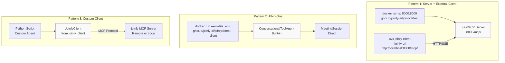
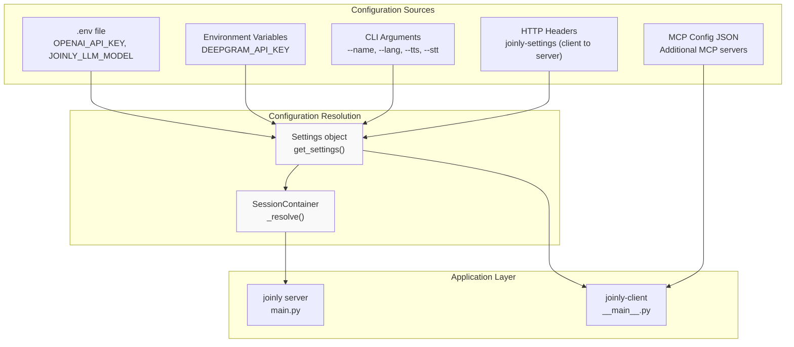
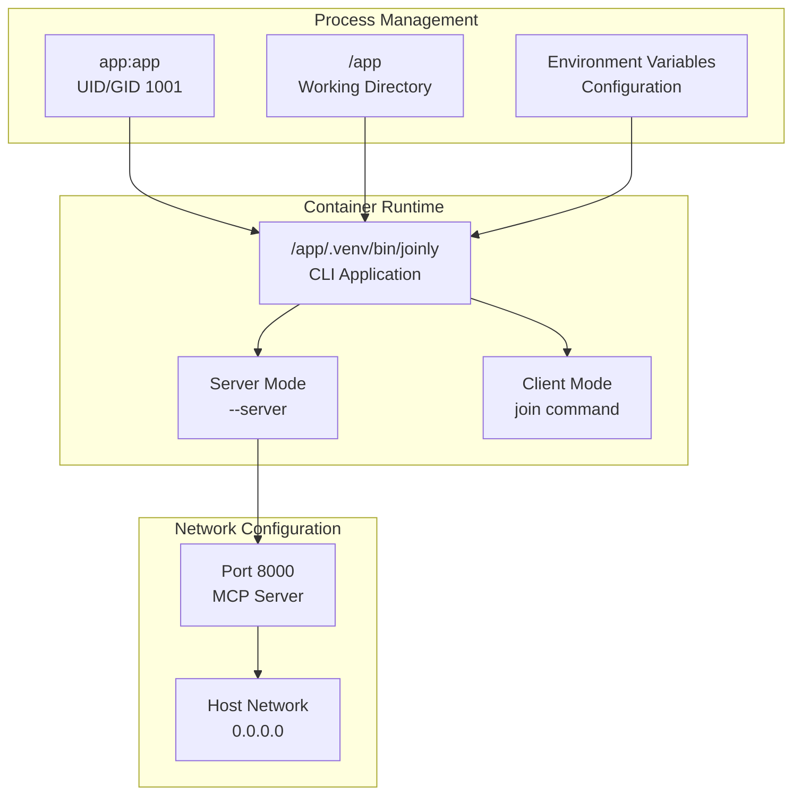
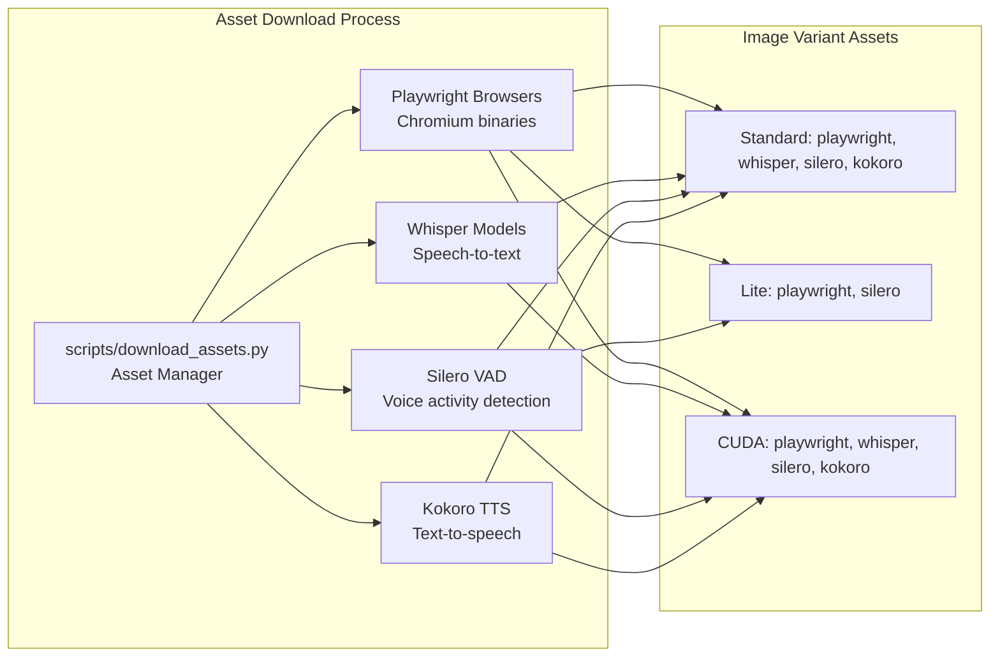

<!-- source: DeepWiki mcp.deepwiki.com · repo joinly-ai/joinly · page 9 Deployment · fetched 2026-10-26 -->

# Deployment

<details>
<summary>Relevant source files</summary>

The following files were used as context for generating this wiki page:

- [.env.example](.env.example)
- [README.md](README.md)
- [client/README.md](client/README.md)
- [client/joinly_client/__init__.py](client/joinly_client/__init__.py)
- [joinly/services/tts/resemble.py](joinly/services/tts/resemble.py)

</details>


This page provides a comprehensive guide for deploying joinly in production environments. The joinly system offers flexible deployment patterns to suit different operational requirements, from simple all-in-one setups to distributed architectures with custom agents.

For detailed information on Docker image variants and build configurations, see page 9.1. For in-depth coverage of deployment patterns and runtime configuration, see page 9.2.

## Deployment Patterns

The joinly system supports three primary deployment patterns, each optimized for different use cases and operational requirements.

**Deployment Pattern Comparison**



Sources: [README.md:52-84](), [README.md:87-125](), [client/README.md:70-139]()

### Pattern 1: Server + External Client

This pattern separates the joinly server (running in Docker) from the client agent. The server handles meeting connections and audio processing, while the client runs independently and connects via the MCP protocol.

**Benefits:**
- Clean separation of concerns
- Client can integrate multiple MCP servers
- Server can support multiple concurrent clients
- Client code runs outside Docker for easier development

**Use cases:** Production deployments, integration with external systems, multi-client scenarios

### Pattern 2: All-in-One

This pattern bundles both server and client into a single Docker container using the `--client` flag. The container includes a built-in `ConversationalToolAgent` and joins the meeting directly.

**Benefits:**
- Simplest deployment (single command)
- No external dependencies
- Ideal for testing and demos

**Use cases:** Quick testing, demonstrations, simple automation tasks

### Pattern 3: Custom Client

This pattern uses the `JoinlyClient` class directly in Python code to build custom agents with specialized behavior. The client connects to a joinly MCP server (local or remote).

**Benefits:**
- Full control over agent behavior
- Can use any LLM framework (LangChain, custom)
- Direct access to low-level MCP APIs
- Flexible tool orchestration

**Use cases:** Custom agent implementations, research projects, specialized workflows

Sources: [README.md:216-218](), [client/README.md:100-139]()

## Docker Image Variants

The joinly system provides three Docker image variants optimized for different hardware configurations and deployment requirements.

| Image Tag | Size | Hardware | STT Model | Use Case |
|-----------|------|----------|-----------|----------|
| `latest` | ~2.3GB | CPU | Whisper base | Standard deployment |
| `latest-cuda` | Largest | GPU (CUDA 12.6+) | Whisper distil-large-v3 | High-performance transcription |
| `latest-lite` | Smallest | CPU | None (cloud only) | Minimal footprint |

**Image Selection Guide:**

- **Standard (`latest`)**: Use for most deployments. Includes local Whisper (base model) and Kokoro TTS for privacy-first operation on CPU.
- **CUDA (`latest-cuda`)**: Use when GPU acceleration is available. Provides significantly faster transcription with larger, more accurate models. Requires NVIDIA Container Toolkit.
- **Lite (`latest-lite`)**: Use for resource-constrained environments or when using cloud STT/TTS services exclusively. Excludes all ML model weights.

For detailed information on image contents, build process, and optimization, see page 9.1.

Sources: [README.md:76-79](), [README.md:200-214](), [docker/Dockerfile:1-78](), [docker/Dockerfile.cuda:1-90](), [docker/Dockerfile.lite:1-80]()

## Configuration Management

Joinly supports multiple configuration sources that can be combined and overridden based on deployment needs.

**Configuration Source Hierarchy**



Sources: [README.md:127-156](), [.env.example:1-48](), [client/README.md:14-16](), [client/README.md:60-63]()

### Environment Variables

Environment variables configure API keys and provider settings. Use a `.env` file for local development or container environment variables for production.

**Common Environment Variables:**

| Variable | Purpose | Example |
|----------|---------|---------|
| `JOINLY_LLM_MODEL` | LLM model name | `gpt-4o` |
| `JOINLY_LLM_PROVIDER` | LLM provider | `openai`, `anthropic`, `google` |
| `OPENAI_API_KEY` | OpenAI API key | `sk-...` |
| `DEEPGRAM_API_KEY` | Deepgram STT/TTS key | Required for cloud STT/TTS |
| `ELEVENLABS_API_KEY` | ElevenLabs TTS key | Required for ElevenLabs TTS |

Sources: [.env.example:1-48](), [README.md:58-73]()

### CLI Arguments

Command-line arguments override environment variables and provide runtime control over session behavior.

**Server Runtime Arguments:**

```bash
# Start as server (default)
docker run -p 8000:8000 ghcr.io/joinly-ai/joinly:latest

# Start as all-in-one client
docker run --env-file .env ghcr.io/joinly-ai/joinly:latest --client <MeetingURL>

# Configure service providers
docker run -p 8000:8000 ghcr.io/joinly-ai/joinly:latest \
  --tts elevenlabs \
  --tts-arg voice_id=EXAVITQu4vr4xnSDxMa6 \
  --stt deepgram \
  --stt-arg model_name=nova-2

# Configure participant settings
docker run -p 8000:8000 ghcr.io/joinly-ai/joinly:latest \
  --name "AI Assistant" \
  --lang de
```

**Client Runtime Arguments:**

```bash
# Connect to joinly server
uvx joinly-client --joinly-url http://localhost:8000/mcp/ <MeetingURL>

# Override server settings
uvx joinly-client --tts elevenlabs --lang de <MeetingURL>

# Configure LLM
uvx joinly-client --llm-provider anthropic --llm-model claude-3-5-haiku-latest <MeetingURL>

# Add MCP servers
uvx joinly-client --mcp-config config.json <MeetingURL>
```

Sources: [README.md:127-156](), [README.md:160-184](), [client/README.md:20-21](), [client/README.md:60-67]()

### HTTP Headers for Dynamic Configuration

When using Pattern 1 (Server + External Client), the `joinly-client` can send configuration overrides to the server via the `joinly-settings` HTTP header. This allows per-session customization without restarting the server.

Settings that can be overridden: `--name`, `--lang`, `--tts`, `--tts-arg`, `--stt`, `--stt-arg`

Sources: [README.md:134-137]()

## Runtime Architecture

The joinly containers support multiple runtime configurations depending on the deployment requirements and client connectivity patterns.



Sources: [docker/Dockerfile:35-36](), [docker/Dockerfile:59-60](), [docker/Dockerfile:66-67](), [docker/Dockerfile:78]()

## Environment Configuration

The container images include default environment variables for production deployment. These can be overridden at runtime to customize behavior.

### Default Environment Variables

| Variable | Default Value | Purpose |
|----------|---------------|---------|
| `PYTHONUNBUFFERED` | `1` | Ensure real-time log output |
| `JOINLY_SERVER_HOST` | `"0.0.0.0"` | Bind to all interfaces |
| `JOINLY_SERVER_PORT` | `8000` | MCP server port |
| `JOINLY_LOGGING_PLAIN` | `1` | Plain text logging for containers |

### CUDA-Specific Variables

| Variable | Default Value | Purpose |
|----------|---------------|---------|
| `JOINLY_DEVICE` | `"cuda"` | Enable GPU acceleration |
| `ONNX_PROVIDER` | `CUDAExecutionProvider` | GPU-accelerated inference |

Sources: [docker/Dockerfile:30-33](), [docker/Dockerfile.cuda:37-42]()

## System Dependencies

All image variants include the same core system dependencies required for browser automation, audio processing, and video conferencing integration.

### Browser Dependencies
- `libnss3`, `libatk1.0-0`, `libatk-bridge2.0-0` - GTK/Gecko support
- `libcups2`, `libxcomposite1`, `libxrandr2` - Display composition
- `libgbm1`, `libxkbcommon0` - Graphics and input handling

### Audio/Video Dependencies  
- `libasound2` - ALSA audio system
- `pulseaudio`, `pulseaudio-utils` - PulseAudio server and utilities
- `xvfb` - Virtual X11 framebuffer
- `x11vnc` - VNC server for remote display (standard and CUDA images only)

### Runtime Dependencies
- `libpangocairo-1.0-0` - Text rendering
- `libxdamage1`, `libxfixes3` - X11 extensions

Sources: [docker/Dockerfile:38-56](), [docker/Dockerfile.cuda:46-67]()

## Asset Management

The container build process includes downloading and bundling required assets to ensure consistent runtime behavior across deployments.



Sources: [docker/Dockerfile:71-75](), [docker/Dockerfile.lite:73-76](), [docker/Dockerfile.cuda:82-86]()

## Security Considerations

The container images implement security best practices to minimize attack surface and follow the principle of least privilege.

### Non-Root Execution
All containers run as a dedicated non-root user (`app:app` with UID/GID 1001) to limit potential security impacts from container escape vulnerabilities.

### Multi-Stage Builds
The build process uses multi-stage Docker builds to separate build dependencies from runtime dependencies, reducing the final image size and attack surface.

### Minimal Base Images
- Standard and lite images use `python:3.12-slim` for minimal footprint
- CUDA image uses official NVIDIA runtime images with only required CUDA libraries

Sources: [docker/Dockerfile:59-63](), [docker/Dockerfile:2](), [docker/Dockerfile.cuda:35]()

---

