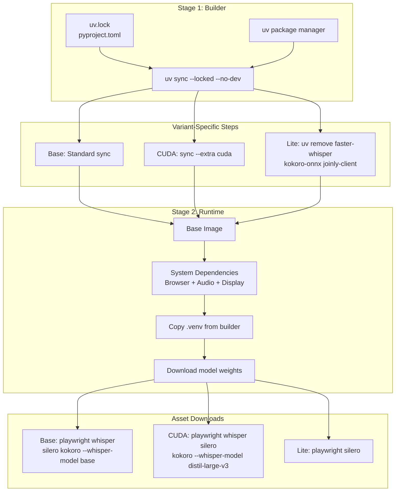
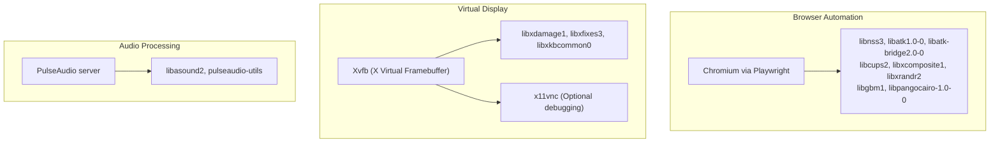

<!-- source: DeepWiki mcp.deepwiki.com · repo joinly-ai/joinly · page 9.1 Docker Images and Variants · fetched 2026-10-26 -->

# Docker Images and Variants

<details>
<summary>Relevant source files</summary>

The following files were used as context for generating this wiki page:

- [CHANGELOG.md](CHANGELOG.md)
- [client/README.md](client/README.md)
- [client/joinly_client/__init__.py](client/joinly_client/__init__.py)
- [pyproject.toml](pyproject.toml)
- [uv.lock](uv.lock)

</details>


This document details the three Docker image variants available for the joinly server and explains when to use each. Each variant is optimized for different deployment scenarios, balancing feature completeness, resource requirements, and performance characteristics.

For information about deployment modes and operational patterns, see [Deployment Modes](#9.2). For development environment setup, see [Development Environment Setup](#8.1).

## Overview of Image Variants

Joinly provides three Docker image variants, each optimized for specific deployment scenarios. The variants differ in their included AI model weights, inference backends, and resource requirements.

| Variant | Image Tag | Base Image | Size (Approx) | Local Models | GPU Support |
|---------|-----------|------------|---------------|--------------|-------------|
| **Base** | `latest` | `python:3.12-slim` | ~3-4 GB | Whisper (base), Kokoro, Silero | CPU only |
| **CUDA** | `cuda` | `nvidia/cuda:12.6.0-cudnn-runtime-ubuntu24.04` | ~6-7 GB | Whisper (distil-large-v3), Kokoro, Silero | CUDA GPU |
| **Lite** | `lite` | `python:3.12-slim` | ~800 MB | None (Silero VAD only) | N/A |

**Sources:** [docker/Dockerfile](), [docker/Dockerfile.lite](), [docker/Dockerfile.cuda](), [CHANGELOG.md:133-134]()

## When to Use Each Variant

### Base Image (`latest`)

**Use this variant when:**
- You need full local inference capabilities for privacy or offline operation
- CPU-based processing is sufficient for your use case (real-time transcription with `base` model)
- You want a balance between features and resource consumption
- You're deploying to standard cloud infrastructure without GPU access

**Characteristics:**
- **STT:** Faster Whisper with `base` model (CPU-optimized, near real-time for English)
- **TTS:** Kokoro ONNX v0.4.9 (local neural TTS)
- **VAD:** Hybrid WebRTC/Silero implementation
- **Resource Requirements:** 2-4 GB RAM, 2+ CPU cores recommended
- **Startup Time:** ~30 seconds (model loading)

**Not recommended when:**
- You need highest quality transcription (use CUDA variant with larger models)
- You have strict resource constraints (use lite variant)
- You're transcribing non-English languages extensively (consider cloud services)

**Sources:** [pyproject.toml:14-16](), [docker/Dockerfile:71-75](), [CHANGELOG.md:210-211]()

### CUDA Image (`cuda`)

**Use this variant when:**
- You have GPU resources available (NVIDIA with CUDA 12.6+ support)
- You need highest quality transcription with larger models
- You're processing multiple concurrent sessions
- Low-latency, high-quality local inference is critical

**Characteristics:**
- **STT:** Faster Whisper with `distil-large-v3` model (GPU-accelerated, state-of-the-art quality)
- **TTS:** Kokoro ONNX with GPU acceleration
- **VAD:** Same as base (Hybrid WebRTC/Silero)
- **Resource Requirements:** 6-8 GB GPU VRAM, 4-8 GB RAM recommended
- **Startup Time:** ~45 seconds (larger model loading)
- **Performance:** 10-20x faster transcription than CPU

**CUDA-specific configuration:**
```bash
JOINLY_DEVICE="cuda"
ONNX_PROVIDER=CUDAExecutionProvider
```

**Not recommended when:**
- No GPU available or GPU resources are expensive
- Standard quality transcription is sufficient
- You need minimal container size

**Sources:** [pyproject.toml:33-35](), [docker/Dockerfile.cuda:37-42](), [docker/Dockerfile.cuda:82-86](), [CHANGELOG.md:210-212]()

### Lite Image (`lite`)

**Use this variant when:**
- You're using cloud-based STT/TTS services exclusively (Deepgram, ElevenLabs, etc.)
- Container size and startup time are critical concerns
- You have strict resource limits (embedded systems, serverless, CI/CD)
- You want to minimize attack surface and dependency footprint

**Characteristics:**
- **STT:** Cloud services only (Deepgram)
- **TTS:** Cloud services only (ElevenLabs, Deepgram, Resemble)
- **VAD:** WebRTC VAD only (no ML-based VAD)
- **Resource Requirements:** 512 MB - 1 GB RAM minimum
- **Startup Time:** ~10 seconds (no model loading)
- **Container Size:** 75-80% smaller than base image

**Removed packages:**
```
faster-whisper
kokoro-onnx
joinly-client (built-in client not available)
```

**Not recommended when:**
- Privacy requirements prevent cloud API usage
- You need offline/air-gapped operation
- You want to use the built-in conversational agent
- Network latency to cloud services is problematic

**Sources:** [docker/Dockerfile.lite:24-25](), [docker/Dockerfile.lite:73-76](), [CHANGELOG.md:133-134]()

## Dependency Comparison

The following table shows which packages are included in each image variant:

| Dependency | Base | CUDA | Lite | Purpose |
|------------|------|------|------|---------|
| `faster-whisper` | ✓ | ✓ | ✗ | Local STT (Whisper models) |
| `kokoro-onnx` | ✓ | ✓ | ✗ | Local TTS (neural voices) |
| `onnxruntime` | ✓ | ✗ | ✗ | CPU inference runtime |
| `onnxruntime-gpu` | ✗ | ✓ | ✗ | GPU inference runtime |
| `webrtcvad-wheels` | ✓ | ✓ | ✓ | Fast VAD (WebRTC) |
| `joinly-client` | ✓ | ✓ | ✗ | Built-in conversational agent |
| `deepgram-sdk` | ✓ | ✓ | ✓ | Cloud STT service |
| `elevenlabs` | ✓ | ✓ | ✓ | Cloud TTS service |
| `playwright` | ✓ | ✓ | ✓ | Browser automation |
| `fastmcp` | ✓ | ✓ | ✓ | MCP server framework |

**Sources:** [pyproject.toml:10-26](), [pyproject.toml:33-35](), [docker/Dockerfile.lite:24-25]()

## Build Architecture

### Multi-Stage Build Process

All three image variants use a two-stage Docker build pattern for optimization. The build process differs primarily in dependency installation and asset downloading.



**Sources:** [docker/Dockerfile:13-25](), [docker/Dockerfile.lite:13-29](), [docker/Dockerfile.cuda:19-32](), [docker/Dockerfile:71-75](), [docker/Dockerfile.lite:73-76](), [docker/Dockerfile.cuda:82-86]()

### Asset Management

During the build process, the `scripts/download_assets.py` script pre-downloads required model weights and browser binaries. This ensures containers start quickly without network dependencies at runtime.

**Base variant assets:**
- Playwright browser binaries (Chromium)
- Whisper `base` model (~140 MB)
- Silero VAD model (~2 MB)
- Kokoro ONNX TTS model (~200 MB)

**CUDA variant assets:**
- Playwright browser binaries
- Whisper `distil-large-v3` model (~1.5 GB)
- Silero VAD model
- Kokoro ONNX TTS model

**Lite variant assets:**
- Playwright browser binaries only
- Silero VAD model
- No local inference models

**Sources:** [docker/Dockerfile:71-75](), [docker/Dockerfile.lite:73-76](), [docker/Dockerfile.cuda:82-86]()

## System Dependencies

All image variants include the same system-level dependencies required for browser automation and audio/video processing. These dependencies are installed in the runtime stage regardless of variant.

### Required System Packages



These dependencies enable:
- **Browser Automation:** Running Chromium in headless mode for meeting platform integration
- **Virtual Display:** Xvfb provides a virtual X11 display for browser rendering
- **Audio Pipeline:** PulseAudio manages virtual microphone and speaker devices

**Sources:** [docker/Dockerfile:37-56](), [docker/Dockerfile.lite:41-59](), [docker/Dockerfile.cuda:46-67]()

## Default Configuration

### Environment Variables

Each variant sets default environment variables appropriate for containerized operation:

**Common to all variants:**
```bash
PYTHONUNBUFFERED=1
JOINLY_SERVER_HOST="0.0.0.0"
JOINLY_SERVER_PORT=8000
JOINLY_LOGGING_PLAIN=1
```

**CUDA variant only:**
```bash
JOINLY_DEVICE="cuda"
ONNX_PROVIDER=CUDAExecutionProvider
```

These defaults can be overridden at runtime via `-e` flags or environment files. See [Configuration and Settings](#2.3) for all available options.

**Sources:** [docker/Dockerfile:30-33](), [docker/Dockerfile.lite:34-37](), [docker/Dockerfile.cuda:37-42]()

### Image Metadata

All images expose port `8000` for the FastMCP server and run as a non-root user (`app:app`, UID/GID 1001) for security.

```bash
EXPOSE 8000
USER app
ENTRYPOINT ["/app/.venv/bin/joinly"]
```

**Sources:** [docker/Dockerfile:58-78](), [docker/Dockerfile.lite:61-79](), [docker/Dockerfile.cuda:69-89]()

## Runtime Configuration

### Port Exposure

All images expose port 8000 for the FastMCP server:

```bash
EXPOSE 8000
```

### Security Model

Images run with a non-root user for security:

```bash
# Create non-root user
RUN groupadd --gid 1001 app && \
    useradd --uid 1001 --gid 1001 -m app
USER app
```

### Entrypoint

The application starts via the installed `joinly` CLI:

```bash
ENTRYPOINT ["/app/.venv/bin/joinly"]
```

**Sources:** [docker/Dockerfile:58-78](), [docker/Dockerfile.lite:61-79](), [docker/Dockerfile.cuda:69-89]()

## Docker Build Exclusions

The `.dockerignore` file optimizes build context by excluding development files:

```
.venv
__pycache__
.gitignore
.git
docker/
docker-compose.yml
.vscode
.devcontainer
.pre-commit-config.yaml
.ruff_cache
node_modules
pytest_cache
.env
```

**Sources:** [.dockerignore:1-13]()

## Deployment Examples

### Basic Deployment

```bash
# Run standard image
docker run -p 8000:8000 ghcr.io/joinly-ai/joinly:latest

# Run with environment variables
docker run -p 8000:8000 \
  -e OPENAI_API_KEY=your_key \
  -e JOINLY_LOGGING_LEVEL=DEBUG \
  ghcr.io/joinly-ai/joinly:latest
```

### CUDA Deployment

```bash
# Run CUDA image with GPU access
docker run --gpus all -p 8000:8000 \
  ghcr.io/joinly-ai/joinly:cuda
```

### Resource-Constrained Deployment

```bash
# Run lite image for minimal resource usage
docker run -p 8000:8000 \
  --memory=2g \
  --cpus=1 \
  ghcr.io/joinly-ai/joinly:lite
```

**Sources:** [docker/Dockerfile:35](), [docker/Dockerfile.lite:39](), [docker/Dockerfile.cuda:44]()

---

