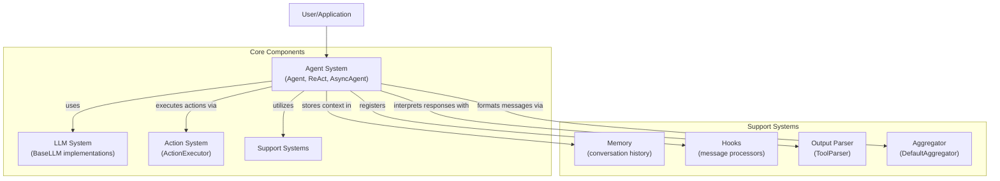
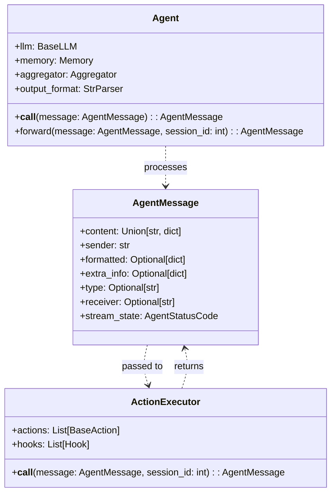
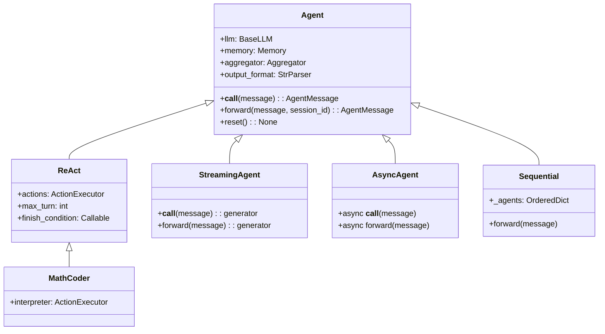
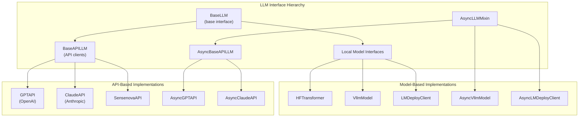
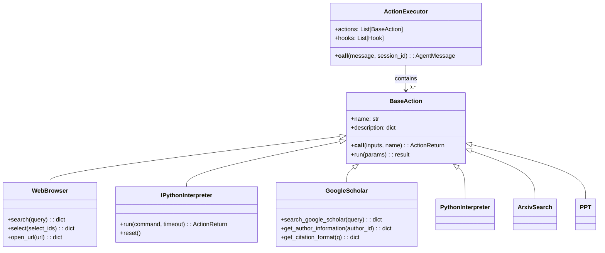
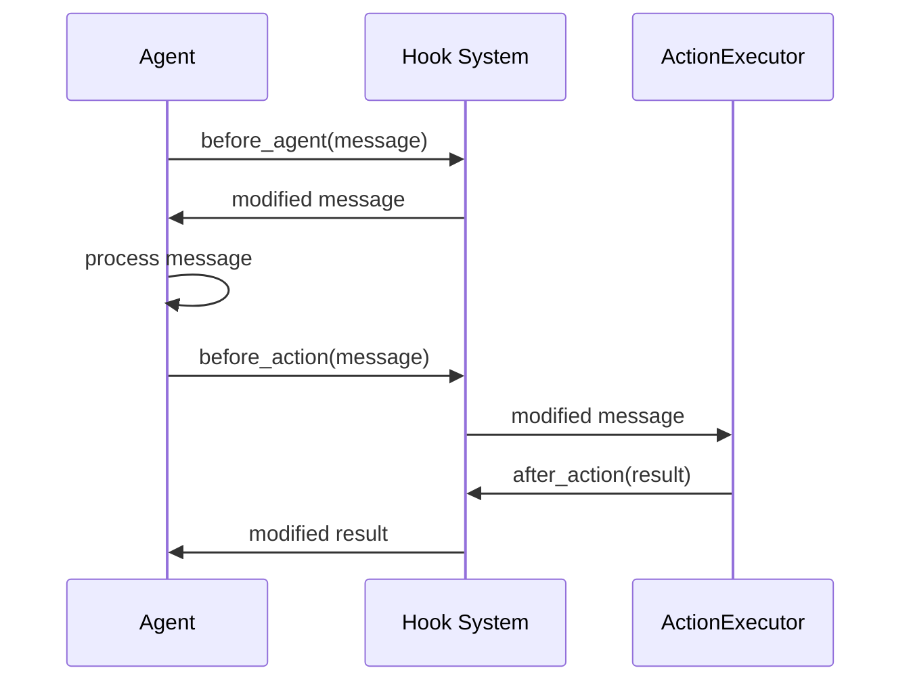
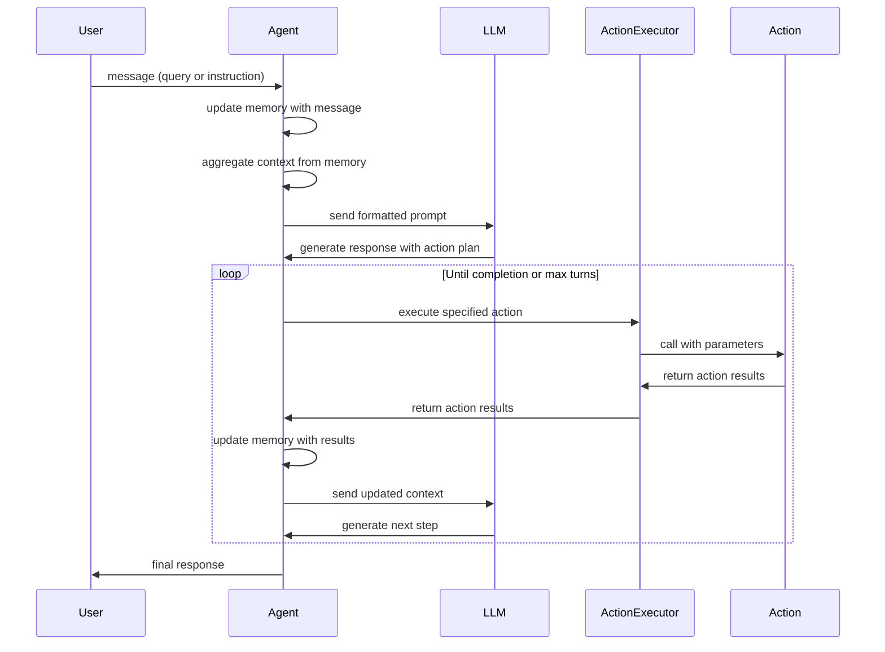

<!-- source: DeepWiki mcp.deepwiki.com · repo InternLM/lagent · page 1 Overview · fetched 2026-10-26 -->

# Overview

<details>
<summary>Relevant source files</summary>

The following files were used as context for generating this wiki page:

- [README.md](README.md)
- [docs/en/changelog.md](docs/en/changelog.md)
- [lagent/version.py](lagent/version.py)
- [requirements/runtime.txt](requirements/runtime.txt)

</details>


LAgent is a lightweight open-source framework for building Large Language Model (LLM) powered agents. It provides a modular and extensible architecture that enables developers to create agents capable of reasoning, executing actions, and interacting with various tools. The framework emphasizes Pythonic design patterns inspired by PyTorch, making it intuitive to create and compose agent components.

For information about installing the framework and its dependencies, see [Installation and Setup](#1.1).

## Architecture Overview

LAgent is organized into four primary systems that work together to create functional LLM-powered agents:



Sources: [README.md:32-78]()

The framework's modular design enables flexible component substitution and extension while maintaining consistent interfaces across the system.

## Communication Model

All components in LAgent communicate using a standardized message format called `AgentMessage`, which serves as the common data structure throughout the system:



Sources: [README.md:37-58](), [README.md:225-276]()

## Agent System

The Agent System provides the core functionality for creating LLM-powered agents with different capabilities:



Sources: [README.md:300-337]()

### Key Agent Types

- **Agent**: Base implementation for LLM-powered agents
- **ReAct**: Implements the Reasoning+Acting paradigm for tool use through iterative cycles
- **StreamingAgent**: Provides incremental/streaming responses
- **AsyncAgent**: Asynchronous implementation for concurrent processing
- **Sequential**: Chains multiple agents together for complex workflows

The `__call__` method of an agent handles the core execution flow:

```python
def __call__(self, *message):
    message = pre_hooks(message)
    add_memory(message)
    message = self.forward(*message)
    add_memory(message)
    message = post_hooks(message)
    return message
```

Sources: [README.md:71-77]()

## LLM Integration System

The LLM Integration System provides a unified abstraction layer for different LLM providers:



Sources: [README.md:38-58](), [README.md:282-290]()

All LLM implementations provide consistent interfaces for:
- `generate()`: Text completion generation
- `chat()`: Chat completion generation
- `stream_generate()` and `stream_chat()`: Streaming variants

The framework offers both API-based LLMs (OpenAI, Claude) and local model integrations (HuggingFace, vLLM, LMDeploy).

## Action System

The Action System enables agents to interact with external tools and services:



Sources: [README.md:225-276]()

### Built-in Actions

The framework includes several built-in tools:

| Action | Description |
|--------|-------------|
| `WebBrowser` | Web search and navigation |
| `IPythonInterpreter` | Interactive Python code execution |
| `PythonInterpreter` | Python code execution |
| `GoogleScholar` | Academic search and citation lookup |
| `ArxivSearch` | Search arXiv papers |
| `PPT` | Presentation creation |

Actions are executed via the `ActionExecutor`, which manages action instances and applies hooks for message processing.

## Support Systems

Several support systems enhance agent capabilities and workflow:

### Memory Management

The Memory component maintains conversation history, allowing agents to retain context across multiple turns:

```python
# Access memory
memory = agent.memory.get_memory()

# Clear memory
agent.reset()

# Get serializable memory state
dumped_memory = agent.state_dict()
```

Sources: [README.md:66-88]()

### Hooks System

Hooks intercept and modify behavior at various points in the agent execution flow:



Sources: [README.md:235-259]()

Custom hooks can be implemented by extending the `Hook` class and overriding methods like `before_action` and `after_action`.

### Output Parsers

Output Parsers extract structured information from LLM responses. The `ToolParser` is particularly important as it extracts tool calls from LLM output:

```python
parser = ToolParser(tool_type='code interpreter', begin='```python\n', end='\n```\n')
agent = Agent(llm, system_prompt, output_format=parser)
```

Sources: [README.md:191-223]()

### Aggregators

Aggregators format context from memory for LLM consumption. The `DefaultAggregator` converts `AgentMessage` objects to the format expected by LLMs:

```python
class FewshotAggregator(DefaultAggregator):
    def __init__(self, few_shot: List[dict] = None):
        self.few_shot = few_shot or []
    
    def aggregate(self, messages, name, parser=None, system_instruction=None):
        # Custom implementation with few-shot examples
        # ...
```

Sources: [README.md:102-165]()

## Usage Patterns

The typical usage pattern in LAgent involves:



Sources: [README.md:300-350]()

### Single Agent Example

```python
from lagent.agents import Agent
from lagent.llms import VllmModel, INTERNLM2_META
from lagent.schema import AgentMessage

# Initialize LLM
llm = VllmModel(
    path='Qwen/Qwen2-7B-Instruct',
    meta_template=INTERNLM2_META,
    stop_words=['<|im_end|>'],
    max_new_tokens=1024,
)

# Create agent
agent = Agent(llm, "You are a helpful assistant.")

# Send message and get response
user_msg = AgentMessage(sender='user', content='Hello, what can you help me with?')
bot_msg = agent(user_msg)
```

Sources: [README.md:38-64]()

### Multi-Agent Systems

LAgent supports building multi-agent systems where agents collaborate to solve tasks:

```python
class Blogger(Agent):
    def __init__(self, model_path, writer_prompt, critic_prompt, max_turn=3):
        super().__init__()
        llm = GPTAPI(model_type=model_path)
        self.writer = Agent(llm, writer_prompt, name='writer')
        self.critic = Agent(llm, critic_prompt, name='critic')
        self.max_turn = max_turn

    def forward(self, message: AgentMessage, session_id=0) -> AgentMessage:
        for _ in range(self.max_turn):
            message = self.writer(message, session_id=session_id)
            message = self.critic(message, session_id=session_id)
        return self.writer(message, session_id=session_id)
```

Sources: [README.md:354-413]()

## Dual Interfaces

LAgent provides both synchronous and asynchronous interfaces for all major components:

| Synchronous | Asynchronous |
|-------------|--------------|
| `Agent` | `AsyncAgent` |
| `GPTAPI` | `AsyncGPTAPI` |
| `VllmModel` | `AsyncVllmModel` |
| `ActionExecutor` | `AsyncActionExecutor` |
| `WebBrowser` | `AsyncWebBrowser` |

Sources: [README.md:282-290]()

This dual interface design allows developers to choose the appropriate approach based on their application requirements - synchronous for debugging and asynchronous for production/concurrent processing.

## Dependencies and Requirements

LAgent has several key dependencies:

```
aiohttp           # For async HTTP requests
anthropic         # For Claude API integration  
arxiv             # For arXiv research tool
jupyter           # For IPython interpreter
pydantic          # For data validation
requests          # For HTTP requests
tiktoken          # For token counting
```

Sources: [requirements/runtime.txt:1-21]()

## License

LAgent is released under the Apache 2.0 license.

Sources: [README.md:527-530]()

---

