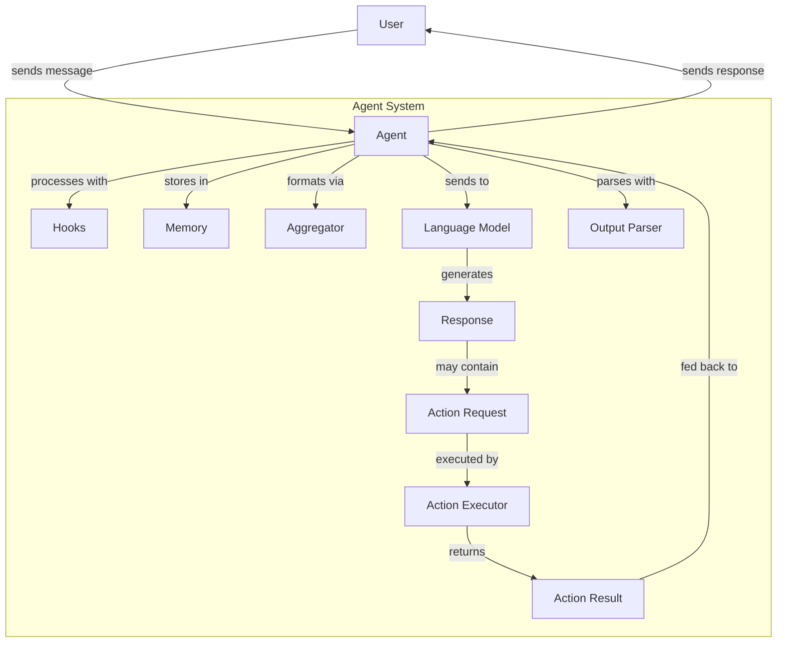
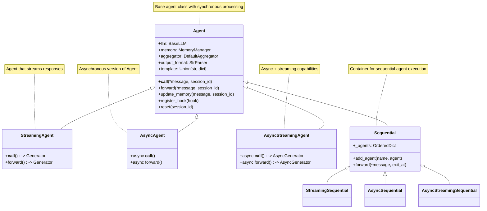
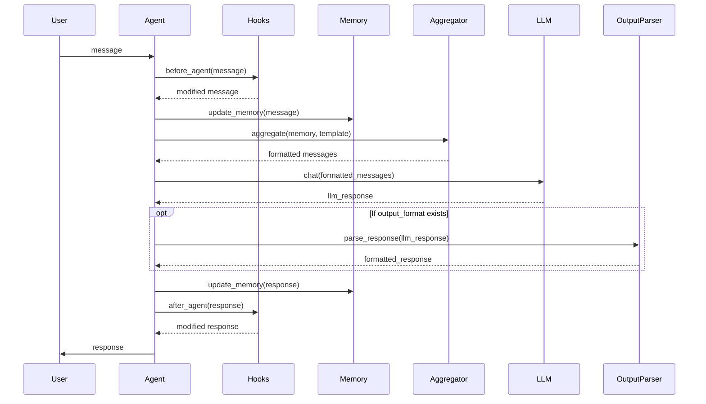
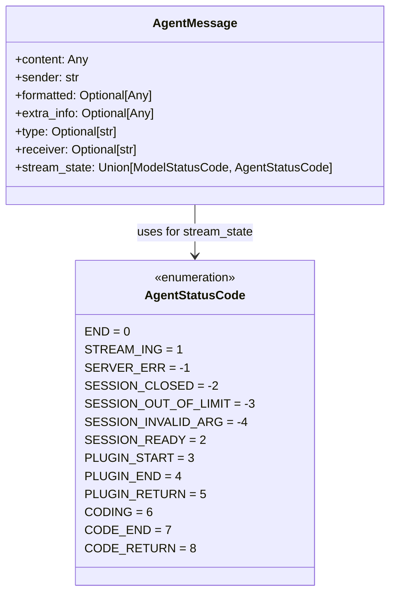
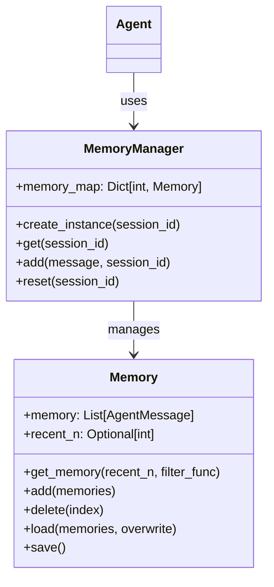
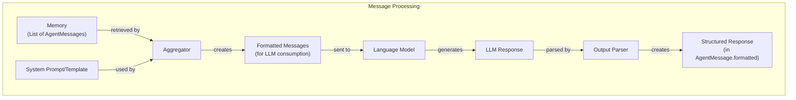
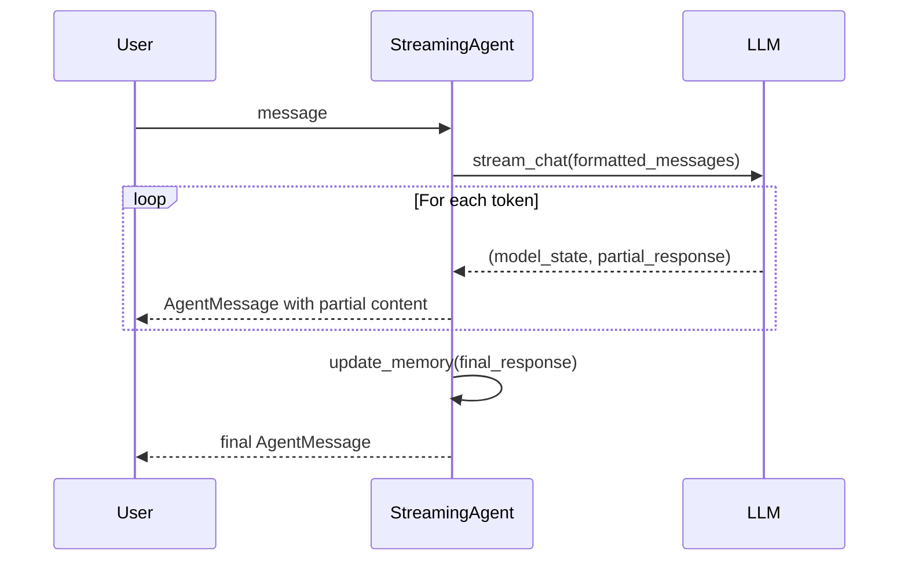
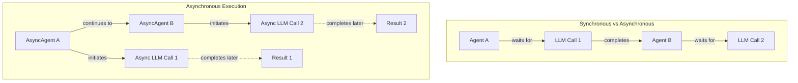
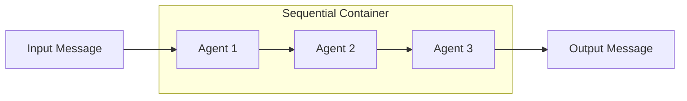
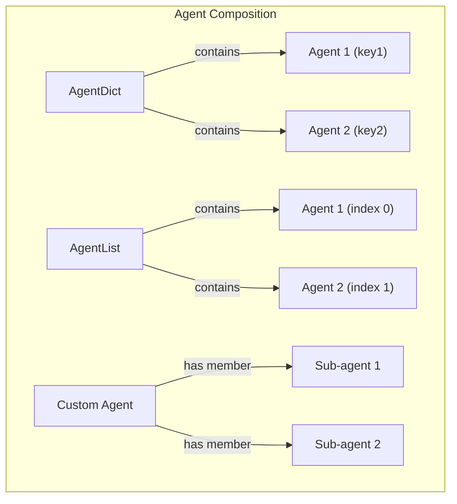

<!-- source: DeepWiki mcp.deepwiki.com · repo InternLM/lagent · page 2.1 Agent System · fetched 2026-10-26 -->

# Agent System

<details>
<summary>Relevant source files</summary>

The following files were used as context for generating this wiki page:

- [README.md](README.md)
- [lagent/agents/__init__.py](lagent/agents/__init__.py)
- [lagent/agents/agent.py](lagent/agents/agent.py)
- [lagent/agents/aggregator/tool_aggregator.py](lagent/agents/aggregator/tool_aggregator.py)
- [lagent/memory/base_memory.py](lagent/memory/base_memory.py)
- [lagent/prompts/parsers/__init__.py](lagent/prompts/parsers/__init__.py)
- [lagent/schema.py](lagent/schema.py)

</details>


The Agent System is the core component of the lagent framework, providing the foundation for creating and managing language model-powered agents. This document covers the architecture of the agent system, explains the different types of agents available, and details how they process messages, maintain state, and interact with other components. For information about the underlying LLM integration, see [LLM Integration](#2.2), and for details about the actions agents can perform, see [Action System](#2.3).

## Overview

The Agent System provides a modular architecture for building AI agents that can interact with users, maintain conversation context, and execute actions. At its core, the system is built around the concept of message passing between components, with explicit memory management and standardized communication formats.



Sources: [lagent/agents/agent.py:18-94](), [README.md:1-418]()

## Core Agent Classes

The Agent System provides a hierarchy of agent classes with different capabilities and execution patterns:



Sources: [lagent/agents/agent.py:18-409]()), [lagent/agents/__init__.py:1-33]()

### Base Agent

The `Agent` class is the fundamental building block of the system. It manages communication with language models, maintains conversation memory, and processes messages through a well-defined lifecycle:



The `Agent` class handles:
- Message preprocessing via hooks
- Memory updates for context retention
- Message aggregation for LLM consumption
- LLM interaction for response generation
- Response parsing and formatting
- Post-processing via hooks

Sources: [lagent/agents/agent.py:18-94]()), [lagent/agents/agent.py:66-83]()

## Agent Communication and Messages

Agents communicate using the `AgentMessage` data structure, which provides a standardized format for message passing throughout the system:



Key fields in `AgentMessage`:
- `content`: The main message content
- `sender`: The source of the message (e.g., "user", agent name)
- `formatted`: Optional structured data parsed from the content
- `stream_state`: Status code for streaming operations

Sources: [lagent/schema.py:90-97]()

## Memory and State Management

Agents maintain state through a memory system that stores conversation history:



The memory system supports:
- Session-based isolation through session IDs
- Adding and retrieving messages
- Filtering and limiting retrieved messages
- Serialization for persistence

Memory is a crucial component that enables agents to maintain context across multiple turns of conversation. Each agent maintains its own memory, and in multi-agent setups, each agent has independent memory.

Sources: [lagent/memory/base_memory.py:6-60](), [lagent/agents/agent.py:61-65]()

## Message Aggregation and Formatting

Before sending messages to the language model, they need to be correctly formatted according to the model's expected input format:



The framework includes different aggregators for various use cases:
- `DefaultAggregator`: Standard formatting for most LLMs
- `InternLMToolAggregator`: Specialized for tool use with the InternLM model

Similarly, different output parsers can extract structured information from LLM responses:
- `StrParser`: Base parser class
- `ToolParser`: Extracts tool calls from model output
- `JSONParser`: Parses JSON from model output

Sources: [lagent/agents/agent.py:85-93](), [lagent/agents/aggregator/tool_aggregator.py:8-106](), [lagent/prompts/parsers/__init__.py:1-9]()

## Specialized Agent Types

### Streaming Agents

Streaming agents allow for incremental response generation, showing the model's output as it's being produced rather than waiting for the complete response:



The streaming implementation uses Python generators to yield partial responses as they become available.

Sources: [lagent/agents/agent.py:216-257](), [lagent/agents/agent.py:304-307]()

### Asynchronous Agents

Asynchronous agents implement non-blocking versions of the agent interface, allowing for concurrent agent operation:



Asynchronous agents are particularly useful in scenarios where multiple agents need to operate concurrently or when integrating with asynchronous web frameworks.

Sources: [lagent/agents/agent.py:179-207](), [lagent/agents/agent.py:210-213]()

### Sequential Agents

The `Sequential` agent class allows for creating a pipeline of agents where messages flow from one agent to the next:



Sequential agents can be used to create multi-stage processing pipelines where each agent performs a specific function and passes its results to the next agent in the sequence.

Sources: [lagent/agents/agent.py:316-351](), [README.md:354-418]()

## Agent Containers and Composition

The framework supports agent composition through container classes like `AgentList` and `AgentDict`:



These container classes allow for flexible organization of multiple agents while maintaining a consistent interface for state management and execution.

Sources: [lagent/agents/agent.py:457-470](), [README.md:419-513]()

## Example Usage Patterns

The Agent System supports various usage patterns depending on the application needs:

### Simple Agent

```python
# Basic agent setup
agent = Agent(llm, system_prompt)
response = agent(user_message)
```

### Tool-using Agent

```python
# Agent that uses tools
agent = Agent(llm, system_prompt, output_format=ToolParser())
executor = ActionExecutor([WebBrowser(), IPythonInterpreter()])

# Process loop
response = agent(user_message)
if response.formatted and response.formatted['tool_type']:
    tool_result = executor(response)
    response = agent(tool_result)
```

### Multi-agent System

```python
# Sequential processing with multiple agents
researcher = Agent(llm, research_prompt, name="researcher")
analyst = Agent(llm, analysis_prompt, name="analyst")
writer = Agent(llm, writing_prompt, name="writer")

sequential = Sequential(researcher, analyst, writer)
final_response = sequential(user_query)
```

Sources: [README.md:30-173](), [README.md:299-351](), [README.md:353-417]()

## Conclusion

The Agent System in lagent provides a comprehensive framework for building and managing LLM-powered agents with different capabilities. Key features include:

1. Flexible agent types supporting synchronous, asynchronous, and streaming operation
2. Memory management for maintaining context across conversations
3. Standardized message format for communication
4. Composable architecture allowing for agent pipelines and hierarchies
5. Hook system for intercepting and modifying agent behavior

This architecture enables the development of sophisticated agent applications, from simple chatbots to complex multi-agent systems that can reason, use tools, and collaborate to solve tasks.

---

