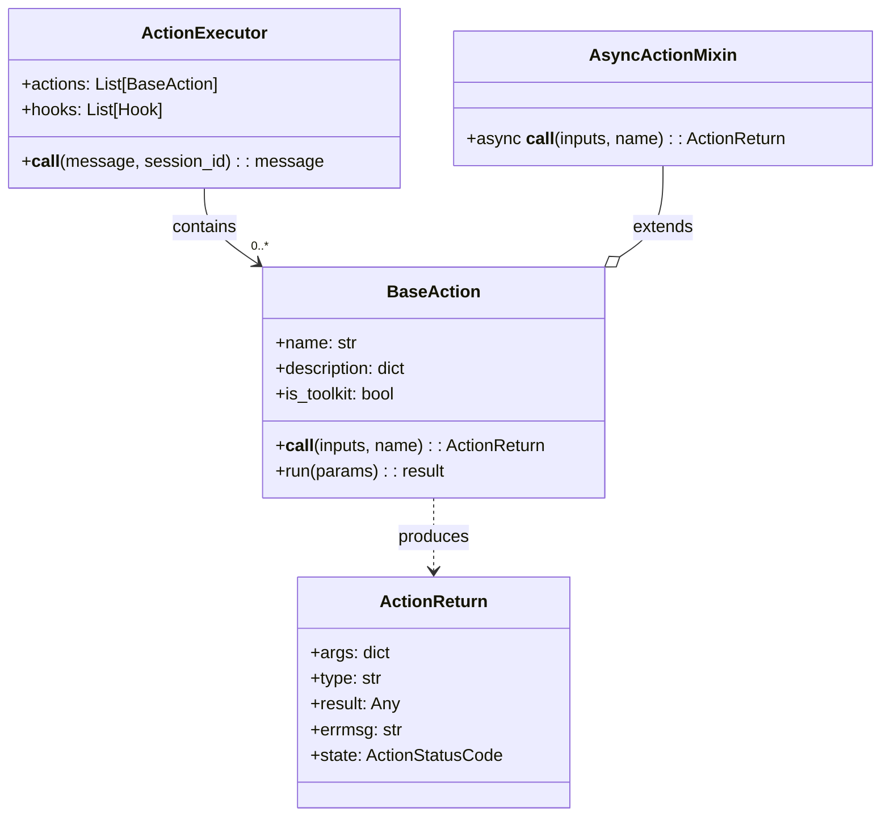
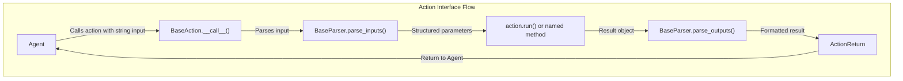
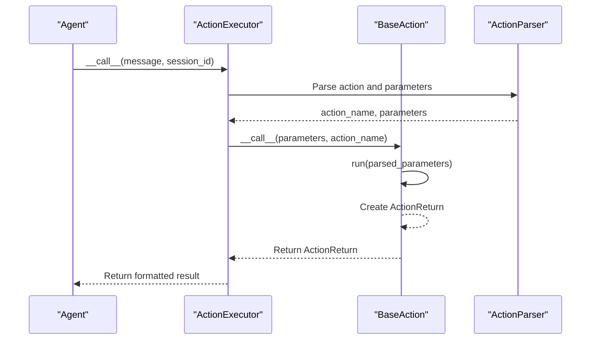
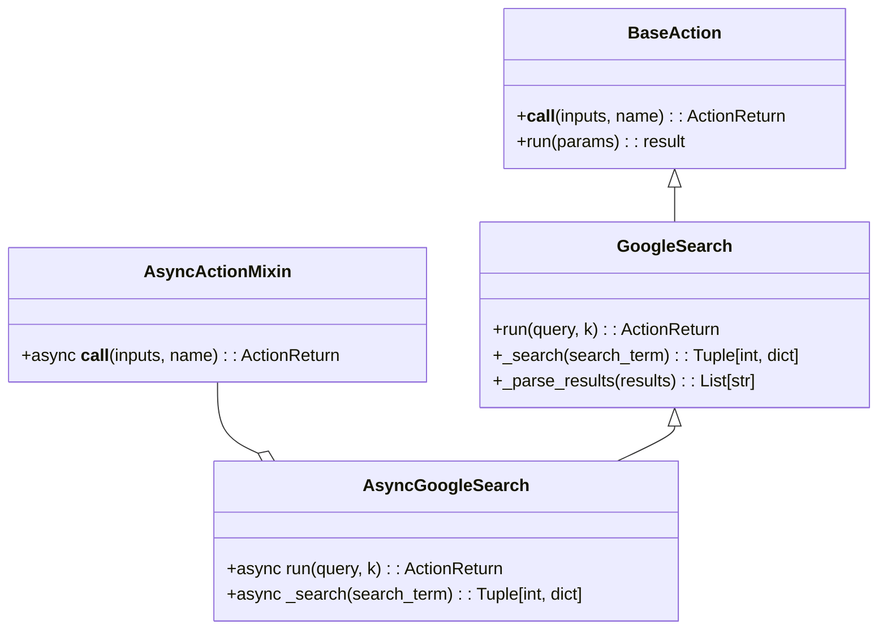
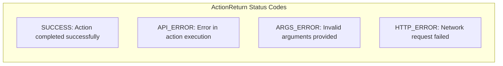
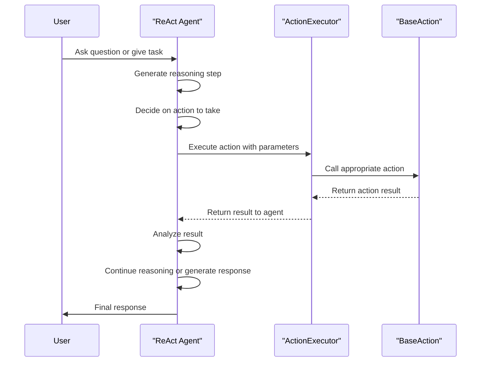

<!-- source: DeepWiki mcp.deepwiki.com · repo InternLM/lagent · page 2.3 Action System · fetched 2026-10-26 -->

# Action System

<details>
<summary>Relevant source files</summary>

The following files were used as context for generating this wiki page:

- [lagent/actions/__init__.py](lagent/actions/__init__.py)
- [lagent/actions/base_action.py](lagent/actions/base_action.py)
- [lagent/actions/google_search.py](lagent/actions/google_search.py)
- [tests/test_actions/test_google_search.py](tests/test_actions/test_google_search.py)

</details>


The Action System in LAgent provides a framework for agents to interact with external tools and systems. It enables agents to perform concrete tasks such as searching the web, executing code, accessing research papers, or creating documents. This page explains the design and implementation of the Action System, how it integrates with the Agent System ([Agent System](#2.1)), and how to create custom actions.

## Core Architecture

The Action System consists of the following key components:

1. **BaseAction**: The foundational class that all actions inherit from
2. **ActionExecutor**: Responsible for managing and executing actions based on agent instructions
3. **Specific Action Implementations**: Various built-in actions providing different capabilities



Sources: [lagent/actions/base_action.py:277-395](), [lagent/actions/__init__.py:1-47]()

## BaseAction

The `BaseAction` class is the core building block of the Action System. It defines the standard interface that all actions must implement and provides the machinery for parsing inputs and formatting outputs.

### Key Components

- **Metaclass**: Uses `ToolMeta` to automatically generate tool descriptions from docstrings and type hints
- **Tool API Decorator**: `tool_api` to document action methods with proper parameter descriptions
- **Parser System**: Converts between string inputs/outputs and structured data



Sources: [lagent/actions/base_action.py:277-395](), [lagent/actions/base_action.py:27-233]()

### Action Method Documentation

Actions use the `tool_api` decorator to document their methods, which automatically extracts parameter information from type hints and docstrings:

```python
@tool_api
def run(self, query: str, k: int = 10) -> ActionReturn:
    """Search Google for information.
    
    Args:
        query (str): the search content
        k (int): select first k results in the search results as response
    """
    # Implementation...
```

The decorator turns this documentation into a structured description that LLMs can understand when deciding how to use the tool.

Sources: [lagent/actions/base_action.py:27-233](), [lagent/actions/google_search.py:57-78]()

## Action Executor

The `ActionExecutor` manages a collection of actions and handles the execution flow:

1. Receives an instruction from the agent
2. Determines which action to execute based on the instruction
3. Executes the action with appropriate parameters
4. Returns the result back to the agent



Sources: [lagent/actions/__init__.py:1]()

## Action Types

LAgent provides a variety of built-in actions categorized by their functionality:

### Web Interaction Actions

| Action | Description | Key Methods |
|--------|-------------|-------------|
| GoogleSearch | Searches the web using Google | `run(query, k)` |
| WebBrowser | Browses and navigates web pages | `search(query)`, `select(ids)`, `open_url(url)` |
| BINGMap | Maps and location services | Various location APIs |

Sources: [lagent/actions/google_search.py:12-245](), [lagent/actions/__init__.py:14-41]()

### Code Execution Actions

| Action | Description | Key Methods |
|--------|-------------|-------------|
| PythonInterpreter | Executes Python code | `run(command)` |
| IPythonInterpreter | Executes IPython code with richer outputs | `run(command)`, `reset()` |
| IPythonInteractive | Interactive Python environment | Various interaction methods |

Sources: [lagent/actions/__init__.py:8-10]()

### Research Tools

| Action | Description | Key Methods |
|--------|-------------|-------------|
| ArxivSearch | Searches academic papers on arXiv | `search(query)` |
| GoogleScholar | Searches academic literature on Google Scholar | `search_google_scholar(query)`, `get_author_information(author_id)` |

Sources: [lagent/actions/__init__.py:2-6]()

### Document Creation

| Action | Description | Key Methods |
|--------|-------------|-------------|
| PPT | Creates PowerPoint presentations | Various presentation methods |

Sources: [lagent/actions/__init__.py:12]()

### Utility Actions

| Action | Description | Purpose |
|--------|-------------|---------|
| FinishAction | Signals task completion | Used to terminate agent execution |
| NoAction | Indicates no action needed | Used when agent just responds with text |
| InvalidAction | Handles invalid action requests | Error handling |

Sources: [lagent/actions/__init__.py:5]()

## Action Implementation Structure



Sources: [lagent/actions/google_search.py:12-245](), [lagent/actions/base_action.py:396-421]()

## Action Return Format

Actions communicate results back to the agent using the `ActionReturn` class, which contains:

- **args**: The original parameters passed to the action
- **type**: The name of the action that was executed
- **result**: The action's output data
- **errmsg**: Error message if the action failed
- **state**: Status code indicating success or error type



Sources: [lagent/actions/google_search.py:65-78](), [tests/test_actions/test_google_search.py:10-35]()

## Creating Custom Actions

To create a custom action, extend the `BaseAction` class and implement at least one of these patterns:

### 1. Simple Action with run() Method

```python
class MyAction(BaseAction):
    """Description of what this action does"""
    
    @tool_api
    def run(self, param1: str, param2: int = 0):
        """Detailed description of the action
        
        Args:
            param1 (str): Description of param1
            param2 (int): Description of param2
            
        Returns:
            Any: Description of the return value
        """
        # Implementation
        return result
```

### 2. Toolkit with Multiple APIs

```python
class MyToolkit(BaseAction):
    """Collection of related tools"""
    
    @tool_api
    def method1(self, param: str):
        """First tool method
        
        Args:
            param (str): Parameter description
        """
        return result
        
    @tool_api
    def method2(self, value: int):
        """Second tool method
        
        Args:
            value (int): Parameter description
        """
        return another_result
```

### 3. Asynchronous Action

```python
class MyAsyncAction(AsyncActionMixin, BaseAction):
    """Asynchronous action implementation"""
    
    @tool_api
    async def run(self, query: str):
        """Async implementation
        
        Args:
            query (str): Input query
        """
        # Async implementation
        return await async_result
```

Sources: [lagent/actions/base_action.py:277-395](), [lagent/actions/google_search.py:163-245]()

## Integration with Agent System

The Action System integrates with the Agent System through the ReAct (Reasoning + Acting) pattern:



Sources: [lagent/actions/__init__.py:1-47]()

## Conclusion

The Action System is a key component of LAgent that bridges the gap between language models and real-world capabilities. By providing a standardized interface for diverse actions, it enables agents to interact with external systems, process data, and perform complex tasks beyond text generation.

For more details about specific action implementations, refer to the following pages:
- [Web Browsing and Search](#2.3.1)
- [Code Execution](#2.3.2)
- [Research and Content Creation](#2.3.3)

---

