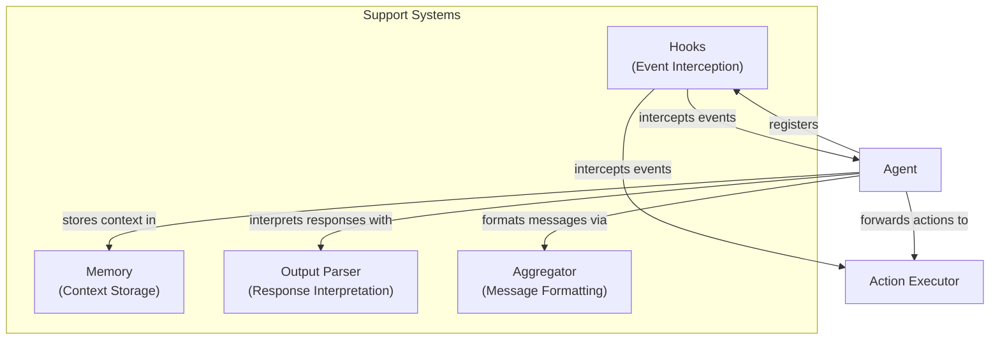
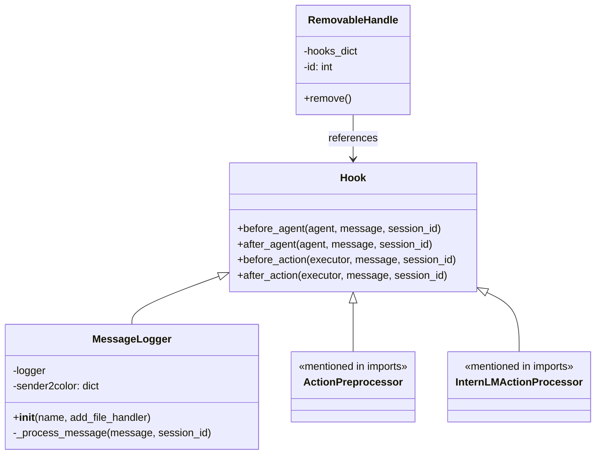
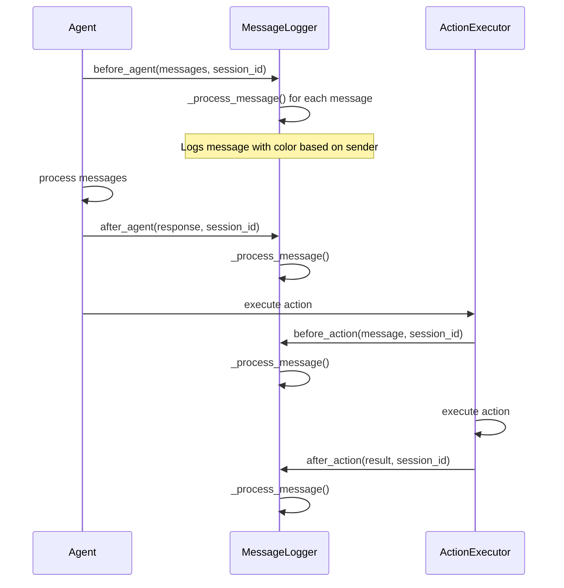
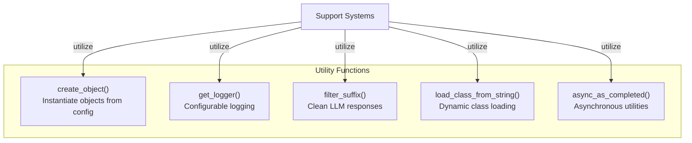
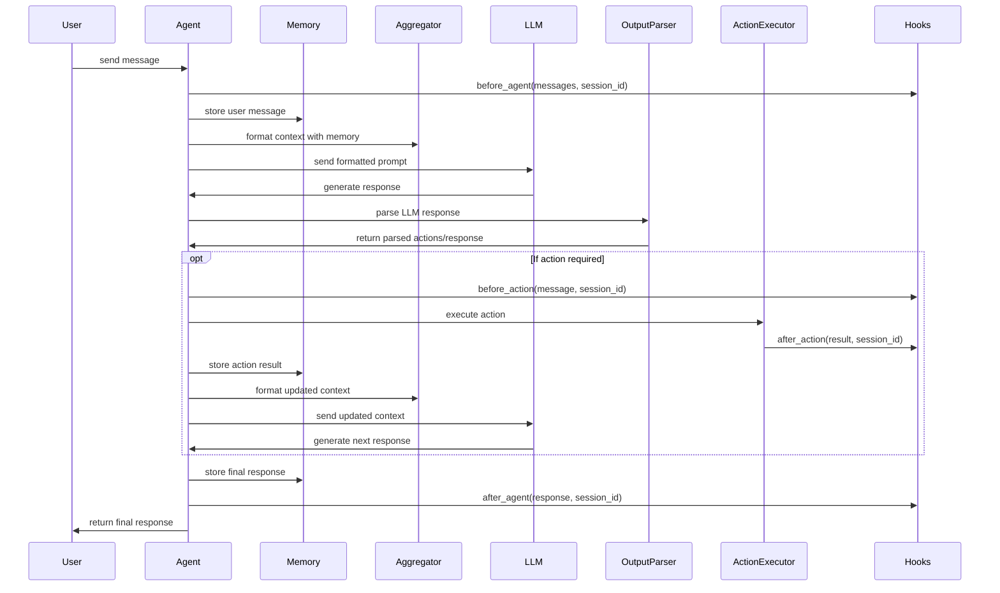

<!-- source: DeepWiki mcp.deepwiki.com · repo InternLM/lagent · page 3 Support Systems · fetched 2026-10-26 -->

# Support Systems

Relevant source files

The following files were used as context for generating this wiki page:

- [lagent/hooks/__init__.py](lagent/hooks/__init__.py)
- [lagent/hooks/hook.py](lagent/hooks/hook.py)
- [lagent/hooks/logger.py](lagent/hooks/logger.py)
- [lagent/utils/__init__.py](lagent/utils/__init__.py)
- [lagent/utils/util.py](lagent/utils/util.py)

Support Systems in LAgent are foundational components that enhance the capabilities of agents by providing essential infrastructure services. These systems handle crucial background operations like context management, event interception, message formatting, and response parsing. While less visible than agents or actions, these support systems are critical for the proper functioning and extensibility of the LAgent framework.

For information about the Agent System, see [Agent System](#2.1).  
For details on the Action System, see [Action System](#2.3).

## Overview of Support Systems

The LAgent framework includes several key support systems:

Sources: [lagent/hooks/hook.py:1-40]()

## Hook System

The Hook system provides a mechanism to intercept and modify the flow of execution at various points in the agent's lifecycle. This enables logging, preprocessing, and other cross-cutting concerns without modifying the core agent or action code.

### Hook Architecture

Sources: [lagent/hooks/hook.py:1-51](), [lagent/hooks/logger.py:1-33](), [lagent/hooks/__init__.py:1-9]()

### Hook Implementation

The Hook system is implemented as a base class with lifecycle methods that can be overridden by subclasses:

1. **Lifecycle Methods**:
   - `before_agent`: Called before an agent processes a message
   - `after_agent`: Called after an agent generates a response
   - `before_action`: Called before an action is executed
   - `after_action`: Called after an action is executed

2. **Hook Registration**:
   - Hooks are registered with agents and action executors
   - `RemovableHandle` allows for dynamically adding and removing hooks

3. **Built-in Hooks**:
   - `MessageLogger`: Logs messages with color-coded formatting
   - `ActionPreprocessor`: Preprocesses actions before execution
   - `InternLMActionProcessor`: Specialized preprocessor for InternLM

Sources: [lagent/hooks/hook.py:7-39](), [lagent/hooks/logger.py:9-33]()

### MessageLogger Example

The `MessageLogger` hook demonstrates the practical use of the Hook system:

Sources: [lagent/hooks/logger.py:9-33]()

## Memory Management

The Memory system maintains conversation history and context between agent interactions. While I don't have the direct source code for the Memory system, it's an essential component in the architecture that:

1. **Stores Contextual Information**:
   - Maintains the history of messages in a conversation
   - Preserves state between interaction turns

2. **Provides Context for Reasoning**:
   - Enables agents to reference previous messages
   - Allows for multi-turn reasoning and interaction

3. **Session Management**:
   - Organizes memory by session IDs
   - Supports multiple concurrent conversations

Memory is a critical component that the agent uses to maintain context across interactions. The Agent accesses Memory during the aggregation phase to bundle the appropriate context for the LLM.

## Output Parsers

Output Parsers extract structured information from LLM responses. They convert the natural language output from language models into structured formats that can be processed by the agent system:

1. **Response Interpretation**:
   - Parse natural language responses into structured data
   - Extract action calls and parameters
   - Identify reasoning steps

2. **Tool Parsing**:
   - Extract tool/action invocations from LLM responses
   - Parse parameters for tool execution
   - Handle different output formats from various LLMs

Output Parsers bridge the gap between the unstructured text output of LLMs and the structured input required by the Action system.

## Aggregator System

The Aggregator is responsible for formatting messages and context before they are sent to the LLM:

1. **Context Formation**:
   - Combines user messages with conversation history
   - Formats system prompts and instructions
   - Prepares context for LLM consumption

2. **Message Formatting**:
   - Structures messages according to LLM requirements
   - Handles different messaging formats for various LLMs
   - Prepares messages for streaming or batch processing

The Aggregator works closely with Memory to retrieve relevant context and format it appropriately for the specific LLM being used.

## Utility Functions

The LAgent framework includes various utility functions that support the operation of these systems:

Sources: [lagent/utils/util.py:14-136](), [lagent/utils/__init__.py:1-14]()

### Key Utilities:

1. **Object Creation and Loading**:
   - `create_object()`: Instantiates objects from configuration dictionaries
   - `load_class_from_string()`: Dynamically loads classes from string paths

2. **Logging**:
   - `get_logger()`: Creates configurable loggers with console and file handlers

3. **Response Processing**:
   - `filter_suffix()`: Cleans responses by removing specified suffixes

4. **Asynchronous Support**:
   - `async_as_completed()`: Wrapper for handling asynchronous operations
   - `GeneratorWithReturn`: Special generator that captures return values

Sources: [lagent/utils/util.py:14-136]()

## Integration with Agent System

Support Systems integrate tightly with the Agent System to provide complete functionality:

Sources: [lagent/hooks/hook.py:7-39]()

## Summary

The Support Systems in LAgent provide critical infrastructure that enables the more visible components like Agents and Actions to function effectively. They handle cross-cutting concerns like memory management, event interception, message formatting, and response parsing. While these systems operate primarily in the background, they are essential for creating flexible, extensible, and functional agent-based applications.

---

