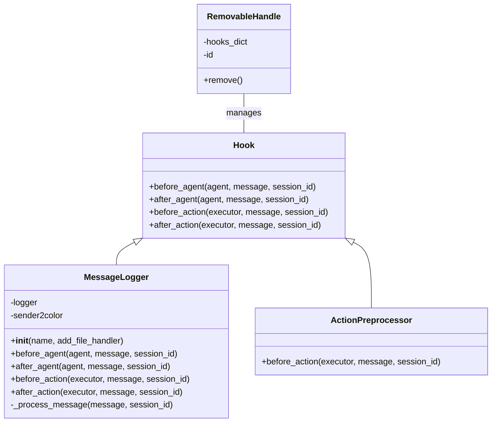
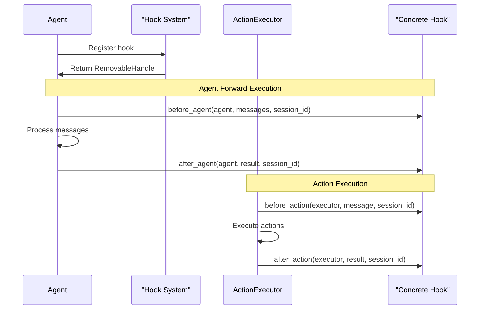
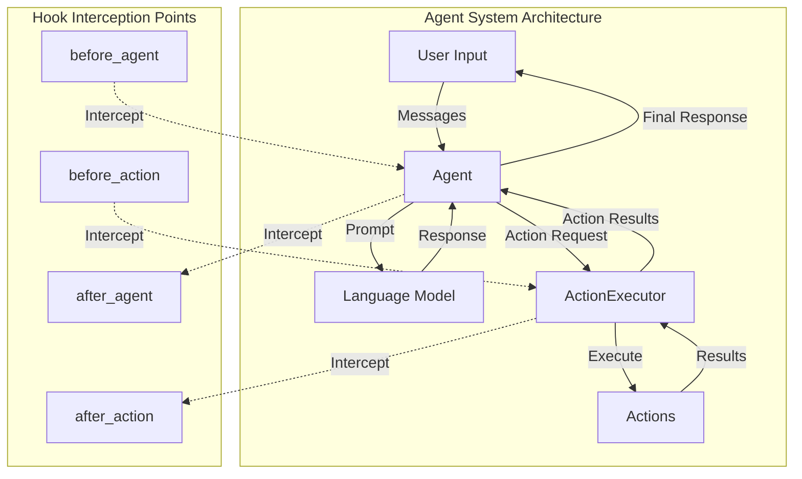
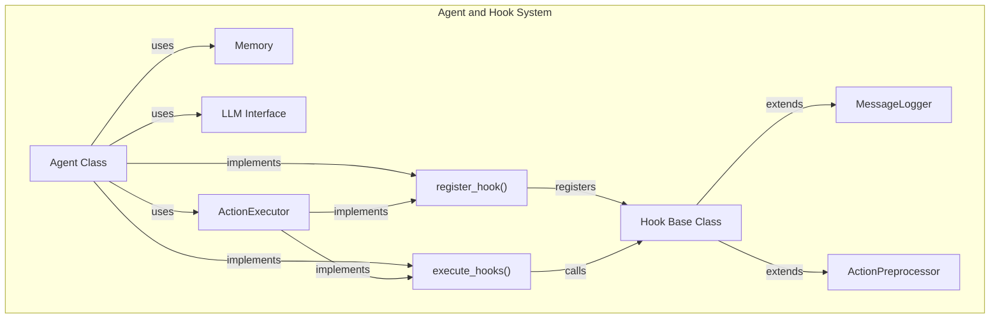

<!-- source: DeepWiki mcp.deepwiki.com · repo InternLM/lagent · page 3.2 Hooks and Middleware · fetched 2026-10-26 -->

# Hooks and Middleware

<details>
<summary>Relevant source files</summary>

The following files were used as context for generating this wiki page:

- [lagent/hooks/__init__.py](lagent/hooks/__init__.py)
- [lagent/hooks/hook.py](lagent/hooks/hook.py)
- [lagent/hooks/logger.py](lagent/hooks/logger.py)
- [lagent/utils/__init__.py](lagent/utils/__init__.py)
- [lagent/utils/util.py](lagent/utils/util.py)

</details>


This page documents the hook system in LAgent, which provides a mechanism to intercept and modify agent behavior at various stages of execution. Hooks serve as lightweight middleware that can be registered with agents and action executors to add capabilities like logging, message pre-processing, and custom integrations without modifying the core components.

## Hook System Architecture

The LAgent hook system consists of a base `Hook` class and various concrete implementations. Hooks can be registered with agents and action executors to intercept execution at four critical points: before and after agent execution, and before and after action execution.



Sources: [lagent/hooks/hook.py:1-51](), [lagent/hooks/logger.py:1-33](), [lagent/hooks/__init__.py:1-9]()

### Hook Registration and Lifecycle

Hooks are registered with agent or action executor components and are called at specific points in the execution flow. When a hook is registered, a `RemovableHandle` is returned, which can be used to remove the hook later.



Sources: [lagent/hooks/hook.py:1-51]()

## Built-in Hooks

### MessageLogger

The `MessageLogger` hook is used to log messages at various points in agent and action execution. It assigns random colors to different message senders for better visual distinction in the console.

```python
# Example usage of MessageLogger hook
from lagent.hooks import MessageLogger

# Create a logger hook
logger_hook = MessageLogger(name='my_agent', add_file_handler=True)

# Register with an agent (code would be in the agent implementation)
agent.register_hook(logger_hook)
```

The `MessageLogger` processes messages by extracting the sender information, assigning a color to the sender, and logging the message content with that color.

Sources: [lagent/hooks/logger.py:1-33](), [lagent/utils/util.py:94-123]()

### Action Preprocessors

Action preprocessors are hooks that modify or enhance messages before they are passed to actions for execution. The base `ActionPreprocessor` class and specialized implementations like `InternLMActionProcessor` are designed to prepare messages for specific action types.

Sources: [lagent/hooks/__init__.py:1-9]()

## Hook System Implementation

The hook system consists of two primary classes:

1. **`Hook`** - The base class defining the hook interface with four methods that correspond to different stages of agent and action execution:

```python
def before_agent(self, agent, message: Tuple[AgentMessage], session_id: int):
    pass

def after_agent(self, agent, message: AgentMessage, session_id: int):
    pass

def before_action(self, executor, message: AgentMessage, session_id: int):
    pass

def after_action(self, executor, message: AgentMessage, session_id: int):
    pass
```

2. **`RemovableHandle`** - A class that manages hook removal:

```python
class RemovableHandle:
    _id_iter = count(0)

    def __init__(self, hooks_dict):
        self.hooks_dict = hooks_dict
        self.id = next(self._id_iter)

    def remove(self):
        del self.hooks_dict[self.id]
```

Sources: [lagent/hooks/hook.py:1-51]()

## Hook Integration in the Agent Architecture

Hooks integrate into the broader agent architecture, providing interception points at key stages of execution.



Sources: [lagent/hooks/hook.py:1-51]()

## Example: MessageLogger Implementation

The `MessageLogger` hook is a concrete implementation that logs messages at each stage of execution. It overrides all four hook methods and uses a common `_process_message` method to handle the logging:

```python
def _process_message(self, message, session_id):
    sender = message.sender
    color = self.sender2color.setdefault(sender, random.choice(list(COLORS)))
    self.logger.info(
        colored(
            f'session id: {session_id}, message sender: {sender}\n'
            f'{message.content}', 
            color
        )
    )
```

The hook uses a logger created with the `get_logger` utility function, which supports both console and file logging.

Sources: [lagent/hooks/logger.py:9-33](), [lagent/utils/util.py:94-123]()

## Using Hooks in Custom Agents

To create and use a custom hook, you would:

1. Subclass the `Hook` base class
2. Override the desired hook methods
3. Register the hook with an agent or action executor

Here's an example pattern for creating a custom hook:

```python
from lagent.hooks import Hook

class MyCustomHook(Hook):
    def before_agent(self, agent, messages, session_id):
        # Custom logic before agent processes messages
        print(f"Agent {agent} about to process messages")
        
    def after_agent(self, agent, message, session_id):
        # Custom logic after agent processes message
        print(f"Agent {agent} finished processing, result: {message}")

# Usage (in agent code):
custom_hook = MyCustomHook()
removable_handle = agent.register_hook(custom_hook)

# Later, if needed:
removable_handle.remove()  # Unregister the hook
```

## Integration with the Broader System

Hooks play a crucial role in the LAgent architecture by providing extension points without modifying core code. They're particularly useful for:

1. **Logging and monitoring**: Capturing interactions for analysis and debugging
2. **Message transformation**: Pre-processing or post-processing messages
3. **Integration with external systems**: Adding custom behaviors like metrics reporting

The hook system in LAgent follows a similar pattern to middleware in web frameworks, allowing for a chain of processing steps that can be customized to specific needs.



Sources: [lagent/hooks/hook.py:1-51](), [lagent/hooks/logger.py:1-33](), [lagent/hooks/__init__.py:1-9]()

## Conclusion

The hook system in LAgent provides a flexible and powerful way to extend and customize agent behavior. By providing interception points at key stages of execution, hooks enable logging, message transformation, and integration with external systems without modifying the core agent code. The built-in hooks like `MessageLogger` demonstrate the utility of this approach, while the extensible nature of the system allows for custom hooks to be created for specific use cases.

---

