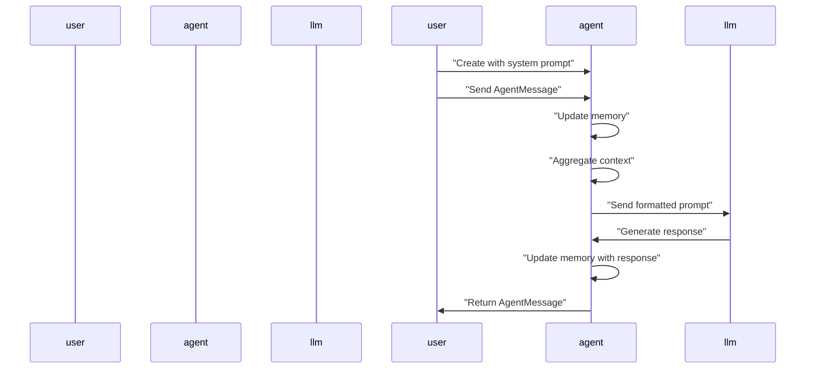
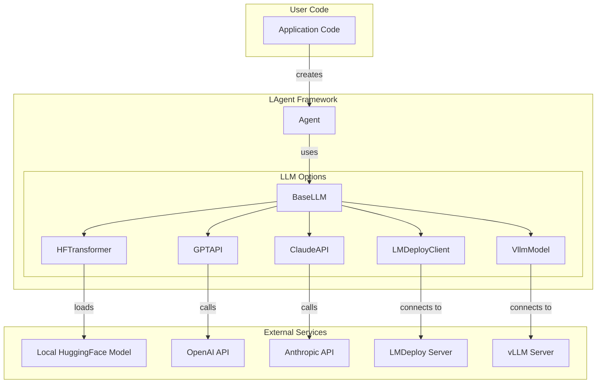
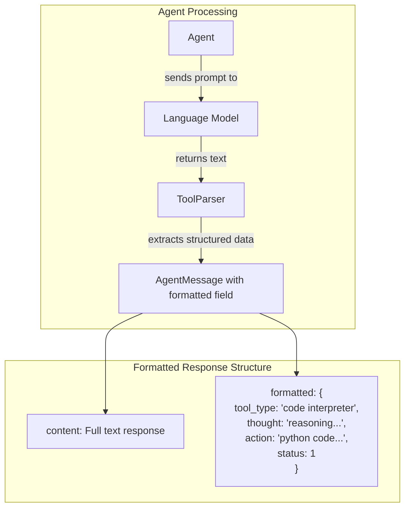
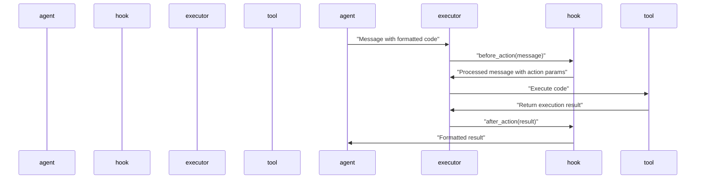
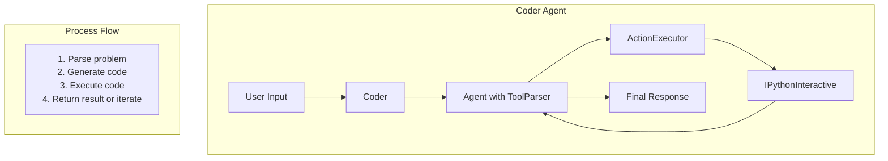
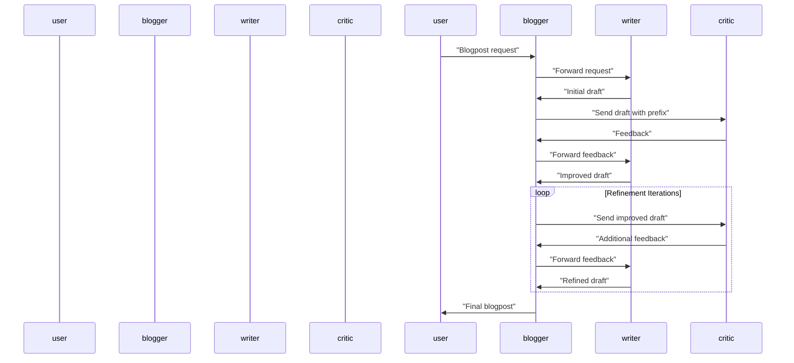
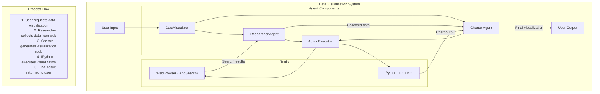

<!-- source: DeepWiki mcp.deepwiki.com · repo InternLM/lagent · page 4 Usage Examples · fetched 2026-10-26 -->

# Usage Examples

<details>
<summary>Relevant source files</summary>

The following files were used as context for generating this wiki page:

- [README.md](README.md)
- [examples/model_cli_demo.py](examples/model_cli_demo.py)

</details>


This page provides practical examples of how to use the LAgent framework in different scenarios. It demonstrates basic patterns for working with single agents, multi-agent systems, and tool integration to solve various tasks. For information on the core architecture and components, see [Core Components](#2).

## Basic Agent Usage

This section demonstrates how to create and interact with simple LAgent agents using different language models.

### Creating a Simple Agent

Below is a basic example showing how to create an agent using the VllmModel LLM implementation:

```python
from lagent.agents import Agent
from lagent.schema import AgentMessage
from lagent.llms import VllmModel, INTERNLM2_META

# Initialize the LLM
llm = VllmModel(
    path='Qwen/Qwen2-7B-Instruct',
    meta_template=INTERNLM2_META,
    tp=1,
    temperature=1.0,
    stop_words=['<|im_end|>'],
    max_new_tokens=1024,
)

# Create the agent with a system prompt
system_prompt = '你的回答只能从"典"、"孝"、"急"三个字中选一个。'
agent = Agent(llm, system_prompt)

# Send a message to the agent
user_msg = AgentMessage(sender='user', content='今天天气情况')
bot_msg = agent(user_msg)
print(bot_msg)
```

This creates a simple agent that responds with one of three predefined Chinese characters based on the system prompt.



Sources: [README.md:39-64]()

### Working with Agent Memory

Agents automatically track conversation history in their memory. You can access and manage this memory:

```python
# Access the full memory (list of AgentMessage objects)
memory = agent.memory.get_memory()

# Get serialized memory (for saving or transferring)
dumped_memory = agent.state_dict()

# Clear the memory
agent.reset()
```

This allows you to inspect the conversation history or clear it for a new session.

Sources: [README.md:66-100]()

### Using Different LLM Implementations

LAgent supports multiple LLM backends through a unified interface. Here's an example using Hugging Face models:



Example using a Hugging Face model:

```python
from lagent.llms import HFTransformer
from lagent.llms.meta_template import INTERNLM2_META

# Initialize HF-based model
model = HFTransformer(
    path="internlm/internlm2-chat-20b",
    meta_template=INTERNLM2_META,
    max_new_tokens=1024,
    temperature=0.1,
    stop_words=['<|im_end|>']
)

# Use with an agent
agent = Agent(model, system_prompt="You are a helpful assistant.")
```

Sources: [examples/model_cli_demo.py:23-35](), [README.md:39-52]()

## Custom Message Processing

### Creating a Custom Message Aggregator

You can customize how messages are processed before being sent to the language model:

```python
from lagent.agents.aggregator import DefaultAggregator

class FewshotAggregator(DefaultAggregator):
    def __init__(self, few_shot: List[dict] = None):
        self.few_shot = few_shot or []

    def aggregate(self,
                 messages: Memory,
                 name: str,
                 parser: StrParser = None,
                 system_instruction: Union[str, dict, List[dict]] = None) -> List[dict]:
        _message = []
        if system_instruction:
            _message.extend(
                self.aggregate_system_intruction(system_instruction))
        _message.extend(self.few_shot)
        # Process regular messages
        messages = messages.get_memory()
        for message in messages:
            # Convert to OpenAI format
            if message.sender == name:
                _message.append(
                    dict(role='assistant', content=str(message.content)))
            else:
                _message.append(dict(role='user', content=message.content))
        return _message

# Use the custom aggregator with an agent
agent = Agent(
    llm,
    aggregator=FewshotAggregator(
        [
            {"role": "user", "content": "今天天气"},
            {"role": "assistant", "content": "【晴】"},
        ]
    )
)
```

This custom aggregator injects few-shot examples into the conversation history before sending it to the model.

Sources: [README.md:102-169]()

### Structured Response Parsing

You can extract structured information from the model's responses:

```python
from lagent.prompts.parsers import ToolParser

# Create a parser that extracts Python code
parser = ToolParser(tool_type='code interpreter', begin='```python\n', end='\n```\n')
llm.gen_params['stop_words'].append('\n```\n')  # Stop generation at code block end

# Use the parser with an agent
agent = Agent(llm, system_prompt, output_format=parser)

# The response will contain structured content in the 'formatted' field
response = agent(user_message)
code = response.formatted['action']  # Extract the code
```

The `formatted` field of the response will contain the structured information extracted by the parser.



Sources: [README.md:171-223]()

## Tool Integration

### Using Action Executors

Action executors allow agents to interact with external tools:

```python
from lagent.hooks import Hook
from lagent.schema import ActionReturn, ActionStatusCode, AgentMessage
from lagent.actions import ActionExecutor, IPythonInteractive

# Create a hook to process messages for the action executor
class CodeProcessor(Hook):
    def before_action(self, executor, message, session_id):
        # Convert formatted content to action request
        message = message.copy(deep=True)
        message.content = dict(
            name='IPythonInteractive', parameters={'command': message.formatted['action']}
        )
        return message

    def after_action(self, executor, message, session_id):
        # Process the action result
        action_return = message.content
        if isinstance(action_return, ActionReturn):
            if action_return.state == ActionStatusCode.SUCCESS:
                response = action_return.format_result()
            else:
                response = action_return.errmsg
        else:
            response = action_return
        message.content = response
        return message

# Create an action executor with the hook
executor = ActionExecutor(actions=[IPythonInteractive()], hooks=[CodeProcessor()])

# Send a message to the executor
executor_msg = executor(bot_message_with_code)
```

This example shows how to use hooks to process messages before and after they're handled by actions.



Sources: [README.md:225-277]()

## Single Agent Examples

### Math Problem Solver

This example shows a specialized agent that solves math problems using Python code:

```python
from lagent.agents.aggregator import InternLMToolAggregator

class Coder(Agent):
    def __init__(self, model_path, system_prompt, max_turn=3):
        super().__init__()
        # Initialize LLM
        llm = VllmModel(
            path=model_path,
            meta_template=INTERNLM2_META,
            tp=1,
            temperature=1.0,
            stop_words=['\n```\n', '<|im_end|>'],
            max_new_tokens=1024,
        )
        # Create agent for code generation
        self.agent = Agent(
            llm,
            system_prompt,
            output_format=ToolParser(
                tool_type='code interpreter', begin='```python\n', end='\n```\n'
            ),
            aggregator=InternLMToolAggregator(),
        )
        # Create executor for running the code
        self.executor = ActionExecutor([IPythonInteractive()], hooks=[CodeProcessor()])
        self.max_turn = max_turn

    def forward(self, message: AgentMessage, session_id=0) -> AgentMessage:
        # Iterate for multiple turns of code generation and execution
        for _ in range(self.max_turn):
            # Generate code with the agent
            message = self.agent(message, session_id=session_id)
            if message.formatted['tool_type'] is None:
                return message
            # Execute the code
            message = self.executor(message, session_id=session_id)
        return message
```

This agent:
1. Generates Python code to solve math problems
2. Executes the code using an IPython interpreter
3. Returns the result or generates more code as needed



Sources: [README.md:299-351]()

## Multi-Agent Systems

### Asynchronous Content Refinement

This example shows how to build a system where multiple agents work together to refine content:

```python
import asyncio
from lagent.llms import AsyncGPTAPI
from lagent.agents import AsyncAgent

class PrefixedMessageHook(Hook):
    def __init__(self, prefix: str, senders: list = None):
        self.prefix = prefix
        self.senders = senders or []

    def before_agent(self, agent, messages, session_id):
        for message in messages:
            if message.sender in self.senders:
                message.content = self.prefix + message.content

class AsyncBlogger(AsyncAgent):
    def __init__(self, model_path, writer_prompt, critic_prompt, critic_prefix='', max_turn=3):
        super().__init__()
        llm = AsyncGPTAPI(model_type=model_path, retry=5, max_new_tokens=2048)
        # Writer agent generates content
        self.writer = AsyncAgent(llm, writer_prompt, name='writer')
        # Critic agent provides feedback
        self.critic = AsyncAgent(
            llm, critic_prompt, name='critic', hooks=[PrefixedMessageHook(critic_prefix, ['writer'])]
        )
        self.max_turn = max_turn

    async def forward(self, message: AgentMessage, session_id=0) -> AgentMessage:
        # Iterate through multiple turns of writing and critiquing
        for _ in range(self.max_turn):
            message = await self.writer(message, session_id=session_id)
            message = await self.critic(message, session_id=session_id)
        # Final version from the writer
        return await self.writer(message, session_id=session_id)
```

This system uses:
1. A writer agent that generates content
2. A critic agent that provides feedback
3. Multiple iterations of refinement



Sources: [README.md:353-418]()

### Multi-Tool Workflow

This example demonstrates a complex workflow involving information retrieval and data visualization:

```python
import json
from lagent.actions import IPythonInterpreter, WebBrowser, ActionExecutor
from lagent.agents.stream import get_plugin_prompt
from lagent.llms import GPTAPI
from lagent.hooks import InternLMActionProcessor

class DataVisualizer(Agent):
    def __init__(self, model_path, research_prompt, chart_prompt, finish_pattern="Final Answer", max_turn=10):
        super().__init__()
        # Initialize LLM
        llm = GPTAPI(model_path, retry=5, max_new_tokens=1024, stop_words=["```\n"])
        
        # Initialize tools
        interpreter = IPythonInterpreter()
        browser = WebBrowser("BingSearch", api_key="YOUR_BING_API_KEY")
        
        # Researcher agent for data collection
        self.researcher = Agent(
            llm,
            # Tool template with browser capabilities
            TOOL_TEMPLATE.format(
                finish_pattern=finish_pattern,
                tool_description=get_plugin_prompt(browser),
                invocation_format='```json\n{"name": {{tool name}}, "parameters": {{keyword arguments}}}\n```\n',
                system_prompt=research_prompt,
            ),
            output_format=ToolParser(
                "browser",
                begin="```json\n",
                end="\n```\n",
                validate=lambda x: json.loads(x.rstrip('`')),
            ),
            aggregator=InternLMToolAggregator(),
            name="researcher",
        )
        
        # Charter agent for data visualization
        self.charter = Agent(
            llm,
            # Tool template with Python interpreter capabilities
            TOOL_TEMPLATE.format(
                finish_pattern=finish_pattern,
                tool_description=interpreter.name,
                invocation_format='```python\n{{code}}\n```\n',
                system_prompt=chart_prompt,
            ),
            output_format=ToolParser(
                "interpreter",
                begin="```python\n",
                end="\n```\n",
                validate=lambda x: x.rstrip('`'),
            ),
            aggregator=InternLMToolAggregator(),
            name="charter",
        )
        
        # Action executor for both tools
        self.executor = ActionExecutor([interpreter, browser], hooks=[InternLMActionProcessor()])
        self.finish_pattern = finish_pattern
        self.max_turn = max_turn

    def forward(self, message, session_id=0):
        # Coordinate between researcher and charter agents
        for _ in range(self.max_turn):
            # Research phase
            message = self.researcher(message, session_id=session_id, stop_words=["```\n", "```python"])
            while message.formatted["tool_type"]:
                message = self.executor(message, session_id=session_id)
                message = self.researcher(message, session_id=session_id, stop_words=["```\n", "```python"])
            if self.finish_pattern in message.content:
                return message
                
            # Charting phase
            message = self.charter(message)
            while message.formatted["tool_type"]:
                message = self.executor(message, session_id=session_id)
                message = self.charter(message, session_id=session_id)
            if self.finish_pattern in message.content:
                return message
                
        return message
```

This system:
1. Uses a researcher agent to search the web for data
2. Uses a charter agent to create visualizations from the data
3. Coordinates between the agents to complete complex tasks



Sources: [README.md:419-513]()

## Advanced Usage Patterns

### Synchronous vs Asynchronous Interfaces

LAgent provides both synchronous and asynchronous interfaces for most components:

```python
# Synchronous components
from lagent.llms import VllmModel
from lagent.actions import ActionExecutor, WebBrowser
from lagent.agents import Agent, AgentForInternLM

# Asynchronous counterparts
from lagent.llms import AsyncVllmModel
from lagent.actions import AsyncActionExecutor, AsyncWebBrowser
from lagent.agents import AsyncAgent, AsyncAgentForInternLM
```

For high-throughput applications, asynchronous interfaces can significantly improve performance by utilizing idle resources during I/O operations.

### Session Management

LAgent supports multiple concurrent sessions through the `session_id` parameter:

```python
# Create an agent
agent = Agent(llm, system_prompt)

# Process messages in different sessions
response1 = agent(message1, session_id=1)
response2 = agent(message2, session_id=2)

# Clear a specific session
agent.reset(session_id=1)
```

This allows you to maintain separate conversations with the same agent instance.

Sources: [README.md:291-298]()

## Summary

This page demonstrated various usage patterns for the LAgent framework, including:

1. Basic agent creation and interaction
2. Memory management and custom message processing 
3. Tool integration with action executors
4. Building specialized single agents
5. Creating multi-agent systems
6. Advanced usage patterns like asynchronous interfaces and session management

These examples provide a foundation for building more complex agent-based applications using the LAgent framework. For more information on specific components, see the other pages in this wiki.

---

