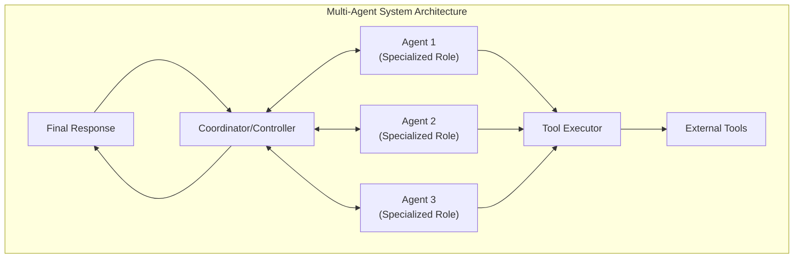
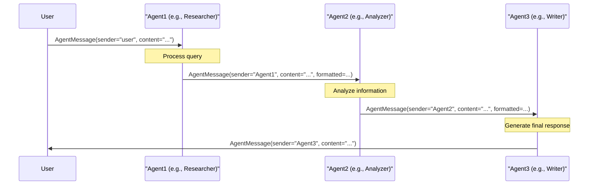
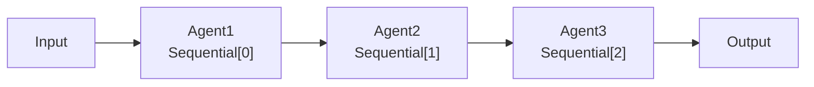
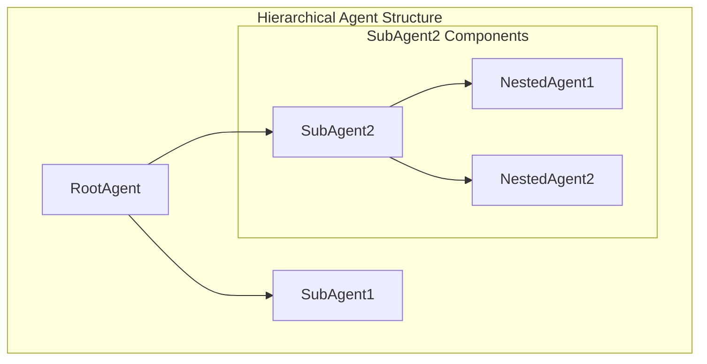
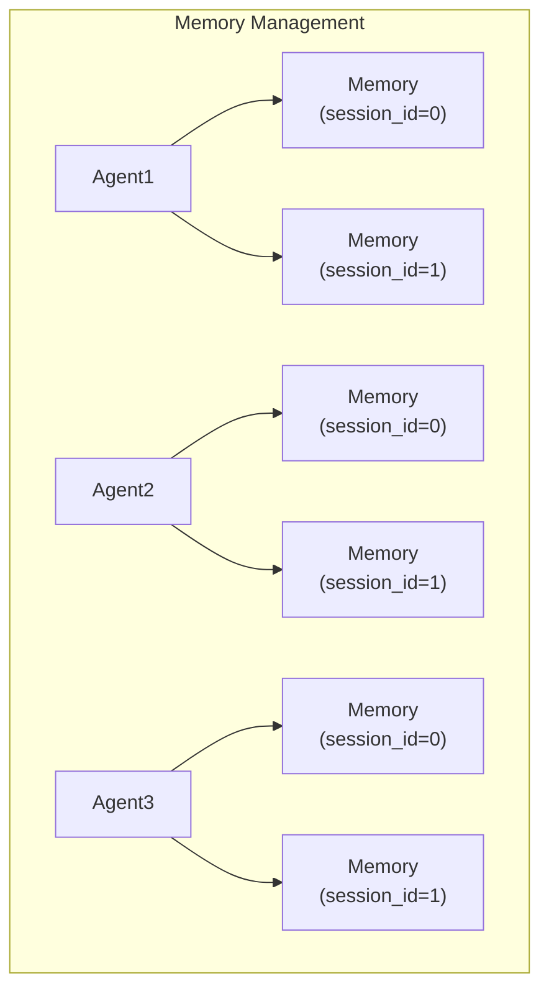
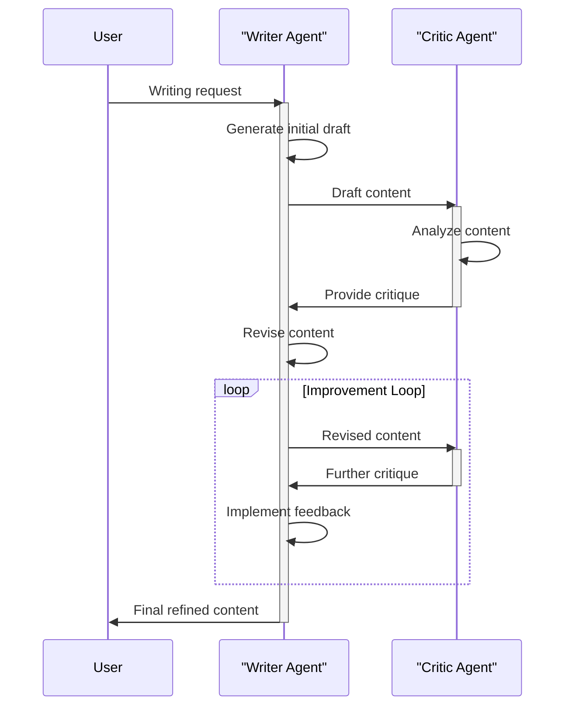
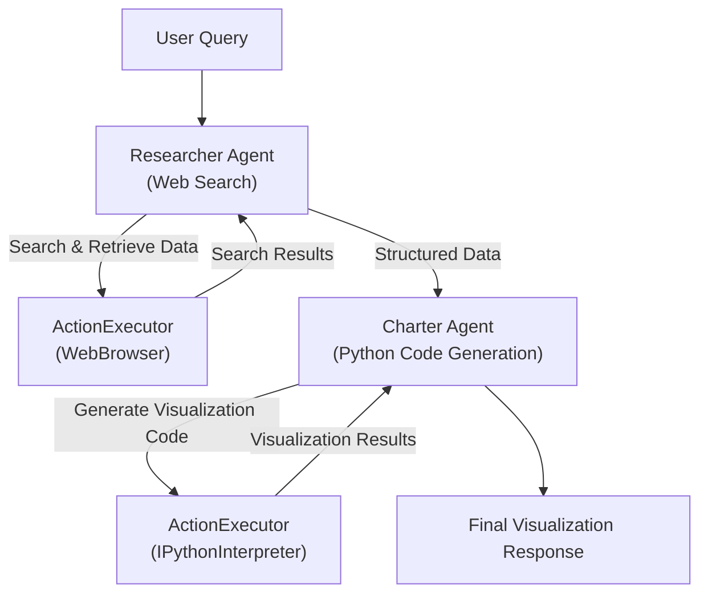

<!-- source: DeepWiki mcp.deepwiki.com · repo InternLM/lagent · page 4.2 Multi-Agent Systems · fetched 2026-10-26 -->

# Multi-Agent Systems

<details>
<summary>Relevant source files</summary>

The following files were used as context for generating this wiki page:

- [README.md](README.md)
- [lagent/agents/__init__.py](lagent/agents/__init__.py)
- [lagent/agents/agent.py](lagent/agents/agent.py)
- [lagent/memory/base_memory.py](lagent/memory/base_memory.py)

</details>


## Purpose and Scope

This document covers the design, implementation, and usage of multi-agent systems within the LAgent framework. It explores how to create, organize, and coordinate multiple agents to solve complex tasks through collaboration. Unlike single agents which operate independently (covered in [Simple Agent Examples](#4.1)), multi-agent systems enable more sophisticated problem-solving through agent specialization, sequential workflows, and coordinated information processing.

## Introduction to Multi-Agent Systems

Multi-agent systems in LAgent are composed of multiple specialized agents that work together to achieve tasks that would be difficult for a single agent to accomplish. The framework provides several mechanisms for creating agent compositions, establishing communication channels, and managing shared memory.



Sources: [README.md:352-418](), [lagent/agents/agent.py:316-363]()

## Core Components for Multi-Agent Systems

### Agent Composition Classes

LAgent provides several classes specifically designed for multi-agent composition:

| Class | Type | Description |
|-------|------|-------------|
| `Sequential` | Sequential execution | Forwards messages to each agent in sequence |
| `AsyncSequential` | Async sequential execution | Asynchronous variant of `Sequential` |
| `StreamingSequential` | Streaming sequential | Streaming variant of `Sequential` for real-time responses |
| `AsyncStreamingSequential` | Async streaming sequential | Combines async and streaming capabilities |
| `AgentList` | Container | List-like container of agents |
| `AgentDict` | Container | Dictionary-like container of agents |

Sources: [lagent/agents/agent.py:316-363](), [lagent/agents/agent.py:411-470](), [lagent/agents/__init__.py:1-33]()

### Agent Communication

Agents communicate using the `AgentMessage` class, which contains:

- `content`: The message content
- `sender`: The name of the agent sending the message
- `formatted`: Structured data extracted from model responses
- `receiver`: The intended recipient (optional)
- `extra_info`: Additional metadata
- `stream_state`: Status of streaming response



Sources: [lagent/agents/agent.py:66-83](), [README.md:37-64]()

## Agent Organization Patterns

### Sequential Agent Chains

The `Sequential` class provides a way to organize agents in a pipeline where each agent processes the output of the previous agent.

```python
sequential_agent = Sequential(
    agent1,  # First agent in the chain
    agent2,  # Second agent
    agent3   # Third agent
)
```

The flow of information moves linearly through the chain, with each agent adding its own expertise to the process.



Sources: [lagent/agents/agent.py:316-350]()

### Nested Agent Hierarchies

Complex agent systems can be built by nesting agents within other agents, creating hierarchical structures:



This is implemented through agent composition, where one agent can contain and coordinate multiple sub-agents.

Sources: [lagent/agents/agent.py:95-100](), [lagent/agents/agent.py:162-176]()

## Memory Management in Multi-Agent Systems

In multi-agent systems, memory management is crucial for maintaining context across agent interactions. The memory system in LAgent allows:

1. Independent memory per agent
2. Session-based isolation (using `session_id`)
3. State preservation and restoration



The state of the entire multi-agent system can be saved and loaded using `state_dict()` and `load_state_dict()` methods:

```python
# Save state
state = multi_agent.state_dict(session_id=0)

# Load state
multi_agent.load_state_dict(state, session_id=0)
```

Sources: [lagent/memory/base_memory.py:1-61](), [lagent/agents/agent.py:102-140](), [README.md:66-100]()

## Practical Examples of Multi-Agent Systems

### Blogging Agent with Self-Refinement

This example implements an asynchronous blogging system where one agent generates content and another critiques it, leading to iterative improvement:



The key implementation aspects include:
- Custom message hooks for prefixing instructions to critique agent
- Multiple improvement iterations controlled by `max_turn`
- Asynchronous processing for efficiency

Sources: [README.md:355-417]()

### Data Visualization Multi-Agent System

This example shows a multi-agent workflow for information retrieval and visualization:



This example demonstrates:
- Specialized agent roles (researcher and charter)
- Tool integration (web search and code execution)
- Coordinated workflow between agents
- Custom output parsing for different tools

Sources: [README.md:420-513]()

## Implementation Guidelines for Multi-Agent Systems

### Session Management

When building multi-agent systems, properly manage session isolation to handle multiple conversations:

```python
# Create a multi-agent system
multi_agent = CustomMultiAgentSystem()

# Process requests with different session IDs
response1 = multi_agent(message1, session_id=0)
response2 = multi_agent(message2, session_id=1)

# Reset specific sessions as needed
multi_agent.reset(session_id=0)
```

Sources: [lagent/agents/agent.py:145-160](), [README.md:293-298]()

### Agent Synchronization Options

LAgent provides both synchronous and asynchronous implementations for multi-agent systems:

| Pattern | Synchronous | Asynchronous |
|---------|------------|--------------|
| Basic | `Sequential` | `AsyncSequential` |
| Streaming | `StreamingSequential` | `AsyncStreamingSequential` |

Choose the appropriate pattern based on your concurrency needs and application requirements.

Sources: [lagent/agents/agent.py:362-408](), [README.md:282-289]()

## Best Practices for Multi-Agent System Design

1. **Agent Specialization**: Assign clear, focused roles to each agent
2. **Controlled Communication**: Use structured message formats with clear `sender` and `receiver` designations
3. **Memory Isolation**: Use `session_id` to maintain separate conversation contexts
4. **Consistent Tool Integration**: Ensure tools are appropriately connected to agents that need them
5. **Error Handling**: Implement proper error handling and recovery mechanisms between agent transitions
6. **Performance Optimization**: Use asynchronous agents for I/O-bound tasks and better resource utilization
7. **State Management**: Implement state persistence for long-running multi-agent workflows

Sources: [README.md:293-298](), [README.md:355-513]()

## Conclusion

Multi-agent systems in LAgent provide a powerful framework for creating complex AI applications through agent specialization and coordination. By leveraging the Sequential and container classes, developers can create sophisticated agent topologies tailored to specific problem domains. The examples from the README demonstrate how multi-agent systems can be applied to real-world problems such as content creation and data visualization workflows.

---

