# Page: Overview

# Overview

<details>
<summary>Relevant source files</summary>

The following files were used as context for generating this wiki page:

- [README.md](README.md)
- [docs/en/changelog.md](docs/en/changelog.md)
- [lagent/version.py](lagent/version.py)
- [requirements/runtime.txt](requirements/runtime.txt)

</details>


LAgent is a lightweight open-source framework for building Large Language Model (LLM) powered agents. It provides a modular and extensible architecture that enables developers to create agents capable of reasoning, executing actions, and interacting with various tools. The framework emphasizes Pythonic design patterns inspired by PyTorch, making it intuitive to create and compose agent components.

For information about installing the framework and its dependencies, see [Installation and Setup](#1.1).

## Architecture Overview

LAgent is organized into four primary systems that work together to create functional LLM-powered agents:

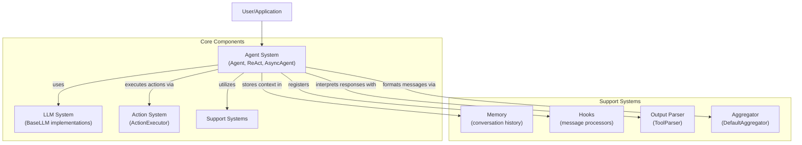

Sources: [README.md:32-78]()

The framework's modular design enables flexible component substitution and extension while maintaining consistent interfaces across the system.

## Communication Model

All components in LAgent communicate using a standardized message format called `AgentMessage`, which serves as the common data structure throughout the system:

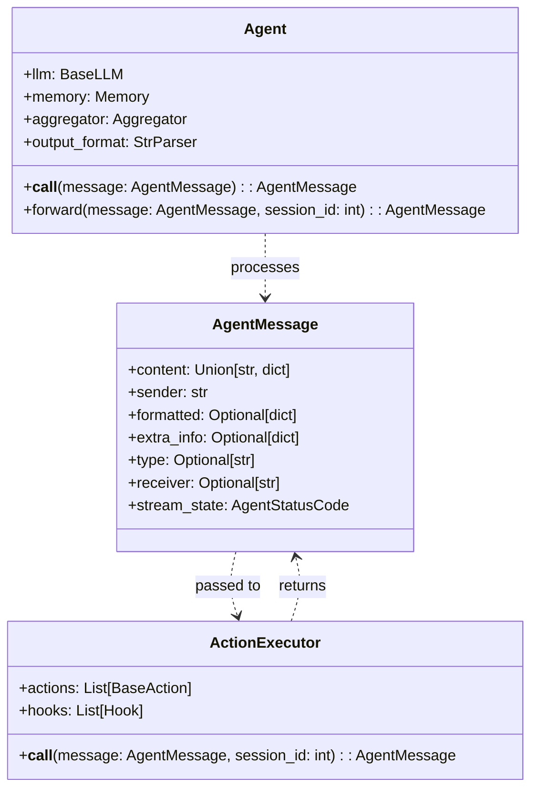

Sources: [README.md:37-58](), [README.md:225-276]()

## Agent System

The Agent System provides the core functionality for creating LLM-powered agents with different capabilities:

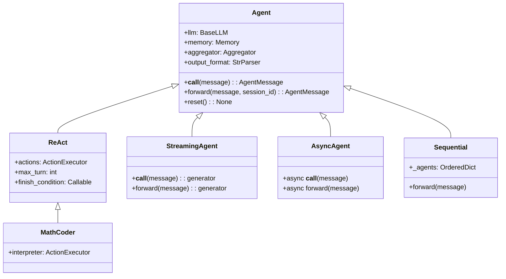

Sources: [README.md:300-337]()

### Key Agent Types

- **Agent**: Base implementation for LLM-powered agents
- **ReAct**: Implements the Reasoning+Acting paradigm for tool use through iterative cycles
- **StreamingAgent**: Provides incremental/streaming responses
- **AsyncAgent**: Asynchronous implementation for concurrent processing
- **Sequential**: Chains multiple agents together for complex workflows

The `__call__` method of an agent handles the core execution flow:

```python
def __call__(self, *message):
    message = pre_hooks(message)
    add_memory(message)
    message = self.forward(*message)
    add_memory(message)
    message = post_hooks(message)
    return message
```

Sources: [README.md:71-77]()

## LLM Integration System

The LLM Integration System provides a unified abstraction layer for different LLM providers:

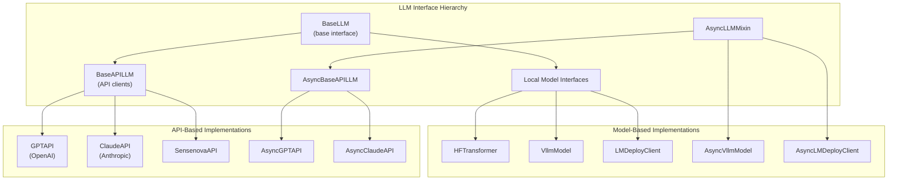

Sources: [README.md:38-58](), [README.md:282-290]()

All LLM implementations provide consistent interfaces for:
- `generate()`: Text completion generation
- `chat()`: Chat completion generation
- `stream_generate()` and `stream_chat()`: Streaming variants

The framework offers both API-based LLMs (OpenAI, Claude) and local model integrations (HuggingFace, vLLM, LMDeploy).

## Action System

The Action System enables agents to interact with external tools and services:

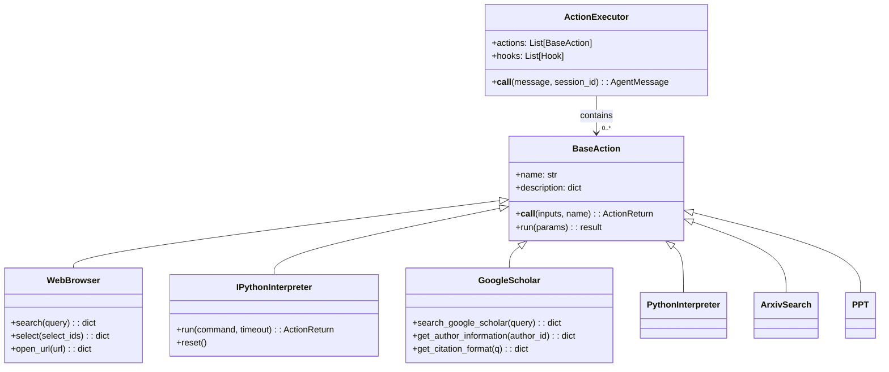

Sources: [README.md:225-276]()

### Built-in Actions

The framework includes several built-in tools:

| Action | Description |
|--------|-------------|
| `WebBrowser` | Web search and navigation |
| `IPythonInterpreter` | Interactive Python code execution |
| `PythonInterpreter` | Python code execution |
| `GoogleScholar` | Academic search and citation lookup |
| `ArxivSearch` | Search arXiv papers |
| `PPT` | Presentation creation |

Actions are executed via the `ActionExecutor`, which manages action instances and applies hooks for message processing.

## Support Systems

Several support systems enhance agent capabilities and workflow:

### Memory Management

The Memory component maintains conversation history, allowing agents to retain context across multiple turns:

```python
# Access memory
memory = agent.memory.get_memory()

# Clear memory
agent.reset()

# Get serializable memory state
dumped_memory = agent.state_dict()
```

Sources: [README.md:66-88]()

### Hooks System

Hooks intercept and modify behavior at various points in the agent execution flow:

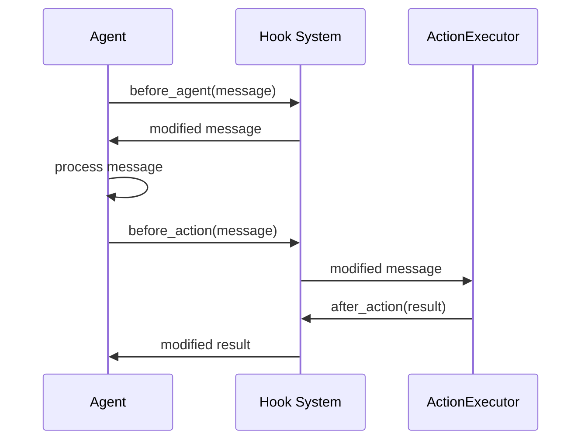

Sources: [README.md:235-259]()

Custom hooks can be implemented by extending the `Hook` class and overriding methods like `before_action` and `after_action`.

### Output Parsers

Output Parsers extract structured information from LLM responses. The `ToolParser` is particularly important as it extracts tool calls from LLM output:

```python
parser = ToolParser(tool_type='code interpreter', begin='```python\n', end='\n```\n')
agent = Agent(llm, system_prompt, output_format=parser)
```

Sources: [README.md:191-223]()

### Aggregators

Aggregators format context from memory for LLM consumption. The `DefaultAggregator` converts `AgentMessage` objects to the format expected by LLMs:

```python
class FewshotAggregator(DefaultAggregator):
    def __init__(self, few_shot: List[dict] = None):
        self.few_shot = few_shot or []
    
    def aggregate(self, messages, name, parser=None, system_instruction=None):
        # Custom implementation with few-shot examples
        # ...
```

Sources: [README.md:102-165]()

## Usage Patterns

The typical usage pattern in LAgent involves:

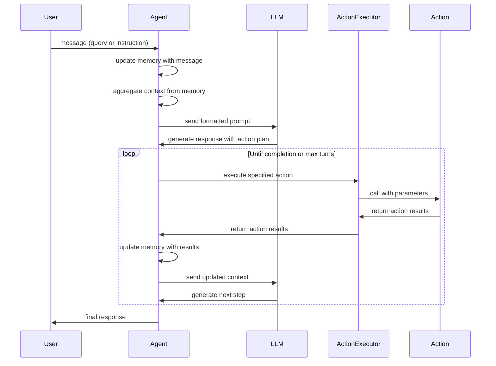

Sources: [README.md:300-350]()

### Single Agent Example

```python
from lagent.agents import Agent
from lagent.llms import VllmModel, INTERNLM2_META
from lagent.schema import AgentMessage

# Initialize LLM
llm = VllmModel(
    path='Qwen/Qwen2-7B-Instruct',
    meta_template=INTERNLM2_META,
    stop_words=['<|im_end|>'],
    max_new_tokens=1024,
)

# Create agent
agent = Agent(llm, "You are a helpful assistant.")

# Send message and get response
user_msg = AgentMessage(sender='user', content='Hello, what can you help me with?')
bot_msg = agent(user_msg)
```

Sources: [README.md:38-64]()

### Multi-Agent Systems

LAgent supports building multi-agent systems where agents collaborate to solve tasks:

```python
class Blogger(Agent):
    def __init__(self, model_path, writer_prompt, critic_prompt, max_turn=3):
        super().__init__()
        llm = GPTAPI(model_type=model_path)
        self.writer = Agent(llm, writer_prompt, name='writer')
        self.critic = Agent(llm, critic_prompt, name='critic')
        self.max_turn = max_turn

    def forward(self, message: AgentMessage, session_id=0) -> AgentMessage:
        for _ in range(self.max_turn):
            message = self.writer(message, session_id=session_id)
            message = self.critic(message, session_id=session_id)
        return self.writer(message, session_id=session_id)
```

Sources: [README.md:354-413]()

## Dual Interfaces

LAgent provides both synchronous and asynchronous interfaces for all major components:

| Synchronous | Asynchronous |
|-------------|--------------|
| `Agent` | `AsyncAgent` |
| `GPTAPI` | `AsyncGPTAPI` |
| `VllmModel` | `AsyncVllmModel` |
| `ActionExecutor` | `AsyncActionExecutor` |
| `WebBrowser` | `AsyncWebBrowser` |

Sources: [README.md:282-290]()

This dual interface design allows developers to choose the appropriate approach based on their application requirements - synchronous for debugging and asynchronous for production/concurrent processing.

## Dependencies and Requirements

LAgent has several key dependencies:

```
aiohttp           # For async HTTP requests
anthropic         # For Claude API integration  
arxiv             # For arXiv research tool
jupyter           # For IPython interpreter
pydantic          # For data validation
requests          # For HTTP requests
tiktoken          # For token counting
```

Sources: [requirements/runtime.txt:1-21]()

## License

LAgent is released under the Apache 2.0 license.

Sources: [README.md:527-530]()

---

# Page: Installation and Setup

# Installation and Setup

<details>
<summary>Relevant source files</summary>

The following files were used as context for generating this wiki page:

- [docs/en/changelog.md](docs/en/changelog.md)
- [lagent/llms/lmdeploy_wrapper.py](lagent/llms/lmdeploy_wrapper.py)
- [lagent/llms/vllm_wrapper.py](lagent/llms/vllm_wrapper.py)
- [lagent/version.py](lagent/version.py)
- [requirements/optional.txt](requirements/optional.txt)
- [requirements/runtime.txt](requirements/runtime.txt)

</details>


This guide provides instructions for installing lagent and setting up its components. It covers the basic installation process, managing dependencies, and configuring various optional components to enable different agent capabilities.

## Core Installation

You can install lagent directly from PyPI:

```bash
pip install lagent
```

For the latest development version, you can install directly from the GitHub repository:

```bash
pip install git+https://github.com/InternLM/lagent.git
```

The current stable version is 0.5.0rc3.

Sources: [lagent/version.py:1-27]()

## Dependencies

Lagent has both core dependencies and optional dependencies that enable specific functionality.

### Core Dependencies

The following dependencies are automatically installed with lagent:

```bash
pip install -r requirements/runtime.txt
```

Core dependencies include:

| Category | Dependencies |
|----------|--------------|
| Networking | `aiohttp`, `requests` |
| API Clients | `anthropic` |
| Research Tools | `arxiv` |
| Async Support | `asyncache`, `asyncer` |
| System | `distro`, `filelock` |
| Function Execution | `func_timeout`, `timeout-decorator` |
| Documentation | `griffe<1.0` |
| Data Handling | `json5`, `jsonschema`, `pydantic==2.6.4` |
| Interactive Computing | `jupyter==1.0.0`, `jupyter_client==8.6.2`, `jupyter_core==5.7.2` |
| Utilities | `tenacity`, `termcolor`, `tiktoken`, `typing-extensions` |

Sources: [requirements/runtime.txt:1-22]()

### Optional Dependencies

Different features require additional dependencies:

```bash
pip install -r requirements/optional.txt
```

Here are the key optional dependencies:

| Feature | Dependencies | Purpose |
|---------|--------------|---------|
| Web Search | `duckduckgo_search==5.3.1b1`, `google-search-results` | Enable web browsing and search actions |
| Local Model Deployment | `lmdeploy>=0.2.5`, `vllm>=0.3.3` | Run models locally with optimized inference |
| Model Integration | `torch`, `transformers>=4.34,<=4.40` | Support for Hugging Face models |
| Content Creation | `pillow`, `python-pptx` | Enable presentation creation actions |
| Execution Control | `timeout_decorator` | Handle timeouts in actions |

Sources: [requirements/optional.txt:1-10]()

## Installation with Specific Features

You can install lagent with specific optional dependencies using pip extras:

### For all optional dependencies:

```bash
pip install "lagent[all]"
```

### For specific features:

```bash
# For local LLM support
pip install "lagent[llm]"

# For web search capabilities
pip install "lagent[search]"

# For document creation
pip install "lagent[ppt]"
```

## Component Dependencies Diagram

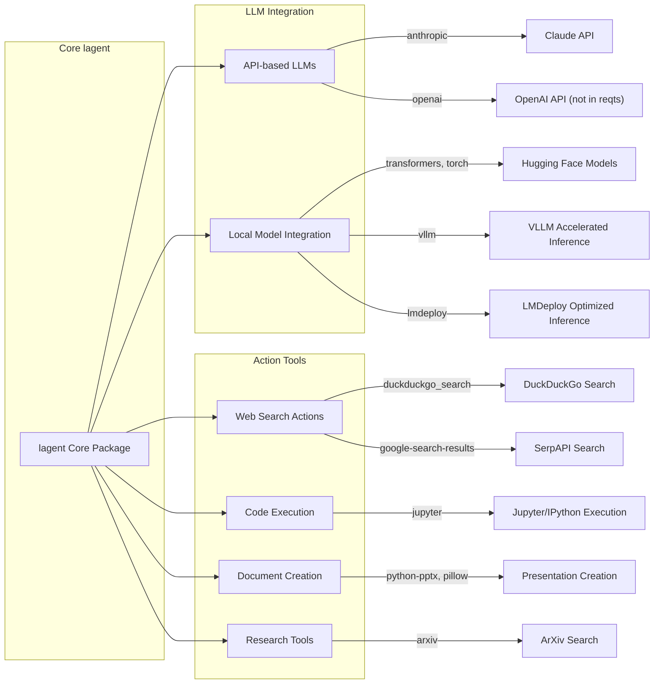

Sources: [requirements/runtime.txt:1-22](), [requirements/optional.txt:1-10]()

## LLM Integration Options

Lagent supports multiple LLM backends through a unified interface. Depending on your needs, you'll need to install and configure different dependencies.

### Model Integration Paths

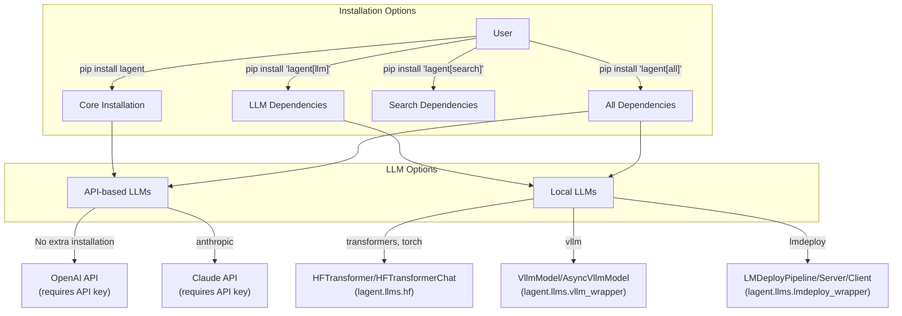

Sources: [lagent/llms/lmdeploy_wrapper.py:1-802](), [lagent/llms/vllm_wrapper.py:1-177]()

## Configuration for LLM Backends

After installation, you need to configure each LLM backend:

### API-based LLM Configuration

For API-based models like OpenAI, you'll need to set the appropriate API keys:

```python
# Example for OpenAI
import os
os.environ["OPENAI_API_KEY"] = "your-api-key"

# Example for Claude
os.environ["ANTHROPIC_API_KEY"] = "your-api-key"
```

### Local LLM Configuration

For local models, you'll need to provide the appropriate model paths or Hugging Face model ids:

```python
# For Hugging Face models
from lagent.llms import HFTransformer
llm = HFTransformer(path="internlm/internlm-chat-7b")

# For VLLM accelerated inference
from lagent.llms import VllmModel
llm = VllmModel(path="internlm/internlm-chat-7b", tp=2)  # tensor parallel = 2

# For LMDeploy optimized inference
from lagent.llms import LMDeployPipeline
llm = LMDeployPipeline(path="internlm/internlm-chat-7b", tp=2)
```

Sources: [lagent/llms/lmdeploy_wrapper.py:210-266](), [lagent/llms/vllm_wrapper.py:18-42]()

## LMDeploy Setup

If you want to use LMDeploy for optimized inference, additional setup is required. LMDeploy offers three deployment patterns:

1. **Pipeline**: Direct integration with the model
2. **Server**: Running a local server with the model
3. **Client**: Connecting to a remote LMDeploy server

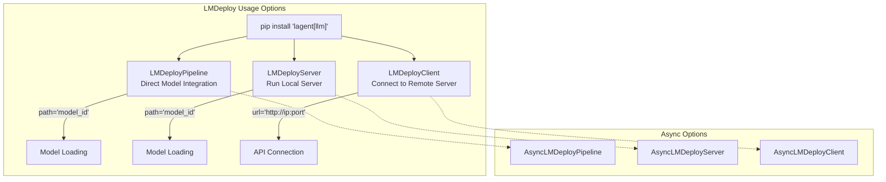

Sources: [lagent/llms/lmdeploy_wrapper.py:210-502]()

## Verification of Installation

You can verify your installation with a simple test:

```python
from lagent import get_version

print(f"Lagent version: {get_version()}")
```

To test a specific LLM connection:

```python
# For API-based models
from lagent.llms import GPTAPI
llm = GPTAPI()
response = llm.generate("Hello, world!")
print(response)

# For local models
from lagent.llms import HFTransformer
llm = HFTransformer(path="internlm/internlm-chat-7b")
response = llm.generate("Hello, world!")
print(response)
```

## Next Steps

After completing the installation and setup:

1. Learn about the Agent System to understand how to create and use different types of agents. See [Agent System](#2.1).
2. Explore the LLM Integration options in more detail. See [LLM Integration](#2.2).
3. Discover the available actions and tools that your agents can use. See [Action System](#2.3).

For practical usage examples, check [Usage Examples](#4).

---

# Page: Core Components

# Core Components

<details>
<summary>Relevant source files</summary>

The following files were used as context for generating this wiki page:

- [.pre-commit-config.yaml](.pre-commit-config.yaml)
- [README.md](README.md)
- [lagent/actions/base_action.py](lagent/actions/base_action.py)
- [lagent/actions/google_search.py](lagent/actions/google_search.py)
- [lagent/agents/__init__.py](lagent/agents/__init__.py)
- [lagent/agents/agent.py](lagent/agents/agent.py)
- [lagent/llms/__init__.py](lagent/llms/__init__.py)
- [lagent/memory/base_memory.py](lagent/memory/base_memory.py)
- [tests/test_actions/test_google_search.py](tests/test_actions/test_google_search.py)

</details>


This page provides an overview of the key components and architecture that make up the LAgent framework. It covers the fundamental building blocks of the system, their responsibilities, and how they work together to enable the creation of LLM-powered agents.

For specific information about individual components, see their dedicated pages: [Agent System](#2.1), [LLM Integration](#2.2), and [Action System](#2.3).

## Core Architecture Overview

LAgent is designed with a modular architecture focused on flexibility and extensibility. The framework is built around several primary components:

- **Agents**: The central orchestrators that manage conversations and tool use
- **Language Models (LLMs)**: The reasoning engines powering agents
- **Actions**: Tools that agents can use to interact with the world
- **Support Systems**: Memory, hooks, parsers, and aggregators that enhance agent capabilities

The following diagram illustrates the high-level relationships between these components:

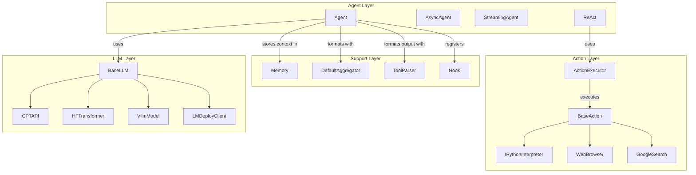

Sources: [lagent/agents/agent.py:18-177](), [lagent/llms/__init__.py:1-40](), [lagent/actions/base_action.py:277-394]()

## Agent System

The agent system serves as the central orchestration layer of the framework. Agents manage interactions with LLMs, store conversation history, execute actions, and handle message formatting.

### Base Agent Class

The `Agent` class is the foundational component. It processes user messages, sends them to the LLM, interprets responses, and maintains conversation context through a memory system.

Key responsibilities of the `Agent` class include:
- Managing conversation state through a memory system
- Formatting prompts through aggregators
- Communicating with LLMs
- Processing LLM outputs through parsers
- Supporting extension through hooks

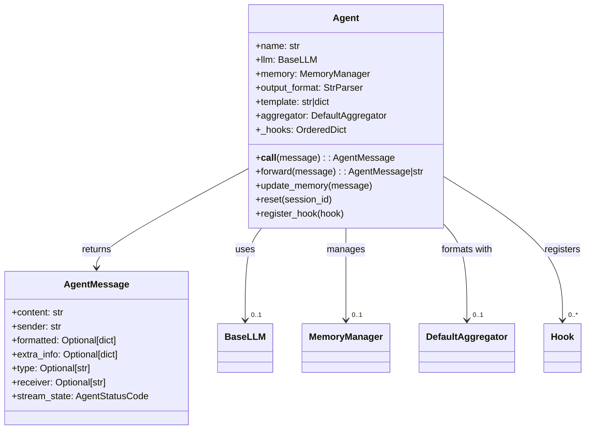

Sources: [lagent/agents/agent.py:18-108]()

### Agent Variants

LAgent provides several specialized agent types to handle different scenarios:

- **Agent**: Base synchronous agent for standard interactions
- **AsyncAgent**: Asynchronous variant for non-blocking operations
- **StreamingAgent**: Agent that returns responses in chunks as they're generated
- **Sequential**: Container for chaining multiple agents together
- **ReAct**: Specialized agent implementing the Reasoning and Acting paradigm

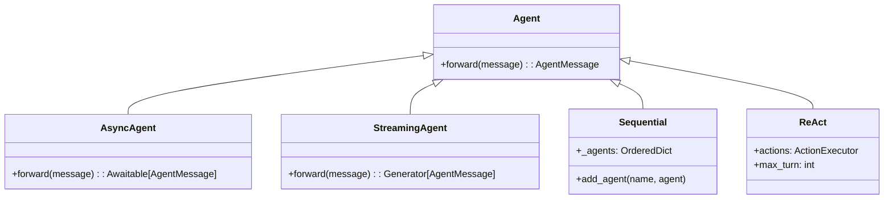

Sources: [lagent/agents/__init__.py:1-33](), [lagent/agents/agent.py:210-303](), [lagent/agents/agent.py:315-360]()

## LLM System

The LLM system provides a unified interface for working with various language models, whether they're API-based (OpenAI, Claude) or locally deployed (via Hugging Face, vLLM, or LMDeploy).

### LLM Abstraction

The `BaseLLM` class defines the standard interface that all language models implement:

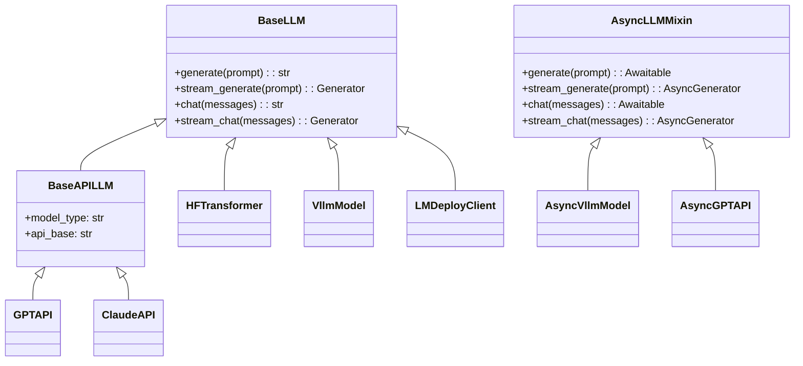

Sources: [lagent/llms/__init__.py:1-40]()

### LLM Implementation Classes

LAgent supports multiple LLM implementations:

| LLM Type | Implementation Classes | Description |
|----------|------------------------|-------------|
| API-based | `GPTAPI`, `ClaudeAPI`, `SensenovaAPI` | Connect to remote API services like OpenAI, Anthropic |
| Local Models | `HFTransformer`, `VllmModel` | Run models locally using frameworks like Hugging Face, vLLM |
| Deployment | `LMDeployClient`, `LMDeployPipeline`, `LMDeployServer` | Deploy models with optimized inference using LMDeploy |

Each implementation class has both synchronous and asynchronous variants (prefixed with "Async") to support different application requirements.

Sources: [lagent/llms/__init__.py:1-40]()

## Action System

The action system enables agents to interact with the external world through tools. It provides a standardized interface for defining, executing, and handling the results of actions.

### BaseAction and ActionExecutor

The `BaseAction` class is the foundation for all tools in the system. Each action implements functionality that an agent can invoke, such as searching the web, executing code, or retrieving information.

The `ActionExecutor` manages the execution of actions and provides a uniform interface for agents to use them.

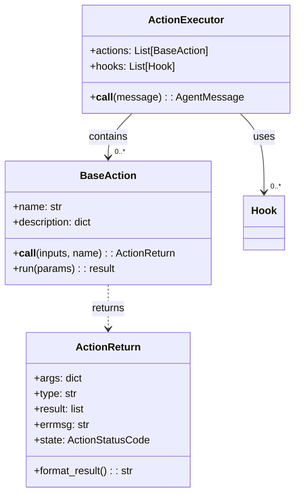

Sources: [lagent/actions/base_action.py:277-394]()

### Built-in Actions

LAgent provides several built-in actions for common tasks:

| Action Type | Implementation | Description |
|-------------|---------------|-------------|
| Web Interaction | `WebBrowser`, `GoogleSearch` | Search the web, navigate websites, retrieve content |
| Code Execution | `IPythonInterpreter`, `PythonInterpreter` | Execute Python code in isolated environments |
| Research | `ArxivSearch`, `GoogleScholar` | Access academic papers and research information |
| Content Creation | `PPT` | Create presentations and documents |

Example of the Google Search implementation:

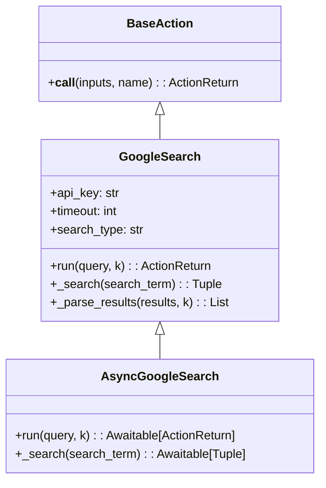

Sources: [lagent/actions/google_search.py:12-244]()

## Support Systems

LAgent includes several support systems that enhance agent capabilities:

### Memory Management

The `Memory` class stores conversation history and provides methods for retrieving, adding, and manipulating stored messages.

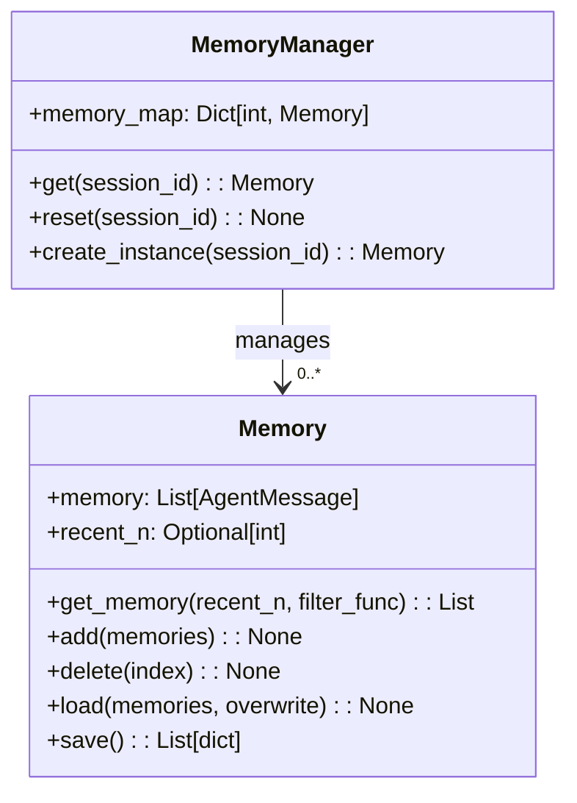

Sources: [lagent/memory/base_memory.py:1-60]()

### Message Aggregation

The `DefaultAggregator` class is responsible for formatting messages from the agent's memory into a format suitable for sending to the LLM. It provides methods for:

- Converting agent messages to LLM-compatible formats
- Adding system instructions
- Handling message formatting for different LLM providers

### Hooks

The hook system allows for intercepting and modifying behavior at various points in the agent execution flow. Hooks can be registered with agents to:

- Preprocess messages before they're sent to the LLM
- Postprocess messages after they're received from the LLM
- Modify actions before execution
- Process action results

### Output Parsing

The parsing system extracts structured information from LLM outputs. The `ToolParser` class can be used to identify when an LLM is attempting to use a tool and extract the parameters.

## Key Communication Patterns

The core components of LAgent interact through well-defined patterns:

1. **User Input Flow**:
   - User sends a message to an Agent
   - Agent adds message to Memory
   - Agent uses Aggregator to format conversation context
   - Agent sends formatted context to LLM
   - LLM generates a response

2. **Action Execution Flow**:
   - LLM response indicates an action should be executed
   - Agent extracts action details via Parser
   - Agent passes action to ActionExecutor
   - ActionExecutor invokes the appropriate BaseAction
   - Action results are returned to Agent
   - Agent sends updated context with action results to LLM for next step

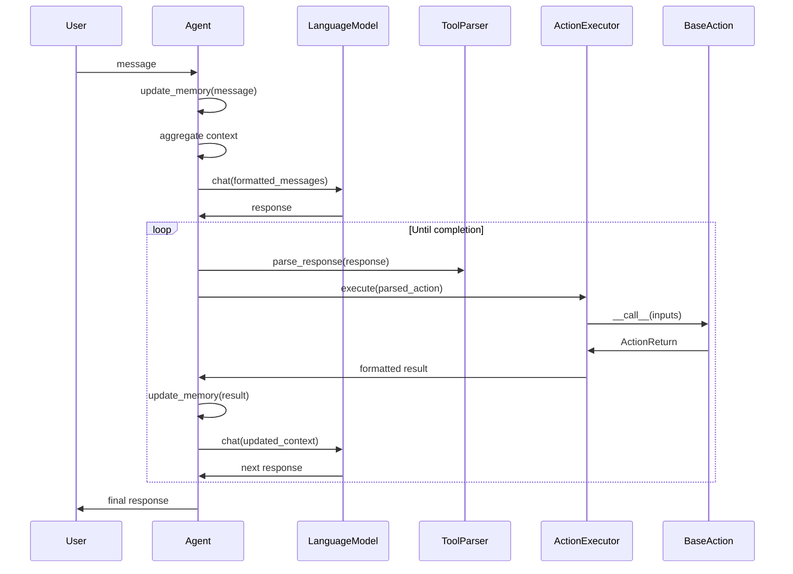

Sources: [README.md:30-276](), [lagent/agents/agent.py:80-93]()

## Customization Options

LAgent provides several customization points for extending the framework:

- **Custom Agents**: Create new agent types by inheriting from the `Agent` class
- **Custom Actions**: Create new tools by implementing the `BaseAction` interface
- **Custom Aggregators**: Modify message formatting by creating new aggregator classes
- **Custom Hooks**: Intercept and modify agent behavior by implementing hooks
- **Custom Parsers**: Extract structured information from LLM outputs with custom parsers

## Synchronous vs. Asynchronous APIs

Most components in LAgent provide both synchronous and asynchronous interfaces, allowing developers to choose the appropriate programming model for their application:

- Synchronous APIs are simpler to use and better for debugging
- Asynchronous APIs enable higher throughput and better resource utilization in production

The framework maintains a consistent naming convention, prefixing asynchronous variants with "Async" (e.g., `Agent` vs. `AsyncAgent`).

Sources: [README.md:280-418]()

---

# Page: Agent System

# Agent System

<details>
<summary>Relevant source files</summary>

The following files were used as context for generating this wiki page:

- [README.md](README.md)
- [lagent/agents/__init__.py](lagent/agents/__init__.py)
- [lagent/agents/agent.py](lagent/agents/agent.py)
- [lagent/agents/aggregator/tool_aggregator.py](lagent/agents/aggregator/tool_aggregator.py)
- [lagent/memory/base_memory.py](lagent/memory/base_memory.py)
- [lagent/prompts/parsers/__init__.py](lagent/prompts/parsers/__init__.py)
- [lagent/schema.py](lagent/schema.py)

</details>


The Agent System is the core component of the lagent framework, providing the foundation for creating and managing language model-powered agents. This document covers the architecture of the agent system, explains the different types of agents available, and details how they process messages, maintain state, and interact with other components. For information about the underlying LLM integration, see [LLM Integration](#2.2), and for details about the actions agents can perform, see [Action System](#2.3).

## Overview

The Agent System provides a modular architecture for building AI agents that can interact with users, maintain conversation context, and execute actions. At its core, the system is built around the concept of message passing between components, with explicit memory management and standardized communication formats.

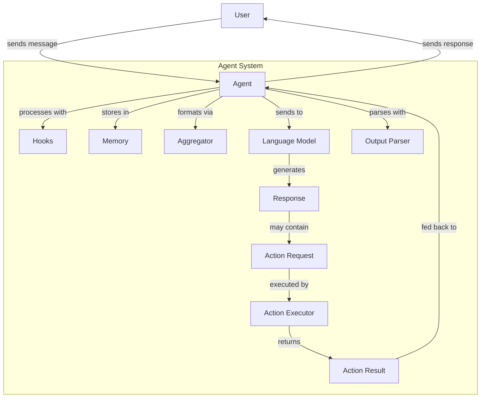

Sources: [lagent/agents/agent.py:18-94](), [README.md:1-418]()

## Core Agent Classes

The Agent System provides a hierarchy of agent classes with different capabilities and execution patterns:

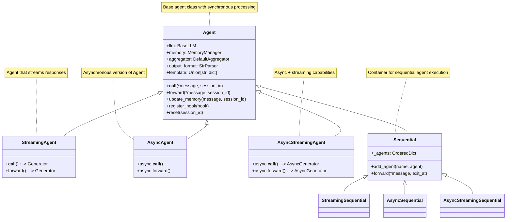

Sources: [lagent/agents/agent.py:18-409]()), [lagent/agents/__init__.py:1-33]()

### Base Agent

The `Agent` class is the fundamental building block of the system. It manages communication with language models, maintains conversation memory, and processes messages through a well-defined lifecycle:

```mermaid
sequenceDiagram
    participant User
    participant Agent
    participant Hooks
    participant Memory
    participant Aggregator
    participant LLM
    participant OutputParser
    
    User->>Agent: message
    
    Agent->>Hooks: before_agent(message)
    Hooks-->>Agent: modified message
    
    Agent->>Memory: update_memory(message)
    
    Agent->>Aggregator: aggregate(memory, template)
    Aggregator-->>Agent: formatted messages
    
    Agent->>LLM: chat(formatted_messages)
    LLM-->>Agent: llm_response
    
    opt If output_format exists
        Agent->>OutputParser: parse_response(llm_response)
        OutputParser-->>Agent: formatted_response
    end
    
    Agent->>Memory: update_memory(response)
    
    Agent->>Hooks: after_agent(response)
    Hooks-->>Agent: modified response
    
    Agent->>User: response
```

The `Agent` class handles:
- Message preprocessing via hooks
- Memory updates for context retention
- Message aggregation for LLM consumption
- LLM interaction for response generation
- Response parsing and formatting
- Post-processing via hooks

Sources: [lagent/agents/agent.py:18-94]()), [lagent/agents/agent.py:66-83]()

## Agent Communication and Messages

Agents communicate using the `AgentMessage` data structure, which provides a standardized format for message passing throughout the system:

```mermaid
classDiagram
    class AgentMessage {
        +content: Any
        +sender: str
        +formatted: Optional[Any]
        +extra_info: Optional[Any]
        +type: Optional[str]
        +receiver: Optional[str]
        +stream_state: Union[ModelStatusCode, AgentStatusCode]
    }
    
    class AgentStatusCode {
        <<enumeration>>
        END = 0
        STREAM_ING = 1
        SERVER_ERR = -1
        SESSION_CLOSED = -2
        SESSION_OUT_OF_LIMIT = -3
        SESSION_INVALID_ARG = -4
        SESSION_READY = 2
        PLUGIN_START = 3
        PLUGIN_END = 4
        PLUGIN_RETURN = 5
        CODING = 6
        CODE_END = 7
        CODE_RETURN = 8
    }
    
    AgentMessage --> AgentStatusCode: uses for stream_state
```

Key fields in `AgentMessage`:
- `content`: The main message content
- `sender`: The source of the message (e.g., "user", agent name)
- `formatted`: Optional structured data parsed from the content
- `stream_state`: Status code for streaming operations

Sources: [lagent/schema.py:90-97]()

## Memory and State Management

Agents maintain state through a memory system that stores conversation history:

```mermaid
classDiagram
    class MemoryManager {
        +memory_map: Dict[int, Memory]
        +create_instance(session_id)
        +get(session_id)
        +add(message, session_id)
        +reset(session_id)
    }
    
    class Memory {
        +memory: List[AgentMessage]
        +recent_n: Optional[int]
        +get_memory(recent_n, filter_func)
        +add(memories)
        +delete(index)
        +load(memories, overwrite)
        +save()
    }
    
    MemoryManager --> Memory: manages
    Agent --> MemoryManager: uses
```

The memory system supports:
- Session-based isolation through session IDs
- Adding and retrieving messages
- Filtering and limiting retrieved messages
- Serialization for persistence

Memory is a crucial component that enables agents to maintain context across multiple turns of conversation. Each agent maintains its own memory, and in multi-agent setups, each agent has independent memory.

Sources: [lagent/memory/base_memory.py:6-60](), [lagent/agents/agent.py:61-65]()

## Message Aggregation and Formatting

Before sending messages to the language model, they need to be correctly formatted according to the model's expected input format:

```mermaid
graph TD
    subgraph "Message Processing"
        Memory["Memory\n(List of AgentMessages)"] -->|"retrieved by"| Aggregator["Aggregator"]
        SystemPrompt["System Prompt/Template"] -->|"used by"| Aggregator
        Aggregator -->|"creates"| FormattedMessages["Formatted Messages\n(for LLM consumption)"]
        FormattedMessages -->|"sent to"| LLM["Language Model"]
        LLM -->|"generates"| Response["LLM Response"]
        Response -->|"parsed by"| Parser["Output Parser"]
        Parser -->|"creates"| FormattedResponse["Structured Response\n(in AgentMessage.formatted)"]
    end
```

The framework includes different aggregators for various use cases:
- `DefaultAggregator`: Standard formatting for most LLMs
- `InternLMToolAggregator`: Specialized for tool use with the InternLM model

Similarly, different output parsers can extract structured information from LLM responses:
- `StrParser`: Base parser class
- `ToolParser`: Extracts tool calls from model output
- `JSONParser`: Parses JSON from model output

Sources: [lagent/agents/agent.py:85-93](), [lagent/agents/aggregator/tool_aggregator.py:8-106](), [lagent/prompts/parsers/__init__.py:1-9]()

## Specialized Agent Types

### Streaming Agents

Streaming agents allow for incremental response generation, showing the model's output as it's being produced rather than waiting for the complete response:

```mermaid
sequenceDiagram
    participant User
    participant StreamingAgent
    participant LLM
    
    User->>StreamingAgent: message
    StreamingAgent->>LLM: stream_chat(formatted_messages)
    
    loop For each token
        LLM-->>StreamingAgent: (model_state, partial_response)
        StreamingAgent-->>User: AgentMessage with partial content
    end
    
    StreamingAgent->>StreamingAgent: update_memory(final_response)
    StreamingAgent-->>User: final AgentMessage
```

The streaming implementation uses Python generators to yield partial responses as they become available.

Sources: [lagent/agents/agent.py:216-257](), [lagent/agents/agent.py:304-307]()

### Asynchronous Agents

Asynchronous agents implement non-blocking versions of the agent interface, allowing for concurrent agent operation:

```mermaid
graph TD
    subgraph "Synchronous vs Asynchronous"
        SyncA["Agent A"] -->|"waits for"| SyncLLM1["LLM Call 1"]
        SyncLLM1 -->|"completes"| SyncB["Agent B"]
        SyncB -->|"waits for"| SyncLLM2["LLM Call 2"]
    end
    
    subgraph "Asynchronous Execution"
        AsyncA["AsyncAgent A"] -->|"initiates"| AsyncLLM1["Async LLM Call 1"]
        AsyncA -->|"continues to"| AsyncB["AsyncAgent B"]
        AsyncB -->|"initiates"| AsyncLLM2["Async LLM Call 2"]
        AsyncLLM1 -.->|"completes later"| Result1["Result 1"]
        AsyncLLM2 -.->|"completes later"| Result2["Result 2"]
    end
```

Asynchronous agents are particularly useful in scenarios where multiple agents need to operate concurrently or when integrating with asynchronous web frameworks.

Sources: [lagent/agents/agent.py:179-207](), [lagent/agents/agent.py:210-213]()

### Sequential Agents

The `Sequential` agent class allows for creating a pipeline of agents where messages flow from one agent to the next:

```mermaid
graph LR
    Input["Input Message"] --> Agent1["Agent 1"]
    Agent1 --> Agent2["Agent 2"]
    Agent2 --> Agent3["Agent 3"]
    Agent3 --> Output["Output Message"]
    
    subgraph "Sequential Container"
        Agent1
        Agent2
        Agent3
    end
```

Sequential agents can be used to create multi-stage processing pipelines where each agent performs a specific function and passes its results to the next agent in the sequence.

Sources: [lagent/agents/agent.py:316-351](), [README.md:354-418]()

## Agent Containers and Composition

The framework supports agent composition through container classes like `AgentList` and `AgentDict`:

```mermaid
graph TD
    subgraph "Agent Composition"
        AgentDict["AgentDict"] -->|"contains"| A1["Agent 1 (key1)"]
        AgentDict -->|"contains"| A2["Agent 2 (key2)"]
        
        AgentList["AgentList"] -->|"contains"| B1["Agent 1 (index 0)"]
        AgentList -->|"contains"| B2["Agent 2 (index 1)"]
        
        CustomAgent["Custom Agent"] -->|"has member"| C1["Sub-agent 1"]
        CustomAgent -->|"has member"| C2["Sub-agent 2"]
    end
```

These container classes allow for flexible organization of multiple agents while maintaining a consistent interface for state management and execution.

Sources: [lagent/agents/agent.py:457-470](), [README.md:419-513]()

## Example Usage Patterns

The Agent System supports various usage patterns depending on the application needs:

### Simple Agent

```python
# Basic agent setup
agent = Agent(llm, system_prompt)
response = agent(user_message)
```

### Tool-using Agent

```python
# Agent that uses tools
agent = Agent(llm, system_prompt, output_format=ToolParser())
executor = ActionExecutor([WebBrowser(), IPythonInterpreter()])

# Process loop
response = agent(user_message)
if response.formatted and response.formatted['tool_type']:
    tool_result = executor(response)
    response = agent(tool_result)
```

### Multi-agent System

```python
# Sequential processing with multiple agents
researcher = Agent(llm, research_prompt, name="researcher")
analyst = Agent(llm, analysis_prompt, name="analyst")
writer = Agent(llm, writing_prompt, name="writer")

sequential = Sequential(researcher, analyst, writer)
final_response = sequential(user_query)
```

Sources: [README.md:30-173](), [README.md:299-351](), [README.md:353-417]()

## Conclusion

The Agent System in lagent provides a comprehensive framework for building and managing LLM-powered agents with different capabilities. Key features include:

1. Flexible agent types supporting synchronous, asynchronous, and streaming operation
2. Memory management for maintaining context across conversations
3. Standardized message format for communication
4. Composable architecture allowing for agent pipelines and hierarchies
5. Hook system for intercepting and modifying agent behavior

This architecture enables the development of sophisticated agent applications, from simple chatbots to complex multi-agent systems that can reason, use tools, and collaborate to solve tasks.

---

# Page: Agent Base Classes

# Agent Base Classes

<details>
<summary>Relevant source files</summary>

The following files were used as context for generating this wiki page:

- [lagent/agents/__init__.py](lagent/agents/__init__.py)
- [lagent/agents/agent.py](lagent/agents/agent.py)
- [lagent/agents/aggregator/tool_aggregator.py](lagent/agents/aggregator/tool_aggregator.py)
- [lagent/memory/base_memory.py](lagent/memory/base_memory.py)
- [lagent/prompts/parsers/__init__.py](lagent/prompts/parsers/__init__.py)
- [lagent/schema.py](lagent/schema.py)

</details>


This document covers the core Agent classes provided by LAgent framework, their interfaces, and usage patterns. These base classes form the foundation of the agent system, enabling different interaction models with language models and supporting both synchronous and asynchronous operations.

For information about ReAct agents (which extend these base classes), see [ReAct Agents](#2.1.2). For specialized agent implementations, see [Specialized Agents](#2.1.3).

## Overview of Agent Base Classes

The LAgent framework provides a set of base Agent classes that enable different interaction patterns with language models:

1. **Basic Agent**: The core agent implementation for standard request-response interactions
2. **Async Agent**: Asynchronous implementation for non-blocking operations
3. **Streaming Agent**: Supports streaming responses for real-time feedback
4. **Sequential Agent**: Chains multiple agents together in sequence
5. **Container Agents**: Collections of agents that act as a single agent

These base classes provide the foundation for more specialized agent implementations in the framework.

Sources: [lagent/agents/__init__.py:1-33](), [lagent/agents/agent.py:18-470]()

## Agent Class Hierarchy

```mermaid
classDiagram
    class "Agent" {
        +llm: BaseLLM
        +memory: MemoryManager
        +output_format: StrParser
        +aggregator: DefaultAggregator
        +template
        +__call__(message): AgentMessage
        +forward(message): AgentMessage
        +reset(session_id)
        +register_hook(hook)
    }
    
    class "AsyncAgentMixin" {
        +async __call__(message): AgentMessage
        +async forward(message): AgentMessage
    }
    
    class "StreamingAgentMixin" {
        +__call__(message): Generator[AgentMessage]
        +forward(message): Generator
    }
    
    class "AsyncStreamingAgentMixin" {
        +async __call__(message): AsyncGenerator[AgentMessage]
        +async forward(message): AsyncGenerator
    }
    
    class "Sequential" {
        +_agents: OrderedDict
        +add_agent(name, agent)
        +forward(message, exit_at): AgentMessage
    }
    
    class "AgentContainerMixin" {
        +wrap collection APIs
    }
    
    Agent <|-- "AsyncAgent"
    Agent <|-- "StreamingAgent"
    Agent <|-- "Sequential"
    
    AsyncAgentMixin --> "AsyncAgent"
    StreamingAgentMixin --> "StreamingAgent"
    
    Sequential <|-- "AsyncSequential"
    Sequential <|-- "StreamingSequential"
    Sequential <|-- "AsyncStreamingSequential"
    
    AsyncAgentMixin --> "AsyncSequential"
    StreamingAgentMixin --> "StreamingSequential"
    AsyncStreamingAgentMixin --> "AsyncStreamingSequential"
    
    Agent <|-- "AgentList"
    Agent <|-- "AgentDict"
    AgentContainerMixin --> "AgentList"
    AgentContainerMixin --> "AgentDict"
```

Sources: [lagent/agents/agent.py:18-470]()

## Base Agent Class

The `Agent` class is the fundamental building block of the LAgent framework. It handles communication with language models, manages conversation memory, and processes input/output messages.

```mermaid
flowchart TD
    subgraph "Agent Components"
        Ag["Agent"] --> LLM["llm: BaseLLM"]
        Ag --> Mem["memory: MemoryManager"]
        Ag --> Agg["aggregator: DefaultAggregator"]
        Ag --> Out["output_format: StrParser"]
        Ag --> Tmpl["template: PromptTemplate"]
        Ag --> Hooks["hooks: Dict[int, Hook]"]
    end
    
    User["User/Application"] -- "message" --> Ag
    Ag -- "response" --> User
    
    Agg -- "formats messages" --> LLM
    LLM -- "generates response" --> Out
    Mem -- "provides context" --> Agg
    Ag -- "updates" --> Mem
```

### Key Properties and Methods

| Property/Method | Description |
|-----------------|-------------|
| `llm` | The language model used by the agent |
| `memory` | Manages conversation history across sessions |
| `aggregator` | Formats messages for the language model |
| `output_format` | Parser for formatting responses |
| `template` | Template for structuring prompts |
| `__call__` | Main entry point for interacting with the agent |
| `forward` | Core processing logic for agent interactions |
| `reset` | Clears the agent's memory for a specific session |
| `register_hook` | Adds hooks for extending agent functionality |
| `state_dict` | Serializes agent state for persistence |
| `load_state_dict` | Loads previously saved agent state |

Sources: [lagent/agents/agent.py:18-98](), [lagent/agents/agent.py:144-165]()

### Basic Usage Example

Here's an example of creating and using the base Agent class:

```python
from lagent.agents import Agent
from lagent.llms import GPTAPI

# Create a simple agent with OpenAI's GPT
agent = Agent(
    llm=GPTAPI(model="gpt-4"), 
    name="Assistant"
)

# Interact with the agent
response = agent("Hello, how can you help me?")
print(response.content)
```

### Agent Interaction Flow

```mermaid
sequenceDiagram
    participant User
    participant Agent
    participant Memory
    participant Aggregator
    participant LLM
    participant OutputParser
    
    User->>Agent: __call__(message)
    Agent->>Agent: Apply pre-processing hooks
    Agent->>Memory: update_memory(message)
    Agent->>Aggregator: aggregate(memory, template)
    Aggregator->>Agent: formatted_messages
    Agent->>LLM: chat(formatted_messages)
    LLM->>Agent: llm_response
    
    opt Has OutputParser
        Agent->>OutputParser: parse_response(llm_response)
        OutputParser->>Agent: formatted_response
    end
    
    Agent->>Memory: update_memory(response)
    Agent->>Agent: Apply post-processing hooks
    Agent->>User: return response
```

Sources: [lagent/agents/agent.py:66-93]()

## Asynchronous Agent

The `AsyncAgent` class extends the base Agent with asynchronous methods for non-blocking operations. This is particularly useful for web applications and services that need to handle multiple requests concurrently.

### Key Methods

| Method | Description |
|--------|-------------|
| `async __call__` | Asynchronous version of the entry point |
| `async forward` | Asynchronous version of the processing logic |

Sources: [lagent/agents/agent.py:179-213]()

### Usage Example

```python
import asyncio
from lagent.agents import AsyncAgent
from lagent.llms import AsyncGPTAPI

async def main():
    # Create an async agent
    agent = AsyncAgent(
        llm=AsyncGPTAPI(model="gpt-4"),
        name="AsyncAssistant"
    )
    
    # Interact with the agent asynchronously
    response = await agent("How does asynchronous programming work?")
    print(response.content)

# Run the async function
asyncio.run(main())
```

## Streaming Agent

The `StreamingAgent` class provides streaming responses, yielding partial results as they become available. This enables real-time feedback during longer generations.

### Key Methods

| Method | Description |
|--------|-------------|
| `__call__` | Returns a generator yielding partial responses |
| `forward` | Returns a generator of model results |

Sources: [lagent/agents/agent.py:216-307]()

### Usage Example

```python
from lagent.agents import StreamingAgent
from lagent.llms import GPTAPI

# Create a streaming agent
agent = StreamingAgent(
    llm=GPTAPI(model="gpt-4"),
    name="StreamingAssistant"
)

# Get streaming responses
for partial_response in agent("Write a short story about AI"):
    print(partial_response.content, end="", flush=True)
```

## Sequential Agent

The `Sequential` class enables chaining multiple agents together, with each agent processing the output of the previous one. This allows building complex agent pipelines.

```mermaid
flowchart LR
    User["User"] -- "query" --> Seq["Sequential Agent"]
    
    subgraph "Sequential Agent"
        A1["Agent 1"] --> A2["Agent 2"] --> A3["Agent 3"]
    end
    
    Seq -- "final response" --> User
```

### Key Methods

| Method | Description |
|--------|-------------|
| `add_agent` | Adds an agent to the sequence |
| `forward` | Processes messages through the sequence of agents |
| `__getitem__` | Access agents by index or name |
| `__len__` | Returns the number of agents in the sequence |

Sources: [lagent/agents/agent.py:316-359]()

### Usage Example

```python
from lagent.agents import Agent, Sequential
from lagent.llms import GPTAPI

# Create individual agents
researcher = Agent(
    llm=GPTAPI(model="gpt-4"),
    name="Researcher"
)

writer = Agent(
    llm=GPTAPI(model="gpt-4"),
    name="Writer"
)

# Create a sequential agent
pipeline = Sequential(
    researcher,
    writer,
    name="ResearchWritingPipeline"
)

# The query first goes to the researcher, then the result goes to the writer
response = pipeline("Explain quantum computing")
print(response.content)
```

## Agent Container Classes

LAgent provides container classes that allow managing collections of agents while providing the standard Agent interface.

### AgentList

A list-like container of agents that is itself an agent.

### AgentDict

A dictionary-like container of agents that is itself an agent.

Sources: [lagent/agents/agent.py:411-470]()

### Usage Example

```python
from lagent.agents import Agent, AgentDict
from lagent.llms import GPTAPI

# Create an agent dictionary
agent_dict = AgentDict({
    "math": Agent(llm=GPTAPI(model="gpt-4"), name="MathExpert"),
    "history": Agent(llm=GPTAPI(model="gpt-4"), name="HistoryExpert"),
    "science": Agent(llm=GPTAPI(model="gpt-4"), name="ScienceExpert")
})

# Access individual agents
response = agent_dict["math"]("What is the derivative of x²?")
print(response.content)
```

## Memory Management

Agents maintain memory of past interactions through the `Memory` class. The memory system enables context-aware responses by providing conversation history to the agent.

```mermaid
flowchart TD
    A["Agent"] --> MM["MemoryManager"]
    MM --> M1["Memory(session_id=0)"]
    MM --> M2["Memory(session_id=1)"]
    MM --> M3["Memory(session_id=...)"]
    
    M1 --> Msg1["AgentMessage[]"]
    M2 --> Msg2["AgentMessage[]"]
    M3 --> Msg3["AgentMessage[]"]
```

### Key Memory Functions

| Method | Description |
|--------|-------------|
| `update_memory` | Adds messages to the agent's memory |
| `reset` | Clears the agent's memory for a session |
| `state_dict` | Serializes memory state for persistence |
| `load_state_dict` | Loads previously saved memory state |

Sources: [lagent/agents/agent.py:62-64](), [lagent/memory/base_memory.py:6-60]()

## Hook System

Agents can be extended with hooks, which allow intercepting and modifying agent behavior at various points in the execution flow.

```mermaid
sequenceDiagram
    participant User
    participant Hook
    participant Agent
    participant LLM
    
    User->>Agent: __call__(message)
    Agent->>Hook: before_agent(agent, message)
    Hook->>Agent: modified message (optional)
    Agent->>LLM: Process message
    LLM->>Agent: response
    Agent->>Hook: after_agent(agent, response)
    Hook->>Agent: modified response (optional)
    Agent->>User: return response
```

### Registering Hooks

```python
from lagent.agents import Agent
from lagent.hooks import MessageLogger

# Create an agent
agent = Agent(...)

# Register a hook
logger_hook = MessageLogger()
handle = agent.register_hook(logger_hook)

# Later, remove the hook if needed
handle.remove()
```

Sources: [lagent/agents/agent.py:140-143]()

## Summary of Agent Variants

The following table summarizes the different agent variants available in LAgent:

| Agent Class | Synchronous | Asynchronous | Streaming | Description |
|-------------|-------------|--------------|-----------|-------------|
| `Agent` | ✅ | ❌ | ❌ | Standard blocking agent |
| `AsyncAgent` | ❌ | ✅ | ❌ | Non-blocking agent |
| `StreamingAgent` | ✅ | ❌ | ✅ | Yields partial responses |
| `AsyncStreamingAgent` | ❌ | ✅ | ✅ | Async agent with streaming |
| `Sequential` | ✅ | ❌ | ❌ | Chain of agents |
| `AsyncSequential` | ❌ | ✅ | ❌ | Async chain of agents |
| `StreamingSequential` | ✅ | ❌ | ✅ | Streaming chain of agents |
| `AsyncStreamingSequential` | ❌ | ✅ | ✅ | Async streaming chain |
| `AgentList` | ✅ | ❌ | ❌ | List-like container of agents |
| `AgentDict` | ✅ | ❌ | ❌ | Dict-like container of agents |

Sources: [lagent/agents/__init__.py:1-33]()

---

# Page: ReAct Agents

# ReAct Agents

<details>
<summary>Relevant source files</summary>

The following files were used as context for generating this wiki page:

- [lagent/agents/__init__.py](lagent/agents/__init__.py)
- [lagent/agents/agent.py](lagent/agents/agent.py)
- [lagent/agents/react.py](lagent/agents/react.py)
- [lagent/memory/base_memory.py](lagent/memory/base_memory.py)
- [lagent/prompts/parsers/str_parser.py](lagent/prompts/parsers/str_parser.py)

</details>


ReAct (Reasoning + Acting) agents implement a powerful paradigm that enables language models to solve complex tasks through iterative reasoning and tool use. This page details the ReAct implementation in the LAgent framework, which follows a multi-turn process where the agent reasons about a problem, selects appropriate tools, executes actions, and incorporates the results to reach a final conclusion.

For information about other agent types like Streaming or AsyncAgent, see [Specialized Agents](#2.1.3).

## Core Concept and Architecture

ReAct agents extend the base Agent class to implement a reasoning-acting loop. They interact with a language model to determine the next action and use an action executor to carry out operations before deciding if they've reached a satisfactory conclusion.

```mermaid
flowchart TD
    subgraph "ReAct Agent System"
        User["User"] -->|"Sends query"| ReAct["ReAct Agent"]
        ReAct -->|"Forwards query"| SelectAgent["Select Agent\n(Internal LLM Agent)"]
        SelectAgent -->|"Generates reasoning\nand action plan"| ReAct
        ReAct -->|"Executes selected\naction if needed"| ActionExecutor["ActionExecutor"]
        ActionExecutor -->|"Returns action\nresults"| ReAct
        ReAct -->|"Checks finish\ncondition"| DecisionPoint{"Finished?"}
        DecisionPoint -->|"No (repeat)"| SelectAgent
        DecisionPoint -->|"Yes"| User
    end
```

Sources: [lagent/agents/react.py:28-66](), [lagent/agents/agent.py:18-94]()

## Implementation Details

The ReAct class extends the base Agent and implements a turn-based interaction pattern that alternates between selecting actions and executing them:

```mermaid
sequenceDiagram
    participant User
    participant ReAct
    participant SelectAgent
    participant ActionExecutor
    
    User->>ReAct: message
    
    loop max_turn times or until completion
        ReAct->>SelectAgent: forward message
        SelectAgent->>ReAct: response with action or conclusion
        
        alt finish_condition met
            ReAct->>User: final response
        else needs more processing
            ReAct->>ActionExecutor: execute action
            ActionExecutor->>ReAct: action results
        end
    end
    
    ReAct->>User: final response
```

Sources: [lagent/agents/react.py:59-65](), [lagent/agents/react.py:99-105]()

### Key Components

1. **select_agent**: An internal Agent instance that determines which action to take or when to conclude
2. **actions**: An ActionExecutor instance that manages available tools and executes them
3. **finish_condition**: A function that determines when the agent has reached a satisfactory conclusion
4. **max_turn**: Maximum number of reasoning-acting cycles before returning

Sources: [lagent/agents/react.py:28-57]()

## Core API and Configuration

The ReAct agent provides both synchronous and asynchronous implementations with the same interface:

| Class | Description |
|-------|-------------|
| `ReAct` | Standard synchronous implementation for sequential processing |
| `AsyncReAct` | Asynchronous implementation for non-blocking operations |

### Initialization Parameters

| Parameter | Type | Description |
|-----------|------|-------------|
| `llm` | `BaseLLM` or `Dict` | Language model for reasoning |
| `actions` | `BaseAction` or `List[BaseAction]` | Tools available to the agent |
| `template` | `PromptTemplate` or `str` | Template for prompting the LLM |
| `memory` | `Dict` | Memory configuration (default: `Memory`) |
| `output_format` | `Dict` | Output parser (default: `JSONParser`) |
| `aggregator` | `Dict` | Context aggregator (default: `DefaultAggregator`) |
| `hooks` | `List` | Hooks for preprocessing (default: `[ActionPreprocessor]`) |
| `finish_condition` | `Callable` | Function determining when to stop (checks for "conclusion") |
| `max_turn` | `int` | Maximum reasoning-acting cycles (default: 5) |

Sources: [lagent/agents/react.py:28-57](), [lagent/agents/react.py:68-97]()

## Implementation Workflow

The ReAct agent operates through the following process:

1. **Initialization**:
   - Creates an `ActionExecutor` for managing tools
   - Creates a `select_agent` with the provided LLM and prompt template
   - Configures memory, output format, and hooks

2. **Forward Method**:
   - Implements a loop for a maximum of `max_turn` iterations
   - For each iteration:
     - Passes the current message to the `select_agent` to decide what to do
     - Checks if the finish condition is met (by default, looks for "conclusion" in the response)
     - If not finished, executes the selected action through the `actions` executor
     - Continues with the result as the new message
   - Returns the final message when done

Sources: [lagent/agents/react.py:59-65](), [lagent/agents/react.py:99-105]()

## Output Format and Processing

ReAct agents use a structured output format to distinguish between:

1. **Action selection**: When the agent needs to use a tool
2. **Conclusion**: When the agent has the final answer

The default implementation uses a JSON parser with two formats:

```
# Action Format:
{
  "thought_process": "...",
  "action": {
    "name": "function_name",
    "parameters": {...}
  }
}

# Finish Format:
{
  "thought_process": "...",
  "conclusion": "..."
}
```

The presence of "conclusion" in the response is used by the default `finish_condition` to determine when the agent has completed its task.

Sources: [lagent/agents/react.py:15-25](), [lagent/agents/react.py:113-127]()

## Memory Management

ReAct agents inherit memory management from the base Agent class. The memory stores:

1. The initial user query
2. Each intermediate step (reasoning, action selection, and action results)
3. The final conclusion

This allows the agent to maintain context throughout the reasoning-acting loop and enables the LLM to review previous steps when making decisions.

Sources: [lagent/agents/agent.py:62-64](), [lagent/memory/base_memory.py:1-60]()

## Integration with Action System

The ReAct agent connects to actions through an `ActionExecutor`, which manages all available tools. When the agent selects an action to perform:

1. The action name and parameters are extracted from the LLM's response
2. The appropriate action is identified and executed
3. The results are returned to the agent for the next reasoning step

Actions can include web browsers, code interpreters, research tools, and other custom tools.

Sources: [lagent/agents/react.py:46](), [lagent/agents/react.py:64](), [lagent/agents/react.py:86](), [lagent/agents/react.py:104]()

## Example Usage

Here's a simplified example of how to create and use a ReAct agent:

```python
from lagent.agents import ReAct
from lagent.schema import AgentMessage

# Create a ReAct agent with Python interpreter capabilities
agent = ReAct(
    llm=dict(
        type="GPTAPI",
        model_type="gpt-4",
    ),
    actions=[dict(type="lagent.actions.PythonInterpreter")],
)

# Use the agent to solve a problem
response = agent(AgentMessage(sender="user", content="Calculate the factorial of 5"))
print(response.content)
```

This example creates a ReAct agent with access to a Python interpreter and uses it to calculate a factorial, demonstrating the reasoning-acting loop in action.

Sources: [lagent/agents/react.py:132-148](), [lagent/agents/react.py:150-164]()

## Asynchronous Implementation

The `AsyncReAct` class provides an asynchronous implementation with identical functionality, suitable for non-blocking operations in asynchronous environments:

```python
# Using AsyncReAct
async_agent = AsyncReAct(
    llm=dict(
        type="AsyncGPTAPI",
        model_type="gpt-4",
    ),
    actions=[dict(type="lagent.actions.AsyncPythonInterpreter")],
)

# Must be called in an async context
response = await async_agent(AgentMessage(sender="user", content="Calculate the factorial of 5"))
```

The async implementation follows the same pattern but uses `async/await` syntax for all operations.

Sources: [lagent/agents/react.py:68-105](), [lagent/agents/react.py:150-164]()

## Customization

ReAct agents can be customized in several ways:

1. **Custom Finish Conditions**: Override the default `finish_condition` function to implement custom stopping criteria
2. **Custom Prompt Templates**: Define specialized prompt templates for domain-specific tasks
3. **Custom Actions**: Create and register custom actions to extend the agent's capabilities
4. **Hooks**: Add pre-processing and post-processing hooks to modify behavior

For more complex customization scenarios, you can inherit from the ReAct class and override specific methods.

Sources: [lagent/agents/react.py:39-41](), [lagent/agents/react.py:79-81]()

---

# Page: Specialized Agents

# Specialized Agents

<details>
<summary>Relevant source files</summary>

The following files were used as context for generating this wiki page:

- [lagent/agents/__init__.py](lagent/agents/__init__.py)
- [lagent/agents/agent.py](lagent/agents/agent.py)
- [lagent/agents/stream.py](lagent/agents/stream.py)
- [lagent/memory/base_memory.py](lagent/memory/base_memory.py)
- [lagent/prompts/parsers/tool_parser.py](lagent/prompts/parsers/tool_parser.py)
- [setup.cfg](setup.cfg)

</details>


This page documents the specialized agent implementations in the lagent framework. These agents extend the core Agent functionality (covered in [Agent Base Classes](#2.1.1)) with capabilities such as streaming responses, sequential processing, and domain-specific functionality like mathematical problem-solving. For information about the ReAct pattern used in some agents, see [ReAct Agents](#2.1.2).

## Agent Specialization Hierarchy

The lagent framework offers several specialized agent implementations that inherit from the base Agent class:

```mermaid
classDiagram
    class "Agent" {
        +llm: BaseLLM
        +memory: Memory
        +aggregator: Aggregator
        +output_format: StrParser
        +forward(message, session_id)
    }
    
    class "StreamingAgent" {
        +__call__(message): Generator
        +forward(message): Generator
    }
    
    class "AsyncAgent" {
        +async __call__(message)
        +async forward(message)
    }
    
    class "AsyncStreamingAgent" {
        +async __call__(message): AsyncGenerator
        +async forward(message): AsyncGenerator
    }
    
    class "Sequential" {
        +_agents: OrderedDict
        +forward(message, exit_at)
    }
    
    class "StreamingSequential" {
        +forward(message, exit_at): Generator
    }
    
    class "AsyncSequential" {
        +async forward(message, exit_at)
    }
    
    class "AsyncStreamingSequential" {
        +async forward(message, exit_at): AsyncGenerator
    }
    
    class "AgentForInternLM" {
        +agent: Agent
        +plugin_executor: ActionExecutor
        +interpreter_executor: ActionExecutor
        +forward(message, session_id)
    }
    
    class "AsyncAgentForInternLM" {
        +agent: AsyncAgent
        +plugin_executor: AsyncActionExecutor
        +interpreter_executor: AsyncActionExecutor
        +async forward(message, session_id)
    }
    
    class "MathCoder" {
        +interpreter_executor: ActionExecutor
    }
    
    class "AsyncMathCoder" {
        +interpreter_executor: AsyncActionExecutor
        +async forward(message, session_id)
    }
    
    Agent <|-- StreamingAgent
    Agent <|-- AsyncAgent
    Agent <|-- Sequential
    
    Agent <|-- AsyncStreamingAgent
    
    Sequential <|-- StreamingSequential
    Sequential <|-- AsyncSequential
    Sequential <|-- AsyncStreamingSequential
    
    Agent <|-- AgentForInternLM
    AsyncAgent <|-- AsyncAgentForInternLM
    
    AgentForInternLM <|-- MathCoder
    AsyncAgentForInternLM <|-- AsyncMathCoder
```

Sources: [lagent/agents/agent.py:18-313](), [lagent/agents/agent.py:316-408](), [lagent/agents/stream.py:56-288]()

## Streaming Agents

Streaming agents provide incremental output generation instead of waiting for the entire response to be ready. This is particularly useful for long-running processes or when immediate feedback is desired.

### StreamingAgent and AsyncStreamingAgent

These agents extend the base Agent class with streaming capabilities:

- **StreamingAgent**: Synchronous streaming agent that returns a generator
- **AsyncStreamingAgent**: Asynchronous streaming agent that returns an async generator

The key difference from the base Agent is that these agents return content incrementally as it's generated by the underlying LLM, rather than waiting for the complete response.

```mermaid
sequenceDiagram
    participant "Client" as Client
    participant "StreamingAgent" as Agent
    participant "LLM" as LLM
    
    Client->>Agent: __call__(message)
    Agent->>Agent: update_memory(message)
    Agent->>Agent: format messages via aggregator
    Agent->>LLM: stream_chat(formatted_messages)
    
    loop For each chunk from LLM
        LLM-->>Agent: (model_state, response_chunk)
        Agent-->>Client: yield updated message
    end
    
    Agent->>Agent: update_memory(final_message)
    Agent-->>Client: yield final message
```

Sources: [lagent/agents/agent.py:216-256](), [lagent/agents/agent.py:259-301](), [lagent/agents/agent.py:304-313]()

### Implementation Details

The streaming functionality is implemented using mixins:

1. **StreamingAgentMixin**: Handles synchronous streaming
   - Overrides `__call__` to return a generator
   - Uses `llm.stream_chat()` instead of `llm.chat()`

2. **AsyncStreamingAgentMixin**: Handles asynchronous streaming
   - Overrides `__call__` to return an async generator
   - Uses `async for` to process streaming content

The StreamingAgent class is created by combining the StreamingAgentMixin with the base Agent class, while AsyncStreamingAgent combines AsyncStreamingAgentMixin with the base Agent class.

Sources: [lagent/agents/agent.py:216-313]()

## Sequential Agents

Sequential agents provide a way to chain multiple agents together, allowing messages to be processed in sequence through a series of specialized agents.

### Sequential and Streaming Variants

Four variants of sequential agents are available:

| Agent Type | Description |
|------------|-------------|
| Sequential | Basic sequential processing of agents |
| AsyncSequential | Asynchronous sequential processing |
| StreamingSequential | Sequential processing with streaming output |
| AsyncStreamingSequential | Asynchronous sequential processing with streaming output |

```mermaid
sequenceDiagram
    participant "Client" as Client
    participant "Sequential" as Seq
    participant "Agent1" as A1
    participant "Agent2" as A2
    participant "Agent3" as A3
    
    Client->>Seq: __call__(message)
    Seq->>A1: __call__(message)
    A1-->>Seq: response1
    
    Seq->>A2: __call__(response1)
    A2-->>Seq: response2
    
    Seq->>A3: __call__(response2)
    A3-->>Seq: response3
    
    Seq-->>Client: response3
```

Sources: [lagent/agents/agent.py:316-408]()

### Implementation Details

The Sequential agent class maintains an ordered dictionary of sub-agents and processes them in sequence:

- Agents can be added during initialization or using the `add_agent` method
- The `forward` method supports an `exit_at` parameter to stop processing after a specific agent
- Each agent in the sequence receives the output of the previous agent as its input

The streaming and asynchronous variants follow the same pattern but with appropriate modifications for their execution models.

Sources: [lagent/agents/agent.py:316-408]()

## InternLM Agents

AgentForInternLM provides specialized support for the InternLM model with integrated tool capabilities.

```mermaid
classDiagram
    class "AgentForInternLM" {
        +agent: Agent
        +plugin_executor: ActionExecutor
        +interpreter_executor: ActionExecutor
        +finish_condition: Callable
        +max_turn: int
        +forward(message, session_id)
    }
    
    class "ActionExecutor" {
        +actions: List[BaseAction]
        +hooks: List[Hook]
        +__call__(message, session_id)
    }
    
    class "MixedToolParser" {
        +parsers: Dict[str, ToolParser]
        +parse_response(data): dict
    }
    
    class "InternLMToolAggregator" {
        +aggregate(memory, agent_name, output_format, template)
    }
    
    AgentForInternLM --> "1" ActionExecutor: plugin_executor
    AgentForInternLM --> "1" ActionExecutor: interpreter_executor
    AgentForInternLM --> "1" Agent: agent
    Agent --> "1" MixedToolParser: output_format
    Agent --> "1" InternLMToolAggregator: aggregator
```

Sources: [lagent/agents/stream.py:56-128](), [lagent/agents/stream.py:169-240]()

### Key Features of InternLM Agents

1. **Dual Action System**:
   - `plugin_executor`: Handles external tool plugins
   - `interpreter_executor`: Handles code interpretation

2. **Tool Integration**:
   - Uses a `MixedToolParser` to handle multiple tool types
   - Supports both plugins and code interpretation

3. **Iteration Model**:
   - Implements a turn-based approach with `max_turn` limit
   - Uses a `finish_condition` to determine when to stop

4. **Step Tracking**:
   - `get_steps()` method provides a structured log of agent reasoning and actions

The AgentForInternLM has both synchronous and asynchronous implementations (AgentForInternLM and AsyncAgentForInternLM respectively).

Sources: [lagent/agents/stream.py:56-128](), [lagent/agents/stream.py:169-240]()

### Tool Processing Flow

```mermaid
flowchart TD
    subgraph "AgentForInternLM"
        A["User Message"] --> B["Process with agent"]
        B --> C{"Tool required?"}
        C -->|"No (status=NO_TOOL)"| D["Return final response"]
        C -->|"Yes"| E{"Determine tool type"}
        E -->|"plugin"| F["Execute plugin"]
        E -->|"interpreter"| G["Execute interpreter"]
        F --> H["Next turn"]
        G --> H
        H --> B
    end
```

Sources: [lagent/agents/stream.py:99-113](), [lagent/agents/stream.py:213-225](), [lagent/prompts/parsers/tool_parser.py:18-22]()

## MathCoder Agents

MathCoder is a specialized agent designed for mathematical problem-solving using Python code execution.

### Key Features of MathCoder

1. **Python-Based Math Solver**:
   - Inherits from AgentForInternLM but focuses on mathematical problem-solving
   - Uses a specialized `InterpreterParser` optimized for Python code execution

2. **Specialized Prompting**:
   - Contains domain-specific instructions for step-by-step reasoning
   - Formats final results in LaTeX with boxed answers

3. **Configuration**:
   - Configured with a longer `max_turn` (6 vs. 4) for complex problems
   - Uses the `IPythonInteractive` interpreter for Jupyter-like code execution

The MathCoder has both synchronous and asynchronous implementations (MathCoder and AsyncMathCoder respectively).

```mermaid
flowchart TD
    subgraph "MathCoder"
        A["Math Problem"] --> B["Analyze problem and generate Python code"]
        B --> C["Execute code in IPython interpreter"]
        C --> D["Analyze results"]
        D --> E{"Solution found?"}
        E -->|"No"| F["Generate refined code"]
        F --> C
        E -->|"Yes"| G["Format answer in LaTeX with \\boxed{}"]
        G --> H["Return solution"]
    end
```

Sources: [lagent/agents/stream.py:130-167](), [lagent/agents/stream.py:243-288]()

### AsyncMathCoder Implementation

The AsyncMathCoder extends the AsyncAgentForInternLM with:

1. **Session Management**:
   - Automatically closes interpreter sessions after the task completes
   - Prevents resource leaks when handling multiple requests

2. **Async Interpreter**:
   - Uses AsyncIPythonInterpreter for non-blocking code execution
   - Particularly important for long-running calculations

Sources: [lagent/agents/stream.py:243-288]()

## Usage Examples

### Streaming Agent

```python
from lagent.agents import StreamingAgent
from lagent.llms import GPTAPI

agent = StreamingAgent(llm=GPTAPI(api_key="your-api-key"))

# Get streaming responses
for chunk in agent("Tell me about artificial intelligence"):
    print(chunk.content, end="", flush=True)
```

### InternLM Agent with Python Interpreter

```python
from lagent.agents import AgentForInternLM
from lagent.actions import IPythonInterpreter
from lagent.llms import GPTAPI

agent = AgentForInternLM(
    llm=GPTAPI(api_key="your-api-key"),
    interpreter=dict(type=IPythonInterpreter)
)

response = agent("Generate a fractal image using Python")
print(response.content)
```

### MathCoder for Solving Math Problems

```python
from lagent.agents import MathCoder
from lagent.llms import GPTAPI

math_agent = MathCoder(
    llm=GPTAPI(api_key="your-api-key")
)

problem = "Find the derivative of f(x) = 3x^4 - 2x^2 + 7x"
solution = math_agent(problem)
print(solution.content)
```

Sources: [lagent/agents/agent.py:304-313](), [lagent/agents/stream.py:56-128](), [lagent/agents/stream.py:130-167]()

---

# Page: LLM Integration

# LLM Integration

<details>
<summary>Relevant source files</summary>

The following files were used as context for generating this wiki page:

- [.pre-commit-config.yaml](.pre-commit-config.yaml)
- [README.md](README.md)
- [lagent/llms/__init__.py](lagent/llms/__init__.py)

</details>


This page documents how lagent integrates with different Language Model providers to enable agent capabilities. It covers the LLM abstraction layer architecture, supported LLM providers, and implementation details for both API-based and locally-deployed models.

For information about implementing agents that use these LLMs, see [Agent System](#2.1). For details on action execution capabilities that agents can use, see [Action System](#2.3).

## 1. LLM Abstraction Architecture

The lagent framework implements a flexible abstraction layer that provides a common interface for different types of language models. This allows agents to work with various LLMs interchangeably while maintaining consistent behavior.

```mermaid
classDiagram
    class BaseLLM {
        +generate(prompt, **kwargs): str
        +stream_generate(prompt, **kwargs): Iterator[str]
        +chat(messages, **kwargs): str
        +stream_chat(messages, **kwargs): Iterator[str]
    }
    
    class AsyncLLMMixin {
        +async_generate(prompt, **kwargs): str
        +async_stream_generate(prompt, **kwargs): AsyncIterator[str]
        +async_chat(messages, **kwargs): str
        +async_stream_chat(messages, **kwargs): AsyncIterator[str]
    }
    
    class BaseAPILLM {
        +api_type: str
        +request(**kwargs): dict
    }
    
    class AsyncBaseAPILLM {
        +api_type: str
        +async_request(**kwargs): dict
    }
    
    BaseLLM <|-- BaseAPILLM
    AsyncLLMMixin <|-- AsyncBaseAPILLM
    BaseAPILLM <|-- AsyncBaseAPILLM
    
    %% API-based implementations
    BaseAPILLM <|-- GPTAPI
    BaseAPILLM <|-- ClaudeAPI
    BaseAPILLM <|-- SensenovaAPI
    AsyncBaseAPILLM <|-- AsyncGPTAPI
    AsyncBaseAPILLM <|-- AsyncClaudeAPI
    
    %% Model-based implementations
    BaseLLM <|-- HFTransformer
    HFTransformer <|-- HFTransformerChat
    BaseLLM <|-- VllmModel
    AsyncLLMMixin <|-- AsyncVllmModel
    
    %% Deployment-based implementations
    BaseLLM <|-- LMDeployClient
    BaseLLM <|-- LMDeployPipeline
    BaseLLM <|-- LMDeployServer
```

Sources: [lagent/llms/__init__.py:1-41]()

The LLM abstraction system defines a consistent interface with core methods for text generation:

1. **Core Interface Methods**:
   - `generate()`: Generate text completion from a prompt
   - `stream_generate()`: Stream text completion from a prompt
   - `chat()`: Generate response to a conversation
   - `stream_chat()`: Stream response to a conversation
   - Async variants of each method (provided by AsyncLLMMixin)

## 2. Types of LLM Implementations

The lagent framework provides three main types of LLM implementations:

### 2.1 API-based LLMs

These implementations connect to cloud-based LLM services through their REST APIs.

```mermaid
graph TD
    subgraph "API-Based LLMs"
        BaseAPILLM["BaseAPILLM"] --> GPTAPI["GPTAPI\n(OpenAI models)"]
        BaseAPILLM --> ClaudeAPI["ClaudeAPI\n(Anthropic Claude)"]
        BaseAPILLM --> SensenovaAPI["SensenovaAPI"]
        
        AsyncBaseAPILLM["AsyncBaseAPILLM"] --> AsyncGPTAPI["AsyncGPTAPI"]
        AsyncBaseAPILLM --> AsyncClaudeAPI["AsyncClaudeAPI"]
    end
```

Sources: [lagent/llms/__init__.py:1-2](), [lagent/llms/__init__.py:14-15](), [lagent/llms/__init__.py:15-16]()

API-based LLMs handle authentication, request formatting, and response parsing for their respective services. For example, the OpenAI implementation accepts API keys and converts between lagent's message format and the format expected by the OpenAI API.

### 2.2 Model-based LLMs

These implementations support running models locally using frameworks like Hugging Face Transformers and vLLM.

```mermaid
graph TD
    subgraph "Model-Based LLMs"
        BaseLLM["BaseLLM"] --> HFTransformer["HFTransformer\n(Hugging Face models)"]
        HFTransformer --> HFTransformerChat["HFTransformerChat"]
        HFTransformer --> HFTransformerCasualLM["HFTransformerCasualLM"]
        
        BaseLLM --> VllmModel["VllmModel\n(vLLM-powered inference)"]
        AsyncLLMMixin["AsyncLLMMixin"] --> AsyncVllmModel["AsyncVllmModel"]
    end
```

Sources: [lagent/llms/__init__.py:4](), [lagent/llms/__init__.py:16]()

Model-based LLMs typically require model paths and generation parameters, allowing for flexible configuration of locally-deployed models. They handle loading models, tokenization, and generation logic.

### 2.3 Deployment-based LLMs

These implementations support models deployed through optimization frameworks like LMDeploy, focusing on inference efficiency and scalability.

```mermaid
graph TD
    subgraph "Deployment-Based LLMs"
        BaseLLM["BaseLLM"] --> LMDeployClient["LMDeployClient"]
        BaseLLM --> LMDeployPipeline["LMDeployPipeline"]
        BaseLLM --> LMDeployServer["LMDeployServer"]
        
        AsyncLLMMixin["AsyncLLMMixin"] --> AsyncLMDeployClient["AsyncLMDeployClient"]
        AsyncLLMMixin --> AsyncLMDeployPipeline["AsyncLMDeployPipeline"]
        AsyncLLMMixin --> AsyncLMDeployServer["AsyncLMDeployServer"]
    end
```

Sources: [lagent/llms/__init__.py:5-12]()

LMDeploy variants offer optimized inference performance with different deployment options:
- Client: Connects to a running LMDeploy service
- Pipeline: Uses LMDeploy's pipeline API for local inference
- Server: Interfaces with a deployed LMDeploy server

## 3. LLM Integration in the Agent Framework

Language models are a core component in the agent architecture, serving as the "brain" that powers agent reasoning and decision-making.

```mermaid
graph TD
    subgraph "Agent System"
        Agent["Agent"] -->|uses| LLM["BaseLLM"]
        Agent -->|formats context via| Aggregator["Aggregator"]
        Agent -->|stores messages in| Memory["Memory"]
        LLM -->|returns response to| Agent
        Agent -->|parses response with| OutputParser["OutputParser"]
        OutputParser -->|extracts actions| ActionExecutor["ActionExecutor"]
    end
    
    subgraph "LLM System"
        LLM --> APILLMs["API-based LLMs\n(OpenAI, Claude, etc.)"]
        LLM --> LocalLLMs["Model-based LLMs\n(HuggingFace, vLLM)"]
        LLM --> DeployedLLMs["Deployment-based LLMs\n(LMDeploy)"]
    end
```

Sources: [README.md:105-116]()

In the agent workflow:
1. The agent receives a user message
2. The message is stored in memory
3. The aggregator formats the conversation history into LLM-compatible messages
4. The LLM generates a response
5. The output parser extracts structured information (like tool calls)
6. If needed, tools are executed and their results are fed back to the LLM

## 4. Configuring LLMs

Each LLM implementation has specific configuration options. Here are common configuration patterns:

### 4.1 API-based LLM Configuration

API-based LLMs typically require API keys and model names:

```python
from lagent.llms import GPTAPI

llm = GPTAPI(
    model_type="gpt-4o",  # Model name
    key="YOUR_API_KEY",   # API key
    retry=5,              # Number of retry attempts
    max_new_tokens=1024   # Maximum tokens to generate
)
```

### 4.2 Local Model Configuration 

Model-based LLMs require model paths and generation parameters:

```python
from lagent.llms import VllmModel, INTERNLM2_META

llm = VllmModel(
    path='Qwen/Qwen2-7B-Instruct',  # Model path
    meta_template=INTERNLM2_META,    # Template configuration
    tp=1,                           # Tensor parallelism
    top_k=1,                        # Top-k sampling parameter
    temperature=1.0,                # Temperature for sampling
    stop_words=['<|im_end|>'],      # Stop tokens
    max_new_tokens=1024             # Maximum tokens to generate
)
```

Sources: [README.md:45-53](), [README.md:308-317]()

### 4.3 Deployment Configuration

LMDeploy implementations connect to optimized deployments:

```python
from lagent.llms import LMDeployClient

llm = LMDeployClient(
    model_path="internlm2-chat-7b",  # Model identifier
    port=23333,                     # Server port
    host="localhost"                # Server host
)
```

## 5. Dual Interface Design

Lagent implements both synchronous and asynchronous interfaces for most LLM implementations, allowing developers to choose based on their application needs.

```mermaid
graph TD
    subgraph "Synchronous Interface"
        BaseLLM["BaseLLM"] -->|"generate()"| SyncResponse["Response"]
        BaseLLM -->|"stream_generate()"| SyncStream["Iterator[Response]"]
        BaseLLM -->|"chat()"| SyncChatResponse["Chat Response"]
    end
    
    subgraph "Asynchronous Interface"
        AsyncLLMMixin["AsyncLLMMixin"] -->|"async_generate()"| AsyncResponse["Coroutine[Response]"]
        AsyncLLMMixin -->|"async_stream_generate()"| AsyncStream["AsyncIterator[Response]"]
        AsyncLLMMixin -->|"async_chat()"| AsyncChatResponse["Coroutine[Response]"]
    end
    
    User["Application/Agent"] -->|"Choose interface"| BaseLLM
    User -->|"Choose interface"| AsyncLLMMixin
```

Sources: [README.md:281-289]()

The dual interface design is particularly useful for:
- **Synchronous**: Debugging, interactive applications, and simpler workflows
- **Asynchronous**: High-throughput applications, backend services, and concurrent processing

## 6. Extension and Customization

The LLM abstraction system is designed to be extensible. Developers can:

1. Implement their own LLM providers by extending `BaseLLM` or `BaseAPILLM`
2. Configure model-specific behavior through templates and parameters
3. Integrate with new model deployment technologies

```mermaid
classDiagram
    class BaseLLM {
        +generate()
        +stream_generate()
        +chat()
        +stream_chat()
    }
    
    class CustomLLM {
        -custom_connection
        -model_config
        +initialize()
        +generate()
        +chat()
    }
    
    BaseLLM <|-- CustomLLM
    
    note for CustomLLM "Developers can implement\ncustom LLM providers by\nextending the base classes"
```

To implement a custom LLM, developers need to:
1. Extend the appropriate base class (BaseLLM or BaseAPILLM)
2. Implement the required methods (generate, chat, etc.)
3. Handle any specific tokenization, prompting, or response parsing

## Summary

The LLM integration in lagent provides a flexible abstraction over various language model implementations, allowing agents to work with different models through a consistent interface. The system supports API-based models (like OpenAI and Claude), locally-deployed models (via Hugging Face and vLLM), and optimized deployments (via LMDeploy). The dual synchronous/asynchronous interface design accommodates different application needs, making the framework suitable for a wide range of agent-based applications.

Sources: [lagent/llms/__init__.py:1-41](), [README.md:36-62]()

---

# Page: API-based LLMs

# API-based LLMs

<details>
<summary>Relevant source files</summary>

The following files were used as context for generating this wiki page:

- [lagent/llms/base_api.py](lagent/llms/base_api.py)
- [lagent/llms/openai.py](lagent/llms/openai.py)
- [lagent/llms/sensenova.py](lagent/llms/sensenova.py)
- [lagent/utils/gen_key.py](lagent/utils/gen_key.py)

</details>


This page documents the API-based language model integrations in the lagent framework. It covers how to use and configure LLMs accessed through REST APIs, such as OpenAI's GPT models and SenseNova's models. For information about locally-deployed models, see [Local Model Integration](#2.2.2).

## Overview

API-based LLMs in lagent provide a consistent interface for interacting with language models hosted by third-party providers. These classes handle the complexities of API communication, authentication, retries, error handling, and message formatting, allowing you to focus on building agents rather than managing API details.

```mermaid
classDiagram
    class BaseLLM {
        +generate()
        +stream_generate()
        +chat()
        +stream_chat()
    }
    
    class AsyncLLMMixin {
        +async chat()
        +async stream_chat()
    }
    
    class BaseAPILLM {
        +template_parser
        +retry: int
        +gen_params: dict
        +is_api: bool
    }
    
    class AsyncBaseAPILLM {
    }
    
    class GPTAPI {
        +model_type: str
        +keys: List[str]
        +invalid_keys: set
        +orgs: List[str]
        +url: str
        +proxies: Dict
        +json_mode: bool
        +_chat()
        +_stream_chat()
        +generate_request_data()
    }
    
    class AsyncGPTAPI {
        +async _chat()
        +async _stream_chat()
    }
    
    class SensenovaAPI {
        +model_type: str
        +keys: List[str]
        +invalid_keys: set
        +url: str
        +proxies: Dict
        +json_mode: bool
        +_chat()
        +_stream_chat()
        +generate_request_data()
    }
    
    BaseLLM <|-- BaseAPILLM
    AsyncLLMMixin <|-- AsyncBaseAPILLM
    BaseAPILLM <|-- AsyncBaseAPILLM
    BaseAPILLM <|-- GPTAPI
    AsyncBaseAPILLM <|-- AsyncGPTAPI
    BaseAPILLM <|-- SensenovaAPI
```

Sources: [lagent/llms/base_api.py:131-174](), [lagent/llms/openai.py:24-411](), [lagent/llms/openai.py:413-811](), [lagent/llms/sensenova.py:23-406]()

## Common Base Classes

API-based LLMs share common functionality implemented in base classes:

### BaseAPILLM

This class serves as the foundation for all API-based LLM integrations. It provides:

- Common generation parameters (temperature, top_p, etc.)
- Retry logic for API failures
- Template parsing for converting messages to API-compatible formats

```python
# Example initialization
llm = BaseAPILLM(
    model_type="model-name",
    retry=2,
    meta_template=[...],  # Optional message role mapping
    max_new_tokens=512,
    top_p=0.8,
    temperature=0.8
)
```

Sources: [lagent/llms/base_api.py:131-173]()

### AsyncBaseAPILLM

This class extends `BaseAPILLM` with asynchronous support, allowing for non-blocking API calls when used with async frameworks like FastAPI or asyncio.

Sources: [lagent/llms/base_api.py:174-175]()

## Message Template Handling

API-based LLMs use the `APITemplateParser` to convert message formats:

```mermaid
flowchart TB
    A["Agent Message Format\n{role: 'user', content: 'Hello'}"] --> B["APITemplateParser"]
    B --> C["API-Specific Format\n{role: 'user', content: 'Hello'}"]
    
    subgraph "Template Parsing Process"
        B -->|"Meta Templates"| D["Role Mapping"]
        D -->|"Apply Wrapper Text"| E["Add Prefixes/Suffixes"]
        E -->|"Merge Same Roles"| F["Final API Messages"]
    end
```

The parser maps internal role names to provider-specific roles and can add role-specific prefixes or suffixes as needed.

Sources: [lagent/llms/base_api.py:7-129]()

## OpenAI GPT Models

The `GPTAPI` and `AsyncGPTAPI` classes provide integration with OpenAI's GPT models through their Chat Completions API.

### Key Features

- Support for all OpenAI models (gpt-3.5-turbo, gpt-4, etc.)
- API key rotation and load balancing
- Organization ID support
- JSON mode for structured outputs
- Streaming support

### Basic Usage Example

```python
from lagent.llms.openai import GPTAPI

# Initialize with API key from environment variable
llm = GPTAPI(
    model_type="gpt-4",
    temperature=0.7,
    max_new_tokens=1024
)

# Create message format
messages = [
    {"role": "system", "content": "You are a helpful assistant."},
    {"role": "user", "content": "Tell me about deep learning."}
]

# Get completion
response = llm.chat(messages)
print(response)
```

### Async Usage Example

```python
import asyncio
from lagent.llms.openai import AsyncGPTAPI

async def main():
    llm = AsyncGPTAPI(model_type="gpt-4")
    messages = [
        {"role": "system", "content": "You are a helpful assistant."},
        {"role": "user", "content": "Tell me about deep learning."}
    ]
    response = await llm.chat(messages)
    print(response)

asyncio.run(main())
```

Sources: [lagent/llms/openai.py:24-411](), [lagent/llms/openai.py:413-811]()

## SenseNova Models

The `SensenovaAPI` class provides integration with SenseTime's SenseNova models.

### Key Features

- Support for SenseChat-5 and other SenseNova models
- JWT token-based authentication
- Streaming support
- Robust error handling and retries

### Basic Usage Example

```python
from lagent.llms.sensenova import SensenovaAPI

# Initialize with API key from environment variable
llm = SensenovaAPI(
    model_type="SenseChat-5-Cantonese",
    temperature=0.7,
    max_new_tokens=1024
)

# Create message format
messages = [
    {"role": "system", "content": "You are a helpful assistant."},
    {"role": "user", "content": "Tell me about deep learning."}
]

# Get completion
response = llm.chat(messages)
print(response)
```

Sources: [lagent/llms/sensenova.py:23-406]()

## API Key Management

All API-based LLM classes in lagent provide flexible options for managing API keys:

```mermaid
flowchart TD
    A["API Key Initialization"] --> B{"Source Type"}
    B -->|"Environment Variable"| C["Read from ENV\n(OPENAI_API_KEY, etc.)"]
    B -->|"Direct String"| D["Use Provided Key"]
    B -->|"List of Keys"| E["Round-Robin Usage"]
    
    E --> F["Filter Invalid Keys"]
    F --> G["Key Rotation Logic"]
    
    C --> H["API Request with Key"]
    D --> H
    G --> H
    
    H --> I{"Request Success?"}
    I -->|"Yes"| J["Return Response"]
    I -->|"No"| K{"Error Type"}
    
    K -->|"Rate Limit"| L["Wait and Retry"]
    K -->|"Invalid Key"| M["Mark Key as Invalid"]
    K -->|"Other Error"| N["Log and Retry"]
    
    L --> H
    M --> O["Check if All Keys Invalid"]
    N --> O
    
    O -->|"Keys Available"| G
    O -->|"All Keys Invalid"| P["Raise Runtime Error"]
```

### Implementation Details

- Support for multiple API keys with round-robin usage
- Automatic detection and exclusion of invalid or quota-exceeded keys
- Configurable retry logic for handling rate limits and other API errors

Sources: [lagent/llms/openai.py:50-92](), [lagent/llms/openai.py:439-481](), [lagent/llms/sensenova.py:44-86]()

## Advanced Features

### Streaming Responses

All API-based LLM classes support streaming responses, which is crucial for real-time agent interactions:

```python
# Example of streaming with OpenAI
llm = GPTAPI(model_type="gpt-4")
messages = [{"role": "user", "content": "Write a poem about AI."}]

for status, text, _ in llm.stream_chat(messages):
    # Print incrementally as tokens arrive
    print(text, end="", flush=True)
```

The streaming implementation:
1. Handles token-by-token processing from the API
2. Implements early stopping when stop words are detected
3. Returns status codes to indicate progress and completion

Sources: [lagent/llms/openai.py:121-161](), [lagent/llms/openai.py:509-549](), [lagent/llms/sensenova.py:118-156]()

### JSON Mode

For structured outputs, API-based LLMs support JSON mode (when available from the provider):

```python
llm = GPTAPI(
    model_type="gpt-4",
    json_mode=True
)
messages = [{"role": "user", "content": "List the top 3 programming languages as a JSON array."}]
response = llm.chat(messages)
# Response will be valid JSON
```

Sources: [lagent/llms/openai.py:344-395](), [lagent/llms/openai.py:742-796](), [lagent/llms/sensenova.py:336-391]()

## Generation Parameters

API-based LLM wrappers translate between lagent's standardized parameters and provider-specific parameters:

| lagent Parameter | OpenAI Equivalent | Description |
|------------------|-------------------|-------------|
| max_new_tokens   | max_tokens        | Maximum tokens to generate |
| temperature      | temperature       | Sampling temperature (0-2) |
| top_p            | top_p             | Nucleus sampling parameter |
| stop_words       | stop              | Sequences that stop generation |
| repetition_penalty | frequency_penalty | Penalty for repeating tokens |

Additional provider-specific parameters can be passed directly in the `chat()` and `stream_chat()` methods.

Sources: [lagent/llms/base_api.py:144-171](), [lagent/llms/openai.py:344-395](), [lagent/llms/openai.py:742-796](), [lagent/llms/sensenova.py:336-391]()

## SenseNova Authentication

SenseNova uses JWT tokens for authentication. The framework includes utilities to generate these tokens:

```python
from lagent.utils.gen_key import auto_gen_jwt_token

# Generate a JWT token from access key and secret key
token = auto_gen_jwt_token(access_key, secret_key)
```

This token is then used as the API key for the `SensenovaAPI` class.

Sources: [lagent/utils/gen_key.py:1-32](), [lagent/llms/sensenova.py:69-74]()

## Error Handling

All API-based LLM wrappers implement comprehensive error handling:

1. Connection errors are retried automatically
2. Rate limit errors trigger a wait-and-retry approach
3. Quota exceeded errors mark keys as invalid and attempt other keys
4. JSON parsing errors are handled gracefully
5. Detailed error logging helps with debugging

The retry mechanism can be configured with the `retry` parameter during initialization.

Sources: [lagent/llms/openai.py:177-238](), [lagent/llms/openai.py:567-631](), [lagent/llms/sensenova.py:177-228]()

## Implementation Note

The API-based LLM implementations are designed for consistent behavior across different providers, with provider-specific optimizations where appropriate. The architecture allows for easy extension to support additional API-based LLM providers in the future.

---

# Page: Local Model Integration

# Local Model Integration

<details>
<summary>Relevant source files</summary>

The following files were used as context for generating this wiki page:

- [lagent/llms/base_llm.py](lagent/llms/base_llm.py)
- [lagent/llms/huggingface.py](lagent/llms/huggingface.py)
- [lagent/llms/lmdeploy_wrapper.py](lagent/llms/lmdeploy_wrapper.py)
- [lagent/llms/vllm_wrapper.py](lagent/llms/vllm_wrapper.py)
- [requirements/optional.txt](requirements/optional.txt)

</details>


This page documents how the LAgent framework integrates with locally deployed language models, including models from Hugging Face, vLLM, and LMDeploy. These integrations allow you to run LLMs locally without relying on external API services. For information about API-based models like OpenAI and Claude, see [API-based LLMs](#2.2.1).

## Overview of Local Model Integration Architecture

LAgent provides several adapter classes that connect to different local model backends while maintaining a consistent interface. All local model integrations inherit from the `BaseLLM` class, which defines standard methods for text generation, streaming, and chat functionality.

```mermaid
classDiagram
    class BaseLLM {
        +generate(inputs, **kwargs)
        +stream_generate(inputs, **kwargs)
        +chat(inputs, **kwargs)
        +stream_chat(inputs, **kwargs)
        +tokenize(prompts)
        +update_gen_params(**kwargs)
    }
    
    class AsyncLLMMixin {
        +async generate(inputs, **kwargs)
        +async stream_generate(inputs, **kwargs)
        +async chat(inputs, **kwargs)
        +async stream_chat(inputs, **kwargs)
        +async tokenize(prompts)
    }
    
    class AsyncBaseLLM {
    }
    
    class HFTransformer {
        +model
        +tokenizer
        +_load_tokenizer()
        +_load_model()
    }
    
    class HFTransformerCasualLM {
    }
    
    class HFTransformerChat {
    }
    
    class VllmModel {
        +model
    }
    
    class AsyncVllmModel {
        +model
    }
    
    class LMDeployPipeline {
        +model
    }
    
    class LMDeployServer {
        +client
    }
    
    class LMDeployClient {
        +client
    }
    
    class AsyncLMDeployPipeline {
    }
    
    class AsyncLMDeployServer {
    }
    
    class AsyncLMDeployClient {
    }
    
    BaseLLM <|-- HFTransformer
    BaseLLM <|-- VllmModel
    BaseLLM <|-- LMDeployPipeline
    BaseLLM <|-- LMDeployServer
    BaseLLM <|-- LMDeployClient
    
    AsyncLLMMixin <|-- AsyncBaseLLM
    BaseLLM <|-- AsyncBaseLLM
    
    AsyncBaseLLM <|-- AsyncVllmModel
    AsyncLLMMixin <|-- AsyncLMDeployPipeline
    AsyncLLMMixin <|-- AsyncLMDeployServer
    AsyncLLMMixin <|-- AsyncLMDeployClient
    
    LMDeployPipeline <|-- AsyncLMDeployPipeline
    LMDeployServer <|-- AsyncLMDeployServer
    LMDeployClient <|-- AsyncLMDeployClient
    
    HFTransformer <|-- HFTransformerCasualLM
    HFTransformerCasualLM <|-- HFTransformerChat
```

Sources: [lagent/llms/base_llm.py](), [lagent/llms/huggingface.py](), [lagent/llms/vllm_wrapper.py](), [lagent/llms/lmdeploy_wrapper.py]()

## Common LLM Interface

All local model integrations share a common interface inherited from `BaseLLM`, which provides these key methods:

| Method | Description |
|--------|-------------|
| `generate(inputs, **kwargs)` | Generate text completion for a single input or batch of inputs |
| `stream_generate(inputs, **kwargs)` | Generate text completion in streaming mode |
| `chat(inputs, **kwargs)` | Generate completion from a list of message templates |
| `stream_chat(inputs, **kwargs)` | Generate streaming completion from messages |
| `tokenize(prompts)` | Convert input text to tokens |

Each model implementation also supports common generation parameters:

| Parameter | Default | Description |
|-----------|---------|-------------|
| `max_new_tokens` | 512 | Maximum number of tokens to generate |
| `top_p` | 0.8 | Nucleus sampling parameter |
| `top_k` | 40 | Top-k sampling parameter |
| `temperature` | 0.8 | Temperature for sampling |
| `repetition_penalty` | 1.0 | Penalty for repeating tokens |
| `stop_words` | None | List of strings to stop generation when encountered |

Sources: [lagent/llms/base_llm.py:96-175]()

## Hugging Face Models Integration

The `HFTransformer` class provides integration with Hugging Face Transformer models, allowing you to use any model from the Hugging Face Hub or locally stored models.

```mermaid
sequenceDiagram
    participant App as "Agent"
    participant HFT as "HFTransformer"
    participant Tok as "AutoTokenizer"
    participant Model as "AutoModel"
    
    App->>HFT: "__init__(path, tokenizer_path, ...)"
    HFT->>Tok: "from_pretrained(tokenizer_path or path)"
    Tok-->>HFT: "tokenizer"
    
    HFT->>Model: "from_pretrained(path, **model_kwargs)"
    Model-->>HFT: "model"
    
    App->>HFT: "generate(inputs, **kwargs)"
    HFT->>Tok: "tokenize inputs"
    Tok-->>HFT: "input_ids"
    HFT->>Model: "model(**inputs)"
    
    loop For each token
        Model-->>HFT: "next_token_logits"
        HFT->>HFT: "process logits"
        HFT->>HFT: "sample next token"
        HFT->>HFT: "append to input_ids"
    end
    
    HFT->>Tok: "decode output_token_ids"
    Tok-->>HFT: "text output"
    HFT-->>App: "generated text"
```

### Key Features of Hugging Face Integration

- **Model Types**: Supports both general transformer models (`AutoModel`) and causal language models (`AutoModelForCausalLM`)
- **Chat Models**: Special handling for chat-tuned models via `HFTransformerChat`
- **Stopping Criteria**: Custom stopping with `stop_words` and `stop_words_id`
- **Tokenizer Configuration**: Flexible tokenizer setup with fallbacks for missing pad tokens

### Usage Example

The Hugging Face integration supports a variety of models and configurations:

```python
# Example configuration
hf_model = HFTransformer(
    path="internlm/internlm-7b",  # Hugging Face model ID or local path
    tokenizer_path=None,  # Optional separate tokenizer path
    model_kwargs=dict(
        device_map="auto",
        torch_dtype=torch.float16
    ),
    max_new_tokens=2048,
    temperature=0.7
)
```

Sources: [lagent/llms/huggingface.py:12-337]()

## vLLM Integration

The `VllmModel` class integrates with the vLLM library, which is optimized for efficient large language model inference with features like PagedAttention.

```mermaid
graph TD
    subgraph "vLLM Integration Flow"
        Agent["Agent"] -->|"Creates"| VM["VllmModel"]
        VM -->|"initializes"| VLLM["vLLM.LLM"]
        
        Agent -->|"calls"| Generate["generate()"]
        Generate -->|"creates"| SP["SamplingParams"]
        Generate -->|"calls"| VLLM_Gen["vLLM.generate()"]
        
        VLLM_Gen -->|"returns"| Response["Completion"]
        Response -->|"post-processed"| Result["Final Result"]
    end
```

### Key Features of vLLM Integration

- **Efficient Inference**: vLLM provides significantly faster inference compared to standard Hugging Face implementations
- **Batch Processing**: Optimized for batch processing of multiple requests
- **Asynchronous API**: `AsyncVllmModel` for non-blocking operations
- **Custom Sampling**: Fine-grained control over generation parameters

### Async Implementation

`AsyncVllmModel` provides a non-blocking alternative using vLLM's asynchronous engine:

```python
# Example async usage
async_model = AsyncVllmModel(
    path="meta-llama/Llama-2-7b-hf",
    tp=2,  # Tensor parallelism
    vllm_cfg=dict(gpu_memory_utilization=0.8)
)
```

Sources: [lagent/llms/vllm_wrapper.py:18-176]()

## LMDeploy Integration

LMDeploy provides a comprehensive solution for deploying LLMs with TurboMind as the backend engine. LAgent offers several integration options with LMDeploy:

```mermaid
graph TD
    subgraph "LMDeploy Integration Options"
        Agent["Agent"]
        
        Agent -->|"Local pipeline"| Pipeline["LMDeployPipeline"]
        Agent -->|"Client/Server"| Client["LMDeployClient"]
        Agent -->|"Server deployment"| Server["LMDeployServer"]
        Agent -->|"Legacy Triton"| Triton["TritonClient"]
        
        Pipeline -->|"uses"| TM["TurboMind Engine"]
        Client -->|"connects to"| API["API Server"]
        Server -->|"starts"| API
        API -->|"uses"| TM
        Triton -->|"connects to"| TS["Triton Server"]
    end
```

### LMDeploy Integration Options

1. **LMDeployPipeline**
   - Direct integration with TurboMind engine
   - Supports models from Hugging Face, local directories, or pre-quantized models
   - Fastest option when running in the same process

2. **LMDeployServer/Client**
   - Client/server architecture for distributed deployment
   - Server handles model loading and inference
   - Clients connect via HTTP

3. **Asynchronous Versions**
   - `AsyncLMDeployPipeline`, `AsyncLMDeployServer`, `AsyncLMDeployClient`
   - Non-blocking API for high-concurrency scenarios

### Model Loading Options

LMDeploy supports multiple ways to load models:

| Loading Method | Description |
|----------------|-------------|
| Local directory | Load a model that has been converted by `lmdeploy convert` |
| Quantized model | Pre-quantized models from Hugging Face (e.g., "InternLM/internlm-chat-20b-4bit") |
| HF model ID | Direct loading from Hugging Face (e.g., "internlm/internlm-chat-7b") |

Sources: [lagent/llms/lmdeploy_wrapper.py:210-802]()

## Implementation Comparison

Below is a comparison of different local model integration options:

| Integration | Pros | Cons | Best For |
|-------------|------|------|----------|
| HFTransformer | - Simplest setup<br>- Access to all HF models<br>- Most flexible | - Slower inference<br>- Higher memory usage | Development, testing, smaller models |
| VllmModel | - Faster inference<br>- Memory efficient<br>- Good scaling | - More complex setup<br>- Not all models supported | Production deployment of medium to large models |
| LMDeployPipeline | - High performance<br>- Quantization support<br>- Optimized inference | - More complex setup<br>- Learning curve | Production deployment where performance is critical |
| LMDeployClient | - Distributed architecture<br>- Resource isolation | - Network overhead<br>- More complex setup | Multi-user systems, resource sharing |

## Installation Requirements

To use the local model integrations, you need to install the corresponding optional dependencies:

```
# For Hugging Face models
pip install "lagent[transformers]"

# For vLLM
pip install "lagent[vllm]"

# For LMDeploy
pip install "lagent[lmdeploy]"
```

The specific version requirements are defined in [requirements/optional.txt:3-9]():

- transformers >= 4.34, <= 4.40
- vllm >= 0.3.3
- lmdeploy >= 0.2.5
- torch (required for all local models)

## Integration with Agent System

Local model integrations connect with the agent system through the LLM abstraction layer:

```mermaid
graph TD
    subgraph "Agent System"
        Agent["Agent"] -->|"uses"| LLM["BaseLLM"]
    end
    
    subgraph "Local Model Implementations"
        LLM --> HF["HFTransformer"]
        LLM --> VLLM["VllmModel"]
        LLM --> LMD["LMDeployPipeline/Server/Client"]
    end
    
    subgraph "Backend Systems"
        HF -->|"uses"| HFBackend["Hugging Face Transformers"]
        VLLM -->|"uses"| VLLMBackend["vLLM Engine"]
        LMD -->|"uses"| LMDBackend["TurboMind Engine"]
    end
```

When an agent needs to generate text or process a chat, it calls methods like `generate()` or `chat()` on the LLM instance. The implementations then handle the conversion between the LAgent format and the format required by each specific backend system.

Sources: [lagent/llms/base_llm.py:96-305]()

---

# Page: Action System

# Action System

<details>
<summary>Relevant source files</summary>

The following files were used as context for generating this wiki page:

- [lagent/actions/__init__.py](lagent/actions/__init__.py)
- [lagent/actions/base_action.py](lagent/actions/base_action.py)
- [lagent/actions/google_search.py](lagent/actions/google_search.py)
- [tests/test_actions/test_google_search.py](tests/test_actions/test_google_search.py)

</details>


The Action System in LAgent provides a framework for agents to interact with external tools and systems. It enables agents to perform concrete tasks such as searching the web, executing code, accessing research papers, or creating documents. This page explains the design and implementation of the Action System, how it integrates with the Agent System ([Agent System](#2.1)), and how to create custom actions.

## Core Architecture

The Action System consists of the following key components:

1. **BaseAction**: The foundational class that all actions inherit from
2. **ActionExecutor**: Responsible for managing and executing actions based on agent instructions
3. **Specific Action Implementations**: Various built-in actions providing different capabilities

```mermaid
classDiagram
    class BaseAction {
        +name: str
        +description: dict
        +__call__(inputs, name): ActionReturn
        +run(params): result
        +is_toolkit: bool
    }
    
    class ActionExecutor {
        +actions: List[BaseAction]
        +hooks: List[Hook]
        +__call__(message, session_id): message
    }
    
    class AsyncActionMixin {
        +async __call__(inputs, name): ActionReturn
    }
    
    class ActionReturn {
        +args: dict
        +type: str
        +result: Any
        +errmsg: str
        +state: ActionStatusCode
    }

    ActionExecutor --> "0..*" BaseAction: contains
    AsyncActionMixin --o BaseAction: extends
    BaseAction ..> ActionReturn: produces
```

Sources: [lagent/actions/base_action.py:277-395](), [lagent/actions/__init__.py:1-47]()

## BaseAction

The `BaseAction` class is the core building block of the Action System. It defines the standard interface that all actions must implement and provides the machinery for parsing inputs and formatting outputs.

### Key Components

- **Metaclass**: Uses `ToolMeta` to automatically generate tool descriptions from docstrings and type hints
- **Tool API Decorator**: `tool_api` to document action methods with proper parameter descriptions
- **Parser System**: Converts between string inputs/outputs and structured data

```mermaid
flowchart TD
    subgraph "Action Interface Flow"
        A["Agent"] -->|"Calls action with string input"| B["BaseAction.__call__()"]
        B -->|"Parses input"| C["BaseParser.parse_inputs()"]
        C -->|"Structured parameters"| D["action.run() or named method"]
        D -->|"Result object"| E["BaseParser.parse_outputs()"]
        E -->|"Formatted result"| F["ActionReturn"]
        F -->|"Return to Agent"| A
    end
```

Sources: [lagent/actions/base_action.py:277-395](), [lagent/actions/base_action.py:27-233]()

### Action Method Documentation

Actions use the `tool_api` decorator to document their methods, which automatically extracts parameter information from type hints and docstrings:

```python
@tool_api
def run(self, query: str, k: int = 10) -> ActionReturn:
    """Search Google for information.
    
    Args:
        query (str): the search content
        k (int): select first k results in the search results as response
    """
    # Implementation...
```

The decorator turns this documentation into a structured description that LLMs can understand when deciding how to use the tool.

Sources: [lagent/actions/base_action.py:27-233](), [lagent/actions/google_search.py:57-78]()

## Action Executor

The `ActionExecutor` manages a collection of actions and handles the execution flow:

1. Receives an instruction from the agent
2. Determines which action to execute based on the instruction
3. Executes the action with appropriate parameters
4. Returns the result back to the agent

```mermaid
sequenceDiagram
    participant Agent as "Agent"
    participant Executor as "ActionExecutor"
    participant Action as "BaseAction"
    participant Parser as "ActionParser"
    
    Agent->>Executor: __call__(message, session_id)
    Executor->>Parser: Parse action and parameters
    Parser-->>Executor: action_name, parameters
    Executor->>Action: __call__(parameters, action_name)
    Action->>Action: run(parsed_parameters)
    Action-->>Action: Create ActionReturn
    Action-->>Executor: Return ActionReturn
    Executor-->>Agent: Return formatted result
```

Sources: [lagent/actions/__init__.py:1]()

## Action Types

LAgent provides a variety of built-in actions categorized by their functionality:

### Web Interaction Actions

| Action | Description | Key Methods |
|--------|-------------|-------------|
| GoogleSearch | Searches the web using Google | `run(query, k)` |
| WebBrowser | Browses and navigates web pages | `search(query)`, `select(ids)`, `open_url(url)` |
| BINGMap | Maps and location services | Various location APIs |

Sources: [lagent/actions/google_search.py:12-245](), [lagent/actions/__init__.py:14-41]()

### Code Execution Actions

| Action | Description | Key Methods |
|--------|-------------|-------------|
| PythonInterpreter | Executes Python code | `run(command)` |
| IPythonInterpreter | Executes IPython code with richer outputs | `run(command)`, `reset()` |
| IPythonInteractive | Interactive Python environment | Various interaction methods |

Sources: [lagent/actions/__init__.py:8-10]()

### Research Tools

| Action | Description | Key Methods |
|--------|-------------|-------------|
| ArxivSearch | Searches academic papers on arXiv | `search(query)` |
| GoogleScholar | Searches academic literature on Google Scholar | `search_google_scholar(query)`, `get_author_information(author_id)` |

Sources: [lagent/actions/__init__.py:2-6]()

### Document Creation

| Action | Description | Key Methods |
|--------|-------------|-------------|
| PPT | Creates PowerPoint presentations | Various presentation methods |

Sources: [lagent/actions/__init__.py:12]()

### Utility Actions

| Action | Description | Purpose |
|--------|-------------|---------|
| FinishAction | Signals task completion | Used to terminate agent execution |
| NoAction | Indicates no action needed | Used when agent just responds with text |
| InvalidAction | Handles invalid action requests | Error handling |

Sources: [lagent/actions/__init__.py:5]()

## Action Implementation Structure

```mermaid
classDiagram
    class BaseAction {
        +__call__(inputs, name): ActionReturn
        +run(params): result
    }
    
    class AsyncActionMixin {
        +async __call__(inputs, name): ActionReturn
    }
    
    class GoogleSearch {
        +run(query, k): ActionReturn
        +_search(search_term): Tuple[int, dict]
        +_parse_results(results): List[str]
    }
    
    class AsyncGoogleSearch {
        +async run(query, k): ActionReturn
        +async _search(search_term): Tuple[int, dict]
    }
    
    BaseAction <|-- GoogleSearch
    AsyncActionMixin --o AsyncGoogleSearch
    GoogleSearch <|-- AsyncGoogleSearch
```

Sources: [lagent/actions/google_search.py:12-245](), [lagent/actions/base_action.py:396-421]()

## Action Return Format

Actions communicate results back to the agent using the `ActionReturn` class, which contains:

- **args**: The original parameters passed to the action
- **type**: The name of the action that was executed
- **result**: The action's output data
- **errmsg**: Error message if the action failed
- **state**: Status code indicating success or error type

```mermaid
flowchart LR
    subgraph "ActionReturn Status Codes"
        SUCCESS["SUCCESS: Action completed successfully"]
        API_ERROR["API_ERROR: Error in action execution"]
        ARGS_ERROR["ARGS_ERROR: Invalid arguments provided"]
        HTTP_ERROR["HTTP_ERROR: Network request failed"]
    end
```

Sources: [lagent/actions/google_search.py:65-78](), [tests/test_actions/test_google_search.py:10-35]()

## Creating Custom Actions

To create a custom action, extend the `BaseAction` class and implement at least one of these patterns:

### 1. Simple Action with run() Method

```python
class MyAction(BaseAction):
    """Description of what this action does"""
    
    @tool_api
    def run(self, param1: str, param2: int = 0):
        """Detailed description of the action
        
        Args:
            param1 (str): Description of param1
            param2 (int): Description of param2
            
        Returns:
            Any: Description of the return value
        """
        # Implementation
        return result
```

### 2. Toolkit with Multiple APIs

```python
class MyToolkit(BaseAction):
    """Collection of related tools"""
    
    @tool_api
    def method1(self, param: str):
        """First tool method
        
        Args:
            param (str): Parameter description
        """
        return result
        
    @tool_api
    def method2(self, value: int):
        """Second tool method
        
        Args:
            value (int): Parameter description
        """
        return another_result
```

### 3. Asynchronous Action

```python
class MyAsyncAction(AsyncActionMixin, BaseAction):
    """Asynchronous action implementation"""
    
    @tool_api
    async def run(self, query: str):
        """Async implementation
        
        Args:
            query (str): Input query
        """
        # Async implementation
        return await async_result
```

Sources: [lagent/actions/base_action.py:277-395](), [lagent/actions/google_search.py:163-245]()

## Integration with Agent System

The Action System integrates with the Agent System through the ReAct (Reasoning + Acting) pattern:

```mermaid
sequenceDiagram
    participant User
    participant Agent as "ReAct Agent"
    participant Executor as "ActionExecutor"
    participant Action as "BaseAction"
    
    User->>Agent: Ask question or give task
    Agent->>Agent: Generate reasoning step
    Agent->>Agent: Decide on action to take
    Agent->>Executor: Execute action with parameters
    Executor->>Action: Call appropriate action
    Action-->>Executor: Return action result
    Executor-->>Agent: Return result to agent
    Agent->>Agent: Analyze result
    Agent->>Agent: Continue reasoning or generate response
    Agent->>User: Final response
```

Sources: [lagent/actions/__init__.py:1-47]()

## Conclusion

The Action System is a key component of LAgent that bridges the gap between language models and real-world capabilities. By providing a standardized interface for diverse actions, it enables agents to interact with external systems, process data, and perform complex tasks beyond text generation.

For more details about specific action implementations, refer to the following pages:
- [Web Browsing and Search](#2.3.1)
- [Code Execution](#2.3.2)
- [Research and Content Creation](#2.3.3)

---

# Page: Web Browsing and Search

# Web Browsing and Search

<details>
<summary>Relevant source files</summary>

The following files were used as context for generating this wiki page:

- [lagent/actions/parser.py](lagent/actions/parser.py)
- [lagent/actions/web_browser.py](lagent/actions/web_browser.py)
- [lagent/llms/anthropic_llm.py](lagent/llms/anthropic_llm.py)
- [tests/test_actions/test_searxng_search.py](tests/test_actions/test_searxng_search.py)

</details>


## Purpose and Scope

This document details the web browsing and search capabilities in the LAgent framework. These components enable agents to search the web, browse search results, and retrieve content from specific URLs, providing agents with access to real-time information from the internet. This documentation covers the search engine interfaces, content fetching mechanisms, and the primary web browser actions that facilitate agent-web interaction.

For information about other action types such as code execution, see [Code Execution](#2.3.2) or research tools like Google Scholar and ArXiv, see [Research and Content Creation](#2.3.3).

Sources: [lagent/actions/web_browser.py:1-6]()

## Architecture Overview

The web browsing system in LAgent consists of three primary components: search engines, content fetching, and the web browser action interface. These components work together to provide comprehensive web access capabilities to agents.

```mermaid
classDiagram
    class BaseAction {
        +name: str
        +description: dict
        +__call__(inputs, name): ActionReturn
    }
    
    class WebBrowser {
        -searcher: BaseSearch
        -fetcher: ContentFetcher
        -search_results: dict
        +search(query): dict
        +select(select_ids): dict
        +open_url(url): dict
    }
    
    class AsyncWebBrowser {
        +async search(query): dict
        +async select(select_ids): dict
        +async open_url(url): dict
    }
    
    class BaseSearch {
        +topk: int
        +black_list: List[str]
        +_filter_results(results): dict
    }
    
    class ContentFetcher {
        +timeout: int
        +fetch(url): Tuple[bool, str]
        +afetch(url): Tuple[bool, str]
    }
    
    BaseAction <|-- WebBrowser
    WebBrowser <|-- AsyncWebBrowser
    
    WebBrowser --> BaseSearch: uses
    WebBrowser --> ContentFetcher: uses
    
    BaseSearch <|-- DuckDuckGoSearch
    BaseSearch <|-- BingSearch
    BaseSearch <|-- SearxngSearch
    BaseSearch <|-- BraveSearch
    BaseSearch <|-- GoogleSearch
    BaseSearch <|-- TencentSearch
```

The web browsing system implements both synchronous and asynchronous APIs through the `WebBrowser` and `AsyncWebBrowser` classes. These browser actions use a search engine implementation derived from `BaseSearch` and a `ContentFetcher` to retrieve web content.

Sources: [lagent/actions/web_browser.py:28-49](), [lagent/actions/web_browser.py:784-815](), [lagent/actions/web_browser.py:817-981]()

## Search Engine Interface

The system provides a common interface for all search engines through the `BaseSearch` abstract class. This standardizes how search results are filtered and formatted.

```mermaid
flowchart TD
    UserQuery("User Query") --> Agent
    Agent --> WebBrowser["WebBrowser Action"]
    
    subgraph "Search Engine System"
        WebBrowser --> |"search(query)"| SearchEngine["Search Engine\n(BaseSearch implementation)"]
        SearchEngine --> |"API Request"| ExternalAPI["External Search API"]
        ExternalAPI --> |"Raw Results"| SearchEngine
        SearchEngine --> |"_filter_results()"| FilteredResults["Filtered Results"]
        FilteredResults --> WebBrowser
    end
    
    WebBrowser --> |"Results"| Agent
    Agent --> |"Response"| User("User")
```

### Available Search Engines

The framework includes multiple search engine implementations:

| Search Engine Class | API Source | Primary Configuration |
|---------------------|------------|------------------------|
| `DuckDuckGoSearch` | DuckDuckGo | `proxy`, `timeout`, `topk` |
| `BingSearch` | Bing Search API | `api_key`, `region`, `topk` |
| `SearxngSearch` | Self-hosted SearxNG | `url`, `language`, `categories` |
| `BraveSearch` | Brave Search API | `api_key`, `region`, `language` |
| `GoogleSearch` | Serper.dev Google Search | `api_key`, `search_type` |
| `TencentSearch` | Tencent Cloud Search | `secret_id`, `secret_key` |

Each search engine implements both synchronous (`search`) and asynchronous (`asearch`) methods, with built-in caching and retry mechanisms.

Sources: [lagent/actions/web_browser.py:50-782]()

### Search Result Filtering

All search engines use a common filtering mechanism to standardize results:

1. Blacklist filtering: Results from domains in the blacklist are excluded
2. Format standardization: All results are formatted into a consistent dictionary structure
3. Size limiting: Only the top `topk` results are returned

The default blacklist includes: youtube.com, bilibili.com, researchgate.net, and the placeholder 'enoN'.

Sources: [lagent/actions/web_browser.py:34-47]()

## Web Browser Actions

The `WebBrowser` class provides three main methods for interacting with web content:

### 1. Search

The `search` method queries the configured search engine and returns a structured list of results:

```python
@tool_api
def search(self, query: Union[str, List[str]]) -> dict:
    """BING search API
    Args:
        query (List[str]): list of search query strings
    """
    # Implementation details
```

The search function can accept either a single query string or a list of queries, which will be processed in parallel.

### 2. Select

The `select` method retrieves the full content from selected search results:

```python
@tool_api
def select(self, select_ids: List[int]) -> dict:
    """get the detailed content on the selected pages.
    Args:
        select_ids (List[int]): list of index to select. Max number of index to be selected is no more than 4.
    """
    # Implementation details
```

This method takes a list of result IDs and fetches the full content from those web pages.

### 3. Open URL

The `open_url` method directly retrieves content from a specified URL:

```python
@tool_api
def open_url(self, url: str) -> dict:
    # Implementation details
```

This method bypasses the search process and directly accesses a known URL.

Sources: [lagent/actions/web_browser.py:817-907]()

## Content Fetching

The `ContentFetcher` class handles the retrieval and parsing of web content:

```mermaid
sequenceDiagram
    participant Agent as Agent
    participant WebBrowser as WebBrowser
    participant ContentFetcher as ContentFetcher
    participant Website as Website
    participant BeautifulSoup as BeautifulSoup
    
    Agent->>WebBrowser: select(result_ids) or open_url(url)
    WebBrowser->>ContentFetcher: fetch(url) or afetch(url)
    ContentFetcher->>Website: HTTP GET request
    Website->>ContentFetcher: HTML response
    ContentFetcher->>BeautifulSoup: parse HTML
    BeautifulSoup->>ContentFetcher: extracted text content
    ContentFetcher->>ContentFetcher: clean text (remove extra newlines)
    ContentFetcher->>WebBrowser: (success, content) tuple
    WebBrowser->>Agent: processed content
```

The content fetcher:
1. Makes HTTP requests to retrieve web content
2. Uses BeautifulSoup to extract text from HTML
3. Cleans the extracted text
4. Implements caching to avoid redundant requests
5. Provides both synchronous and asynchronous interfaces

Sources: [lagent/actions/web_browser.py:784-815]()

## Advanced Features

### Caching and Efficiency

Both search and content fetching operations implement TTL (Time-To-Live) caching:

```python
@cached(cache=TTLCache(maxsize=100, ttl=600))
def search(self, query: str, max_retry: int = 3) -> dict:
    # Implementation
```

```python
@cached(cache=TTLCache(maxsize=100, ttl=600))
def fetch(self, url: str) -> Tuple[bool, str]:
    # Implementation
```

The caching mechanism:
- Stores up to 100 results per method
- Expires cache entries after 600 seconds (10 minutes)
- Applies to both synchronous and asynchronous operations

Sources: [lagent/actions/web_browser.py:67-77](), [lagent/actions/web_browser.py:789-800]()

### Error Handling and Retries

All search engines implement robust error handling and retry logic:

1. Multiple retry attempts (configurable, typically 3)
2. Exponential backoff with randomization
3. Specific error handling for different types of failures
4. Detailed logging of error conditions

Sources: [lagent/actions/web_browser.py:67-77]()

### Asynchronous Operations

The framework provides asynchronous versions of all operations through:

1. `AsyncWebBrowser` class extending `WebBrowser` with `AsyncActionMixin`
2. Asynchronous search methods (`asearch`) in all search engine implementations
3. Asynchronous content fetching (`afetch`)

This enables efficient handling of multiple concurrent requests and integration with asynchronous agent frameworks.

Sources: [lagent/actions/web_browser.py:909-981]()

## Integration with Parsers

The web browser actions use the `JsonParser` to handle input and output formatting:

```python
def __init__(
    self,
    searcher_type: str = 'DuckDuckGoSearch',
    timeout: int = 5,
    black_list: Optional[List[str]] = [
        'enoN',
        'youtube.com',
        'bilibili.com',
        'researchgate.net',
    ],
    topk: int = 20,
    description: Optional[dict] = None,
    parser: Type[BaseParser] = JsonParser,
    **kwargs,
):
    # Implementation
```

The `JsonParser` enforces that input arguments are provided in JSON format and handles error checking for required parameters.

Sources: [lagent/actions/web_browser.py:817-839](), [lagent/actions/parser.py:81-112]()

## Usage Flow

The typical usage flow for web browsing within an agent involves:

```mermaid
flowchart TD
    Start("Start") --> Query["Agent generates search query"]
    Query --> Search["WebBrowser.search(query)"]
    Search --> Results["Agent receives search results"]
    Results --> Evaluate["Agent evaluates search results"]
    Evaluate --> Select["WebBrowser.select([result_ids])"]
    Select --> Content["Agent receives full content"]
    Content --> Process["Agent processes content"]
    Process --> Response["Agent generates response"]
    
    Evaluate -->|"Direct URL needed"| OpenURL["WebBrowser.open_url(url)"]
    OpenURL --> Content
```

This flow allows agents to:
1. Begin with a general search
2. Review summaries of search results
3. Select promising results for detailed content retrieval
4. Process and integrate the retrieved information into their responses

Sources: [lagent/actions/web_browser.py:817-907]()

## Example Configuration

Here's an example of how to initialize a web browser action with different search engines:

```python
# DuckDuckGo (default, no API key required)
browser = WebBrowser(searcher_type='DuckDuckGoSearch', topk=5)

# Bing Search
browser = WebBrowser(
    searcher_type='BingSearch',
    api_key='your-api-key-here',
    region='en-US',
    topk=5
)

# Self-hosted SearxNG
browser = WebBrowser(
    searcher_type='SearxngSearch',
    url='http://your-searxng-instance:8080',
    language='en',
    topk=5
)
```

These configurations can be directly passed to an agent's action executor to enable web browsing capabilities.

Sources: [lagent/actions/web_browser.py:817-839]()

---

# Page: Code Execution

# Code Execution

<details>
<summary>Relevant source files</summary>

The following files were used as context for generating this wiki page:

- [lagent/actions/ipython_interactive.py](lagent/actions/ipython_interactive.py)
- [lagent/actions/ipython_interpreter.py](lagent/actions/ipython_interpreter.py)
- [lagent/actions/ipython_manager.py](lagent/actions/ipython_manager.py)
- [lagent/actions/python_interpreter.py](lagent/actions/python_interpreter.py)

</details>


This document details the code execution capabilities of the LAgent framework, focusing on the Python and IPython interpreter actions that allow agents to execute code programmatically. For information about other action types such as web browsing or research tools, see [Web Browsing and Search](#2.3.1) and [Research and Content Creation](#2.3.3).

## Overview

The Code Execution system provides agents with the ability to write and execute Python code, enabling computational problem-solving, data analysis, and programmatic interaction with various libraries. This system is implemented as a set of action classes that can be registered with an agent's `ActionExecutor`.

```mermaid
graph TD
    subgraph "Code Execution System"
        BaseAction["BaseAction"] --> PythonInterpreter["PythonInterpreter"]
        BaseAction --> IPythonInt["IPythonInteractive"]
        BaseAction --> IPythonKernel["IPythonInterpreter"]
        BaseAction --> IPythonMgr["IPythonInteractiveManager"]
        
        AsyncActionMixin["AsyncActionMixin"] --> AsyncPython["AsyncPythonInterpreter"]
        AsyncActionMixin --> AsyncIPythonInt["AsyncIPythonInteractive"]
        AsyncActionMixin --> AsyncIPythonKernel["AsyncIPythonInterpreter"]
        
        PythonInterpreter --> AsyncPython
        IPythonInt --> AsyncIPythonInt
        IPythonKernel --> AsyncIPythonKernel
    end

    Agent["Agent"] --> ActionExecutor["ActionExecutor"]
    ActionExecutor --> BaseAction
```

Sources: [lagent/actions/python_interpreter.py:33-137](), [lagent/actions/ipython_interactive.py:43-196](), [lagent/actions/ipython_interpreter.py:154-356](), [lagent/actions/ipython_manager.py:115-221]()

## Interpreter Types

The LAgent framework offers several Python interpreter implementations, each with different capabilities and use cases:

| Interpreter | Description | Features | Use Case |
|-------------|-------------|----------|----------|
| `PythonInterpreter` | Simple Python execution | Basic code execution, minimal environment | Simple computations |
| `IPythonInteractive` | Interactive IPython shell | Interactive execution, rich output | Multi-line code, interactive sessions |
| `IPythonInterpreter` | Jupyter-like environment | Rich outputs (text, images), kernel-based | Data visualization, complex analysis |
| `IPythonInteractiveManager` | Multi-process manager | Process pooling, concurrent execution | High-throughput or parallel execution |

Each interpreter type is available in both synchronous and asynchronous variants, with the async versions prefixed with "Async" (e.g., `AsyncPythonInterpreter`).

Sources: [lagent/actions/python_interpreter.py:33-137](), [lagent/actions/ipython_interactive.py:43-196](), [lagent/actions/ipython_interpreter.py:154-356](), [lagent/actions/ipython_manager.py:115-221]()

## Execution Flow

The code execution process follows a similar pattern across all interpreter types:

```mermaid
sequenceDiagram
    participant Agent as "Agent"
    participant Executor as "ActionExecutor"
    participant Action as "Python/IPython Interpreter"
    participant Runtime as "Execution Environment"
    
    Agent->>Executor: Call with code snippet
    Executor->>Action: Execute code
    Action->>Action: Extract code from text
    Action->>Runtime: Initialize runtime environment
    Action->>Runtime: Execute code with timeout
    
    alt Success
        Runtime->>Action: Return execution result
        Action->>Executor: Format success response
    else Error or Timeout
        Runtime->>Action: Return error information
        Action->>Executor: Format error response
    end
    
    Executor->>Agent: Return formatted result
```

Sources: [lagent/actions/python_interpreter.py:64-96](), [lagent/actions/ipython_interactive.py:79-99](), [lagent/actions/ipython_interpreter.py:331-355]()

## Python Interpreter

The `PythonInterpreter` provides basic Python execution capabilities. It's the simplest of the code execution actions, executing Python code in a fresh environment.

```mermaid
classDiagram
    class PythonInterpreter {
        +GenericRuntime runtime
        +str answer_symbol
        +str answer_expr
        +bool answer_from_stdout
        +int timeout
        +run(command: str): ActionReturn
        -_call(command: str): ActionReturn
    }
    
    class GenericRuntime {
        +dict GLOBAL_DICT
        +dict LOCAL_DICT
        +list HEADERS
        +exec_code(code_piece: str): None
        +eval_code(expr: str): Any
    }
    
    PythonInterpreter -- GenericRuntime: uses
```

Key features:
- Uses a simple `GenericRuntime` class for code execution
- Supports code extraction from markdown code blocks
- Can extract answers via function call, stdout, or expression evaluation
- Handles timeouts and execution errors

Sources: [lagent/actions/python_interpreter.py:14-137]()

## IPython Interactive

The `IPythonInteractive` class provides a more sophisticated execution environment using IPython. It offers richer interactive capabilities compared to the basic Python interpreter.

```mermaid
classDiagram
    class IPythonInteractive {
        +int timeout
        +int max_out_len
        +bool use_signals
        +run(command: str, timeout: Optional[int]): ActionReturn
        +exec(code: str): ExecutionResult
        +reset(): None
        +create_shell(): InteractiveShell
        +extract_code(text: str): str
        +wrap_code_with_timeout(code: str, timeout: int): str
    }
    
    class ExecutionResult {
        +Status status
        +str value
        +str msg
    }
    
    IPythonInteractive -- ExecutionResult: returns
```

Key features:
- Uses IPython's `InteractiveShell` for richer execution environment
- Captures and formats execution results and errors
- Supports signal-based timeout mechanism
- Can extract code from various text formats
- Properly handles execution statuses (success/failure)

Sources: [lagent/actions/ipython_interactive.py:14-196]()

## IPython Interpreter

The `IPythonInterpreter` provides a Jupyter notebook-like execution environment, supporting rich outputs including text and images.

```mermaid
classDiagram
    class IPythonInterpreter {
        +int timeout
        +str user_data_dir
        +str work_dir
        +bool _initialized
        +KernelManager kernel_manager
        +KernelClient kernel_client
        +initialize(): None
        +reset(): None
        +_call(command: str, timeout: Optional[int]): Tuple[str, bool]
        +run(command: str, timeout: Optional[int]): ActionReturn
        +start_kernel(): Tuple[KernelManager, KernelClient]
    }
```

Key features:
- Uses Jupyter kernel infrastructure for execution
- Supports text and image outputs
- Maintains kernel state between executions
- Handles code extraction and timeout management
- Processes images for display in agent responses

Sources: [lagent/actions/ipython_interpreter.py:154-356]()

## Async Execution Support

All interpreter types have asynchronous counterparts, enabling non-blocking code execution in asyncio-based applications:

```mermaid
classDiagram
    class AsyncActionMixin {
        <<interface>>
        +async __call__()
    }
    
    class AsyncPythonInterpreter {
        +async run(command: str): ActionReturn
    }
    
    class AsyncIPythonInteractive {
        +async run(command: str, timeout: Optional[int]): ActionReturn
        +async exec(code: str, timeout: int): ExecutionResult
    }
    
    class AsyncIPythonInterpreter {
        +async initialize(session_id: str)
        +async reset(session_id: str)
        +async shutdown(session_id: str)
        +async close_session(session_id: str)
        +async _call(command, timeout, session_id)
        +async run(command: str, timeout: Optional[int], session_id: Optional[str]): ActionReturn
    }
    
    AsyncActionMixin <|-- AsyncPythonInterpreter
    AsyncActionMixin <|-- AsyncIPythonInteractive
    AsyncActionMixin <|-- AsyncIPythonInterpreter
```

Key features:
- All methods are implemented as coroutines for asyncio compatibility
- Session management for stateful execution
- Kernel management for async Jupyter operations
- Timeout handling in async contexts

Sources: [lagent/actions/python_interpreter.py:137-177](), [lagent/actions/ipython_interactive.py:197-273](), [lagent/actions/ipython_interpreter.py:358-522]()

## Code Extraction

All interpreters include functionality to extract code from various formats, including markdown code blocks and structured data:

```mermaid
graph TD
    Input["Input Text"] --> Extract["extract_code()"]
    Extract --> TripleCheck["Check for ```python ... ```"]
    Extract --> SingleCheck["Check for `...`"]
    Extract --> JSONCheck["Check for JSON format"]
    
    TripleCheck --> |Found| CleanCode["Extracted Code"]
    SingleCheck --> |Found| CleanCode
    JSONCheck --> |Found| CleanCode
    
    CleanCode --> Execute["Execute Code"]
```

The extraction process:
1. Checks for triple backtick code blocks (```python...```)
2. Falls back to single backtick blocks (`...`)
3. Attempts to parse as JSON with a "code" property
4. If no patterns match, uses the raw input

Sources: [lagent/actions/python_interpreter.py:64-96](), [lagent/actions/ipython_interactive.py:138-174](), [lagent/actions/ipython_interpreter.py:525-542]()

## Result Handling

Execution results are returned in a standardized `ActionReturn` format:

```mermaid
classDiagram
    class ActionReturn {
        +dict args
        +str type
        +str url
        +List[dict] result
        +ActionStatusCode state
        +str errmsg
    }
    
    class ActionStatusCode {
        <<enumeration>>
        +SUCCESS
        +API_ERROR
        +TIMEOUT_ERROR
    }
    
    ActionReturn -- ActionStatusCode: uses
```

For successful executions, the `result` field contains formatted output data:
- Text output is included as `{'type': 'text', 'content': output_text}`
- Image outputs (in IPythonInterpreter) are included as `{'type': 'image', 'content': image_path}`

For failed executions, the `errmsg` field contains error information and `state` is set to `ActionStatusCode.API_ERROR`.

Sources: [lagent/actions/python_interpreter.py:97-134](), [lagent/actions/ipython_interactive.py:79-99](), [lagent/actions/ipython_interpreter.py:331-355]()

## Integration with Agents

To use code execution capabilities in an agent, add the appropriate interpreter to the agent's `ActionExecutor`:

1. Choose the appropriate interpreter based on your requirements
2. Register it with the `ActionExecutor`
3. The agent can then invoke code execution through the action system

The agent's LLM will typically format code in markdown code blocks, which the interpreters automatically extract and execute.

Sources: [lagent/actions/python_interpreter.py:33-137](), [lagent/actions/ipython_interactive.py:43-196](), [lagent/actions/ipython_interpreter.py:154-356]()

## Timeout and Safety

All interpreters implement timeout mechanisms to prevent infinite execution:

- `PythonInterpreter` uses the `func_timeout` library
- `IPythonInteractive` uses signal-based timeouts
- `IPythonInterpreter` uses Jupyter kernel interrupt capabilities

Additionally, input validation and error handling provide protection against malformed code. The system is designed to capture and report errors rather than allowing them to propagate to the calling code.

Sources: [lagent/actions/python_interpreter.py:86-95](), [lagent/actions/ipython_interactive.py:28-40](), [lagent/actions/ipython_interpreter.py:35-36]()

---

# Page: Research and Content Creation

# Research and Content Creation

<details>
<summary>Relevant source files</summary>

The following files were used as context for generating this wiki page:

- [lagent/actions/arxiv_search.py](lagent/actions/arxiv_search.py)
- [lagent/actions/google_scholar_search.py](lagent/actions/google_scholar_search.py)
- [lagent/actions/ppt.py](lagent/actions/ppt.py)

</details>


## Purpose and Scope

This document covers the research and content creation actions provided by LAgent that enable agents to search academic papers, retrieve scholarly information, and create presentations. These tools enhance an agent's ability to perform research tasks and generate formatted outputs based on that research.

The research components include ArXiv paper search and Google Scholar integration, while content creation focuses on PowerPoint presentation generation. For information on other available tools like web browsing or code execution, see [Web Browsing and Search](#2.3.1) and [Code Execution](#2.3.2).

## Overview of Research and Content Creation Tools

Research and content creation tools in LAgent are implemented as action classes that inherit from `BaseAction`. These specialized actions enable agents to access external knowledge repositories and generate formatted content.

```mermaid
graph TD
    subgraph "Agent System"
        Agent(["Agent"])
        ActionExecutor(["ActionExecutor"])
    end

    subgraph "Research Actions"
        ArxivSearch(["ArxivSearch"])
        GoogleScholar(["GoogleScholar"])
    end

    subgraph "Content Creation Actions"
        PPT(["PPT"])
    end

    subgraph "External Services"
        ArxivAPI(["arxiv.org API"])
        SerpAPI(["SerpAPI/Google Scholar"])
        PptxLib(["python-pptx Library"])
    end

    Agent --> ActionExecutor
    ActionExecutor --> ArxivSearch
    ActionExecutor --> GoogleScholar
    ActionExecutor --> PPT
    
    ArxivSearch --> ArxivAPI
    GoogleScholar --> SerpAPI
    PPT --> PptxLib
```

Sources: [lagent/actions/arxiv_search.py:10-58](), [lagent/actions/google_scholar_search.py:12-273](), [lagent/actions/ppt.py:18-157]()

## Research Actions

### ArXiv Search

The `ArxivSearch` action allows agents to query ArXiv.org for academic papers in fields such as physics, mathematics, computer science, and economics.

```mermaid
classDiagram
    class BaseAction {
        +__call__(inputs, name): ActionReturn
        +run(params): result
    }
    
    class ArxivSearch {
        +top_k_results: int
        +max_query_len: int
        +doc_content_chars_max: int
        +get_arxiv_article_information(query): dict
    }
    
    class AsyncArxivSearch {
        +get_arxiv_article_information(query): dict
    }
    
    BaseAction <|-- ArxivSearch
    ArxivSearch <|-- AsyncArxivSearch
```

Sources: [lagent/actions/arxiv_search.py:10-58]()

#### Key Features

- Searches for academic papers on ArXiv based on a text query
- Returns metadata including publication date, title, authors, and summary
- Configurable for number of results, query length, and summary length
- Available in both synchronous and asynchronous versions

#### Usage and Parameters

The main method `get_arxiv_article_information` accepts a query string and returns information about matching papers:

| Parameter | Type | Description |
|-----------|------|-------------|
| `query` | str | The search query used to find relevant papers |

The action returns a dictionary with a `content` field containing information about up to 3 matching papers (configurable via `top_k_results`).

Sources: [lagent/actions/arxiv_search.py:30-57]()

### Google Scholar Search

The `GoogleScholar` action provides comprehensive access to scholarly articles and author information using the SerpAPI integration with Google Scholar.

```mermaid
classDiagram
    class BaseAction {
        +__call__(inputs, name): ActionReturn
        +run(params): result
    }
    
    class GoogleScholar {
        +api_key: str
        +search_google_scholar(query, ...): dict
        +get_author_information(author_id, ...): dict
        +get_citation_format(q, ...): dict
        +get_author_id(mauthors, ...): dict
    }
    
    class AsyncGoogleScholar {
        +search_google_scholar(query, ...): dict
        +get_author_information(author_id, ...): dict
        +get_citation_format(q, ...): dict
        +get_author_id(mauthors, ...): dict
    }
    
    BaseAction <|-- GoogleScholar
    GoogleScholar <|-- AsyncGoogleScholar
```

Sources: [lagent/actions/google_scholar_search.py:12-273]()

#### Key Features

- Searches for scholarly articles with extensive filtering options
- Retrieves author profiles and publication histories
- Gets citation formats for papers
- Looks up author IDs by name
- Requires a SerpAPI API key (obtainable from https://serper.dev)

#### Main Methods

1. **search_google_scholar**: Searches for scholarly articles based on a query

   | Key Parameters | Type | Description |
   |----------------|------|-------------|
   | `query` | str | The search query |
   | `as_ylo`/`as_yhi` | int | Year range filters |
   | `num` | int | Maximum number of results (limited to 20) |

   Returns titles, citation counts, and snippets for matching articles.

2. **get_author_information**: Retrieves detailed information about an author

   | Key Parameters | Type | Description |
   |----------------|------|-------------|
   | `author_id` | str | The ID of an author |
   | `hl` | str | Language for results (default: 'en') |

   Returns the author's name, affiliations, website, and recent articles.

3. **get_citation_format**: Retrieves citation format for a specific article

4. **get_author_id**: Gets an author's ID by searching for their name

Sources: [lagent/actions/google_scholar_search.py:38-272]()

## Content Creation Actions

### PowerPoint Presentation Creator

The `PPT` action enables agents to create PowerPoint presentations with various slide layouts including title slides, text slides, and slides with images.

```mermaid
classDiagram
    class BaseAction {
        +__call__(inputs, name): ActionReturn
        +run(params): result
    }
    
    class PPT {
        +theme_mapping: dict
        +pointer: Presentation
        +location: str
        +create_file(theme, abs_location): dict
        +add_first_page(title, subtitle): dict
        +add_text_page(title, bullet_items): dict
        +add_text_image_page(title, bullet_items, image): dict
        +submit_file(): dict
    }
    
    class AsyncPPT {
        +create_file(theme, abs_location): dict
        +add_first_page(title, subtitle): dict
        +add_text_page(title, bullet_items): dict
        +add_text_image_page(title, bullet_items, image): dict
        +submit_file(): dict
    }
    
    BaseAction <|-- PPT
    PPT <|-- AsyncPPT
```

Sources: [lagent/actions/ppt.py:18-233]()

#### Key Features

- Creates PowerPoint presentations with customizable themes
- Supports multiple slide types (title, text-only, text with image)
- Formats text as bullet points
- Available in both synchronous and asynchronous versions
- Uses the `python-pptx` library for PowerPoint manipulation

#### Creating a Presentation

The typical workflow for creating a presentation involves:

1. **Initialize the presentation**: Call `create_file(theme, abs_location)` to create a new presentation file
2. **Add a title slide**: Use `add_first_page(title, subtitle)` to create the initial slide
3. **Add content slides**: Use `add_text_page` and `add_text_image_page` to add content slides
4. **Save the presentation**: Call `submit_file()` to finalize and save the presentation

For bullet point slides, multiple points can be specified by separating them with `[SPAN]` in the `bullet_items` parameter.

Sources: [lagent/actions/ppt.py:32-157]()

## Integration with Agent System

To use research and content creation actions in the LAgent framework, they must be registered with an `ActionExecutor` and then provided to an agent instance.

```mermaid
sequenceDiagram
    participant User
    participant Agent as "ReAct Agent"
    participant ActionExec as "ActionExecutor"
    participant Research as "Research Action"
    participant Content as "Content Creation Action"
    
    User->>Agent: Request research on topic
    Agent->>Agent: Formulate research strategy
    Agent->>ActionExec: Execute research action
    ActionExec->>Research: Call with search parameters
    Research->>ActionExec: Return research results
    ActionExec->>Agent: Return formatted results
    
    Agent->>Agent: Analyze research and plan content
    Agent->>ActionExec: Execute content creation action
    ActionExec->>Content: Call with content parameters
    Content->>ActionExec: Return content status
    ActionExec->>Agent: Return creation status
    
    Agent->>User: Return completed task information
```

Sources: [lagent/actions/arxiv_search.py:10-58](), [lagent/actions/google_scholar_search.py:12-273](), [lagent/actions/ppt.py:18-157]()

### Example Configuration

The research and content creation actions can be combined to create a complete research-to-presentation workflow. Here's how these actions would typically be registered with an `ActionExecutor`:

```python
# Create action instances
arxiv_search = ArxivSearch(top_k_results=5)
google_scholar = GoogleScholar(api_key="YOUR_SERPER_API_KEY")
ppt_creator = PPT()

# Register actions with ActionExecutor
action_executor = ActionExecutor(
    actions=[arxiv_search, google_scholar, ppt_creator]
)

# Create agent with the action executor
agent = ReAct(
    llm=llm,
    actions=action_executor
)
```

This configuration enables an agent to perform academic research and compile the results into a presentation based on user requests.

## Limitations and Considerations

1. **API Dependencies**:
   - Google Scholar search requires a SerpAPI API key
   - Network connectivity is required for both research tools

2. **Content Restrictions**:
   - ArXiv search is limited to specific academic fields
   - PowerPoint creation has limited theming options (currently only 'Default')

3. **Performance Considerations**:
   - Research actions may take time to complete, making async versions preferable for interactive applications
   - Creating complex presentations with many slides may have performance implications

---

# Page: Support Systems

# Support Systems

<details>
<summary>Relevant source files</summary>

The following files were used as context for generating this wiki page:

- [lagent/hooks/__init__.py](lagent/hooks/__init__.py)
- [lagent/hooks/hook.py](lagent/hooks/hook.py)
- [lagent/hooks/logger.py](lagent/hooks/logger.py)
- [lagent/utils/__init__.py](lagent/utils/__init__.py)
- [lagent/utils/util.py](lagent/utils/util.py)

</details>


Support Systems in LAgent are foundational components that enhance the capabilities of agents by providing essential infrastructure services. These systems handle crucial background operations like context management, event interception, message formatting, and response parsing. While less visible than agents or actions, these support systems are critical for the proper functioning and extensibility of the LAgent framework.

For information about the Agent System, see [Agent System](#2.1).  
For details on the Action System, see [Action System](#2.3).

## Overview of Support Systems

The LAgent framework includes several key support systems:

```mermaid
graph TD
    subgraph "Support Systems"
        Memory["Memory\n(Context Storage)"]
        Hooks["Hooks\n(Event Interception)"]
        OutputParser["Output Parser\n(Response Interpretation)"]
        Aggregator["Aggregator\n(Message Formatting)"]
    end

    Agent[Agent] -->|"stores context in"| Memory
    Agent -->|"registers"| Hooks
    Hooks -->|"intercepts events"| Agent
    Hooks -->|"intercepts events"| ActionExecutor[Action Executor]
    Agent -->|"formats messages via"| Aggregator
    Agent -->|"interprets responses with"| OutputParser
    
    Agent -->|"forwards actions to"| ActionExecutor
```

Sources: [lagent/hooks/hook.py:1-40]()

## Hook System

The Hook system provides a mechanism to intercept and modify the flow of execution at various points in the agent's lifecycle. This enables logging, preprocessing, and other cross-cutting concerns without modifying the core agent or action code.

### Hook Architecture

```mermaid
classDiagram
    class Hook {
        +before_agent(agent, message, session_id)
        +after_agent(agent, message, session_id)
        +before_action(executor, message, session_id)
        +after_action(executor, message, session_id)
    }
    
    class RemovableHandle {
        -hooks_dict
        -id: int
        +remove()
    }
    
    class MessageLogger {
        -logger
        -sender2color: dict
        +__init__(name, add_file_handler)
        -_process_message(message, session_id)
    }
    
    class ActionPreprocessor {
        <<mentioned in imports>>
    }
    
    class InternLMActionProcessor {
        <<mentioned in imports>>
    }
    
    Hook <|-- MessageLogger
    Hook <|-- ActionPreprocessor
    Hook <|-- InternLMActionProcessor
    RemovableHandle --> Hook: references
```

Sources: [lagent/hooks/hook.py:1-51](), [lagent/hooks/logger.py:1-33](), [lagent/hooks/__init__.py:1-9]()

### Hook Implementation

The Hook system is implemented as a base class with lifecycle methods that can be overridden by subclasses:

1. **Lifecycle Methods**:
   - `before_agent`: Called before an agent processes a message
   - `after_agent`: Called after an agent generates a response
   - `before_action`: Called before an action is executed
   - `after_action`: Called after an action is executed

2. **Hook Registration**:
   - Hooks are registered with agents and action executors
   - `RemovableHandle` allows for dynamically adding and removing hooks

3. **Built-in Hooks**:
   - `MessageLogger`: Logs messages with color-coded formatting
   - `ActionPreprocessor`: Preprocesses actions before execution
   - `InternLMActionProcessor`: Specialized preprocessor for InternLM

Sources: [lagent/hooks/hook.py:7-39](), [lagent/hooks/logger.py:9-33]()

### MessageLogger Example

The `MessageLogger` hook demonstrates the practical use of the Hook system:

```mermaid
sequenceDiagram
    participant Agent
    participant MessageLogger
    participant Executor as ActionExecutor
    
    Agent->>MessageLogger: before_agent(messages, session_id)
    MessageLogger->>MessageLogger: _process_message() for each message
    Note over MessageLogger: Logs message with color based on sender
    
    Agent->>Agent: process messages
    
    Agent->>MessageLogger: after_agent(response, session_id)
    MessageLogger->>MessageLogger: _process_message()
    
    Agent->>Executor: execute action
    Executor->>MessageLogger: before_action(message, session_id)
    MessageLogger->>MessageLogger: _process_message()
    
    Executor->>Executor: execute action
    
    Executor->>MessageLogger: after_action(result, session_id)
    MessageLogger->>MessageLogger: _process_message()
```

Sources: [lagent/hooks/logger.py:9-33]()

## Memory Management

The Memory system maintains conversation history and context between agent interactions. While I don't have the direct source code for the Memory system, it's an essential component in the architecture that:

1. **Stores Contextual Information**:
   - Maintains the history of messages in a conversation
   - Preserves state between interaction turns

2. **Provides Context for Reasoning**:
   - Enables agents to reference previous messages
   - Allows for multi-turn reasoning and interaction

3. **Session Management**:
   - Organizes memory by session IDs
   - Supports multiple concurrent conversations

Memory is a critical component that the agent uses to maintain context across interactions. The Agent accesses Memory during the aggregation phase to bundle the appropriate context for the LLM.

## Output Parsers

Output Parsers extract structured information from LLM responses. They convert the natural language output from language models into structured formats that can be processed by the agent system:

1. **Response Interpretation**:
   - Parse natural language responses into structured data
   - Extract action calls and parameters
   - Identify reasoning steps

2. **Tool Parsing**:
   - Extract tool/action invocations from LLM responses
   - Parse parameters for tool execution
   - Handle different output formats from various LLMs

Output Parsers bridge the gap between the unstructured text output of LLMs and the structured input required by the Action system.

## Aggregator System

The Aggregator is responsible for formatting messages and context before they are sent to the LLM:

1. **Context Formation**:
   - Combines user messages with conversation history
   - Formats system prompts and instructions
   - Prepares context for LLM consumption

2. **Message Formatting**:
   - Structures messages according to LLM requirements
   - Handles different messaging formats for various LLMs
   - Prepares messages for streaming or batch processing

The Aggregator works closely with Memory to retrieve relevant context and format it appropriately for the specific LLM being used.

## Utility Functions

The LAgent framework includes various utility functions that support the operation of these systems:

```mermaid
graph TD
    subgraph "Utility Functions"
        CreateObject["create_object()\nInstantiate objects from config"]
        GetLogger["get_logger()\nConfigurable logging"]
        FilterSuffix["filter_suffix()\nClean LLM responses"]
        LoadClass["load_class_from_string()\nDynamic class loading"]
        AsyncCompleted["async_as_completed()\nAsynchronous utilities"]
    end

    SupportSystems["Support Systems"] -->|"utilize"| CreateObject
    SupportSystems -->|"utilize"| GetLogger
    SupportSystems -->|"utilize"| FilterSuffix
    SupportSystems -->|"utilize"| LoadClass
    SupportSystems -->|"utilize"| AsyncCompleted
```

Sources: [lagent/utils/util.py:14-136](), [lagent/utils/__init__.py:1-14]()

### Key Utilities:

1. **Object Creation and Loading**:
   - `create_object()`: Instantiates objects from configuration dictionaries
   - `load_class_from_string()`: Dynamically loads classes from string paths

2. **Logging**:
   - `get_logger()`: Creates configurable loggers with console and file handlers

3. **Response Processing**:
   - `filter_suffix()`: Cleans responses by removing specified suffixes

4. **Asynchronous Support**:
   - `async_as_completed()`: Wrapper for handling asynchronous operations
   - `GeneratorWithReturn`: Special generator that captures return values

Sources: [lagent/utils/util.py:14-136]()

## Integration with Agent System

Support Systems integrate tightly with the Agent System to provide complete functionality:

```mermaid
sequenceDiagram
    participant User
    participant Agent
    participant Memory
    participant Aggregator
    participant LLM
    participant OutputParser
    participant ActionExecutor
    participant Hooks
    
    User->>Agent: send message
    
    Agent->>Hooks: before_agent(messages, session_id)
    Agent->>Memory: store user message
    Agent->>Aggregator: format context with memory
    
    Agent->>LLM: send formatted prompt
    LLM->>Agent: generate response
    
    Agent->>OutputParser: parse LLM response
    OutputParser->>Agent: return parsed actions/response
    
    opt If action required
        Agent->>Hooks: before_action(message, session_id)
        Agent->>ActionExecutor: execute action
        ActionExecutor->>Hooks: after_action(result, session_id)
        Agent->>Memory: store action result
        Agent->>Aggregator: format updated context
        Agent->>LLM: send updated context
        LLM->>Agent: generate next response
    end
    
    Agent->>Memory: store final response
    Agent->>Hooks: after_agent(response, session_id)
    Agent->>User: return final response
```

Sources: [lagent/hooks/hook.py:7-39]()

## Summary

The Support Systems in LAgent provide critical infrastructure that enables the more visible components like Agents and Actions to function effectively. They handle cross-cutting concerns like memory management, event interception, message formatting, and response parsing. While these systems operate primarily in the background, they are essential for creating flexible, extensible, and functional agent-based applications.

---

# Page: Memory Management

# Memory Management

<details>
<summary>Relevant source files</summary>

The following files were used as context for generating this wiki page:

- [lagent/agents/__init__.py](lagent/agents/__init__.py)
- [lagent/agents/agent.py](lagent/agents/agent.py)
- [lagent/memory/base_memory.py](lagent/memory/base_memory.py)

</details>


## Purpose and Scope

This document explains the memory management system in the LAgent framework, which enables agents to maintain conversation context and history. Memory management is a critical component that allows agents to retain information across multiple conversation turns, helping them provide more coherent and context-aware responses.

The memory system in LAgent is responsible for:
- Storing conversation history with users and tool interactions
- Providing context to language models during agent operations
- Supporting multiple concurrent conversation sessions
- Enabling state persistence and restoration

For information about hooks and middleware (which can extend memory functionality), see [Hooks and Middleware](#3.2).

## Memory Architecture

The memory management system in LAgent consists of two primary components:
1. **Memory**: The base storage class that maintains a list of conversation messages
2. **MemoryManager**: A manager class that handles multiple memory instances across different sessions

```mermaid
classDiagram
    class Memory {
        +List~AgentMessage~ memory
        +int recent_n
        +add(memories)
        +get_memory(recent_n, filter_func)
        +delete(index)
        +save()
        +load(memories, overwrite)
    }
    
    class MemoryManager {
        +Dict~int, Memory~ memory_map
        +create_instance(session_id)
        +get(session_id)
        +add(message, session_id)
        +reset(session_id)
    }
    
    class Agent {
        +MemoryManager memory
        +update_memory(message, session_id)
        +forward(message, session_id)
        +reset(session_id)
        +state_dict(session_id)
        +load_state_dict(state_dict, session_id)
    }
    
    MemoryManager --> "0..*" Memory : manages
    Agent --> "1" MemoryManager : uses
```

Sources: [lagent/memory/base_memory.py:1-61](), [lagent/agents/agent.py:38-56]()

## Memory Class

The `Memory` class is the fundamental unit of memory storage in LAgent. It maintains an ordered list of `AgentMessage` objects and provides methods for accessing and manipulating this history.

### Key Features

- **Message Storage**: Maintains a chronological list of all messages in a conversation
- **Windowed Access**: Ability to retrieve only the most recent N messages
- **Filtering**: Support for custom filtering functions to select specific messages
- **Serialization**: Methods to save and load conversation history

### Core Methods

| Method | Description |
|--------|-------------|
| `add(memories)` | Adds one or more messages to memory |
| `get_memory(recent_n, filter_func)` | Retrieves messages, optionally filtered and limited to most recent |
| `delete(index)` | Removes messages at specified index(es) |
| `save()` | Serializes memory content to a list of dictionaries |
| `load(memories, overwrite)` | Loads messages from serialized format |

Sources: [lagent/memory/base_memory.py:6-60]()

## Memory Manager

The `MemoryManager` is responsible for managing multiple memory instances, each associated with a different conversation session. It's created when an agent is initialized and serves as the primary interface for memory operations.

```mermaid
sequenceDiagram
    participant Agent
    participant MemoryManager
    participant Memory
    participant LLM as "Language Model"
    
    Agent->>MemoryManager: add(message, session_id=1)
    alt Session exists
        MemoryManager->>Memory: add(message)
    else Session doesn't exist
        MemoryManager->>MemoryManager: create_instance(session_id=1)
        MemoryManager->>Memory: add(message)
    end
    
    Agent->>MemoryManager: get(session_id=1)
    MemoryManager->>Memory: get_memory()
    Memory-->>MemoryManager: messages
    MemoryManager-->>Agent: messages
    
    Agent->>Agent: format messages with aggregator
    Agent->>LLM: send formatted context
```

Sources: [lagent/agents/agent.py:51-64](), [lagent/agents/agent.py:85-93]()

## Agent Memory Integration

Agents in LAgent integrate memory management directly in their conversation flow:

1. When an agent receives a message, it first stores it in memory
2. The agent then aggregates context from memory to create a prompt for the LLM
3. After receiving a response from the LLM, the agent stores this response in memory
4. This cycle continues, building up conversation history

### Memory Update Flow

```mermaid
flowchart TD
    A["Agent.__call__()"] --> B["update_memory(user_message)"]
    B --> C["forward(message)"]
    C --> D["memory.get(session_id)"]
    D --> E["aggregator.aggregate(memory)"]
    E --> F["llm.chat(formatted_messages)"]
    F --> G["update_memory(response)"]
    G --> H["return response"]
```

Sources: [lagent/agents/agent.py:66-83](), [lagent/agents/agent.py:85-93]()

## Session Management

LAgent's memory system supports multiple concurrent conversations through session IDs:

- Each session has its own independent memory instance
- Session IDs are typically integers, with 0 as the default
- Agents maintain separate conversation history for each session
- Sessions can be independently reset, saved, or loaded

### Session Handling in Agents

```mermaid
classDiagram
    class Agent {
        +__call__(message, session_id)
        +forward(message, session_id)
        +update_memory(message, session_id)
        +reset(session_id)
        +state_dict(session_id)
        +load_state_dict(state_dict, session_id)
    }
    
    class MemoryManager {
        +Dict~int, Memory~ memory_map
        +get(session_id)
        +add(message, session_id)
        +reset(session_id)
        +create_instance(session_id)
    }
    
    Agent --> MemoryManager : uses
```

Sources: [lagent/agents/agent.py:62-64](), [lagent/agents/agent.py:85-93](), [lagent/agents/agent.py:145-160]()

## State Management

LAgent provides methods to save and load the state of agent conversations, enabling:
- Persistence across application restarts
- Transfer of conversations between agents
- Checkpointing of conversation state

### State Serialization

The `state_dict` method serializes the memory state:

```mermaid
flowchart TD
    A["agent.state_dict(session_id)"] --> B["Collect memory from all agents"]
    B --> C["Convert AgentMessage objects to dictionaries"]
    C --> D["Return dictionary of serialized memories"]
    
    E["agent.load_state_dict(state_dict, session_id)"] --> F["Validate keys in state_dict"]
    F --> G["Create memory instances if needed"]
    G --> H["Load serialized messages into memory"]
```

Sources: [lagent/agents/agent.py:102-138]()

## Memory in Agent Containers

LAgent supports composite agents through containers like `Sequential`, `AgentList`, and `AgentDict`. These containers handle memory in special ways:

- Each sub-agent maintains its own independent memory
- State operations cascade to all sub-agents
- Reset operations can target specific sub-agents

### Memory Hierarchy

```mermaid
graph TD
    A["Sequential Agent"] --> |"memory.reset(session_id)"| B["Sub-Agent 1"]
    A --> |"memory.reset(session_id)"| C["Sub-Agent 2"]
    A --> |"memory.reset(session_id)"| D["Sub-Agent 3"]
    
    B --> |"has"| E["Memory Instance"]
    C --> |"has"| F["Memory Instance"]
    D --> |"has"| G["Memory Instance"]
```

Sources: [lagent/agents/agent.py:145-160](), [lagent/agents/agent.py:316-359]()

## Usage Examples

### Basic Memory Access

When creating an agent, the memory is automatically initialized:

```python
from lagent.agents import Agent
from lagent.llms import GPTAPI

agent = Agent(llm=GPTAPI())  # Memory instantiated with default settings

# Send messages that get stored in memory
response = agent("What is machine learning?", session_id=1)
response = agent("Can you provide an example?", session_id=1)

# Reset memory for a specific session
agent.reset(session_id=1)
```

### Saving and Loading State

For persistence across sessions:

```python
# After conversation
state = agent.state_dict(session_id=1)

# Save state (e.g., to file)
import json
with open("conversation.json", "w") as f:
    json.dump(state, f)

# Later, load the state back
with open("conversation.json", "r") as f:
    state = json.load(f)
agent.load_state_dict(state, session_id=1)
```

Sources: [lagent/agents/agent.py:102-138](), [lagent/agents/agent.py:145-160]()

## Advanced Memory Management

### Custom Memory Filtering

The memory system supports custom filtering to retrieve specific message types:

```python
# Example: Filter to only show user messages
memory = agent.memory.get(session_id=1)
user_messages = memory.get_memory(filter_func=lambda i, m: m.sender == "user")
```

### Memory Window Limits

To control context length, you can limit to recent messages:

```python
# Create memory with a sliding window of 10 messages
from lagent.agents import Agent
from lagent.memory import Memory

agent = Agent(memory=dict(type=Memory, recent_n=10))
```

Sources: [lagent/memory/base_memory.py:12-24](), [lagent/agents/agent.py:38-51]()

---

# Page: Hooks and Middleware

# Hooks and Middleware

<details>
<summary>Relevant source files</summary>

The following files were used as context for generating this wiki page:

- [lagent/hooks/__init__.py](lagent/hooks/__init__.py)
- [lagent/hooks/hook.py](lagent/hooks/hook.py)
- [lagent/hooks/logger.py](lagent/hooks/logger.py)
- [lagent/utils/__init__.py](lagent/utils/__init__.py)
- [lagent/utils/util.py](lagent/utils/util.py)

</details>


This page documents the hook system in LAgent, which provides a mechanism to intercept and modify agent behavior at various stages of execution. Hooks serve as lightweight middleware that can be registered with agents and action executors to add capabilities like logging, message pre-processing, and custom integrations without modifying the core components.

## Hook System Architecture

The LAgent hook system consists of a base `Hook` class and various concrete implementations. Hooks can be registered with agents and action executors to intercept execution at four critical points: before and after agent execution, and before and after action execution.

```mermaid
classDiagram
    class Hook {
        +before_agent(agent, message, session_id)
        +after_agent(agent, message, session_id)
        +before_action(executor, message, session_id)
        +after_action(executor, message, session_id)
    }
    
    class MessageLogger {
        -logger
        -sender2color
        +__init__(name, add_file_handler)
        +before_agent(agent, message, session_id)
        +after_agent(agent, message, session_id)
        +before_action(executor, message, session_id)
        +after_action(executor, message, session_id)
        -_process_message(message, session_id)
    }
    
    class ActionPreprocessor {
        +before_action(executor, message, session_id)
    }
    
    class RemovableHandle {
        -hooks_dict
        -id
        +remove()
    }
    
    Hook <|-- MessageLogger
    Hook <|-- ActionPreprocessor
    RemovableHandle -- Hook: manages
```

Sources: [lagent/hooks/hook.py:1-51](), [lagent/hooks/logger.py:1-33](), [lagent/hooks/__init__.py:1-9]()

### Hook Registration and Lifecycle

Hooks are registered with agent or action executor components and are called at specific points in the execution flow. When a hook is registered, a `RemovableHandle` is returned, which can be used to remove the hook later.

```mermaid
sequenceDiagram
    participant Agent
    participant Hook as "Hook System"
    participant ActionExecutor
    participant ConcreteHook as "Concrete Hook"
    
    Agent->>Hook: Register hook
    Hook->>Agent: Return RemovableHandle
    
    Note over Agent,ConcreteHook: Agent Forward Execution
    Agent->>ConcreteHook: before_agent(agent, messages, session_id)
    Agent->>Agent: Process messages
    Agent->>ConcreteHook: after_agent(agent, result, session_id)
    
    Note over ActionExecutor,ConcreteHook: Action Execution
    ActionExecutor->>ConcreteHook: before_action(executor, message, session_id)
    ActionExecutor->>ActionExecutor: Execute actions
    ActionExecutor->>ConcreteHook: after_action(executor, result, session_id)
```

Sources: [lagent/hooks/hook.py:1-51]()

## Built-in Hooks

### MessageLogger

The `MessageLogger` hook is used to log messages at various points in agent and action execution. It assigns random colors to different message senders for better visual distinction in the console.

```python
# Example usage of MessageLogger hook
from lagent.hooks import MessageLogger

# Create a logger hook
logger_hook = MessageLogger(name='my_agent', add_file_handler=True)

# Register with an agent (code would be in the agent implementation)
agent.register_hook(logger_hook)
```

The `MessageLogger` processes messages by extracting the sender information, assigning a color to the sender, and logging the message content with that color.

Sources: [lagent/hooks/logger.py:1-33](), [lagent/utils/util.py:94-123]()

### Action Preprocessors

Action preprocessors are hooks that modify or enhance messages before they are passed to actions for execution. The base `ActionPreprocessor` class and specialized implementations like `InternLMActionProcessor` are designed to prepare messages for specific action types.

Sources: [lagent/hooks/__init__.py:1-9]()

## Hook System Implementation

The hook system consists of two primary classes:

1. **`Hook`** - The base class defining the hook interface with four methods that correspond to different stages of agent and action execution:

```python
def before_agent(self, agent, message: Tuple[AgentMessage], session_id: int):
    pass

def after_agent(self, agent, message: AgentMessage, session_id: int):
    pass

def before_action(self, executor, message: AgentMessage, session_id: int):
    pass

def after_action(self, executor, message: AgentMessage, session_id: int):
    pass
```

2. **`RemovableHandle`** - A class that manages hook removal:

```python
class RemovableHandle:
    _id_iter = count(0)

    def __init__(self, hooks_dict):
        self.hooks_dict = hooks_dict
        self.id = next(self._id_iter)

    def remove(self):
        del self.hooks_dict[self.id]
```

Sources: [lagent/hooks/hook.py:1-51]()

## Hook Integration in the Agent Architecture

Hooks integrate into the broader agent architecture, providing interception points at key stages of execution.

```mermaid
graph TD
    subgraph "Agent System Architecture"
        User["User Input"]
        Agent["Agent"]
        LLM["Language Model"]
        ActionExec["ActionExecutor"]
        Actions["Actions"]
        
        User -->|"Messages"| Agent
        Agent -->|"Prompt"| LLM
        LLM -->|"Response"| Agent
        Agent -->|"Action Request"| ActionExec
        ActionExec -->|"Execute"| Actions
        Actions -->|"Results"| ActionExec
        ActionExec -->|"Action Results"| Agent
        Agent -->|"Final Response"| User
    end
    
    subgraph "Hook Interception Points"
        BeforeAgent["before_agent"]
        AfterAgent["after_agent"]
        BeforeAction["before_action"]
        AfterAction["after_action"]
        
        BeforeAgent -.->|"Intercept"| Agent
        Agent -.->|"Intercept"| AfterAgent
        BeforeAction -.->|"Intercept"| ActionExec
        ActionExec -.->|"Intercept"| AfterAction
    end
```

Sources: [lagent/hooks/hook.py:1-51]()

## Example: MessageLogger Implementation

The `MessageLogger` hook is a concrete implementation that logs messages at each stage of execution. It overrides all four hook methods and uses a common `_process_message` method to handle the logging:

```python
def _process_message(self, message, session_id):
    sender = message.sender
    color = self.sender2color.setdefault(sender, random.choice(list(COLORS)))
    self.logger.info(
        colored(
            f'session id: {session_id}, message sender: {sender}\n'
            f'{message.content}', 
            color
        )
    )
```

The hook uses a logger created with the `get_logger` utility function, which supports both console and file logging.

Sources: [lagent/hooks/logger.py:9-33](), [lagent/utils/util.py:94-123]()

## Using Hooks in Custom Agents

To create and use a custom hook, you would:

1. Subclass the `Hook` base class
2. Override the desired hook methods
3. Register the hook with an agent or action executor

Here's an example pattern for creating a custom hook:

```python
from lagent.hooks import Hook

class MyCustomHook(Hook):
    def before_agent(self, agent, messages, session_id):
        # Custom logic before agent processes messages
        print(f"Agent {agent} about to process messages")
        
    def after_agent(self, agent, message, session_id):
        # Custom logic after agent processes message
        print(f"Agent {agent} finished processing, result: {message}")

# Usage (in agent code):
custom_hook = MyCustomHook()
removable_handle = agent.register_hook(custom_hook)

# Later, if needed:
removable_handle.remove()  # Unregister the hook
```

## Integration with the Broader System

Hooks play a crucial role in the LAgent architecture by providing extension points without modifying core code. They're particularly useful for:

1. **Logging and monitoring**: Capturing interactions for analysis and debugging
2. **Message transformation**: Pre-processing or post-processing messages
3. **Integration with external systems**: Adding custom behaviors like metrics reporting

The hook system in LAgent follows a similar pattern to middleware in web frameworks, allowing for a chain of processing steps that can be customized to specific needs.

```mermaid
graph TB
    subgraph "Agent and Hook System"
        Agent["Agent Class"]
        Memory["Memory"]
        LLM["LLM Interface"]
        ActionExec["ActionExecutor"]
        
        Agent -->|"uses"| Memory
        Agent -->|"uses"| LLM
        Agent -->|"uses"| ActionExec
        
        HooksRegister["register_hook()"]
        HooksExecute["execute_hooks()"]
        
        Agent -->|"implements"| HooksRegister
        Agent -->|"implements"| HooksExecute
        ActionExec -->|"implements"| HooksRegister
        ActionExec -->|"implements"| HooksExecute
        
        Hook["Hook Base Class"]
        MessageLogger["MessageLogger"]
        ActionPreprocessor["ActionPreprocessor"]
        
        Hook -->|"extends"| MessageLogger
        Hook -->|"extends"| ActionPreprocessor
        
        HooksRegister -->|"registers"| Hook
        HooksExecute -->|"calls"| Hook
    end
```

Sources: [lagent/hooks/hook.py:1-51](), [lagent/hooks/logger.py:1-33](), [lagent/hooks/__init__.py:1-9]()

## Conclusion

The hook system in LAgent provides a flexible and powerful way to extend and customize agent behavior. By providing interception points at key stages of execution, hooks enable logging, message transformation, and integration with external systems without modifying the core agent code. The built-in hooks like `MessageLogger` demonstrate the utility of this approach, while the extensible nature of the system allows for custom hooks to be created for specific use cases.

---

# Page: Usage Examples

# Usage Examples

<details>
<summary>Relevant source files</summary>

The following files were used as context for generating this wiki page:

- [README.md](README.md)
- [examples/model_cli_demo.py](examples/model_cli_demo.py)

</details>


This page provides practical examples of how to use the LAgent framework in different scenarios. It demonstrates basic patterns for working with single agents, multi-agent systems, and tool integration to solve various tasks. For information on the core architecture and components, see [Core Components](#2).

## Basic Agent Usage

This section demonstrates how to create and interact with simple LAgent agents using different language models.

### Creating a Simple Agent

Below is a basic example showing how to create an agent using the VllmModel LLM implementation:

```python
from lagent.agents import Agent
from lagent.schema import AgentMessage
from lagent.llms import VllmModel, INTERNLM2_META

# Initialize the LLM
llm = VllmModel(
    path='Qwen/Qwen2-7B-Instruct',
    meta_template=INTERNLM2_META,
    tp=1,
    temperature=1.0,
    stop_words=['<|im_end|>'],
    max_new_tokens=1024,
)

# Create the agent with a system prompt
system_prompt = '你的回答只能从"典"、"孝"、"急"三个字中选一个。'
agent = Agent(llm, system_prompt)

# Send a message to the agent
user_msg = AgentMessage(sender='user', content='今天天气情况')
bot_msg = agent(user_msg)
print(bot_msg)
```

This creates a simple agent that responds with one of three predefined Chinese characters based on the system prompt.

```mermaid
sequenceDiagram
    participant "User" as user
    participant "Agent" as agent
    participant "VllmModel" as llm
    
    user->>agent: "Create with system prompt"
    user->>agent: "Send AgentMessage"
    agent->>agent: "Update memory"
    agent->>agent: "Aggregate context"
    agent->>llm: "Send formatted prompt"
    llm->>agent: "Generate response"
    agent->>agent: "Update memory with response"
    agent->>user: "Return AgentMessage"
```

Sources: [README.md:39-64]()

### Working with Agent Memory

Agents automatically track conversation history in their memory. You can access and manage this memory:

```python
# Access the full memory (list of AgentMessage objects)
memory = agent.memory.get_memory()

# Get serialized memory (for saving or transferring)
dumped_memory = agent.state_dict()

# Clear the memory
agent.reset()
```

This allows you to inspect the conversation history or clear it for a new session.

Sources: [README.md:66-100]()

### Using Different LLM Implementations

LAgent supports multiple LLM backends through a unified interface. Here's an example using Hugging Face models:

```mermaid
graph TD
    subgraph "User Code"
        UserApp["Application Code"]
    end
    
    subgraph "LAgent Framework"
        UserApp -->|"creates"| AgentObj["Agent"]
        AgentObj -->|"uses"| LLMObj["BaseLLM"]
        
        subgraph "LLM Options"
            LLMObj --> HFT["HFTransformer"]
            LLMObj --> GPTAPI["GPTAPI"]
            LLMObj --> Claude["ClaudeAPI"]
            LLMObj --> LMDeploy["LMDeployClient"]
            LLMObj --> VLLM["VllmModel"]
        end
    end
    
    subgraph "External Services"
        HFT -->|"loads"| HFModel["Local HuggingFace Model"]
        GPTAPI -->|"calls"| OpenAIAPI["OpenAI API"]
        Claude -->|"calls"| AnthropicAPI["Anthropic API"]
        LMDeploy -->|"connects to"| LMDeployServer["LMDeploy Server"]
        VLLM -->|"connects to"| VLLMServer["vLLM Server"]
    end
```

Example using a Hugging Face model:

```python
from lagent.llms import HFTransformer
from lagent.llms.meta_template import INTERNLM2_META

# Initialize HF-based model
model = HFTransformer(
    path="internlm/internlm2-chat-20b",
    meta_template=INTERNLM2_META,
    max_new_tokens=1024,
    temperature=0.1,
    stop_words=['<|im_end|>']
)

# Use with an agent
agent = Agent(model, system_prompt="You are a helpful assistant.")
```

Sources: [examples/model_cli_demo.py:23-35](), [README.md:39-52]()

## Custom Message Processing

### Creating a Custom Message Aggregator

You can customize how messages are processed before being sent to the language model:

```python
from lagent.agents.aggregator import DefaultAggregator

class FewshotAggregator(DefaultAggregator):
    def __init__(self, few_shot: List[dict] = None):
        self.few_shot = few_shot or []

    def aggregate(self,
                 messages: Memory,
                 name: str,
                 parser: StrParser = None,
                 system_instruction: Union[str, dict, List[dict]] = None) -> List[dict]:
        _message = []
        if system_instruction:
            _message.extend(
                self.aggregate_system_intruction(system_instruction))
        _message.extend(self.few_shot)
        # Process regular messages
        messages = messages.get_memory()
        for message in messages:
            # Convert to OpenAI format
            if message.sender == name:
                _message.append(
                    dict(role='assistant', content=str(message.content)))
            else:
                _message.append(dict(role='user', content=message.content))
        return _message

# Use the custom aggregator with an agent
agent = Agent(
    llm,
    aggregator=FewshotAggregator(
        [
            {"role": "user", "content": "今天天气"},
            {"role": "assistant", "content": "【晴】"},
        ]
    )
)
```

This custom aggregator injects few-shot examples into the conversation history before sending it to the model.

Sources: [README.md:102-169]()

### Structured Response Parsing

You can extract structured information from the model's responses:

```python
from lagent.prompts.parsers import ToolParser

# Create a parser that extracts Python code
parser = ToolParser(tool_type='code interpreter', begin='```python\n', end='\n```\n')
llm.gen_params['stop_words'].append('\n```\n')  # Stop generation at code block end

# Use the parser with an agent
agent = Agent(llm, system_prompt, output_format=parser)

# The response will contain structured content in the 'formatted' field
response = agent(user_message)
code = response.formatted['action']  # Extract the code
```

The `formatted` field of the response will contain the structured information extracted by the parser.

```mermaid
graph TD
    subgraph "Agent Processing"
        AgentObj["Agent"] -->|"sends prompt to"| LLM["Language Model"]
        LLM -->|"returns text"| Parser["ToolParser"]
        Parser -->|"extracts structured data"| Response["AgentMessage with formatted field"]
    end
    
    subgraph "Formatted Response Structure"
        Response --> Content["content: Full text response"]
        Response --> FormattedField["formatted: {
            tool_type: 'code interpreter',
            thought: 'reasoning...',
            action: 'python code...',
            status: 1
        }"]
    end
```

Sources: [README.md:171-223]()

## Tool Integration

### Using Action Executors

Action executors allow agents to interact with external tools:

```python
from lagent.hooks import Hook
from lagent.schema import ActionReturn, ActionStatusCode, AgentMessage
from lagent.actions import ActionExecutor, IPythonInteractive

# Create a hook to process messages for the action executor
class CodeProcessor(Hook):
    def before_action(self, executor, message, session_id):
        # Convert formatted content to action request
        message = message.copy(deep=True)
        message.content = dict(
            name='IPythonInteractive', parameters={'command': message.formatted['action']}
        )
        return message

    def after_action(self, executor, message, session_id):
        # Process the action result
        action_return = message.content
        if isinstance(action_return, ActionReturn):
            if action_return.state == ActionStatusCode.SUCCESS:
                response = action_return.format_result()
            else:
                response = action_return.errmsg
        else:
            response = action_return
        message.content = response
        return message

# Create an action executor with the hook
executor = ActionExecutor(actions=[IPythonInteractive()], hooks=[CodeProcessor()])

# Send a message to the executor
executor_msg = executor(bot_message_with_code)
```

This example shows how to use hooks to process messages before and after they're handled by actions.

```mermaid
sequenceDiagram
    participant "Agent" as agent
    participant "Hook" as hook
    participant "ActionExecutor" as executor
    participant "IPythonInteractive" as tool
    
    agent->>executor: "Message with formatted code"
    executor->>hook: "before_action(message)"
    hook->>executor: "Processed message with action params"
    executor->>tool: "Execute code"
    tool->>executor: "Return execution result"
    executor->>hook: "after_action(result)"
    hook->>agent: "Formatted result"
```

Sources: [README.md:225-277]()

## Single Agent Examples

### Math Problem Solver

This example shows a specialized agent that solves math problems using Python code:

```python
from lagent.agents.aggregator import InternLMToolAggregator

class Coder(Agent):
    def __init__(self, model_path, system_prompt, max_turn=3):
        super().__init__()
        # Initialize LLM
        llm = VllmModel(
            path=model_path,
            meta_template=INTERNLM2_META,
            tp=1,
            temperature=1.0,
            stop_words=['\n```\n', '<|im_end|>'],
            max_new_tokens=1024,
        )
        # Create agent for code generation
        self.agent = Agent(
            llm,
            system_prompt,
            output_format=ToolParser(
                tool_type='code interpreter', begin='```python\n', end='\n```\n'
            ),
            aggregator=InternLMToolAggregator(),
        )
        # Create executor for running the code
        self.executor = ActionExecutor([IPythonInteractive()], hooks=[CodeProcessor()])
        self.max_turn = max_turn

    def forward(self, message: AgentMessage, session_id=0) -> AgentMessage:
        # Iterate for multiple turns of code generation and execution
        for _ in range(self.max_turn):
            # Generate code with the agent
            message = self.agent(message, session_id=session_id)
            if message.formatted['tool_type'] is None:
                return message
            # Execute the code
            message = self.executor(message, session_id=session_id)
        return message
```

This agent:
1. Generates Python code to solve math problems
2. Executes the code using an IPython interpreter
3. Returns the result or generates more code as needed

```mermaid
graph TD
    subgraph "Coder Agent"
        Input["User Input"] --> CoderAgent["Coder"]
        CoderAgent --> InnerAgent["Agent with ToolParser"]
        InnerAgent --> ActionExec["ActionExecutor"]
        ActionExec --> IPythonTool["IPythonInteractive"]
        IPythonTool --> InnerAgent
        InnerAgent --> Output["Final Response"]
    end
    
    subgraph "Process Flow"
        Process["1. Parse problem
                2. Generate code
                3. Execute code
                4. Return result or iterate"]
    end
```

Sources: [README.md:299-351]()

## Multi-Agent Systems

### Asynchronous Content Refinement

This example shows how to build a system where multiple agents work together to refine content:

```python
import asyncio
from lagent.llms import AsyncGPTAPI
from lagent.agents import AsyncAgent

class PrefixedMessageHook(Hook):
    def __init__(self, prefix: str, senders: list = None):
        self.prefix = prefix
        self.senders = senders or []

    def before_agent(self, agent, messages, session_id):
        for message in messages:
            if message.sender in self.senders:
                message.content = self.prefix + message.content

class AsyncBlogger(AsyncAgent):
    def __init__(self, model_path, writer_prompt, critic_prompt, critic_prefix='', max_turn=3):
        super().__init__()
        llm = AsyncGPTAPI(model_type=model_path, retry=5, max_new_tokens=2048)
        # Writer agent generates content
        self.writer = AsyncAgent(llm, writer_prompt, name='writer')
        # Critic agent provides feedback
        self.critic = AsyncAgent(
            llm, critic_prompt, name='critic', hooks=[PrefixedMessageHook(critic_prefix, ['writer'])]
        )
        self.max_turn = max_turn

    async def forward(self, message: AgentMessage, session_id=0) -> AgentMessage:
        # Iterate through multiple turns of writing and critiquing
        for _ in range(self.max_turn):
            message = await self.writer(message, session_id=session_id)
            message = await self.critic(message, session_id=session_id)
        # Final version from the writer
        return await self.writer(message, session_id=session_id)
```

This system uses:
1. A writer agent that generates content
2. A critic agent that provides feedback
3. Multiple iterations of refinement

```mermaid
sequenceDiagram
    participant "User" as user
    participant "AsyncBlogger" as blogger
    participant "Writer" as writer
    participant "Critic" as critic
    
    user->>blogger: "Blogpost request"
    blogger->>writer: "Forward request"
    writer->>blogger: "Initial draft"
    blogger->>critic: "Send draft with prefix"
    critic->>blogger: "Feedback"
    blogger->>writer: "Forward feedback"
    writer->>blogger: "Improved draft"
    
    loop Refinement Iterations
        blogger->>critic: "Send improved draft"
        critic->>blogger: "Additional feedback"
        blogger->>writer: "Forward feedback"
        writer->>blogger: "Refined draft"
    end
    
    blogger->>user: "Final blogpost"
```

Sources: [README.md:353-418]()

### Multi-Tool Workflow

This example demonstrates a complex workflow involving information retrieval and data visualization:

```python
import json
from lagent.actions import IPythonInterpreter, WebBrowser, ActionExecutor
from lagent.agents.stream import get_plugin_prompt
from lagent.llms import GPTAPI
from lagent.hooks import InternLMActionProcessor

class DataVisualizer(Agent):
    def __init__(self, model_path, research_prompt, chart_prompt, finish_pattern="Final Answer", max_turn=10):
        super().__init__()
        # Initialize LLM
        llm = GPTAPI(model_path, retry=5, max_new_tokens=1024, stop_words=["```\n"])
        
        # Initialize tools
        interpreter = IPythonInterpreter()
        browser = WebBrowser("BingSearch", api_key="YOUR_BING_API_KEY")
        
        # Researcher agent for data collection
        self.researcher = Agent(
            llm,
            # Tool template with browser capabilities
            TOOL_TEMPLATE.format(
                finish_pattern=finish_pattern,
                tool_description=get_plugin_prompt(browser),
                invocation_format='```json\n{"name": {{tool name}}, "parameters": {{keyword arguments}}}\n```\n',
                system_prompt=research_prompt,
            ),
            output_format=ToolParser(
                "browser",
                begin="```json\n",
                end="\n```\n",
                validate=lambda x: json.loads(x.rstrip('`')),
            ),
            aggregator=InternLMToolAggregator(),
            name="researcher",
        )
        
        # Charter agent for data visualization
        self.charter = Agent(
            llm,
            # Tool template with Python interpreter capabilities
            TOOL_TEMPLATE.format(
                finish_pattern=finish_pattern,
                tool_description=interpreter.name,
                invocation_format='```python\n{{code}}\n```\n',
                system_prompt=chart_prompt,
            ),
            output_format=ToolParser(
                "interpreter",
                begin="```python\n",
                end="\n```\n",
                validate=lambda x: x.rstrip('`'),
            ),
            aggregator=InternLMToolAggregator(),
            name="charter",
        )
        
        # Action executor for both tools
        self.executor = ActionExecutor([interpreter, browser], hooks=[InternLMActionProcessor()])
        self.finish_pattern = finish_pattern
        self.max_turn = max_turn

    def forward(self, message, session_id=0):
        # Coordinate between researcher and charter agents
        for _ in range(self.max_turn):
            # Research phase
            message = self.researcher(message, session_id=session_id, stop_words=["```\n", "```python"])
            while message.formatted["tool_type"]:
                message = self.executor(message, session_id=session_id)
                message = self.researcher(message, session_id=session_id, stop_words=["```\n", "```python"])
            if self.finish_pattern in message.content:
                return message
                
            # Charting phase
            message = self.charter(message)
            while message.formatted["tool_type"]:
                message = self.executor(message, session_id=session_id)
                message = self.charter(message, session_id=session_id)
            if self.finish_pattern in message.content:
                return message
                
        return message
```

This system:
1. Uses a researcher agent to search the web for data
2. Uses a charter agent to create visualizations from the data
3. Coordinates between the agents to complete complex tasks

```mermaid
graph TD
    subgraph "Data Visualization System"
        UserInput["User Input"] --> DataVisualizer["DataVisualizer"]
        
        subgraph "Agent Components"
            DataVisualizer --> Researcher["Researcher Agent"]
            DataVisualizer --> Charter["Charter Agent"]
            Researcher --> ActionExec["ActionExecutor"]
            Charter --> ActionExec
        end
        
        subgraph "Tools"
            ActionExec --> WebBrowser["WebBrowser (BingSearch)"]
            ActionExec --> IPythonInterp["IPythonInterpreter"]
        end
        
        WebBrowser -->|"Search results"| Researcher
        Researcher -->|"Collected data"| Charter
        IPythonInterp -->|"Chart output"| Charter
        Charter -->|"Final visualization"| UserOutput["User Output"]
    end
    
    subgraph "Process Flow"
        Flow["1. User requests data visualization
              2. Researcher collects data from web
              3. Charter generates visualization code
              4. IPython executes visualization
              5. Final result returned to user"]
    end
```

Sources: [README.md:419-513]()

## Advanced Usage Patterns

### Synchronous vs Asynchronous Interfaces

LAgent provides both synchronous and asynchronous interfaces for most components:

```python
# Synchronous components
from lagent.llms import VllmModel
from lagent.actions import ActionExecutor, WebBrowser
from lagent.agents import Agent, AgentForInternLM

# Asynchronous counterparts
from lagent.llms import AsyncVllmModel
from lagent.actions import AsyncActionExecutor, AsyncWebBrowser
from lagent.agents import AsyncAgent, AsyncAgentForInternLM
```

For high-throughput applications, asynchronous interfaces can significantly improve performance by utilizing idle resources during I/O operations.

### Session Management

LAgent supports multiple concurrent sessions through the `session_id` parameter:

```python
# Create an agent
agent = Agent(llm, system_prompt)

# Process messages in different sessions
response1 = agent(message1, session_id=1)
response2 = agent(message2, session_id=2)

# Clear a specific session
agent.reset(session_id=1)
```

This allows you to maintain separate conversations with the same agent instance.

Sources: [README.md:291-298]()

## Summary

This page demonstrated various usage patterns for the LAgent framework, including:

1. Basic agent creation and interaction
2. Memory management and custom message processing 
3. Tool integration with action executors
4. Building specialized single agents
5. Creating multi-agent systems
6. Advanced usage patterns like asynchronous interfaces and session management

These examples provide a foundation for building more complex agent-based applications using the LAgent framework. For more information on specific components, see the other pages in this wiki.

---

# Page: Simple Agent Examples

# Simple Agent Examples

<details>
<summary>Relevant source files</summary>

The following files were used as context for generating this wiki page:

- [examples/model_cli_demo.py](examples/model_cli_demo.py)

</details>


This page demonstrates how to create and use basic single agents with various Language Model (LLM) backends in the lagent framework. For information about systems with multiple agents working together, see [Multi-Agent Systems](#4.2).

## Introduction

Simple agents in lagent are individual AI assistants that can perform tasks through natural language interaction. They combine language models with optional tools to create intelligent agents capable of reasoning and action. This page focuses on how to create different types of single agents and demonstrates common usage patterns.

```mermaid
graph TD
    User["User"] -->|"sends message"| Agent["Agent"]
    Agent -->|"processes with"| LLM["Language Model"]
    Agent -->|"executes tools via"| ActionExecutor["ActionExecutor"]
    ActionExecutor -->|"uses"| Tools["Tools/Actions"]
    LLM -->|"generates response"| Agent
    Tools -->|"returns results"| Agent
    Agent -->|"returns response"| User
```

Sources: [examples/model_cli_demo.py]()

## Initializing Language Models

The first step in creating an agent is initializing a language model. Lagent supports various LLM backends including:

1. API-based models (OpenAI, Claude)
2. Local models via Hugging Face
3. Optimized inference via LMDeploy and vLLM

Here's an example of initializing a Hugging Face Transformer model:

```mermaid
graph TD
    HFTransformer["HFTransformer"]
    MetaTemplate["INTERNLM2_META"]
    Config["Configuration Parameters"]
    
    MetaTemplate -->|"formats prompts for"| HFTransformer
    Config -->|"controls generation behavior"| HFTransformer
```

From [examples/model_cli_demo.py:25-34]():

```python
model = HFTransformer(
    path='internlm/internlm2-chat-20b',  # Model path/identifier
    meta_template=META,                   # Template for formatting prompts
    max_new_tokens=1024,                  # Maximum tokens to generate
    top_p=0.8,                            # Nucleus sampling parameter
    top_k=None,                           # Top-k sampling parameter
    temperature=0.1,                      # Temperature for sampling
    repetition_penalty=1.0,               # Penalty for repetition
    stop_words=['<|im_end|>'])            # Words that signal end of generation
```

Sources: [examples/model_cli_demo.py]()

## Agent Types

Lagent provides several agent types to suit different needs:

```mermaid
classDiagram
    class Agent {
        +llm: BaseLLM
        +memory: Memory
        +aggregator: Aggregator
        +output_parser: StrParser
        +__call__(message): string
        +reset()
    }
    
    class ReAct {
        +actions: ActionExecutor
        +max_turn: int
        +finish_condition: Callable
    }
    
    class StreamingAgent {
        +__call__(message): generator
    }
    
    class AsyncAgent {
        +async __call__(message): string
    }
    
    Agent <|-- ReAct
    Agent <|-- StreamingAgent
    Agent <|-- AsyncAgent
```

### Basic Agent

The simplest agent type provides a conversational interface to an LLM without tools:

```python
from lagent.llms import HFTransformer
from lagent.llms.meta_template import INTERNLM2_META
from lagent.agents import Agent

# Initialize LLM
llm = HFTransformer(
    path='internlm/internlm2-chat-20b',
    meta_template=INTERNLM2_META,
    max_new_tokens=1024,
    temperature=0.1
)

# Create a basic agent
agent = Agent(llm=llm)

# Send a message to the agent
response = agent("Tell me about artificial intelligence")
print(response)
```

### ReAct Agent

The ReAct agent implements the Reasoning+Acting paradigm, allowing the agent to use tools to accomplish tasks:

```python
from lagent.llms import HFTransformer
from lagent.agents import ReAct
from lagent.actions import WebBrowser, PythonInterpreter, ActionExecutor

# Initialize LLM
llm = HFTransformer(
    path='internlm/internlm2-chat-20b',
    meta_template=INTERNLM2_META,
    max_new_tokens=1024
)

# Create action executor with tools
actions = ActionExecutor(actions=[WebBrowser(), PythonInterpreter()])

# Create ReAct agent
agent = ReAct(llm=llm, actions=actions, max_turn=10)

# Use the agent with a task that might require tools
response = agent("Find the population of Tokyo and calculate its square root")
```

### Streaming Agent

For applications that require real-time responses, the StreamingAgent provides incremental output:

```python
from lagent.llms import HFTransformer
from lagent.agents import StreamingAgent

# Create streaming agent
agent = StreamingAgent(llm=llm)

# Process streaming output
for partial_response in agent("Explain quantum computing"):
    print(partial_response, end="", flush=True)
```

The `model_cli_demo.py` example demonstrates handling streaming output:

From [examples/model_cli_demo.py:54-58]():

```python
current_length = 0
for status, response, _ in model.stream_chat(history):
    print(response[current_length:], end='', flush=True)
    current_length = len(response)
```

Sources: [examples/model_cli_demo.py]()

## Managing Conversation History

Agents in lagent maintain conversation history to provide context-aware responses:

```mermaid
graph TD
    User["User"] -->|"message 1"| Agent["Agent"]
    Agent -->|"stores message"| Memory["Memory"]
    Agent -->|"gets context from"| Memory
    Agent -->|"processes with"| LLM["Language Model"]
    LLM -->|"generates response"| Agent
    Agent -->|"stores response in"| Memory
    Agent -->|"returns response 1"| User
    
    User -->|"message 2 (followup)"| Agent
    Agent -->|"stores message"| Memory
    Agent -->|"gets updated context"| Memory
    Agent -->|"processes with"| LLM
    LLM -->|"generates contextual response"| Agent
    Agent -->|"stores response in"| Memory
    Agent -->|"returns response 2"| User
```

The `model_cli_demo.py` example shows a pattern for managing conversation history:

From [examples/model_cli_demo.py:41-58]():

```python
history = []
while True:
    # Get user input
    prompt = input_prompt()
    
    # Add user message to history
    history.append(dict(role='user', content=prompt))
    
    # Generate response with streaming
    for status, response, _ in model.stream_chat(history):
        print(response[current_length:], end='', flush=True)
    
    # Add assistant response to history
    history.append(dict(role='assistant', content=response))
```

When using agents, this history is managed automatically by the agent's memory system, but you can reset it when needed:

```python
# Reset agent memory/history
agent.reset()
```

Sources: [examples/model_cli_demo.py]()

## Common Usage Patterns

### Interactive Chat Loop

```mermaid
sequenceDiagram
    participant User
    participant Agent
    participant LLM
    
    loop Until user exits
        User->>Agent: Send message
        Agent->>LLM: Process with context
        LLM->>Agent: Generate response
        Agent->>User: Return response
    end
```

Example:

```python
from lagent.agents import Agent

# Create agent (llm initialized previously)
agent = Agent(llm=llm)

# Interactive chat loop
print("Chat with the agent (type 'exit' to end):")
while True:
    user_input = input("> ")
    if user_input.lower() == "exit":
        break
    response = agent(user_input)
    print("Agent:", response)
```

### ReAct Agent with Tools

```mermaid
sequenceDiagram
    participant User
    participant ReAct
    participant LLM
    participant ActionExecutor
    participant Tool
    
    User->>ReAct: Send query
    ReAct->>LLM: Process query
    LLM->>ReAct: Decide to use tool
    ReAct->>ActionExecutor: Execute tool action
    ActionExecutor->>Tool: Run tool
    Tool->>ActionExecutor: Return results
    ActionExecutor->>ReAct: Return action results
    ReAct->>LLM: Process with tool results
    LLM->>ReAct: Generate final response
    ReAct->>User: Return response
```

Example:

```python
from lagent.agents import ReAct
from lagent.actions import WebBrowser, PythonInterpreter, ActionExecutor

# Create action executor with tools
actions = ActionExecutor(actions=[
    WebBrowser(),  # For web search/browsing
    PythonInterpreter()  # For code execution
])

# Create ReAct agent
agent = ReAct(llm=llm, actions=actions, max_turn=10)

# Use the agent for a complex task
response = agent("What's the current weather in Tokyo? Convert the temperature to Fahrenheit.")
print(response)
```

### Batch Processing with Agent

```python
from lagent.agents import Agent

# Create agent
agent = Agent(llm=llm)

# Batch process questions
questions = [
    "What is the capital of France?",
    "How does photosynthesis work?",
    "Explain quantum computing"
]

results = []
for question in questions:
    # Reset agent for each new question (optional)
    agent.reset()
    response = agent(question)
    results.append({"question": question, "answer": response})

# Process results
for item in results:
    print(f"Q: {item['question']}")
    print(f"A: {item['answer']}")
    print("-" * 40)
```

## Model CLI Demo Implementation

The `model_cli_demo.py` example provides a simple CLI interface for interacting with an LLM:

```mermaid
sequenceDiagram
    participant User
    participant CLI
    participant HFTransformer
    
    User->>CLI: Input prompt
    CLI->>HFTransformer: stream_chat(history)
    HFTransformer-->>CLI: Stream response chunks
    CLI-->>User: Display response incrementally
    CLI->>CLI: Update history
    
    Note over CLI,HFTransformer: Loop continues for conversation
```

From [examples/model_cli_demo.py:23-63]():

This example demonstrates:
1. Initializing an HFTransformer with specific parameters
2. Accepting user input in a loop
3. Maintaining conversation history
4. Streaming model responses for real-time display
5. Supporting both chat and generate modes

Sources: [examples/model_cli_demo.py]()

## Conclusion

This page has demonstrated how to create and use basic single agents with various Language Model backends in lagent. We've covered:

1. Initializing different types of language models
2. Creating various agent types (basic, ReAct, streaming)
3. Managing conversation history
4. Common usage patterns for agents

For more advanced usage patterns, see:
- [Multi-Agent Systems](#4.2) for examples of setting up systems with multiple agents working together
- [Tool Usage Examples](#4.3) for detailed demonstrations of how to leverage different tools within agents

Sources: [examples/model_cli_demo.py]()

---

# Page: Multi-Agent Systems

# Multi-Agent Systems

<details>
<summary>Relevant source files</summary>

The following files were used as context for generating this wiki page:

- [README.md](README.md)
- [lagent/agents/__init__.py](lagent/agents/__init__.py)
- [lagent/agents/agent.py](lagent/agents/agent.py)
- [lagent/memory/base_memory.py](lagent/memory/base_memory.py)

</details>


## Purpose and Scope

This document covers the design, implementation, and usage of multi-agent systems within the LAgent framework. It explores how to create, organize, and coordinate multiple agents to solve complex tasks through collaboration. Unlike single agents which operate independently (covered in [Simple Agent Examples](#4.1)), multi-agent systems enable more sophisticated problem-solving through agent specialization, sequential workflows, and coordinated information processing.

## Introduction to Multi-Agent Systems

Multi-agent systems in LAgent are composed of multiple specialized agents that work together to achieve tasks that would be difficult for a single agent to accomplish. The framework provides several mechanisms for creating agent compositions, establishing communication channels, and managing shared memory.

```mermaid
graph TD
    subgraph "Multi-Agent System Architecture"
        User["User Input"] --> Coordinator["Coordinator/Controller"]
        Coordinator <--> Agent1["Agent 1\n(Specialized Role)"]
        Coordinator <--> Agent2["Agent 2\n(Specialized Role)"]
        Coordinator <--> Agent3["Agent 3\n(Specialized Role)"]
        Agent1 --> Executor["Tool Executor"]
        Agent2 --> Executor
        Agent3 --> Executor
        Executor --> Tools["External Tools"]
        Coordinator --> User["Final Response"]
    end
```

Sources: [README.md:352-418](), [lagent/agents/agent.py:316-363]()

## Core Components for Multi-Agent Systems

### Agent Composition Classes

LAgent provides several classes specifically designed for multi-agent composition:

| Class | Type | Description |
|-------|------|-------------|
| `Sequential` | Sequential execution | Forwards messages to each agent in sequence |
| `AsyncSequential` | Async sequential execution | Asynchronous variant of `Sequential` |
| `StreamingSequential` | Streaming sequential | Streaming variant of `Sequential` for real-time responses |
| `AsyncStreamingSequential` | Async streaming sequential | Combines async and streaming capabilities |
| `AgentList` | Container | List-like container of agents |
| `AgentDict` | Container | Dictionary-like container of agents |

Sources: [lagent/agents/agent.py:316-363](), [lagent/agents/agent.py:411-470](), [lagent/agents/__init__.py:1-33]()

### Agent Communication

Agents communicate using the `AgentMessage` class, which contains:

- `content`: The message content
- `sender`: The name of the agent sending the message
- `formatted`: Structured data extracted from model responses
- `receiver`: The intended recipient (optional)
- `extra_info`: Additional metadata
- `stream_state`: Status of streaming response

```mermaid
sequenceDiagram
    participant User
    participant Agent1 as "Agent1 (e.g., Researcher)"
    participant Agent2 as "Agent2 (e.g., Analyzer)"
    participant Agent3 as "Agent3 (e.g., Writer)"
    
    User->>Agent1: AgentMessage(sender="user", content="...")
    Note over Agent1: Process query
    Agent1->>Agent2: AgentMessage(sender="Agent1", content="...", formatted=...)
    Note over Agent2: Analyze information
    Agent2->>Agent3: AgentMessage(sender="Agent2", content="...", formatted=...)
    Note over Agent3: Generate final response
    Agent3->>User: AgentMessage(sender="Agent3", content="...")
```

Sources: [lagent/agents/agent.py:66-83](), [README.md:37-64]()

## Agent Organization Patterns

### Sequential Agent Chains

The `Sequential` class provides a way to organize agents in a pipeline where each agent processes the output of the previous agent.

```python
sequential_agent = Sequential(
    agent1,  # First agent in the chain
    agent2,  # Second agent
    agent3   # Third agent
)
```

The flow of information moves linearly through the chain, with each agent adding its own expertise to the process.

```mermaid
graph LR
    I["Input"] --> A1["Agent1\nSequential[0]"]
    A1 --> A2["Agent2\nSequential[1]"]
    A2 --> A3["Agent3\nSequential[2]"]
    A3 --> O["Output"]
```

Sources: [lagent/agents/agent.py:316-350]()

### Nested Agent Hierarchies

Complex agent systems can be built by nesting agents within other agents, creating hierarchical structures:

```mermaid
graph TD
    subgraph "Hierarchical Agent Structure"
        RootAgent["RootAgent"] --> SA1["SubAgent1"]
        RootAgent --> SA2["SubAgent2"]
        
        subgraph "SubAgent2 Components"
            SA2 --> SA2A["NestedAgent1"]
            SA2 --> SA2B["NestedAgent2"]
        end
    end
```

This is implemented through agent composition, where one agent can contain and coordinate multiple sub-agents.

Sources: [lagent/agents/agent.py:95-100](), [lagent/agents/agent.py:162-176]()

## Memory Management in Multi-Agent Systems

In multi-agent systems, memory management is crucial for maintaining context across agent interactions. The memory system in LAgent allows:

1. Independent memory per agent
2. Session-based isolation (using `session_id`)
3. State preservation and restoration

```mermaid
graph TD
    subgraph "Memory Management"
        Agent1["Agent1"] --> Mem1["Memory\n(session_id=0)"]
        Agent2["Agent2"] --> Mem2["Memory\n(session_id=0)"]
        Agent3["Agent3"] --> Mem3["Memory\n(session_id=0)"]
        
        Agent1 --> Mem1b["Memory\n(session_id=1)"]
        Agent2 --> Mem2b["Memory\n(session_id=1)"]
        Agent3 --> Mem3b["Memory\n(session_id=1)"]
    end
```

The state of the entire multi-agent system can be saved and loaded using `state_dict()` and `load_state_dict()` methods:

```python
# Save state
state = multi_agent.state_dict(session_id=0)

# Load state
multi_agent.load_state_dict(state, session_id=0)
```

Sources: [lagent/memory/base_memory.py:1-61](), [lagent/agents/agent.py:102-140](), [README.md:66-100]()

## Practical Examples of Multi-Agent Systems

### Blogging Agent with Self-Refinement

This example implements an asynchronous blogging system where one agent generates content and another critiques it, leading to iterative improvement:

```mermaid
sequenceDiagram
    participant User
    participant Writer as "Writer Agent"
    participant Critic as "Critic Agent"
    
    User->>Writer: Writing request
    activate Writer
    Writer->>Writer: Generate initial draft
    Writer->>Critic: Draft content
    activate Critic
    Critic->>Critic: Analyze content
    Critic->>Writer: Provide critique
    deactivate Critic
    Writer->>Writer: Revise content
    loop Improvement Loop
        Writer->>Critic: Revised content
        activate Critic
        Critic->>Writer: Further critique
        deactivate Critic
        Writer->>Writer: Implement feedback
    end
    Writer->>User: Final refined content
    deactivate Writer
```

The key implementation aspects include:
- Custom message hooks for prefixing instructions to critique agent
- Multiple improvement iterations controlled by `max_turn`
- Asynchronous processing for efficiency

Sources: [README.md:355-417]()

### Data Visualization Multi-Agent System

This example shows a multi-agent workflow for information retrieval and visualization:

```mermaid
flowchart TD
    Start["User Query"] --> ResearchAgent["Researcher Agent\n(Web Search)"]
    ResearchAgent --> |"Search & Retrieve Data"| ExecutorBrowser["ActionExecutor\n(WebBrowser)"]
    ExecutorBrowser --> |"Search Results"| ResearchAgent
    ResearchAgent --> |"Structured Data"| ChartAgent["Charter Agent\n(Python Code Generation)"]
    ChartAgent --> |"Generate Visualization Code"| ExecutorInterpreter["ActionExecutor\n(IPythonInterpreter)"]
    ExecutorInterpreter --> |"Visualization Results"| ChartAgent
    ChartAgent --> End["Final Visualization Response"]
```

This example demonstrates:
- Specialized agent roles (researcher and charter)
- Tool integration (web search and code execution)
- Coordinated workflow between agents
- Custom output parsing for different tools

Sources: [README.md:420-513]()

## Implementation Guidelines for Multi-Agent Systems

### Session Management

When building multi-agent systems, properly manage session isolation to handle multiple conversations:

```python
# Create a multi-agent system
multi_agent = CustomMultiAgentSystem()

# Process requests with different session IDs
response1 = multi_agent(message1, session_id=0)
response2 = multi_agent(message2, session_id=1)

# Reset specific sessions as needed
multi_agent.reset(session_id=0)
```

Sources: [lagent/agents/agent.py:145-160](), [README.md:293-298]()

### Agent Synchronization Options

LAgent provides both synchronous and asynchronous implementations for multi-agent systems:

| Pattern | Synchronous | Asynchronous |
|---------|------------|--------------|
| Basic | `Sequential` | `AsyncSequential` |
| Streaming | `StreamingSequential` | `AsyncStreamingSequential` |

Choose the appropriate pattern based on your concurrency needs and application requirements.

Sources: [lagent/agents/agent.py:362-408](), [README.md:282-289]()

## Best Practices for Multi-Agent System Design

1. **Agent Specialization**: Assign clear, focused roles to each agent
2. **Controlled Communication**: Use structured message formats with clear `sender` and `receiver` designations
3. **Memory Isolation**: Use `session_id` to maintain separate conversation contexts
4. **Consistent Tool Integration**: Ensure tools are appropriately connected to agents that need them
5. **Error Handling**: Implement proper error handling and recovery mechanisms between agent transitions
6. **Performance Optimization**: Use asynchronous agents for I/O-bound tasks and better resource utilization
7. **State Management**: Implement state persistence for long-running multi-agent workflows

Sources: [README.md:293-298](), [README.md:355-513]()

## Conclusion

Multi-agent systems in LAgent provide a powerful framework for creating complex AI applications through agent specialization and coordination. By leveraging the Sequential and container classes, developers can create sophisticated agent topologies tailored to specific problem domains. The examples from the README demonstrate how multi-agent systems can be applied to real-world problems such as content creation and data visualization workflows.

---

# Page: Tool Usage Examples

# Tool Usage Examples

<details>
<summary>Relevant source files</summary>

The following files were used as context for generating this wiki page:

- [examples/model_cli_demo.py](examples/model_cli_demo.py)
- [lagent/actions/base_action.py](lagent/actions/base_action.py)
- [lagent/actions/google_search.py](lagent/actions/google_search.py)
- [tests/test_actions/test_google_search.py](tests/test_actions/test_google_search.py)

</details>


This document provides practical examples and guidelines for using tools within the LAgent framework. It demonstrates how to leverage different action implementations, integrate them with agents, and build complex tool-based workflows. For information about creating multi-agent systems, see [Multi-Agent Systems](#4.2).

## Understanding the Tool System in LAgent

The LAgent framework provides a robust tool system that allows agents to interact with external systems and execute operations. Tools in LAgent are implemented as subclasses of `BaseAction` and can be organized as either single-function tools or multi-function toolkits.

```mermaid
classDiagram
    class "BaseAction" {
        +__call__(inputs, name): ActionReturn
        +run(params): result
        +name: str
        +description: dict
    }
    
    class "GoogleSearch" {
        +run(query, k): ActionReturn
        +_search(search_term): Tuple[int, dict]
        +_parse_results(results, k): List[str]
    }
    
    class "AsyncGoogleSearch" {
        +async run(query, k): ActionReturn
        +async _search(search_term): Tuple[int, dict]
    }
    
    class "WebBrowser" {
        +search(query): dict
        +select(select_ids): dict
        +open_url(url): dict
    }
    
    class "IPythonInterpreter" {
        +run(command, timeout): ActionReturn
        +reset()
    }
    
    class "ActionExecutor" {
        +actions: List[BaseAction]
        +hooks: List[Hook]
        +__call__(message, session_id): message
    }
    
    "BaseAction" <|-- "GoogleSearch"
    "BaseAction" <|-- "WebBrowser"
    "BaseAction" <|-- "IPythonInterpreter"
    "GoogleSearch" <|-- "AsyncGoogleSearch"
    "ActionExecutor" --> "BaseAction" : contains
```

Sources: [lagent/actions/base_action.py:277-395](), [lagent/actions/google_search.py:12-162]()

## Tool Execution Flow

When an agent uses a tool, it follows a specific execution flow that handles input parsing, execution, and result formatting.

```mermaid
sequenceDiagram
    participant "Agent" as agent
    participant "ActionExecutor" as executor
    participant "BaseAction" as action
    participant "External System" as external
    
    agent->>executor: __call__(message, session_id)
    executor->>action: __call__(inputs, name="run")
    
    action->>action: _parser.parse_inputs(inputs, name)
    
    action->>action: getattr(self, name)(**inputs)
    action->>external: API call or operation
    external->>action: Raw results
    
    action->>action: _parser.parse_outputs(outputs)
    action->>action: ActionReturn(inputs, type=name, result=result)
    
    action->>executor: Return ActionReturn
    executor->>agent: Updated message with tool results
```

Sources: [lagent/actions/base_action.py:352-375](), [lagent/actions/google_search.py:57-78]()

## Implementing and Using Basic Tools

### Single-Function Tools

The simplest type of tool has a single `run` method that performs a specific operation. The `tool_api` decorator is used to automatically generate the tool description from docstrings and type hints.

```python
class Bold(BaseAction):
    """Make text bold"""

    @tool_api
    def run(self, text: str):
        """
        Args:
            text (str): input text

        Returns:
            str: bold text
        """
        return '**' + text + '**'
```

Sources: [lagent/actions/base_action.py:291-304]()

### Multi-Function Toolkits

For more complex functionality, tools can expose multiple APIs as a toolkit:

```python
class Calculator(BaseAction):
    """Calculator"""

    @tool_api
    def add(self, a, b):
        """Add operation

        Args:
            a (int): augend
            b (int): addend

        Returns:
            int: sum
        """
        return a + b

    @tool_api
    def sub(self, a, b):
        """Subtraction operation

        Args:
            a (int): minuend
            b (int): subtrahend

        Returns:
            int: difference
        """
        return a - b
```

Sources: [lagent/actions/base_action.py:309-339]()

## Using Built-in Tools

### Google Search

The `GoogleSearch` tool provides a convenient interface to search the web using the Serper.dev Google Search API.

```python
from lagent.actions import GoogleSearch
from lagent.agents import ReAct

# Initialize Google Search action
search_tool = GoogleSearch(api_key="your_serper_api_key")

# Create an agent with the search tool
agent = ReAct(
    llm=your_llm,
    actions=[search_tool]
)

# Use the agent
response = agent("What's the capital of France?")
```

Key parameters for the `GoogleSearch` tool:
- `api_key`: Your Serper API key (required)
- `timeout`: Maximum time to wait for search results (default: 5 seconds)
- `search_type`: Type of search to perform (default: 'search')

Sources: [lagent/actions/google_search.py:12-160](), [tests/test_actions/test_google_search.py:8-35]()

### Asynchronous Tools

For applications that need to handle concurrent operations, LAgent provides asynchronous versions of tools:

```python
from lagent.actions import AsyncGoogleSearch
from lagent.agents import AsyncAgent

# Initialize async Google Search
async_search = AsyncGoogleSearch(api_key="your_serper_api_key")

# Create an async agent
async_agent = AsyncAgent(
    llm=your_async_llm,
    actions=[async_search]
)

# Use the async agent
response = await async_agent("What's the weather in New York?")
```

Sources: [lagent/actions/google_search.py:163-244](), [lagent/actions/base_action.py:396-421]()

## Creating Custom Tools

To create a custom tool in LAgent, you need to:

1. Subclass `BaseAction`
2. Implement the `run` method or other methods with the `@tool_api` decorator
3. Handle input parsing and error cases properly

```mermaid
flowchart TD
    A["Identify Tool Functionality"] --> B["Subclass BaseAction"]
    B --> C["Implement run method with @tool_api"]
    C --> D["Write docstrings and type hints"]
    D --> E["Implement input parsing and validation"]
    E --> F["Handle errors and edge cases"]
    F --> G["Return ActionReturn object"]
    
    H["Optional: Add AsyncActionMixin"] --> I["Implement async methods"]
    I --> J["Handle async errors"]
    J --> G
```

Sources: [lagent/actions/base_action.py:27-233](), [lagent/actions/base_action.py:277-395]()

### Example Custom Tool

Here's a template for creating a custom tool:

```python
from lagent.actions import BaseAction, tool_api
from lagent.schema import ActionReturn, ActionStatusCode

class MyCustomTool(BaseAction):
    """Description of your custom tool"""
    
    def __init__(self, custom_param=None, **kwargs):
        super().__init__(**kwargs)
        self.custom_param = custom_param
        
    @tool_api
    def run(self, input_param: str) -> ActionReturn:
        """Detailed description of what this tool does
        
        Args:
            input_param (str): Description of the input parameter
            
        Returns:
            ActionReturn: The result of the operation
        """
        tool_return = ActionReturn(type=self.name)
        
        try:
            # Implement your tool logic here
            result = self._process(input_param)
            tool_return.result = [dict(type='text', content=str(result))]
            tool_return.state = ActionStatusCode.SUCCESS
        except Exception as e:
            tool_return.errmsg = str(e)
            tool_return.state = ActionStatusCode.API_ERROR
            
        return tool_return
        
    def _process(self, input_param):
        # Internal processing logic
        return f"Processed: {input_param}"
```

Sources: [lagent/actions/google_search.py:57-78](), [lagent/actions/base_action.py:352-375]()

## Integrating Tools with Agents

To use tools with agents in LAgent, you need to:

1. Initialize the tool instances
2. Create an agent with the tools
3. Send messages to the agent

```mermaid
flowchart LR
    A["Initialize Tools"] --> B["Create ActionExecutor"]
    B --> C["Initialize Agent with ActionExecutor"]
    C --> D["Send User Query to Agent"]
    D --> E["Agent Plans Actions"]
    E --> F["ActionExecutor Runs Tools"]
    F --> G["Results Returned to Agent"]
    G --> H["Agent Generates Response"]
    H --> I["Response Returned to User"]
```

Sources: [lagent/actions/base_action.py:352-375]()

### Tool Selection and Execution

When an agent receives a message, it:

1. Plans which tool to use based on the message content
2. Formats the tool input according to tool requirements
3. Executes the tool through the ActionExecutor
4. Receives and processes the tool results
5. Decides whether to use additional tools or provide a final response

## Error Handling in Tools

All tools in LAgent return an `ActionReturn` object that includes:

- `args`: The arguments passed to the tool
- `type`: The name of the tool
- `result`: The result of the operation (when successful)
- `errmsg`: Error message (when unsuccessful)
- `state`: Status code indicating success or type of failure

The possible status codes are:
- `ActionStatusCode.SUCCESS`: The operation completed successfully
- `ActionStatusCode.API_ERROR`: There was an error in the tool's API
- `ActionStatusCode.ARGS_ERROR`: The arguments provided were invalid
- `ActionStatusCode.HTTP_ERROR`: There was an HTTP error (for web-based tools)

```python
# Example of error handling in a tool
try:
    # Tool operation
    result = some_operation()
    return ActionReturn(inputs, type=self.name, result=result)
except ValueError as e:
    return ActionReturn(
        inputs, 
        type=self.name, 
        errmsg=str(e), 
        state=ActionStatusCode.ARGS_ERROR
    )
except Exception as e:
    return ActionReturn(
        inputs, 
        type=self.name, 
        errmsg=str(e), 
        state=ActionStatusCode.API_ERROR
    )
```

Sources: [lagent/actions/google_search.py:57-78](), [tests/test_actions/test_google_search.py:8-35]()

## Advanced Tool Usage Patterns

### Combining Multiple Tools

Complex tasks often require combining multiple tools. For example, an agent might:
1. Use GoogleSearch to find information
2. Use IPythonInterpreter to analyze the data
3. Use another tool to format and present the results

```python
from lagent.actions import GoogleSearch, IPythonInterpreter
from lagent.agents import ReAct

# Initialize tools
search_tool = GoogleSearch(api_key="your_serper_api_key")
code_tool = IPythonInterpreter()

# Create an agent with multiple tools
agent = ReAct(
    llm=your_llm,
    actions=[search_tool, code_tool]
)

# Use the agent for a complex task
response = agent(
    "Find the population of the 5 largest cities in France and create a bar chart"
)
```

### Sequential Tool Usage

For multi-step workflows, agents can use tools sequentially to build on previous results.

```mermaid
sequenceDiagram
    participant "User" as user
    participant "Agent" as agent
    participant "GoogleSearch" as search
    participant "IPythonInterpreter" as code
    
    user->>agent: "Analyze climate data for Paris"
    agent->>search: Search for climate data
    search->>agent: Return search results
    agent->>agent: Process and extract data
    agent->>code: Generate Python code for analysis
    code->>agent: Return analysis results
    agent->>user: Present final analysis
```

## Best Practices for Tool Usage

1. **Clear Documentation**: Use detailed docstrings and type hints to help the LLM understand when and how to use each tool
2. **Robust Error Handling**: Always handle potential errors in tools and provide meaningful error messages
3. **Appropriate Tool Selection**: Choose the right tools for the task and avoid unnecessary complexity
4. **Performance Considerations**: Use asynchronous tools for I/O-bound operations to improve performance
5. **Security**: Be mindful of security implications, especially for tools that execute code or access external systems
6. **Testing**: Thoroughly test tools with different inputs, including edge cases and error conditions

Sources: [lagent/actions/base_action.py:27-233](), [tests/test_actions/test_google_search.py:8-35]()

## Conclusion

The tools system in LAgent provides a powerful and flexible way to extend agent capabilities beyond simple text generation. By leveraging built-in tools and creating custom tools, you can build sophisticated agents that can search the web, execute code, analyze data, and interact with various external systems.

For more information on implementing multi-agent systems, see [Multi-Agent Systems](#4.2), and for basic agent examples, refer to [Simple Agent Examples](#4.1).