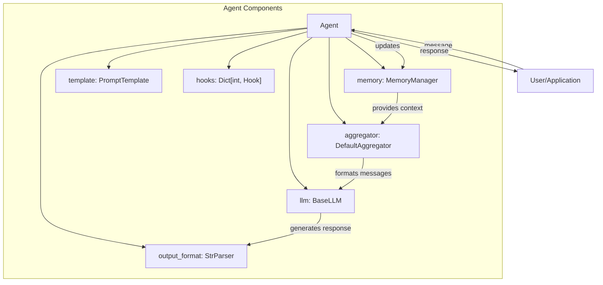
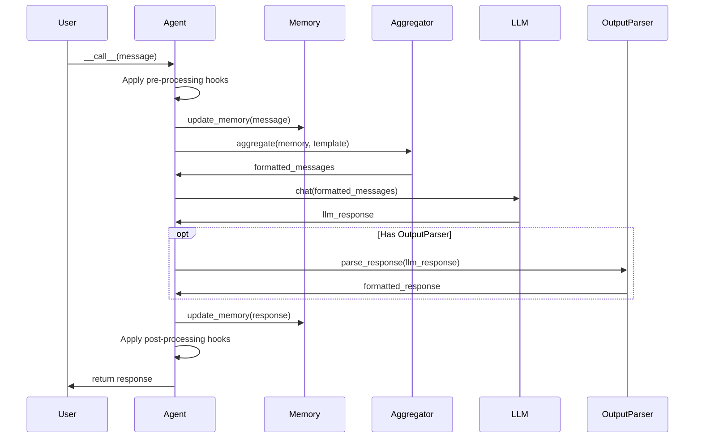
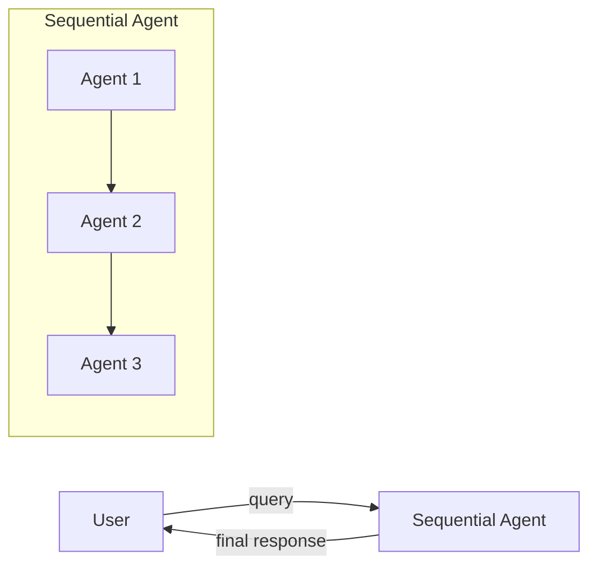
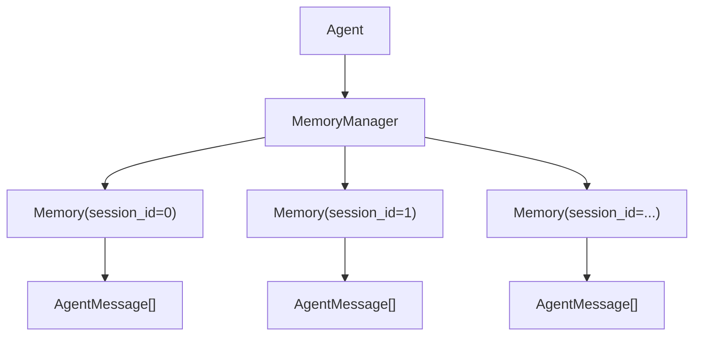
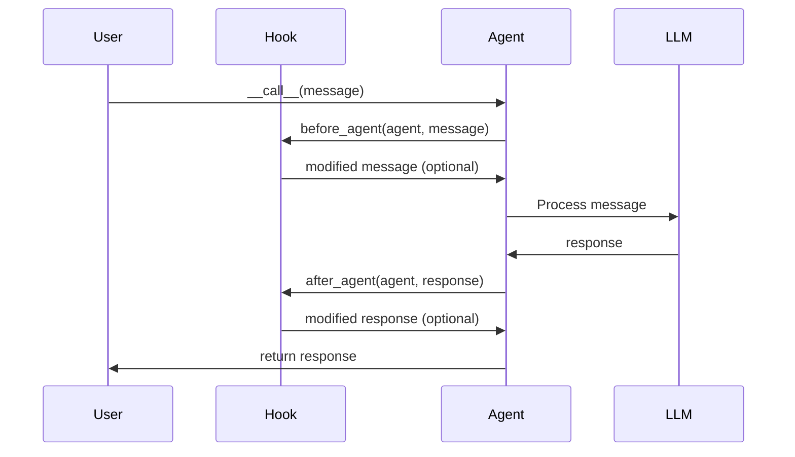

<!-- source: DeepWiki mcp.deepwiki.com · repo InternLM/lagent · extra page Agent Base Classes · fetched 2026-10-26 -->

# Agent Base Classes

<details>
<summary>Relevant source files</summary>

The following files were used as context for generating this wiki page:

- [lagent/agents/__init__.py](lagent/agents/__init__.py)
- [lagent/agents/agent.py](lagent/agents/agent.py)
- [lagent/agents/aggregator/tool_aggregator.py](lagent/agents/aggregator/tool_aggregator.py)
- [lagent/memory/base_memory.py](lagent/memory/base_memory.py)
- [lagent/prompts/parsers/__init__.py](lagent/prompts/parsers/__init__.py)
- [lagent/schema.py](lagent/schema.py)

</details>


This document covers the core Agent classes provided by LAgent framework, their interfaces, and usage patterns. These base classes form the foundation of the agent system, enabling different interaction models with language models and supporting both synchronous and asynchronous operations.

For information about ReAct agents (which extend these base classes), see [ReAct Agents](#2.1.2). For specialized agent implementations, see [Specialized Agents](#2.1.3).

## Overview of Agent Base Classes

The LAgent framework provides a set of base Agent classes that enable different interaction patterns with language models:

1. **Basic Agent**: The core agent implementation for standard request-response interactions
2. **Async Agent**: Asynchronous implementation for non-blocking operations
3. **Streaming Agent**: Supports streaming responses for real-time feedback
4. **Sequential Agent**: Chains multiple agents together in sequence
5. **Container Agents**: Collections of agents that act as a single agent

These base classes provide the foundation for more specialized agent implementations in the framework.

Sources: [lagent/agents/__init__.py:1-33](), [lagent/agents/agent.py:18-470]()

## Agent Class Hierarchy

```mermaid
classDiagram
    class "Agent" {
        +llm: BaseLLM
        +memory: MemoryManager
        +output_format: StrParser
        +aggregator: DefaultAggregator
        +template
        +__call__(message): AgentMessage
        +forward(message): AgentMessage
        +reset(session_id)
        +register_hook(hook)
    }
    
    class "AsyncAgentMixin" {
        +async __call__(message): AgentMessage
        +async forward(message): AgentMessage
    }
    
    class "StreamingAgentMixin" {
        +__call__(message): Generator[AgentMessage]
        +forward(message): Generator
    }
    
    class "AsyncStreamingAgentMixin" {
        +async __call__(message): AsyncGenerator[AgentMessage]
        +async forward(message): AsyncGenerator
    }
    
    class "Sequential" {
        +_agents: OrderedDict
        +add_agent(name, agent)
        +forward(message, exit_at): AgentMessage
    }
    
    class "AgentContainerMixin" {
        +wrap collection APIs
    }
    
    Agent <|-- "AsyncAgent"
    Agent <|-- "StreamingAgent"
    Agent <|-- "Sequential"
    
    AsyncAgentMixin --> "AsyncAgent"
    StreamingAgentMixin --> "StreamingAgent"
    
    Sequential <|-- "AsyncSequential"
    Sequential <|-- "StreamingSequential"
    Sequential <|-- "AsyncStreamingSequential"
    
    AsyncAgentMixin --> "AsyncSequential"
    StreamingAgentMixin --> "StreamingSequential"
    AsyncStreamingAgentMixin --> "AsyncStreamingSequential"
    
    Agent <|-- "AgentList"
    Agent <|-- "AgentDict"
    AgentContainerMixin --> "AgentList"
    AgentContainerMixin --> "AgentDict"
```

Sources: [lagent/agents/agent.py:18-470]()

## Base Agent Class

The `Agent` class is the fundamental building block of the LAgent framework. It handles communication with language models, manages conversation memory, and processes input/output messages.



### Key Properties and Methods

| Property/Method | Description |
|-----------------|-------------|
| `llm` | The language model used by the agent |
| `memory` | Manages conversation history across sessions |
| `aggregator` | Formats messages for the language model |
| `output_format` | Parser for formatting responses |
| `template` | Template for structuring prompts |
| `__call__` | Main entry point for interacting with the agent |
| `forward` | Core processing logic for agent interactions |
| `reset` | Clears the agent's memory for a specific session |
| `register_hook` | Adds hooks for extending agent functionality |
| `state_dict` | Serializes agent state for persistence |
| `load_state_dict` | Loads previously saved agent state |

Sources: [lagent/agents/agent.py:18-98](), [lagent/agents/agent.py:144-165]()

### Basic Usage Example

Here's an example of creating and using the base Agent class:

```python
from lagent.agents import Agent
from lagent.llms import GPTAPI

# Create a simple agent with OpenAI's GPT
agent = Agent(
    llm=GPTAPI(model="gpt-4"), 
    name="Assistant"
)

# Interact with the agent
response = agent("Hello, how can you help me?")
print(response.content)
```

### Agent Interaction Flow



Sources: [lagent/agents/agent.py:66-93]()

## Asynchronous Agent

The `AsyncAgent` class extends the base Agent with asynchronous methods for non-blocking operations. This is particularly useful for web applications and services that need to handle multiple requests concurrently.

### Key Methods

| Method | Description |
|--------|-------------|
| `async __call__` | Asynchronous version of the entry point |
| `async forward` | Asynchronous version of the processing logic |

Sources: [lagent/agents/agent.py:179-213]()

### Usage Example

```python
import asyncio
from lagent.agents import AsyncAgent
from lagent.llms import AsyncGPTAPI

async def main():
    # Create an async agent
    agent = AsyncAgent(
        llm=AsyncGPTAPI(model="gpt-4"),
        name="AsyncAssistant"
    )
    
    # Interact with the agent asynchronously
    response = await agent("How does asynchronous programming work?")
    print(response.content)

# Run the async function
asyncio.run(main())
```

## Streaming Agent

The `StreamingAgent` class provides streaming responses, yielding partial results as they become available. This enables real-time feedback during longer generations.

### Key Methods

| Method | Description |
|--------|-------------|
| `__call__` | Returns a generator yielding partial responses |
| `forward` | Returns a generator of model results |

Sources: [lagent/agents/agent.py:216-307]()

### Usage Example

```python
from lagent.agents import StreamingAgent
from lagent.llms import GPTAPI

# Create a streaming agent
agent = StreamingAgent(
    llm=GPTAPI(model="gpt-4"),
    name="StreamingAssistant"
)

# Get streaming responses
for partial_response in agent("Write a short story about AI"):
    print(partial_response.content, end="", flush=True)
```

## Sequential Agent

The `Sequential` class enables chaining multiple agents together, with each agent processing the output of the previous one. This allows building complex agent pipelines.



### Key Methods

| Method | Description |
|--------|-------------|
| `add_agent` | Adds an agent to the sequence |
| `forward` | Processes messages through the sequence of agents |
| `__getitem__` | Access agents by index or name |
| `__len__` | Returns the number of agents in the sequence |

Sources: [lagent/agents/agent.py:316-359]()

### Usage Example

```python
from lagent.agents import Agent, Sequential
from lagent.llms import GPTAPI

# Create individual agents
researcher = Agent(
    llm=GPTAPI(model="gpt-4"),
    name="Researcher"
)

writer = Agent(
    llm=GPTAPI(model="gpt-4"),
    name="Writer"
)

# Create a sequential agent
pipeline = Sequential(
    researcher,
    writer,
    name="ResearchWritingPipeline"
)

# The query first goes to the researcher, then the result goes to the writer
response = pipeline("Explain quantum computing")
print(response.content)
```

## Agent Container Classes

LAgent provides container classes that allow managing collections of agents while providing the standard Agent interface.

### AgentList

A list-like container of agents that is itself an agent.

### AgentDict

A dictionary-like container of agents that is itself an agent.

Sources: [lagent/agents/agent.py:411-470]()

### Usage Example

```python
from lagent.agents import Agent, AgentDict
from lagent.llms import GPTAPI

# Create an agent dictionary
agent_dict = AgentDict({
    "math": Agent(llm=GPTAPI(model="gpt-4"), name="MathExpert"),
    "history": Agent(llm=GPTAPI(model="gpt-4"), name="HistoryExpert"),
    "science": Agent(llm=GPTAPI(model="gpt-4"), name="ScienceExpert")
})

# Access individual agents
response = agent_dict["math"]("What is the derivative of x²?")
print(response.content)
```

## Memory Management

Agents maintain memory of past interactions through the `Memory` class. The memory system enables context-aware responses by providing conversation history to the agent.



### Key Memory Functions

| Method | Description |
|--------|-------------|
| `update_memory` | Adds messages to the agent's memory |
| `reset` | Clears the agent's memory for a session |
| `state_dict` | Serializes memory state for persistence |
| `load_state_dict` | Loads previously saved memory state |

Sources: [lagent/agents/agent.py:62-64](), [lagent/memory/base_memory.py:6-60]()

## Hook System

Agents can be extended with hooks, which allow intercepting and modifying agent behavior at various points in the execution flow.



### Registering Hooks

```python
from lagent.agents import Agent
from lagent.hooks import MessageLogger

# Create an agent
agent = Agent(...)

# Register a hook
logger_hook = MessageLogger()
handle = agent.register_hook(logger_hook)

# Later, remove the hook if needed
handle.remove()
```

Sources: [lagent/agents/agent.py:140-143]()

## Summary of Agent Variants

The following table summarizes the different agent variants available in LAgent:

| Agent Class | Synchronous | Asynchronous | Streaming | Description |
|-------------|-------------|--------------|-----------|-------------|
| `Agent` | ✅ | ❌ | ❌ | Standard blocking agent |
| `AsyncAgent` | ❌ | ✅ | ❌ | Non-blocking agent |
| `StreamingAgent` | ✅ | ❌ | ✅ | Yields partial responses |
| `AsyncStreamingAgent` | ❌ | ✅ | ✅ | Async agent with streaming |
| `Sequential` | ✅ | ❌ | ❌ | Chain of agents |
| `AsyncSequential` | ❌ | ✅ | ❌ | Async chain of agents |
| `StreamingSequential` | ✅ | ❌ | ✅ | Streaming chain of agents |
| `AsyncStreamingSequential` | ❌ | ✅ | ✅ | Async streaming chain |
| `AgentList` | ✅ | ❌ | ❌ | List-like container of agents |
| `AgentDict` | ✅ | ❌ | ❌ | Dict-like container of agents |

Sources: [lagent/agents/__init__.py:1-33]()

---

