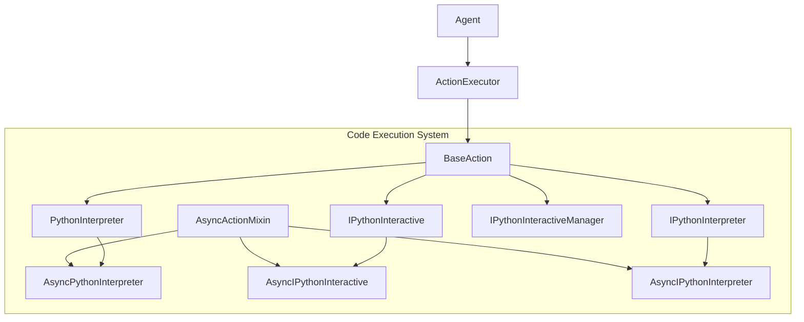
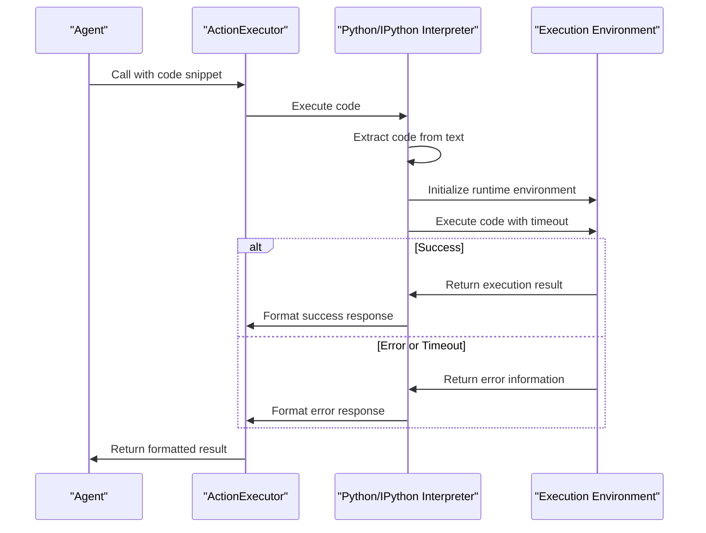
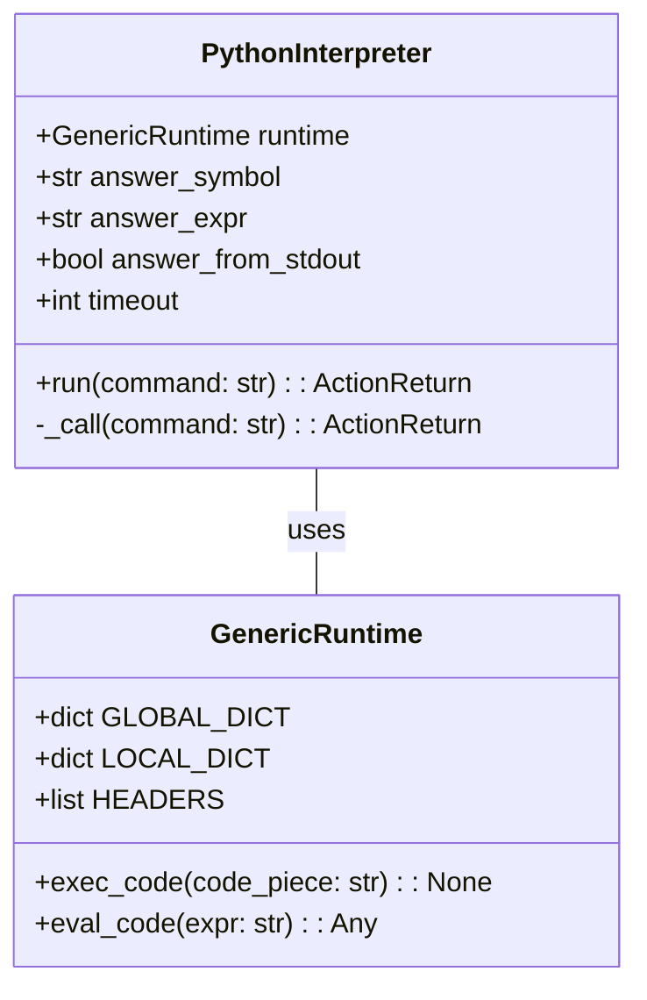
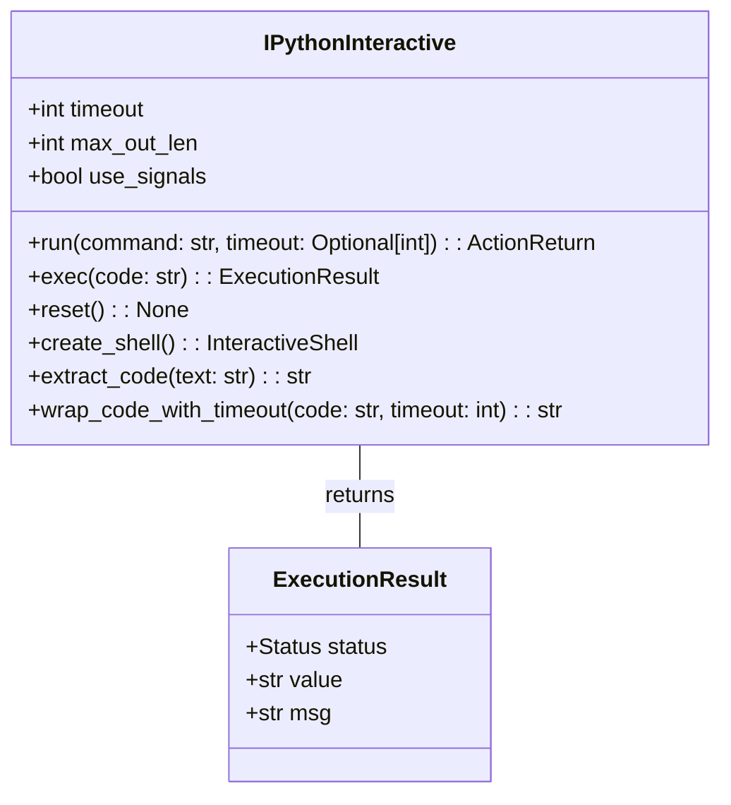
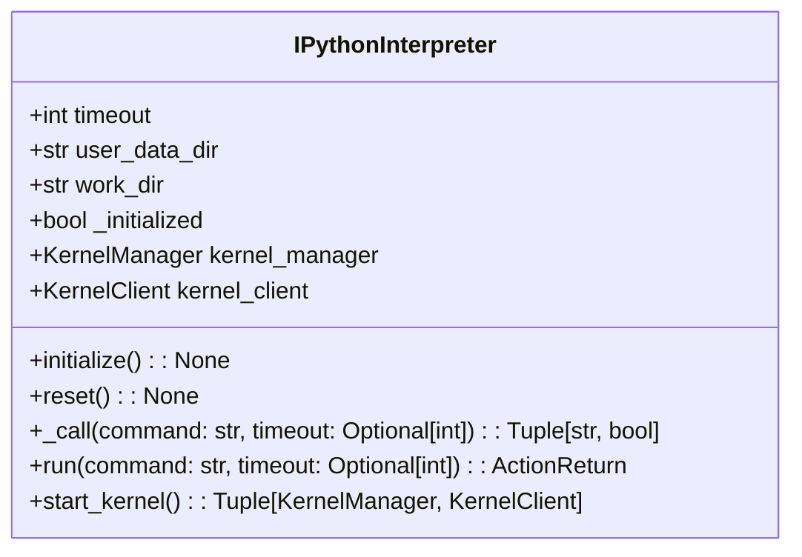
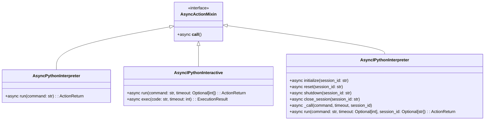
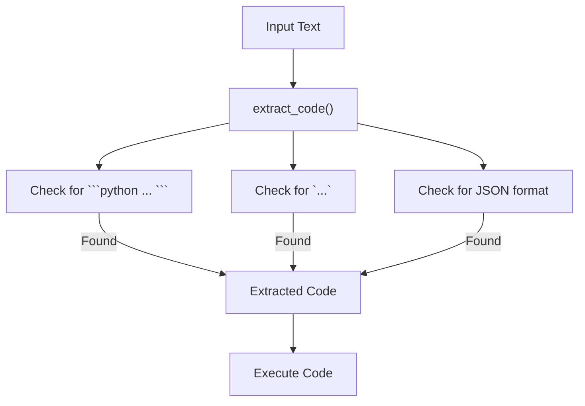
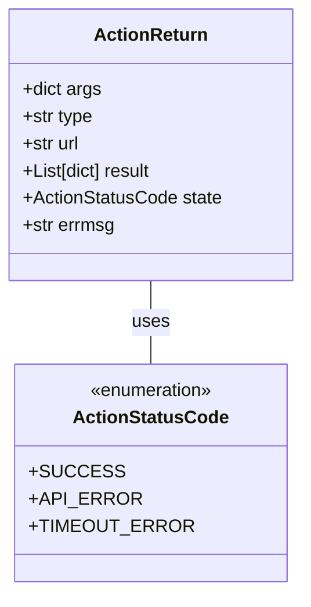

<!-- source: DeepWiki mcp.deepwiki.com · repo InternLM/lagent · extra page Code Execution · fetched 2026-10-26 -->

# Code Execution

<details>
<summary>Relevant source files</summary>

The following files were used as context for generating this wiki page:

- [lagent/actions/ipython_interactive.py](lagent/actions/ipython_interactive.py)
- [lagent/actions/ipython_interpreter.py](lagent/actions/ipython_interpreter.py)
- [lagent/actions/ipython_manager.py](lagent/actions/ipython_manager.py)
- [lagent/actions/python_interpreter.py](lagent/actions/python_interpreter.py)

</details>


This document details the code execution capabilities of the LAgent framework, focusing on the Python and IPython interpreter actions that allow agents to execute code programmatically. For information about other action types such as web browsing or research tools, see [Web Browsing and Search](#2.3.1) and [Research and Content Creation](#2.3.3).

## Overview

The Code Execution system provides agents with the ability to write and execute Python code, enabling computational problem-solving, data analysis, and programmatic interaction with various libraries. This system is implemented as a set of action classes that can be registered with an agent's `ActionExecutor`.



Sources: [lagent/actions/python_interpreter.py:33-137](), [lagent/actions/ipython_interactive.py:43-196](), [lagent/actions/ipython_interpreter.py:154-356](), [lagent/actions/ipython_manager.py:115-221]()

## Interpreter Types

The LAgent framework offers several Python interpreter implementations, each with different capabilities and use cases:

| Interpreter | Description | Features | Use Case |
|-------------|-------------|----------|----------|
| `PythonInterpreter` | Simple Python execution | Basic code execution, minimal environment | Simple computations |
| `IPythonInteractive` | Interactive IPython shell | Interactive execution, rich output | Multi-line code, interactive sessions |
| `IPythonInterpreter` | Jupyter-like environment | Rich outputs (text, images), kernel-based | Data visualization, complex analysis |
| `IPythonInteractiveManager` | Multi-process manager | Process pooling, concurrent execution | High-throughput or parallel execution |

Each interpreter type is available in both synchronous and asynchronous variants, with the async versions prefixed with "Async" (e.g., `AsyncPythonInterpreter`).

Sources: [lagent/actions/python_interpreter.py:33-137](), [lagent/actions/ipython_interactive.py:43-196](), [lagent/actions/ipython_interpreter.py:154-356](), [lagent/actions/ipython_manager.py:115-221]()

## Execution Flow

The code execution process follows a similar pattern across all interpreter types:



Sources: [lagent/actions/python_interpreter.py:64-96](), [lagent/actions/ipython_interactive.py:79-99](), [lagent/actions/ipython_interpreter.py:331-355]()

## Python Interpreter

The `PythonInterpreter` provides basic Python execution capabilities. It's the simplest of the code execution actions, executing Python code in a fresh environment.



Key features:
- Uses a simple `GenericRuntime` class for code execution
- Supports code extraction from markdown code blocks
- Can extract answers via function call, stdout, or expression evaluation
- Handles timeouts and execution errors

Sources: [lagent/actions/python_interpreter.py:14-137]()

## IPython Interactive

The `IPythonInteractive` class provides a more sophisticated execution environment using IPython. It offers richer interactive capabilities compared to the basic Python interpreter.



Key features:
- Uses IPython's `InteractiveShell` for richer execution environment
- Captures and formats execution results and errors
- Supports signal-based timeout mechanism
- Can extract code from various text formats
- Properly handles execution statuses (success/failure)

Sources: [lagent/actions/ipython_interactive.py:14-196]()

## IPython Interpreter

The `IPythonInterpreter` provides a Jupyter notebook-like execution environment, supporting rich outputs including text and images.



Key features:
- Uses Jupyter kernel infrastructure for execution
- Supports text and image outputs
- Maintains kernel state between executions
- Handles code extraction and timeout management
- Processes images for display in agent responses

Sources: [lagent/actions/ipython_interpreter.py:154-356]()

## Async Execution Support

All interpreter types have asynchronous counterparts, enabling non-blocking code execution in asyncio-based applications:



Key features:
- All methods are implemented as coroutines for asyncio compatibility
- Session management for stateful execution
- Kernel management for async Jupyter operations
- Timeout handling in async contexts

Sources: [lagent/actions/python_interpreter.py:137-177](), [lagent/actions/ipython_interactive.py:197-273](), [lagent/actions/ipython_interpreter.py:358-522]()

## Code Extraction

All interpreters include functionality to extract code from various formats, including markdown code blocks and structured data:



The extraction process:
1. Checks for triple backtick code blocks (```python...```)
2. Falls back to single backtick blocks (`...`)
3. Attempts to parse as JSON with a "code" property
4. If no patterns match, uses the raw input

Sources: [lagent/actions/python_interpreter.py:64-96](), [lagent/actions/ipython_interactive.py:138-174](), [lagent/actions/ipython_interpreter.py:525-542]()

## Result Handling

Execution results are returned in a standardized `ActionReturn` format:



For successful executions, the `result` field contains formatted output data:
- Text output is included as `{'type': 'text', 'content': output_text}`
- Image outputs (in IPythonInterpreter) are included as `{'type': 'image', 'content': image_path}`

For failed executions, the `errmsg` field contains error information and `state` is set to `ActionStatusCode.API_ERROR`.

Sources: [lagent/actions/python_interpreter.py:97-134](), [lagent/actions/ipython_interactive.py:79-99](), [lagent/actions/ipython_interpreter.py:331-355]()

## Integration with Agents

To use code execution capabilities in an agent, add the appropriate interpreter to the agent's `ActionExecutor`:

1. Choose the appropriate interpreter based on your requirements
2. Register it with the `ActionExecutor`
3. The agent can then invoke code execution through the action system

The agent's LLM will typically format code in markdown code blocks, which the interpreters automatically extract and execute.

Sources: [lagent/actions/python_interpreter.py:33-137](), [lagent/actions/ipython_interactive.py:43-196](), [lagent/actions/ipython_interpreter.py:154-356]()

## Timeout and Safety

All interpreters implement timeout mechanisms to prevent infinite execution:

- `PythonInterpreter` uses the `func_timeout` library
- `IPythonInteractive` uses signal-based timeouts
- `IPythonInterpreter` uses Jupyter kernel interrupt capabilities

Additionally, input validation and error handling provide protection against malformed code. The system is designed to capture and report errors rather than allowing them to propagate to the calling code.

Sources: [lagent/actions/python_interpreter.py:86-95](), [lagent/actions/ipython_interactive.py:28-40](), [lagent/actions/ipython_interpreter.py:35-36]()

---

