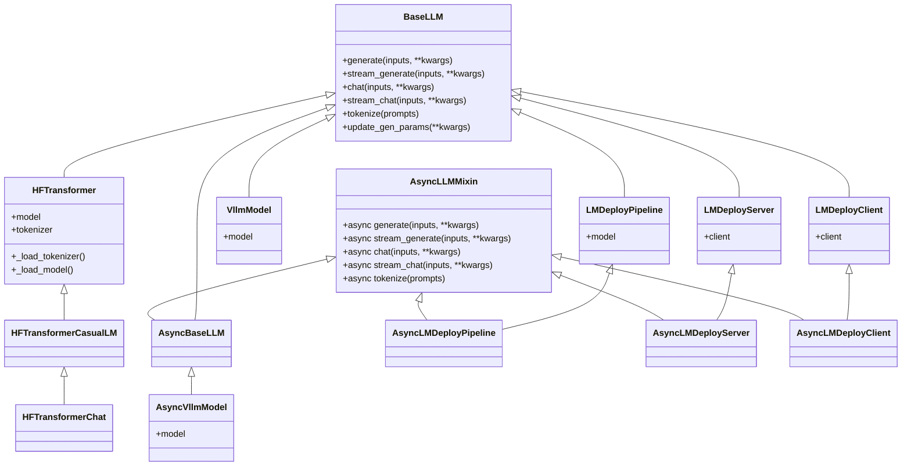
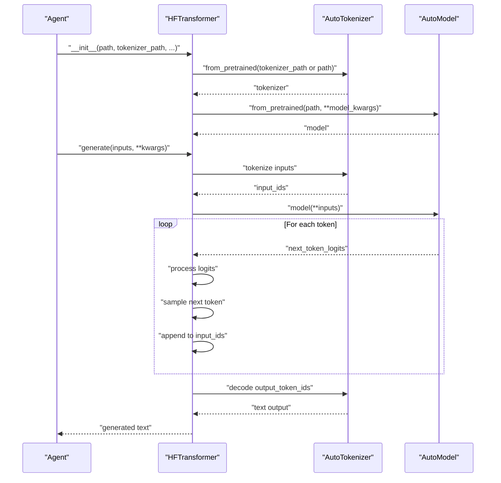
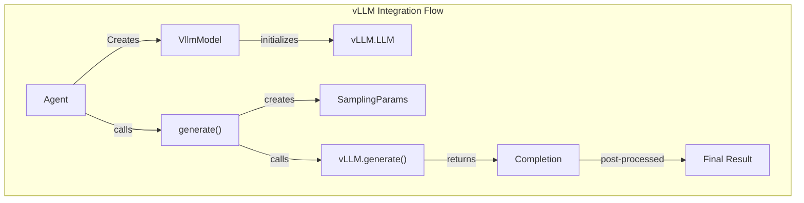
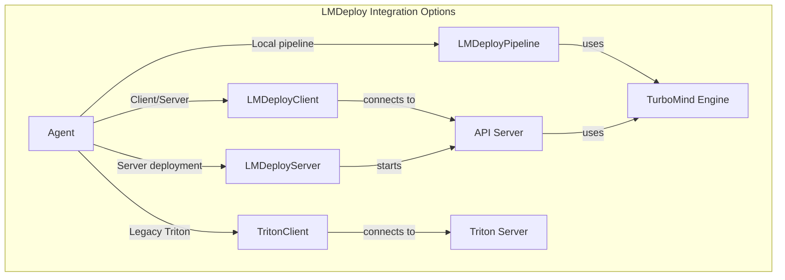
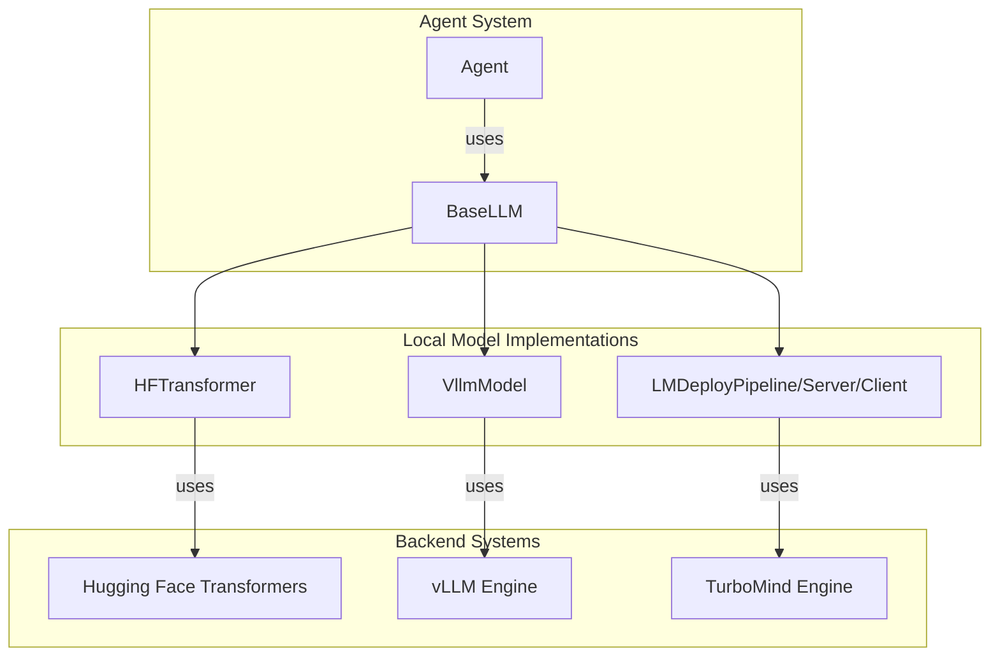

<!-- source: DeepWiki mcp.deepwiki.com · repo InternLM/lagent · extra page Local Model Integration · fetched 2026-10-26 -->

# Local Model Integration

<details>
<summary>Relevant source files</summary>

The following files were used as context for generating this wiki page:

- [lagent/llms/base_llm.py](lagent/llms/base_llm.py)
- [lagent/llms/huggingface.py](lagent/llms/huggingface.py)
- [lagent/llms/lmdeploy_wrapper.py](lagent/llms/lmdeploy_wrapper.py)
- [lagent/llms/vllm_wrapper.py](lagent/llms/vllm_wrapper.py)
- [requirements/optional.txt](requirements/optional.txt)

</details>


This page documents how the LAgent framework integrates with locally deployed language models, including models from Hugging Face, vLLM, and LMDeploy. These integrations allow you to run LLMs locally without relying on external API services. For information about API-based models like OpenAI and Claude, see [API-based LLMs](#2.2.1).

## Overview of Local Model Integration Architecture

LAgent provides several adapter classes that connect to different local model backends while maintaining a consistent interface. All local model integrations inherit from the `BaseLLM` class, which defines standard methods for text generation, streaming, and chat functionality.



Sources: [lagent/llms/base_llm.py](), [lagent/llms/huggingface.py](), [lagent/llms/vllm_wrapper.py](), [lagent/llms/lmdeploy_wrapper.py]()

## Common LLM Interface

All local model integrations share a common interface inherited from `BaseLLM`, which provides these key methods:

| Method | Description |
|--------|-------------|
| `generate(inputs, **kwargs)` | Generate text completion for a single input or batch of inputs |
| `stream_generate(inputs, **kwargs)` | Generate text completion in streaming mode |
| `chat(inputs, **kwargs)` | Generate completion from a list of message templates |
| `stream_chat(inputs, **kwargs)` | Generate streaming completion from messages |
| `tokenize(prompts)` | Convert input text to tokens |

Each model implementation also supports common generation parameters:

| Parameter | Default | Description |
|-----------|---------|-------------|
| `max_new_tokens` | 512 | Maximum number of tokens to generate |
| `top_p` | 0.8 | Nucleus sampling parameter |
| `top_k` | 40 | Top-k sampling parameter |
| `temperature` | 0.8 | Temperature for sampling |
| `repetition_penalty` | 1.0 | Penalty for repeating tokens |
| `stop_words` | None | List of strings to stop generation when encountered |

Sources: [lagent/llms/base_llm.py:96-175]()

## Hugging Face Models Integration

The `HFTransformer` class provides integration with Hugging Face Transformer models, allowing you to use any model from the Hugging Face Hub or locally stored models.



### Key Features of Hugging Face Integration

- **Model Types**: Supports both general transformer models (`AutoModel`) and causal language models (`AutoModelForCausalLM`)
- **Chat Models**: Special handling for chat-tuned models via `HFTransformerChat`
- **Stopping Criteria**: Custom stopping with `stop_words` and `stop_words_id`
- **Tokenizer Configuration**: Flexible tokenizer setup with fallbacks for missing pad tokens

### Usage Example

The Hugging Face integration supports a variety of models and configurations:

```python
# Example configuration
hf_model = HFTransformer(
    path="internlm/internlm-7b",  # Hugging Face model ID or local path
    tokenizer_path=None,  # Optional separate tokenizer path
    model_kwargs=dict(
        device_map="auto",
        torch_dtype=torch.float16
    ),
    max_new_tokens=2048,
    temperature=0.7
)
```

Sources: [lagent/llms/huggingface.py:12-337]()

## vLLM Integration

The `VllmModel` class integrates with the vLLM library, which is optimized for efficient large language model inference with features like PagedAttention.



### Key Features of vLLM Integration

- **Efficient Inference**: vLLM provides significantly faster inference compared to standard Hugging Face implementations
- **Batch Processing**: Optimized for batch processing of multiple requests
- **Asynchronous API**: `AsyncVllmModel` for non-blocking operations
- **Custom Sampling**: Fine-grained control over generation parameters

### Async Implementation

`AsyncVllmModel` provides a non-blocking alternative using vLLM's asynchronous engine:

```python
# Example async usage
async_model = AsyncVllmModel(
    path="meta-llama/Llama-2-7b-hf",
    tp=2,  # Tensor parallelism
    vllm_cfg=dict(gpu_memory_utilization=0.8)
)
```

Sources: [lagent/llms/vllm_wrapper.py:18-176]()

## LMDeploy Integration

LMDeploy provides a comprehensive solution for deploying LLMs with TurboMind as the backend engine. LAgent offers several integration options with LMDeploy:



### LMDeploy Integration Options

1. **LMDeployPipeline**
   - Direct integration with TurboMind engine
   - Supports models from Hugging Face, local directories, or pre-quantized models
   - Fastest option when running in the same process

2. **LMDeployServer/Client**
   - Client/server architecture for distributed deployment
   - Server handles model loading and inference
   - Clients connect via HTTP

3. **Asynchronous Versions**
   - `AsyncLMDeployPipeline`, `AsyncLMDeployServer`, `AsyncLMDeployClient`
   - Non-blocking API for high-concurrency scenarios

### Model Loading Options

LMDeploy supports multiple ways to load models:

| Loading Method | Description |
|----------------|-------------|
| Local directory | Load a model that has been converted by `lmdeploy convert` |
| Quantized model | Pre-quantized models from Hugging Face (e.g., "InternLM/internlm-chat-20b-4bit") |
| HF model ID | Direct loading from Hugging Face (e.g., "internlm/internlm-chat-7b") |

Sources: [lagent/llms/lmdeploy_wrapper.py:210-802]()

## Implementation Comparison

Below is a comparison of different local model integration options:

| Integration | Pros | Cons | Best For |
|-------------|------|------|----------|
| HFTransformer | - Simplest setup<br>- Access to all HF models<br>- Most flexible | - Slower inference<br>- Higher memory usage | Development, testing, smaller models |
| VllmModel | - Faster inference<br>- Memory efficient<br>- Good scaling | - More complex setup<br>- Not all models supported | Production deployment of medium to large models |
| LMDeployPipeline | - High performance<br>- Quantization support<br>- Optimized inference | - More complex setup<br>- Learning curve | Production deployment where performance is critical |
| LMDeployClient | - Distributed architecture<br>- Resource isolation | - Network overhead<br>- More complex setup | Multi-user systems, resource sharing |

## Installation Requirements

To use the local model integrations, you need to install the corresponding optional dependencies:

```
# For Hugging Face models
pip install "lagent[transformers]"

# For vLLM
pip install "lagent[vllm]"

# For LMDeploy
pip install "lagent[lmdeploy]"
```

The specific version requirements are defined in [requirements/optional.txt:3-9]():

- transformers >= 4.34, <= 4.40
- vllm >= 0.3.3
- lmdeploy >= 0.2.5
- torch (required for all local models)

## Integration with Agent System

Local model integrations connect with the agent system through the LLM abstraction layer:



When an agent needs to generate text or process a chat, it calls methods like `generate()` or `chat()` on the LLM instance. The implementations then handle the conversion between the LAgent format and the format required by each specific backend system.

Sources: [lagent/llms/base_llm.py:96-305]()

---

