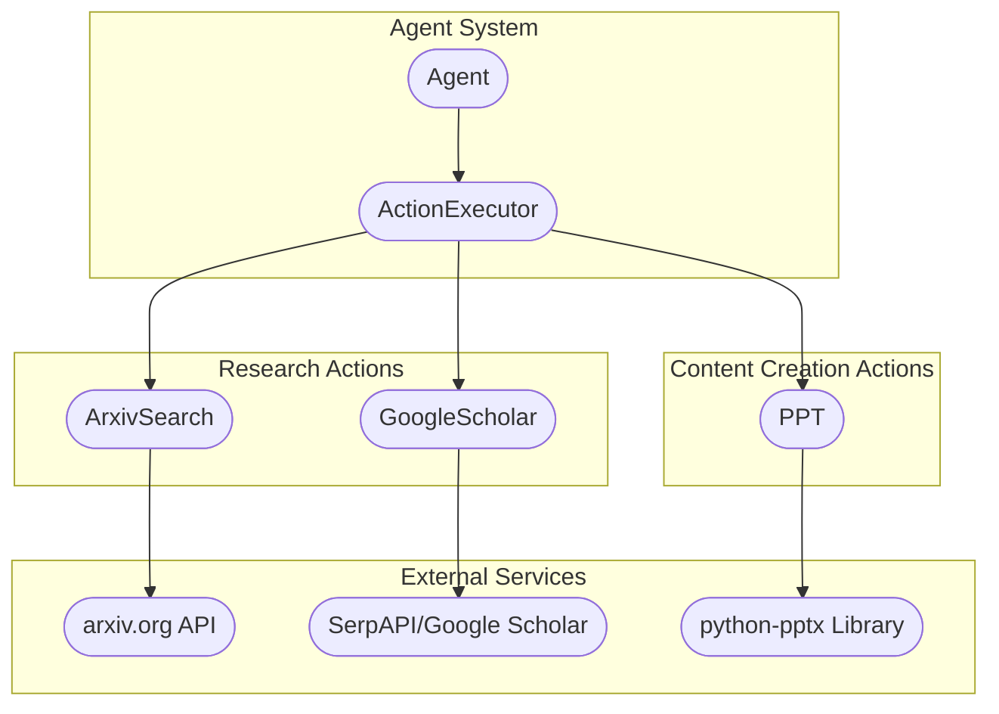
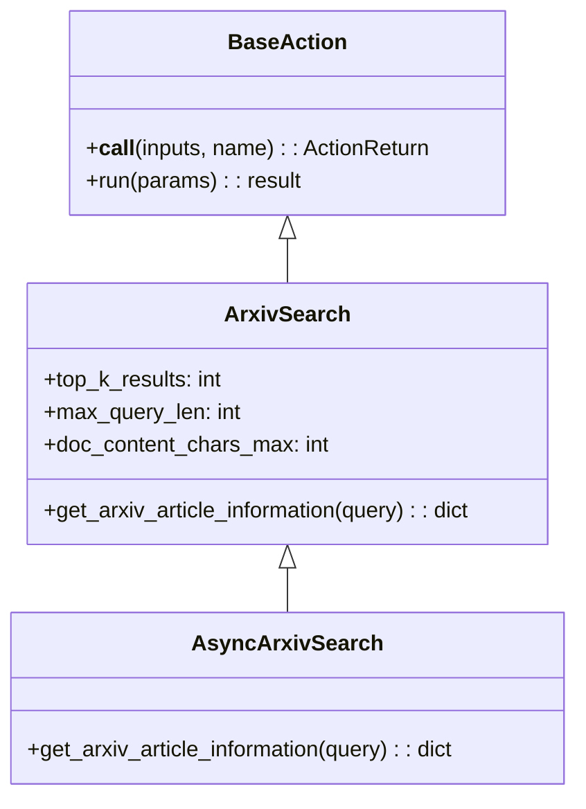
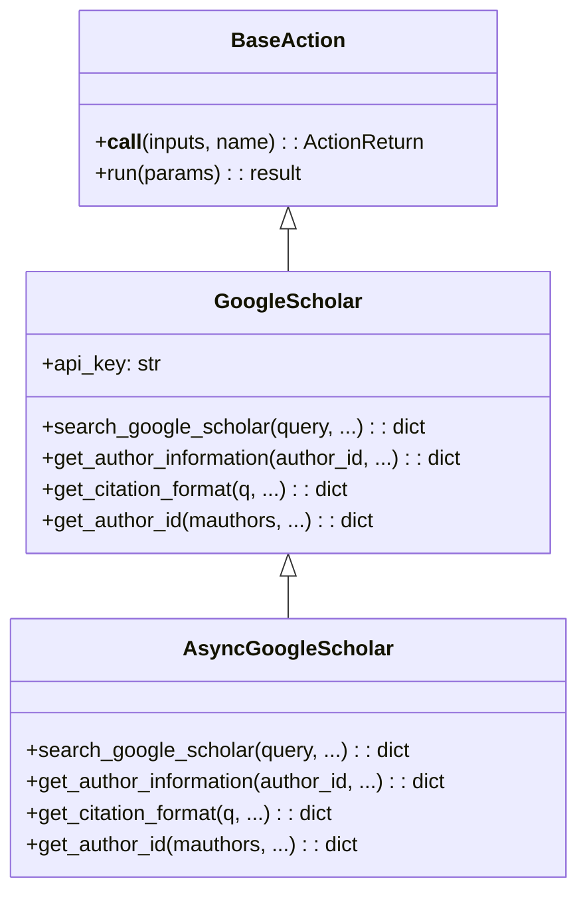
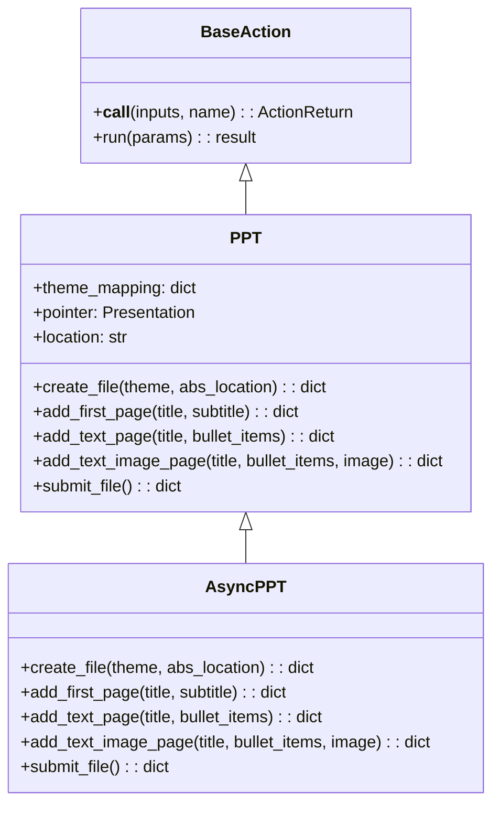
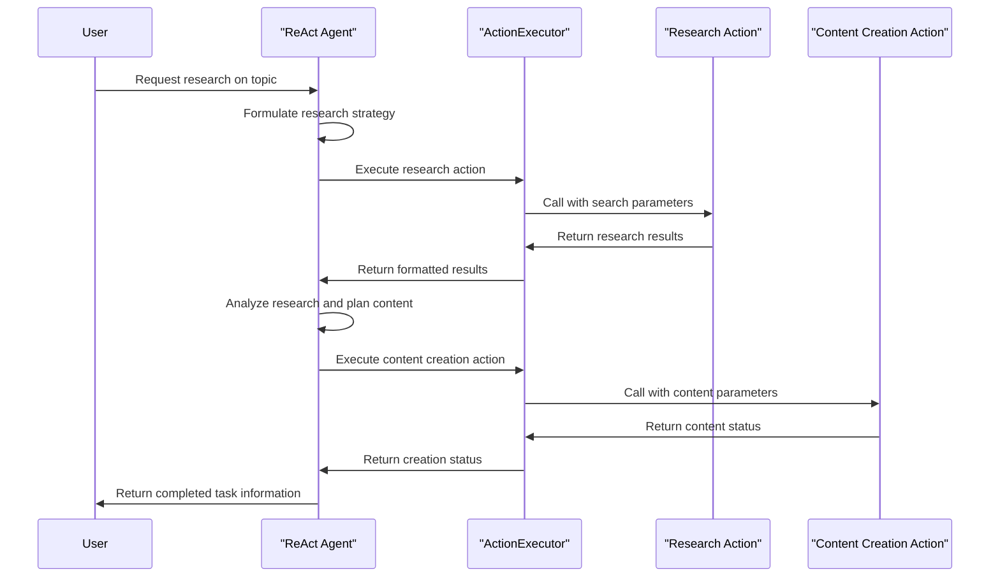

<!-- source: DeepWiki mcp.deepwiki.com · repo InternLM/lagent · extra page Research and Content Creation · fetched 2026-10-26 -->

# Research and Content Creation

<details>
<summary>Relevant source files</summary>

The following files were used as context for generating this wiki page:

- [lagent/actions/arxiv_search.py](lagent/actions/arxiv_search.py)
- [lagent/actions/google_scholar_search.py](lagent/actions/google_scholar_search.py)
- [lagent/actions/ppt.py](lagent/actions/ppt.py)

</details>


## Purpose and Scope

This document covers the research and content creation actions provided by LAgent that enable agents to search academic papers, retrieve scholarly information, and create presentations. These tools enhance an agent's ability to perform research tasks and generate formatted outputs based on that research.

The research components include ArXiv paper search and Google Scholar integration, while content creation focuses on PowerPoint presentation generation. For information on other available tools like web browsing or code execution, see [Web Browsing and Search](#2.3.1) and [Code Execution](#2.3.2).

## Overview of Research and Content Creation Tools

Research and content creation tools in LAgent are implemented as action classes that inherit from `BaseAction`. These specialized actions enable agents to access external knowledge repositories and generate formatted content.



Sources: [lagent/actions/arxiv_search.py:10-58](), [lagent/actions/google_scholar_search.py:12-273](), [lagent/actions/ppt.py:18-157]()

## Research Actions

### ArXiv Search

The `ArxivSearch` action allows agents to query ArXiv.org for academic papers in fields such as physics, mathematics, computer science, and economics.



Sources: [lagent/actions/arxiv_search.py:10-58]()

#### Key Features

- Searches for academic papers on ArXiv based on a text query
- Returns metadata including publication date, title, authors, and summary
- Configurable for number of results, query length, and summary length
- Available in both synchronous and asynchronous versions

#### Usage and Parameters

The main method `get_arxiv_article_information` accepts a query string and returns information about matching papers:

| Parameter | Type | Description |
|-----------|------|-------------|
| `query` | str | The search query used to find relevant papers |

The action returns a dictionary with a `content` field containing information about up to 3 matching papers (configurable via `top_k_results`).

Sources: [lagent/actions/arxiv_search.py:30-57]()

### Google Scholar Search

The `GoogleScholar` action provides comprehensive access to scholarly articles and author information using the SerpAPI integration with Google Scholar.



Sources: [lagent/actions/google_scholar_search.py:12-273]()

#### Key Features

- Searches for scholarly articles with extensive filtering options
- Retrieves author profiles and publication histories
- Gets citation formats for papers
- Looks up author IDs by name
- Requires a SerpAPI API key (obtainable from https://serper.dev)

#### Main Methods

1. **search_google_scholar**: Searches for scholarly articles based on a query

   | Key Parameters | Type | Description |
   |----------------|------|-------------|
   | `query` | str | The search query |
   | `as_ylo`/`as_yhi` | int | Year range filters |
   | `num` | int | Maximum number of results (limited to 20) |

   Returns titles, citation counts, and snippets for matching articles.

2. **get_author_information**: Retrieves detailed information about an author

   | Key Parameters | Type | Description |
   |----------------|------|-------------|
   | `author_id` | str | The ID of an author |
   | `hl` | str | Language for results (default: 'en') |

   Returns the author's name, affiliations, website, and recent articles.

3. **get_citation_format**: Retrieves citation format for a specific article

4. **get_author_id**: Gets an author's ID by searching for their name

Sources: [lagent/actions/google_scholar_search.py:38-272]()

## Content Creation Actions

### PowerPoint Presentation Creator

The `PPT` action enables agents to create PowerPoint presentations with various slide layouts including title slides, text slides, and slides with images.



Sources: [lagent/actions/ppt.py:18-233]()

#### Key Features

- Creates PowerPoint presentations with customizable themes
- Supports multiple slide types (title, text-only, text with image)
- Formats text as bullet points
- Available in both synchronous and asynchronous versions
- Uses the `python-pptx` library for PowerPoint manipulation

#### Creating a Presentation

The typical workflow for creating a presentation involves:

1. **Initialize the presentation**: Call `create_file(theme, abs_location)` to create a new presentation file
2. **Add a title slide**: Use `add_first_page(title, subtitle)` to create the initial slide
3. **Add content slides**: Use `add_text_page` and `add_text_image_page` to add content slides
4. **Save the presentation**: Call `submit_file()` to finalize and save the presentation

For bullet point slides, multiple points can be specified by separating them with `[SPAN]` in the `bullet_items` parameter.

Sources: [lagent/actions/ppt.py:32-157]()

## Integration with Agent System

To use research and content creation actions in the LAgent framework, they must be registered with an `ActionExecutor` and then provided to an agent instance.



Sources: [lagent/actions/arxiv_search.py:10-58](), [lagent/actions/google_scholar_search.py:12-273](), [lagent/actions/ppt.py:18-157]()

### Example Configuration

The research and content creation actions can be combined to create a complete research-to-presentation workflow. Here's how these actions would typically be registered with an `ActionExecutor`:

```python
# Create action instances
arxiv_search = ArxivSearch(top_k_results=5)
google_scholar = GoogleScholar(api_key="YOUR_SERPER_API_KEY")
ppt_creator = PPT()

# Register actions with ActionExecutor
action_executor = ActionExecutor(
    actions=[arxiv_search, google_scholar, ppt_creator]
)

# Create agent with the action executor
agent = ReAct(
    llm=llm,
    actions=action_executor
)
```

This configuration enables an agent to perform academic research and compile the results into a presentation based on user requests.

## Limitations and Considerations

1. **API Dependencies**:
   - Google Scholar search requires a SerpAPI API key
   - Network connectivity is required for both research tools

2. **Content Restrictions**:
   - ArXiv search is limited to specific academic fields
   - PowerPoint creation has limited theming options (currently only 'Default')

3. **Performance Considerations**:
   - Research actions may take time to complete, making async versions preferable for interactive applications
   - Creating complex presentations with many slides may have performance implications

---

