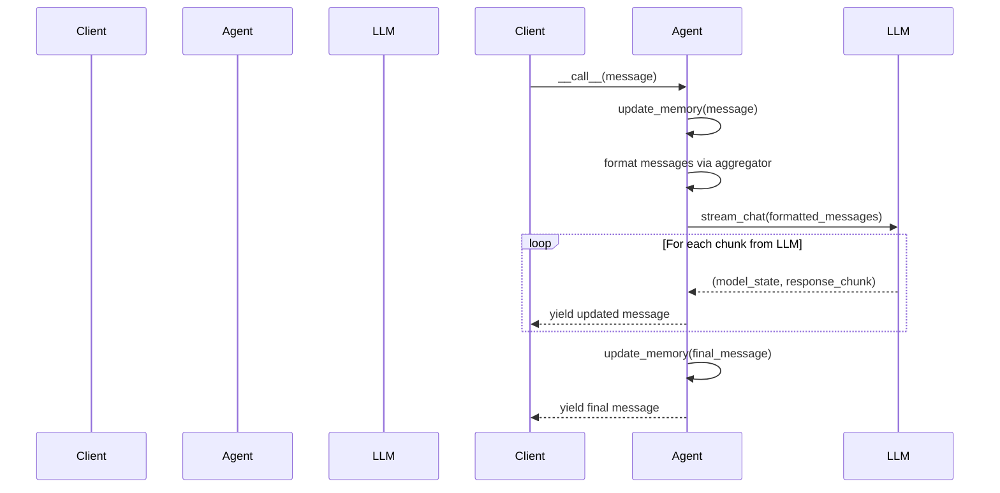
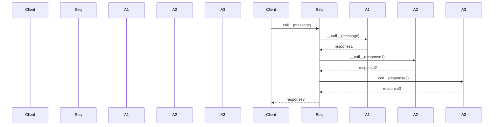
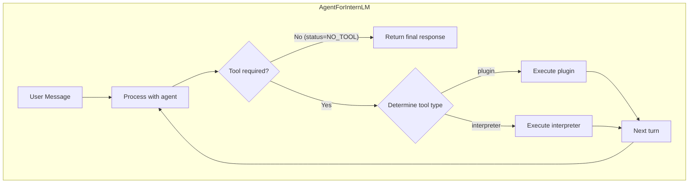
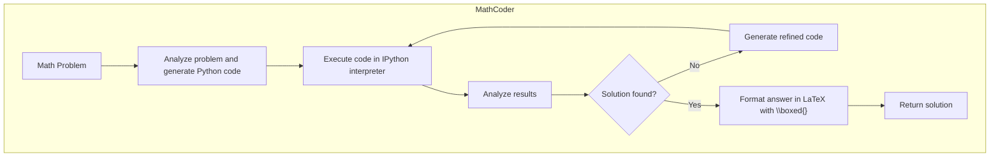

<!-- source: DeepWiki mcp.deepwiki.com · repo InternLM/lagent · extra page Specialized Agents · fetched 2026-10-26 -->

# Specialized Agents

<details>
<summary>Relevant source files</summary>

The following files were used as context for generating this wiki page:

- [lagent/agents/__init__.py](lagent/agents/__init__.py)
- [lagent/agents/agent.py](lagent/agents/agent.py)
- [lagent/agents/stream.py](lagent/agents/stream.py)
- [lagent/memory/base_memory.py](lagent/memory/base_memory.py)
- [lagent/prompts/parsers/tool_parser.py](lagent/prompts/parsers/tool_parser.py)
- [setup.cfg](setup.cfg)

</details>


This page documents the specialized agent implementations in the lagent framework. These agents extend the core Agent functionality (covered in [Agent Base Classes](#2.1.1)) with capabilities such as streaming responses, sequential processing, and domain-specific functionality like mathematical problem-solving. For information about the ReAct pattern used in some agents, see [ReAct Agents](#2.1.2).

## Agent Specialization Hierarchy

The lagent framework offers several specialized agent implementations that inherit from the base Agent class:

```mermaid
classDiagram
    class "Agent" {
        +llm: BaseLLM
        +memory: Memory
        +aggregator: Aggregator
        +output_format: StrParser
        +forward(message, session_id)
    }
    
    class "StreamingAgent" {
        +__call__(message): Generator
        +forward(message): Generator
    }
    
    class "AsyncAgent" {
        +async __call__(message)
        +async forward(message)
    }
    
    class "AsyncStreamingAgent" {
        +async __call__(message): AsyncGenerator
        +async forward(message): AsyncGenerator
    }
    
    class "Sequential" {
        +_agents: OrderedDict
        +forward(message, exit_at)
    }
    
    class "StreamingSequential" {
        +forward(message, exit_at): Generator
    }
    
    class "AsyncSequential" {
        +async forward(message, exit_at)
    }
    
    class "AsyncStreamingSequential" {
        +async forward(message, exit_at): AsyncGenerator
    }
    
    class "AgentForInternLM" {
        +agent: Agent
        +plugin_executor: ActionExecutor
        +interpreter_executor: ActionExecutor
        +forward(message, session_id)
    }
    
    class "AsyncAgentForInternLM" {
        +agent: AsyncAgent
        +plugin_executor: AsyncActionExecutor
        +interpreter_executor: AsyncActionExecutor
        +async forward(message, session_id)
    }
    
    class "MathCoder" {
        +interpreter_executor: ActionExecutor
    }
    
    class "AsyncMathCoder" {
        +interpreter_executor: AsyncActionExecutor
        +async forward(message, session_id)
    }
    
    Agent <|-- StreamingAgent
    Agent <|-- AsyncAgent
    Agent <|-- Sequential
    
    Agent <|-- AsyncStreamingAgent
    
    Sequential <|-- StreamingSequential
    Sequential <|-- AsyncSequential
    Sequential <|-- AsyncStreamingSequential
    
    Agent <|-- AgentForInternLM
    AsyncAgent <|-- AsyncAgentForInternLM
    
    AgentForInternLM <|-- MathCoder
    AsyncAgentForInternLM <|-- AsyncMathCoder
```

Sources: [lagent/agents/agent.py:18-313](), [lagent/agents/agent.py:316-408](), [lagent/agents/stream.py:56-288]()

## Streaming Agents

Streaming agents provide incremental output generation instead of waiting for the entire response to be ready. This is particularly useful for long-running processes or when immediate feedback is desired.

### StreamingAgent and AsyncStreamingAgent

These agents extend the base Agent class with streaming capabilities:

- **StreamingAgent**: Synchronous streaming agent that returns a generator
- **AsyncStreamingAgent**: Asynchronous streaming agent that returns an async generator

The key difference from the base Agent is that these agents return content incrementally as it's generated by the underlying LLM, rather than waiting for the complete response.



Sources: [lagent/agents/agent.py:216-256](), [lagent/agents/agent.py:259-301](), [lagent/agents/agent.py:304-313]()

### Implementation Details

The streaming functionality is implemented using mixins:

1. **StreamingAgentMixin**: Handles synchronous streaming
   - Overrides `__call__` to return a generator
   - Uses `llm.stream_chat()` instead of `llm.chat()`

2. **AsyncStreamingAgentMixin**: Handles asynchronous streaming
   - Overrides `__call__` to return an async generator
   - Uses `async for` to process streaming content

The StreamingAgent class is created by combining the StreamingAgentMixin with the base Agent class, while AsyncStreamingAgent combines AsyncStreamingAgentMixin with the base Agent class.

Sources: [lagent/agents/agent.py:216-313]()

## Sequential Agents

Sequential agents provide a way to chain multiple agents together, allowing messages to be processed in sequence through a series of specialized agents.

### Sequential and Streaming Variants

Four variants of sequential agents are available:

| Agent Type | Description |
|------------|-------------|
| Sequential | Basic sequential processing of agents |
| AsyncSequential | Asynchronous sequential processing |
| StreamingSequential | Sequential processing with streaming output |
| AsyncStreamingSequential | Asynchronous sequential processing with streaming output |



Sources: [lagent/agents/agent.py:316-408]()

### Implementation Details

The Sequential agent class maintains an ordered dictionary of sub-agents and processes them in sequence:

- Agents can be added during initialization or using the `add_agent` method
- The `forward` method supports an `exit_at` parameter to stop processing after a specific agent
- Each agent in the sequence receives the output of the previous agent as its input

The streaming and asynchronous variants follow the same pattern but with appropriate modifications for their execution models.

Sources: [lagent/agents/agent.py:316-408]()

## InternLM Agents

AgentForInternLM provides specialized support for the InternLM model with integrated tool capabilities.

```mermaid
classDiagram
    class "AgentForInternLM" {
        +agent: Agent
        +plugin_executor: ActionExecutor
        +interpreter_executor: ActionExecutor
        +finish_condition: Callable
        +max_turn: int
        +forward(message, session_id)
    }
    
    class "ActionExecutor" {
        +actions: List[BaseAction]
        +hooks: List[Hook]
        +__call__(message, session_id)
    }
    
    class "MixedToolParser" {
        +parsers: Dict[str, ToolParser]
        +parse_response(data): dict
    }
    
    class "InternLMToolAggregator" {
        +aggregate(memory, agent_name, output_format, template)
    }
    
    AgentForInternLM --> "1" ActionExecutor: plugin_executor
    AgentForInternLM --> "1" ActionExecutor: interpreter_executor
    AgentForInternLM --> "1" Agent: agent
    Agent --> "1" MixedToolParser: output_format
    Agent --> "1" InternLMToolAggregator: aggregator
```

Sources: [lagent/agents/stream.py:56-128](), [lagent/agents/stream.py:169-240]()

### Key Features of InternLM Agents

1. **Dual Action System**:
   - `plugin_executor`: Handles external tool plugins
   - `interpreter_executor`: Handles code interpretation

2. **Tool Integration**:
   - Uses a `MixedToolParser` to handle multiple tool types
   - Supports both plugins and code interpretation

3. **Iteration Model**:
   - Implements a turn-based approach with `max_turn` limit
   - Uses a `finish_condition` to determine when to stop

4. **Step Tracking**:
   - `get_steps()` method provides a structured log of agent reasoning and actions

The AgentForInternLM has both synchronous and asynchronous implementations (AgentForInternLM and AsyncAgentForInternLM respectively).

Sources: [lagent/agents/stream.py:56-128](), [lagent/agents/stream.py:169-240]()

### Tool Processing Flow



Sources: [lagent/agents/stream.py:99-113](), [lagent/agents/stream.py:213-225](), [lagent/prompts/parsers/tool_parser.py:18-22]()

## MathCoder Agents

MathCoder is a specialized agent designed for mathematical problem-solving using Python code execution.

### Key Features of MathCoder

1. **Python-Based Math Solver**:
   - Inherits from AgentForInternLM but focuses on mathematical problem-solving
   - Uses a specialized `InterpreterParser` optimized for Python code execution

2. **Specialized Prompting**:
   - Contains domain-specific instructions for step-by-step reasoning
   - Formats final results in LaTeX with boxed answers

3. **Configuration**:
   - Configured with a longer `max_turn` (6 vs. 4) for complex problems
   - Uses the `IPythonInteractive` interpreter for Jupyter-like code execution

The MathCoder has both synchronous and asynchronous implementations (MathCoder and AsyncMathCoder respectively).



Sources: [lagent/agents/stream.py:130-167](), [lagent/agents/stream.py:243-288]()

### AsyncMathCoder Implementation

The AsyncMathCoder extends the AsyncAgentForInternLM with:

1. **Session Management**:
   - Automatically closes interpreter sessions after the task completes
   - Prevents resource leaks when handling multiple requests

2. **Async Interpreter**:
   - Uses AsyncIPythonInterpreter for non-blocking code execution
   - Particularly important for long-running calculations

Sources: [lagent/agents/stream.py:243-288]()

## Usage Examples

### Streaming Agent

```python
from lagent.agents import StreamingAgent
from lagent.llms import GPTAPI

agent = StreamingAgent(llm=GPTAPI(api_key="your-api-key"))

# Get streaming responses
for chunk in agent("Tell me about artificial intelligence"):
    print(chunk.content, end="", flush=True)
```

### InternLM Agent with Python Interpreter

```python
from lagent.agents import AgentForInternLM
from lagent.actions import IPythonInterpreter
from lagent.llms import GPTAPI

agent = AgentForInternLM(
    llm=GPTAPI(api_key="your-api-key"),
    interpreter=dict(type=IPythonInterpreter)
)

response = agent("Generate a fractal image using Python")
print(response.content)
```

### MathCoder for Solving Math Problems

```python
from lagent.agents import MathCoder
from lagent.llms import GPTAPI

math_agent = MathCoder(
    llm=GPTAPI(api_key="your-api-key")
)

problem = "Find the derivative of f(x) = 3x^4 - 2x^2 + 7x"
solution = math_agent(problem)
print(solution.content)
```

Sources: [lagent/agents/agent.py:304-313](), [lagent/agents/stream.py:56-128](), [lagent/agents/stream.py:130-167]()

---

