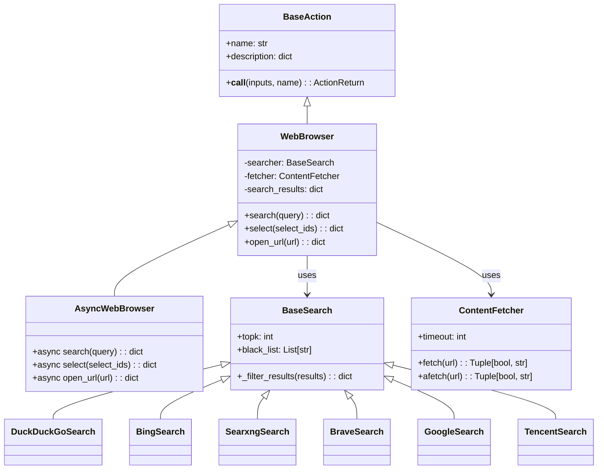
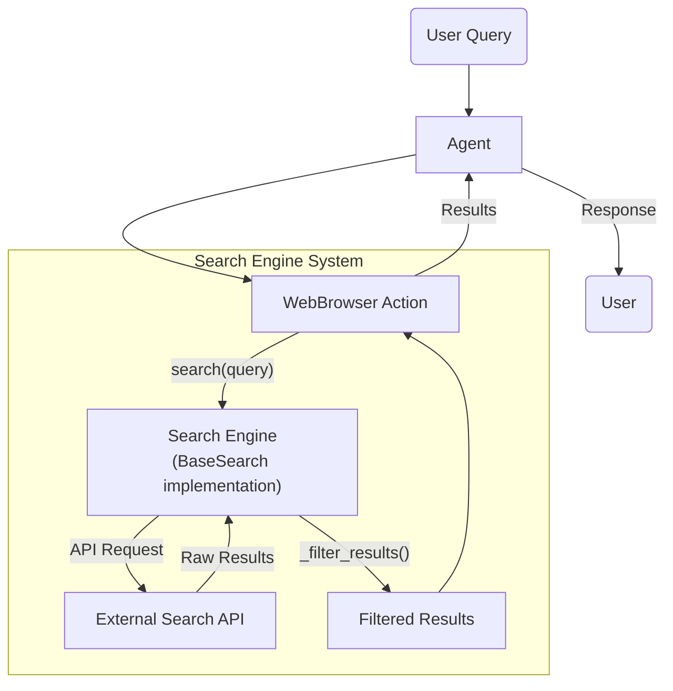
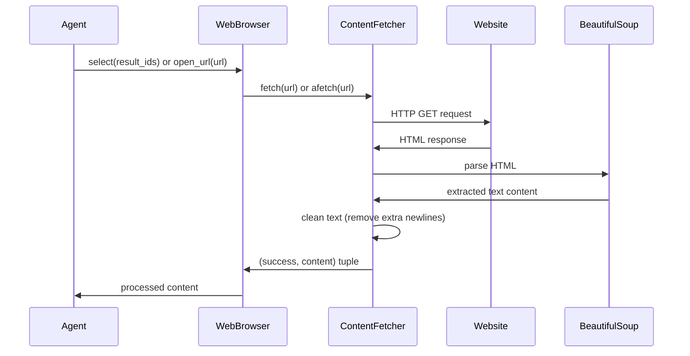
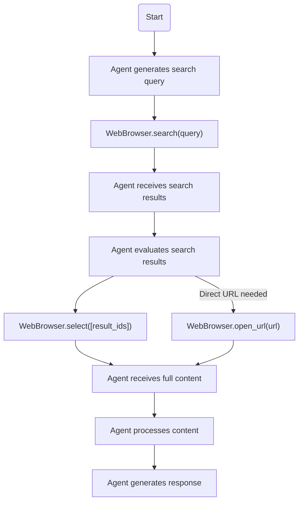

<!-- source: DeepWiki mcp.deepwiki.com · repo InternLM/lagent · extra page Web Browsing and Search · fetched 2026-10-26 -->

# Web Browsing and Search

<details>
<summary>Relevant source files</summary>

The following files were used as context for generating this wiki page:

- [lagent/actions/parser.py](lagent/actions/parser.py)
- [lagent/actions/web_browser.py](lagent/actions/web_browser.py)
- [lagent/llms/anthropic_llm.py](lagent/llms/anthropic_llm.py)
- [tests/test_actions/test_searxng_search.py](tests/test_actions/test_searxng_search.py)

</details>


## Purpose and Scope

This document details the web browsing and search capabilities in the LAgent framework. These components enable agents to search the web, browse search results, and retrieve content from specific URLs, providing agents with access to real-time information from the internet. This documentation covers the search engine interfaces, content fetching mechanisms, and the primary web browser actions that facilitate agent-web interaction.

For information about other action types such as code execution, see [Code Execution](#2.3.2) or research tools like Google Scholar and ArXiv, see [Research and Content Creation](#2.3.3).

Sources: [lagent/actions/web_browser.py:1-6]()

## Architecture Overview

The web browsing system in LAgent consists of three primary components: search engines, content fetching, and the web browser action interface. These components work together to provide comprehensive web access capabilities to agents.



The web browsing system implements both synchronous and asynchronous APIs through the `WebBrowser` and `AsyncWebBrowser` classes. These browser actions use a search engine implementation derived from `BaseSearch` and a `ContentFetcher` to retrieve web content.

Sources: [lagent/actions/web_browser.py:28-49](), [lagent/actions/web_browser.py:784-815](), [lagent/actions/web_browser.py:817-981]()

## Search Engine Interface

The system provides a common interface for all search engines through the `BaseSearch` abstract class. This standardizes how search results are filtered and formatted.



### Available Search Engines

The framework includes multiple search engine implementations:

| Search Engine Class | API Source | Primary Configuration |
|---------------------|------------|------------------------|
| `DuckDuckGoSearch` | DuckDuckGo | `proxy`, `timeout`, `topk` |
| `BingSearch` | Bing Search API | `api_key`, `region`, `topk` |
| `SearxngSearch` | Self-hosted SearxNG | `url`, `language`, `categories` |
| `BraveSearch` | Brave Search API | `api_key`, `region`, `language` |
| `GoogleSearch` | Serper.dev Google Search | `api_key`, `search_type` |
| `TencentSearch` | Tencent Cloud Search | `secret_id`, `secret_key` |

Each search engine implements both synchronous (`search`) and asynchronous (`asearch`) methods, with built-in caching and retry mechanisms.

Sources: [lagent/actions/web_browser.py:50-782]()

### Search Result Filtering

All search engines use a common filtering mechanism to standardize results:

1. Blacklist filtering: Results from domains in the blacklist are excluded
2. Format standardization: All results are formatted into a consistent dictionary structure
3. Size limiting: Only the top `topk` results are returned

The default blacklist includes: youtube.com, bilibili.com, researchgate.net, and the placeholder 'enoN'.

Sources: [lagent/actions/web_browser.py:34-47]()

## Web Browser Actions

The `WebBrowser` class provides three main methods for interacting with web content:

### 1. Search

The `search` method queries the configured search engine and returns a structured list of results:

```python
@tool_api
def search(self, query: Union[str, List[str]]) -> dict:
    """BING search API
    Args:
        query (List[str]): list of search query strings
    """
    # Implementation details
```

The search function can accept either a single query string or a list of queries, which will be processed in parallel.

### 2. Select

The `select` method retrieves the full content from selected search results:

```python
@tool_api
def select(self, select_ids: List[int]) -> dict:
    """get the detailed content on the selected pages.
    Args:
        select_ids (List[int]): list of index to select. Max number of index to be selected is no more than 4.
    """
    # Implementation details
```

This method takes a list of result IDs and fetches the full content from those web pages.

### 3. Open URL

The `open_url` method directly retrieves content from a specified URL:

```python
@tool_api
def open_url(self, url: str) -> dict:
    # Implementation details
```

This method bypasses the search process and directly accesses a known URL.

Sources: [lagent/actions/web_browser.py:817-907]()

## Content Fetching

The `ContentFetcher` class handles the retrieval and parsing of web content:



The content fetcher:
1. Makes HTTP requests to retrieve web content
2. Uses BeautifulSoup to extract text from HTML
3. Cleans the extracted text
4. Implements caching to avoid redundant requests
5. Provides both synchronous and asynchronous interfaces

Sources: [lagent/actions/web_browser.py:784-815]()

## Advanced Features

### Caching and Efficiency

Both search and content fetching operations implement TTL (Time-To-Live) caching:

```python
@cached(cache=TTLCache(maxsize=100, ttl=600))
def search(self, query: str, max_retry: int = 3) -> dict:
    # Implementation
```

```python
@cached(cache=TTLCache(maxsize=100, ttl=600))
def fetch(self, url: str) -> Tuple[bool, str]:
    # Implementation
```

The caching mechanism:
- Stores up to 100 results per method
- Expires cache entries after 600 seconds (10 minutes)
- Applies to both synchronous and asynchronous operations

Sources: [lagent/actions/web_browser.py:67-77](), [lagent/actions/web_browser.py:789-800]()

### Error Handling and Retries

All search engines implement robust error handling and retry logic:

1. Multiple retry attempts (configurable, typically 3)
2. Exponential backoff with randomization
3. Specific error handling for different types of failures
4. Detailed logging of error conditions

Sources: [lagent/actions/web_browser.py:67-77]()

### Asynchronous Operations

The framework provides asynchronous versions of all operations through:

1. `AsyncWebBrowser` class extending `WebBrowser` with `AsyncActionMixin`
2. Asynchronous search methods (`asearch`) in all search engine implementations
3. Asynchronous content fetching (`afetch`)

This enables efficient handling of multiple concurrent requests and integration with asynchronous agent frameworks.

Sources: [lagent/actions/web_browser.py:909-981]()

## Integration with Parsers

The web browser actions use the `JsonParser` to handle input and output formatting:

```python
def __init__(
    self,
    searcher_type: str = 'DuckDuckGoSearch',
    timeout: int = 5,
    black_list: Optional[List[str]] = [
        'enoN',
        'youtube.com',
        'bilibili.com',
        'researchgate.net',
    ],
    topk: int = 20,
    description: Optional[dict] = None,
    parser: Type[BaseParser] = JsonParser,
    **kwargs,
):
    # Implementation
```

The `JsonParser` enforces that input arguments are provided in JSON format and handles error checking for required parameters.

Sources: [lagent/actions/web_browser.py:817-839](), [lagent/actions/parser.py:81-112]()

## Usage Flow

The typical usage flow for web browsing within an agent involves:



This flow allows agents to:
1. Begin with a general search
2. Review summaries of search results
3. Select promising results for detailed content retrieval
4. Process and integrate the retrieved information into their responses

Sources: [lagent/actions/web_browser.py:817-907]()

## Example Configuration

Here's an example of how to initialize a web browser action with different search engines:

```python
# DuckDuckGo (default, no API key required)
browser = WebBrowser(searcher_type='DuckDuckGoSearch', topk=5)

# Bing Search
browser = WebBrowser(
    searcher_type='BingSearch',
    api_key='your-api-key-here',
    region='en-US',
    topk=5
)

# Self-hosted SearxNG
browser = WebBrowser(
    searcher_type='SearxngSearch',
    url='http://your-searxng-instance:8080',
    language='en',
    topk=5
)
```

These configurations can be directly passed to an agent's action executor to enable web browsing capabilities.

Sources: [lagent/actions/web_browser.py:817-839]()

---

