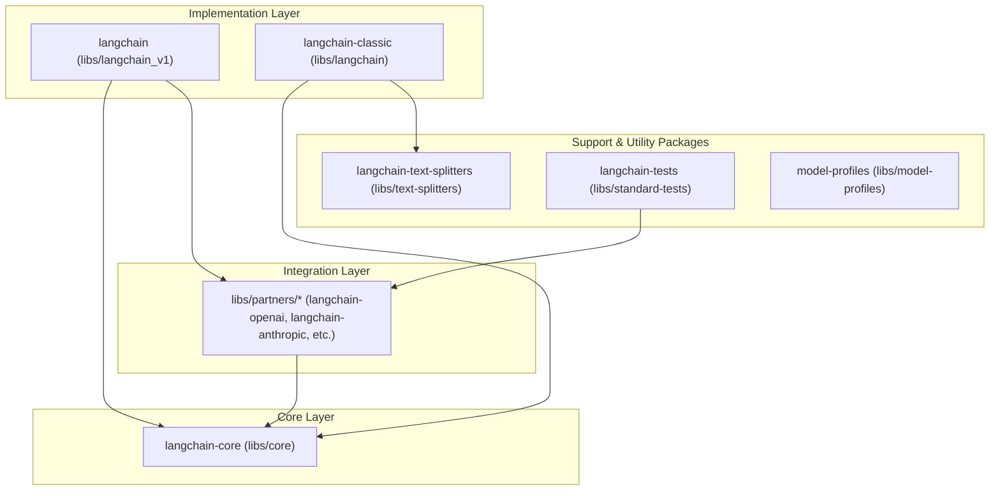
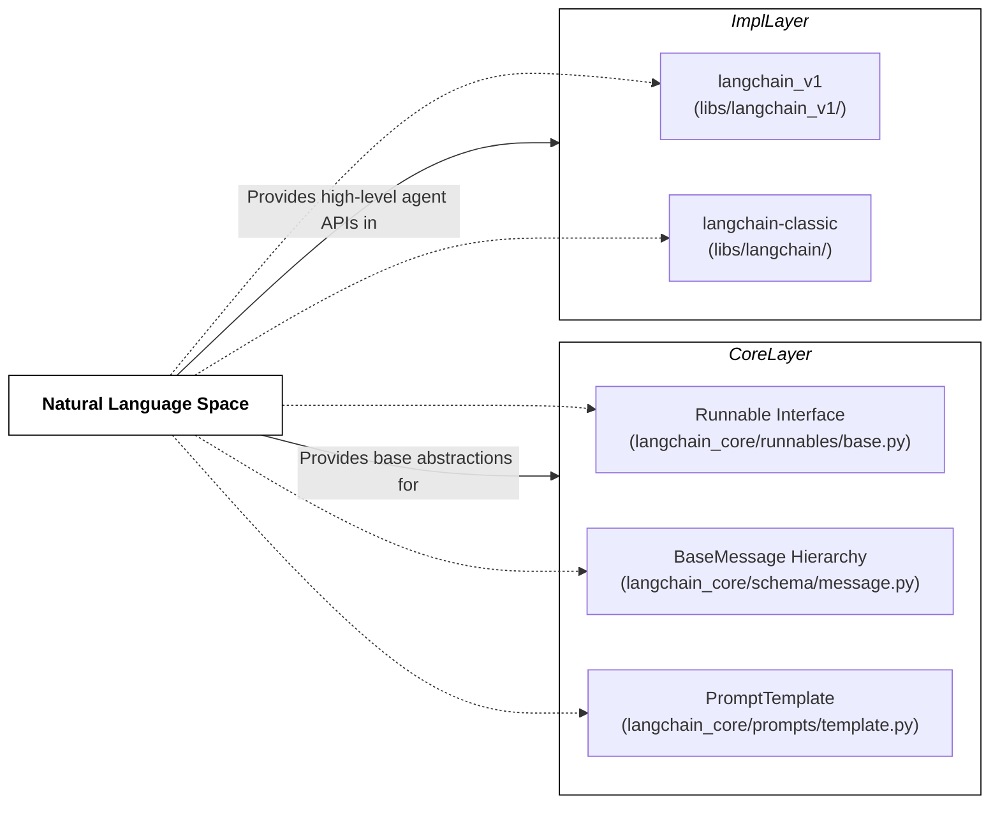
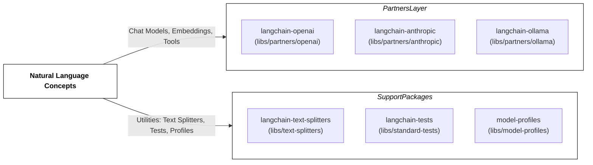

<!-- source: DeepWiki mcp.deepwiki.com · repo langchain-ai/langchain · page 1 Overview · fetched 2026-10-26 -->

# Overview

Relevant source files

The following files were used as context for generating this wiki page:

- [.github/CODEOWNERS](.github/CODEOWNERS)
- [.github/PULL_REQUEST_TEMPLATE.md](.github/PULL_REQUEST_TEMPLATE.md)
- [.github/workflows/pr_lint.yml](.github/workflows/pr_lint.yml)
- [AGENTS.md](AGENTS.md)
- [README.md](README.md)
- [libs/README.md](libs/README.md)
- [libs/core/Makefile](libs/core/Makefile)
- [libs/core/README.md](libs/core/README.md)
- [libs/langchain/Makefile](libs/langchain/Makefile)
- [libs/langchain/README.md](libs/langchain/README.md)
- [libs/langchain/pyproject.toml](libs/langchain/pyproject.toml)
- [libs/langchain/tests/unit_tests/conftest.py](libs/langchain/tests/unit_tests/conftest.py)
- [libs/langchain/tests/unit_tests/test_dependencies.py](libs/langchain/tests/unit_tests/test_dependencies.py)
- [libs/langchain/uv.lock](libs/langchain/uv.lock)
- [libs/langchain_v1/Makefile](libs/langchain_v1/Makefile)
- [libs/langchain_v1/README.md](libs/langchain_v1/README.md)
- [libs/langchain_v1/langchain/__init__.py](libs/langchain_v1/langchain/__init__.py)
- [libs/langchain_v1/pyproject.toml](libs/langchain_v1/pyproject.toml)
- [libs/langchain_v1/uv.lock](libs/langchain_v1/uv.lock)
- [libs/model-profiles/pyproject.toml](libs/model-profiles/pyproject.toml)
- [libs/model-profiles/uv.lock](libs/model-profiles/uv.lock)
- [libs/partners/README.md](libs/partners/README.md)
- [libs/standard-tests/README.md](libs/standard-tests/README.md)
- [libs/standard-tests/pyproject.toml](libs/standard-tests/pyproject.toml)
- [libs/standard-tests/uv.lock](libs/standard-tests/uv.lock)
- [libs/text-splitters/Makefile](libs/text-splitters/Makefile)
- [libs/text-splitters/README.md](libs/text-splitters/README.md)
- [libs/text-splitters/pyproject.toml](libs/text-splitters/pyproject.toml)
- [libs/text-splitters/uv.lock](libs/text-splitters/uv.lock)

The LangChain monorepo serves as the core development repository for the LangChain agent engineering framework and its surrounding ecosystem [README.md:12-25](). It is organized as a multi-package Python project managed via `uv`, containing base abstractions, runtime orchestrators, legacy pipelines, third-party provider integrations, and shared utility packages [AGENTS.md:15-37]().

The repository is structured to cleanly separate low-level interfaces from high-level agent implementations and vendor-specific integrations. Below is an architectural overview of how the monorepo packages interrelate:

The core layer provides foundational abstractions and protocols upon which all other packages build. The implementation layer consists of two primary packages:

- **`langchain_v1`**: The actively maintained implementation with modern agent architecture and workflow orchestration.
- **`langchain-classic`**: A legacy package preserving traditional chains and agent executors, maintained for backward compatibility with no new features.

The integration layer (`libs/partners/`) contains service-specific code implementing models, embeddings, and tools for third-party providers such as OpenAI, Anthropic, and local model supports. Support and utility packages provide shared tooling like text splitting utilities, standard test suites for validating integrations, and model profile metadata.

*Sources: [AGENTS.md:15-37](), [libs/core/pyproject.toml:5-37](), [libs/langchain_v1/pyproject.toml:5-31](), [libs/langchain/pyproject.toml:5-34]()*

---

## 1.1. Repository Layout and Packages

The `libs/` directory houses multiple independently versioned Python packages. Each package maintains its own `pyproject.toml`, `uv.lock`, and `Makefile` to manage metadata, dependencies, and development workflows independently [AGENTS.md:17-54](). Inter-package dependencies are linked locally during development using `[tool.uv.sources]` entries, allowing editable installs that reference local paths instead of PyPI releases [libs/langchain/pyproject.toml:117-122]().

Key packages include:

| Package Name            | Directory (libs/)       | Description                                                                                                              |
|-------------------------|------------------------|--------------------------------------------------------------------------------------------------------------------------|
| `langchain-core`        | core                   | Foundational runtime abstractions, core interfaces such as Runnables and messages, and serialization layers. This is the base building block used by all client-facing packages. |
| `langchain_v1`          | langchain_v1            | Actively maintained implementation package featuring `create_agent` factory, LangGraph workflows, modern API surface including unified model/embedding initialization via `init_chat_model`. |
| `langchain-classic`     | langchain               | Legacy package preserving classical chains, memory and evaluation components, legacy agents, and output parsers. No feature development occurs here. |
| Partner Integration Packages | partners/*             | Third-party provider integrations (e.g. openai, anthropic, ollama). Each integrates models, tools, and embeddings conforming to the core protocols. |
| `langchain-text-splitters` | text-splitters          | Utilities for text chunking and document splitting to prepare inputs for LLMs and retrievers.                           |
| `langchain-tests`       | standard-tests          | Shared pytest-based test suites validating provider implementations to ensure consistent behavior.                       |
| `model-profiles`        | model-profiles          | Model metadata, capability schemas, and CLI tooling to manage model profiles and augmentations.                         |

Developers typically work with these packages independently but within the monorepo context for consistent integration and release management.

For detailed package structure, versioning, and inter-package dependency layout, see [Repository Layout and Packages](#1.1).

*Sources: [AGENTS.md:15-54](), [libs/core/pyproject.toml:5-88](), [libs/langchain/pyproject.toml:5-122](), [libs/langchain_v1/pyproject.toml:5-106]*

---

## 1.2. Developer Setup and Workflows

Development across the LangChain monorepo relies on the `uv` toolchain for environment and dependency management [AGENTS.md:46-53](). Unlike other monorepos, there is no root-level workspace configuration file; developers must enter an individual package directory (e.g., `libs/core` or `libs/langchain_v1`) before running commands [AGENTS.md:54]().

Common workflows include:

- **Dependency Syncing**: `uv sync --all-groups` installs all dependency groups for the current package, including test and lint dependencies. Selective sync with `--group <name>` is supported for incremental installs [AGENTS.md:56-64]().
- **Testing**: Running `make test` in each package triggers pytest runs suited for that package's code, often with network isolation to prevent unexpected calls to external services [AGENTS.md:67-68]().
- **Linting and Formatting**: `make lint` invokes the `ruff` linter, while `make format` runs auto-formatting [AGENTS.md:48](), [AGENTS.md:75-79]().
- **Static Typing**: Type-checking runs under `uv run --group lint mypy .`, ensuring strict adherence to type hints and preventing regressions [AGENTS.md:81-83]().

The monorepo enforces strict commit message and branch naming conventions as defined in CI pipelines and pre-commit hooks. This ensures consistent code quality and traceability across packages [.github/workflows/pr_lint.yml:1-129]().

For detailed environment setup instructions, development workflows, and contribution guidelines, see [Developer Setup and Workflows](#1.2).

*Sources: [AGENTS.md:44-151](), [.github/workflows/pr_lint.yml:1-130]*

---

## 1.3. Generated Wiki (openwiki/) and Docs Automation

The `openwiki/` directory contains a generated, just-in-time evidence index used to bridge the LangChain codebase with human-readable documentation and high-level concepts [AGENTS.md:35](). It stores claim files that map assertions about the code, page manifests, and structural metadata crucial for automated doc generation and code ownership.

This evidence layer enables automated workflows like `openwiki-update` that synchronize code changes with documentation updates, maintaining accuracy and freshness of LangChain's public-facing references.

For more information on how the openwiki system works and its integration into LangChain's docs release process, see [Generated Wiki (openwiki/) and Docs Automation](#1.3).

*Sources: [AGENTS.md:35]*

---

## Bridging Natural Language Concepts to Code Entities

Below are diagrams illustrating how conceptual system components map to code entities and package boundaries.

### Diagram 1: From "Natural Language Space" to "Code Entity Space" - Core and Implementation Layer

This diagram shows core abstractions such as `Runnable` and message schemas that form the foundation, with higher-level LangChain implementation packages built on top managing user-oriented API functionality.

---

### Diagram 2: From "Natural Language Space" to "Code Entity Space" - Integrations and Support Packages

This diagram clarifies how provider integration packages deliver functionality for third-party services, while support packages provide utilities and testing frameworks to aid consistent development and quality assurance.

---

For further exploration of these topics, examine the detailed child pages:

- [Repository Layout and Packages](#1.1)
- [Developer Setup and Workflows](#1.2)
- [Generated Wiki (openwiki/) and Docs Automation](#1.3)

---

*Sources: [README.md:12-25](), [AGENTS.md:15-54](), [libs/core/pyproject.toml:5-88](), [libs/langchain_v1/pyproject.toml:5-31](), [libs/langchain/pyproject.toml:5-122](), [libs/text-splitters/pyproject.toml:5-54](), [libs/standard-tests/pyproject.toml:5-60](), [libs/model-profiles/uv.lock:1-60]()*

---

