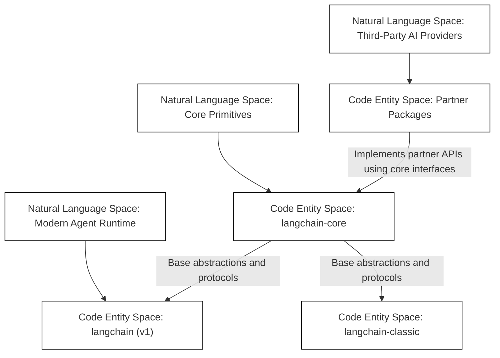
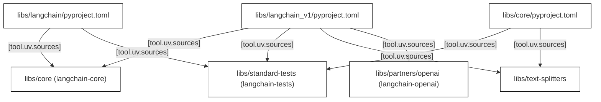
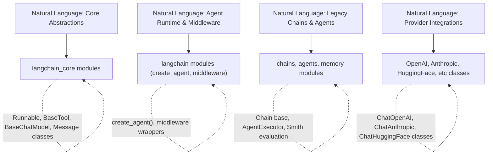
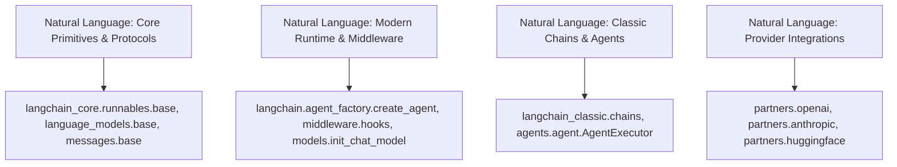

<!-- source: DeepWiki mcp.deepwiki.com · repo langchain-ai/langchain · page 1.1 Repository Layout and Packages · fetched 2026-10-26 -->

# Repository Layout and Packages

<details>
<summary>Relevant source files</summary>

The following files were used as context for generating this wiki page:

- [libs/core/langchain_core/version.py](libs/core/langchain_core/version.py)
- [libs/core/pyproject.toml](libs/core/pyproject.toml)
- [libs/core/tests/unit_tests/runnables/__snapshots__/test_fallbacks.ambr](libs/core/tests/unit_tests/runnables/__snapshots__/test_fallbacks.ambr)
- [libs/core/tests/unit_tests/runnables/__snapshots__/test_runnable.ambr](libs/core/tests/unit_tests/runnables/__snapshots__/test_runnable.ambr)
- [libs/core/tests/unit_tests/runnables/test_fallbacks.py](libs/core/tests/unit_tests/runnables/test_fallbacks.py)
- [libs/core/uv.lock](libs/core/uv.lock)
- [libs/langchain/pyproject.toml](libs/langchain/pyproject.toml)
- [libs/langchain/tests/unit_tests/conftest.py](libs/langchain/tests/unit_tests/conftest.py)
- [libs/langchain/tests/unit_tests/test_dependencies.py](libs/langchain/tests/unit_tests/test_dependencies.py)
- [libs/langchain/uv.lock](libs/langchain/uv.lock)
- [libs/langchain_v1/langchain/__init__.py](libs/langchain_v1/langchain/__init__.py)
- [libs/langchain_v1/pyproject.toml](libs/langchain_v1/pyproject.toml)
- [libs/langchain_v1/uv.lock](libs/langchain_v1/uv.lock)
- [libs/model-profiles/pyproject.toml](libs/model-profiles/pyproject.toml)
- [libs/model-profiles/uv.lock](libs/model-profiles/uv.lock)
- [libs/partners/deepseek/pyproject.toml](libs/partners/deepseek/pyproject.toml)
- [libs/partners/deepseek/uv.lock](libs/partners/deepseek/uv.lock)
- [libs/partners/fireworks/langchain_fireworks/_version.py](libs/partners/fireworks/langchain_fireworks/_version.py)
- [libs/partners/fireworks/pyproject.toml](libs/partners/fireworks/pyproject.toml)
- [libs/partners/fireworks/uv.lock](libs/partners/fireworks/uv.lock)
- [libs/partners/groq/pyproject.toml](libs/partners/groq/pyproject.toml)
- [libs/partners/groq/uv.lock](libs/partners/groq/uv.lock)
- [libs/partners/huggingface/pyproject.toml](libs/partners/huggingface/pyproject.toml)
- [libs/partners/huggingface/uv.lock](libs/partners/huggingface/uv.lock)
- [libs/partners/mistralai/pyproject.toml](libs/partners/mistralai/pyproject.toml)
- [libs/partners/mistralai/uv.lock](libs/partners/mistralai/uv.lock)
- [libs/partners/perplexity/pyproject.toml](libs/partners/perplexity/pyproject.toml)
- [libs/partners/perplexity/uv.lock](libs/partners/perplexity/uv.lock)
- [libs/partners/xai/pyproject.toml](libs/partners/xai/pyproject.toml)
- [libs/partners/xai/uv.lock](libs/partners/xai/uv.lock)
- [libs/standard-tests/pyproject.toml](libs/standard-tests/pyproject.toml)
- [libs/standard-tests/uv.lock](libs/standard-tests/uv.lock)
- [libs/text-splitters/pyproject.toml](libs/text-splitters/pyproject.toml)
- [libs/text-splitters/uv.lock](libs/text-splitters/uv.lock)

</details>


## Purpose and Scope
This page provides a detailed technical overview of the LangChain monorepo layout under the `libs/` directory. It focuses on the key packages such as `langchain-core`, `langchain` (v1), `langchain-classic`, text-splitters, standard-tests, model-profiles, and partner integrations. The discussion covers their `pyproject.toml` configurations, `uv.lock` dependency lockfiles, versioning schemes, and how local workspace linking is implemented within the monorepo through `uv` source overrides.

---

## 1. Monorepo Package Topology and System Roles

LangChain's monorepo organizes functionality into modular packages under `libs/` with clear separation of core primitives, runtime frameworks, legacy implementations, and partner integrations. This design supports maintainability, flexible dependency management, and workspace development.


*Diagram 1: Mapping of natural language conceptual spaces to core code packages.*

**Explanation:**

- **langchain-core** (distribution name: `langchain-core`) provides foundational abstractions such as runnables, messages, prompts, tools, serialization schemas, and protocol definitions used across LangChain.
- **langchain** (v1) (distribution name: `langchain`) implements the modern agent runtime including agent factories, middleware systems, and unified model/embedding initialization built on top of langchain-core.
- **langchain-classic** (distribution name: `langchain-classic`) contains legacy chains, agents, memory modules, and evaluation tools, also leveraging langchain-core interfaces.
- **Partner packages** under `libs/partners/*` implement third-party AI provider integrations standardized around langchain-core's abstractions.

Sources:  
`libs/core/pyproject.toml:6-37`  
`libs/langchain_v1/pyproject.toml:5-30`  
`libs/langchain/pyproject.toml:6-34`  

---

## 2. Tour of `libs/*` Packages

### `libs/core` (`langchain-core`)

This package houses the fundamental core abstractions and interfaces used across LangChain. It contains base classes and utilities for messages, prompts, tools, runnables, serialization mechanisms, and protocol definitions. It is designed to be a minimal stable foundation with relatively few external dependencies.

- **Package Name:** `langchain-core`  
- **Version:** `1.6.6` (declared in `langchain_core/version.py`)  
- **Key dependencies:**  
  - `langsmith` (for tracing and external tooling support)  
  - `httpx` (async HTTP client)  
  - `tenacity` (for retries)  
  - `jsonpatch` (JSON patch operations)  
  - `PyYAML` (YAML parsing)  
  - `pydantic` (data validation)  
  - `uuid-utils` (UUID handling utilities)  
  - `langchain-protocol` (protocol schemas)  
- **Configuration source:** `libs/core/pyproject.toml` lines 6-37  
- **Version constant:** Found at `libs/core/langchain_core/version.py:3`  

This package enforces strict typing and linting, with mypy plugins and ruff rules configured for code quality.

---

### `libs/langchain_v1` (`langchain`)

This is the modern LangChain runtime package built atop `langchain-core` and `langgraph`. It provides:

- Agent factory method `create_agent`.
- Middleware framework with hooks for model and tool call wrapping.
- Unified initialization for language models and embeddings.
- Modern graph-based execution model for agents.

- **Package Name:** `langchain`  
- **Version:** `1.4.3`  
- **Key dependencies:**  
  - `langchain-core>=1.6.3`  
  - `langgraph>=1.2.11` (graph execution library)  
  - `pydantic>=2.7.4`  
- **Configuration source:** `libs/langchain_v1/pyproject.toml` lines 5-30  
- **Version declared:** `libs/langchain_v1/langchain/__init__.py:3`

---

### `libs/langchain` (`langchain-classic`)

Houses legacy implementations maintained for backward compatibility and gradual migration:

- Classic chains and memory modules.
- Older agent executors and output parsers.
- Evaluation tools and smith frameworks.
- Strong dependencies on SQLAlchemy and `requests`.

- **Package Name:** `langchain-classic`  
- **Version:** `1.0.8`  
- **Key dependencies:**  
  - `langchain-core>=1.4.7`  
  - `langchain-text-splitters`  
  - `langsmith`  
  - `pydantic`  
  - `SQLAlchemy`  
  - `requests`  
- **Configuration source:** `libs/langchain/pyproject.toml` lines 6-34  

---

### `libs/standard-tests` (`langchain-tests`)

Provides standardized conformance test suites and pytest plugin infrastructure for validating:

- Chat models and language models.
- Tools and vector stores.
- Retrievers and store integrations.

- **Package Name:** `langchain-tests`  
- **Version:** `1.1.9` (from dependency declarations)  
- **Key dependencies:**  
  - `langchain-core`  
  - `pytest`  
  - `httpx`  
  - `syrupy` (snapshot testing)  
  - `vcrpy` (HTTP cassette recording)  
  - `numpy`  
- **Configuration source:** `libs/standard-tests/pyproject.toml` lines 6-38  

---

### Additional Notable Packages

- **`libs/text-splitters`**: Document chunking and text splitting utilities, isolated with minimal dependencies.
- **`libs/model-profiles`**: Provides schemas for model metadata, CLI tools for refreshing and summarizing profiles.
- **`libs/partners/*`**: Separate provider integration packages, each with its own pyproject.toml and lockfiles, implementing integrations for OpenAI, Anthropic, HuggingFace, Fireworks, Groq, Mistral, XAI, DeepSeek, Perplexity, and others.

Sources:  
`libs/core/pyproject.toml:6-37`  
`libs/langchain_v1/pyproject.toml:5-30`  
`libs/langchain/pyproject.toml:6-34`  
`libs/standard-tests/pyproject.toml:6-38`  

---

## 3. Workspace Links and Build Configurations

LangChain uses the `uv` build system to manage workspace dependencies within the monorepo. Each package declares local editable references to sibling packages under `[tool.uv.sources]` in their `pyproject.toml`. This enables seamless local development without the need to publish intermediate versions.


*Diagram 2: Inter-package workspace linking topology configured through `uv.sources`.*

Examples of workspace links:

From `libs/langchain_v1/pyproject.toml`:

```toml
[tool.uv.sources]
langchain-core = { path = "../core", editable = true }
langchain-tests = { path = "../standard-tests", editable = true }
langchain-text-splitters = { path = "../text-splitters", editable = true }
langchain-openai = { path = "../partners/openai", editable = true }
langchain-anthropic = { path = "../partners/anthropic", editable = true }
```

From `libs/core/pyproject.toml`:

```toml
[tool.uv.sources]
langchain-tests = { path = "../standard-tests" }
langchain-text-splitters = { path = "../text-splitters" }
```

This setup means code in `langchain-v1` or `langchain-classic` directly observes latest changes in core, tests, or partner packages during development.

Sources:  
`libs/langchain_v1/pyproject.toml:100-105`  
`libs/core/pyproject.toml:85-87`  
`libs/langchain/pyproject.toml:117-121`  

---

## 4. Summary Table of Monorepo Packages

| Package Directory         | Distribution Name       | Version  | Primary Purpose                                           |
|--------------------------|------------------------|----------|------------------------------------------------------------|
| `libs/core`              | `langchain-core`       | 1.6.6    | Core primitives, runnables, messages, tools, protocols       |
| `libs/langchain_v1`      | `langchain`            | 1.4.3    | Modern agent runtime, middleware, model initialization       |
| `libs/langchain`         | `langchain-classic`    | 1.0.8    | Legacy chains, agents, memory modules                        |
| `libs/text-splitters`    | `langchain-text-splitters` | varies | Document splitting utilities                                 |
| `libs/standard-tests`    | `langchain-tests`      | 1.1.9    | Standardized conformance tests and pytest plugins           |
| `libs/model-profiles`    | `langchain-profiles`   | varies   | Model metadata schemas and profiling CLI                     |
| `libs/partners/*`        | `langchain-{provider}` | varies   | Provider integrations for OpenAI, Anthropic, HuggingFace, etc.|

Sources:  
`libs/core/pyproject.toml:24`  
`libs/langchain_v1/pyproject.toml:24`  
`libs/langchain/pyproject.toml:23`  
`libs/standard-tests/pyproject.toml:24`  

---

## 5. Bridging Natural Language Concepts to Code Entities

LangChain’s design bridges high-level natural language system concepts with concrete code implementations organized in different packages and modules. The following diagrams illustrate these mappings clearly.


*Diagram 3: Mapping natural language system concepts to representative code entities in respective packages.*

---


*Diagram 4: Code entities illustrating concrete classes and functions where key system concepts are implemented.*

---

# Summary

This page elaborates on the LangChain monorepo's modular design, highlighting the division between core abstractions, modern runtime, legacy implementations, and third-party provider integrations. Each package's `pyproject.toml` defines its dependencies and versioning with local editable workspace links for development via `uv` source mappings.

Understanding this layered package structure is essential for navigating, developing, and extending LangChain efficiently.

---

Sources:  
- `libs/core/pyproject.toml:6-37`  
- `libs/core/langchain_core/version.py:1-4`  
- `libs/langchain_v1/pyproject.toml:5-30,100-105`  
- `libs/langchain_v1/langchain/__init__.py:1-4`  
- `libs/langchain/pyproject.toml:6-34,117-121`  
- `libs/standard-tests/pyproject.toml:6-38`  
- `libs/core/uv.lock:1-80`  
- `libs/langchain_v1/uv.lock:1-95`  
- `libs/langchain/uv.lock:1-64`  
- `libs/standard-tests/uv.lock:1-60`

---

