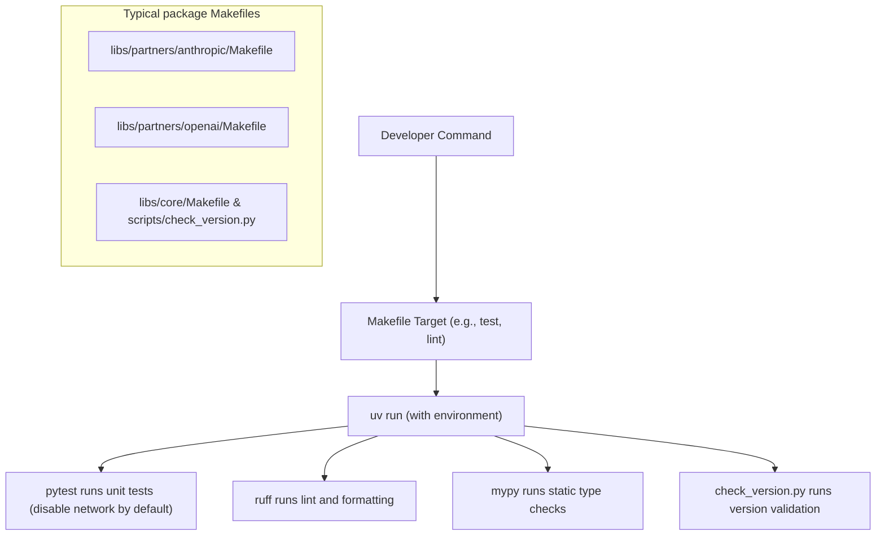
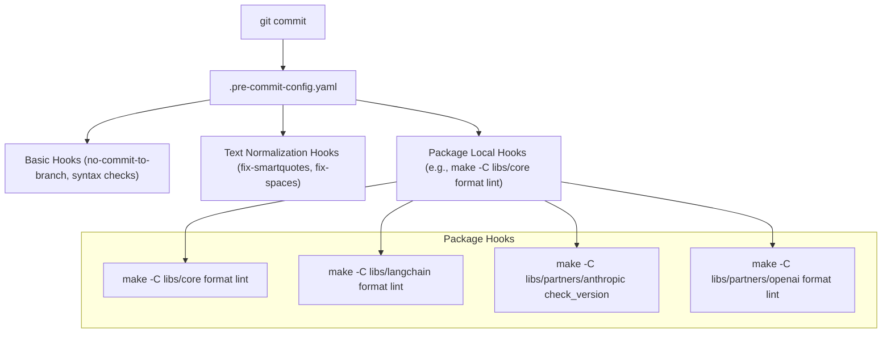
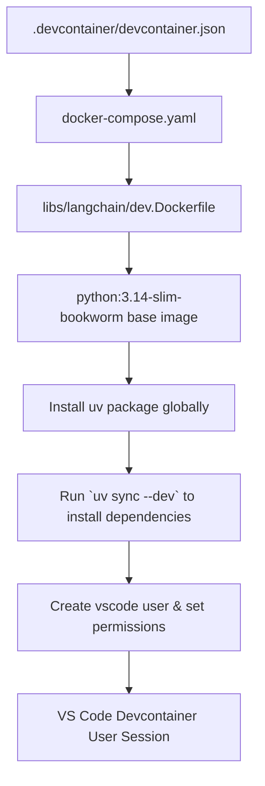
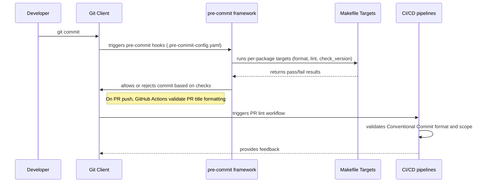

<!-- source: DeepWiki mcp.deepwiki.com · repo langchain-ai/langchain · page 1.2 Developer Setup and Workflows · fetched 2026-10-26 -->

# Developer Setup and Workflows

<details>
<summary>Relevant source files</summary>

The following files were used as context for generating this wiki page:

- [.devcontainer/README.md](.devcontainer/README.md)
- [.devcontainer/devcontainer.json](.devcontainer/devcontainer.json)
- [.devcontainer/docker-compose.yaml](.devcontainer/docker-compose.yaml)
- [.github/CODEOWNERS](.github/CODEOWNERS)
- [.github/PULL_REQUEST_TEMPLATE.md](.github/PULL_REQUEST_TEMPLATE.md)
- [.github/workflows/pr_lint.yml](.github/workflows/pr_lint.yml)
- [.gitignore](.gitignore)
- [.pre-commit-config.yaml](.pre-commit-config.yaml)
- [.vscode/extensions.json](.vscode/extensions.json)
- [.vscode/settings.json](.vscode/settings.json)
- [AGENTS.md](AGENTS.md)
- [README.md](README.md)
- [libs/README.md](libs/README.md)
- [libs/core/Makefile](libs/core/Makefile)
- [libs/core/langchain_core/messages/content.py](libs/core/langchain_core/messages/content.py)
- [libs/core/scripts/check_imports.py](libs/core/scripts/check_imports.py)
- [libs/core/scripts/check_version.py](libs/core/scripts/check_version.py)
- [libs/langchain/Makefile](libs/langchain/Makefile)
- [libs/langchain/dev.Dockerfile](libs/langchain/dev.Dockerfile)
- [libs/langchain_v1/Makefile](libs/langchain_v1/Makefile)
- [libs/langchain_v1/scripts/check_imports.py](libs/langchain_v1/scripts/check_imports.py)
- [libs/langchain_v1/scripts/check_version.py](libs/langchain_v1/scripts/check_version.py)
- [libs/partners/README.md](libs/partners/README.md)
- [libs/partners/anthropic/Makefile](libs/partners/anthropic/Makefile)
- [libs/partners/chroma/Makefile](libs/partners/chroma/Makefile)
- [libs/partners/deepseek/Makefile](libs/partners/deepseek/Makefile)
- [libs/partners/exa/Makefile](libs/partners/exa/Makefile)
- [libs/partners/fireworks/Makefile](libs/partners/fireworks/Makefile)
- [libs/partners/groq/Makefile](libs/partners/groq/Makefile)
- [libs/partners/huggingface/Makefile](libs/partners/huggingface/Makefile)
- [libs/partners/mistralai/Makefile](libs/partners/mistralai/Makefile)
- [libs/partners/nomic/Makefile](libs/partners/nomic/Makefile)
- [libs/partners/ollama/Makefile](libs/partners/ollama/Makefile)
- [libs/partners/openai/Makefile](libs/partners/openai/Makefile)
- [libs/partners/qdrant/Makefile](libs/partners/qdrant/Makefile)
- [libs/partners/xai/Makefile](libs/partners/xai/Makefile)
- [libs/text-splitters/Makefile](libs/text-splitters/Makefile)

</details>


This page details the developer setup, build orchestration, dependency management via `uv`, Makefile targets, pre-commit validation gates, and containerized development workflows across the LangChain monorepo.

---

## 1. Package-Level Makefiles and `uv` Workflows

The LangChain monorepo is organized as a multi-package Python workspace under the `libs/` directory. Each package (such as `core`, `langchain_v1`, partner integrations like `partners/anthropic` and `partners/openai`, and utility packages like `text-splitters`) manages its own independent development lifecycle. This includes an isolated `pyproject.toml` for package metadata and dependencies, a locked `uv.lock` for deterministic dependency resolution, and a `Makefile` defining common development targets.

### Dependency and Environment Management with `uv`
- `uv` is the monorepo-wide Python package installer and environment manager used throughout the LangChain repo. It replaces traditional tools like `pip` and `poetry` to provide:
  - Automatic environment activation
  - Precise dependency resolution & locking per package
  - Isolated editable installs within each package folder
- Developers **must never run `pip`, `poetry`, or create virtual environments manually**. Instead, run `uv sync` to install dependencies and `uv run` to execute commands with environment control.
- Dependency constraints, including Python compatibility, are specified per package in `pyproject.toml`.
- Editable installs use `[tool.uv.sources]` to reference local packages for efficient development workflows [see `AGENTS.md:17-93`].

### Standard Makefile Targets
Each package's Makefile provides a consistent interface for development commands, including the following primary targets:

| Target              | Description                                                                             |
|---------------------|-----------------------------------------------------------------------------------------|
| `test` / `tests`      | Runs unit tests using `pytest`. Tests run with network calls disabled by default (`--disable-socket`) for hermetic builds. Supports parallelism and selective test files. Example flags include `-n auto`, `--allow-unix-socket`. |
| `integration_test` / `integration_tests` | Runs live integration tests that require network access to external APIs. Often includes smoke tests across multiple SDK versions for compatibility validation. |
| `lint`               | Executes `ruff` linter for code quality checks and style violations.                     |
| `format`             | Runs code formatters provided by `ruff`, e.g. auto-formatting fixes.                     |
| `type`               | Runs static type checking via `mypy` with package-level cache directories to speed repeated checks. |
| `check_version`      | Validates version number consistency between `pyproject.toml` and internal source code versions to avoid release conflicts. |
| `check_imports`      | Runs custom import lint scripts to enforce module boundaries and architectural constraints. |

These targets use `uv run` internally to ensure commands run with the appropriate environment and dependencies activated.

#### Example Makefile and UV Lifecycle Diagram



Sources: [libs/partners/anthropic/Makefile:1-81](), [libs/partners/openai/Makefile:1-101](), [libs/core/Makefile:1-89](), [libs/core/scripts/check_version.py:1-65](), [AGENTS.md:17-93]()

---

## 2. Pre-Commit Hooks and Code Quality Gates

LangChain uses `pre-commit` hooks configured centrally in `.pre-commit-config.yaml` to enforce code quality, style, and package consistency before commits are accepted.

### Pre-Commit Hook Components:

- **Basic Git Safety & Syntax Hooks:**
  - `no-commit-to-branch` prevents direct commits to protected branches like `master`.
  - `check-yaml`, `check-toml` validate syntax correctness of project config files.
  - `end-of-file-fixer` and `trailing-whitespace` ensure clean trailing formatting.
- **Text Normalization:**
  - Hooks like `fix-smartquotes` and `fix-spaces` from `texthooks` ensure consistent ASCII characters.
- **Package-Specific Hooks:**
  - For each package, the pre-commit runs its Makefile `format` and `lint` targets. This provides uniform formatting and linting without manual commands.
  - Version consistency checks via `check_version` targets run to avoid version drifts.
- **Package Coverage:**
  - Core packages (`core`, `langchain`, `standard-tests`, `text-splitters`) and partner integrations (`anthropic`, `chroma`, `openai`, etc.) all have hooks that invoke their local Makefiles for formatting/linting.

### Architecture of Pre-Commit Validation



This setup enforces that all committed code conforms to style, passes lint/type checks, and maintains version hygiene, reducing manual errors and maintaining the project's quality standards.

Sources: [.pre-commit-config.yaml:1-171]()

---

## 3. Containerized Development (Devcontainers)

To facilitate environment consistency and simplify setup, LangChain offers a VS Code devcontainer configuration, backed by Docker and Docker Compose.

### Main Components

- **Dockerfile** (`libs/langchain/dev.Dockerfile`):
  - Based on official Python 3.14 slim image.
  - Installs essential OS dependencies: build tools, curl, git, vim, less, certificates.
  - Installs `uv` globally for dependency management.
  - Copies the entire repo and runs `uv sync --dev` inside `libs/langchain_v1` to install dev dependencies in editable mode.
  - Creates a dedicated non-root `vscode` user with appropriate permissions.
  - Sets shell and working directory for smooth interactive usage [libs/langchain/dev.Dockerfile:1-43].

- **Devcontainer JSON Configuration** (`.devcontainer/devcontainer.json`):
  - Uses Docker Compose to launch the `langchain` service container.
  - Mounts a persistent Docker volume for the workspace.
  - Adds useful VS Code extensions, e.g. Python, Mypy, isort, markdown linting, Jupyter, GitHub Copilot.
  - Sets Python interpreter path inside the container workspace to `libs/langchain_v1/.venv/bin/python`.
  - Runs a post-create command to `uv sync` dependencies automatically upon container startup [`.devcontainer/devcontainer.json:1-58`].

This combination ensures that developers get an out-of-the-box ready environment that matches repo dependency constraints and uses proper virtual environments with consistent tooling.

### Container Dev Environment Bootstrap Diagram



Sources: [.devcontainer/devcontainer.json:1-58](), [libs/langchain/dev.Dockerfile:1-43]()

---

## 4. Linting, Import Checks, and Version Consistency

### Version Consistency Checks

- Run by `check_version` Makefile targets in each package (e.g. `libs/partners/anthropic/Makefile`, `libs/core/Makefile`).
- Invokes the Python script `libs/core/scripts/check_version.py` which:
  - Reads `pyproject.toml` version metadata.
  - Compares with internal `version.py` constants.
  - Throws errors if mismatch detected.
- Prevents release and merge errors due to version drift.

### Import Boundary Linting

- Custom import checks are run by targets like `check_imports` calling scripts (`scripts/check_imports.py`).
- Ensures packages do not import internals from other packages that would break architectural layering.
- Maintains strict modular boundaries in the monorepo.

These linting and checking conventions integrate into `pre-commit` and are regularly executed on CI pipelines.

Sources: [libs/core/scripts/check_version.py:1-65](), [libs/partners/anthropic/Makefile:62-63](), [libs/core/Makefile:34-35]()

---

## 5. Pull Request Conventions

The LangChain repo enforces a consistent commit and PR title format using Conventional Commits, verified by a GitHub Actions workflow `.github/workflows/pr_lint.yml`.

Key points:

- Titles must follow `<type>(<scope>): <message>` format.
- `type` must be lowercase (e.g., `feat`, `fix`, `docs`, `style`, `refactor`, `test`, `ci`, `chore`).
- Scope must never be empty; it must identify the affected package (e.g., `core`, `anthropic`, `langchain`, `partners`).
- Allowed scopes and types are strictly enumerated in the workflow config.
- Breaking changes append an exclamation mark after type/scope (e.g., `feat!: ...`).
- The workflow rejects PRs with malformed titles or empty scopes to maintain clean semantic history.

This convention facilitates automated changelog generation, release automation, and clearer code review patterns.

Sources: [.github/workflows/pr_lint.yml:1-129]()

---

# Summary

This page outlined developer setup and workflows in the LangChain monorepo:

- **Per-package Makefiles** that use `uv` to manage dependencies and run tests, linting, formatting, and type checking.
- **Pre-commit hooks** configured centrally to auto-run formatting, linting, and version checks on commits.
- **Containerized development environment** based on Docker, Docker Compose, and VS Code devcontainers, ensuring consistent developer setups.
- **Version consistency and import boundary validations** to maintain architectural hygiene.
- **Conventional Commits enforcement** via GitHub Actions to guarantee clean, descriptive commit and PR messages.

These tooling and workflow conventions enable a streamlined, reliable, and high-quality development experience across the LangChain project.

---

# Appendix: Key File Locations for Setup

| Purpose                     | Primary Files                                      |
|-----------------------------|--------------------------------------------------|
| Core development Makefile   | `libs/core/Makefile`                              |
| Anthropic partner Makefile  | `libs/partners/anthropic/Makefile`                |
| OpenAI partner Makefile     | `libs/partners/openai/Makefile`                    |
| Pre-commit config           | `.pre-commit-config.yaml`                         |
| Devcontainer config         | `.devcontainer/devcontainer.json`                 |
| Dockerfile for devcontainer | `libs/langchain/dev.Dockerfile`                    |
| Version consistency script  | `libs/core/scripts/check_version.py`              |
| PR lint GitHub action       | `.github/workflows/pr_lint.yml`                     |

---

# Detailed Diagram: Natural Language to Code Entities – Makefile to Code Integration

```mermaid
flowchart TD
    NL["Developer runs command `make test` or `make lint`"] --> MF["Makefile target (e.g. `test`, `lint`)"]
    MF --> UV["Invokes `uv run` with environment and dependencies"]
    UV --> PYTEST["`pytest` runs tests located in `tests/` directories"]
    UV --> RUFF["`ruff` runs lint and format on package source files"]
    UV --> MYPY["`mypy` runs static type checks with caching"]

    subgraph "Representative Package Makefiles"
    MF1[libs/partners/anthropic/Makefile]
    MF2[libs/partners/openai/Makefile]
    MF3[libs/core/Makefile]
    end

    MF --> MF1
    MF --> MF2
    MF --> MF3
```

---

# Detailed Diagram: From Pre-Commit to Final Build Validation



---

Sources:  
[libs/partners/anthropic/Makefile:1-81](), [libs/partners/openai/Makefile:1-101](), [libs/core/Makefile:1-89](), [libs/core/scripts/check_version.py:1-65](),  
[.pre-commit-config.yaml:1-171](), [.devcontainer/devcontainer.json:1-58](), [libs/langchain/dev.Dockerfile:1-43](),  
[.github/workflows/pr_lint.yml:1-129](), [AGENTS.md:17-93]()

---

