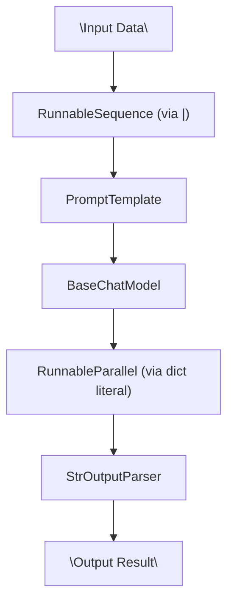
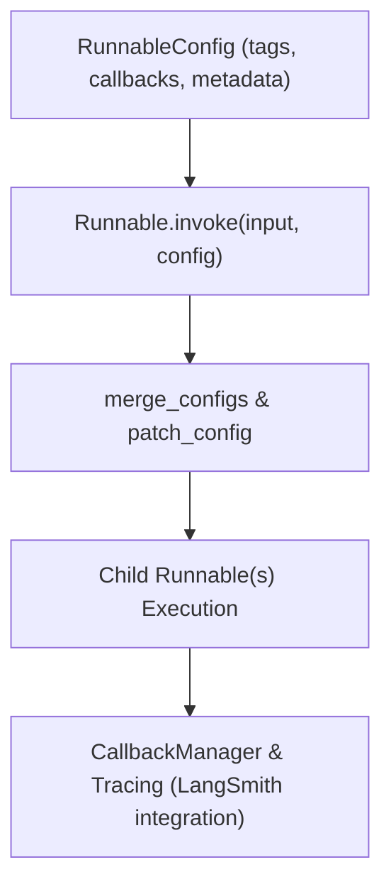

<!-- source: DeepWiki mcp.deepwiki.com · repo langchain-ai/langchain · page 2.1 Runnables and LCEL · fetched 2026-10-26 -->

# Runnables and LCEL

<details>
<summary>Relevant source files</summary>

The following files were used as context for generating this wiki page:

- [libs/core/langchain_core/callbacks/base.py](libs/core/langchain_core/callbacks/base.py)
- [libs/core/langchain_core/callbacks/manager.py](libs/core/langchain_core/callbacks/manager.py)
- [libs/core/langchain_core/output_parsers/string.py](libs/core/langchain_core/output_parsers/string.py)
- [libs/core/langchain_core/rate_limiters.py](libs/core/langchain_core/rate_limiters.py)
- [libs/core/langchain_core/runnables/base.py](libs/core/langchain_core/runnables/base.py)
- [libs/core/langchain_core/runnables/branch.py](libs/core/langchain_core/runnables/branch.py)
- [libs/core/langchain_core/runnables/config.py](libs/core/langchain_core/runnables/config.py)
- [libs/core/langchain_core/runnables/configurable.py](libs/core/langchain_core/runnables/configurable.py)
- [libs/core/langchain_core/runnables/fallbacks.py](libs/core/langchain_core/runnables/fallbacks.py)
- [libs/core/langchain_core/runnables/passthrough.py](libs/core/langchain_core/runnables/passthrough.py)
- [libs/core/langchain_core/runnables/retry.py](libs/core/langchain_core/runnables/retry.py)
- [libs/core/langchain_core/runnables/schema.py](libs/core/langchain_core/runnables/schema.py)
- [libs/core/langchain_core/runnables/utils.py](libs/core/langchain_core/runnables/utils.py)
- [libs/core/langchain_core/version.py](libs/core/langchain_core/version.py)
- [libs/core/pyproject.toml](libs/core/pyproject.toml)
- [libs/core/tests/unit_tests/callbacks/test_sync_callback_manager.py](libs/core/tests/unit_tests/callbacks/test_sync_callback_manager.py)
- [libs/core/tests/unit_tests/runnables/__snapshots__/test_fallbacks.ambr](libs/core/tests/unit_tests/runnables/__snapshots__/test_fallbacks.ambr)
- [libs/core/tests/unit_tests/runnables/__snapshots__/test_runnable.ambr](libs/core/tests/unit_tests/runnables/__snapshots__/test_runnable.ambr)
- [libs/core/tests/unit_tests/runnables/test_config.py](libs/core/tests/unit_tests/runnables/test_config.py)
- [libs/core/tests/unit_tests/runnables/test_configurable.py](libs/core/tests/unit_tests/runnables/test_configurable.py)
- [libs/core/tests/unit_tests/runnables/test_fallbacks.py](libs/core/tests/unit_tests/runnables/test_fallbacks.py)
- [libs/core/tests/unit_tests/runnables/test_runnable.py](libs/core/tests/unit_tests/runnables/test_runnable.py)
- [libs/core/tests/unit_tests/runnables/test_utils.py](libs/core/tests/unit_tests/runnables/test_utils.py)
- [libs/core/uv.lock](libs/core/uv.lock)

</details>


## Purpose and Scope

This page provides a high-level architectural overview of **Runnables** and **LangChain Expression Language (LCEL)** within the `langchain-core` package. The Runnable interface is a foundational abstraction that standardizes units of work capable of synchronous and asynchronous execution, streaming, batching, and declarative composition.

As a parent page, it briefly introduces core concepts including composition, configuration propagation, retries/fallbacks, configurable runtime fields, and rate limiters. Detailed technical implementations and subsystem specifics are covered in child pages:
- [Graph Rendering and Visualization](#2.1.1)
- [Streaming, Events and Chat History Runnables](#2.1.2)

---

## 1. The Runnable Interface and LCEL Composition

At the core of `langchain-core` is the abstract base class `Runnable`, which defines how inputs are transformed into outputs. This abstraction applies uniformly to prompts, language models, output parsers, tools, or arbitrary business logic.

### Core Runnable Methods

- **`invoke`/`ainvoke`**: Execute a single input synchronously/asynchronously to produce an output.
- **`batch`/`abatch`**: Process multiple inputs efficiently in batch concurrently.
- **`stream`/`astream`**: Stream output tokens or chunks incrementally from a single input.
- **`astream_log`**: (Deprecated) Stream output with detailed intermediate events for tracing.

The interface also exposes input, output, and configuration schemas for static analysis and validation.

### Declarative Composition via LCEL

The LangChain Expression Language (LCEL) enables declarative creation of complex workflows using `Runnable` instances as building blocks:

- The **`|` operator** builds a `RunnableSequence`, invoking runnables sequentially, passing output from one to the next.
- Dictionary literals create a `RunnableParallel`, invoking runnables concurrently with the same input, returning a dict of outputs keyed per runnable.

This compositional model supports deep nesting and chaining while preserving all execution modes (sync, async, batch, streaming).



*Figure 1: LCEL composition pipeline mapping components to execution flow.*

Sources: `[libs/core/langchain_core/runnables/base.py:133-210]()`


---

## 2. Configuration Propagation and `RunnableConfig`

To control execution at runtime, `Runnable` methods accept an optional `RunnableConfig` dict-like object. This encapsulates configuration for the run, including:

- Callback managers for tracing and logging
- Tags, metadata, and run names for observability
- Concurrency limits and recursion depth for execution control
- Runtime values for configurable fields defined on runnables

When a runnable invokes child runnables, the config merges and propagates automatically, preserving context and observability metadata transparently.

Utility functions like `merge_configs` and `patch_config` aid in layering configs cleanly.



*Figure 2: Propagation of `RunnableConfig` and integration with tracing callbacks.*

Sources: `[libs/core/langchain_core/runnables/base.py:52-65]()`, `[libs/core/langchain_core/runnables/config.py:1-60]()`


---

## 3. Retries, Fallbacks, and Rate Limiters

To support resilient production workflows, the runnable system provides composable wrappers:

- **Fallbacks:** `RunnableWithFallbacks` wraps a base `Runnable` with alternate fallbacks. If the primary runnable raises specified exceptions, fallbacks are tried in order until one succeeds. Optionally, the exception can be passed to fallbacks for informed handling. This supports graceful degradation between providers or logic paths.

- **Retries:** Retry wrappers add retry policies with exponential backoff, jitter, etc., automatically retrying transient failures.

- **Rate Limiters:** Provide generalized request throttling via a `BaseRateLimiter` interface. An in-memory token bucket implementation `InMemoryRateLimiter` allows controlling calls/sec with max burst capacity, suitable for API quota compliance.

These resilient features are declaratively added through methods such as `.with_fallbacks()` and `.with_retry()` on any runnable, including composed pipelines.

Sources: `[libs/core/langchain_core/runnables/fallbacks.py:1-196]()`, `[libs/core/langchain_core/runnables/retry.py:1-50]()`, `[libs/core/langchain_core/rate_limiters.py:1-181]()`


---

## 4. Configurable Fields and Runtime Selection

Runnables support dynamically configurable parameters exposed as `ConfigurableField` and described by `ConfigurableFieldSpec`. Fields allow injecting runtime values for attributes like temperature, system prompts, or nested runnables.

The `DynamicRunnable` orchestrates runtime selection among alternatives based on config values. It overrides its `prepare` method to instantiate or select the effective runnable for a given call, enabling runtime model selection or prompt variant injection without code modifications.

Advanced scenarios can leverage single-option or multi-option configurable fields to drive variant chains or parameter selection dynamically.

Sources: `[libs/core/langchain_core/runnables/configurable.py:1-216]()`, `[libs/core/langchain_core/runnables/utils.py:67-70]()`


---

## 5. Child Pages

For specialized runnable subsystems and detailed technical insights, please consult the following child pages:

- **[Graph Rendering and Visualization](#2.1.1)**  
  Covers construction, inspection, and rendering of runnable composition graphs in Mermaid, ASCII, and PNG formats.

- **[Streaming, Events and Chat History Runnables](#2.1.2)**  
  Details asynchronous streaming event implementations (`astream_events` v1/v2), log streaming utilities, memory event streams, and chat history integration with `RunnableWithMessageHistory`.


---

# Bridging Natural Language Concepts to Code Entities

Below are two diagrams that map key LangChain runtime concepts and architecture from natural language system terminology to concrete code components and source files.

```mermaid
%% Title: Natural Language Space to Runnable Code Entities

graph LR
    NLS1["Unit of work for prompt/models/tools"] --> CE1[Runnable<br/>`Runnable` abstract class<br/>libs/core/langchain_core/runnables/base.py]
    NLS2["Declarative composition"] --> CE2[LCEL operators<br/>`|` operator, dict literal<br/>`RunnableSequence`, `RunnableParallel`<br/>libs/core/langchain_core/runnables/base.py]
    NLS3["Streaming and batching interface"] --> CE1
    NLS4["Retries and fallback wrappers"] --> CE3[Fallback & Retry classes<br/>`RunnableWithFallbacks`<br/>libs/core/langchain_core/runnables/fallbacks.py]
    NLS5["Runtime config and metadata"] --> CE4[`RunnableConfig` dict<br/>libs/core/langchain_core/runnables/config.py]
    NLS6["Configurable runtime switching"] --> CE5[`DynamicRunnable` and fields<br/>libs/core/langchain_core/runnables/configurable.py]
    NLS7["Rate limiting"] --> CE6[Rate limiter interfaces<br/>`BaseRateLimiter`, `InMemoryRateLimiter`<br/>libs/core/langchain_core/rate_limiters.py]

    classDef codeEntity fill:#fff,stroke:#000,stroke-width:1px;

    CE1:::codeEntity
    CE2:::codeEntity
    CE3:::codeEntity
    CE4:::codeEntity
    CE5:::codeEntity
    CE6:::codeEntity
```

```mermaid
%% Title: Runnable Execution Flow and Config Lifecycle

graph TD
    Input["Input to Runnable.invoke()"] --> RunnableObj["Runnable Instance<br/>`invoke`, `ainvoke`, `batch`, `stream`"]
    RunnableObj --> ConfigPropagate["Propagate `RunnableConfig`"]
    ConfigPropagate --> ChildRunnable["Child Runnable(s) Executed"]
    ChildRunnable --> Execution["Actual Execution<br/>Prompt / Model / Tool"]
    Execution --> Output["Output Result"]

    ConfigPropagate -.-> CallbackMgr["Callback Manager & Tracing<br/>(LangSmith integration)"]
    CallbackMgr --> TraceStore["Persistent Trace Storage"]

    RetryWrapper["`with_retry()` wrapper"] --> RunnableObj
    FallbackWrapper["`with_fallbacks()` wrapper"] --> RunnableObj
    RateLimiter["Rate Limiter (e.g. `InMemoryRateLimiter`)"] -.-> RunnableObj

    classDef codeEntity fill:#fff,stroke:#000,stroke-width:1px;
```

Sources:  
- `[libs/core/langchain_core/runnables/base.py:133-212]()`  
- `[libs/core/langchain_core/runnables/config.py:1-60]()`  
- `[libs/core/langchain_core/runnables/fallbacks.py:1-196]()`  
- `[libs/core/langchain_core/runnables/configurable.py:1-216]()`  
- `[libs/core/langchain_core/rate_limiters.py:1-181]()`

---

