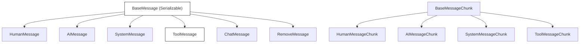
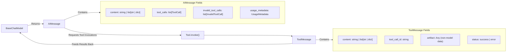

<!-- source: DeepWiki mcp.deepwiki.com · repo langchain-ai/langchain · page 2.2 Messages and Content Blocks · fetched 2026-10-26 -->

# Messages and Content Blocks

<details>
<summary>Relevant source files</summary>

The following files were used as context for generating this wiki page:

- [libs/core/langchain_core/messages/ai.py](libs/core/langchain_core/messages/ai.py)
- [libs/core/langchain_core/messages/base.py](libs/core/langchain_core/messages/base.py)
- [libs/core/langchain_core/messages/chat.py](libs/core/langchain_core/messages/chat.py)
- [libs/core/langchain_core/messages/function.py](libs/core/langchain_core/messages/function.py)
- [libs/core/langchain_core/messages/human.py](libs/core/langchain_core/messages/human.py)
- [libs/core/langchain_core/messages/modifier.py](libs/core/langchain_core/messages/modifier.py)
- [libs/core/langchain_core/messages/system.py](libs/core/langchain_core/messages/system.py)
- [libs/core/langchain_core/messages/tool.py](libs/core/langchain_core/messages/tool.py)
- [libs/core/langchain_core/messages/utils.py](libs/core/langchain_core/messages/utils.py)
- [libs/core/langchain_core/utils/_merge.py](libs/core/langchain_core/utils/_merge.py)
- [libs/core/langchain_core/utils/formatting.py](libs/core/langchain_core/utils/formatting.py)
- [libs/core/tests/unit_tests/messages/test_utils.py](libs/core/tests/unit_tests/messages/test_utils.py)
- [libs/core/tests/unit_tests/prompts/__snapshots__/test_chat.ambr](libs/core/tests/unit_tests/prompts/__snapshots__/test_chat.ambr)
- [libs/core/tests/unit_tests/test_messages.py](libs/core/tests/unit_tests/test_messages.py)
- [libs/core/tests/unit_tests/utils/test_formatting.py](libs/core/tests/unit_tests/utils/test_formatting.py)

</details>


Messages and Content Blocks form the standardized communication layer in `langchain-core` (`libs/core/langchain_core/messages/`). They provide a unified, provider-agnostic abstraction for interacting with chat models and tooling. This abstraction manages various content forms including plain text, multi-modal content blocks, tool invocation requests and responses, streaming chunks, and detailed token usage metadata to facilitate robust agent workflows and analytics.

---

## 1. BaseMessage Hierarchy and Message Types

The foundation of LangChain's chat input/output system is the `BaseMessage` class (`libs/core/langchain_core/messages/base.py:93-144`). It defines core fields like `content` (which can be plain text or structured content blocks), optional identifiers, and extensible metadata. From this base, various specialized message types derive, representing distinct conversational roles or operational semantics:

| Message Class      | Purpose                                                                                     | File Reference                               |
|--------------------|---------------------------------------------------------------------------------------------|----------------------------------------------|
| `HumanMessage`     | User-supplied input messages                                                                | `libs/core/langchain_core/messages/human.py:9-30` |
| `AIMessage`        | Responses generated by a language model                                                     | `libs/core/langchain_core/messages/ai.py:160-184` |
| `SystemMessage`    | System-level instructions that prime model behavior                                         | `libs/core/langchain_core/messages/system.py:9-30` |
| `ToolMessage`      | Tool execution results sent back to the model                                              | `libs/core/langchain_core/messages/tool.py:26-174` |
| `RemoveMessage`    | Special message to mark removal of another message, used in stateful graph flows            | `libs/core/langchain_core/messages/modifier.py:8-13` |

Each message type has a corresponding streaming chunk variant (`BaseMessageChunk` derivatives) for incremental token delivery. These chunk classes support merging partial data streams, essential for streaming model interfaces ([libs/core/tests/unit_tests/test_messages.py:10-32]()).



*Sources: `libs/core/langchain_core/messages/base.py:93-144`, `libs/core/langchain_core/messages/human.py:9-63`, `libs/core/langchain_core/messages/ai.py:160-184`, `libs/core/langchain_core/messages/tool.py:26-174`*

---

## 2. AIMessage, ToolMessage and Structured Model Outputs

Two key message types facilitate tool-calling integration and structured output handling:

- **AIMessage**: Represents a language model's response, containing textual or structured multi-modal `content`, and a list of `tool_calls` indicating any requested tool executions. It also includes `invalid_tool_calls` for encoding parse errors encountered in tool call outputs. This message type carries `usage_metadata` capturing token usage to facilitate cost tracking ([libs/core/langchain_core/messages/ai.py:170-180]).

- **ToolMessage**: Encapsulates the results from a tool execution triggered by an AIMessage's tool call. Each ToolMessage is uniquely associated with a `tool_call_id`. To handle large or complex outputs, ToolMessage supports an `artifact` field storing full result data (e.g., images or logs) separate from the `content` sent to the model, allowing efficient interaction with models without overloading prompts ([libs/core/langchain_core/messages/tool.py:26-83]).



*Sources: `libs/core/langchain_core/messages/ai.py:160-180`, `libs/core/langchain_core/messages/tool.py:26-83`*

---

## 3. Chunk Merging and Streaming Architecture

To support token-level streaming with chat models, each message type has a chunk variant (`BaseMessageChunk`) which supports merging via operator overloading (`__add__`). The merging logic ensures that partial data or chunks of streamed content are combined correctly:

- For string or array content, chunks concatenate seamlessly.
- Partial JSON fragments in tool call arguments stream asynchronously and get merged to reconstruct complete JSON objects.
- Token usage metadata fields aggregate by summing counts across chunks, preserving accurate usage tracking across streamed output pieces.

This design allows incremental partial messages to be combined into cohesive full messages dynamically during streaming ([libs/core/tests/unit_tests/test_messages.py:50-125], [libs/core/langchain_core/utils/_merge.py:6-95], [libs/core/tests/unit_tests/messages/test_utils.py:87-152]).

```mermaid
graph LR
    MsgChunk1["MessageChunk 1"] + MsgChunk2["MessageChunk 2"] --> MergedChunk["Merged MessageChunk"]
    
    subgraph MergingLogic
        TextContent["Concatenate text content"]
        ToolCallChunks["Merge partial tool call JSON by index"]
        UsageMetadata["Sum input/output tokens"]
    end
    
    MsgChunk1 --> MergingLogic
    MsgChunk2 --> MergingLogic
    MergingLogic --> MergedChunk
```

*Sources: `libs/core/tests/unit_tests/test_messages.py:50-125`, `libs/core/langchain_core/utils/_merge.py:6-95`, `libs/core/tests/unit_tests/messages/test_utils.py:87-152`*

---

## 4. Usage Metadata and Token Accounting

`AIMessage` supports detailed usage tracking through the `UsageMetadata` typed dictionary (`libs/core/langchain_core/messages/ai.py:104-158`). This provides a standardized token accounting schema across all models and providers, enabling consistent cost analysis and analytics.

| Field                 | Type                 | Description                                                                                  |
|-----------------------|----------------------|----------------------------------------------------------------------------------------------|
| `input_tokens`        | `int`                | Total prompt tokens consumed                                                                 |
| `output_tokens`       | `int`                | Total completion tokens generated                                                            |
| `total_tokens`        | `int`                | Sum of input and output tokens                                                               |
| `input_token_details` | `InputTokenDetails`   | Optional detailed breakdown by input source (e.g., audio tokens, cache reads or creations)    |
| `output_token_details`| `OutputTokenDetails`  | Optional detailed breakdown by output type (e.g., audio, reasoning tokens)                    |

This metadata format supports enhanced observability and cost transparency in downstream monitoring systems such as LangSmith.

*Sources: `libs/core/langchain_core/messages/ai.py:104-158`*

---

## 5. Message Utilities (Filtering, Conversion, Formatting)

Several utility functions in `libs/core/langchain_core/messages/utils.py` facilitate robust message handling:

- **`filter_messages()`**: Filter messages by criteria such as name, type, ID, and tool call presence. Useful to extract relevant subsets of conversation history or to exclude certain message types before processing [libs/core/tests/unit_tests/messages/test_utils.py:140-185].

- **`merge_message_runs()`**: Concatenate consecutive messages of the same class into a single message. It merges textual content or content blocks with an optional separator, reducing prompt fragmentation and optimizing model inputs [libs/core/tests/unit_tests/messages/test_utils.py:35-85].

- **`convert_to_messages()`**: Deserialize raw dicts or tuples into validated `BaseMessage` instances for consistent downstream processing.

- **`get_buffer_string()`**: Serialize a sequence of messages into a readable string transcript format, which aids debugging and logging.

These tools enable flexible, high-level management of conversational message sequences in LangChain workflows.

*Sources: `libs/core/langchain_core/messages/utils.py:1-130`, `libs/core/tests/unit_tests/messages/test_utils.py`*

---

## 6. Provider Block Translators

AI providers such as OpenAI, Anthropic, Google GenAI, AWS Bedrock, and Groq each have their own formats for content blocks and tool call payloads. LangChain core includes provider-specific *block translators* that convert between LangChain's standardized content blocks and provider native message formats.

These translators assure consistent, idiomatic communication with each provider API, including support for multiparty chat formats, streaming, tool call protocols, and multi-modal content.

For details, see the child page:

- [Block Translators for Providers](#2.2.1) — Standard content block translation for OpenAI, Anthropic, Google GenAI, Bedrock, Groq.

---

This modular, composable message layer sits at the core of LangChain's chat and agent frameworks, bridging natural language interactions with structured tooling and multi-modal content, while tracking usage and enabling downstream monitoring and tooling.

---

