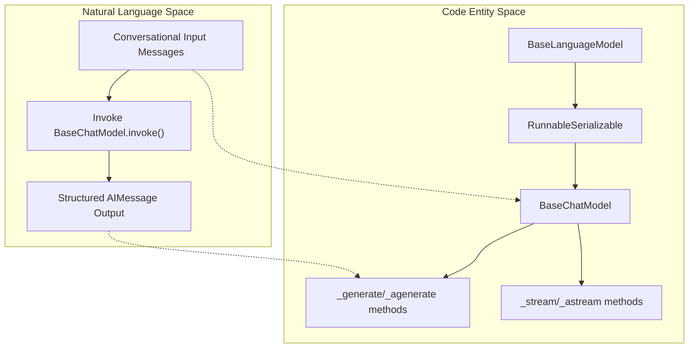
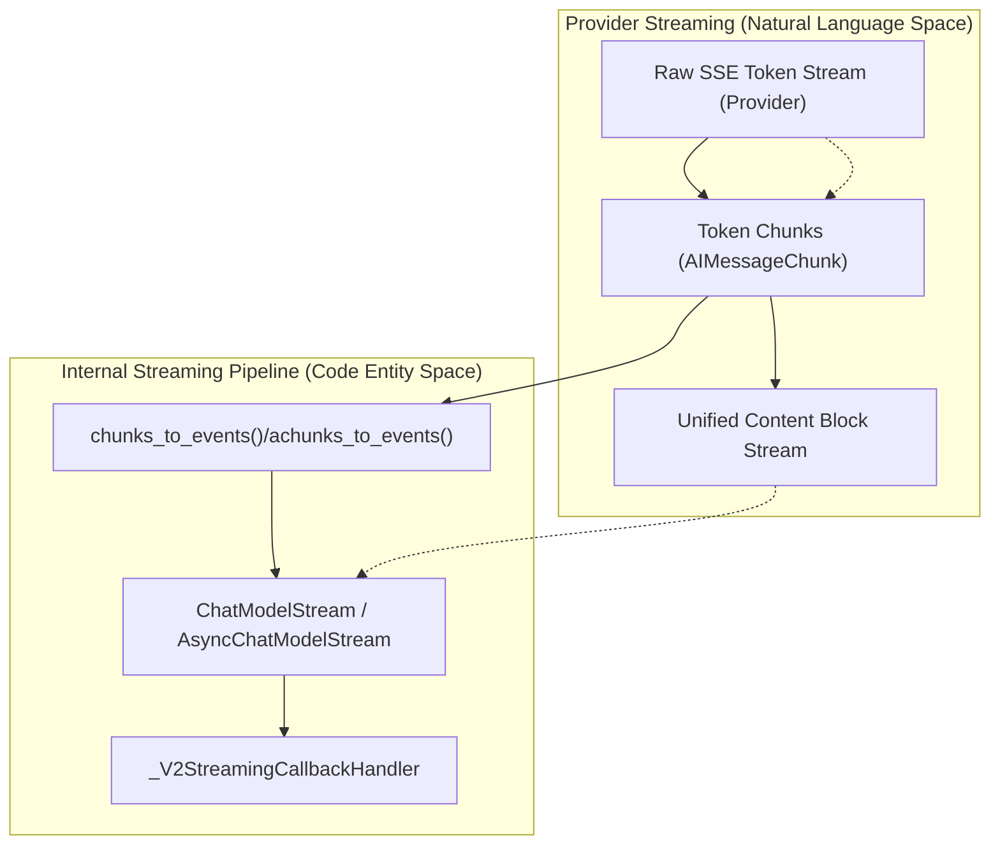
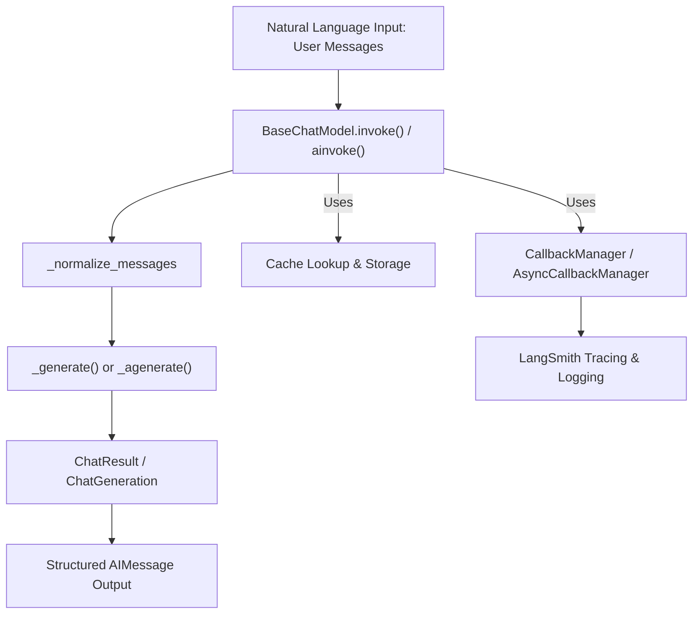
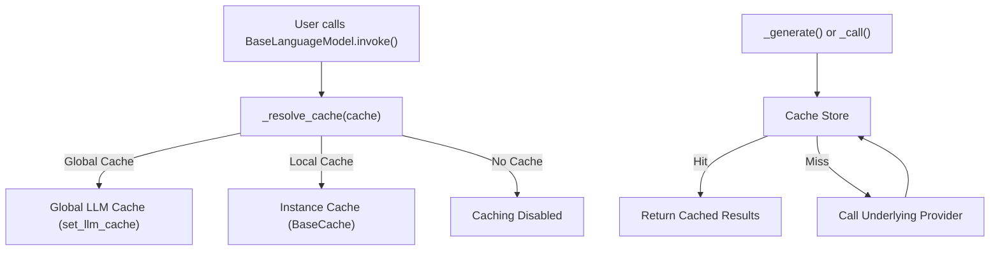

<!-- source: DeepWiki mcp.deepwiki.com · repo langchain-ai/langchain · page 2.3 Language Model Base Classes · fetched 2026-10-26 -->

# Language Model Base Classes

<details>
<summary>Relevant source files</summary>

The following files were used as context for generating this wiki page:

- [libs/core/langchain_core/language_models/_compat_bridge.py](libs/core/langchain_core/language_models/_compat_bridge.py)
- [libs/core/langchain_core/language_models/_utils.py](libs/core/langchain_core/language_models/_utils.py)
- [libs/core/langchain_core/language_models/base.py](libs/core/langchain_core/language_models/base.py)
- [libs/core/langchain_core/language_models/chat_model_stream.py](libs/core/langchain_core/language_models/chat_model_stream.py)
- [libs/core/langchain_core/language_models/chat_models.py](libs/core/langchain_core/language_models/chat_models.py)
- [libs/core/langchain_core/language_models/fake_chat_models.py](libs/core/langchain_core/language_models/fake_chat_models.py)
- [libs/core/langchain_core/language_models/llms.py](libs/core/langchain_core/language_models/llms.py)
- [libs/core/tests/unit_tests/fake/test_fake_chat_model.py](libs/core/tests/unit_tests/fake/test_fake_chat_model.py)
- [libs/core/tests/unit_tests/language_models/chat_models/test_base.py](libs/core/tests/unit_tests/language_models/chat_models/test_base.py)
- [libs/core/tests/unit_tests/language_models/chat_models/test_cache.py](libs/core/tests/unit_tests/language_models/chat_models/test_cache.py)
- [libs/core/tests/unit_tests/language_models/llms/test_base.py](libs/core/tests/unit_tests/language_models/llms/test_base.py)
- [libs/core/tests/unit_tests/language_models/llms/test_cache.py](libs/core/tests/unit_tests/language_models/llms/test_cache.py)
- [libs/core/tests/unit_tests/language_models/test_chat_model_stream.py](libs/core/tests/unit_tests/language_models/test_chat_model_stream.py)
- [libs/core/tests/unit_tests/language_models/test_chat_model_streamer.py](libs/core/tests/unit_tests/language_models/test_chat_model_streamer.py)
- [libs/core/tests/unit_tests/language_models/test_chat_model_v3_stream.py](libs/core/tests/unit_tests/language_models/test_chat_model_v3_stream.py)
- [libs/core/tests/unit_tests/language_models/test_compat_bridge.py](libs/core/tests/unit_tests/language_models/test_compat_bridge.py)
- [libs/core/tests/unit_tests/language_models/test_v1_parity.py](libs/core/tests/unit_tests/language_models/test_v1_parity.py)
- [libs/langchain/tests/unit_tests/agents/test_agent.py](libs/langchain/tests/unit_tests/agents/test_agent.py)
- [libs/langchain/tests/unit_tests/llms/test_fake_chat_model.py](libs/langchain/tests/unit_tests/llms/test_fake_chat_model.py)
- [libs/langchain/tests/unit_tests/stubs.py](libs/langchain/tests/unit_tests/stubs.py)

</details>


## Purpose and Scope
This page documents the core architecture, execution lifecycle, caching mechanisms, streaming bridges, testing fakes, and model profile integrations for LangChain's language model base classes (`BaseLanguageModel`, `BaseChatModel`, and `BaseLLM`) defined in the langchain-core codebase.

---

## 1. Architectural Hierarchy: `BaseLanguageModel`, `BaseChatModel`, and `BaseLLM`

All language model wrappers inherit from the abstract base class `BaseLanguageModel`, which itself extends the `RunnableSerializable` interface. This base class provides common interfaces for serialization, batching, asynchronous execution, and configuration management. It represents a unified abstraction over various language model interactions [libs/core/langchain_core/language_models/base.py:181-188]().

Two main subclasses specialize the base class for different uses:

- **`BaseChatModel`**: Designed for conversational models. It primarily operates with structured message inputs (`Sequence[BaseMessage]`, `ChatPromptValue`, etc.) and returns structured chat outputs (e.g., `AIMessage`) wrapped in `ChatResult` or `ChatGeneration`. It supports both synchronous and asynchronous generation and streaming of `ChatGenerationChunk`s [libs/core/langchain_core/language_models/chat_models.py]().

- **`BaseLLM`**: Intended for classic large language models that operate on raw text prompts (`str` or `PromptValue`) and output plain text completions via `LLMResult` and `Generation` objects. It also supports streaming text output with less structural rigor compared to chat models [libs/core/langchain_core/language_models/llms.py]().

### Diagram: Conceptual and Code Entity Hierarchy for Chat Models

Sources: [libs/core/langchain_core/language_models/base.py:181-188](), [libs/core/langchain_core/language_models/chat_models.py]()

---

## 2. Invocation and Streaming Lifecycle

### Invocation Flow in `BaseChatModel`

The synchronous `.invoke()` and asynchronous `.ainvoke()` methods follow a multi-step lifecycle:

1. **Input Normalization**: Input prompts of various types (strings, sequences of messages, `PromptValue`, etc.) are normalized into a consistent internal format (usually `ChatPromptValue` with a message sequence). Internal helpers like `_normalize_messages` ensure normalized structured message input [libs/core/langchain_core/language_models/chat_models.py:38]().

2. **Callback Manager Setup**: Callback managers (`CallbackManager` or `AsyncCallbackManager`) are prepared for run lifecycle event handling, enabling integrated tracing, logging, and telemetry instrumentation.

3. **Cache Lookup**: Before generation, the cache subsystem is queried for existing cached results keyed by the prompt and the model configuration parameters.

4. **Core Execution**: On cache misses, the abstract model-specific generation method `_generate()` or `_agenerate()` is invoked, typically by concrete subclasses implementing provider-specific calls.

5. **Result Return**: The model returns a `ChatResult` containing one or more `ChatGeneration`s, which embed the generated `AIMessage`s. Tracing and callback events are dispatched accordingly.

### Streaming Output Handling

Streaming generation returns incremental `ChatGenerationChunk`s wrapping `AIMessageChunk`s which represent partial content slices.

- Streaming chunks are passed through a **compatibility bridge** (`chunks_to_events`, `achunks_to_events` in `_compat_bridge.py`), converting incremental `AIMessageChunk` content blocks into standardized protocol events compliant with the LangChain event schema.

- The lifecycle events in streams include `message-start`, `content-block-start`, multiple `content-block-delta`, `content-block-finish`, and finally `message-finish`.

- Wrappers `ChatModelStream` and `AsyncChatModelStream` expose iterable interfaces for streaming consumers and integrate advanced callback handlers such as `_V2StreamingCallbackHandler` for rich instrumentation and lifecycle event propagation [libs/core/langchain_core/language_models/_compat_bridge.py](), [libs/core/langchain_core/language_models/chat_model_stream.py]().

### Diagram: Streaming Lifecycle and Protocol Event Conversion

Sources: [libs/core/langchain_core/language_models/_compat_bridge.py:1-32](), [libs/core/langchain_core/language_models/chat_model_stream.py:1-15]()

---

## 3. Caching Subsystem

### Cache Configuration and Resolution

The `BaseLanguageModel` class supports response caching via its `cache` property, configurable as:

- `True`: Use a globally-set cache instance (configured via `set_llm_cache()`).
- `False`: Disable caching.
- `None`: Use global cache if available, else no cache.
- Instance of `BaseCache`: Use this explicit cache instance.

The cache resolution logic occurs in `llms.py` via the `_resolve_cache()` function, enforcing that `True` without a global cache raises an exception.

### Cache Lookup and Insertion Flow

1. The prompt text and generation parameters are assembled into a cache key.

2. The cache is queried: if there is a cache hit, cached generations are returned immediately.

3. On a cache miss, the model performs generation by calling the underlying provider.

4. The result is then inserted back into the cache for future reuse.

### Caching Table

| Cache Parameter     | Cache Used                  | Behavior on Cache Miss            |
|---------------------|-----------------------------|---------------------------------|
| `True`              | Global LLM Cache             | Generate + store in global cache |
| Instance of `BaseCache` | Custom Cache Instance        | Generate + store in custom cache |
| `False`             | None (caching disabled)      | Generate only, do not store       |
| `None`              | Global LLM Cache if set else no cache | Same as above                  |

### Conceptual Cache Resolution Snippet

```python
def _resolve_cache(cache: BaseCache | bool | None) -> BaseCache | None:
    if isinstance(cache, BaseCache):
        return cache
    if cache is True:
        llm_cache = get_llm_cache()
        if llm_cache is None:
            raise ValueError("Global cache not set")
        return llm_cache
    if cache is None:
        return get_llm_cache()
    return None
```
Sources: [libs/core/langchain_core/language_models/base.py:190-199](), [libs/core/langchain_core/language_models/llms.py:135-156](), [libs/core/tests/unit_tests/language_models/chat_models/test_cache.py]()

---

## 4. Fakes and Testing Utilities

To facilitate development and testing without external API dependencies or costs, LangChain provides fake model implementations:

- **`FakeListChatModel`**: Returns pre-defined string responses cycling through a list for each invocation. Supports optional sleep delays and error injection on streaming chunks. Batch methods are overridden to maintain order without concurrency [libs/core/langchain_core/language_models/fake_chat_models.py:59-154]()

- **`FakeMessagesListChatModel`**: Like `FakeListChatModel`, but cycles through a list of predefined `BaseMessage` responses [libs/core/langchain_core/language_models/fake_chat_models.py:21-47]()

- **`GenericFakeChatModel`**: Accepts an infinite iterator of `AIMessage`s and supports streaming of message chunks, enabling comprehensive testing of callback handlers, chunk accumulation, and streaming behaviors with rich message content [libs/core/tests/unit_tests/fake/test_fake_chat_model.py]()

- **`FakeListLLM`**: Analogous fake LLM that cycles string outputs for plain text prompt input, useful for traditional LLM interface testing [libs/core/tests/unit_tests/language_models/llms/test_base.py:28-35]()

These fake models allow unit and integration testing of caching, tracing, batch processing, callbacks, error handling, and streaming without reliance on external API calls.

---

## 5. Model Profiles

`ModelProfile` schemas standardize metadata describing a model's capabilities, default parameter ranges, token limits, feature flags (e.g. function calling), and provider-specific attributes.

- Model profiles facilitate tooling, UI, and agent adaptations based on the model's documented strengths and limitations.

- The `ModelProfile` class is imported and optionally attached to model wrappers such as `BaseChatModel`. Unknown profile keys warn users to maintain schema correctness [libs/core/langchain_core/language_models/chat_models.py:50-53]().

This structured profile metadata supports consistent multi-provider handling and enables advanced usage scenarios in LangChain's ecosystem.

---

# Summary Diagrams: Mapping Natural Language Concepts to Core Code Entities

### Chat Model Call Lifecycle


### Cache Resolution and Usage in Base Language Model


Sources:  
- [libs/core/langchain_core/language_models/base.py:181-188]()  
- [libs/core/langchain_core/language_models/chat_models.py]()  
- [libs/core/langchain_core/language_models/llms.py:135-156]()  
- [libs/core/langchain_core/language_models/fake_chat_models.py:59-154]()  
- [libs/core/tests/unit_tests/fake/test_fake_chat_model.py]()  
- [libs/core/tests/unit_tests/language_models/chat_models/test_cache.py]()  
- [libs/core/langchain_core/language_models/_compat_bridge.py:1-32]()  
- [libs/core/langchain_core/language_models/chat_model_stream.py:1-15]()

---

