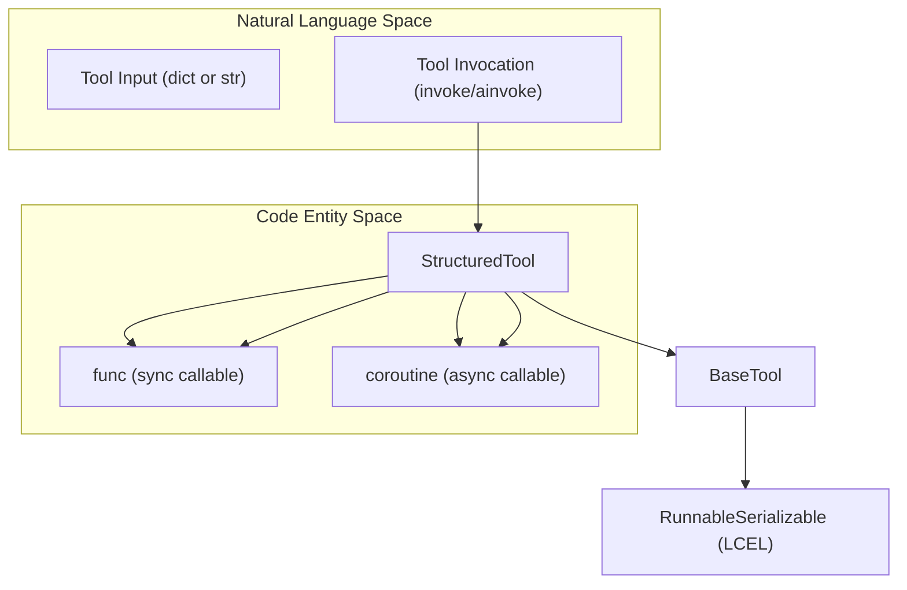
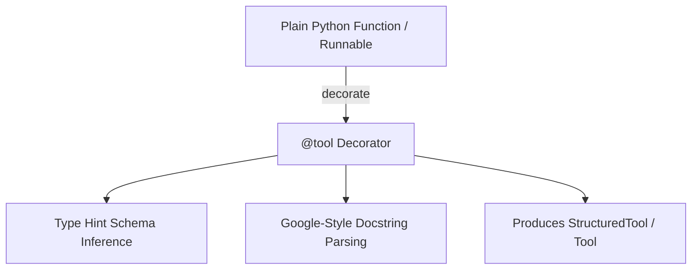
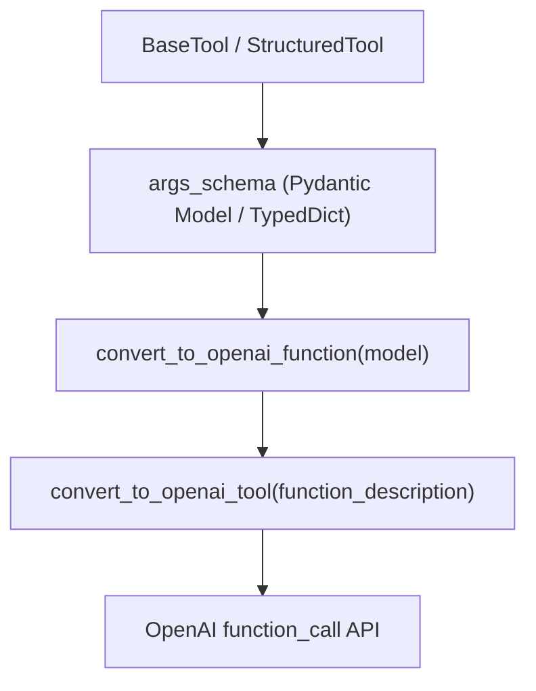

<!-- source: DeepWiki mcp.deepwiki.com · repo langchain-ai/langchain · page 2.4 Tools and Function Calling · fetched 2026-10-26 -->

# Tools and Function Calling

Relevant source files

The following files were used as context for generating this wiki page:

- [libs/core/langchain_core/tools/base.py](libs/core/langchain_core/tools/base.py)
- [libs/core/langchain_core/tools/convert.py](libs/core/langchain_core/tools/convert.py)
- [libs/core/langchain_core/tools/simple.py](libs/core/langchain_core/tools/simple.py)
- [libs/core/langchain_core/tools/structured.py](libs/core/langchain_core/tools/structured.py)
- [libs/core/langchain_core/utils/function_calling.py](libs/core/langchain_core/utils/function_calling.py)
- [libs/core/langchain_core/utils/pydantic.py](libs/core/langchain_core/utils/pydantic.py)
- [libs/core/tests/unit_tests/pydantic_utils.py](libs/core/tests/unit_tests/pydantic_utils.py)
- [libs/core/tests/unit_tests/test_tools.py](libs/core/tests/unit_tests/test_tools.py)
- [libs/core/tests/unit_tests/test_tools_postponed_annotations.py](libs/core/tests/unit_tests/test_tools_postponed_annotations.py)
- [libs/core/tests/unit_tests/utils/test_function_calling.py](libs/core/tests/unit_tests/utils/test_function_calling.py)
- [libs/core/tests/unit_tests/utils/test_pydantic.py](libs/core/tests/unit_tests/utils/test_pydantic.py)

### Purpose and Scope
This page covers the architecture, implementation, and utilities for defining, executing, and serializing tools within `langchain-core`. It details the `BaseTool` and `StructuredTool` classes, the `@tool` decorator for automatic schema inference from Python functions and docstrings, argument schema validation via Pydantic, runtime injected arguments (such as `RunnableConfig` and `ToolRuntime`), and conversion utilities like `convert_to_openai_function` and `convert_to_openai_tool` for LLM interoperability.

Sources: `libs/core/langchain_core/tools/base.py`, `libs/core/langchain_core/tools/structured.py`, `libs/core/langchain_core/tools/convert.py`, `libs/core/langchain_core/utils/function_calling.py` 

---

### 1. BaseTool and StructuredTool Architecture

LangChain's tool system is built upon the `BaseTool` class, which extends `RunnableSerializable`. This enables tools to behave as runnables in the LangChain Expression Language (LCEL) framework, allowing them to be invoked, composed, serialized, and integrated cleanly with language models.

#### BaseTool (`libs/core/langchain_core/tools/base.py`)
- **Purpose:** Abstract base for all tools.
- **Key Attributes:**
  - `name`: String name identifier for the tool.
  - `description`: Human-readable description used for documentation and OpenAI function metadata.
  - `args_schema`: Defines the shape and typing of the tool's inputs, typically a Pydantic model or dict schema.
  - `return_direct`: Boolean flag indicating if the tool's output should be returned directly instead of further processing.
- **Core Methods:**
  - `_run(...)`: Abstract synchronous tool execution method; subclass implementations override this.
  - `_arun(...)`: Optional asynchronous variant.
- **Runtime Behavior:** Supports runtime argument injection (`RunnableConfig`, callbacks), validation of inputs against schemas, and consistent invocation interface.

#### StructuredTool (`libs/core/langchain_core/tools/structured.py`)
- **Purpose:** Concrete subclass for tools with strongly typed structured inputs.
- **Input Schema:** `args_schema` must be a Pydantic `BaseModel` subclass or a compatible dict schema.
- **Function Wrappers:**
  - `func`: The synchronous callable that implements the tool logic.
  - `coroutine`: Optional asynchronous callable version.
- **Implementation Details:**
  - Supports invocation with typed arguments validated against `args_schema`.
  - Injected arguments (e.g., `config`, `callbacks`) are automatically handled and excluded from the public schema.
  - Asynchronous execution falls back to thread pool if no `coroutine` is defined.
  - Provides class method `from_function` to construct a structured tool from a plain Python function with type annotations, easing tool creation.

Sources: `libs/core/langchain_core/tools/base.py`, `libs/core/langchain_core/tools/structured.py` 

---

### 2. The `@tool` Decorator and Schema Inference

The `@tool` decorator (`libs/core/langchain_core/tools/convert.py`) simplifies converting regular Python callables or `Runnable` instances into LangChain tools. It supports a flexible interface including usage as a no-argument decorator, a parameterized decorator, or a direct function call.

#### Main Features
- **Automatic Argument Schema Inference:**
  - When `infer_schema=True` (default), the decorator automatically generates a Pydantic input schema from function parameter type hints.
  - Avoids listing injected runtime arguments like `config` or `callbacks` in the schema.
- **Docstring Parsing:**
  - If `parse_docstring=True`, Google-style docstrings are parsed to extract function and parameter descriptions.
  - Descriptions override or augment schema and tool metadata, improving generated OpenAI function documentation.
- **Response Format Options:**
  - `"content"` (default): The function's output forms the main content of a ToolMessage.
  - `"content_and_artifact"`: Output is a tuple `(content, artifact)` for enhanced ToolMessage formation, e.g., with metadata.
- **Integration with Runnables:**
  - Supports decoration of sync/async functions or subclasses of `Runnable`.
  - If a `Runnable` is given, a string `name` must be supplied explicitly.
- **Error Handling:**
  - Raises `ValueError` if too many positional arguments are passed or if required arguments are missing.
  - Reserved parameter names for injected arguments (`config`, `run_manager`, `callbacks`) are filtered or cause errors to prevent runtime conflicts.

#### Example Flow

Sources: `libs/core/langchain_core/tools/convert.py`, `libs/core/langchain_core/tools/base.py` 

---

### 3. Argument Schemas and Runtime Injected Arguments

Tools accept arguments described by `args_schema`, usually a Pydantic model or a dict specifying the JSON schema of expected inputs. This schema is used for both validation and function calling metadata.

#### Runtime Argument Injection
- Some arguments to tool functions are intended only for runtime use by the framework and **must not** be included in user-visible schemas or exposed to the LLM.
- The following argument names are **reserved** and are injected at runtime:
  - `config` (type: `RunnableConfig`)
  - `run_manager` or `callbacks` (callback manager instances)
- These reserved names are stripped from the serialized schema and omitted from the JSON schema passed to the LLM.
- Additional runtime injection is supported via `Annotated` types with the `InjectedToolArg` marker annotation to explicitly mark arguments as injected.
- This enables tools to receive execution context (e.g., tracing, metrics) without leaking those parameters into the language model's function calling interface.

#### Injected Arguments and Schema Filtering
- When building the tool's JSON schema for OpenAI compatible function specification, injected arguments are excluded, ensuring a clean input interface.
- Injected arguments receive values internally at runtime when invoking the tool.
- This separation is fundamental to supporting tooling runtime metadata and context propagation without polluting the user's tool interface.

Sources: `libs/core/langchain_core/tools/base.py`, `libs/core/langchain_core/tools/convert.py`, `libs/core/tests/unit_tests/test_tools.py` 

---

### 4. Function Calling and OpenAI Conversion Utilities

To use LangChain tools via OpenAI's function calling API or similar LLM interfaces, the tool's argument schema and metadata must be converted to the expected OpenAI function specification format.

#### Core Utility: `convert_to_openai_function` (`libs/core/langchain_core/utils/function_calling.py`)
- Converts a Pydantic model or TypedDict schema into a dictionary matching OpenAI's `functions` schema.
- Returns:
  - `name`: Name of the function (usually the tool's name).
  - `description`: Description string.
  - `parameters`: JSON schema object representing inputs.
- Cleans up schema:
  - Removes redundant `"title"` keys to reduce size.
  - Dereferences `$ref`s in schemas if any.
  - Handles compatibility with both Pydantic v1 and v2.
- Raises `TypeError` for non-Pydantic models or unsupported schema types.

#### Extended Utility: `convert_to_openai_tool`
- Wraps the output of `convert_to_openai_function` in the expected envelope with `"type": "function"` for OpenAI tooling.
- Encapsulates all metadata necessary to register the tool as an OpenAI function model can call.

#### Data Flow

Sources: `libs/core/langchain_core/utils/function_calling.py`, `libs/core/langchain_core/utils/json_schema.py` 

---

# Summary

LangChain's tool and function calling infrastructure hinges on:

- `BaseTool` and `StructuredTool` classes that formalize tools as typed, structured, and callable entities.
- The flexible and powerful `@tool` decorator to easily convert ordinary Python functions or `Runnable`s into LangChain tools with inferred argument schemas and rich descriptions.
- Runtime argument injection design that cleanly separates user-facing input parameters from execution-time context and callback handlers.
- Conversion utilities targeting OpenAI's function calling schema, enabling seamless interoperability and schema-based validation.

These components collectively enable type-safe, self-documenting, and interoperable tools that are seamlessly integrated into LangChain's agent and runnable ecosystem, facilitating robust natural language interfaces with executable backend logic.

# References

- `libs/core/langchain_core/tools/base.py`
- `libs/core/langchain_core/tools/structured.py`
- `libs/core/langchain_core/tools/convert.py`
- `libs/core/langchain_core/utils/function_calling.py`
- `libs/core/tests/unit_tests/test_tools.py`

---

