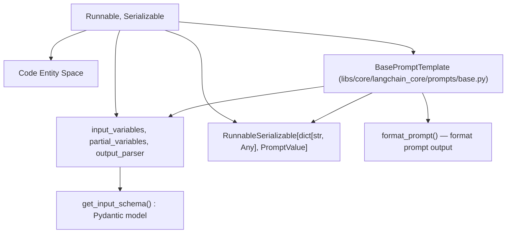
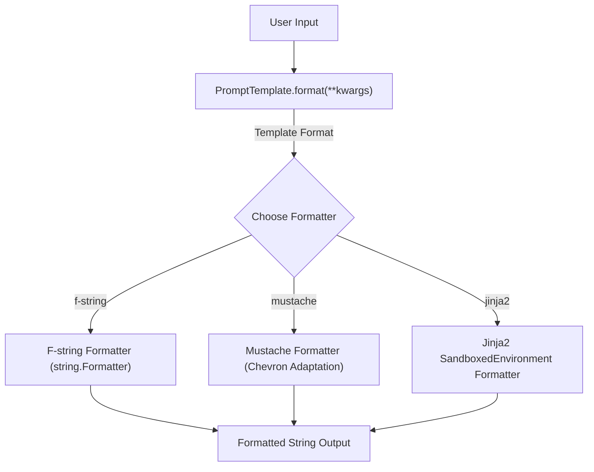
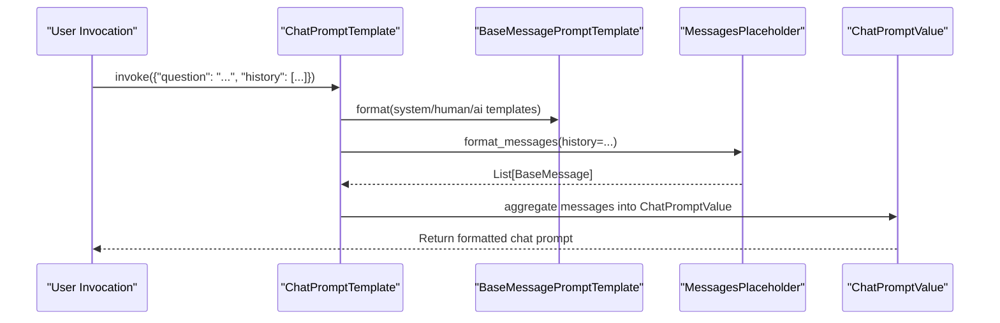
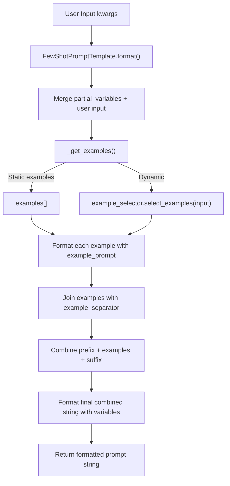
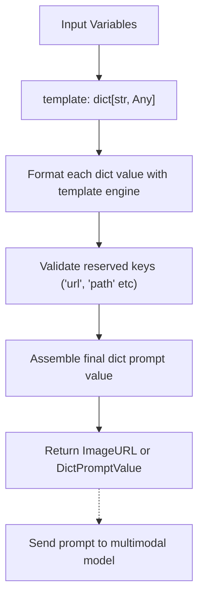
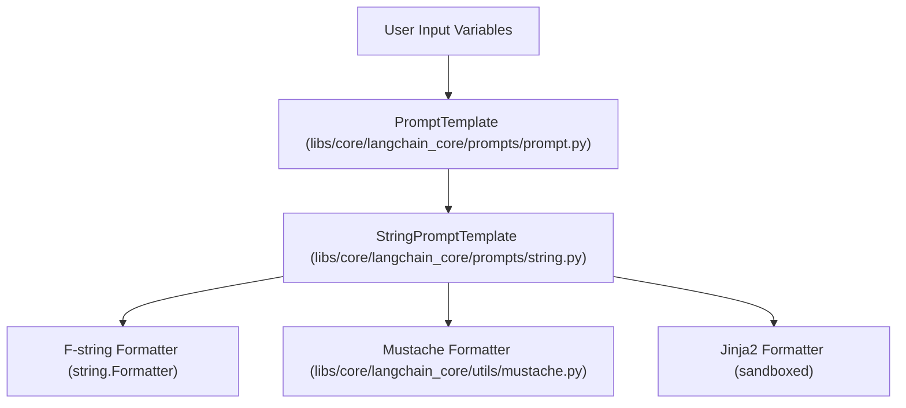
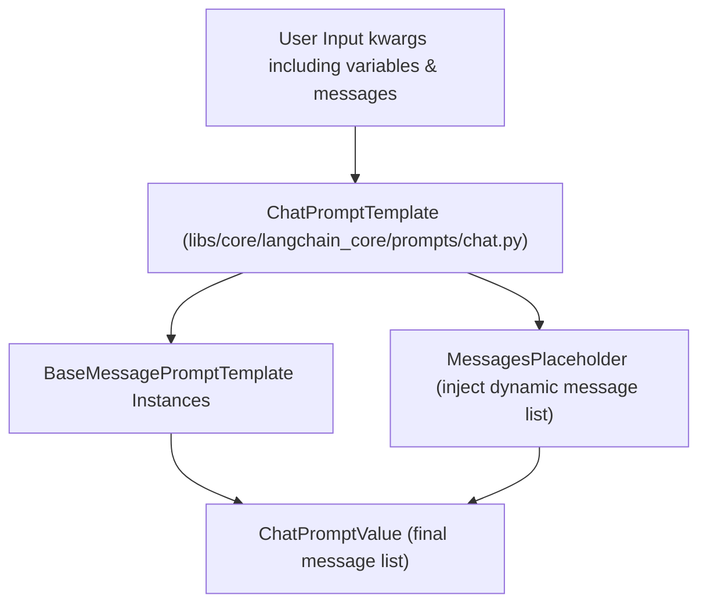

<!-- source: DeepWiki mcp.deepwiki.com · repo langchain-ai/langchain · page 2.5 Prompts and Example Selectors · fetched 2026-10-26 -->

# Prompts and Example Selectors

Relevant source files

The following files were used as context for generating this wiki page:

- [libs/core/langchain_core/example_selectors/base.py](libs/core/langchain_core/example_selectors/base.py)
- [libs/core/langchain_core/example_selectors/length_based.py](libs/core/langchain_core/example_selectors/length_based.py)
- [libs/core/langchain_core/example_selectors/semantic_similarity.py](libs/core/langchain_core/example_selectors/semantic_similarity.py)
- [libs/core/langchain_core/prompts/base.py](libs/core/langchain_core/prompts/base.py)
- [libs/core/langchain_core/prompts/chat.py](libs/core/langchain_core/prompts/chat.py)
- [libs/core/langchain_core/prompts/dict.py](libs/core/langchain_core/prompts/dict.py)
- [libs/core/langchain_core/prompts/few_shot.py](libs/core/langchain_core/prompts/few_shot.py)
- [libs/core/langchain_core/prompts/few_shot_with_templates.py](libs/core/langchain_core/prompts/few_shot_with_templates.py)
- [libs/core/langchain_core/prompts/image.py](libs/core/langchain_core/prompts/image.py)
- [libs/core/langchain_core/prompts/loading.py](libs/core/langchain_core/prompts/loading.py)
- [libs/core/langchain_core/prompts/message.py](libs/core/langchain_core/prompts/message.py)
- [libs/core/langchain_core/prompts/prompt.py](libs/core/langchain_core/prompts/prompt.py)
- [libs/core/langchain_core/prompts/string.py](libs/core/langchain_core/prompts/string.py)
- [libs/core/langchain_core/utils/image.py](libs/core/langchain_core/utils/image.py)
- [libs/core/langchain_core/utils/mustache.py](libs/core/langchain_core/utils/mustache.py)
- [libs/core/tests/unit_tests/example_selectors/test_base.py](libs/core/tests/unit_tests/example_selectors/test_base.py)
- [libs/core/tests/unit_tests/example_selectors/test_similarity.py](libs/core/tests/unit_tests/example_selectors/test_similarity.py)
- [libs/core/tests/unit_tests/load/test_secret_injection.py](libs/core/tests/unit_tests/load/test_secret_injection.py)
- [libs/core/tests/unit_tests/prompts/test_chat.py](libs/core/tests/unit_tests/prompts/test_chat.py)
- [libs/core/tests/unit_tests/prompts/test_dict.py](libs/core/tests/unit_tests/prompts/test_dict.py)
- [libs/core/tests/unit_tests/prompts/test_few_shot.py](libs/core/tests/unit_tests/prompts/test_few_shot.py)
- [libs/core/tests/unit_tests/prompts/test_image.py](libs/core/tests/unit_tests/prompts/test_image.py)
- [libs/core/tests/unit_tests/prompts/test_loading.py](libs/core/tests/unit_tests/prompts/test_loading.py)
- [libs/core/tests/unit_tests/prompts/test_prompt.py](libs/core/tests/unit_tests/prompts/test_prompt.py)
- [libs/core/tests/unit_tests/prompts/test_string.py](libs/core/tests/unit_tests/prompts/test_string.py)

This page covers in detail the implementation, architecture, and data flow of prompt templates and example selectors in `langchain-core`. It covers the base prompt abstraction, string prompt formatting (f-string, mustache, jinja2), chat prompt templates with message role support, few-shot prompt composition and example selectors, and multimodal prompts for images and dicts.

---

## 1. Base Prompt Abstraction and Runnable Integration (`BasePromptTemplate`)

All prompt templates in LangChain derive from the abstract base class `BasePromptTemplate`, which itself inherits from `RunnableSerializable[dict[str, Any], PromptValue]`. This tight integration with LangChain's Runnable interface allows prompts to be invoked programmatically with validation, caching, streaming, and composability using LCEL pipelines.

Key fields and behaviors:

- **`input_variables: list[str]`** — Names of variables required to format the prompt template. These are validated for correctness and uniqueness. [libs/core/langchain_core/prompts/base.py:43-46]()

- **`optional_variables: list[str]`** — Optional input variable names, often related to placeholders or message containers which do not require user input. [libs/core/langchain_core/prompts/base.py:48-53]()

- **`partial_variables: Mapping[str, Any]`** — Variables with fixed values baked into the prompt so users don't need to supply them on each call. These are combined with user-provided inputs during formatting. [libs/core/langchain_core/prompts/base.py:67-72]()

- **`input_types: dict[str, Any]`** — Specifies data types for input variables to generate Pydantic schemas for validation. If omitted, variables default to strings. [libs/core/langchain_core/prompts/base.py:55-59]()

- **Validation Logic** ensures reserved variable names (`"stop"`) are not used and that input and partial variables do not overlap, maintaining runtime correctness and avoiding conflicts. [libs/core/langchain_core/prompts/base.py:80-106]()

`BasePromptTemplate` defines:

- `get_input_schema(config)` — Dynamically builds Pydantic input schemas from variables and types, enabling tight validation during prompt invocation.

- `format_prompt(**kwargs)` — Abstract method implemented by subclasses to produce formatted prompt output.

- Integration with Runnable (LCEL) guarantees that prompt templates can participate in LangChain's execution framework, including streaming and batching.

### Diagram: Base Prompt Abstraction in Natural Language and Code

Sources: [libs/core/langchain_core/prompts/base.py:38-160]()

---

## 2. String-Based Prompt Templates and Formatting Engines (`PromptTemplate`)

`PromptTemplate` is the primary class for string-based text prompts, extending `StringPromptTemplate` with support for multiple template engines and input validation. It supports these template formats:

- **`f-string`** (default): Uses Python's built-in f-string formatting semantics, implemented using a safe custom formatter over `string.Formatter`. Supports standard `{var}` substitution syntax. [libs/core/langchain_core/prompts/string.py:7-16]()

- **`mustache`**: A logic-less templating engine implemented via the `mustache` package (adapted from Chevron). Supports nested variables, sections, inverted sections, and skips HTML escaping. [libs/core/langchain_core/utils/mustache.py:1-244]()

- **`jinja2`**: Supports the popular Jinja2 engine, but with critical security warnings. LangChain enforces rendering with Jinja2's `SandboxedEnvironment` which restricts access to dunder attributes but does not guarantee complete sandboxing. Users are cautioned never to use untrusted Jinja templates. [libs/core/langchain_core/prompts/string.py:33-72]()

The `PromptTemplate` class performs:

- **Input Variables Extraction**: Automatically extracts template variables based on the chosen formatter. For example, it supports nested keys like `obj.foo` for mustache and jinja2. [libs/core/langchain_core/prompts/prompt.py:115-125]()

- **Template Validation**: Optionally validates the template against the input variables to detect missing or extra placeholders. Mustache templates do not support validation due to their dynamic nature. [libs/core/langchain_core/prompts/prompt.py:86-115]()

- **Template Combination**: Supports the `+` operator for combining two prompt templates with the same format, merging input variables and concatenating templates into a single prompt. This gives a convenient way to build larger prompt bodies dynamically. [libs/core/langchain_core/prompts/prompt.py:142-184]()

### Diagram: String Prompt Formatting Engines & Control Flow

Sources: [libs/core/langchain_core/prompts/prompt.py:24-193](), [libs/core/langchain_core/prompts/string.py:30-123](), [libs/core/langchain_core/utils/mustache.py:1-244]()

---

## 3. Chat Prompts: Multi-Message Prompt Construction (`ChatPromptTemplate` and `MessagesPlaceholder`)

LangChain provides advanced chat prompt templating with message-level granularity, supporting multiple message roles and integration of dynamic message history or context.

- **`ChatPromptTemplate`** — Composes a sequence of message prompt templates (subclasses of `BaseMessagePromptTemplate`) representing individual turns or message roles in a chat conversation. Roles include System, Human, AI, and general Chat messages. The final result is a `ChatPromptValue` which encapsulates a list of fully formatted message objects. [libs/core/langchain_core/prompts/chat.py:25-42]()

- **`MessagesPlaceholder`** — A special message prompt template allowing the prompt to receive a variable bound to a list of pre-existing messages (such as chat history). It supports features like:

  - `variable_name` — The key in the input dict that holds the message list.

  - `optional` — Whether this input is required or can be omitted (returning empty list).

  - `n_messages` — To limit the count of messages inserted (e.g., keep only the last N messages).

  It converts each tuple (role, content) or `BaseMessage` objects into corresponding message objects like `SystemMessage` or `HumanMessage`. [libs/core/langchain_core/prompts/chat.py:53-191]()

### Chat Prompt Processing Flow

When a `ChatPromptTemplate` is invoked:

1. The user provides input variables, potentially including a message list under a `MessagesPlaceholder` key (e.g., `history`).

2. Each constituent `BaseMessagePromptTemplate` in the `messages` list formats its part of the prompt:

   - Static messages (like system messages) format their templates.

   - `MessagesPlaceholder` extracts and converts the provided message list.

3. The messages are concatenated preserving order to build a `ChatPromptValue`.

4. The `ChatPromptValue` can be converted to a list of fully realized `BaseMessage` objects for sending to chat models.

### Diagram: Chat Prompt and MessagesPlaceholder Integration

Sources: [libs/core/langchain_core/prompts/chat.py:53-191]()

---

## 4. Few-Shot Prompt Templates and Dynamic Example Selectors (`FewShotPromptTemplate`)

Few-shot prompting involves prefixing a prompt with examples to illustrate the task to the language model.

### Core Few-Shot Architecture

Few-shot prompt templates extend a mixin `_FewShotPromptTemplateMixin`, combining the ability to handle either a fixed list of `examples` or leverage an `example_selector` to dynamically select examples at formatting time. The mixin validates exclusive presence of one of these two inputs [libs/core/langchain_core/prompts/few_shot.py:34-81]().

- **`examples: list[dict[str, Any]]`** — Static list of example input-output pairs or structured data.

- **`example_selector: BaseExampleSelector`** — Abstract selector interface that filters or ranks examples per input context, e.g., via semantic similarity or length constraints.

The main class `FewShotPromptTemplate` defines:

- `example_prompt: PromptTemplate` — Template applied to each example to render it into the prompt string.

- `prefix: str` and `suffix: str` — Strings placed before and after the examples.

- `example_separator: str` — Separator string to join examples.

### Formatting Flow

During formatting:

1. Input variables are merged with partials.

2. The example list is retrieved either statically or via selector.

3. Each example dict is formatted using `example_prompt`.

4. The prefix, formatted examples (joined by separator), and suffix are concatenated.

5. The final combined prompt string is formatted with remaining variables.

### Dynamic Example Selection

`BaseExampleSelector` subclasses enable strategies like semantic similarity search, length filtering, or retrieval from vector stores to dynamically pick the best examples given input context.

### Diagram: Few-Shot Prompt with Example Selector Flow

Sources: [libs/core/langchain_core/prompts/few_shot.py:34-200](), [libs/core/langchain_core/prompts/few_shot_with_templates.py:19-188]()

---

## 5. Multimodal and Structured Prompts (`ImagePromptTemplate` and `DictPromptTemplate`)

LangChain supports prompt templates beyond raw strings to accommodate multimodal and structured data such as images or dictionaries.

### Image Prompt Template

`ImagePromptTemplate` extends `BasePromptTemplate[ImageURL]` and generates prompts consisting of image URLs and optional detail flags for multimodal vision models [libs/core/langchain_core/prompts/image.py:17-177]().

Key implementation details:

- The `template` is a dictionary (e.g., `{"url": "...", "detail": "high"}`) with string values formatted by one of the supported template engines.

- Input variables must not overlap with reserved keys: `"url"`, `"path"`, or `"detail"`.

- Filesystem paths (`path`) are no longer supported for security; only URLs are allowed.

The `format()` method applies formatting to each dictionary value independently, then validates the presence of a `url` (string), and assembles the final output dict.

### Dict Prompt Template

`DictPromptTemplate` (code not fully shown here) provides similar behavior to `ImagePromptTemplate` but is generalized to arbitrary key-value pairs in dictionaries, formatting each independently and returning structured prompt values.

### Diagram: Multimodal Prompt Template Flow

Sources: [libs/core/langchain_core/prompts/image.py:1-177](), [libs/core/langchain_core/prompts/dict.py]()

---

# Summary Table of Prompt Types and Their Roles

| Prompt Template Type          | Base Class                    | Input Type                     | Output Type                 | Template Formats Supported  | Key Features                                  |
|------------------------------|-------------------------------|--------------------------------|-----------------------------|-----------------------------|----------------------------------------------|
| `PromptTemplate`              | `StringPromptTemplate`         | Dict of variables              | Formatted string             | f-string (default), mustache, jinja2* | General text prompt with flexible syntax    |
| `ChatPromptTemplate`          | `BasePromptTemplate`           | Dict incl. messages & variables | `ChatPromptValue` (list of messages) | Composed of message templates               | Multi-turn chat prompt with roles            |
| `FewShotPromptTemplate`       | `StringPromptTemplate` + mixin | Dict with examples             | Formatted string             | f-string, jinja2                           | Supports prepending examples dynamically    |
| `ImagePromptTemplate`         | `BasePromptTemplate`           | Dict variables                | Dict with URL + detail       | f-string, mustache, jinja2                  | Multi-modal image prompts with URL handling |
| `MessagesPlaceholder` (chat) | `BaseMessagePromptTemplate`    | Named variable list of messages | List of `BaseMessage`        | N/A                                         | Inject dynamic message history                |

_*Jinja2 usage discouraged for untrusted templates due to security risks._

---

# Detailed Mermaid Diagrams Mapping Natural Language Concepts to Code Entities

### Diagram 1: PromptTemplate and Formatting Engines

### Diagram 2: ChatPromptTemplate and Message Handling

---

# Conclusion

The `langchain-core` prompt subsystem provides a rich and extensible abstraction enabling:

- Typed, validated prompt inputs unified under runnable interfaces.

- Multiple templating engines tailored for flexibility and security (preferring f-string).

- Chat-specific prompts supporting dynamic multi-message sequences, message history injection.

- Few-shot prompt templates facilitating example-driven prompting both statically and dynamically via selectors.

- Multimodal prompt support for images and dicts, supporting evolving LLM modalities beyond text.

These building blocks integrate tightly with LangChain's larger architecture, facilitating prompt engineering, reuse, and robust execution in complex AI pipelines.

---

Sources:

- [libs/core/langchain_core/prompts/base.py:38-160]()
- [libs/core/langchain_core/prompts/prompt.py:24-193]()
- [libs/core/langchain_core/prompts/string.py:30-153]()
- [libs/core/langchain_core/utils/mustache.py:1-244]()
- [libs/core/langchain_core/prompts/chat.py:53-191]()
- [libs/core/langchain_core/prompts/few_shot.py:34-200]()
- [libs/core/langchain_core/prompts/few_shot_with_templates.py:19-188]()
- [libs/core/langchain_core/prompts/image.py:1-177]()
- [libs/core/langchain_core/prompts/dict.py]()

---

