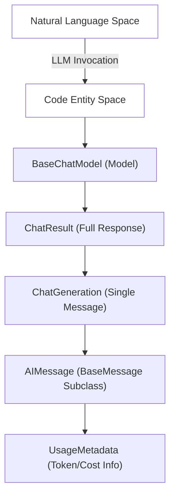
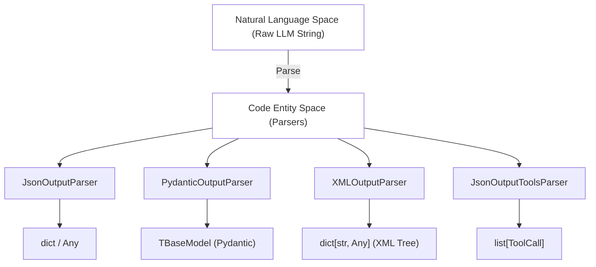
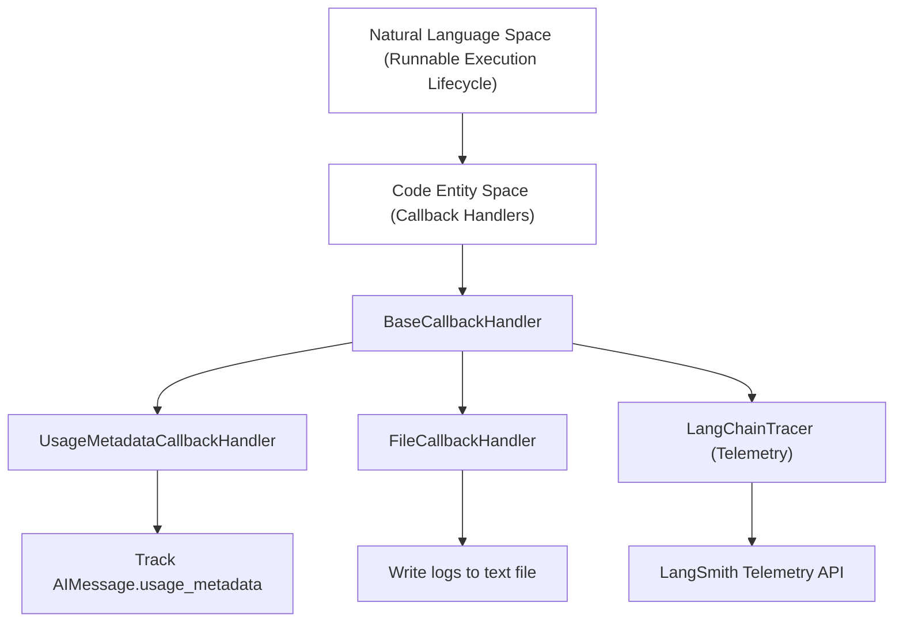

<!-- source: DeepWiki mcp.deepwiki.com · repo langchain-ai/langchain · page 2.6 Outputs, Output Parsers and Callbacks · fetched 2026-10-26 -->

# Outputs, Output Parsers and Callbacks

Relevant source files

The following files were used as context for generating this wiki page:

- [libs/core/langchain_core/_api/__init__.py](libs/core/langchain_core/_api/__init__.py)
- [libs/core/langchain_core/callbacks/__init__.py](libs/core/langchain_core/callbacks/__init__.py)
- [libs/core/langchain_core/callbacks/file.py](libs/core/langchain_core/callbacks/file.py)
- [libs/core/langchain_core/callbacks/stdout.py](libs/core/langchain_core/callbacks/stdout.py)
- [libs/core/langchain_core/callbacks/streaming_stdout.py](libs/core/langchain_core/callbacks/streaming_stdout.py)
- [libs/core/langchain_core/callbacks/usage.py](libs/core/langchain_core/callbacks/usage.py)
- [libs/core/langchain_core/document_loaders/__init__.py](libs/core/langchain_core/document_loaders/__init__.py)
- [libs/core/langchain_core/documents/__init__.py](libs/core/langchain_core/documents/__init__.py)
- [libs/core/langchain_core/language_models/__init__.py](libs/core/langchain_core/language_models/__init__.py)
- [libs/core/langchain_core/load/__init__.py](libs/core/langchain_core/load/__init__.py)
- [libs/core/langchain_core/messages/__init__.py](libs/core/langchain_core/messages/__init__.py)
- [libs/core/langchain_core/output_parsers/__init__.py](libs/core/langchain_core/output_parsers/__init__.py)
- [libs/core/langchain_core/output_parsers/base.py](libs/core/langchain_core/output_parsers/base.py)
- [libs/core/langchain_core/output_parsers/json.py](libs/core/langchain_core/output_parsers/json.py)
- [libs/core/langchain_core/output_parsers/list.py](libs/core/langchain_core/output_parsers/list.py)
- [libs/core/langchain_core/output_parsers/openai_functions.py](libs/core/langchain_core/output_parsers/openai_functions.py)
- [libs/core/langchain_core/output_parsers/openai_tools.py](libs/core/langchain_core/output_parsers/openai_tools.py)
- [libs/core/langchain_core/output_parsers/pydantic.py](libs/core/langchain_core/output_parsers/pydantic.py)
- [libs/core/langchain_core/output_parsers/xml.py](libs/core/langchain_core/output_parsers/xml.py)
- [libs/core/langchain_core/outputs/chat_generation.py](libs/core/langchain_core/outputs/chat_generation.py)
- [libs/core/langchain_core/outputs/chat_result.py](libs/core/langchain_core/outputs/chat_result.py)
- [libs/core/langchain_core/outputs/generation.py](libs/core/langchain_core/outputs/generation.py)
- [libs/core/langchain_core/outputs/llm_result.py](libs/core/langchain_core/outputs/llm_result.py)
- [libs/core/langchain_core/outputs/run_info.py](libs/core/langchain_core/outputs/run_info.py)
- [libs/core/langchain_core/prompts/__init__.py](libs/core/langchain_core/prompts/__init__.py)
- [libs/core/langchain_core/tracers/__init__.py](libs/core/langchain_core/tracers/__init__.py)
- [libs/core/langchain_core/tracers/evaluation.py](libs/core/langchain_core/tracers/evaluation.py)
- [libs/core/langchain_core/tracers/root_listeners.py](libs/core/langchain_core/tracers/root_listeners.py)
- [libs/core/langchain_core/tracers/run_collector.py](libs/core/langchain_core/tracers/run_collector.py)
- [libs/core/langchain_core/tracers/stdout.py](libs/core/langchain_core/tracers/stdout.py)
- [libs/core/tests/unit_tests/callbacks/test_imports.py](libs/core/tests/unit_tests/callbacks/test_imports.py)
- [libs/core/tests/unit_tests/callbacks/test_usage_callback.py](libs/core/tests/unit_tests/callbacks/test_usage_callback.py)
- [libs/core/tests/unit_tests/embeddings/test_deterministic_embedding.py](libs/core/tests/unit_tests/embeddings/test_deterministic_embedding.py)
- [libs/core/tests/unit_tests/messages/test_imports.py](libs/core/tests/unit_tests/messages/test_imports.py)
- [libs/core/tests/unit_tests/output_parsers/test_base_parsers.py](libs/core/tests/unit_tests/output_parsers/test_base_parsers.py)
- [libs/core/tests/unit_tests/output_parsers/test_imports.py](libs/core/tests/unit_tests/output_parsers/test_imports.py)
- [libs/core/tests/unit_tests/output_parsers/test_json.py](libs/core/tests/unit_tests/output_parsers/test_json.py)
- [libs/core/tests/unit_tests/output_parsers/test_list_parser.py](libs/core/tests/unit_tests/output_parsers/test_list_parser.py)
- [libs/core/tests/unit_tests/output_parsers/test_openai_tools.py](libs/core/tests/unit_tests/output_parsers/test_openai_tools.py)
- [libs/core/tests/unit_tests/output_parsers/test_pydantic_parser.py](libs/core/tests/unit_tests/output_parsers/test_pydantic_parser.py)
- [libs/core/tests/unit_tests/output_parsers/test_xml_parser.py](libs/core/tests/unit_tests/output_parsers/test_xml_parser.py)
- [libs/core/tests/unit_tests/outputs/test_chat_generation.py](libs/core/tests/unit_tests/outputs/test_chat_generation.py)
- [libs/core/tests/unit_tests/test_pydantic_serde.py](libs/core/tests/unit_tests/test_pydantic_serde.py)
- [libs/langchain/tests/unit_tests/callbacks/test_file.py](libs/langchain/tests/unit_tests/callbacks/test_file.py)
- [libs/langchain/tests/unit_tests/callbacks/test_stdout.py](libs/langchain/tests/unit_tests/callbacks/test_stdout.py)

## Purpose and Scope
This page documents the foundational execution result types, structured output transformation pipelines, and telemetry/callback infrastructure in `langchain-core`. It covers the core data structures for generation and chat results (`Generation`, `ChatGeneration`, `ChatResult`), built-in output parsers including JSON, Pydantic, XML, and OpenAI-style tool call parsers, as well as callback handlers used for logging, streaming, and usage metadata tracking.

---

## 1. Generation and Result Data Structures

Language models return normalized container objects encapsulating generated outputs and metadata. These serve as a standardized representation of model responses.

- **`Generation`**  
  Represents a single generation output from a base LLM. It holds `text` (the generated string), optional `generation_info` (metadata about the generation such as tokens used), and a type discriminator. This class is implemented in [libs/core/langchain_core/outputs/generation.py]().

- **`ChatGeneration`**  
  Extends `Generation` specifically for chat models. Instead of just raw text, it contains a `message` of type `BaseMessage` that may represent rich chat message content like an `AIMessage`. It also maintains `text` synced from the chat message content via a Pydantic validator (`model_validator`) that runs after object creation. This ensures legacy support and compatibility with message content blocks. See [libs/core/langchain_core/outputs/chat_generation.py:17-74]().

- **`ChatGenerationChunk`**  
  A chunk of a streaming chat generation used to represent partial pieces of a chat message as they stream in. Supports the `__add__` operator to concatenate multiple chunks, merging their message content and generation info. See [libs/core/langchain_core/outputs/chat_generation.py:77-128]().

- **`ChatResult`**  
  Aggregates multiple chat generations from a model invocation along with overall model-level output metadata (`LLMOutput`). This represents the full response from a chat model, potentially containing multiple alternative generations. See [libs/core/langchain_core/outputs/chat_result.py]().

### Data Flow Diagram: Natural Language to Generation Data Structures

Sources:
- `libs/core/langchain_core/outputs/generation.py`
- `libs/core/langchain_core/outputs/chat_generation.py:17-128`
- `libs/core/langchain_core/outputs/chat_result.py`

---

## 2. Output Parsers

Output parsers transform raw generation outputs (plain strings or messages) into structured Python objects such as dictionaries, Pydantic models, XML trees, or tool call abstractions.

All output parsers extend from one of two base classes:

- `BaseTransformOutputParser`: Transforms a single raw string input to output.
- `BaseCumulativeTransformOutputParser`: Designed to handle streaming partial parsing by cumulatively accumulating input.

### JSON and Pydantic Parsers

- **`JsonOutputParser`**  
  Parses string output that contains JSON or JSON markdown code blocks into a Python dictionary or JSON-like object. Supports partial streaming parse with incremental JSON patch deltas. It attempts robust markdown codeblock extraction and partial JSON parsing [libs/core/langchain_core/output_parsers/json.py:31-92]().  
  Format instructions leverage any attached Pydantic schema if provided to specify the expected JSON format precisely.

- **`PydanticOutputParser`**  
  Extends `JsonOutputParser` to further validate and parse JSON data against a specified Pydantic model class. It supports both Pydantic v1 and v2 models, using `model_validate` or `parse_obj` respectively. Errors are wrapped in `OutputParserException` for clarity. Also provides a format instruction method that renders the Pydantic JSON schema for LLM prompt guidance [libs/core/langchain_core/output_parsers/pydantic.py:19-124]().

### XML Parser

- **`XMLOutputParser`**  
  Uses an XML pull parser either from the standard library `xml.etree.ElementTree` or the safer `defusedxml` package, if installed. It uses a streaming implementation encapsulated in `_StreamingParser` to parse XML chunks and yield nested dictionaries representing XML trees. The parser robustly detects XML content start in inputs and handles nested tags. It also protects against XML entity attacks, raising `OutputParserException` on malformed or malicious XML. This parser converts XML elements into nested `dict[str, Any]` structures reflecting the XML hierarchy, keyed by tag names, supporting multiple children of the same tag as lists. See [libs/core/langchain_core/output_parsers/xml.py:42-182]().

### OpenAI Tool Call Parsers

- **`JsonOutputToolsParser`**  
  Reads model outputs that contain encoded tool calls conforming to the OpenAI function-calling protocol. It attempts to parse tool call payloads, including their JSON argument strings, and converts them into Python objects (e.g., `ToolCall` or `InvalidToolCall`) for use by tools in LangChain. It supports partial parsing, strict JSON checking, and can return either all calls or only the first based on configuration. Parsing errors raise `OutputParserException` with detailed context. See [libs/core/langchain_core/output_parsers/openai_tools.py:26-164]().

### Data Flow Diagram: Output Parsers Bridging Raw LLM Output and Structured Code Entities

Sources:
- `libs/core/langchain_core/output_parsers/json.py:31-92`
- `libs/core/langchain_core/output_parsers/pydantic.py:19-124`
- `libs/core/langchain_core/output_parsers/xml.py:42-182`
- `libs/core/langchain_core/output_parsers/openai_tools.py:26-164`

---

## 3. Callback Handlers and Usage Tracking

Callbacks implement the `BaseCallbackHandler` interface to receive lifecycle event notifications from runnables, chains, agents, and language models. They can emit logs, write to files, collect usage data, stream chunks, or integrate with tracing tools.

### UsageMetadataCallbackHandler

This handler tracks token usage and generation metadata by intercepting `AIMessage.usage_metadata` from chat model outputs. It accumulates usage statistics per model name in a thread-safe manner. Internally it locks a shared dict keyed by model names and sums usage metadata as messages arrive. Clients can instantiate this handler directly or use the `get_usage_metadata_callback()` context manager which installs the handler in a contextvar and ensures lifecycle scoped usage collection. See [libs/core/langchain_core/callbacks/usage.py:18-124]().

### FileCallbackHandler

Writes callback event data, such as chain and agent execution logs, to a file with optional text color. It supports both direct instantiation and recommended context-manager usage. Using it without a context manager emits a deprecation warning. This handler manages the file resource lifecycle properly, closing the file on context exit or object deletion. It listens to chain start/end, agent actions, and tool ends and writes their logs to the file. See [libs/core/langchain_core/callbacks/file.py:21-161]().

### Callback Usage Lifecycle Diagram

Sources:
- `libs/core/langchain_core/callbacks/usage.py:18-125`
- `libs/core/langchain_core/callbacks/file.py:21-161`

---

# Summary

This section documents the reusable building blocks handling the outputs from language and chat models (`Generation`, `ChatGeneration`), their transformation into structured data with multiple parsers (such as JSON, Pydantic, XML, OpenAI Tools), and the callback infrastructure responsible for telemetry, logging, and usage tracking. The abstractions ensure smooth bridging from raw natural language model outputs to rich structured internal representations and provide tools for observability and extensibility across the LangChain framework.

---

