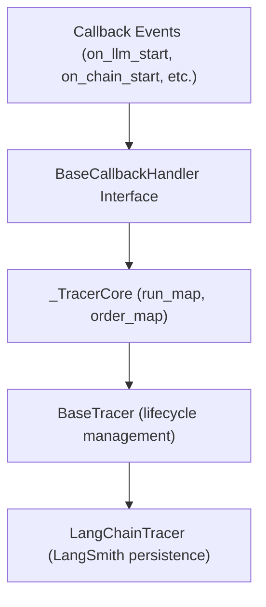
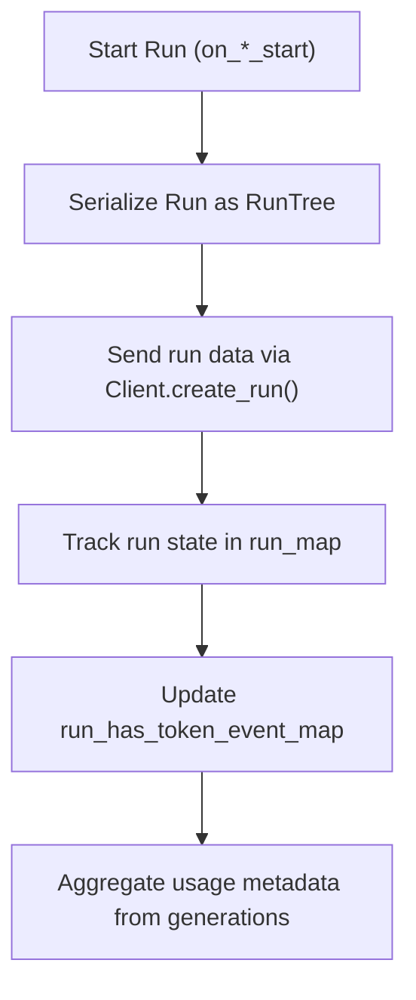
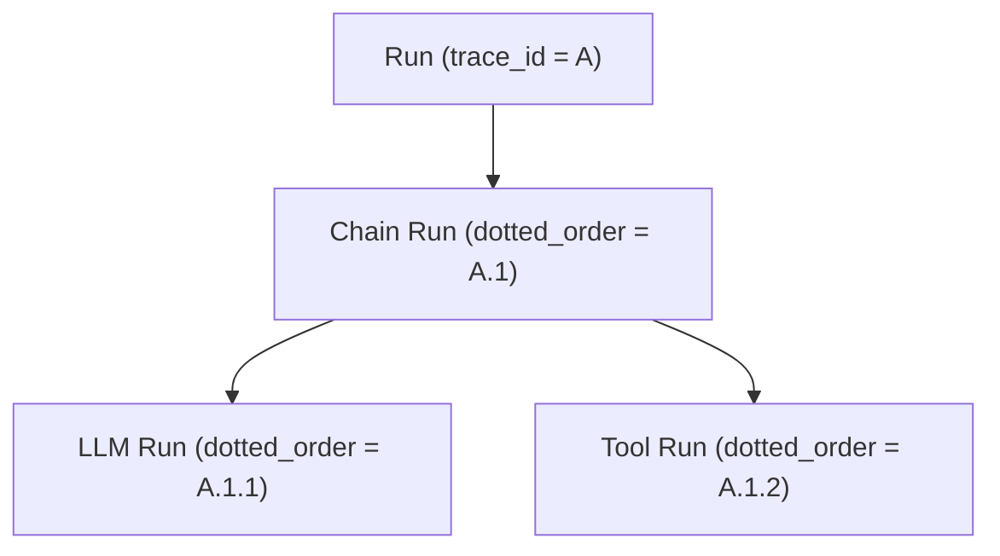
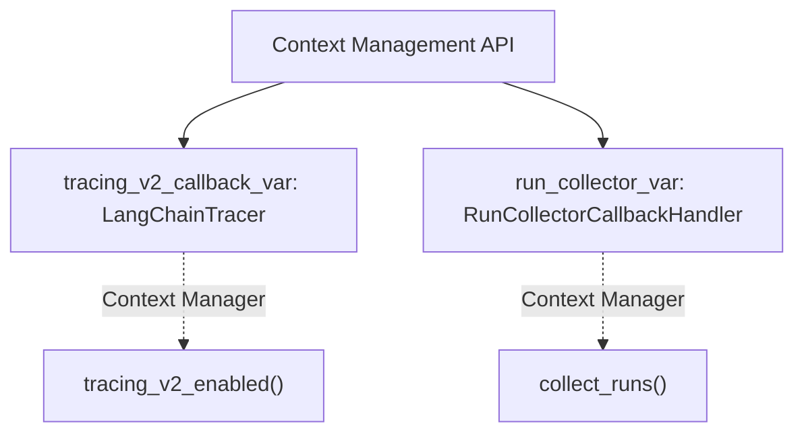
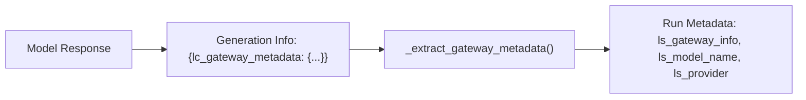

<!-- source: DeepWiki mcp.deepwiki.com · repo langchain-ai/langchain · page 2.7 Tracing and LangSmith Integration · fetched 2026-10-26 -->

# Tracing and LangSmith Integration

Relevant source files

The following files were used as context for generating this wiki page:

- [libs/core/langchain_core/tracers/base.py](libs/core/langchain_core/tracers/base.py)
- [libs/core/langchain_core/tracers/context.py](libs/core/langchain_core/tracers/context.py)
- [libs/core/langchain_core/tracers/core.py](libs/core/langchain_core/tracers/core.py)
- [libs/core/langchain_core/tracers/langchain.py](libs/core/langchain_core/tracers/langchain.py)
- [libs/core/langchain_core/tracers/schemas.py](libs/core/langchain_core/tracers/schemas.py)
- [libs/core/langchain_core/utils/_gateway.py](libs/core/langchain_core/utils/_gateway.py)
- [libs/core/tests/unit_tests/conftest.py](libs/core/tests/unit_tests/conftest.py)
- [libs/core/tests/unit_tests/runnables/test_tracing_interops.py](libs/core/tests/unit_tests/runnables/test_tracing_interops.py)
- [libs/core/tests/unit_tests/tracers/test_async_base_tracer.py](libs/core/tests/unit_tests/tracers/test_async_base_tracer.py)
- [libs/core/tests/unit_tests/tracers/test_automatic_metadata.py](libs/core/tests/unit_tests/tracers/test_automatic_metadata.py)
- [libs/core/tests/unit_tests/tracers/test_base_tracer.py](libs/core/tests/unit_tests/tracers/test_base_tracer.py)
- [libs/core/tests/unit_tests/tracers/test_imports.py](libs/core/tests/unit_tests/tracers/test_imports.py)
- [libs/core/tests/unit_tests/tracers/test_langchain.py](libs/core/tests/unit_tests/tracers/test_langchain.py)
- [libs/core/tests/unit_tests/tracers/test_schemas.py](libs/core/tests/unit_tests/tracers/test_schemas.py)
- [libs/core/tests/unit_tests/utils/test_gateway.py](libs/core/tests/unit_tests/utils/test_gateway.py)
- [libs/langchain/langchain_classic/callbacks/tracers/schemas.py](libs/langchain/langchain_classic/callbacks/tracers/schemas.py)
- [libs/langchain/langchain_classic/schema/callbacks/tracers/schemas.py](libs/langchain/langchain_classic/schema/callbacks/tracers/schemas.py)

## Purpose and Scope
This page provides a comprehensive technical explanation of the tracing architecture and LangSmith integration within `langchain-core`. It covers the core abstract tracer base classes, the `LangChainTracer` implementation that persists tracing runs to the LangSmith endpoint, the run schemas and hierarchical run structure, context management utilities for tracing, and handling of LangSmith gateway metadata.

---

## 1. Tracer Core and Base Architecture

Tracing in LangChain tracks the execution of various components such as LLM calls, chains, and tools by reacting to callback lifecycle events like `on_llm_start`, `on_chain_start`, `on_tool_start` and their corresponding end or error events. These events form a tree structure of nested runs, capturing a full execution graph.

### Key Components

- **_TracerCore** (in `libs/core/langchain_core/tracers/core.py`) is an abstract base class that manages key internal data structures:
  - `run_map`: Maps run IDs to `Run` objects, representing currently active runs.
  - `order_map`: Maps run IDs to tuples `(trace_id, dotted_order)` which encode hierarchical trace order.
  - `_external_run_ids`: Tracks refcounts for externally injected run IDs to avoid premature cleanup.

- The class also handles constructing the hierarchical identifiers:
  - `trace_id`: The root UUID shared among all runs in a trace.
  - `dotted_order`: A lexicographically sortable string reflecting start time and the run's position in the hierarchy (e.g., `20230405T123456789000Z<root_id>.childid`).

- **BaseTracer** (in `libs/core/langchain_core/tracers/base.py`) inherits from `_TracerCore` and the callback handler interface `BaseCallbackHandler`. It implements orchestration of run lifecycle hooks including starting and ending traces, managing run maps, and delegates persistence of runs to subclasses.

### Data Flow

Tracing events from runnables and LLMs trigger callback events processed by `BaseTracer`. This constructs and maintains `Run` objects representing the hierarchical execution tree. Runs are stored in maps and ordering metadata is tracked to maintain trace hierarchy. Upon run completion, persistence logic is called to store or forward run data.

| Class                | Module Path                                      | Role                                                         |
|----------------------|-------------------------------------------------|--------------------------------------------------------------|
| `_TracerCore`        | `langchain_core.tracers.core`                    | Abstract base with run and ordering maps, hierarchy handling |
| `BaseTracer`         | `langchain_core.tracers.base`                    | Implements lifecycle hooks, abstracts persistence             |
| `LangChainTracer`    | `langchain_core.tracers.langchain`               | Concrete tracer persisting runs remotely to LangSmith API     |

Sources: `libs/core/langchain_core/tracers/core.py:66-180`(), `libs/core/langchain_core/tracers/base.py:33-60`()

---

## 2. LangChainTracer and Remote Persistence

`LangChainTracer` extends `BaseTracer` to enable persistence of tracing runs by sending serialized run data to the LangSmith endpoint through the `langsmith.Client` SDK.

### Characteristics and Features

- **Client and Project Resolution**:
  - Uses a `langsmith.Client` either explicitly passed or cached globally via `get_client()`.
  - Project name for runs is resolved with priority:
    1. `project_name` parameter if given
    2. Environment variable `LANGCHAIN_PROJECT`
    3. Legacy environment variable `LANGCHAIN_SESSION`
    4. Defaults to `"default"`
- **Metadata and Tagging**:
  - Accepts explicit tags and metadata dict on initialization.
  - Maintains a set of special metadata keys (`OVERRIDABLE_LANGSMITH_INHERITABLE_METADATA_KEYS`) that override normal metadata inheritance to allow nested tracer calls to replace LangSmith-specific metadata like `"ls_agent_type"`.
- **Streaming Token Event Support**:
  - Maintains a map `run_has_token_event_map` to track which runs have streaming token events enabled.
- **Usage Metadata Aggregation**:
  - Uses functions like `_get_usage_metadata_from_generations` to aggregate token usage metadata embedded in serialized generation messages.

### Core Data Flow for Persistence

1. Run starts: the run is serialized as a `RunTree` object.
2. The run data is sent asynchronously to LangSmith's remote API using `Client.create_run()`.
3. Run state is tracked locally in `run_map`.
4. Streaming token events and usage metadata are tracked and aggregated across runs.

Sources: `libs/core/langchain_core/tracers/langchain.py:1-197`()

---

## 3. Run Schemas and Tree Structure

Tracing runs are modeled using the `RunTree` object from LangSmith, aliased as `Run` in `langchain-core` for backwards compatibility (`libs/core/langchain_core/tracers/schemas.py`).

### Important Run Attributes

- `id` (UUID): Unique identifier for the run.
- `trace_id` (UUID): The root run ID shared across all nested runs in the trace.
- `dotted_order` (str): A sortable string form encoding timestamp and hierarchical position.
- `child_runs` (list of `Run`): Nested child run objects forming the call graph.

The hierarchical structure supports nested runs such as chains calling LLM runs and tools, with each run linked to its parent.

This hierarchy is built and maintained by `_TracerCore` during the lifecycle of runs.

Sources: `libs/core/langchain_core/tracers/core.py:133-176`(), `libs/core/langchain_core/tracers/schemas.py:5-10`()

---

## 4. Context Management and Callback Handlers

To integrate tracing cleanly without forcing explicit callback passing, `langchain-core` provides context management utilities that automatically inject tracing into runnable execution contexts.

### Key Context Variables and APIs (`libs/core/langchain_core/tracers/context.py`)

- `tracing_v2_callback_var`: A `ContextVar` holding the current active `LangChainTracer`.
- `run_collector_var`: Holds a special `RunCollectorCallbackHandler` to locally collect runs, useful for debugging/testing.
- Context Managers:
  - `tracing_v2_enabled`: Enables tracing for all runs in an execution context by setting the current `LangChainTracer` in `tracing_v2_callback_var`. It accepts options like project name, example ID, client and tags.
  - `collect_runs`: Enables local run collection by setting `run_collector_var` within the context.
- `register_configure_hook`: Registers hooks for setting up callback handlers and environment-driven configuration on context variables.

These utilities abstract the complexity of configuring tracing, enabling implicit instrumentation within scopes for LangChain objects.

Sources: `libs/core/langchain_core/tracers/context.py:30-103`()

---

## 5. LangSmith Gateway Metadata and Configuration

LangSmith acts as a gateway to route model calls through a proxy while attaching enriched metadata useful for observability and debugging.

### Gateway Metadata Extraction

- The key `lc_gateway_metadata` (aliased as `GATEWAY_METADATA_RESPONSE_KEY`) is attached to the `generation_info` of `LLMResult`'s generations.
- Function `_extract_gateway_metadata` (in `libs/core/langchain_core/tracers/core.py`) iterates through generations to extract this metadata dict if present.

### Metadata Propagation to Runs

- Extracted gateway info is promoted into run metadata under keys:
  - `"ls_gateway_info"`: The raw gateway info dict.
  - `"ls_model_name"`: Resolved model name.
  - `"ls_provider"`: Resolved provider name.

This enables better trace filtering and display in LangSmith UI.

### Gateway Configuration Resolution

- The `_resolve_gateway_config` utility function in `utils/_gateway.py` honors environment variables and explicit parameters to determine the base URL and API key for model providers.
- It handles:
  - Enabling/disabling the gateway with environment variables (`LANGSMITH_GATEWAY`, `LANGSMITH_GATEWAY_API_KEY`, `LANGSMITH_API_KEY`).
  - Precedence rules to favor explicit configuration, fallback to environment, or the default gateway host.

Sources: `libs/core/langchain_core/tracers/core.py:44-63`(), `libs/core/langchain_core/utils/_gateway.py:1-181`()

---

# Summary

The tracing system in `langchain-core` provides robust, hierarchical instrumentation of LangChain executions, capturing call graphs of LLMs, chains, and tools as `Run` objects managed by `_TracerCore` and extended by `LangChainTracer` for remote persistence via LangSmith.

Context management APIs enable automatic instrumentation without forcing explicit callback wiring, and LangSmith gateway metadata integration enriches traces with provider routing information. This architecture supports sophisticated features like streaming token events, usage metadata aggregation, error handling, and metadata inheritance with override controls.

---

# References to Code and Tests

- Tracer core and base lifecycle:  
  `libs/core/langchain_core/tracers/core.py:66-180`(),  
  `libs/core/langchain_core/tracers/base.py:33-60`()
- LangChainTracer implementation:  
  `libs/core/langchain_core/tracers/langchain.py:1-197`()
- Run schemas:  
  `libs/core/langchain_core/tracers/schemas.py:5-10`()
- Context management utilities:  
  `libs/core/langchain_core/tracers/context.py:30-103`()
- Gateway metadata extraction:  
  `libs/core/langchain_core/tracers/core.py:44-63`()
- Gateway base URL and key resolution:  
  `libs/core/langchain_core/utils/_gateway.py:1-181`()

Additional tests for tracing context, metadata inheritance, and thread safety are found in:  
`libs/core/tests/unit_tests/tracers/test_langchain.py`(),  
`libs/core/tests/unit_tests/runnables/test_tracing_interops.py`()

Sources:  
`libs/core/langchain_core/tracers/core.py`(),  
`libs/core/langchain_core/tracers/base.py`(),  
`libs/core/langchain_core/tracers/langchain.py`(),  
`libs/core/langchain_core/tracers/schemas.py`(),  
`libs/core/langchain_core/tracers/context.py`(),  
`libs/core/langchain_core/utils/_gateway.py`(),  
`libs/core/tests/unit_tests/tracers/test_langchain.py`(),  
`libs/core/tests/unit_tests/runnables/test_tracing_interops.py`()

---

