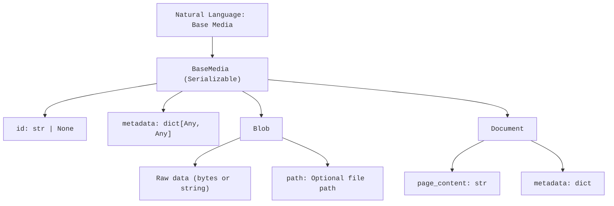
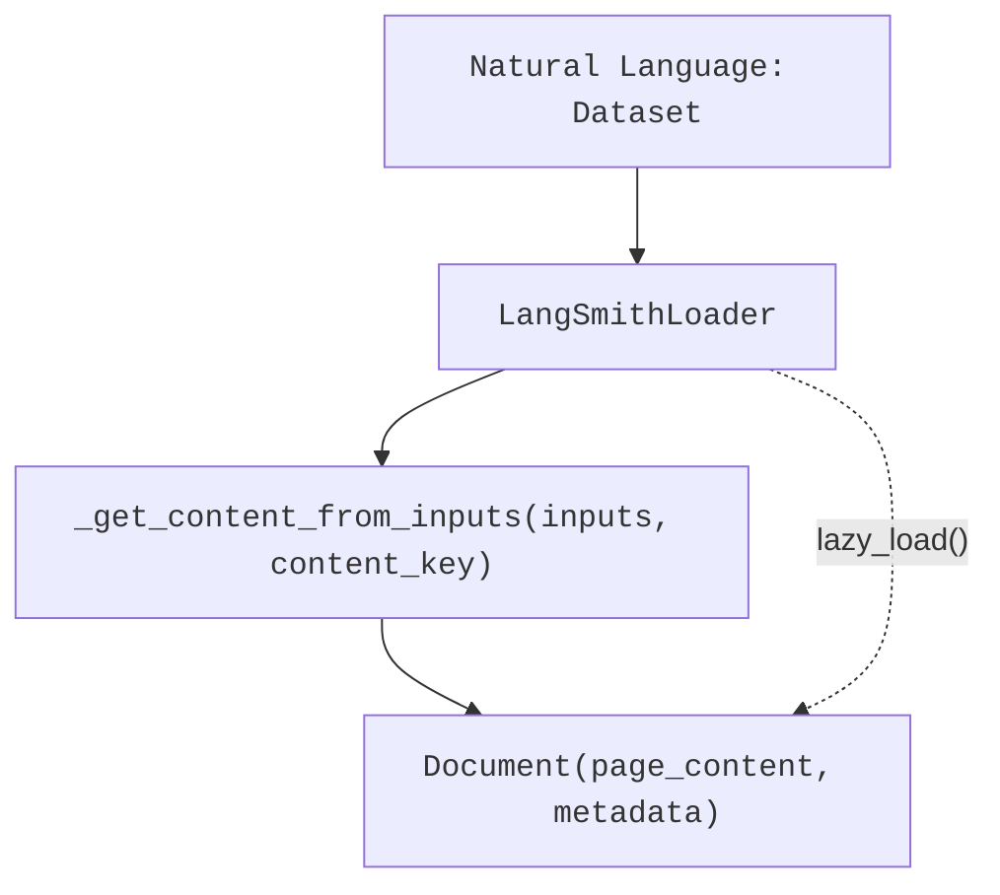
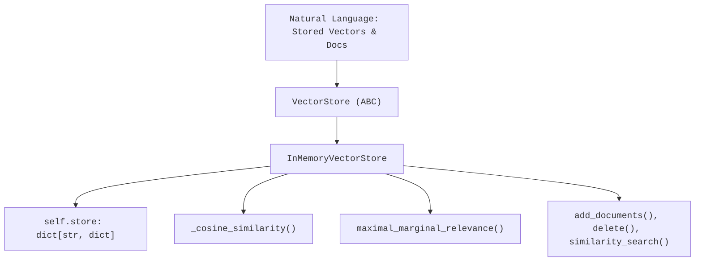
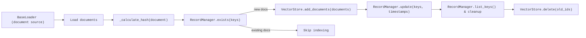

<!-- source: DeepWiki mcp.deepwiki.com · repo langchain-ai/langchain · page 2.8 Retrieval Primitives: Documents, Vector Stores, Indexing · fetched 2026-10-26 -->

# Retrieval Primitives: Documents, Vector Stores, Indexing

Relevant source files

The following files were used as context for generating this wiki page:

- [libs/core/langchain_core/document_loaders/base.py](libs/core/langchain_core/document_loaders/base.py)
- [libs/core/langchain_core/document_loaders/blob_loaders.py](libs/core/langchain_core/document_loaders/blob_loaders.py)
- [libs/core/langchain_core/document_loaders/langsmith.py](libs/core/langchain_core/document_loaders/langsmith.py)
- [libs/core/langchain_core/documents/base.py](libs/core/langchain_core/documents/base.py)
- [libs/core/langchain_core/documents/compressor.py](libs/core/langchain_core/documents/compressor.py)
- [libs/core/langchain_core/documents/transformers.py](libs/core/langchain_core/documents/transformers.py)
- [libs/core/langchain_core/embeddings/embeddings.py](libs/core/langchain_core/embeddings/embeddings.py)
- [libs/core/langchain_core/embeddings/fake.py](libs/core/langchain_core/embeddings/fake.py)
- [libs/core/langchain_core/indexing/__init__.py](libs/core/langchain_core/indexing/__init__.py)
- [libs/core/langchain_core/indexing/api.py](libs/core/langchain_core/indexing/api.py)
- [libs/core/langchain_core/indexing/base.py](libs/core/langchain_core/indexing/base.py)
- [libs/core/langchain_core/retrievers.py](libs/core/langchain_core/retrievers.py)
- [libs/core/langchain_core/vectorstores/base.py](libs/core/langchain_core/vectorstores/base.py)
- [libs/core/langchain_core/vectorstores/in_memory.py](libs/core/langchain_core/vectorstores/in_memory.py)
- [libs/core/langchain_core/vectorstores/utils.py](libs/core/langchain_core/vectorstores/utils.py)
- [libs/core/tests/unit_tests/document_loaders/__init__.py](libs/core/tests/unit_tests/document_loaders/__init__.py)
- [libs/core/tests/unit_tests/document_loaders/test_base.py](libs/core/tests/unit_tests/document_loaders/test_base.py)
- [libs/core/tests/unit_tests/document_loaders/test_langsmith.py](libs/core/tests/unit_tests/document_loaders/test_langsmith.py)
- [libs/core/tests/unit_tests/documents/test_imports.py](libs/core/tests/unit_tests/documents/test_imports.py)
- [libs/core/tests/unit_tests/documents/test_str.py](libs/core/tests/unit_tests/documents/test_str.py)
- [libs/core/tests/unit_tests/embeddings/__init__.py](libs/core/tests/unit_tests/embeddings/__init__.py)
- [libs/core/tests/unit_tests/indexing/__init__.py](libs/core/tests/unit_tests/indexing/__init__.py)
- [libs/core/tests/unit_tests/indexing/test_hashed_document.py](libs/core/tests/unit_tests/indexing/test_hashed_document.py)
- [libs/core/tests/unit_tests/indexing/test_in_memory_record_manager.py](libs/core/tests/unit_tests/indexing/test_in_memory_record_manager.py)
- [libs/core/tests/unit_tests/indexing/test_indexing.py](libs/core/tests/unit_tests/indexing/test_indexing.py)
- [libs/core/tests/unit_tests/indexing/test_public_api.py](libs/core/tests/unit_tests/indexing/test_public_api.py)
- [libs/core/tests/unit_tests/vectorstores/test_in_memory.py](libs/core/tests/unit_tests/vectorstores/test_in_memory.py)
- [libs/core/tests/unit_tests/vectorstores/test_utils.py](libs/core/tests/unit_tests/vectorstores/test_utils.py)
- [libs/core/tests/unit_tests/vectorstores/test_vectorstore.py](libs/core/tests/unit_tests/vectorstores/test_vectorstore.py)
- [libs/langchain/tests/unit_tests/indexes/test_indexing.py](libs/langchain/tests/unit_tests/indexes/test_indexing.py)
- [libs/standard-tests/tests/unit_tests/__init__.py](libs/standard-tests/tests/unit_tests/__init__.py)
- [libs/standard-tests/tests/unit_tests/test_in_memory_vectorstore.py](libs/standard-tests/tests/unit_tests/test_in_memory_vectorstore.py)

## Purpose and Scope
This page documents the foundational retrieval primitives implemented in the `langchain-core` codebase. It covers the core data abstractions (`Blob`, `Document`), the document loader interfaces, the embeddings interface, vector store abstractions including the in-memory vector store implementation, retriever abstractions, and the indexing API which couples record managers to vector stores for efficient incremental indexing. 

The documentation explains the implementation details, data flows, and key classes and methods enabling retrieval-augmented workflows. Several mermaid diagrams illustrate relationships bridging high-level natural language concepts to code entities.

---

## 1. Documents, Blobs, and Media Types

At the very base of retrieval pipelines are media and document representations, defined in `langchain_core.documents.base`.  

- **`BaseMedia`** is a serializable base class implementing common content metadata and an optional unique ID field coerced to string.
- **`Blob`** extends `BaseMedia` to represent raw data (text or bytes), either in-memory or referenced by file path. It provides convenience methods such as `as_string()`, `as_bytes()`, and byte-stream context manager `as_bytes_io()` to access contents transparently whether stored or file-backed. MIME type and encoding metadata are also tracked.
- **`Document`** (not fully shown here but implied and related) extends `BaseMedia` to wrap textual content (`page_content`) used extensively for retrieval, vector storage, and retrieval augmented generation (RAG).

This abstraction cleanly separates raw byte content (`Blob`) from processed textual content (`Document`), both extending a base identifier and metadata container.

*Figure 1: Media and Document class hierarchy linking base identification to structured text and raw blobs.*

**Sources:**  
`libs/core/langchain_core/documents/base.py:34-210`()

---

## 2. Document Loaders and LangSmith Loader

Document loaders provide an interface for lazy ingestion of external content sources, yielding streams of `Document` objects.

- The base loader interface `BaseLoader` (from `langchain_core.document_loaders.base`) defines synchronous `lazy_load()` and asynchronous `alazy_load()` methods returning iterators or async iterators of `Document`s.
- The **`LangSmithLoader`** specializes this for LangSmith datasets, loading dataset examples via a LangSmith client and extracting specific nested fields from example inputs as document text using a configurable nested key path `content_key`.
- It supports lazy loading of documents with optional filtering, content formatting, and metadata inclusion.
- The nested content extraction logic is handled in the helper `_get_content_from_inputs()` which safely traverses hierarchical dictionaries by the provided key path, throwing comprehensible errors on missing keys.

*Figure 2: Document loading flow from LangSmith dataset examples into `Document` instances.*

**Sources:**  
`libs/core/langchain_core/document_loaders/langsmith.py:17-176`(),  
`libs/core/tests/unit_tests/indexing/test_indexing.py:26-44`()

---

## 3. Embeddings Interface

Embeddings are the vector representation transform layer for textual data. The embedding interface (defined in `langchain_core.embeddings`) standardizes:

- `embed_documents(texts: list[str]) -> list[list[float]]`: Synchronously embed a batch of texts into vectors for insertion into vector stores.
- `embed_query(text: str) -> list[float]`: Synchronously embed a single query for retrieval similarity computations.
- Corresponding asynchronous methods for embedding are also supported.

This interface allows vector stores and retrievers to work generically with any embedding backend.

**Sources:**  
(This interface is implied and referenced, but code not explicitly included in excerpt.)

---

## 4. VectorStore Base and InMemoryVectorStore

The vector store interface abstracts storage and fuzzy retrieval over embedded documents.

### `VectorStore` (Abstract Base Class)
Defined in `langchain_core.vectorstores.base`, it specifies core methods:

- `add_texts(texts, metadatas=None, ids=None, **kwargs)`: Embed and add multiple texts.
- `add_documents(documents, ids=None, **kwargs)`: Add `Document` objects with embeddings.
- `delete(ids)`: Delete documents by ID.
- `get_by_ids(ids)`: Retrieve documents by ID.
- `similarity_search(query, k, **kwargs)`: Search for top-k documents similar to query.
- Support for asynchronous versions of these methods.

Special rules ensure that subclasses can override either `add_texts` or `add_documents` to implement insertion logic.

### `InMemoryVectorStore`

A concrete `VectorStore` implementation holding vectors and documents purely in-memory using a dictionary keyed by document id.

- The store maps ids to dictionaries with keys: `"id"`, `"vector"` (embedding), `"text"` (page_content), and `"metadata"`.
- Embeddings are computed synchronously or asynchronously using the `Embeddings` interface.
- Uses numpy (if available) for vector cosine similarity calculations and optionally simsimd for acceleration.
- Supports search ranking by cosine similarity and also maximal marginal relevance (MMR) for diverse results.
- Exposes filtering predicates on search results.
- Implements synchronous and asynchronous add, delete, search, and retrieval by id.
- The class allows dumping to and loading from JSON files for persistence.

*Figure 3: Vector store architecture: abstract interface and in-memory concrete implementation.*

**Sources:**  
`libs/core/langchain_core/vectorstores/base.py:43-186`(),  
`libs/core/langchain_core/vectorstores/in_memory.py:34-171`(),  
`libs/core/langchain_core/vectorstores/utils.py:39-163`()

---

## 5. Retrievers

Retrievers wrap document retrieval workflows, given a string query producing relevant documents for further processing.

- `BaseRetriever` in `langchain_core.retrievers` inherits `RunnableSerializable[str, list[Document]]`, implementing the runnable interface for integration into LangChain.
- Subclasses override `_get_relevant_documents(query: str) -> list[Document]` synchronously to perform retrieval.
- Optionally, asynchronous retrieval can be implemented by overriding `_aget_relevant_documents`.
- Class initialization introspects method signatures to support backward compatibility and async fallbacks running synchronous methods in executors.
- Provides metadata and tagging to identify retriever instances and support tracing systems.

Typical retrievers are backed by vector stores or alternate retrieval backends.

*Figure 4: Retriever querying documents via vector store similarity search.*

**Sources:**  
`libs/core/langchain_core/retrievers.py:55-187`()

---

## 6. Indexing API and Record Managers

Efficient incremental indexing is vital to maintain current vectors and documents in the vector store without redundant re-indexing.

#### Record Managers

- The `RecordManager` abstract base in `langchain_core.indexing.base` maintains metadata tracking:
  - Document hash keys
  - Group/source IDs
  - Timestamp of last indexing/update
- It supports atomic upsert (`update`/`aupdate`), existence queries (`exists`/`aexists`), and key listing with filtering (`list_keys`).
- This enables the indexing system to detect previously indexed documents and efficiently update only changed or new documents.

#### Hashing and Document Fingerprinting

- The function `_get_document_with_hash` in `indexing.api` computes a stable hash UUID for documents based on content and metadata.
- Supported algorithms include `sha1` (default, with warning on collision resistance), `sha256`, `sha512`, and `blake2b`.
- This hash serves as a unique document fingerprint to identify documents in indexing cycles.

#### Indexing Functions: `index()` and `aindex()`

- These API functions accept a `BaseLoader`, `RecordManager`, and `VectorStore` to perform document ingestion, hashing, deduplication, persistence, and record updates.
- Process flow:
  1. Load documents from the loader (sync or async).
  2. Compute hash keys per document.
  3. Use record manager `exists()` to skip already indexed documents.
  4. Add new or updated documents to the vector store.
  5. Update record manager with new keys and timestamps.
  6. Optionally clean up old keys and remove deleted documents (`cleanup='full'`).
- They use batching (`_batch` and `_abatch`) utilities for processing large sets.
- Deduplication preserves document order.

*Figure 5: Indexing data flow showing document ingestion, hash key generation, existence check, vector persistence, record update, and cleanup.*

**Sources:**  
`libs/core/langchain_core/indexing/api.py:1-200`(),  
`libs/core/langchain_core/indexing/base.py:22-189`()

---

# Summary

This page detailed the core retrieval building blocks in `langchain-core`:

- Low-level media and document abstractions (`BaseMedia`, `Blob`, `Document`) with flexible content access.
- Lazy-loading document loaders, highlighted by the LangSmith loader extracting nested fields.
- The embeddings interface facilitating vectorization.
- The `VectorStore` base class with an in-memory concrete implementation backed by numpy-based similarity and MMR ranking.
- Retriever abstraction wrapping query to document retrieval logic supporting both sync and async runtimes.
- The indexing API coupling loaders, record managers, and vector stores to implement efficient incremental indexing with robust hashing and metadata tracking.

Together, these components form the foundation for building scalable retrieval-augmented generation and search-based applications.

---

# Additional Mermaid Diagram: System Components Bridging Natural Language and Code Entities

*Figure 6: Query flow from natural language input to document retrieval, through retriever and vector store, fed by documents loaded from data sources.*

---

# Additional Mermaid Diagram: Indexing Workflow from Source to Vector Store

*Figure 7: Indexing data flow showing document ingestion, hash key generation, existence check, vector persistence, record update, and cleanup.*

---

# References and Further Reading

- `libs/core/langchain_core/documents/base.py`  
- `libs/core/langchain_core/document_loaders/langsmith.py`  
- `libs/core/langchain_core/vectorstores/base.py`  
- `libs/core/langchain_core/vectorstores/in_memory.py`  
- `libs/core/langchain_core/vectorstores/utils.py`  
- `libs/core/langchain_core/retrievers.py`  
- `libs/core/langchain_core/indexing/api.py`  
- `libs/core/langchain_core/indexing/base.py`  

**Sources:**  
- `libs/core/langchain_core/documents/base.py:34-210`  
- `libs/core/langchain_core/document_loaders/langsmith.py:17-176`  
- `libs/core/langchain_core/vectorstores/base.py:43-186`  
- `libs/core/langchain_core/vectorstores/in_memory.py:34-171`  
- `libs/core/langchain_core/vectorstores/utils.py:39-163`  
- `libs/core/langchain_core/retrievers.py:55-187`  
- `libs/core/langchain_core/indexing/api.py:1-200`  
- `libs/core/langchain_core/indexing/base.py:22-189`

---

