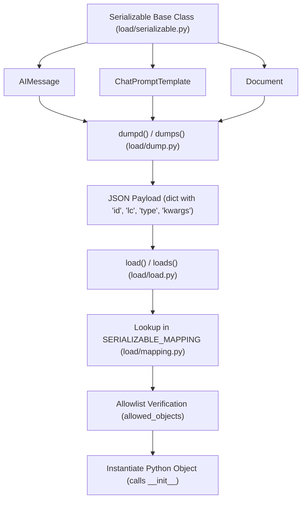
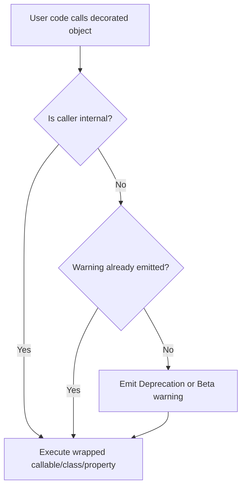
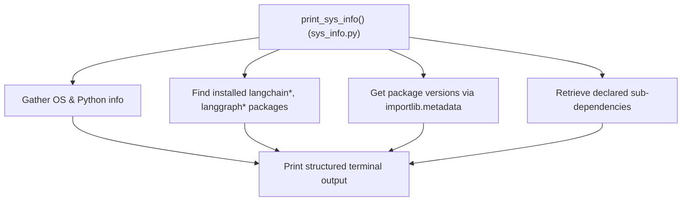

<!-- source: DeepWiki mcp.deepwiki.com · repo langchain-ai/langchain · page 2.9 Core Infrastructure: Serialization, Caches, Utils, Security · fetched 2026-10-26 -->

# Core Infrastructure: Serialization, Caches, Utils, Security

<details>
<summary>Relevant source files</summary>

The following files were used as context for generating this wiki page:

- [libs/core/langchain_core/_api/beta_decorator.py](libs/core/langchain_core/_api/beta_decorator.py)
- [libs/core/langchain_core/_api/deprecation.py](libs/core/langchain_core/_api/deprecation.py)
- [libs/core/langchain_core/_security/__init__.py](libs/core/langchain_core/_security/__init__.py)
- [libs/core/langchain_core/_security/_exceptions.py](libs/core/langchain_core/_security/_exceptions.py)
- [libs/core/langchain_core/_security/_policy.py](libs/core/langchain_core/_security/_policy.py)
- [libs/core/langchain_core/_security/_ssrf_protection.py](libs/core/langchain_core/_security/_ssrf_protection.py)
- [libs/core/langchain_core/_security/_transport.py](libs/core/langchain_core/_security/_transport.py)
- [libs/core/langchain_core/agents.py](libs/core/langchain_core/agents.py)
- [libs/core/langchain_core/caches.py](libs/core/langchain_core/caches.py)
- [libs/core/langchain_core/env.py](libs/core/langchain_core/env.py)
- [libs/core/langchain_core/exceptions.py](libs/core/langchain_core/exceptions.py)
- [libs/core/langchain_core/globals.py](libs/core/langchain_core/globals.py)
- [libs/core/langchain_core/load/dump.py](libs/core/langchain_core/load/dump.py)
- [libs/core/langchain_core/load/load.py](libs/core/langchain_core/load/load.py)
- [libs/core/langchain_core/load/mapping.py](libs/core/langchain_core/load/mapping.py)
- [libs/core/langchain_core/load/serializable.py](libs/core/langchain_core/load/serializable.py)
- [libs/core/langchain_core/prompt_values.py](libs/core/langchain_core/prompt_values.py)
- [libs/core/langchain_core/prompts/structured.py](libs/core/langchain_core/prompts/structured.py)
- [libs/core/langchain_core/stores.py](libs/core/langchain_core/stores.py)
- [libs/core/langchain_core/sys_info.py](libs/core/langchain_core/sys_info.py)
- [libs/core/langchain_core/utils/__init__.py](libs/core/langchain_core/utils/__init__.py)
- [libs/core/langchain_core/utils/aiter.py](libs/core/langchain_core/utils/aiter.py)
- [libs/core/langchain_core/utils/iter.py](libs/core/langchain_core/utils/iter.py)
- [libs/core/langchain_core/utils/json.py](libs/core/langchain_core/utils/json.py)
- [libs/core/langchain_core/utils/json_schema.py](libs/core/langchain_core/utils/json_schema.py)
- [libs/core/langchain_core/utils/strings.py](libs/core/langchain_core/utils/strings.py)
- [libs/core/langchain_core/utils/utils.py](libs/core/langchain_core/utils/utils.py)
- [libs/core/tests/unit_tests/_api/test_beta_decorator.py](libs/core/tests/unit_tests/_api/test_beta_decorator.py)
- [libs/core/tests/unit_tests/_api/test_deprecation.py](libs/core/tests/unit_tests/_api/test_deprecation.py)
- [libs/core/tests/unit_tests/load/test_serializable.py](libs/core/tests/unit_tests/load/test_serializable.py)
- [libs/core/tests/unit_tests/prompts/test_structured.py](libs/core/tests/unit_tests/prompts/test_structured.py)
- [libs/core/tests/unit_tests/test_ssrf_policy_transport.py](libs/core/tests/unit_tests/test_ssrf_policy_transport.py)
- [libs/core/tests/unit_tests/test_ssrf_protection.py](libs/core/tests/unit_tests/test_ssrf_protection.py)
- [libs/core/tests/unit_tests/utils/test_aiter.py](libs/core/tests/unit_tests/utils/test_aiter.py)
- [libs/core/tests/unit_tests/utils/test_imports.py](libs/core/tests/unit_tests/utils/test_imports.py)
- [libs/core/tests/unit_tests/utils/test_iter.py](libs/core/tests/unit_tests/utils/test_iter.py)
- [libs/core/tests/unit_tests/utils/test_json_schema.py](libs/core/tests/unit_tests/utils/test_json_schema.py)
- [libs/core/tests/unit_tests/utils/test_strings.py](libs/core/tests/unit_tests/utils/test_strings.py)
- [libs/core/tests/unit_tests/utils/test_utils.py](libs/core/tests/unit_tests/utils/test_utils.py)
- [libs/langchain/langchain_classic/evaluation/schema.py](libs/langchain/langchain_classic/evaluation/schema.py)
- [libs/langchain/langchain_classic/storage/file_system.py](libs/langchain/langchain_classic/storage/file_system.py)
- [libs/langchain/tests/integration_tests/conftest.py](libs/langchain/tests/integration_tests/conftest.py)
- [libs/langchain/tests/unit_tests/embeddings/test_caching.py](libs/langchain/tests/unit_tests/embeddings/test_caching.py)
- [libs/langchain/tests/unit_tests/storage/test_filesystem.py](libs/langchain/tests/unit_tests/storage/test_filesystem.py)

</details>


This page details the foundational infrastructure components implemented in the `langchain_core` library, which support critical system functionalities including serialization and deserialization of LangChain objects, caching mechanisms, utility helpers, API lifecycle decorators, security mitigations against SSRF attacks, and system environment introspection tools.

---

## 1. Serialization and Deserialization Architecture

LangChain objects serialize to and deserialize from structured JSON using rigorously managed mappings, versioning, and allowlists to maintain backwards compatibility and enforce security constraints when loading potentially hostile input.

### 1.1 The `Serializable` Base Class

At the heart of LangChain serialization lies the abstract base class `Serializable`, extending Pydantic's `BaseModel`. To be serializable, a subclass must explicitly override `is_lc_serializable()` to `True`, preventing accidental exposure of arbitrary Python objects.

Each serialized object produces a dictionary with fields including:

- **`lc`**: Serialization format version (an integer).
- **`id`**: A list of strings that uniquely identify the class by its namespace path (e.g., `["langchain_core", "messages", "ai", "AIMessage"]`).
- **`type`**: Describes the serialization mode, such as `"constructor"` (normal), `"secret"` (masked secret value), or `"not_implemented"` (stub).
- **`kwargs`** (optional): The dictionary of constructor arguments needed to reinstantiate the object.
- Additional fields like `repr` for `"not_implemented"` types.

This design imposes explicit serialization opt-in via `is_lc_serializable` and leverages Pydantic's model field introspection for kwargs extraction, including support for secret masking. These mechanics are implemented in [`libs/core/langchain_core/load/serializable.py:106-193`]().

### 1.2 Serialization Mapping and Namespace Compatibility

Classes in LangChain may relocate across packages or modules over time. To preserve deserialization compatibility, the `SERIALIZABLE_MAPPING` dictionary maps legacy serialization IDs (tuple of namespaces and class names) to their current Python import paths.

For example:

```python
("langchain", "schema", "messages", "AIMessage") -> ("langchain_core", "messages", "ai", "AIMessage")
```

This resolves deserialized objects' class locations dynamically, supporting cross-version loads. The mappings also cover legacy package names and their moved classes.

The mapping and resolution system is defined in [`libs/core/langchain_core/load/mapping.py:22-227`]().

### 1.3 The Loading Process and Security Considerations

Deserialization is executed via functions like `load()` or `loads()`. These:

- Validate that the serialized `'id'` is in an allowed set of classes, dictated by the `allowed_objects` parameter which may be:
  - Explicit lists of classes (most secure for untrusted input).
  - Named sets such as `'messages'` (safe chat messages only), `'core'` (default but broader and unsafe for untrusted manifests), or `'all'` (includes partner integrations; unsafe).
- Look up the runtime class location from `SERIALIZABLE_MAPPING`.
- Instantiate the class with the recorded `kwargs`, triggering `__init__` and validation.

Because deserialization calls constructors, side effects (network calls, file I/O) may be triggered if the class or its args permit it. This represents a significant security risk when loading data from untrusted sources. Of note:

- Custom endpoints configured in models may cause Server-Side Request Forgery (SSRF).
- Developers should avoid loading untrusted manifests or restrict `allowed_objects` accordingly.

Additionally, plain dictionaries containing an `'lc'` key are escaped during serialization by wrapping them with `{"__lc_escaped__": {...}}` to prevent them being interpreted as LC objects during deserialization.

These principles and implementations are described in detail in [`libs/core/langchain_core/load/load.py:1-166`]().

#### Serialization and Deserialization Data Flow Diagram



*Sources: [libs/core/langchain_core/load/serializable.py:106-193](), [libs/core/langchain_core/load/mapping.py:22-227](), [libs/core/langchain_core/load/load.py:1-166]()*


---

## 2. Caches and Key-Value Stores

Efficient reuse of expensive computations, especially LLM calls, requires caching and storage abstractions. `langchain_core` provides these at abstract and concrete levels.

### 2.1 Cache Interface and In-Memory Cache

The `BaseCache` abstract base class defines fundamental cache interfaces to support storing and retrieving generation results keyed by `(prompt, llm_string)` tuples.

Key methods:

- `lookup(prompt: str, llm_string: str) -> list[Generation] | None` — check cache for stored generations.
- `update(prompt: str, llm_string: str, return_val: list[Generation]) -> None` — add results to cache.
- Async versions `alookup` and `aupdate` calling synchronous defaults unless overridden.

The `InMemoryCache` implements an in-memory dictionary cache, storing generations keyed by prompt and model string. This cache is useful for ephemeral, testing, or simple use-cases.

Diagram - Cache Architecture:

```mermaid
flowchart TD
    BaseCache["BaseCache (caches.py)"]
    InMemoryCache["InMemoryCache (caches.py)"]
    alookup["alookup / lookup"]
    aupdate["aupdate / update"]
    MemoryDict["Internal memory dict storage"]

    BaseCache --> InMemoryCache
    InMemoryCache --> MemoryDict

    alookup --> BaseCache
    aupdate --> BaseCache

    alookup -->|results: seq[Generation] or None| Caller["Caller"]
    aupdate -->|store results| MemoryDict
```

*Sources: [libs/core/langchain_core/caches.py:32-175]()*


### 2.2 Key-Value Store Abstraction

The generic `BaseStore[str, V]` defines batch operations for key-value stores mapping strings to typed values:

- `mget(keys: Sequence[str]) -> Sequence[V | None]` — batch get values.
- `mset(keys: Sequence[str], values: Sequence[V]) -> None` — batch set values.
- `mdelete(keys: Sequence[str]) -> None` — batch delete keys.
- `yield_keys(prefix: str = "") -> Iterator[str]` — iterator over matching keys.
- `ayield_keys(prefix: str = "") -> AsyncIterator[str]` — async version.

`InMemoryBaseStore` is a threadsafe in-memory dictionary implementing these methods, enabling testing or ephemeral store usage.

*Sources: [libs/core/langchain_core/stores.py:26-197]()

---

## 3. Utility Functions and Pydantic Integrations

The `utils` module offers a suite of generic and Pydantic-aware helper functions:

- **Argument validation:** `xor_args` decorator validates that exactly one argument in each exclusive group is provided.
- **Version checking:** `check_package_version` compares installed package versions against bounds, raising errors for mismatches.
- **Dynamic guarded imports:** `guard_import` attempts to import modules gracefully, raising user-friendly errors if missing.
- **Testing utilities:** `mock_now` context manager mocks `datetime.datetime.now()` for deterministic tests.
- **Pydantic helpers:** Functions to get all Pydantic field names (including aliases) and to robustly check if a value differs from its default, avoiding side effects from default factories.
- **Secret value helpers:** Functions to unwrap secrets safely from environment variables.

This comprehensive utility toolbox is crucial for robust, error-tolerant code that interacts with external dependencies and complex Pydantic models [libs/core/langchain_core/utils/utils.py:1-208](), [libs/core/langchain_core/load/serializable.py:59-104]().

---

## 4. API Lifecycle Decorators: Deprecation and Beta Warnings

To enable smooth API evolution and inform users about unstable or deprecated features, LangChain includes decorators that emit runtime warnings.

### 4.1 `@deprecated` Decorator

Implemented in `_api/deprecation.py`, `deprecated()` marks functions, classes, methods, or properties as deprecated, optionally specifying:

- Since which version it's deprecated (`since`).
- Scheduled removal version (`removal`).
- Suggested alternative (`alternative` or `alternative_import`).
- Pending deprecation flag.
- Custom messages and object types.

It emits a user-visible `LangChainDeprecationWarning` on first usage (outside internal calls) and attaches a decorated docstring noting deprecation. The decorator supports sync/async callables, properties, static/class methods, and classes.

### 4.2 `@beta` Decorator

Similarly, `_api/beta_decorator.py` exposes a `beta()` decorator to mark API parts as beta, issuing a `LangChainBetaWarning` on first non-internal use.

### 4.3 Warning Emission Flow



This implementation prevents excessive warnings and ensures user clarity while avoiding noise from internal framework calls.

*Sources: [libs/core/langchain_core/_api/deprecation.py:120-185](), [libs/core/langchain_core/_api/beta_decorator.py:32-115]()*


---

## 5. Security: SSRF Protection and Policy Enforcement

LangChain integrates critical security modules in the `_security` namespace to mitigate Server-Side Request Forgery (SSRF) and related attacks. Key features include:

- **URL and IP validation policies:** Block requests to private, loopback, link-local, and reserved IP ranges to avoid internal network access.
- **Transport-layer wrappers:** Intercept outgoing network calls to enforce security checks transparently.
- **Custom exceptions:** Signal security violations in deserialization or model execution.

This complements deserialization allowlists to reduce attack surface from malicious serialized payloads or custom configured endpoints.

Tests validating SSRF protection reside in unit tests like `tests/unit_tests/test_ssrf_protection.py`.

---

## 6. System Information and Diagnostics

The `sys_info.py` module enables environment introspection useful for debugging installation and runtime issues. Features include:

- Enumerating installed packages starting with `langchain` and `langgraph` prefixes, as well as relevant related packages.
- Querying version numbers with `importlib.metadata`.
- Detecting sub-dependencies declared by these packages.
- Capturing OS and Python runtime information.
- Printing a neatly formatted summary of the above data on the terminal.

### Diagnostic Data Flow Diagram



*Sources: [libs/core/langchain_core/sys_info.py:1-135]()*


---

# Summary Table of Key Modules and Responsibilities

| Module / Class                                   | Responsibility                                                   |
| ------------------------------------------------|-----------------------------------------------------------------|
| `Serializable` [load/serializable.py]           | Base class for serializable LangChain objects                   |
| `SERIALIZABLE_MAPPING` [load/mapping.py]        | Maps legacy serialized IDs to current implementation namespaces |
| `load()` / `loads()` [load/load.py]              | Deserialize JSON to LC objects with allowlist security          |
| `dumpd()` / `dumps()` [load/dump.py]             | Serialize LC objects to JSON                                     |
| `BaseCache`, `InMemoryCache` [caches.py]        | Caching interface and in-memory implementation for model results |
| `BaseStore`, `InMemoryBaseStore` [stores.py]    | Abstract and in-memory key-value store abstractions             |
| `@deprecated`, `@beta` decorators [deprecation.py, beta_decorator.py] | API lifecycle decorators with user warnings                      |
| `_security` modules                              | SSRF protection policies and transport enforcement              |
| `sys_info.py`                                    | Environment and package diagnostics printing                     |
| `utils/utils.py`                                 | Common utilities including import guards, version checks, Pydantic helpers |

---

This core infrastructure underpins LangChain's reliable, extensible, and secure operation by enabling end-to-end faithful serialization, efficient caching, robust API management, and critical runtime diagnostics.

# End of 2.9 Core Infrastructure Wiki Page

---

