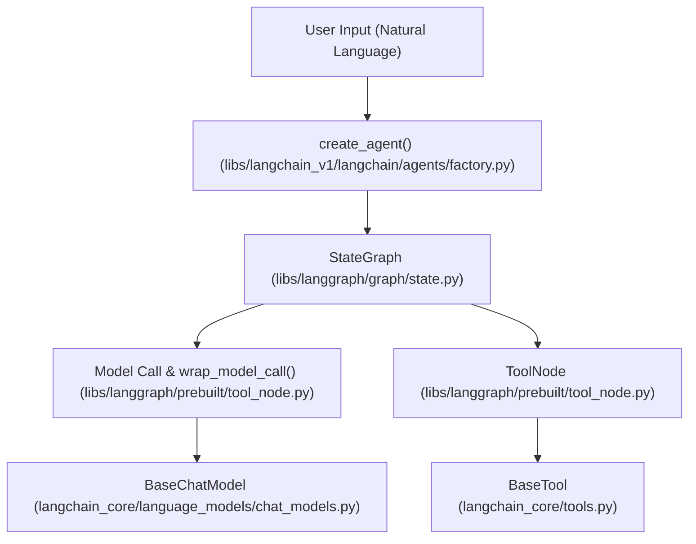
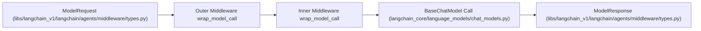
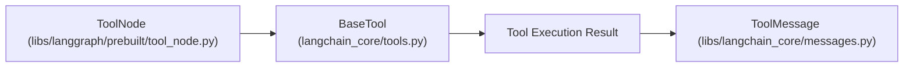
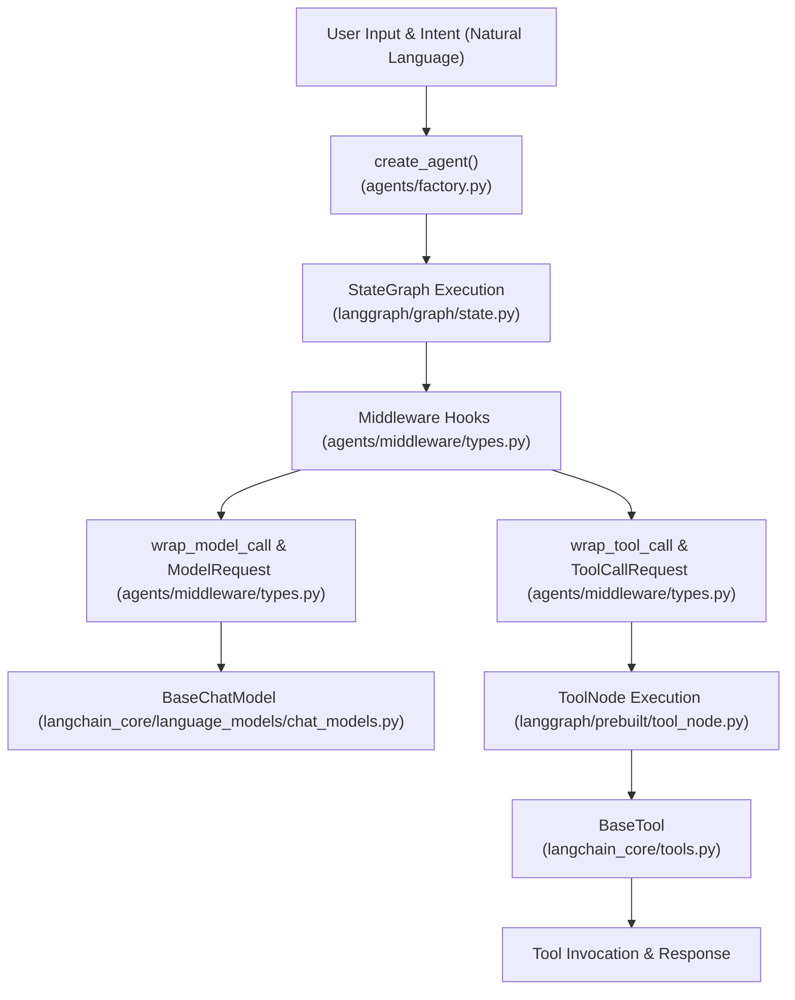
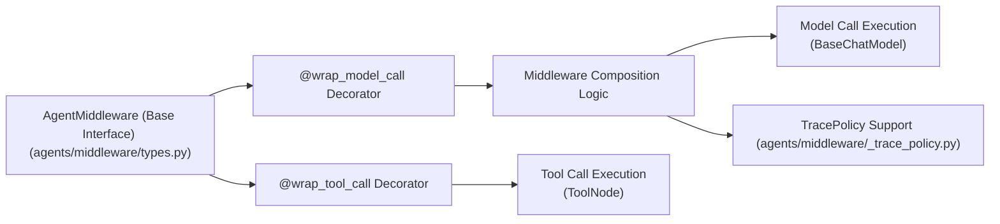

<!-- source: DeepWiki mcp.deepwiki.com · repo langchain-ai/langchain · page 3 langchain v1: Agents and Middleware · fetched 2026-10-26 -->

# langchain v1: Agents and Middleware

Relevant source files

The following files were used as context for generating this wiki page:

- [libs/langchain_v1/langchain/agents/__init__.py](libs/langchain_v1/langchain/agents/__init__.py)
- [libs/langchain_v1/langchain/agents/factory.py](libs/langchain_v1/langchain/agents/factory.py)
- [libs/langchain_v1/langchain/agents/middleware/__init__.py](libs/langchain_v1/langchain/agents/middleware/__init__.py)
- [libs/langchain_v1/langchain/agents/middleware/context_editing.py](libs/langchain_v1/langchain/agents/middleware/context_editing.py)
- [libs/langchain_v1/langchain/agents/middleware/todo.py](libs/langchain_v1/langchain/agents/middleware/todo.py)
- [libs/langchain_v1/langchain/agents/middleware/tool_selection.py](libs/langchain_v1/langchain/agents/middleware/tool_selection.py)
- [libs/langchain_v1/langchain/agents/middleware/types.py](libs/langchain_v1/langchain/agents/middleware/types.py)
- [libs/langchain_v1/langchain/agents/structured_output.py](libs/langchain_v1/langchain/agents/structured_output.py)
- [libs/langchain_v1/tests/unit_tests/agents/model.py](libs/langchain_v1/tests/unit_tests/agents/model.py)
- [libs/langchain_v1/tests/unit_tests/agents/test_react_agent.py](libs/langchain_v1/tests/unit_tests/agents/test_react_agent.py)
- [libs/langchain_v1/tests/unit_tests/agents/test_response_format.py](libs/langchain_v1/tests/unit_tests/agents/test_response_format.py)

Purpose and Scope: This page provides an overview of the `langchain_v1` package (`libs/langchain_v1/`), which introduces a modern, LangGraph-backed agent execution engine. It covers the `create_agent` factory, the composable middleware framework, structured output handling, and unified model/embedding initialization.

As a parent page, this document offers a high-level architectural view. For deep technical details, implementation specifics, and advanced configurations, refer to the following child pages:
- [Agent Factory and Structured Output](#3.1)
- [Middleware Framework](#3.2)
- [Tool Node and Model/Embedding Initialization](#3.3)

---

## Architecture Overview

The `langchain_v1` package bridges high-level agent orchestrations with robust state graph execution primitives provided by `langgraph`. The core entry point is `create_agent`, which compiles a state graph containing model request handling, middleware interceptors, and tool execution nodes.

This diagram highlights how natural language input flows through the `create_agent` factory to build a `StateGraph`. The StateGraph orchestrates calls to the language model and executes tools via nodes, integrating middleware interceptors throughout the execution flow.

*Sources: libs/langchain_v1/langchain/agents/factory.py:30-36(), libs/langchain_v1/langchain/agents/middleware/types.py:20-30()*

---

## 3.1. Agent Factory and Structured Output

The `create_agent` factory function is the primary interface for creating agents with middleware support. It compiles a `StateGraph` that manages the interaction between the chat model and multiple tools, maintaining conversation state and handling runtime context like checkpointers and stores.

Structured output support is a key feature. By specifying a `response_format`, users can enforce strong validation and structured parsing of model outputs into target schemas such as Pydantic models, dataclasses, TypedDicts, or JSON schemas.

Under the hood, the factory adapts the model and tools to either use provider-native structured output (for models that support it) or a tool-calling strategy where structured output is handled as tool calls validated against the provided schema. This ensures consistent, type-safe agent responses.

The factory also supports runtime injection configurations and an option for `return_direct` responses for quicker results bypassing some output wrapping.

For an in-depth guide on graph construction, agent state schema, response formats, runtime injection, and direct return modes, see the child page: [Agent Factory and Structured Output](#3.1).

*Sources: libs/langchain_v1/langchain/agents/factory.py:1-72(), libs/langchain_v1/langchain/agents/structured_output.py:29-104(), libs/langgraph/prebuilt/tool_node.py:34-36()*

---

## 3.2. Middleware Framework

The `langchain_v1` middleware system allows modular extension and interception of agent behavior at both the model call and tool call stages. Middleware components subclass `AgentMiddleware` and register hooks using decorators such as `wrap_model_call` and `wrap_tool_call`. These hooks intercept calls, allowing transformations, augmentations, retries, error handling, and more.

This illustrates the middleware call stack wrapping the main model invocation. Similar stack composition applies for tool call interception.

Several middleware implementations provide sophisticated agent capabilities, including:
- Context summarization and pruning (`SummarizationMiddleware`)
- Task planning and management (`TodoListMiddleware`)
- Dynamic tool selection via LLMs (`LLMToolSelectorMiddleware`)
- Model fallback strategies (`ModelFallbackMiddleware`)
- Personally Identifiable Information (PII) detection and redaction (`PIIMiddleware`)

The framework supports composing these middleware layers, configuring their behavior, and managing trace policies for observability.

For detailed documentation on middleware types, hook configurations, specializations, composition patterns, and contextual state management, see [Middleware Framework](#3.2).

*Sources: libs/langchain_v1/langchain/agents/middleware/types.py:43-66(), libs/langchain_v1/langchain/agents/middleware/__init__.py:1-100(), libs/langchain_v1/langchain/agents/middleware/todo.py:1-144()*

---

## 3.3. Tool Node and Model/Embedding Initialization

Within the compiled agent execution graph, tools are represented as `ToolNode` instances. These nodes handle execution semantics including argument injection, async dispatch, tool call lifecycle management, and error transformation into structured `ToolMessage` objects. This enables seamless integration of tools into the message-based agent interactions.

In parallel, `langchain_v1` unifies model and embedding initialization via functions like `init_chat_model` and `init_embeddings`. These factory utilities abstract over underlying providers and configurations, harmonizing model instantiation across OpenAI, Anthropic, and other supported platforms. This consistent initialization enables easier middleware and agent integration.

For comprehensive implementation details on tool node semantics and unified initialization utilities, see [Tool Node and Model/Embedding Initialization](#3.3).

*Sources: libs/langchain_v1/langchain/agents/factory.py:71-72(), libs/langchain_v1/langchain/agents/middleware/todo.py:1-23(), libs/langgraph/prebuilt/tool_node.py:29-35()*

---

### Summary Table of Main Concepts

| Component                 | Role and Description                                                                                  | Code References                                |
|---------------------------|-----------------------------------------------------------------------------------------------------|-----------------------------------------------|
| `create_agent`            | Factory to create agents; builds StateGraph with integrated middleware and tool nodes.               | `agents/factory.py`                            |
| `StateGraph`              | Graph execution engine managing states, transitions, and runnable components like models/tools.      | `langgraph/graph/state.py`                     |
| `AgentMiddleware`         | Base class and hook decorators for intercepting model and tool calls; composable middleware layers. | `agents/middleware/types.py`                   |
| `ToolNode`                | Node representing tool execution including argument injection and error handling.                    | `langgraph/prebuilt/tool_node.py`              |
| `init_chat_model`         | Unified factory function initializing chat models with provider configuration abstractions.          | `langchain_v1/langchain/chat_models/__init__.py` (implied) |
| Structured Output Support | Enables validation and parsing of model outputs into schemas (Pydantic, dataclasses, TypedDicts).   | `agents/structured_output.py`                  |

---

For more detailed information, refer to the respective child pages covering each core area:

- [Agent Factory and Structured Output](#3.1)
- [Middleware Framework](#3.2)
- [Tool Node and Model/Embedding Initialization](#3.3)

---

# Bridging Natural Language Space to Code Entities

This diagram maps key system concepts in the natural language processing domain and shows the corresponding code entities that implement them within `langchain_v1`:

This flow shows how user natural language input triggers the agent factory, which builds a graph that facilitates both language model calls and tool calls wrapped by middleware layers. Those nodes invoke the actual chat models and tools implemented in the core LangChain packages.

---

# Bridging Middleware Concepts to Implementation

This visualization clarifies how middleware interfaces use the `wrap_model_call` and `wrap_tool_call` decorators to intercept calls, apply transformations, and compose multiple middleware layers around the core model and tool execution.

---

# Summary

`langchain_v1` represents a modern, extensible approach to building agents powered by state graph execution and middleware. The unified `create_agent` factory simplifies agent setup while enabling rich structured output parsing and flexible runtime injection. The middleware system provides powerful interception points for runtime behaviors, safety, editing, and tool orchestration. Finally, integrated tool node execution and consistent model/embedding initialization unify the agent execution landscape under a coherent, graph-based paradigm.

For detailed guidance on each feature, consult the child pages linked above.

---

*Sources:*

- libs/langchain_v1/langchain/agents/factory.py:1-190  
- libs/langchain_v1/langchain/agents/middleware/types.py:43-66  
- libs/langchain_v1/langchain/agents/middleware/__init__.py:1-100  
- libs/langchain_v1/langchain/agents/structured_output.py:29-104  
- libs/langgraph/prebuilt/tool_node.py:29-36  
- libs/langchain_v1/langchain/agents/middleware/todo.py:1-144

---

