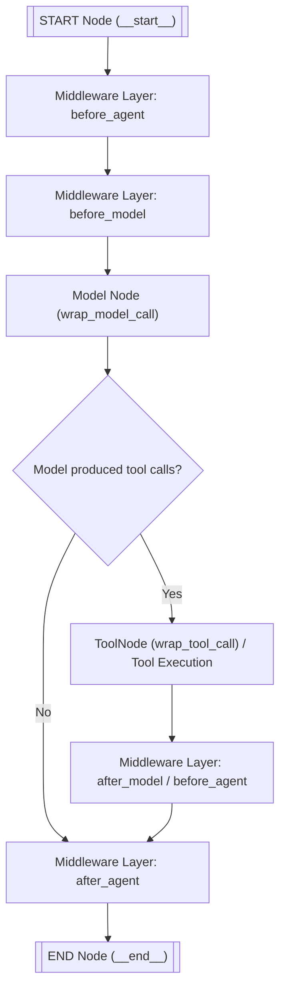
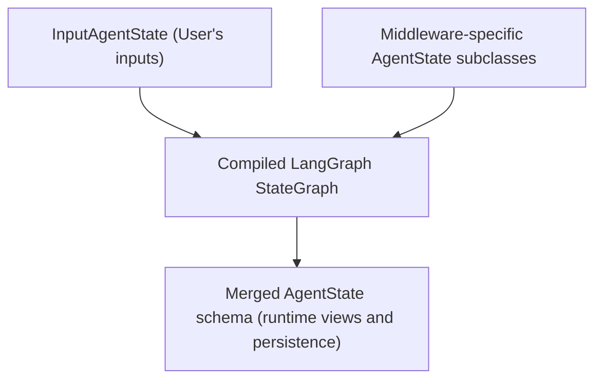
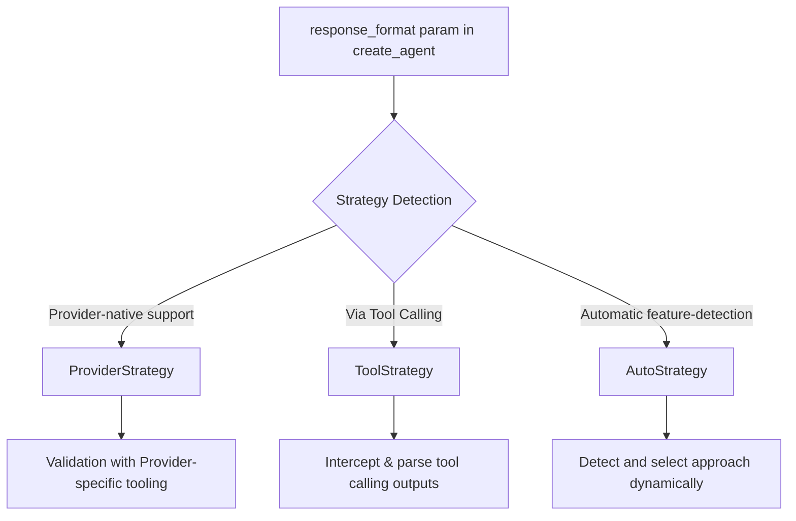
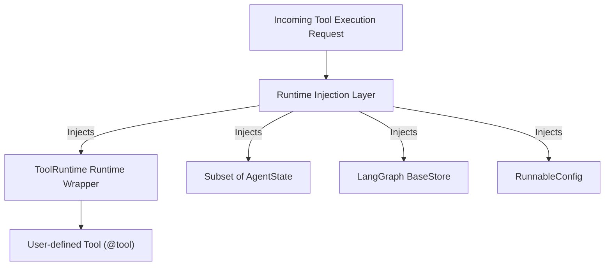

<!-- source: DeepWiki mcp.deepwiki.com · repo langchain-ai/langchain · page 3.1 Agent Factory and Structured Output · fetched 2026-10-26 -->

# Agent Factory and Structured Output

Relevant source files

The following files were used as context for generating this wiki page:

- [libs/langchain_v1/langchain/agents/factory.py](libs/langchain_v1/langchain/agents/factory.py)
- [libs/langchain_v1/langchain/agents/middleware/__init__.py](libs/langchain_v1/langchain/agents/middleware/__init__.py)
- [libs/langchain_v1/langchain/agents/middleware/context_editing.py](libs/langchain_v1/langchain/agents/middleware/context_editing.py)
- [libs/langchain_v1/langchain/agents/middleware/todo.py](libs/langchain_v1/langchain/agents/middleware/todo.py)
- [libs/langchain_v1/langchain/agents/middleware/tool_selection.py](libs/langchain_v1/langchain/agents/middleware/tool_selection.py)
- [libs/langchain_v1/langchain/agents/middleware/types.py](libs/langchain_v1/langchain/agents/middleware/types.py)
- [libs/langchain_v1/langchain/agents/structured_output.py](libs/langchain_v1/langchain/agents/structured_output.py)
- [libs/langchain_v1/tests/cassettes/test_inference_to_native_output[False].yaml.gz](libs/langchain_v1/tests/cassettes/test_inference_to_native_output[False].yaml.gz)
- [libs/langchain_v1/tests/cassettes/test_inference_to_native_output[True].yaml.gz](libs/langchain_v1/tests/cassettes/test_inference_to_native_output[True].yaml.gz)
- [libs/langchain_v1/tests/cassettes/test_inference_to_tool_output[False].yaml.gz](libs/langchain_v1/tests/cassettes/test_inference_to_tool_output[False].yaml.gz)
- [libs/langchain_v1/tests/cassettes/test_inference_to_tool_output[True].yaml.gz](libs/langchain_v1/tests/cassettes/test_inference_to_tool_output[True].yaml.gz)
- [libs/langchain_v1/tests/cassettes/test_strict_mode[False].yaml.gz](libs/langchain_v1/tests/cassettes/test_strict_mode[False].yaml.gz)
- [libs/langchain_v1/tests/cassettes/test_strict_mode[True].yaml.gz](libs/langchain_v1/tests/cassettes/test_strict_mode[True].yaml.gz)
- [libs/langchain_v1/tests/unit_tests/agents/__snapshots__/test_middleware_agent.ambr](libs/langchain_v1/tests/unit_tests/agents/__snapshots__/test_middleware_agent.ambr)
- [libs/langchain_v1/tests/unit_tests/agents/__snapshots__/test_middleware_decorators.ambr](libs/langchain_v1/tests/unit_tests/agents/__snapshots__/test_middleware_decorators.ambr)
- [libs/langchain_v1/tests/unit_tests/agents/__snapshots__/test_return_direct_graph.ambr](libs/langchain_v1/tests/unit_tests/agents/__snapshots__/test_return_direct_graph.ambr)
- [libs/langchain_v1/tests/unit_tests/agents/test_agent_name.py](libs/langchain_v1/tests/unit_tests/agents/test_agent_name.py)
- [libs/langchain_v1/tests/unit_tests/agents/test_create_agent_tool_validation.py](libs/langchain_v1/tests/unit_tests/agents/test_create_agent_tool_validation.py)
- [libs/langchain_v1/tests/unit_tests/agents/test_fetch_last_ai_and_tool_messages.py](libs/langchain_v1/tests/unit_tests/agents/test_fetch_last_ai_and_tool_messages.py)
- [libs/langchain_v1/tests/unit_tests/agents/test_injected_runtime_create_agent.py](libs/langchain_v1/tests/unit_tests/agents/test_injected_runtime_create_agent.py)
- [libs/langchain_v1/tests/unit_tests/agents/test_kwargs_tool_runtime_injection.py](libs/langchain_v1/tests/unit_tests/agents/test_kwargs_tool_runtime_injection.py)
- [libs/langchain_v1/tests/unit_tests/agents/test_response_format.py](libs/langchain_v1/tests/unit_tests/agents/test_response_format.py)
- [libs/langchain_v1/tests/unit_tests/agents/test_response_format_integration.py](libs/langchain_v1/tests/unit_tests/agents/test_response_format_integration.py)
- [libs/langchain_v1/tests/unit_tests/agents/test_responses_spec.py](libs/langchain_v1/tests/unit_tests/agents/test_responses_spec.py)
- [libs/langchain_v1/tests/unit_tests/agents/test_return_direct_graph.py](libs/langchain_v1/tests/unit_tests/agents/test_return_direct_graph.py)
- [libs/langchain_v1/tests/unit_tests/agents/test_return_direct_spec.py](libs/langchain_v1/tests/unit_tests/agents/test_return_direct_spec.py)
- [libs/langchain_v1/tests/unit_tests/agents/test_state_schema.py](libs/langchain_v1/tests/unit_tests/agents/test_state_schema.py)
- [libs/langchain_v1/tests/unit_tests/agents/test_subagent_streaming.py](libs/langchain_v1/tests/unit_tests/agents/test_subagent_streaming.py)
- [libs/langchain_v1/tests/unit_tests/agents/test_system_message.py](libs/langchain_v1/tests/unit_tests/agents/test_system_message.py)
- [libs/langchain_v1/tests/unit_tests/agents/utils.py](libs/langchain_v1/tests/unit_tests/agents/utils.py)

## Purpose and Scope

This page provides a detailed technical overview of the agent construction and structured output handling in the `langchain_v1` package, focusing on:

- The `create_agent` factory function and its LangGraph-based execution graph construction.
- The design and extension of agent state via typed schemas (`AgentState`, `InputAgentState`).
- Structured output handling with typed response formats and validation strategies.
- Runtime injection that allows tools to access contextual runtime data transparently.
- The semantics and workflow of `return_direct` tools for short-circuiting agent execution.

The explanations herein reference the implementation primarily in `libs/langchain_v1/langchain/agents/factory.py` along with middleware types and structured output modules.

---

## `create_agent` Graph Construction and Architecture

`create_agent` constructs an agent by building a LangGraph `StateGraph` that encodes agent execution steps, including middleware hooks, model calls, and tool invocations.

### Composition of the Agent Execution Graph

- **Start node (__start__)**: Entry point of the graph.
- **Middleware Hook Nodes**:
  - `before_agent`
  - `before_model`
  - `after_model`
  - `after_agent`
  
  These represent layers of middleware hooks that run before/after the model and agent steps.
  
- **Model Node**:
  
  The core LLM call wrapped by the middleware stack's `wrap_model_call`.
  
- **Check for Tool Calls**:
  
  A conditional node inspects if the model response contains tool calls.
  
- **Tool Node (ToolNode)**:
  
  Executes the tool calls emitted by the model, wrapped by the tool middleware's `wrap_tool_call`.

- **End node (__end__)**: Terminates the execution.

### Data Flow and Execution Semantics

1. The agent starts at the `START` node.
2. The `before_agent` middleware run.
3. Then `before_model` middleware run.
4. The main model node executes, producing an output that may contain tool calls.
5. A decision routes the flow:
   - If tool calls exist, the tool node executes each tool call, wrapped by middleware.
   - If no tool calls, flow continues to `after_agent`.
6. After tool execution, `after_model` middleware run.
7. Finally, `after_agent` middleware run, concluding at the `END` node.

This layered middleware composition allows interception and augmentation of calls.

### Diagram: `create_agent` Execution Graph Structure

Sources:  
- `libs/langchain_v1/langchain/agents/factory.py:30-72()`  
- `libs/langchain_v1/tests/unit_tests/agents/__snapshots__/test_middleware_agent.ambr:9-24()`  

---

## State Schemas and Extension (`AgentState`, `InputAgentState`, `state_schema`)

Agents carry state across executions, usually representing conversations or task tracking. This state is modeled as a typed dictionary subclass (`AgentState`) which can be extended by users or middleware.

### Key Concepts

- **`AgentState`**: The comprehensive agent state including conversation messages and metadata.
- **`InputAgentState`**: Input-bound schema subclass for agent invocation inputs (e.g., user messages).
- **`state_schema` argument to `create_agent`**: Lets users provide custom subclasses extending agent state with new fields.

### Benefits and Usage

- Durable, typed fields for user and middleware data.
- Strongly typed state enables validation and clear data access in tools and middleware.
- Middleware can merge their own state requirements with user `state_schema`.

### Diagram: State Schemas and Schema Merging

### Classes and Files

| Concept          | Purpose                                | Module & Lines                             |
|------------------|--------------------------------------|-------------------------------------------|
| `AgentState`      | Default agent mutable state           | `langchain.agents.middleware.types.py:87-194` |
| `InputAgentState` | Schema for invocation input            | Same as above                             |
| `state_schema`    | User-defined or extended schema       | Used in `create_agent()`                  |

Sources:  
- `libs/langchain_v1/langchain/agents/middleware/types.py:87-194()`  
- `libs/langchain_v1/tests/unit_tests/agents/test_state_schema.py:38-130()`  

---

## Structured Output and Response Formats (`response_format`, `ToolStrategy`, `ProviderStrategy`, `AutoStrategy`)

`create_agent` accepts a `response_format` parameter allowing developers to define structured response schemas for the agent output. This enforces strong typing and validation on model or tool outputs, supporting types such as:

- Pydantic models.
- Python dataclasses.
- TypedDicts.
- Raw JSON schema dictionaries.

### Strategies for Structured Output

The response format determines how model output is parsed and validated via different strategies:

- **`ProviderStrategy`**: Uses provider-native structured output support if available.
- **`ToolStrategy`**: Treats the response format as a tool schema, intercepting tool calls to parse output.
- **`AutoStrategy`**: Automatically decides between provider-native or tool-calling based on model profile or fallback regexes.

### Strategy Selection Diagram

### Exceptions for structured output errors

- `MultipleStructuredOutputsError` if the model returns multiple structured tool calls but only one expected.
- `StructuredOutputValidationError` for failures parsing tool call arguments against the schema.

### Core Types and Files

| Class / Concept      | Description                                             | Module & Lines                         |
|---------------------|---------------------------------------------------------|---------------------------------------|
| `ResponseFormat`    | Abstract encapsulation of schema and validation         | `langchain.agents.structured_output.py:66-70` |
| `ToolStrategy`      | Treats response as tool call with schema parsing        | `langchain.agents.structured_output.py:196-205` |
| `ProviderStrategy`  | Provider-native structured output validation             | `langchain.agents.structured_output.py:64-67`  |
| `AutoStrategy`      | Dynamic strategy selector                                  | `langchain.agents.factory.py:182-190`             |

Sources:  
- `libs/langchain_v1/langchain/agents/structured_output.py:1-472()`  
- `libs/langchain_v1/langchain/agents/factory.py:182-190()`  
- `libs/langchain_v1/tests/unit_tests/agents/test_response_format.py:1-205()`  

---

## Runtime Injection (`ToolRuntime`, `InjectedState`, `InjectedStore`)

### Overview

Agent tools decorated with `@tool` may require access to contextual runtime information like:

- Current agent state (messages, metadata).
- Tool call ID.
- Runtime context.
- Persistent store handles.
- Streaming output handlers.
- Current Runnable execution config.

Instead of manually passing these parameters, `create_agent` supports **runtime injection** of such context into tool function parameters automatically.

### Injection Workflow Diagram

### Key Classes

| Concept          | Purpose                                                    | Reference                                    |
|------------------|------------------------------------------------------------|----------------------------------------------|
| `ToolRuntime`    | Wrapper object exposing `.state`, `.tool_call_id`, `.config`, `.context`, `.store`, `.stream_writer` to tools | `libs/langchain_v1/tests/unit_tests/agents/test_injected_runtime_create_agent.py:36-83` |
| `InjectedState`  | Type for tool args to receive filtered or full agent state  | Same as above                               |
| `InjectedStore`  | Annotated parameter type to inject persistent store         | Same as above                               |

This automatic injection supports both sync and async tools gracefully, templating rich interaction with runtime state without verbose parameter passing.

Sources:  
- `libs/langchain_v1/tests/unit_tests/agents/test_injected_runtime_create_agent.py:1-183()`  

---

## `return_direct` and Specialized Execution Semantics

`return_direct` is a flag that can be set on tools to short-circuit the normal agent reasoning loop:

- When a `return_direct=True` tool is executed, its output is immediately returned as the agent response.
- This bypasses any further model calls, tool executions, or middleware after the tool completes.
- Used for final answer extraction or actions that do not require further reasoning.

### Implementation Notes

- During graph construction, tools marked `return_direct=True` alter the control flow.
- The agent execution halts and returns the tool result instantly.
- The graph and middleware coordinations respect this to optimize response time and resource usage.

Sources:  
- `libs/langchain_v1/tests/unit_tests/agents/test_return_direct_spec.py:1-50()`  

---

# Summary

This page detailed the inner workings of `create_agent` in `langchain_v1`:

- How the LangGraph state graph orchestrates middleware hooks, model calls, and tool execution.
- Using typed `AgentState` schemas to capture and extend agent execution state.
- Structured output strategies (`ToolStrategy`, `ProviderStrategy`, `AutoStrategy`) to type and validate model/tool responses.
- Runtime injection to seamlessly supply contextual data to tools during execution.
- The `return_direct` feature enabling immediate agent response return from certain tool calls.

This layered design offers flexible, type-safe, and extensible agent workflows with rich middleware and tool integration.

---

# Diagrams Recap

## Diagram 1: `create_agent` Execution Graph Structure

## Diagram 2: State Schemas and Schema Merging

## Diagram 3: Response Format Strategy Resolution

## Diagram 4: Runtime Injection for Tools

---

# References

- `libs/langchain_v1/langchain/agents/factory.py`  
- `libs/langchain_v1/langchain/agents/middleware/types.py`  
- `libs/langchain_v1/langchain/agents/structured_output.py`  
- `libs/langchain_v1/tests/unit_tests/agents/test_response_format.py`  
- `libs/langchain_v1/tests/unit_tests/agents/test_state_schema.py`  
- `libs/langchain_v1/tests/unit_tests/agents/test_injected_runtime_create_agent.py`  
- `libs/langchain_v1/tests/unit_tests/agents/test_return_direct_spec.py`

---

