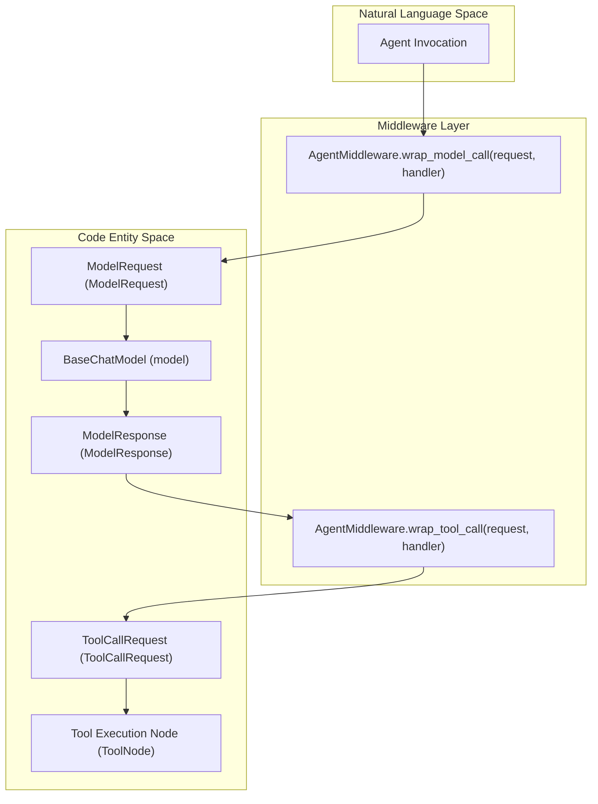
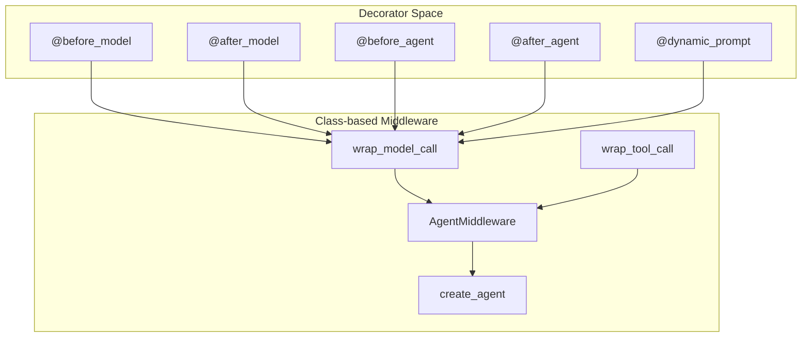

<!-- source: DeepWiki mcp.deepwiki.com · repo langchain-ai/langchain · page 3.2 Middleware Framework · fetched 2026-10-26 -->

# Middleware Framework

Relevant source files

The following files were used as context for generating this wiki page:

- [libs/langchain_v1/langchain/agents/factory.py](libs/langchain_v1/langchain/agents/factory.py)
- [libs/langchain_v1/langchain/agents/middleware/__init__.py](libs/langchain_v1/langchain/agents/middleware/__init__.py)
- [libs/langchain_v1/langchain/agents/middleware/context_editing.py](libs/langchain_v1/langchain/agents/middleware/context_editing.py)
- [libs/langchain_v1/langchain/agents/middleware/model_fallback.py](libs/langchain_v1/langchain/agents/middleware/model_fallback.py)
- [libs/langchain_v1/langchain/agents/middleware/todo.py](libs/langchain_v1/langchain/agents/middleware/todo.py)
- [libs/langchain_v1/langchain/agents/middleware/tool_selection.py](libs/langchain_v1/langchain/agents/middleware/tool_selection.py)
- [libs/langchain_v1/langchain/agents/middleware/types.py](libs/langchain_v1/langchain/agents/middleware/types.py)
- [libs/langchain_v1/langchain/agents/structured_output.py](libs/langchain_v1/langchain/agents/structured_output.py)
- [libs/langchain_v1/tests/unit_tests/agents/any_str.py](libs/langchain_v1/tests/unit_tests/agents/any_str.py)
- [libs/langchain_v1/tests/unit_tests/agents/middleware/core/test_composition.py](libs/langchain_v1/tests/unit_tests/agents/middleware/core/test_composition.py)
- [libs/langchain_v1/tests/unit_tests/agents/middleware/core/test_decorators.py](libs/langchain_v1/tests/unit_tests/agents/middleware/core/test_decorators.py)
- [libs/langchain_v1/tests/unit_tests/agents/middleware/core/test_dynamic_tools.py](libs/langchain_v1/tests/unit_tests/agents/middleware/core/test_dynamic_tools.py)
- [libs/langchain_v1/tests/unit_tests/agents/middleware/core/test_framework.py](libs/langchain_v1/tests/unit_tests/agents/middleware/core/test_framework.py)
- [libs/langchain_v1/tests/unit_tests/agents/middleware/core/test_tools.py](libs/langchain_v1/tests/unit_tests/agents/middleware/core/test_tools.py)
- [libs/langchain_v1/tests/unit_tests/agents/middleware/core/test_wrap_model_call_state_update.py](libs/langchain_v1/tests/unit_tests/agents/middleware/core/test_wrap_model_call_state_update.py)
- [libs/langchain_v1/tests/unit_tests/agents/middleware/implementations/test_context_editing.py](libs/langchain_v1/tests/unit_tests/agents/middleware/implementations/test_context_editing.py)
- [libs/langchain_v1/tests/unit_tests/agents/middleware/implementations/test_model_fallback.py](libs/langchain_v1/tests/unit_tests/agents/middleware/implementations/test_model_fallback.py)
- [libs/langchain_v1/tests/unit_tests/agents/middleware/implementations/test_todo.py](libs/langchain_v1/tests/unit_tests/agents/middleware/implementations/test_todo.py)
- [libs/langchain_v1/tests/unit_tests/agents/test_response_format.py](libs/langchain_v1/tests/unit_tests/agents/test_response_format.py)
- [libs/langchain_v1/tests/unit_tests/agents/test_responses.py](libs/langchain_v1/tests/unit_tests/agents/test_responses.py)

## Purpose and Scope

The Middleware Framework in `langchain_v1` introduces a flexible, pluggable layer for intercepting and modifying agent executions built on the LangGraph runtime. This framework centers around the `AgentMiddleware` base type designed to allow custom extensions to agent behavior without deeply modifying the agent core logic [libs/langchain_v1/langchain/agents/factory.py:1-90](), [libs/langchain_v1/langchain/agents/middleware/types.py:1-66]().

Middleware can transform model requests, filter or emulate tool calls, enforce safety and retry policies, dynamically adjust agent context, and handle other cross-cutting concerns such as tool selection or context summarization.

This page presents a high-level overview of middleware types, core interceptor hooks (`wrap_model_call` and `wrap_tool_call`), middleware composition mechanics, and decorator utilities for middleware functions.

For concrete middleware implementations and detailed behaviors, see the dedicated child pages:

- [Context Management Middleware](#3.2.1) — Summarization, context editing, todo lists, tool selection, model fallback, and PII redaction.
- [Safety, Limits and Retry Middleware](#3.2.2) — Human-in-the-loop, shell execution policies, call limits, retries, and tool error handling.

Sources:  
- `libs/langchain_v1/langchain/agents/factory.py:1-90`  
- `libs/langchain_v1/langchain/agents/middleware/types.py:1-66`  
- `libs/langchain_v1/langchain/agents/middleware/__init__.py:1-50`  

---

## Middleware Types and Core Hooks

Middleware in LangChain agents acts as interceptors for two main kinds of operations:

- **Model calls**: Intercepting calls that send messages to and retrieve responses from chat or language models.
- **Tool calls**: Intercepting invocations of external or internal tools integrated with the agent.

### Key Middleware Hooks

- `wrap_model_call(request: ModelRequest, handler) -> ModelResponse | AIMessage | ExtendedModelResponse`

  Intercepts an outgoing model request encapsulated in a `ModelRequest` structure containing messages, available tools, system prompts, and options [libs/langchain_v1/langchain/agents/middleware/types.py:88-157](). Middleware can modify this request—such as injecting context, adjusting prompts, filtering tools—and then forward the call downstream by invoking `handler`. It can also modify or extend the model response.

- `wrap_tool_call(request: ToolCallRequest, handler) -> Any`

  Intercepts a tool execution request. Middleware may inspect, modify, emulate, or trace tool calls before forwarding to the actual tool executor [libs/langchain_v1/langchain/agents/middleware/types.py:27-60]().

Middleware layers are composed into ordered chains that wrap these calls, enabling an onion-like model of nested interception where each layer can pre- and post-process calls or responses.

*Figure 1: Flow from agent invocation through middleware hooks to model and tool code entities.*

Sources:  
- `libs/langchain_v1/langchain/agents/middleware/types.py:27-66, 88-157`  
- `libs/langchain_v1/langchain/agents/factory.py:74-123`  

---

## Middleware Composition and Decorators

### Middleware Composition

Multiple middleware instances attached to an agent compose into a layered stack. The innermost middleware runs first, with calls flowing outward through the chain [libs/langchain_v1/langchain/agents/factory.py:74-90](). Each middleware wraps the `wrap_model_call` and `wrap_tool_call` handlers of the next, allowing sequential transformation or augmentation of requests and responses.

Internally, compositions accumulate commands and side effects across middleware layers, allowing coordinated state updates and multiple cross-cutting concerns to coexist in modular fashion.

### Decorator Utilities

To simplify middleware creation, LangChain exposes decorators for function-based middleware components. These are alternative to full subclass implementations and allow concise injection of logic at specific points:

- `@before_model` and `@after_model`: Run logic before or after the core model call.
- `@before_agent` and `@after_agent`: Hooks at the boundaries of the agent invocation.
- `@dynamic_prompt`: For declarative prompt formatting before model calls.
- `@wrap_model_call` and `@wrap_tool_call`: Base decorators wrapping the full call lifecycle.

These decorators are composed under the hood into the same middleware chain applied by `create_agent` during agent construction.

*Figure 2: Relationship of decorators, middleware classes, and the agent factory.*

Sources:  
- `libs/langchain_v1/langchain/agents/factory.py:74-90`  
- `libs/langchain_v1/langchain/agents/middleware/types.py:58-65`  

---

## Child Page References

For detailed middleware implementations and usage patterns, consult the child pages:

### 3.2.1 Context Management Middleware

Focuses on handling agent context and tooling for better conversation management:

- **SummarizationMiddleware**: Compresses conversation histories to keep within token limits.
- **ContextEditingMiddleware**: Prunes or clears prior tool results to manage context size.
- **TodoListMiddleware**: Implements structured task planning and progress tracking within sessions.
- **LLMToolSelectorMiddleware**: Uses a helper LLM to dynamically choose relevant tools before model calls.
- **ModelFallbackMiddleware**: Provides fallback strategies for selecting alternative LLMs.
- **PIIMiddleware**: Detects and redacts personally identifiable information (PII).

See [Context Management Middleware](#3.2.1) for thorough descriptions and configuration options.

### 3.2.2 Safety, Limits and Retry Middleware

Ensures robust agent execution with safety controls and error handling:

- **HumanInTheLoopMiddleware**: Supports human interruption and intervention workflows.
- **ShellToolMiddleware**: Governs shell command execution with sandboxing and redaction policies.
- **ModelCallLimitMiddleware** and **ToolCallLimitMiddleware**: Enforce usage limits on model and tool calls.
- **ModelRetryMiddleware** and **ToolRetryMiddleware**: Automatically retry failed calls as configured.
- **ToolErrorMiddleware**: Captures and manages tool execution errors transparently.

For configuration patterns and safety guidelines, see [Safety, Limits and Retry Middleware](#3.2.2).

Sources:  
- `libs/langchain_v1/langchain/agents/middleware/__init__.py:1-50`  

---

# Summary

The Middleware Framework offers a modular interception layer for LangChain agents that can augment, transform, or gatekeep interactions with both language models and integrated tools. Core hooks `wrap_model_call` and `wrap_tool_call` enable full control over request and response flows. Flexible composition and decorator utilities facilitate building rich middleware pipelines for context management, safety, retry policies, and more.

Refer to the child pages for deep dives into specific middleware implementations and usage scenarios.

---

# References and Source Files

- Middleware core and types: `libs/langchain_v1/langchain/agents/middleware/types.py:1-66, 87-157`  
- Middleware entrypoint and exports: `libs/langchain_v1/langchain/agents/middleware/__init__.py:1-51`  
- Agent factory with middleware support: `libs/langchain_v1/langchain/agents/factory.py:1-90`

---

