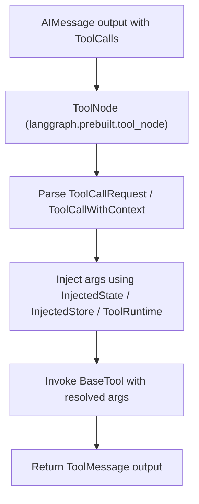
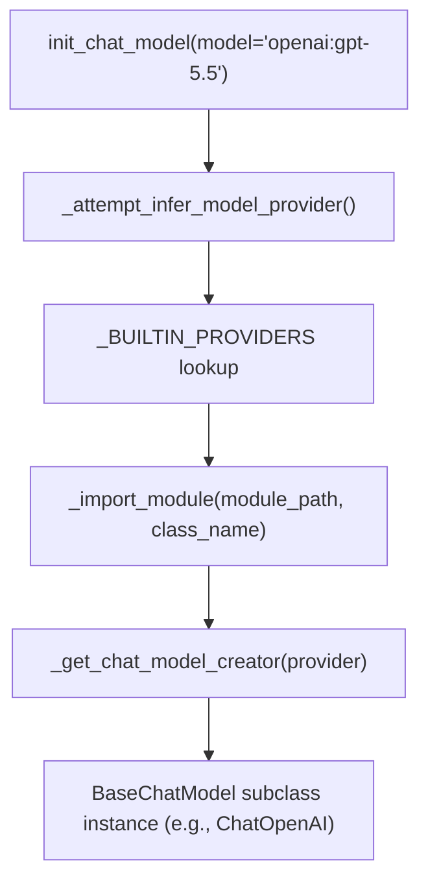
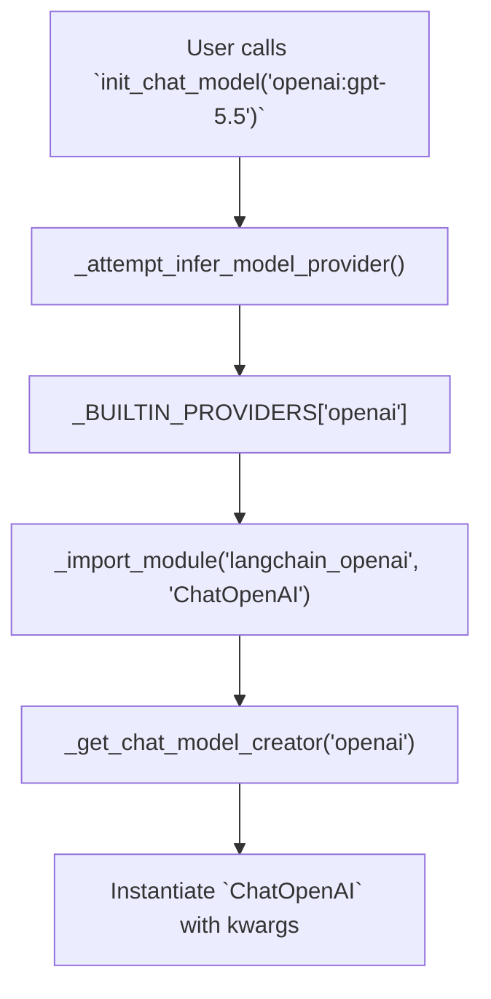
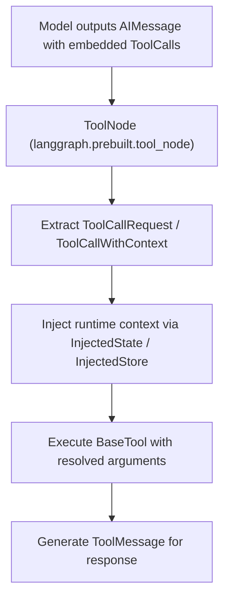

<!-- source: DeepWiki mcp.deepwiki.com · repo langchain-ai/langchain · page 3.3 Tool Node and Model/Embedding Initialization · fetched 2026-10-26 -->

# Tool Node and Model/Embedding Initialization

<details>
<summary>Relevant source files</summary>

The following files were used as context for generating this wiki page:

- [libs/langchain/langchain_classic/chat_models/base.py](libs/langchain/langchain_classic/chat_models/base.py)
- [libs/langchain/langchain_classic/embeddings/base.py](libs/langchain/langchain_classic/embeddings/base.py)
- [libs/langchain/tests/unit_tests/chat_models/test_base.py](libs/langchain/tests/unit_tests/chat_models/test_base.py)
- [libs/langchain_v1/langchain/chat_models/__init__.py](libs/langchain_v1/langchain/chat_models/__init__.py)
- [libs/langchain_v1/langchain/chat_models/base.py](libs/langchain_v1/langchain/chat_models/base.py)
- [libs/langchain_v1/langchain/embeddings/__init__.py](libs/langchain_v1/langchain/embeddings/__init__.py)
- [libs/langchain_v1/langchain/embeddings/base.py](libs/langchain_v1/langchain/embeddings/base.py)
- [libs/langchain_v1/langchain/tools/__init__.py](libs/langchain_v1/langchain/tools/__init__.py)
- [libs/langchain_v1/langchain/tools/tool_node.py](libs/langchain_v1/langchain/tools/tool_node.py)
- [libs/langchain_v1/tests/integration_tests/cache/fake_embeddings.py](libs/langchain_v1/tests/integration_tests/cache/fake_embeddings.py)
- [libs/langchain_v1/tests/integration_tests/embeddings/test_base.py](libs/langchain_v1/tests/integration_tests/embeddings/test_base.py)
- [libs/langchain_v1/tests/unit_tests/chat_models/test_chat_models.py](libs/langchain_v1/tests/unit_tests/chat_models/test_chat_models.py)
- [libs/langchain_v1/tests/unit_tests/embeddings/test_base.py](libs/langchain_v1/tests/unit_tests/embeddings/test_base.py)
- [libs/langchain_v1/tests/unit_tests/embeddings/test_imports.py](libs/langchain_v1/tests/unit_tests/embeddings/test_imports.py)
- [libs/langchain_v1/tests/unit_tests/tools/test_imports.py](libs/langchain_v1/tests/unit_tests/tools/test_imports.py)

</details>


## Purpose and Scope
This page provides a detailed technical examination of the tool node execution semantics and the initialization functions for chat models and embeddings in LangChain v1 (`libs/langchain_v1`) and the legacy classic package (`libs/langchain/langchain_classic`). It explains how LangGraph's tool execution nodes are wrapped and exposed by LangChain tools, how `init_chat_model` dynamically loads and instantiates chat models by parsing model strings and mapping providers to integration classes, and similarly how `init_embeddings` instantiates vector embedding models. The documentation covers internal registries, dynamic import patterns, factory functions, and relevant runtime data flows.

---

## 1. Tool Node Execution Semantics (`ToolNode`)

The `ToolNode` mechanism in LangChain v1 is implemented as a thin shim wrapping LangGraph's prebuilt tool execution primitives. The `langchain.tools.tool_node` module re-exports core classes and helpers to maintain backward compatibility and provide a centralized import location:

- **`ToolNode`**: The execution node responsible for processing tool call requests that are embedded within AI chat outputs.
- **`ToolCallRequest` and `ToolCallWithContext`**: Data models capturing the parameters and contextual metadata for individual tool calls.
- **`ToolCallWrapper`**: Utility class facilitating middleware-style wrapping around tool executions.
- **`InjectedState`**, **`InjectedStore`**, **`ToolRuntime`**: Special parameter annotations that enable automatic injection of execution state, persistent graph store, or runtime metadata directly into the tool call arguments during graph execution.

These APIs are re-exported from `langgraph.prebuilt.tool_node` and `langgraph.prebuilt` to keep the API consistent and compatible within LangChain [libs/langchain_v1/langchain/tools/tool_node.py:1-20](). 

**Role in Execution Flow:**  
When a chat model produces output containing embedded tool calls, these are compiled into `ToolCallRequest` instances. The `ToolNode` accepts these, resolves argument injection (by interpreting `InjectedState` etc.), and invokes the appropriate `BaseTool` instance. The tool's output is wrapped as a `ToolMessage` and returned to the LangChain runtime for further processing or response generation.

### Diagram: Tool Execution and Runtime Argument Injection



Sources:  
`libs/langchain_v1/langchain/tools/tool_node.py`

---

## 2. Chat Model Initialization (`init_chat_model`)

### Overview
The `init_chat_model` factory function supports unified chat model initialization across multiple providers by leveraging dynamic module imports and cached factory functions. It is implemented with both a current v1 version (`libs/langchain_v1/langchain/chat_models/base.py`) and a legacy version (`libs/langchain/langchain_classic/chat_models/base.py`) for backward compatibility.

### Provider Registry
The cornerstone is `_BUILTIN_PROVIDERS`, a dictionary mapping provider keys (like `"openai"`, `"anthropic"`, `"langsmith"`) to tuples describing:

- **Module Path**: The Python module containing the integration's chat model class (e.g., `'langchain_openai'`).
- **Class Name**: The chat model class to instantiate (e.g., `'ChatOpenAI'`).
- **Creator Function**: A callable wrapping instantiation logic appropriately for the provider.

Example excerpt from the registry:

```python
_BUILTIN_PROVIDERS = {
    "openai": ("langchain_openai", "ChatOpenAI", _call),
    "anthropic": ("langchain_anthropic", "ChatAnthropic", _call),
    "langsmith": ("langchain_openai", "ChatOpenAI", _init_langsmith),
    # ... additional providers ...
}
```

This registry enables LangChain to support a wide range of providers while centralizing integration points [libs/langchain_v1/langchain/chat_models/base.py:56-99]().

### Dynamic Import and Instantiation
- The helper `_import_module` dynamically imports the specified module and handles `ImportError` by raising a message recommending `pip install` of the appropriate integration package.
- `_get_chat_model_creator` caches factory functions per provider to optimize repeated instantiations.
- For special cases like LangSmith, `_init_langsmith` applies configuration of base URL and API keys from environment variables or supplied parameters, enforcing specific gateway defaults.
- If the user provides just a raw model name, the code attempts to infer the provider via `_attempt_infer_model_provider` based on known prefixes or explicit specification of `model_provider`.

### Configurability
The returned chat model instances can be configured either as:

- **Fixed models**: Ready to use with parameters fixed at construction time.
- **Configurable models**: Capable of runtime configuration by passing parameters in a `RunnableConfig` (enabling switching models/providers dynamically).

This flexibility allows middleware layers to inject or override parameters during a graph execution or agent run.

### Usage Workflow
1. User calls `init_chat_model` with a model string (e.g., `"openai:gpt-5.5"`) or separate provider.
2. The provider and model name are parsed and validated.
3. The provider's integration module is imported dynamically.
4. A constructor callable is retrieved from the registry.
5. The chat model class is instantiated with passed kwargs and returned.

### Diagram: Chat Model Initialization Data Flow



Sources:  
- `libs/langchain_v1/langchain/chat_models/base.py`  
- `libs/langchain/langchain_classic/chat_models/base.py`

---

## 3. Embedding Initialization (`init_embeddings`)

### Overview
The `init_embeddings` function parallels chat model initialization to provide dynamic instantiation of embedding models from multiple supported providers. It is implemented separately in the v1 and classic codebases using similar patterns [libs/langchain_v1/langchain/embeddings/base.py](), [libs/langchain/langchain_classic/embeddings/base.py]().

### Provider Registry and Factory
A dedicated `_BUILTIN_PROVIDERS` dictionary maps embedding providers (e.g., `"openai"`, `"bedrock"`, `"huggingface"`) to tuples of:

- **Module Import Path**
- **Embedding Class Name**
- **Creator Function** (for instantiation)

Example segment:

```python
_BUILTIN_PROVIDERS = {
    "openai": ("langchain_openai", "OpenAIEmbeddings", _call),
    "bedrock": ("langchain_aws", "BedrockEmbeddings", lambda cls, model, **kwargs: cls(model_id=model, **kwargs)),
    "huggingface": ("langchain_huggingface", "HuggingFaceEmbeddings", lambda cls, model, **kwargs: cls(model_name=model, **kwargs)),
}
```

This registry is used to dynamically import and create embeddings classes as requested.

### Model String Parsing and Provider Inference
- The embedding factory enforces a model naming format `"provider:model-name"` and validates it against supported providers.
- Functions `_parse_model_string` and `_infer_model_and_provider` help in safe parsing and error messaging.
- Omitting the provider either results in an explicit error or must be specified separately.

### Factory Invocation
- Once the integration module is imported, the embeddings class is retrieved.
- A partial function wrapping the constructor is returned by `_get_embeddings_class_creator`.
- The final `init_embeddings` function calls this factory with user-provided arguments to produce an embeddings instance.

### Summary Initialization Flow

1. Input model string and optional provider are validated.
2. Provider registry is queried for import info.
3. Integration module is dynamically imported.
4. The embeddings class is located and constructor callable formed.
5. An embeddings object is instantiated and returned.

Sources:  
- `libs/langchain_v1/langchain/embeddings/base.py`  
- `libs/langchain/langchain_classic/embeddings/base.py`

---

## 4. Natural Language Space to Code Entity Space Mapping

To bridge understanding from usage in natural language or user API calls to code entities and runtime flow, two illustrative diagrams are presented.

### Diagram 1: Chat Model Initialization Flow from Call to Class



- Shows how a user-level call to initialize a chat model maps through provider inference, registry lookup, dynamic import, factory retrieval, and instance creation.
- All key named functions and dicts correspond to code entities for easy search and extension.

Sources:  
`libs/langchain_v1/langchain/chat_models/base.py`

---

### Diagram 2: Tool Execution Argument Injection and Runtime Flow from AI Output



- Illustrates the path from AI chat output embedding a tool call to the execution of a LangChain tool.
- Highlights automatic runtime contextual argument injection enabling seamless state-aware tool invocation.

Sources:  
`libs/langchain_v1/langchain/tools/tool_node.py`

---

# Summary

This page explains the architectural layers enabling LangChain's unified interfaces for tool node execution and for initializing chat models and embeddings. The `ToolNode` acts as the critical runtime executor that processes embedded tool calls within chat outputs, resolving argument injections seamlessly. The `init_chat_model` and `init_embeddings` functions provide extensible, dynamic factory mechanisms to instantiate models from multiple third-party integrations, driven by provider registries and dynamic imports, supporting both fixed and runtime configurable parameters. Understanding these internals aids developers in extending the LangChain ecosystem and debugging integrations.

---

# References

| Concept                          | Code Reference                                        |
|---------------------------------|-------------------------------------------------------|
| Tool Node Re-exports             | `libs/langchain_v1/langchain/tools/tool_node.py:1-20`            |
| Chat Model Registry & Factory    | `libs/langchain_v1/langchain/chat_models/base.py:1-172`          |
| Classic Chat Model Initialization| `libs/langchain/langchain_classic/chat_models/base.py:81-137`    |
| Embeddings Registry & Factory   | `libs/langchain_v1/langchain/embeddings/base.py:1-94`            |
| Classic Embeddings Initialization| `libs/langchain/langchain_classic/embeddings/base.py:140-182`    |

Sources:  
`libs/langchain_v1/langchain/tools/tool_node.py`  
`libs/langchain_v1/langchain/chat_models/base.py`  
`libs/langchain/langchain_classic/chat_models/base.py`  
`libs/langchain_v1/langchain/embeddings/base.py`  
`libs/langchain/langchain_classic/embeddings/base.py`

---

