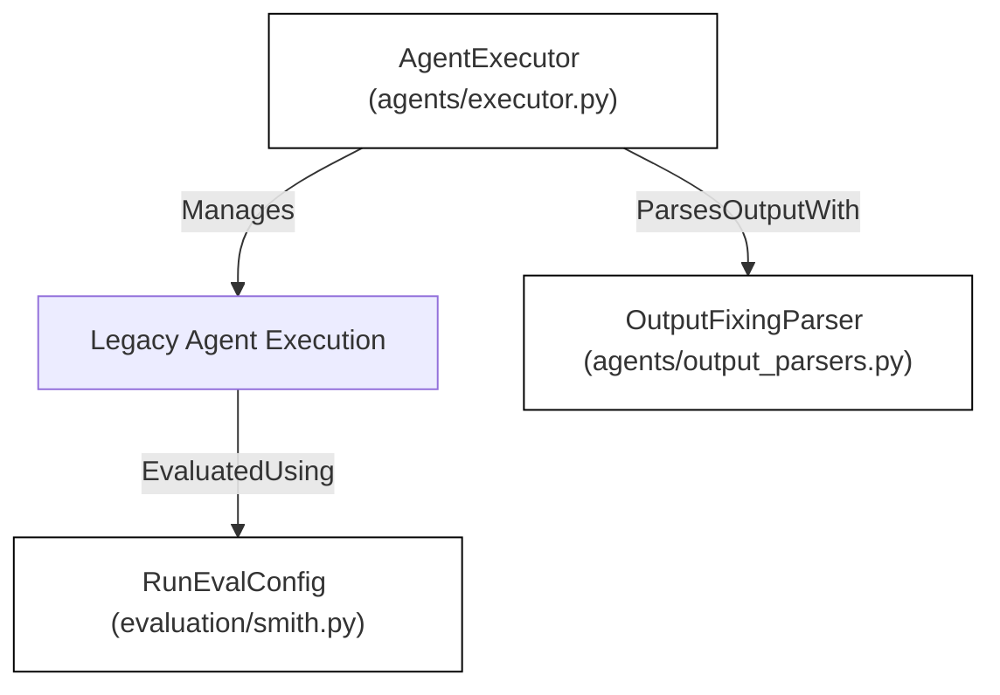

<!-- source: DeepWiki mcp.deepwiki.com · repo langchain-ai/langchain · page 4 langchain-classic (Legacy Package) · fetched 2026-10-26 -->

# langchain-classic (Legacy Package)

Relevant source files

The following files were used as context for generating this wiki page:

- [libs/langchain/langchain_classic/agents/agent_toolkits/conversational_retrieval/openai_functions.py](libs/langchain/langchain_classic/agents/agent_toolkits/conversational_retrieval/openai_functions.py)
- [libs/langchain/langchain_classic/base_memory.py](libs/langchain/langchain_classic/base_memory.py)
- [libs/langchain/langchain_classic/chains/base.py](libs/langchain/langchain_classic/chains/base.py)
- [libs/langchain/langchain_classic/chains/conversation/base.py](libs/langchain/langchain_classic/chains/conversation/base.py)
- [libs/langchain/langchain_classic/embeddings/__init__.py](libs/langchain/langchain_classic/embeddings/__init__.py)
- [libs/langchain/langchain_classic/memory/buffer.py](libs/langchain/langchain_classic/memory/buffer.py)
- [libs/langchain/langchain_classic/memory/chat_memory.py](libs/langchain/langchain_classic/memory/chat_memory.py)
- [libs/langchain/langchain_classic/memory/combined.py](libs/langchain/langchain_classic/memory/combined.py)
- [libs/langchain/langchain_classic/memory/readonly.py](libs/langchain/langchain_classic/memory/readonly.py)
- [libs/langchain/langchain_classic/memory/simple.py](libs/langchain/langchain_classic/memory/simple.py)
- [libs/langchain/langchain_classic/memory/vectorstore.py](libs/langchain/langchain_classic/memory/vectorstore.py)
- [libs/langchain/langchain_classic/schema/__init__.py](libs/langchain/langchain_classic/schema/__init__.py)
- [libs/langchain/tests/integration_tests/embeddings/__init__.py](libs/langchain/tests/integration_tests/embeddings/__init__.py)
- [libs/langchain/tests/integration_tests/embeddings/test_base.py](libs/langchain/tests/integration_tests/embeddings/test_base.py)
- [libs/langchain/tests/unit_tests/agents/test_types.py](libs/langchain/tests/unit_tests/agents/test_types.py)
- [libs/langchain/tests/unit_tests/chains/test_base.py](libs/langchain/tests/unit_tests/chains/test_base.py)
- [libs/langchain/tests/unit_tests/chains/test_conversation.py](libs/langchain/tests/unit_tests/chains/test_conversation.py)
- [libs/langchain/tests/unit_tests/chains/test_llm_math.py](libs/langchain/tests/unit_tests/chains/test_llm_math.py)
- [libs/langchain/tests/unit_tests/chains/test_qa_with_sources.py](libs/langchain/tests/unit_tests/chains/test_qa_with_sources.py)
- [libs/langchain/tests/unit_tests/embeddings/test_base.py](libs/langchain/tests/unit_tests/embeddings/test_base.py)
- [libs/langchain/tests/unit_tests/embeddings/test_imports.py](libs/langchain/tests/unit_tests/embeddings/test_imports.py)
- [libs/langchain/tests/unit_tests/test_imports.py](libs/langchain/tests/unit_tests/test_imports.py)

The `langchain-classic` package houses the legacy orchestration primitives, pre-LCEL (LangChain Expression Language) execution chains, memory abstractions, legacy agents, evaluation utilities, and backward-compatibility import shims from earlier versions of LangChain. This package supports older workflows and facilitates gradual migration toward the newer LangGraph and LCEL-based architectures used in `langchain v1` and beyond.

While new development should use the modern `langchain.agents.create_agent` infrastructure, the `langchain-classic` package remains important for maintaining and evolving existing deployments that depend on the classic chains, memory models, and agent tooling.

For details, see the child pages:  
- [Chains and Memory](#4.1)  
- [Legacy Agents, Output Parsers and Evaluation](#4.2)  
- [Serialization Compatibility and Import Surface](#4.3)  

---

## Architecture and Component Mapping

This diagram maps natural language concepts and classic conceptual workflows to their primary code entities in the `langchain_classic` package, emphasizing the core legacy classes for chain orchestration, memory management, and legacy agent execution.

```mermaid
graph TD
    NL_StatefulConversation["Stateful Conversation Workflow"] -->|ImplementedBy| ConversationChain["ConversationChain (chains/conversation/base.py)"]
    NL_ExecutionPipeline["Execution Pipeline Base"] -->|ImplementedBy| Chain["Chain (chains/base.py)"]
    NL_ShortTermMemory["Short-Term Chat History"] -->|Uses| BaseChatMemory["BaseChatMemory (memory/chat_memory.py)"]
    NL_VectorRetrievalMemory["Vector Store Retriever Memory"] -->|Uses| VectorStoreRetrieverMemory["VectorStoreRetrieverMemory (memory/vectorstore.py)"]

    NL_Agents["Legacy Agent Execution"] -->|ImplementedBy| AgentExecutor["AgentExecutor (agents/executor.py)"]
    NL_OutputParsing["Output Parsers & Fixing"] -->|Utilizes| OutputFixingParser["OutputFixingParser (agents/output_parsers.py)"]
    NL_Evaluation["Smith Evaluation Runner"] -->|Utilities| RunEvalConfig["RunEvalConfig (evaluation/smith.py)"]

    style NL_StatefulConversation fill:none,stroke:#000,stroke-width:1px
    style NL_ExecutionPipeline fill:none,stroke:#000,stroke-width:1px
    style NL_ShortTermMemory fill:none,stroke:#000,stroke-width:1px
    style NL_VectorRetrievalMemory fill:none,stroke:#000,stroke-width:1px
    style NL_Agents fill:none,stroke:#000,stroke-width:1px
    style NL_OutputParsing fill:none,stroke:#000,stroke-width:1px
    style NL_Evaluation fill:none,stroke:#000,stroke-width:1px
```

*Figure 1: Natural language workflows mapped to legacy core code entities.*

Sources:  
[libs/langchain/langchain_classic/chains/base.py:52-185](),  
[libs/langchain/langchain_classic/chains/conversation/base.py:23-114](),  
[libs/langchain/langchain_classic/base_memory.py:30-119](),  
[libs/langchain/langchain_classic/memory/chat_memory.py:28-107](),  
[libs/langchain/langchain_classic/memory/vectorstore.py:26-125]()  

---

## 4.1 Chains and Memory

At the core of `langchain-classic` is the `Chain` abstract base class, which defines the interface for orchestrating sequences of operations such as calls to language models, document retrievers, or nested chains. `Chain` handles input validation, output formatting, callback invocation for lifecycle events, and supports both synchronous and asynchronous execution through methods like `__call__`, `invoke`, and `ainvoke` [chains/base.py:52-185](). 

A specialized subclass, `ConversationChain`, enables building stateful conversational workflows by combining an LLM, a prompt template, and a memory store. This chain uses classic memory implementations such as `ConversationBufferMemory` to persist dialogue history. This class is now deprecated in favor of the more flexible `RunnableWithMessageHistory`, which provides improved streaming, batching, and multi-threaded support for conversation memory [chains/conversation/base.py:23-114]().

Memory abstractions historically derive from `BaseMemory`, which represents state persistence across chain executions. Memories inject contextual data into inputs before a chain runs and capture relevant outputs afterward. Implementations include in-memory buffers (`ConversationBufferMemory`), chat-specific memory (`BaseChatMemory`), and vector-store backed retriever memory (`VectorStoreRetrieverMemory`), offering varied persistence and retrieval strategies for conversational and extraction flows [base_memory.py:30-119](), [memory/buffer.py:24-32](), [memory/vectorstore.py:26-125]().

This integration of Chains and Memory allows legacy chains to function as stateful agents capable of retaining context, enabling coherent multi-turn conversations or iterative workflows.

For detailed API and usage patterns, see [Chains and Memory](#4.1).

Sources:  
[libs/langchain/langchain_classic/chains/base.py:52-185](),  
[libs/langchain/langchain_classic/chains/conversation/base.py:23-114](),  
[libs/langchain/langchain_classic/base_memory.py:30-119](),  
[libs/langchain/langchain_classic/memory/buffer.py:24-32](),  
[libs/langchain/langchain_classic/memory/vectorstore.py:26-125]()  

---

## 4.2 Legacy Agents, Output Parsers and Evaluation

The `langchain-classic` package includes legacy agent runtime components, chiefly represented by `AgentExecutor`. This class orchestrates classical agent workflows, coordinating tool invocation and model reasoning cycles. It manages executing tool calls based on LLM outputs and parsing outputs for subsequent steps using dedicated output parsers [agents/executor.py] (not shown here, referenced for completeness).

Robust output parsing utilities add resilience by wrapping parsers with fix-and-retry logic, allowing correction of malformed or partial model outputs. These combinator-style parsers enhance the stability of agent tool interactions and response interpretation [agents/output_parsers.py] (not shown here).

For evaluation, LangSmith-compatible configurations (`RunEvalConfig`) and runners are provided to automate evaluation of agent/model performance on benchmark tasks or datasets. This facilitates systematic validation, error analysis, and quality assurance within legacy agent workflows [evaluation/smith.py] (not shown here).

*Figure 2: Legacy agent execution, output parsing, and evaluation utilities.*

For detailed explanation and code examples, see [Legacy Agents, Output Parsers and Evaluation](#4.2).

Sources:  
[libs/langchain/langchain_classic/chains/base.py:52-73]()  

---

## 4.3 Serialization Compatibility and Import Surface

To support legacy use cases smoothly during migration, `langchain-classic` implements a broad import surface that dynamically handles deprecated imports and community extensions. The map `DEPRECATED_LOOKUP` provides a routing table for lazy loading deprecated components from `langchain_community` or other legacy namespaces.

The package includes rigorous unit tests (`test_imports.py`) that recursively import all submodules to ensure completeness and detect accidental new imports from deprecated namespaces. This disciplined import hygiene prevents unexpected dependencies or breaks during transitions [tests/unit_tests/test_imports.py:14-150]().

This serialization and import compatibility layer preserves backward compatibility and maintains a stable API surface for users relying on classic chains, memories, agents, and storage while preparing for full migration.

For specific import mechanics, snapshot load/dump, and deprecation handling, see [Serialization Compatibility and Import Surface](#4.3).

Sources:  
[libs/langchain/tests/unit_tests/test_imports.py:14-150]()  

---

This overview connects the legacy orchestration, memory, agent, evaluation, and compatibility subsystems in `langchain-classic` to their respective code entities and workflows. For deeper dives and API details, consult the dedicated child pages.

---

