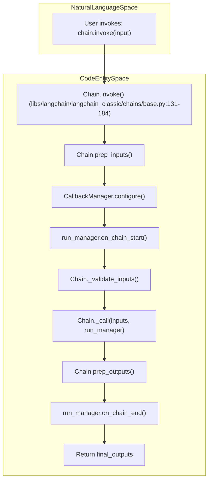
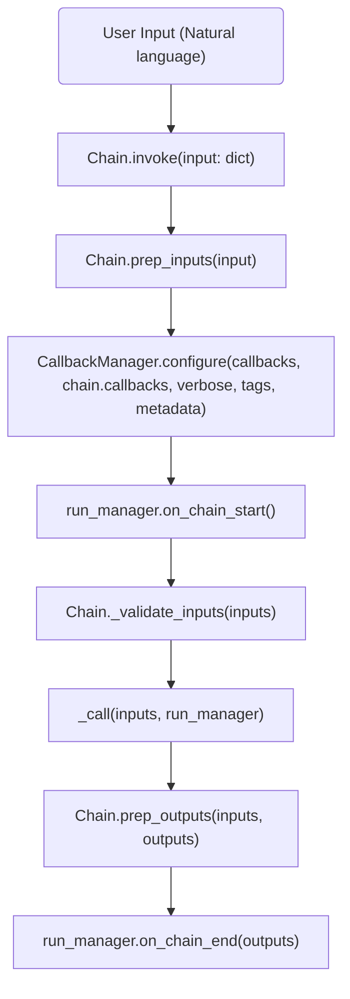
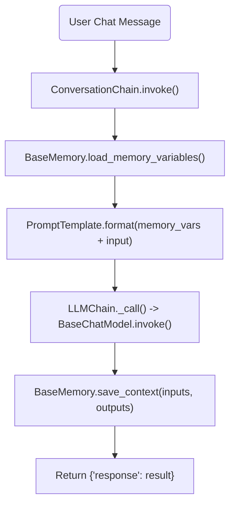

<!-- source: DeepWiki mcp.deepwiki.com · repo langchain-ai/langchain · page 4.1 Chains and Memory · fetched 2026-10-26 -->

# Chains and Memory

<details>
<summary>Relevant source files</summary>

The following files were used as context for generating this wiki page:

- [libs/langchain/langchain_classic/agents/agent_toolkits/conversational_retrieval/openai_functions.py](libs/langchain/langchain_classic/agents/agent_toolkits/conversational_retrieval/openai_functions.py)
- [libs/langchain/langchain_classic/agents/agent_types.py](libs/langchain/langchain_classic/agents/agent_types.py)
- [libs/langchain/langchain_classic/base_memory.py](libs/langchain/langchain_classic/base_memory.py)
- [libs/langchain/langchain_classic/chains/base.py](libs/langchain/langchain_classic/chains/base.py)
- [libs/langchain/langchain_classic/chains/conversation/base.py](libs/langchain/langchain_classic/chains/conversation/base.py)
- [libs/langchain/langchain_classic/chains/openai_functions/extraction.py](libs/langchain/langchain_classic/chains/openai_functions/extraction.py)
- [libs/langchain/langchain_classic/chains/openai_functions/tagging.py](libs/langchain/langchain_classic/chains/openai_functions/tagging.py)
- [libs/langchain/langchain_classic/chains/openai_tools/extraction.py](libs/langchain/langchain_classic/chains/openai_tools/extraction.py)
- [libs/langchain/langchain_classic/chains/structured_output/base.py](libs/langchain/langchain_classic/chains/structured_output/base.py)
- [libs/langchain/langchain_classic/indexes/vectorstore.py](libs/langchain/langchain_classic/indexes/vectorstore.py)
- [libs/langchain/langchain_classic/memory/buffer.py](libs/langchain/langchain_classic/memory/buffer.py)
- [libs/langchain/langchain_classic/memory/chat_memory.py](libs/langchain/langchain_classic/memory/chat_memory.py)
- [libs/langchain/langchain_classic/memory/combined.py](libs/langchain/langchain_classic/memory/combined.py)
- [libs/langchain/langchain_classic/memory/readonly.py](libs/langchain/langchain_classic/memory/readonly.py)
- [libs/langchain/langchain_classic/memory/simple.py](libs/langchain/langchain_classic/memory/simple.py)
- [libs/langchain/langchain_classic/memory/vectorstore.py](libs/langchain/langchain_classic/memory/vectorstore.py)
- [libs/langchain/langchain_classic/schema/__init__.py](libs/langchain/langchain_classic/schema/__init__.py)
- [libs/langchain/langchain_classic/smith/__init__.py](libs/langchain/langchain_classic/smith/__init__.py)
- [libs/langchain/langchain_classic/smith/evaluation/__init__.py](libs/langchain/langchain_classic/smith/evaluation/__init__.py)
- [libs/langchain/tests/integration_tests/chat_models/test_base.py](libs/langchain/tests/integration_tests/chat_models/test_base.py)
- [libs/langchain/tests/unit_tests/chains/test_base.py](libs/langchain/tests/unit_tests/chains/test_base.py)
- [libs/langchain/tests/unit_tests/chains/test_conversation.py](libs/langchain/tests/unit_tests/chains/test_conversation.py)
- [libs/langchain_v1/tests/integration_tests/chat_models/test_base.py](libs/langchain_v1/tests/integration_tests/chat_models/test_base.py)
- [libs/langchain_v1/tests/unit_tests/conftest.py](libs/langchain_v1/tests/unit_tests/conftest.py)

</details>


## Purpose and Scope
This page documents the legacy `langchain-classic` package components for building chains and managing memory. It describes:

- The `Chain` abstract base class that defines the core execution lifecycle and API for composing sequential workflows.
- Specialized chains such as conversation chains that integrate memory and prompts.
- Structured-output and extraction chains/factories for parsing model outputs into structured data.
- Various memory implementations that manage conversation histories and state variables.

These components form the foundation for building sophisticated language model applications in a stateful, composable, and observable manner.

---

## 1. The Chain Base Class (`Chain`)

The `Chain` class is the fundamental abstraction for all sequential pipelines in the legacy `langchain-classic` package. It extends `RunnableSerializable` to support both classic chain behavior and LangChain Expression Language (LCEL) interoperability.

### Core Architecture and Data Flow

- **Input/Output:** Chains receive inputs as dictionaries (`dict[str, Any]`) and produce outputs as dictionaries.
- **Memory:** Optionally use a `BaseMemory` instance to maintain stateful context between calls.
- **Callbacks:** Supports `CallbackManager` integration to emit lifecycle and debug events during chain execution.
- **Tags/Metadata:** Chains can carry optional tags and metadata propagated through callbacks.
- **Validation:** Inputs and outputs are validated against declared `input_keys` and `output_keys` properties.

The invocation lifecycle proceeds as:



**Explanation:**

1. User calls `chain.invoke(input)` with input dict.
2. Input preprocessing via `prep_inputs()` (validates and massages inputs).
3. Callback manager configured for lifecycle event handling.
4. `on_chain_start` event fired on callbacks.
5. Input validation ensures all `input_keys` are present.
6. Core chain logic executed via `_call()`, optionally passing run manager.
7. Outputs post-processed with `prep_outputs()` (combines with inputs if needed).
8. `on_chain_end` event fired.
9. Final outputs returned including optional run info.

### Key Methods and Properties

| Feature                | Description                                                                                                                   | Location / Reference                                      |
|------------------------|-------------------------------------------------------------------------------------------------------------------------------|-----------------------------------------------------------|
| `input_keys`           | List of expected input keys                                                                                                   | Abstract property, e.g. `FakeChain` in test: `test_base.py:42-67`           |
| `output_keys`          | List of expected output keys                                                                                                  | Abstract property                                           |
| `invoke()`             | Primary synchronous execution method taking input dict, returning output dict possibly including run info                      | `Chain.invoke()` in `chains/base.py:131-184`               |
| `run()`                | Convenience method for chains with single input & single output key, returns output value                                     | Tested in `tests/unit_tests/chains/test_base.py:124-170`   |
| `_call()`              | Core method to implement actual chain logic, receives inputs and optional callback manager                                     | Abstract, subclasses override                              |
| `memory`               | Optional `BaseMemory` instance that loads variables before and saves state after execution                                     | Property on `Chain` class                                 |
| Input/Output Validation| Ensures all required keys are present and raises `ValueError` otherwise                                                       | Implemented in base chain `_validate_inputs()`             |
| `get_input_schema()`   | Dynamically creates Pydantic input model to aid validation and typing                                                         | `Chain.get_input_schema()` in base chain                   |
| `get_output_schema()`  | Similarly constructs Pydantic output model                                                                                    | Implemented in base chain                                  |

### Testing Notes

Extensive tests verify:

- Validation errors on missing input keys.
- Validation errors on missing output keys.
- `run()` behavior supports only one input key and one output key, raises error otherwise.
- Callback handlers receive lifecycle events.
- Inclusion of run metadata with outputs.
- Async invocation variants supported.

Sources: `libs/langchain/langchain_classic/chains/base.py:1-187`, `libs/langchain/tests/unit_tests/chains/test_base.py:1-225`

---

## 2. Conversation Chains (`ConversationChain`)

`ConversationChain` extends `LLMChain` (which is a subclass of `Chain`) to implement chat-based conversational workflows. It integrates a conversation memory and prompt template for structured dialog.

### Architecture and Data Flow

```mermaid
flowchart TD
  subgraph NaturalLanguageSpace
    ChatTurn["User sends chat message"]
  end

  subgraph CodeEntitySpace
    ConvInvoke["ConversationChain.invoke() (chains/conversation/base.py:23-154)"]
    MemLoad["BaseMemory.load_memory_variables()"]
    PromptInject["Fill prompt template with memory variables + input"]
    LLMCall["LLMChain._call() -> BaseChatModel.invoke()"]
    MemSave["BaseMemory.save_context(inputs, outputs)"]
    ReturnResp["Return {'response': result}"]

    ChatTurn --> ConvInvoke
    ConvInvoke --> MemLoad --> PromptInject --> LLMCall --> MemSave --> ReturnResp
```

**Explanation:**

- When invoked, the chain loads relevant memory variables (conversation history).
- Input and memory contents fill the prompt template.
- The prompt is passed to the LLM for generation.
- The output is saved back to memory for future context.
- The final output is returned as a dictionary with keys like `response`.

### Validations and Constraints

- The `input_key` property defines the expected input key (default `"input"`).
- Memory variables (e.g., chat history) must not overlap input keys.
- Prompt input variables must exactly match memory variables plus the input key.
- Model validators enforce consistent prompt setup to avoid ambiguous keys.

### Common Memory Classes with `ConversationChain`

- **ConversationBufferMemory:** Stores entire conversation as formatted string with prefixes for human/AI messages.
- **ConversationBufferWindowMemory:** Maintains a window of last k messages.
- **ConversationSummaryMemory:** Summarizes long histories using LLM.

### Async Support

- Async methods like `ainvoke()` supported.
- Awaitable memory load/save methods integrated.

Sources: `libs/langchain/langchain_classic/chains/conversation/base.py:1-154`,  
`libs/langchain/langchain_classic/memory/buffer.py:24-92`,  
`libs/langchain/tests/unit_tests/chains/test_conversation.py:1-172`

---

## 3. Structured-Output and Extraction Chains

Legacy factories exist to build chains that convert free-text or chat output into structured data using OpenAI function calling or JSON/Pydantic schemas.

### Factory Functions Summary

| Factory                                  | Description                                                                                         | Location                                             |
|------------------------------------------|-------------------------------------------------------------------------------------------------|------------------------------------------------------|
| `create_extraction_chain`                 | Creates an LLMChain for extracting entities from text with OpenAI function-call style JSON output parser | `chains/openai_functions/extraction.py:56-88`        |
| `create_extraction_chain_pydantic`       | Similar, but uses Pydantic schema for strong typing and validation                               | `chains/openai_functions/extraction.py:99-145`       |
| `create_extraction_chain_pydantic` (tools variant) | Creates a runnable pipeline using tools derived from Pydantic models                            | `chains/openai_tools/extraction.py:28-55`             |
| `create_tagging_chain`                    | Builds tagging chain extracting labeling info based on schema with JSON output parser           | `chains/openai_functions/tagging.py:45-104`           |
| `create_tagging_chain_pydantic`           | Tagging chain variant for Pydantic schema                                                      | `chains/openai_functions/tagging.py:115-178`          |
| `create_openai_fn_runnable`               | Generic runnable sequence that uses OpenAI function calling; supports multiple functions         | `chains/structured_output/base.py:40-147`             |
| `create_structured_output_runnable`       | Advanced runnable supporting different modes (openai-functions, openai-tools, openai-json) and output parsing | Partial in `chains/structured_output/base.py`          |

### Data Flow for Extraction Chain

```mermaid
flowchart TD
  subgraph NaturalLanguageSpace
    UserInput["Raw passage to extract info from"]
  end

  subgraph CodeEntitySpace
    FuncDef["Create OpenAI function schema from JSON or Pydantic"]
    LLMChainBuild["Build LLMChain with prompt, LLM, and output_parser"]
    ChainInvoke["Invoke chain with input passage"]
    OutputParse["Parse output JSON to native Python objects"]

    UserInput --> ChainInvoke
    ChainInvoke --> FuncDef --> LLMChainBuild --> OutputParse
```

### Deprecation Notes

- These legacy APIs are deprecated and scheduled for removal by 2.0.0.
- Recommended replacements use the `ChatModel.with_structured_output(...)` interface which offers richer tooling integration and easier structured output handling.

Sources:  
`libs/langchain/langchain_classic/chains/openai_functions/extraction.py:1-145`  
`libs/langchain/langchain_classic/chains/openai_tools/extraction.py:1-55`  
`libs/langchain/langchain_classic/chains/openai_functions/tagging.py:1-178`  
`libs/langchain/langchain_classic/chains/structured_output/base.py:1-158`

---

## 4. Memory Implementations

Memory classes provide stateful storage for conversational or contextual data between chain invocations. They define how conversation histories or variables are loaded before running the chain and saved afterward.

### Base Memory Interfaces

- **`BaseMemory`** defines core methods and properties:
  - `memory_variables` property: The list of keys it provides.
  - `load_memory_variables(inputs)` synchronous method to fetch memory context variables.
  - `save_context(inputs, outputs)` synchronous method to save result context.
  - `clear()` to reset stored memory.
  - Corresponding async methods: `aload_memory_variables()`, `asave_context()`, `aclear()`.

- **`BaseChatMemory`** extends `BaseMemory` and is tailored for chat message histories, working on `BaseMessage` objects instead of plain strings.

### Concrete Memory Implementations

| Class                           | Functionality                                                                                   | Location                        |
|---------------------------------|-----------------------------------------------------------------------------------------------|--------------------------------|
| `ConversationBufferMemory`       | Stores full chat history as formatted string or message list; supports `human_prefix` and `ai_prefix` | `memory/buffer.py:24-92`        |
| `ConversationBufferWindowMemory`| Maintains sliding window of recent messages for memory longevity                               | `memory/buffer_window.py`       |
| `ConversationSummaryMemory`      | Uses an LLM to summarize and compress long conversation histories                             | `memory/summary.py`             |
| `VectorStoreRetrieverMemory`    | Backed by a `VectorStoreRetriever` to save/load relevant conversation turns or documents      | `memory/vectorstore.py:26-126` |

### Memory Data Flow with ConversationChain

```mermaid
flowchart TD
  subgraph NaturalLanguageSpace
    Conversation["User inputs and AI responses"]
  end

  subgraph CodeEntitySpace
    LoadVars["ConversationBufferMemory.load_memory_variables()"]
    FormatPrompt["Format prompt with loaded history and current input"]
    ChainCall["ConversationChain._call() calls LLM"]
    SaveCtx["ConversationBufferMemory.save_context(inputs, outputs)"]

    Conversation --> LoadVars --> FormatPrompt --> ChainCall --> SaveCtx
```

### Usage Notes

- Memory is attached to chains to maintain conversational or contextual state.
- Conversations can have customizable prefixes (`human_prefix`, `ai_prefix`) to clarify roles in memory.
- Memory implementations differ in how they store data (string concatenation, message lists, vector stores).
- Memory clear operations reset stored history.
- Async methods allow compatibility with async chain invocations.

Sources:  
`libs/langchain/langchain_classic/base_memory.py:1-40`  
`libs/langchain/langchain_classic/memory/buffer.py:1-180`  
`libs/langchain/langchain_classic/memory/vectorstore.py:26-126`  
`libs/langchain/tests/unit_tests/chains/test_conversation.py:1-172`

---

# Summary

The legacy `langchain-classic` package implements a robust, abstracted, and extensible framework:

- `Chain` base class for structured sequential logic with lifecycle callbacks and validation.
- `ConversationChain` for chat-based stateful interaction integrating memories.
- Structured-output/extraction chains built on OpenAI function calling and JSON/Pydantic schemas, though deprecated.
- Memory implementations handling conversation buffers, message histories, and vector store-backed retrieval.

Together, these enable complex language model workflows with conversation awareness and structured data extraction, suitable for stateful applications. While some APIs are deprecated in favor of newer LangChain core and `ChatModel` style abstractions, they remain valuable reference points for chain and memory mechanics.

---

# Mermaid Diagram: Mapping Natural Language Concepts to Chain Base Class (`Chain`) Code



# Mermaid Diagram: Mapping Conversation Chain + Memory Integration



---

Sources:  
`libs/langchain/langchain_classic/chains/base.py:1-187`  
`libs/langchain/tests/unit_tests/chains/test_base.py:1-225`  
`libs/langchain/langchain_classic/chains/conversation/base.py:1-154`  
`libs/langchain/langchain_classic/memory/buffer.py:24-92`  
`libs/langchain/tests/unit_tests/chains/test_conversation.py:1-172`  
`libs/langchain/langchain_classic/chains/openai_functions/extraction.py:1-145`  
`libs/langchain/langchain_classic/chains/openai_tools/extraction.py:1-55`  
`libs/langchain/langchain_classic/chains/openai_functions/tagging.py:1-178`  
`libs/langchain/langchain_classic/chains/structured_output/base.py:1-158`  
`libs/langchain/langchain_classic/base_memory.py:1-40`  
`libs/langchain/langchain_classic/memory/vectorstore.py:26-126`

---

