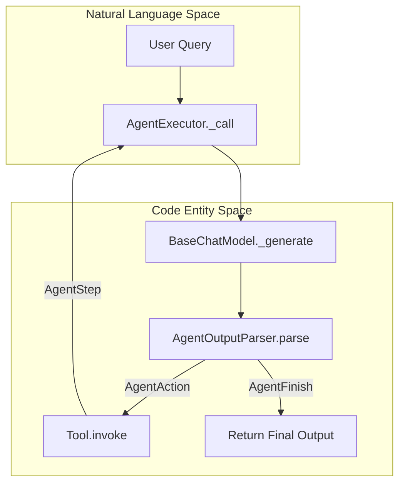
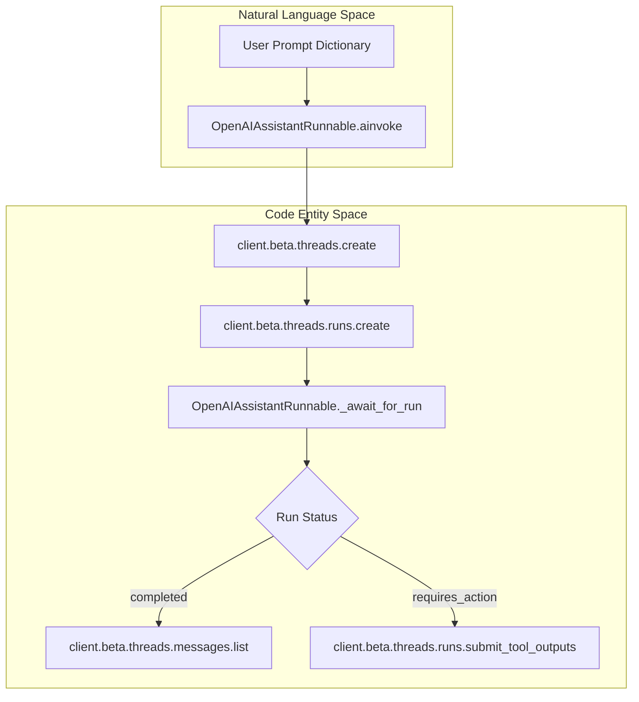
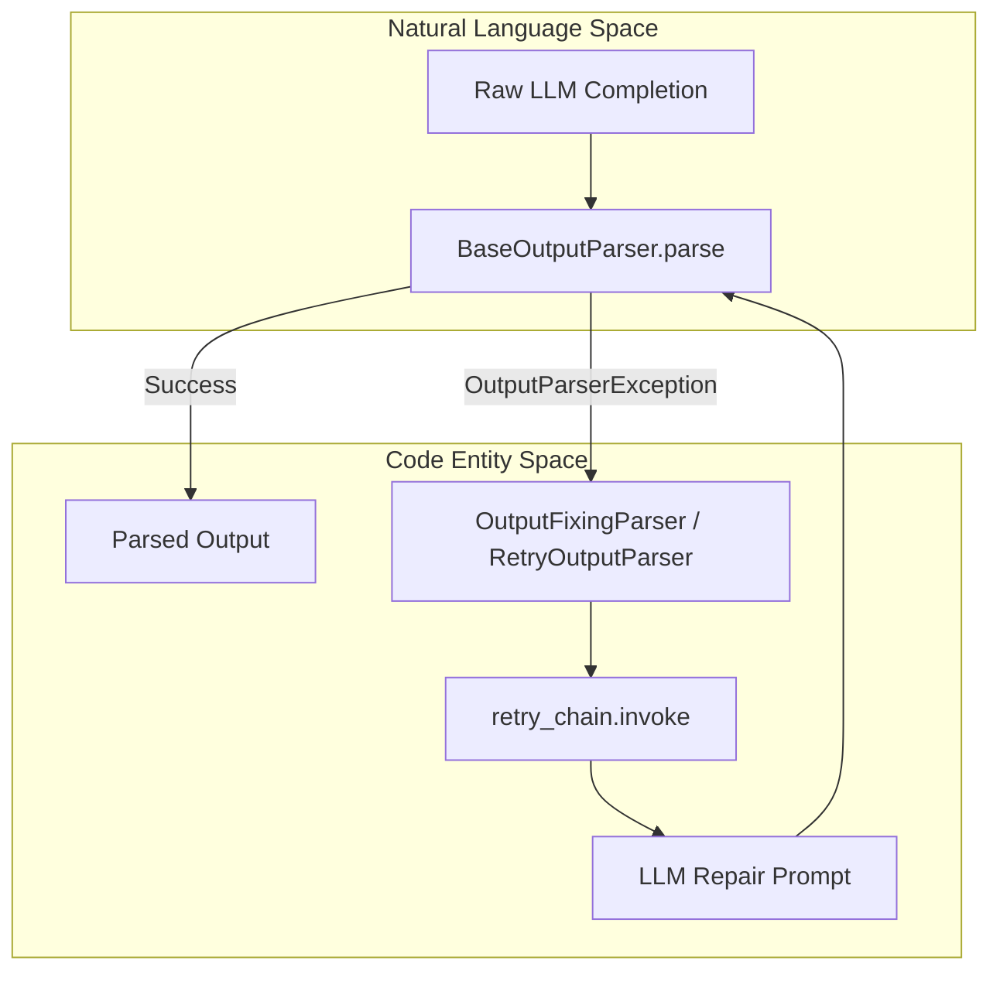
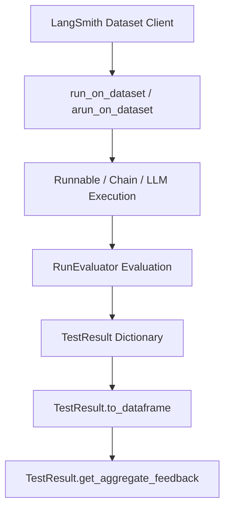

<!-- source: DeepWiki mcp.deepwiki.com · repo langchain-ai/langchain · page 4.2 Legacy Agents, Output Parsers and Evaluation · fetched 2026-10-26 -->

# Legacy Agents, Output Parsers and Evaluation

Relevant source files

The following files were used as context for generating this wiki page:

- [libs/langchain/langchain_classic/agents/agent.py](libs/langchain/langchain_classic/agents/agent.py)
- [libs/langchain/langchain_classic/agents/agent_iterator.py](libs/langchain/langchain_classic/agents/agent_iterator.py)
- [libs/langchain/langchain_classic/agents/output_parsers/tools.py](libs/langchain/langchain_classic/agents/output_parsers/tools.py)
- [libs/langchain/langchain_classic/chains/api/base.py](libs/langchain/langchain_classic/chains/api/base.py)
- [libs/langchain/langchain_classic/chains/openai_functions/citation_fuzzy_match.py](libs/langchain/langchain_classic/chains/openai_functions/citation_fuzzy_match.py)
- [libs/langchain/langchain_classic/retrievers/document_compressors/listwise_rerank.py](libs/langchain/langchain_classic/retrievers/document_compressors/listwise_rerank.py)
- [libs/langchain/langchain_classic/retrievers/multi_vector.py](libs/langchain/langchain_classic/retrievers/multi_vector.py)
- [libs/langchain/langchain_classic/smith/evaluation/progress.py](libs/langchain/langchain_classic/smith/evaluation/progress.py)
- [libs/langchain/langchain_classic/smith/evaluation/runner_utils.py](libs/langchain/langchain_classic/smith/evaluation/runner_utils.py)
- [libs/langchain/tests/mock_servers/robot/server.py](libs/langchain/tests/mock_servers/robot/server.py)
- [libs/langchain/tests/unit_tests/agents/test_openai_assistant.py](libs/langchain/tests/unit_tests/agents/test_openai_assistant.py)
- [libs/langchain/tests/unit_tests/chains/query_constructor/test_parser.py](libs/langchain/tests/unit_tests/chains/query_constructor/test_parser.py)
- [libs/langchain/tests/unit_tests/output_parsers/test_fix.py](libs/langchain/tests/unit_tests/output_parsers/test_fix.py)
- [libs/langchain/tests/unit_tests/output_parsers/test_retry.py](libs/langchain/tests/unit_tests/output_parsers/test_retry.py)
- [libs/langchain/tests/unit_tests/smith/evaluation/test_runner_utils.py](libs/langchain/tests/unit_tests/smith/evaluation/test_runner_utils.py)
- [libs/partners/qdrant/langchain_qdrant/qdrant.py](libs/partners/qdrant/langchain_qdrant/qdrant.py)
- [libs/partners/qdrant/langchain_qdrant/vectorstores.py](libs/partners/qdrant/langchain_qdrant/vectorstores.py)
- [libs/partners/qdrant/tests/integration_tests/async_api/test_add_texts.py](libs/partners/qdrant/tests/integration_tests/async_api/test_add_texts.py)
- [libs/partners/qdrant/tests/integration_tests/async_api/test_from_texts.py](libs/partners/qdrant/tests/integration_tests/async_api/test_from_texts.py)
- [libs/partners/qdrant/tests/integration_tests/async_api/test_max_marginal_relevance.py](libs/partners/qdrant/tests/integration_tests/async_api/test_max_marginal_relevance.py)
- [libs/partners/qdrant/tests/integration_tests/async_api/test_similarity_search.py](libs/partners/qdrant/tests/integration_tests/async_api/test_similarity_search.py)
- [libs/partners/qdrant/tests/integration_tests/common.py](libs/partners/qdrant/tests/integration_tests/common.py)
- [libs/partners/qdrant/tests/integration_tests/test_add_texts.py](libs/partners/qdrant/tests/integration_tests/test_add_texts.py)
- [libs/partners/qdrant/tests/integration_tests/test_embedding_interface.py](libs/partners/qdrant/tests/integration_tests/test_embedding_interface.py)

## Purpose and Scope

This page documents the legacy agent execution frameworks, advanced output parsing mechanisms (including auto-fixing and retrying parsers), and LangSmith evaluation runner utilities housed within the `langchain-classic` legacy package. These components represent pre-LangGraph agent patterns (`AgentExecutor`), wrapper abstractions for the OpenAI Assistants API (`OpenAIAssistantRunnable`), robust error-correction layers for structured data extraction, and dataset evaluation pipelines.

---

## 1. Legacy Agent Execution Framework (`AgentExecutor`)

The `AgentExecutor` class and associated agent factories coordinate the classic LangChain agent loop: invoking a language model, parsing the output into an `AgentAction` or `AgentFinish`, executing requested tools, and feeding the resulting `AgentStep` back into the loop until completion.

### Key Classes and Functions

- **`AgentExecutor`**: The core runtime engine that manages iterations, time/iteration limits, and callback dispatch for legacy agents. It handles the orchestration of agent calls, tool invocations, error management, and output formatting [libs/langchain/langchain_classic/agents/agent.py:1-209]() (definition extends beyond shown lines, tests at [libs/langchain/tests/unit_tests/agents/test_agent.py:1-220]()).

- **`initialize_agent` and Factory Functions**: Convenience factory functions that bind a list of tools to an LLM or chat model using a specified legacy `AgentType` (e.g., `AgentType.ZERO_SHOT_REACT_DESCRIPTION`), constructing runnable agents suitable for the pre-LangGraph stack [libs/langchain/tests/unit_tests/agents/test_agent.py:30-37]().

### Data Flow and Execution Loop

The legacy agent loop works as follows:

1. A **user query** is input to the `AgentExecutor` via its `_call` method.
2. The agent internally calls the language model (`BaseChatModel._generate`) with the current context.
3. The language model output is parsed into an `AgentAction` or `AgentFinish` by an `AgentOutputParser`.
4. If an `AgentAction` is returned, the corresponding tool is invoked, and the observation (tool result) is appended.
5. The process repeats until an `AgentFinish` is reached, providing the final output.

*Diagram 1: Legacy Agent Execution Loop bridging user input to tool invocation and termination via `AgentExecutor`.*

### Sources:
- `libs/langchain/langchain_classic/agents/agent.py:1-209`
- `libs/langchain/tests/unit_tests/agents/test_agent.py:1-220`

---

## 2. OpenAI Assistant Agents (`OpenAIAssistantRunnable`)

`OpenAIAssistantRunnable` integrates OpenAI's Assistants Beta API into LangChain's `Runnable` interface, providing a seamless execution model for assistant threads, runs, and tool outputs [libs/langchain/tests/unit_tests/agents/test_openai_assistant.py:7-143]().

### Key Classes and Methods

- **`OpenAIAssistantRunnable`**: A runnable wrapping around the OpenAI Assistants client, managing assistants, threads, runs, and tool output submission. Supports both synchronous and asynchronous operations.

- **`create_assistant()` and `acreate_assistant()`**: Factory methods for creating new assistant definitions synchronously or asynchronously on the OpenAI platform.

- **`ainvoke()`**: The async method to process user input; it creates threads, submits runs, polls for run status (`_await_for_run`), and retrieves completion messages or actions (tools to invoke). Handles run statuses such as 'completed' or 'requires_action' (requiring tool outputs to be submitted back).

*Diagram 2: OpenAI Assistant lifecycle managed by `OpenAIAssistantRunnable`.*

### Sources:
- `libs/langchain/tests/unit_tests/agents/test_openai_assistant.py:7-143`

---

## 3. Fixing and Retry Output Parsers

LangChain classic includes robust output parsing wrappers designed to improve extraction reliability by automatically correcting malformed or erroneous outputs from language model completions.

### Key Classes and Functions

- **`OutputFixingParser`**: Wraps a base output parser that may raise `OutputParserException`. On parsing failure, it uses a configured retry chain (usually a runnable wrapping an LLM prompt) to generate a revised completion intended to fix the output. Constructible via `from_llm` for ease of use with any LLM [libs/langchain/tests/unit_tests/output_parsers/test_fix.py:1-196]().

- **`RetryOutputParser` and `RetryWithErrorOutputParser`**: Similar wrappers that on parsing failure re-run the LLM on a special retry prompt, optionally providing the original error message to the model, enabling more informed correction of outputs [libs/langchain/tests/unit_tests/output_parsers/test_retry.py:1-184]().

### Parser Correction Loop Data Flow

1. The **raw LLM completion** is first parsed by the base `BaseOutputParser`.
2. On parse success, the parsed output is returned.
3. On `OutputParserException` failure, the `OutputFixingParser` or `RetryOutputParser` triggers a retry chain.
4. The retry chain invokes the LLM with a repair prompt or a prompt enriched with the original error to generate a fixed completion.
5. The fixing parser tries parsing the new completion again.
6. This loop repeats up to `max_retries`.

*Diagram 3: Output parser correction loop handled by `OutputFixingParser` and `RetryOutputParser`.*

### Sources:
- `libs/langchain/tests/unit_tests/output_parsers/test_fix.py:1-196`
- `libs/langchain/tests/unit_tests/output_parsers/test_retry.py:1-184`

---

## 4. LangSmith Evaluation Runner Utilities

The `langchain_classic.smith.evaluation.runner_utils` module provides utilities to run language models, Chains, or Runnables over LangSmith datasets, capture evaluations, and aggregate results. This facilitates automated benchmarking and feedback collection within LangSmith evaluation workflows.

### Key Components and Data Flow

- **`run_on_dataset()` / `arun_on_dataset()`**: Functions that execute a given model, Chain, or runnable across all examples in a LangSmith dataset. They manage input validation, run execution, trace capturing with `LangChainTracer`, and submission of evaluation runs back to LangSmith [libs/langchain/langchain_classic/smith/evaluation/runner_utils.py:16-59,144-1764]().

- **`TestResult`**: A subclassed dictionary that stores individual evaluation results keyed by example IDs. It provides helper methods:

  - `to_dataframe()`: Converts all results into a pandas DataFrame for analysis.
  - `get_aggregate_feedback()`: Returns quantiles and descriptive statistics on feedback scores, excluding input/output columns [libs/langchain/langchain_classic/smith/evaluation/runner_utils.py:147-170]().

- **Git Metadata Sanitization**: Functions like `_sanitize_git_remote_url()` and `_format_git_tags()` clean local Git repository info by removing sensitive credentials or malformed URLs before attaching environment tags to evaluation runs [libs/langchain/langchain_classic/smith/evaluation/runner_utils.py:81-137]().

### LangSmith Evaluation Pipeline Data Flow

1. The **LangSmith Dataset Client** supplies evaluation examples.
2. `run_on_dataset` or `arun_on_dataset` iterates over examples, validating and running the target callable (Chain/LLM/Runnable).
3. Each run generates outputs and is optionally evaluated with a `RunEvaluator`.
4. Results are collected into a `TestResult` dictionary.
5. `TestResult` can be converted into a DataFrame and inspected for aggregate feedback statistics.

*Diagram 4: Data flow of LangSmith evaluation runners and `TestResult` aggregation.*

### Sources:
- `libs/langchain/langchain_classic/smith/evaluation/runner_utils.py:1-1765`
- `libs/langchain/tests/unit_tests/smith/evaluation/test_runner_utils.py:1-509`

---

# Summary

This page has detailed the legacy agent mechanism embodied in `AgentExecutor`, the stateful OpenAI assistant integration via `OpenAIAssistantRunnable`, sophisticated output parsers for self-correcting model outputs (`OutputFixingParser` and `RetryOutputParser`), and extensive utilities for running and aggregating LangSmith evaluation experiments (`runner_utils`). These legacy components underpin core LangChain functionalities while the project evolves towards modern LangGraph-agent patterns.

---

