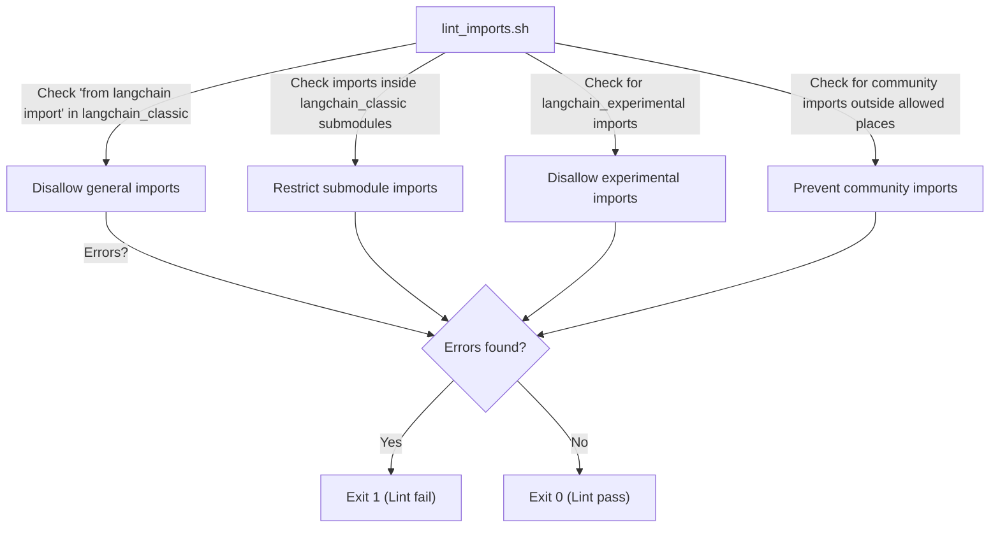
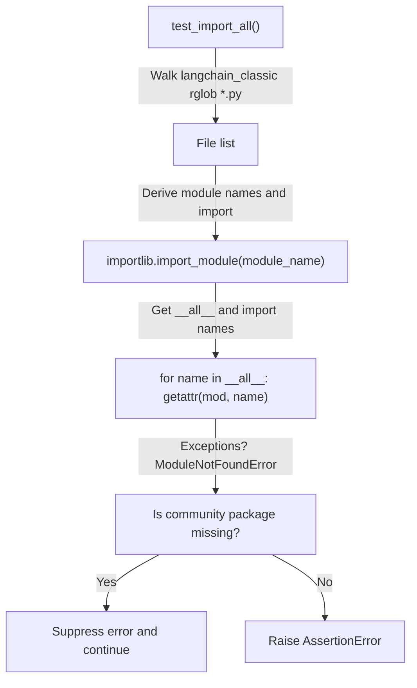
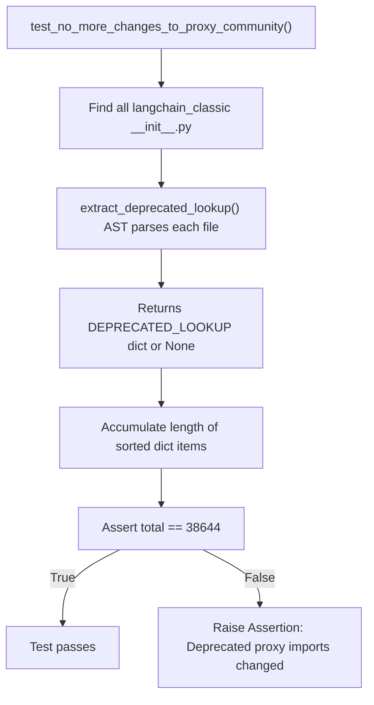
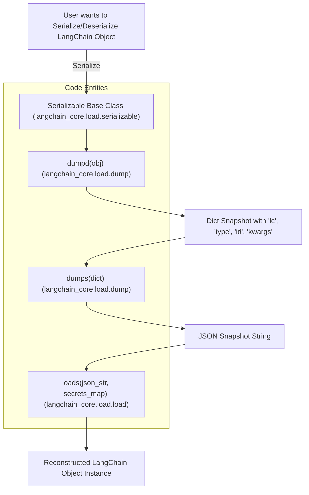
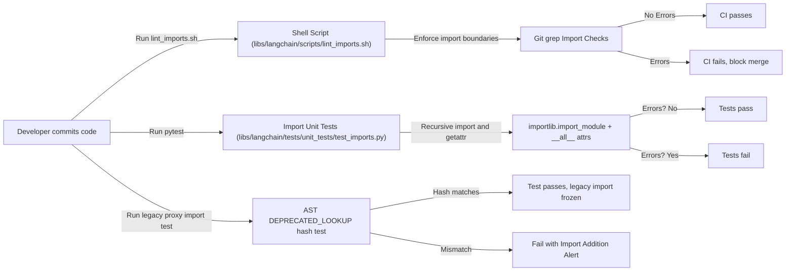

<!-- source: DeepWiki mcp.deepwiki.com · repo langchain-ai/langchain · page 4.3 Serialization Compatibility and Import Surface · fetched 2026-10-26 -->

# Serialization Compatibility and Import Surface

<details>
<summary>Relevant source files</summary>

The following files were used as context for generating this wiki page:

- [libs/langchain/extended_testing_deps.txt](libs/langchain/extended_testing_deps.txt)
- [libs/langchain/langchain_classic/agents/openai_assistant/base.py](libs/langchain/langchain_classic/agents/openai_assistant/base.py)
- [libs/langchain/langchain_classic/chains/moderation.py](libs/langchain/langchain_classic/chains/moderation.py)
- [libs/langchain/langchain_classic/embeddings/__init__.py](libs/langchain/langchain_classic/embeddings/__init__.py)
- [libs/langchain/langchain_classic/evaluation/embedding_distance/base.py](libs/langchain/langchain_classic/evaluation/embedding_distance/base.py)
- [libs/langchain/langchain_classic/evaluation/loading.py](libs/langchain/langchain_classic/evaluation/loading.py)
- [libs/langchain/scripts/lint_imports.sh](libs/langchain/scripts/lint_imports.sh)
- [libs/langchain/tests/integration_tests/embeddings/__init__.py](libs/langchain/tests/integration_tests/embeddings/__init__.py)
- [libs/langchain/tests/integration_tests/embeddings/test_base.py](libs/langchain/tests/integration_tests/embeddings/test_base.py)
- [libs/langchain/tests/unit_tests/agents/test_types.py](libs/langchain/tests/unit_tests/agents/test_types.py)
- [libs/langchain/tests/unit_tests/chains/test_llm_math.py](libs/langchain/tests/unit_tests/chains/test_llm_math.py)
- [libs/langchain/tests/unit_tests/chains/test_qa_with_sources.py](libs/langchain/tests/unit_tests/chains/test_qa_with_sources.py)
- [libs/langchain/tests/unit_tests/embeddings/test_base.py](libs/langchain/tests/unit_tests/embeddings/test_base.py)
- [libs/langchain/tests/unit_tests/embeddings/test_imports.py](libs/langchain/tests/unit_tests/embeddings/test_imports.py)
- [libs/langchain/tests/unit_tests/load/__snapshots__/test_dump.ambr](libs/langchain/tests/unit_tests/load/__snapshots__/test_dump.ambr)
- [libs/langchain/tests/unit_tests/load/test_dump.py](libs/langchain/tests/unit_tests/load/test_dump.py)
- [libs/langchain/tests/unit_tests/load/test_load.py](libs/langchain/tests/unit_tests/load/test_load.py)
- [libs/langchain/tests/unit_tests/test_imports.py](libs/langchain/tests/unit_tests/test_imports.py)

</details>


## Purpose and Scope
This page details the mechanisms ensuring serialization compatibility, snapshot loading/dumping, import surface validation, and deprecated re-export shims within the LangChain ecosystem. The focus is primarily on the `langchain_classic` package and its integration with core and partner packages.

It covers:

- How composite LangChain objects (chains, prompts, LLMs, tools) are serialized/deserialized using the `langchain_core.load` API.
- Secrets management in serialization for safe snapshotting without leaking sensitive info.
- Import lint scripts enforcing strict module import boundaries preventing unintended dependency creep.
- Runtime import tests that verify completeness and correctness of public API imports.
- AST-based tests ensuring deprecated proxy community imports do not expand unexpectedly.

---

## 1. Serialization and Snapshot Loading (`langchain_core.load`)

### Overview
LangChain uses a custom serialization protocol centered around the `Serializable` base class (`langchain_core.load.serializable`) that encodes runnables, chains, prompts, models, etc., into JSON-compatible "snapshots". These snapshots are dictionaries or strings that contain:

- `"lc"`: Serialization version integer.
- `"type"`: Type indicator (e.g., `"constructor"`).
- `"id"`: A fully qualified identifier path as a list of namespace strings to the class.
- `"kwargs"`: Constructor keyword arguments capturing the object's configuration, including nested serializable attributes.
- Secret fields are replaced with references to environment variables rather than raw values, improving security.

Key serialization functions include:

- `dumpd(obj)` — Dump to a dictionary snapshot.
- `dumps(obj)` — Dump to JSON string snapshot.
- `load(obj)` — Load an object from a dictionary snapshot.
- `loads(str)` — Load an object from a JSON string snapshot.

The reconstruction process rehydrates complex LangChain objects fully with secrets re-injected from environment or mappings, returning instances with correct types.

### Serialization Flow Diagram

```mermaid
graph TD
  SerializableObj["Serializable LangChain Object"] -->|dumpd(obj)| DictSnapshot["Dict Snapshot: {'lc', 'type', 'id', 'kwargs'}"]
  DictSnapshot -->|dumps(dict)| JSONSnapshot["JSON String Snapshot"]
  JSONSnapshot -->|loads(json_str, secrets_map)| RehydratedObj["Rehydrated LangChain Object"]
  RehydratedObj -->|Validation and Reinit| FinalInstance["Fully Constructed Python Instance"]
```

### Secrets Handling and Namespaces

- Serializable classes may define the `lc_secrets` property: a mapping of attribute names to environment variable keys.
- During serialization, secret attributes are replaced with a special marker referencing environment variable secrets, never storing raw secret values.
- Classes also can extend or override the namespace for serialization IDs with `get_lc_namespace()`, providing hierarchical identifiers. This supports logical grouping and version-compatible serialization.

Example (from tests):

- `Person` class exposes a `"secret"` attribute tied to `"SECRET"` env var.
- `SpecialPerson` extends namespace and adds its own secret (`"another_secret"` mapped to `"ANOTHER_SECRET"`).
- Both secrets and regular visible attributes are serialized accordingly.

### Snapshot Testing Example (simplified)

```python
def test_person(snapshot: Any) -> None:
    p = Person(secret="parrot party")
    assert dumps(p, pretty=True) == snapshot

    sp = SpecialPerson(another_secret="Wooo", secret="Hmm")
    assert dumps(sp, pretty=True) == snapshot
```

The snapshots confirm exact, stable serialization output matching expected JSON structures.

### Deserialization With Secrets

The `loads` function supports receiving a `secrets_map` which supplies secret values referenced in the snapshot:

```python
llm2 = loads(llm_string, secrets_map={"OPENAI_API_KEY": "hello"})
```

If omitted, it falls back to environment variables. The deserialized object retains type integrity, e.g., restored as `OpenAI` LLM instance, not generic constructor.

### Error Handling

Non-serializable attributes or unsupported types (e.g., custom HTTP clients) cause `NotImplementedError` on loading, ensuring early failure detection.

---

## 2. Import Surface Enforcement and Linting

### Rationale

Strict import boundaries preserve modular architecture and avoid circular dependencies or unexpected runtime failures. The LangChain repo enforces:

- `langchain_classic` cannot broadly import everything from `langchain`; imports are limited to select submodules.
- Imports from `langchain_community` are deprecated except in narrowly allowed cases and must be explicit.
- No imports from `langchain_experimental` are allowed in the core packages.
- Each subpackage in `langchain_classic` can only import from designated namespaces.

### Lint Script (`scripts/lint_imports.sh`)

This shell script contains multiple `git grep` expressions to detect violations of import boundaries:

- Lines 9-23 enforce restricted import patterns inside `langchain_classic` folders.
- Lines 25 and 31 forbid any imports from `langchain_experimental` and global imports from `langchain_community` (except with an explicit comment for allowance).

If violations occur, the script exits with status 1, causing CI to fail and preventing merge with bad imports.

### Linting Flow Diagram



This script is run as part of CI pipelines to maintain code hygiene.

### Import Unit Tests (`tests/unit_tests/test_imports.py`)

This pytest module performs:

- Recursive import of every `.py` file under `langchain_classic` to catch ImportErrors early.
- For each module, it tries to import all names from the module's `__all__`.
- Errors related to missing `langchain_community` are suppressed if that package is not installed (optional dependency).
- Includes a hash-based sentinel test to detect accidental additions to deprecated proxy imports.

### Import Test Flow Diagram



This ensures the import surface is consistent and error-free at runtime.

---

## 3. Deprecated Re-Export Shims and Proxy Community Modules

### Background

`langchain_classic` historically re-exported many classes and functions from the `langchain_community` package using deprecated proxy imports to provide compatibility for existing consumers. New imports from `langchain_community` into the core repo have been deprecated to limit dependency growth and enforce modular clarity.

### AST-Based Proxy Lookup Test (Legacy Proxy Stability)

The test named `test_no_more_changes_to_proxy_community()` scans all `__init__.py` files in `langchain_classic`.

- It uses `ast` parsing to extract a dictionary variable named `DEPRECATED_LOOKUP` from each file if present.
- Computes a sum of the lengths of all sorted `DEPRECATED_LOOKUP.items()`.
- Asserts that the sum equals an "evil magic number" (`38644`).
- If the sum differs, it signals that new deprecated imports have been added improperly and fails the test.

This mechanism acts as a sentinel preventing accidental expansion of deprecated proxies.

### AST Extraction and Test Flow Diagram



---

## 4. Summary Table of Key Serialization and Import Controls

| Mechanism                         | Location/Module                                   | Role/Function                                               |
|----------------------------------|-------------------------------------------------|-------------------------------------------------------------|
| **Serializable Base**             | `langchain_core.load.serializable`               | Base class defining JSON snapshot format, secret masking, and namespace IDs |
| **Serialization Functions**       | `langchain_core.load.{load,loads,dumpd,dumps}` | Core API for serializing/deserializing LangChain objects with secret injection |
| **Import Lint Script**             | `libs/langchain/scripts/lint_imports.sh`        | Shell script enforcing strict import boundaries via git grep commands |
| **Import Unit Tests**              | `libs/langchain/tests/unit_tests/test_imports.py` | Recursive import checks and API attribute import validation |
| **Deprecated Proxy AST Test**     | `libs/langchain/tests/unit_tests/test_imports.py` | AST-based hash validation to detect changes in deprecated proxy import dicts |
| **Serialization Snapshot Tests**  | `libs/langchain/tests/unit_tests/load/test_dump.py` | Tests validating stable serialization output and aliases |

---

## Additional Technical Notes

- Serialization seamlessly integrates with optional external partner packages such as `langchain_openai` and `langchain_community`.
- Secret serialization replaces sensitive data with secure environment variable references, supporting safe snapshot archival without leaking secrets.
- Import linting and import tests preserve core LangChain architecture modularity, preventing dependency pollution.
- Deprecated proxy community imports are frozen to avoid broadening the legacy import surface, encouraging explicit dependency usage.

---

# Appendix: Visualizations Bridging Natural Language Concepts to Code Entities

### Diagram 1: Serialization Workflow from User Intent to Code



### Diagram 2: Import Surface Validation Pipeline



---

### Sources
- [libs/langchain/tests/unit_tests/load/test_load.py:4-196]()
- [libs/langchain/tests/unit_tests/load/test_dump.py:1-168]()
- [libs/langchain/tests/unit_tests/test_imports.py:8-165]()
- [libs/langchain/scripts/lint_imports.sh:1-38]()
- [libs/langchain/tests/unit_tests/test_imports.py:78-108]()
- [libs/langchain/tests/unit_tests/test_imports.py:111-164]()

---

