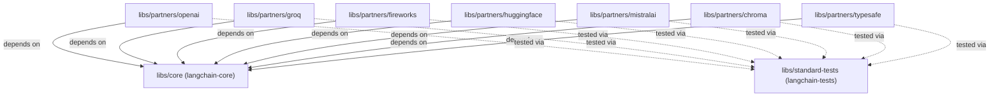
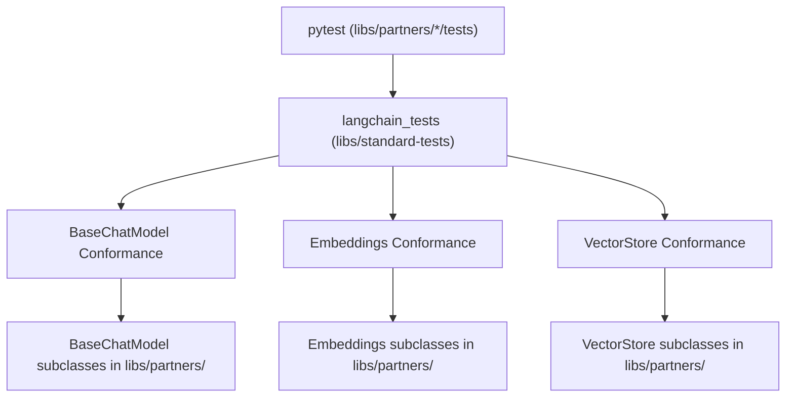
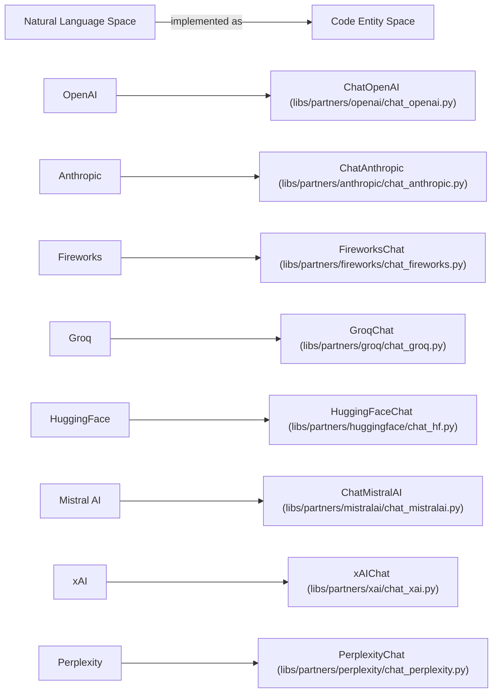
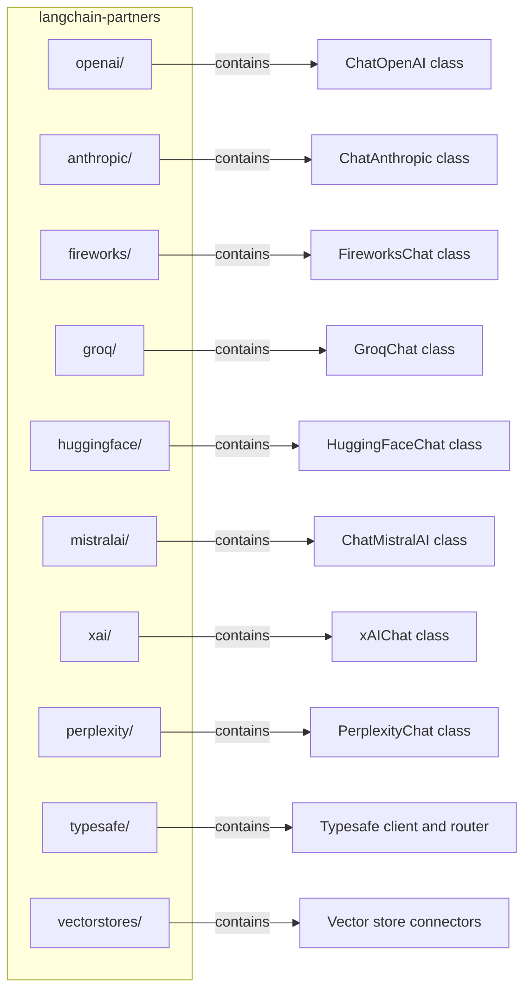

<!-- source: DeepWiki mcp.deepwiki.com · repo langchain-ai/langchain · page 5 Provider Integrations (libs/partners) · fetched 2026-10-26 -->

# Provider Integrations (libs/partners)

Relevant source files

The following files were used as context for generating this wiki page:

- [libs/partners/anthropic/Makefile](libs/partners/anthropic/Makefile)
- [libs/partners/chroma/Makefile](libs/partners/chroma/Makefile)
- [libs/partners/deepseek/Makefile](libs/partners/deepseek/Makefile)
- [libs/partners/deepseek/README.md](libs/partners/deepseek/README.md)
- [libs/partners/deepseek/pyproject.toml](libs/partners/deepseek/pyproject.toml)
- [libs/partners/deepseek/uv.lock](libs/partners/deepseek/uv.lock)
- [libs/partners/exa/Makefile](libs/partners/exa/Makefile)
- [libs/partners/fireworks/Makefile](libs/partners/fireworks/Makefile)
- [libs/partners/fireworks/README.md](libs/partners/fireworks/README.md)
- [libs/partners/fireworks/langchain_fireworks/_version.py](libs/partners/fireworks/langchain_fireworks/_version.py)
- [libs/partners/fireworks/pyproject.toml](libs/partners/fireworks/pyproject.toml)
- [libs/partners/fireworks/uv.lock](libs/partners/fireworks/uv.lock)
- [libs/partners/groq/Makefile](libs/partners/groq/Makefile)
- [libs/partners/groq/README.md](libs/partners/groq/README.md)
- [libs/partners/groq/pyproject.toml](libs/partners/groq/pyproject.toml)
- [libs/partners/groq/uv.lock](libs/partners/groq/uv.lock)
- [libs/partners/huggingface/Makefile](libs/partners/huggingface/Makefile)
- [libs/partners/huggingface/README.md](libs/partners/huggingface/README.md)
- [libs/partners/huggingface/pyproject.toml](libs/partners/huggingface/pyproject.toml)
- [libs/partners/huggingface/uv.lock](libs/partners/huggingface/uv.lock)
- [libs/partners/mistralai/Makefile](libs/partners/mistralai/Makefile)
- [libs/partners/mistralai/README.md](libs/partners/mistralai/README.md)
- [libs/partners/mistralai/pyproject.toml](libs/partners/mistralai/pyproject.toml)
- [libs/partners/mistralai/uv.lock](libs/partners/mistralai/uv.lock)
- [libs/partners/nomic/Makefile](libs/partners/nomic/Makefile)
- [libs/partners/ollama/Makefile](libs/partners/ollama/Makefile)
- [libs/partners/ollama/README.md](libs/partners/ollama/README.md)
- [libs/partners/openai/Makefile](libs/partners/openai/Makefile)
- [libs/partners/openai/README.md](libs/partners/openai/README.md)
- [libs/partners/perplexity/README.md](libs/partners/perplexity/README.md)
- [libs/partners/perplexity/pyproject.toml](libs/partners/perplexity/pyproject.toml)
- [libs/partners/perplexity/uv.lock](libs/partners/perplexity/uv.lock)
- [libs/partners/qdrant/Makefile](libs/partners/qdrant/Makefile)
- [libs/partners/xai/Makefile](libs/partners/xai/Makefile)
- [libs/partners/xai/README.md](libs/partners/xai/README.md)
- [libs/partners/xai/pyproject.toml](libs/partners/xai/pyproject.toml)
- [libs/partners/xai/uv.lock](libs/partners/xai/uv.lock)

## Purpose and Scope

This section provides a high-level overview of the partner integration packages located under `libs/partners/` in the LangChain monorepo. These packages separate third-party model and tool provider SDKs from `langchain-core` and primary runtime packages, allowing independent versioning, releasing, and dependency management.

Each package implements adapters that conform to LangChain’s core interfaces such as chat models, embeddings, or vector stores, facilitating seamless integration with external providers. Implementation details are available in the linked child pages.

---

## 1. Overview of Partner Package Architecture

Each partner integration under `libs/partners/` is an independent Python package managed with Hatchling and the `uv` tool. These packages specify dependencies including `langchain-core` and often other provider-specific SDKs, while sharing common test suites through `langchain-tests`. They maintain their own versioning and release cycles.

Dependencies on `langchain-core` enable these packages to implement core abstractions like `BaseChatModel` and `Embeddings`. The test packages (`langchain-tests`) provide standardized conformance tests used by all provider packages to validate compliance with LangChain interfaces.

*Figure 5.1: Partner Package Dependency Graph showing integration packages' dependence on `langchain-core` and testing with `langchain-tests`.*

Sources:  
- `libs/partners/mistralai/pyproject.toml:1-64`  
- `libs/partners/fireworks/pyproject.toml:1-78`  
- `libs/partners/groq/pyproject.toml:1-63`  

---

## 2. Child Pages and Integration Index

The `libs/partners/` directory contains packages for distinct third-party providers. Each package exposes wrappers for chat models, embeddings, clients, tools, or vector stores compatible with LangChain core abstractions.

### 5.1 OpenAI Integration  
Implements OpenAI chat models (`ChatOpenAI`, `BaseChatOpenAI`), managing Chat Completions vs Responses APIs, multiple output compatibility versions, client utilities, Codex, embeddings, and LLMs.  
*For details, see [OpenAI Integration](#5.1).*

### 5.2 Anthropic Integration  
Provides Anthropic API integration with message formatting, beta header support, built-in tools, cache middleware, and specialized output parsers.  
*For details, see [Anthropic Integration](#5.2).*

### 5.3 OpenAI-Compatible Providers  
Hosts OpenAI-compatible providers such as Groq, Fireworks, DeepSeek, xAI, Perplexity, and OpenRouter, providing compatibility layers to interchangeably use these within LangChain.  
*For details, see [OpenAI-Compatible Providers](#5.3).*

### 5.4 Local and Open-Source Providers  
Supports local and open-source models like Ollama and HuggingFace, including chat models, LLMs, embeddings, and pipelines for local hosting or external hubs.  
*For details, see [Local and Open-Source Providers](#5.4).*

### 5.5 Mistral AI Integration  
Targets Mistral AI, offering `ChatMistralAI` and embeddings. Utilizes `httpx` and `tokenizers` for efficient API calls and tokenizer handling.  
*For details, see [Mistral AI Integration](#5.5).*

### 5.6 Vector Stores and Retrieval Partners  
Comprises connectors for vector stores and retrieval systems including Chroma, Qdrant, Nomic embeddings, and Exa retrievers/tools enhancing search and lookup.  
*For details, see [Vector Stores and Retrieval Partners](#5.6).*

### 5.7 Typesafe Partner Package  
Features typesafe classifiers, clients, an experimental model router, and auto-mode middleware for robust model orchestration.  
*For details, see [Typesafe Partner Package](#5.7).*

---

## 3. Conformance and Validation

All partner packages run test suites leveraging the `langchain-tests` conformance tests to ensure adherence to LangChain interface contracts for chat models, embeddings, and vector stores.

*Figure 5.2: Test Workflow Executing Standard Conformance Test Suites on Partner Implementations.*

This ensures all external provider integrations reliably conform to expected behavior within the LangChain ecosystem.

Sources:  
- `libs/partners/mistralai/pyproject.toml:43-51`  
- `libs/partners/fireworks/pyproject.toml:43-55`  
- `libs/partners/groq/pyproject.toml:40-49`  

---

## 4. Bridging Natural Language Providers to Code Entities

To aid understanding and navigation, these diagrams map real-world natural language model providers to LangChain partner package code entities.

### 4.1 Natural Language Providers to LangChain Core Classes

*Figure 5.3: Mapping of Natural Language Providers to Their Corresponding Chat Model Classes in Code.*

### 4.2 LangChain Partners Directory Structure and Core Entities

*Figure 5.4: Directory Layout of Partner Packages Showing Key Provider Integration Entities.*

---

## Summary

The `libs/partners/` directory forms a modular architecture isolating third-party provider SDKs and integrations from the LangChain core. Each package follows a consistent build, dependency, and testing style, exposing models and connectors that conform strictly to LangChain core interfaces. This design enables independent evolution, robust testing, and easy swap-in/out of models or vector stores.

For detailed technical documentation on each integration, please refer to the corresponding child pages:

- [OpenAI Integration](#5.1)  
- [Anthropic Integration](#5.2)  
- [OpenAI-Compatible Providers](#5.3)  
- [Local and Open-Source Providers](#5.4)  
- [Mistral AI Integration](#5.5)  
- [Vector Stores and Retrieval Partners](#5.6)  
- [Typesafe Partner Package](#5.7)  

Sources:  
- `libs/partners/mistralai/pyproject.toml`  
- `libs/partners/fireworks/pyproject.toml`  
- `libs/partners/groq/pyproject.toml`  
- `libs/partners/huggingface/pyproject.toml`  
- `libs/partners/xai/pyproject.toml`  
- `libs/partners/perplexity/uv.lock`  
- Repository directory structure and file manifests

---

