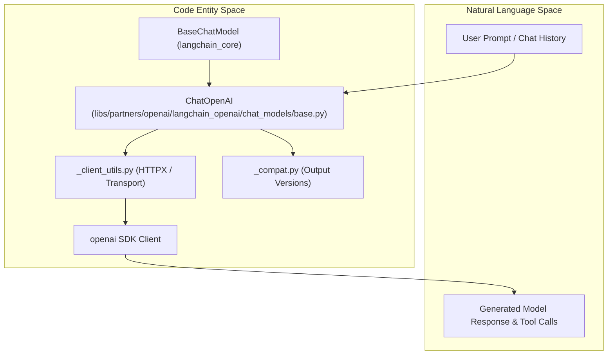
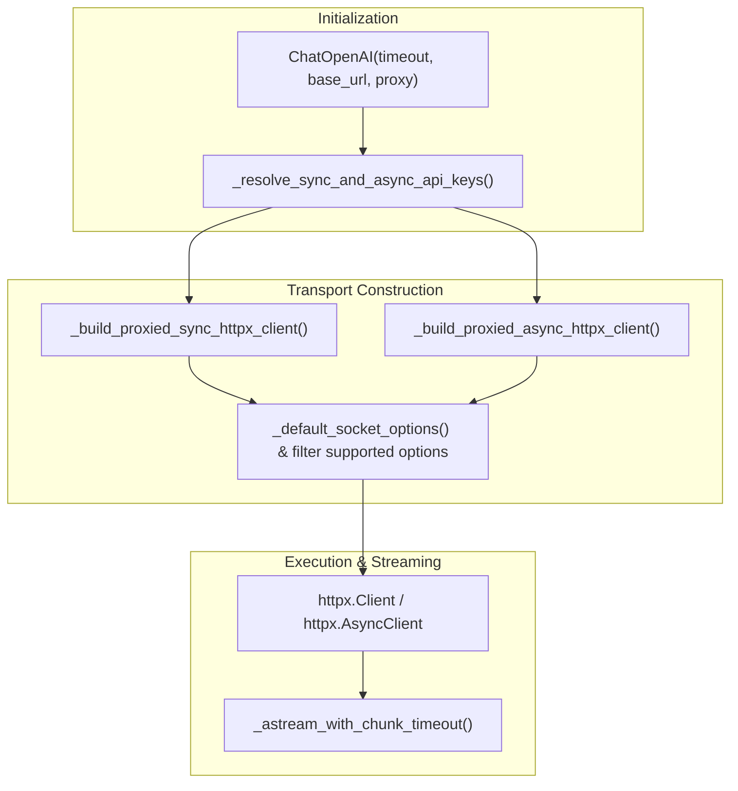
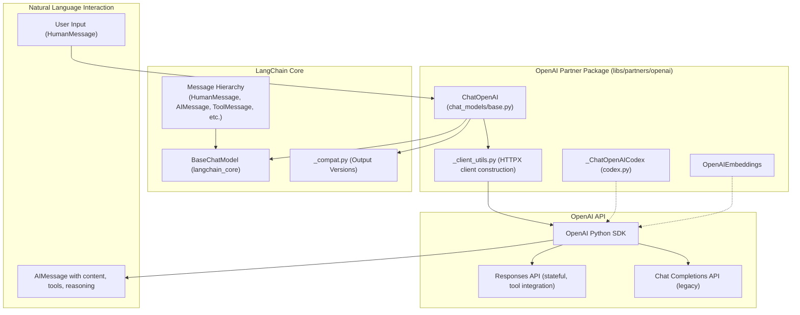

<!-- source: DeepWiki mcp.deepwiki.com · repo langchain-ai/langchain · page 5.1 OpenAI Integration · fetched 2026-10-26 -->

# OpenAI Integration

Relevant source files

The following files were used as context for generating this wiki page:

- [libs/partners/anthropic/tests/cassettes/test_system_tool_addition.yaml.gz](libs/partners/anthropic/tests/cassettes/test_system_tool_addition.yaml.gz)
- [libs/partners/openai/langchain_openai/__init__.py](libs/partners/openai/langchain_openai/__init__.py)
- [libs/partners/openai/langchain_openai/_compat.py](libs/partners/openai/langchain_openai/_compat.py)
- [libs/partners/openai/langchain_openai/_version.py](libs/partners/openai/langchain_openai/_version.py)
- [libs/partners/openai/langchain_openai/chat_models/__init__.py](libs/partners/openai/langchain_openai/chat_models/__init__.py)
- [libs/partners/openai/langchain_openai/chat_models/_client_utils.py](libs/partners/openai/langchain_openai/chat_models/_client_utils.py)
- [libs/partners/openai/langchain_openai/chat_models/_compat.py](libs/partners/openai/langchain_openai/chat_models/_compat.py)
- [libs/partners/openai/langchain_openai/chat_models/base.py](libs/partners/openai/langchain_openai/chat_models/base.py)
- [libs/partners/openai/langchain_openai/chat_models/codex.py](libs/partners/openai/langchain_openai/chat_models/codex.py)
- [libs/partners/openai/langchain_openai/chatgpt_oauth.py](libs/partners/openai/langchain_openai/chatgpt_oauth.py)
- [libs/partners/openai/pyproject.toml](libs/partners/openai/pyproject.toml)
- [libs/partners/openai/scripts/RECORD_CODEX_CASSETTES.md](libs/partners/openai/scripts/RECORD_CODEX_CASSETTES.md)
- [libs/partners/openai/tests/cassettes/test_system_additional_tools.yaml.gz](libs/partners/openai/tests/cassettes/test_system_additional_tools.yaml.gz)
- [libs/partners/openai/tests/integration_tests/chat_models/conftest.py](libs/partners/openai/tests/integration_tests/chat_models/conftest.py)
- [libs/partners/openai/tests/integration_tests/chat_models/test_azure.py](libs/partners/openai/tests/integration_tests/chat_models/test_azure.py)
- [libs/partners/openai/tests/integration_tests/chat_models/test_base.py](libs/partners/openai/tests/integration_tests/chat_models/test_base.py)
- [libs/partners/openai/tests/integration_tests/chat_models/test_codex.py](libs/partners/openai/tests/integration_tests/chat_models/test_codex.py)
- [libs/partners/openai/tests/integration_tests/chat_models/test_codex_standard.py](libs/partners/openai/tests/integration_tests/chat_models/test_codex_standard.py)
- [libs/partners/openai/tests/integration_tests/chat_models/test_responses_api.py](libs/partners/openai/tests/integration_tests/chat_models/test_responses_api.py)
- [libs/partners/openai/tests/integration_tests/llms/test_azure.py](libs/partners/openai/tests/integration_tests/llms/test_azure.py)
- [libs/partners/openai/tests/unit_tests/chat_models/test_base.py](libs/partners/openai/tests/unit_tests/chat_models/test_base.py)
- [libs/partners/openai/tests/unit_tests/chat_models/test_client_utils.py](libs/partners/openai/tests/unit_tests/chat_models/test_client_utils.py)
- [libs/partners/openai/tests/unit_tests/chat_models/test_codex.py](libs/partners/openai/tests/unit_tests/chat_models/test_codex.py)
- [libs/partners/openai/tests/unit_tests/chat_models/test_imports.py](libs/partners/openai/tests/unit_tests/chat_models/test_imports.py)
- [libs/partners/openai/tests/unit_tests/chat_models/test_stream_chunk_timeout.py](libs/partners/openai/tests/unit_tests/chat_models/test_stream_chunk_timeout.py)
- [libs/partners/openai/tests/unit_tests/test_chatgpt_oauth.py](libs/partners/openai/tests/unit_tests/test_chatgpt_oauth.py)
- [libs/partners/openai/tests/unit_tests/test_compat.py](libs/partners/openai/tests/unit_tests/test_compat.py)
- [libs/partners/openai/tests/unit_tests/test_imports.py](libs/partners/openai/tests/unit_tests/test_imports.py)
- [libs/partners/openai/tests/unit_tests/test_secrets.py](libs/partners/openai/tests/unit_tests/test_secrets.py)
- [libs/partners/openai/uv.lock](libs/partners/openai/uv.lock)

## Purpose and Scope

The `langchain-openai` partner package located at `libs/partners/openai/` bridges OpenAI's API and models with LangChain's core abstractions. It provides comprehensive support for OpenAI chat models (`ChatOpenAI`), legacy completion models, embeddings, and specialized runtimes such as Codex. This integration is designed to manage modern OpenAI features like function calling, tool integration, and the new Responses API while maintaining backward compatibility and extensibility `[libs/partners/openai/pyproject.toml:5-30](), [libs/partners/openai/langchain_openai/chat_models/base.py:1-236]()`.

This page serves as a high-level overview of the OpenAI integration focusing on:

- The `ChatOpenAI` chat model wrapper and related architecture.
- Differences between the Chat Completions and Responses APIs.
- The output version compatibility framework.
- Utilities managing HTTP clients and transport layers.
- Legacy support for Codex and embeddings.

For detailed technical exploration of Azure wrappers, embeddings/LLMs, and testing infrastructure, see the child pages:
- [Azure OpenAI and Embeddings/LLMs](#5.1.1)
- [OpenAI Test Suite, Cassettes and Snapshots](#5.1.2)

---

## 1. ChatOpenAI and Model Architecture

`ChatOpenAI` is the principal class encapsulating OpenAI chat model interactions, extending the base LangChain chat model abstraction `BaseChatModel` from `langchain-core`. It translates between LangChain message types (`HumanMessage`, `AIMessage`, `SystemMessage`, `ToolMessage`) and OpenAI's native chat request and response formats.

Its responsibilities include:

- Serialization of LangChain messages into OpenAI API request structures.
- Parsing streamed or batched OpenAI API responses into LangChain message and generation types.
- Managing tool calls, function calling, and embedding reasoning or refusal information inside message content.
- Utilizing model profiles for default parameters, token limits, and capability flags.

Internally, `ChatOpenAI` relies on dedicated client utilities for HTTP transport configuration and a compatibility layer for handling evolving output message formats.

Sources:  
`[libs/partners/openai/langchain_openai/chat_models/base.py:65-236]()`,  
`[libs/partners/openai/langchain_openai/chat_models/_client_utils.py:1-184]()`

---

## 2. Chat Completions vs. Responses API

`ChatOpenAI` supports two principal interaction modes with OpenAI's services:

- **Chat Completions API**: The standard, stateless chat interaction delivering text or function call completions. It sends chat messages and receives completions in a synchronous request-response style.

- **Responses API**: A newer OpenAI service with stateful chat context support and deeper tool integration. It supports passing a `previous_response_id` for maintaining conversation state, and leverages extended response formats with embedded reasoning, rich annotations, and built-in preview tools like `web_search_preview`.

Users enable the Responses API support in `ChatOpenAI` by setting the `use_responses_api=True` flag. Internally, this switches message serialization, request construction, and streaming logic to accommodate the Responses API format and semantics.

This API evolution enhances structured output, multi-tool orchestration, and longer context management `[libs/partners/openai/tests/integration_tests/chat_models/test_responses_api.py:83-160]()`

---

## 3. Output Versions and Compatibility Layer

To support both historical and current OpenAI response formats, the integration defines an `output_version` parameter controlling the format of `AIMessage` content:

| Output Version     | Description                                                                                   |
|--------------------|-----------------------------------------------------------------------------------------------|
| `None` or `'v0'`   | Legacy style (v0.3) encoding reasoning, tool outputs, and refusal data inside `additional_kwargs` of the `AIMessage`. This preserves backward compatibility with early LangChain/OpenAI models `[libs/partners/openai/langchain_openai/chat_models/_compat.py:91-159]()`. |
| `'responses/v1'`   | Native Responses API style where reasoning, refusals, and tool calls appear as distinct content blocks within the top-level `AIMessage.content` list. This preserves message sequencing and supports richer metadata `[libs/partners/openai/langchain_openai/chat_models/_compat.py:35-59]()`. |

The `_compat.py` module provides functions to convert between these formats dynamically. This abstraction allows `ChatOpenAI` to surface a consistent interface while embracing the latest OpenAI features and formats without breaking existing code.

---

## 4. Client Utilities and HTTP Transport Tuning

HTTP communication with OpenAI is handled through reusable, cached clients leveraging the `httpx` library:

- Clients are constructed with environmental proxy awareness and configurable timeout settings.
- Socket options like `TCP_KEEPALIVE` and Linux-specific options like `TCP_USER_TIMEOUT` are applied when supported to improve network reliability.
- Separate sync and async clients are provided for blocking and asynchronous invocation paths.
- A wrapper enforces a per-chunk timeout on streaming SSE responses to avoid stalled token generation.

This careful design balances performance, reliability, and user configurability while minimizing overhead on repeated instantiations `[libs/partners/openai/langchain_openai/chat_models/_client_utils.py:1-184]()`, `[libs/partners/openai/langchain_openai/chat_models/base.py:149-161]()`.

---

## 5. Codex, Embeddings, and Legacy LLMs

Beyond chat-centric functionality, `langchain-openai` provides support for:

- **Codex Models:** Specialized wrappers for OpenAI Codex code generation models that support streaming code completions and OAuth-based authorization. This enables integration with code synthesis workflows `[libs/partners/openai/langchain_openai/chat_models/codex.py]()`.
- **Embeddings:** Embeddings classes (e.g., `OpenAIEmbeddings`) connect OpenAI's text embedding endpoints with LangChain vector store and retrieval abstractions.
- **Legacy Completion Models:** Support for older OpenAI text completion APIs alongside chat models, allowing a unified user experience and a migration path as OpenAI evolves.

This multi-model support provides comprehensive coverage for diverse OpenAI use cases inside LangChain.

---

## Child Pages

For further detailed reading on specific facets of the OpenAI integration, consult the following sub-pages:

- **[Azure OpenAI and Embeddings/LLMs](#5.1.1)**  
  Covers the Azure-specific `AzureChatOpenAI` subclass, Azure identity authentication, deployment configuration, API versioning, and embeddings adaptations.

- **[OpenAI Test Suite, Cassettes and Snapshots](#5.1.2)**  
  Details the extensive testing framework including streaming tests, VCR cassette recording for API responses, snapshot-based integration testing, and fixtures for robust quality assurance of the OpenAI integration.

---

# Summary Diagram: LangChain OpenAI Integration Components

Sources:  
- `[libs/partners/openai/langchain_openai/chat_models/base.py:1-236]()`  
- `[libs/partners/openai/langchain_openai/chat_models/_compat.py:1-178]()`  
- `[libs/partners/openai/langchain_openai/chat_models/_client_utils.py:1-184]()`  
- `[libs/partners/openai/pyproject.toml:5-30]()`  
- `[libs/partners/openai/langchain_openai/chat_models/codex.py:1-140]()`  
- `[libs/partners/openai/tests/integration_tests/chat_models/test_responses_api.py:1-191]()`  
- `[libs/partners/openai/tests/integration_tests/chat_models/test_base.py:1-196]()`

---

