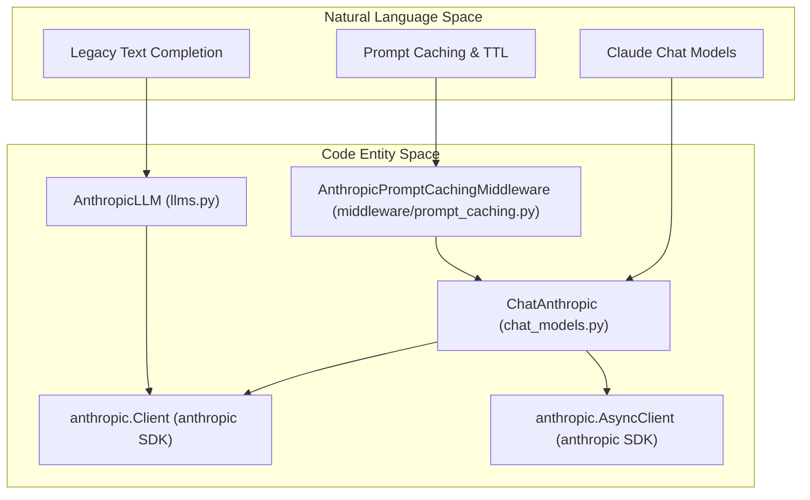
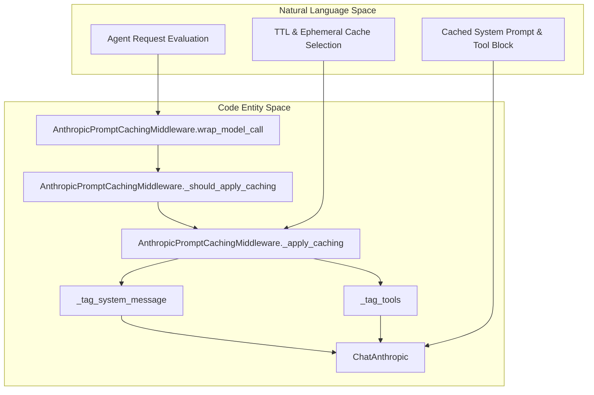

<!-- source: DeepWiki mcp.deepwiki.com · repo langchain-ai/langchain · page 5.2 Anthropic Integration · fetched 2026-10-26 -->

# Anthropic Integration

Relevant source files

The following files were used as context for generating this wiki page:

- [libs/core/langchain_core/messages/block_translators/anthropic.py](libs/core/langchain_core/messages/block_translators/anthropic.py)
- [libs/core/tests/unit_tests/messages/block_translators/test_anthropic.py](libs/core/tests/unit_tests/messages/block_translators/test_anthropic.py)
- [libs/core/tests/unit_tests/messages/test_ai.py](libs/core/tests/unit_tests/messages/test_ai.py)
- [libs/partners/anthropic/README.md](libs/partners/anthropic/README.md)
- [libs/partners/anthropic/langchain_anthropic/_compat.py](libs/partners/anthropic/langchain_anthropic/_compat.py)
- [libs/partners/anthropic/langchain_anthropic/_version.py](libs/partners/anthropic/langchain_anthropic/_version.py)
- [libs/partners/anthropic/langchain_anthropic/chat_models.py](libs/partners/anthropic/langchain_anthropic/chat_models.py)
- [libs/partners/anthropic/langchain_anthropic/data/profile_augmentations.toml](libs/partners/anthropic/langchain_anthropic/data/profile_augmentations.toml)
- [libs/partners/anthropic/langchain_anthropic/experimental.py](libs/partners/anthropic/langchain_anthropic/experimental.py)
- [libs/partners/anthropic/langchain_anthropic/llms.py](libs/partners/anthropic/langchain_anthropic/llms.py)
- [libs/partners/anthropic/langchain_anthropic/output_parsers.py](libs/partners/anthropic/langchain_anthropic/output_parsers.py)
- [libs/partners/anthropic/pyproject.toml](libs/partners/anthropic/pyproject.toml)
- [libs/partners/anthropic/scripts/check_version.py](libs/partners/anthropic/scripts/check_version.py)
- [libs/partners/anthropic/tests/integration_tests/test_chat_models.py](libs/partners/anthropic/tests/integration_tests/test_chat_models.py)
- [libs/partners/anthropic/tests/integration_tests/test_llms.py](libs/partners/anthropic/tests/integration_tests/test_llms.py)
- [libs/partners/anthropic/tests/unit_tests/test_chat_models.py](libs/partners/anthropic/tests/unit_tests/test_chat_models.py)
- [libs/partners/anthropic/tests/unit_tests/test_compat.py](libs/partners/anthropic/tests/unit_tests/test_compat.py)
- [libs/partners/anthropic/tests/unit_tests/test_output_parsers.py](libs/partners/anthropic/tests/unit_tests/test_output_parsers.py)
- [libs/partners/anthropic/tests/unit_tests/test_sonnet55.py](libs/partners/anthropic/tests/unit_tests/test_sonnet55.py)
- [libs/partners/anthropic/uv.lock](libs/partners/anthropic/uv.lock)

The `langchain-anthropic` package (`libs/partners/anthropic/pyproject.toml`) provides official LangChain integrations for Anthropic's Claude models. It bridges LangChain's core abstractions with the native Anthropic Python SDK, supporting advanced features such as chat message formatting, beta headers for experimental API features, built-in tools integration, middleware-based prompt caching, and robust output parsers for structured tool calling. A deprecated legacy text completion wrapper is also included for backward compatibility.

---

## 1. Package Layout and Dependencies

The `langchain-anthropic` package resides in `libs/partners/anthropic/` inside the LangChain monorepo. It manages dependencies and workspace links through standard `pyproject.toml` and lock files (`uv.lock`).

Key dependencies include:

- `anthropic` Python SDK (version >=0.120.0, <2.0.0),
- `langchain-core` (version >=1.6.6, <2.0.0),
- `pydantic` (version >=2.7.4, <3.0.0)

Development and testing utilize various tools such as `pytest`, `vcrpy` for HTTP interaction recording, and `langchain-tests` for integration tests (`libs/partners/anthropic/pyproject.toml:25-59`).

*Figure 1: Mapping between LangChain's Anthropic integration components and the Anthropic SDK.*

Sources: `libs/partners/anthropic/pyproject.toml`, `libs/partners/anthropic/langchain_anthropic/chat_models.py`, `libs/partners/anthropic/langchain_anthropic/middleware/prompt_caching.py`, `libs/partners/anthropic/langchain_anthropic/llms.py`

---

## 2. ChatAnthropic and Message Formatting

At the core of the integration is the `ChatAnthropic` class, implemented in `chat_models.py`. It provides a LangChain `BaseChatModel` interface to Anthropic Claude models. This class handles:

- Converting LangChain's standardized message types (`HumanMessage`, `SystemMessage`, `AIMessage`, `ToolMessage`) into Anthropic's expected message format with precise role mapping (`_message_type_lookups`).

- Managing both synchronous (`anthropic.Client`) and asynchronous (`anthropic.AsyncClient`) API calls.

- Emitting detailed usage metadata (`UsageMetadata`) that tracks tokens consumed.

- Streaming generation support with chunked responses (`AIMessageChunk` aggregation).

- Injecting LangSmith gateway metadata observed on API responses into LangChain's callback events to surface rich diagnostic data (`_add_gateway_metadata`).

`ChatAnthropic` also supports modern API beta headers and built-in tool usage seamlessly (see next sections).

The legacy `AnthropicLLM` class in `llms.py` provides traditional text completion capabilities but is deprecated in favor of `ChatAnthropic`'s modern chat completions and should be avoided for new code.

Sources: `libs/partners/anthropic/langchain_anthropic/chat_models.py`, `libs/partners/anthropic/langchain_anthropic/llms.py`

---

## 3. Beta Headers and Built-in Tools

Anthropic has introduced multiple experimental features requiring "beta" headers in API requests. `langchain-anthropic` manages these via:

- A mapping `_TOOL_TYPE_TO_BETA` that associates tool type strings (e.g., `"computer_20250124"`, `"web_fetch_20250910"`, `"advisor_20260301"`) with their required beta header tokens which enable access to these preview features.

- A collection `_BUILTIN_TOOL_PREFIXES` used to detect built-in tool invocations that require special passthrough handling, bypassing the usual tool conversion to ensure the original tool definition is sent to the Anthropic API.

When `ChatAnthropic` sends requests invoking these built-in tools, it applies the appropriate beta header to enable Anthropic's feature flag for that tool, ensuring correct access and behavior. This mechanism supports new Anthropic capabilities like code execution, web search, memory management, and advisory tools within the LangChain framework.

Sources: `libs/partners/anthropic/langchain_anthropic/chat_models.py:180-208`

---

## 4. Prompt Caching and Middleware Overview

To optimize multi-turn interactions and reduce token consumption, `langchain-anthropic` implements advanced prompt caching middleware:

- The `AnthropicPromptCachingMiddleware` (found in `middleware/prompt_caching.py`) intercepts model calls and identifies stable prompt parts, such as system messages and contiguous tool declarations, as cache candidates.

- It adds ephemeral cache control tokens and manages TTL settings to allow efficient reuse of these stable prompt components across calls.

- The middleware integrates tightly with model settings for cache propagations and influences prompt construction transparently to the user.

- This caching strategy is critical in reducing redundant token costs in agent loops, especially when invoking built-in tools or repeated system instructions.

*Figure 2: Execution flow of the Anthropic prompt caching middleware during agent model calls.*

For detailed designs, hook implementations, and related middleware including tooling support, please see the dedicated child page:

- [Anthropic Middleware (Prompt Caching, Tools)](#5.2.1)

Sources: `libs/partners/anthropic/langchain_anthropic/middleware/prompt_caching.py`

---

## 5. Output Parsers and Tool Calling

`ChatAnthropic` supports LangChain's structured output parsing framework, enabling sophisticated tool calling workflows:

- Output parsers such as `ToolsOutputParser` parse tool invocation information encoded in Anthropic chat message blocks (e.g., `"tool_use"` blocks). They extract, validate, and transform this data into executable tool calls or Pydantic-validated arguments.

- Custom `AnthropicTool` definitions provide a schema to convert from LangChain tool formats, Pydantic models, or plain functions into Anthropic's own tool schema. This supports compliance with Anthropic's input validation, deferred tool loading, cache controls, and caller restrictions.

- This parsing capability enables LangChain agents to invoke external or built-in tools seamlessly, preserving rigorous type safety and flexible extensions.

The output parsing system also converts between LangChain's internal content block formats and Anthropic-specific formats, managing compatibility and ensuring reliable serialization/deserialization of messages and tool usage.

Sources:  
`libs/partners/anthropic/langchain_anthropic/chat_models.py`,  
`libs/partners/anthropic/langchain_anthropic/output_parsers.py`

---

# Summary

The `langchain-anthropic` package is a comprehensive integration that:

- Provides a first-class `ChatAnthropic` chat model interface for Anthropic Claude models, with detailed message and usage handling.

- Manages beta headers automatically to enable Anthropic's evolving suite of built-in tools and experimental API features.

- Implements sophisticated prompt caching middleware to optimize multi-turn agent interactions and token efficiency.

- Integrates rich output parsers for structured tool invocation supporting both user-defined and built-in Anthropic tools.

- Includes a deprecated legacy LLM wrapper for text completions for backward compatibility.

For a deep dive into middleware and tooling specifics, please visit the child page:

- [Anthropic Middleware (Prompt Caching, Tools)](#5.2.1)

---

Sources:  
`libs/partners/anthropic/pyproject.toml`  
`libs/partners/anthropic/langchain_anthropic/chat_models.py`  
`libs/partners/anthropic/langchain_anthropic/llms.py`  
`libs/partners/anthropic/langchain_anthropic/middleware/prompt_caching.py`  
`libs/partners/anthropic/langchain_anthropic/output_parsers.py`

---

