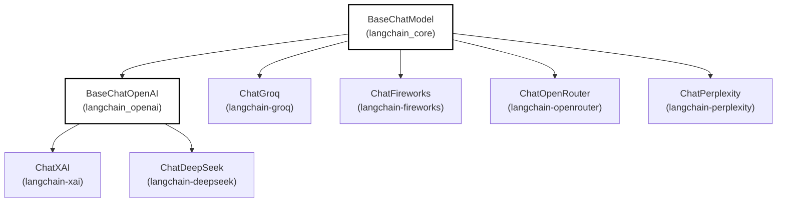

<!-- source: DeepWiki mcp.deepwiki.com · repo langchain-ai/langchain · page 5.3 OpenAI-Compatible Providers · fetched 2026-10-26 -->

# OpenAI-Compatible Providers

<details>
<summary>Relevant source files</summary>

The following files were used as context for generating this wiki page:

- [libs/partners/deepseek/langchain_deepseek/chat_models.py](libs/partners/deepseek/langchain_deepseek/chat_models.py)
- [libs/partners/deepseek/scripts/check_imports.py](libs/partners/deepseek/scripts/check_imports.py)
- [libs/partners/deepseek/tests/integration_tests/test_chat_models.py](libs/partners/deepseek/tests/integration_tests/test_chat_models.py)
- [libs/partners/deepseek/tests/integration_tests/test_compile.py](libs/partners/deepseek/tests/integration_tests/test_compile.py)
- [libs/partners/deepseek/tests/unit_tests/test_chat_models.py](libs/partners/deepseek/tests/unit_tests/test_chat_models.py)
- [libs/partners/fireworks/langchain_fireworks/chat_models.py](libs/partners/fireworks/langchain_fireworks/chat_models.py)
- [libs/partners/fireworks/langchain_fireworks/data/profile_augmentations.toml](libs/partners/fireworks/langchain_fireworks/data/profile_augmentations.toml)
- [libs/partners/fireworks/langchain_fireworks/embeddings.py](libs/partners/fireworks/langchain_fireworks/embeddings.py)
- [libs/partners/fireworks/langchain_fireworks/llms.py](libs/partners/fireworks/langchain_fireworks/llms.py)
- [libs/partners/fireworks/langchain_fireworks/middleware/__init__.py](libs/partners/fireworks/langchain_fireworks/middleware/__init__.py)
- [libs/partners/fireworks/langchain_fireworks/middleware/prompt_caching.py](libs/partners/fireworks/langchain_fireworks/middleware/prompt_caching.py)
- [libs/partners/fireworks/tests/integration_tests/test_chat_models.py](libs/partners/fireworks/tests/integration_tests/test_chat_models.py)
- [libs/partners/fireworks/tests/integration_tests/test_compile.py](libs/partners/fireworks/tests/integration_tests/test_compile.py)
- [libs/partners/fireworks/tests/integration_tests/test_llms.py](libs/partners/fireworks/tests/integration_tests/test_llms.py)
- [libs/partners/fireworks/tests/integration_tests/test_standard.py](libs/partners/fireworks/tests/integration_tests/test_standard.py)
- [libs/partners/fireworks/tests/unit_tests/middleware/__init__.py](libs/partners/fireworks/tests/unit_tests/middleware/__init__.py)
- [libs/partners/fireworks/tests/unit_tests/middleware/test_prompt_caching.py](libs/partners/fireworks/tests/unit_tests/middleware/test_prompt_caching.py)
- [libs/partners/fireworks/tests/unit_tests/test_chat_models.py](libs/partners/fireworks/tests/unit_tests/test_chat_models.py)
- [libs/partners/fireworks/tests/unit_tests/test_embeddings.py](libs/partners/fireworks/tests/unit_tests/test_embeddings.py)
- [libs/partners/fireworks/tests/unit_tests/test_embeddings_standard.py](libs/partners/fireworks/tests/unit_tests/test_embeddings_standard.py)
- [libs/partners/fireworks/tests/unit_tests/test_llms.py](libs/partners/fireworks/tests/unit_tests/test_llms.py)
- [libs/partners/fireworks/tests/unit_tests/test_standard.py](libs/partners/fireworks/tests/unit_tests/test_standard.py)
- [libs/partners/groq/langchain_groq/chat_models.py](libs/partners/groq/langchain_groq/chat_models.py)
- [libs/partners/groq/scripts/check_imports.py](libs/partners/groq/scripts/check_imports.py)
- [libs/partners/groq/tests/cassettes/test_code_interpreter.yaml.gz](libs/partners/groq/tests/cassettes/test_code_interpreter.yaml.gz)
- [libs/partners/groq/tests/integration_tests/test_chat_models.py](libs/partners/groq/tests/integration_tests/test_chat_models.py)
- [libs/partners/groq/tests/integration_tests/test_compile.py](libs/partners/groq/tests/integration_tests/test_compile.py)
- [libs/partners/groq/tests/integration_tests/test_standard.py](libs/partners/groq/tests/integration_tests/test_standard.py)
- [libs/partners/groq/tests/unit_tests/fake/callbacks.py](libs/partners/groq/tests/unit_tests/fake/callbacks.py)
- [libs/partners/groq/tests/unit_tests/test_chat_models.py](libs/partners/groq/tests/unit_tests/test_chat_models.py)
- [libs/partners/groq/tests/unit_tests/test_standard.py](libs/partners/groq/tests/unit_tests/test_standard.py)
- [libs/partners/openai/langchain_openai/data/profile_augmentations.toml](libs/partners/openai/langchain_openai/data/profile_augmentations.toml)
- [libs/partners/openrouter/langchain_openrouter/_version.py](libs/partners/openrouter/langchain_openrouter/_version.py)
- [libs/partners/openrouter/langchain_openrouter/chat_models.py](libs/partners/openrouter/langchain_openrouter/chat_models.py)
- [libs/partners/openrouter/pyproject.toml](libs/partners/openrouter/pyproject.toml)
- [libs/partners/openrouter/tests/integration_tests/test_chat_models.py](libs/partners/openrouter/tests/integration_tests/test_chat_models.py)
- [libs/partners/openrouter/tests/integration_tests/test_standard.py](libs/partners/openrouter/tests/integration_tests/test_standard.py)
- [libs/partners/openrouter/tests/unit_tests/__snapshots__/test_standard.ambr](libs/partners/openrouter/tests/unit_tests/__snapshots__/test_standard.ambr)
- [libs/partners/openrouter/tests/unit_tests/test_chat_models.py](libs/partners/openrouter/tests/unit_tests/test_chat_models.py)
- [libs/partners/openrouter/tests/unit_tests/test_standard.py](libs/partners/openrouter/tests/unit_tests/test_standard.py)
- [libs/partners/openrouter/uv.lock](libs/partners/openrouter/uv.lock)
- [libs/partners/perplexity/langchain_perplexity/_utils.py](libs/partners/perplexity/langchain_perplexity/_utils.py)
- [libs/partners/perplexity/langchain_perplexity/chat_models.py](libs/partners/perplexity/langchain_perplexity/chat_models.py)
- [libs/partners/perplexity/langchain_perplexity/retrievers.py](libs/partners/perplexity/langchain_perplexity/retrievers.py)
- [libs/partners/perplexity/langchain_perplexity/tools.py](libs/partners/perplexity/langchain_perplexity/tools.py)
- [libs/partners/perplexity/langchain_perplexity/types.py](libs/partners/perplexity/langchain_perplexity/types.py)
- [libs/partners/perplexity/tests/integration_tests/test_chat_models.py](libs/partners/perplexity/tests/integration_tests/test_chat_models.py)
- [libs/partners/perplexity/tests/integration_tests/test_chat_models_standard.py](libs/partners/perplexity/tests/integration_tests/test_chat_models_standard.py)
- [libs/partners/perplexity/tests/integration_tests/test_search_api.py](libs/partners/perplexity/tests/integration_tests/test_search_api.py)
- [libs/partners/perplexity/tests/unit_tests/test_chat_models.py](libs/partners/perplexity/tests/unit_tests/test_chat_models.py)
- [libs/partners/perplexity/tests/unit_tests/test_chat_models_responses.py](libs/partners/perplexity/tests/unit_tests/test_chat_models_responses.py)
- [libs/partners/xai/langchain_xai/chat_models.py](libs/partners/xai/langchain_xai/chat_models.py)
- [libs/partners/xai/langchain_xai/data/profile_augmentations.toml](libs/partners/xai/langchain_xai/data/profile_augmentations.toml)
- [libs/partners/xai/tests/integration_tests/test_chat_models.py](libs/partners/xai/tests/integration_tests/test_chat_models.py)
- [libs/partners/xai/tests/integration_tests/test_chat_models_standard.py](libs/partners/xai/tests/integration_tests/test_chat_models_standard.py)
- [libs/partners/xai/tests/unit_tests/test_chat_models.py](libs/partners/xai/tests/unit_tests/test_chat_models.py)
- [libs/partners/xai/tests/unit_tests/test_chat_models_standard.py](libs/partners/xai/tests/unit_tests/test_chat_models_standard.py)

</details>


This wiki page covers the technical architecture, class structures, error translation, and feature integration of OpenAI-compatible chat model providers in LangChain (`libs/partners`). This includes Groq, Fireworks, DeepSeek, xAI, Perplexity, and OpenRouter.

---

## 1. Architectural Patterns for OpenAI-Compatible Wrappers

LangChain integrates non-OpenAI providers that implement OpenAI-compatible APIs or expose vendor-specific Python SDKs mainly via two inheritance patterns:

1. **Direct `BaseChatOpenAI` Subclassing**  
   Providers that have close wire-protocol compatibility with OpenAI's Chat Completions endpoint subclass `BaseChatOpenAI` from `langchain_openai`. This inheritance allows sharing of sophisticated features — such as request batching, streaming, OpenAI-style tool calling, and support for OpenAI-specific kwargs — with minimal wrapping overhead. Examples:  
   - `ChatXAI`  
   - `ChatDeepSeek`

2. **Direct `BaseChatModel` Subclassing with Vendor SDKs**  
   Providers that require non-trivial request/response translation or use their own SDKs inherit directly from `BaseChatModel` (`langchain_core.language_models.chat_models.BaseChatModel`). These define custom request formatting, response parsing, and specialized error handling tailored to each SDK. Examples:  
   - `ChatGroq`  
   - `ChatFireworks`  
   - `ChatPerplexity`  
   - `ChatOpenRouter`


*Figure 1: Class inheritance hierarchy bridging core LangChain abstractions to OpenAI-compatible chat model implementations.*

Sources:  
`libs/partners/xai/langchain_xai/chat_models.py:1-199`(),  
`libs/partners/deepseek/langchain_deepseek/chat_models.py:1-203`(),  
`libs/partners/groq/langchain_groq/chat_models.py:1-190`(),  
`libs/partners/fireworks/langchain_fireworks/chat_models.py:1-215`(),  
`libs/partners/openrouter/langchain_openrouter/chat_models.py:1-195`(),  
`libs/partners/perplexity/langchain_perplexity/chat_models.py:1-193`()

---

## 2. Provider-Specific Implementations

### Groq (`langchain-groq`)

`ChatGroq` provides LangChain integration for Groq LLMs using the official `groq` Python SDK. It implements custom request format translation and response parsing independent of OpenAI.

- **Key Features**:  
  - Supports `reasoning_format` parameter allowing control over the reasoning content output style:
    - `'parsed'`: Places reasoning in `additional_kwargs.reasoning_content` of the message for structured reasoning extraction.
    - `'raw'`: Embeds reasoning inline with `<think>` tags.
    - `'hidden'`: Suppresses reasoning content in the response.
    
    These behaviors are controlled internally during request construction and response parsing [libs/partners/groq/langchain_groq/chat_models.py:151-163]().
  - Error handling promotes Groq-specific 400 `BadRequestError`s caused by context length overflow to a specialized `GroqContextOverflowError` (which subclasses LangChain's `ContextOverflowError`). The `_handle_groq_invalid_request` function examines error messages for known overflow indicators and raises this exception for graceful handling [libs/partners/groq/langchain_groq/chat_models.py:93-123]().
  - Provides environment variable configuration (`GROQ_API_KEY`).

- **Example usage**:
```python
from langchain_groq import ChatGroq
from langchain_core.messages import HumanMessage

model = ChatGroq(
    model="openai/gpt-oss-20b",
    temperature=0.7,
    max_tokens=100,
    reasoning_format='parsed',
)
response = model.invoke([HumanMessage(content="Hello Groq!")])
```

Sources:  
`libs/partners/groq/langchain_groq/chat_models.py:1-190`()

---

### Fireworks (`langchain-fireworks`)

`ChatFireworks` wraps the Fireworks vendor SDK (generated via Stainless) by subclassing `BaseChatModel` and managing complex request/response adaptations:

- **Content Sanitization**:  
  Before sending chat completions, `_sanitize_chat_completions_content` strips LangChain-generated IDs from text blocks as Fireworks rejects unknown keys on message parts, ensuring strict API compatibility [libs/partners/fireworks/tests/unit_tests/test_chat_models.py:164-181]().

- **Dynamic Schema Introspection**:  
  `_allowed_content_part_keys()` dynamically infers the allowed keys in Fireworks' content parts by parsing the imported Stainless client's TypedDict annotations at runtime. This guards against drifting API schemas and prevents silent incompatibilities [libs/partners/fireworks/langchain_fireworks/chat_models.py:199-213]().

- **Error Mapping**: Captures Fireworks SDK exceptions (like `BadRequestError`, `APIConnectionError`, `AuthenticationError`) and maps them to LangChain core exceptions (`ContextOverflowError`, `ModelAuthenticationError`, `ModelConnectionError`, etc.) for consistent error handling.

- Requires `FIREWORKS_API_KEY` in environment.

Sources:  
`libs/partners/fireworks/langchain_fireworks/chat_models.py:1-215`(),  
`libs/partners/fireworks/tests/unit_tests/test_chat_models.py:160-181`()

---

### DeepSeek (`langchain-deepseek`)

`ChatDeepSeek` subclasses `BaseChatOpenAI` to reuse OpenAI-compatible features and extends them with DeepSeek-specific behavior:

- **Prompt Cache Token Accounting**:  
  DeepSeek returns caching usage tokens at the top level (`prompt_cache_hit_tokens`, `prompt_cache_miss_tokens`) instead of nested like OpenAI.  
  `_get_prompt_cache_hit_tokens()` reads the cache hit tokens from response data, while `_add_cache_read_tokens()` injects this count under `"cache_read"` in the usage metadata of `AIMessage` [libs/partners/deepseek/langchain_deepseek/chat_models.py:49-108]().  
  This integration lets downstream tooling accurately reason about prompt caching benefits.

- Requires environment variable `DEEPSEEK_API_KEY`.

Sources:  
`libs/partners/deepseek/langchain_deepseek/chat_models.py:110-203`()

---

### xAI (`langchain-xai`)

`ChatXAI` subclasses `BaseChatOpenAI` to integrate with xAI's Grok-style chat models:

- **Stop Parameter Handling**:  
  The `_model_rejects_stop` method uses name pattern matching to decide whether to exclude the OpenAI `stop` parameter for some Grok models that reject it, avoiding runtime errors (e.g., models starting with `"grok-3"`, `"grok-4"`, or containing `"grok-code-fast"`) [libs/partners/xai/langchain_xai/chat_models.py:44-59]().
  
- Supports standard OpenAI-like parameters and streaming.

- Environment variable to configure is `XAI_API_KEY`.

Sources:  
`libs/partners/xai/langchain_xai/chat_models.py:61-199`()

---

### Perplexity (`langchain-perplexity`)

`ChatPerplexity` inherits directly from `BaseChatModel` and routes requests either to Perplexity's Chat Completions API or Responses (Agent) API, based on presence of agent-like keys:

- **API Routing Logic**:  
  If any keys in `_RESPONSES_ONLY_ARGS` (e.g., `"instructions"`, `"include"`, `"previous_response_id"`) or built-in tool types are found in the request, the call routes through `perplexity.Perplexity.responses.create()` to enable agent features. Otherwise, calls go to `perplexity.Perplexity.chat.completions()` [libs/partners/perplexity/langchain_perplexity/chat_models.py:114-175]().

- **Parameter Filtering**:  
  Sampling/control parameters like `temperature`, `top_p`, `stop` are dropped with logged warnings when forwarding to the Responses API because it rejects them [libs/partners/perplexity/langchain_perplexity/chat_models.py:148-164]().

- Requires API key configured according to provider docs (details not shown here).

Sources:  
`libs/partners/perplexity/langchain_perplexity/chat_models.py:1-193`()

---

### OpenRouter (`langchain-openrouter`)

`ChatOpenRouter` subclasses `BaseChatModel`, wrapping the `openrouter.OpenRouter` SDK to provide unified access to hundreds of models across multiple vendors:

- **Application Attribution**:  
  Supports injection of app-level attributes (`app_url`, `app_title`, `app_categories`) to add HTTP referer and custom headers to requests. This enables tracking and attribution on the OpenRouter platform for usage statistics and billing purposes [libs/partners/openrouter/langchain_openrouter/chat_models.py:179-193]().
  
- **Streaming Response Metadata Enrichment**:  
  `_create_stream_generation_info` annotates streaming chunks with `model_name`, `provider`, `id`, `created` timestamp, and other metadata fields from the raw OpenRouter response. This consistent enrichment aids LangChain in tracking response provenance and usage [libs/partners/openrouter/langchain_openrouter/chat_models.py:86-103]().

- Environment variable is `OPENROUTER_API_KEY`.

Sources:  
`libs/partners/openrouter/langchain_openrouter/chat_models.py:1-195`(),  
`libs/partners/openrouter/pyproject.toml:27-27`()

---

## 3. Data Flow and Request Processing

The diagram below summarizes the message passing and provider dispatch pipeline underlying these OpenAI-compatible integrations.

```mermaid
graph TD
    LMInput["Input: BaseMessage[] or str"] --> SelectProvider{"Choose Provider by Class / Config"}

    SelectProvider -->|ChatDeepSeek / ChatXAI<br/>(BaseChatOpenAI subclass)| BaseChatOpenAI_Gen["BaseChatOpenAI._generate()"]

    SelectProvider -->|ChatGroq| GroqSDK["groq.Client.chat.completions.create()"]
    SelectProvider -->|ChatFireworks| FireworksSDK["fireworks.Client.chat.completions.create()"]
    SelectProvider -->|ChatOpenRouter| OpenRouterSDK["openrouter.OpenRouter.chat.create()"]
    SelectProvider -->|ChatPerplexity| CheckParams{"Check special Params"}

    CheckParams -->|No Responses Params| PerplexityChat["perplexity.Perplexity.chat.completions()"]
    CheckParams -->|Has Responses Params| PerplexityResponses["perplexity.Perplexity.responses.create()"]

    BaseChatOpenAI_Gen --> NormalizeOpenAIOut["Normalize OpenAI ChatResult"]
    GroqSDK --> ParseGroqResp["Groq response parsing"]
    FireworksSDK --> SanitizeFireworksReq["Sanitize request content"]
    FireworksSDK --> ParseFireworksResp["Parse Fireworks response"]
    OpenRouterSDK --> ParseOpenRouterResp["OpenRouter streaming + metadata parse"]
    PerplexityChat --> ParsePerplexity["Parse Perplexity chat completions response"]
    PerplexityResponses --> ParsePerplexity

    ParseGroqResp --> FinalLCMessage["AIMessage with UsageMetadata"]
    ParseFireworksResp --> FinalLCMessage
    ParseOpenRouterResp --> FinalLCMessage
    ParsePerplexity --> FinalLCMessage
    NormalizeOpenAIOut --> FinalLCMessage

    style LMInput fill:none,stroke:#000,stroke-width:2px
    style SelectProvider fill:none,stroke:#000,stroke-width:2px
    style BaseChatOpenAI_Gen fill:none,stroke:#000,stroke-width:2px
    style GroqSDK fill:none,stroke:#000,stroke-width:2px
    style FireworksSDK fill:none,stroke:#000,stroke-width:2px
    style OpenRouterSDK fill:none,stroke:#000,stroke-width:2px
    style CheckParams fill:none,stroke:#000,stroke-width:2px
    style PerplexityChat fill:none,stroke:#000,stroke-width:2px
    style PerplexityResponses fill:none,stroke:#000,stroke-width:2px
    style ParseGroqResp fill:none,stroke:#000,stroke-width:2px
    style SanitizeFireworksReq fill:none,stroke:#000,stroke-width:2px
    style ParseFireworksResp fill:none,stroke:#000,stroke-width:2px
    style ParseOpenRouterResp fill:none,stroke:#000,stroke-width:2px
    style ParsePerplexity fill:none,stroke:#000,stroke-width:2px
    style NormalizeOpenAIOut fill:none,stroke:#000,stroke-width:2px
    style FinalLCMessage fill:none,stroke:#000,stroke-width:2px
```
*Figure 2: Data flow mapping invocation input messages through provider-specific SDK clients and parsers to standardized LangChain chat message outputs.*

Sources:  
`libs/partners/groq/langchain_groq/chat_models.py`  
`libs/partners/fireworks/langchain_fireworks/chat_models.py`  
`libs/partners/deepseek/langchain_deepseek/chat_models.py`  
`libs/partners/xai/langchain_xai/chat_models.py`  
`libs/partners/perplexity/langchain_perplexity/chat_models.py`  
`libs/partners/openrouter/langchain_openrouter/chat_models.py`

---

## 4. Summary of Provider Integration Features

| Provider Package           | Base Class                 | Underlying SDK         | Key Integration Adaptations                                                                                           |
|---------------------------|----------------------------|-----------------------|----------------------------------------------------------------------------------------------------------------------|
| `langchain-groq`          | `BaseChatModel`            | `groq`                | Custom error wrapping for context overflow (`GroqContextOverflowError`), reasoning format parsing                    |
| `langchain-fireworks`     | `BaseChatModel`            | `fireworks`           | Strict schema compliance via content part key filtering, dynamic allowed keys, Stainless SDK error mapping            |
| `langchain-deepseek`      | `BaseChatOpenAI`           | `openai`              | Extension of OpenAI adapter with DeepSeek-specific prompt cache token usage tracking                                  |
| `langchain-xai`           | `BaseChatOpenAI`           | `openai`              | Stop parameter exclusion for model families that reject `stop` parameter                                             |
| `langchain-perplexity`    | `BaseChatModel`            | `perplexity`          | Dual routing between Chat Completion and Agent Responses API; parameter filtering for incompatible keys              |
| `langchain-openrouter`    | `BaseChatModel`            | `openrouter`           | Multi-provider aggregation; app attribution headers support; enriched streaming response metadata processing          |

Sources: Aggregated from all above provider source files.

---

This page details the internal client adaptations and data flow necessary to use alternative OpenAI-compatible chat models seamlessly in LangChain. These wrappers allow uniform invocation patterns while honoring provider-specific nuances such as error handling, API quirks, and metadata extraction.

---

