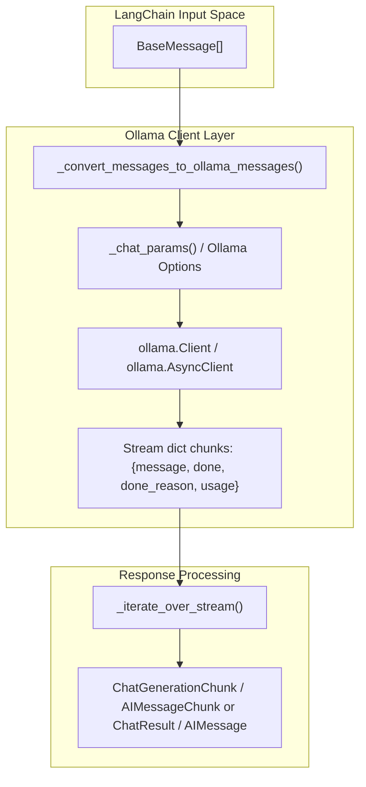
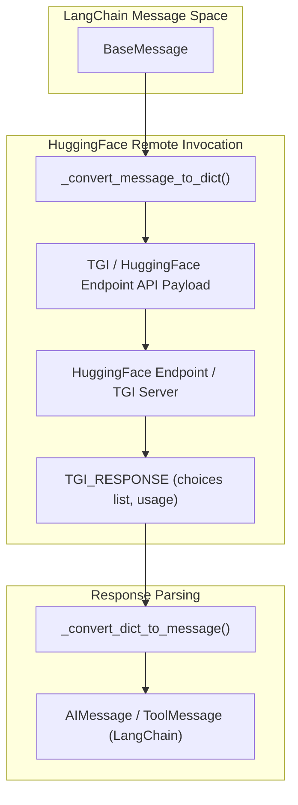
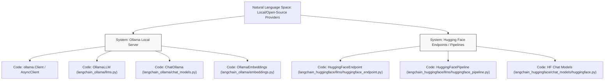

<!-- source: DeepWiki mcp.deepwiki.com · repo langchain-ai/langchain · page 5.4 Local and Open-Source Providers · fetched 2026-10-26 -->

# Local and Open-Source Providers

<details>
<summary>Relevant source files</summary>

The following files were used as context for generating this wiki page:

- [libs/partners/exa/pyproject.toml](libs/partners/exa/pyproject.toml)
- [libs/partners/exa/uv.lock](libs/partners/exa/uv.lock)
- [libs/partners/huggingface/langchain_huggingface/chat_models/__init__.py](libs/partners/huggingface/langchain_huggingface/chat_models/__init__.py)
- [libs/partners/huggingface/langchain_huggingface/chat_models/huggingface.py](libs/partners/huggingface/langchain_huggingface/chat_models/huggingface.py)
- [libs/partners/huggingface/langchain_huggingface/embeddings/huggingface.py](libs/partners/huggingface/langchain_huggingface/embeddings/huggingface.py)
- [libs/partners/huggingface/langchain_huggingface/embeddings/huggingface_endpoint.py](libs/partners/huggingface/langchain_huggingface/embeddings/huggingface_endpoint.py)
- [libs/partners/huggingface/langchain_huggingface/llms/huggingface_endpoint.py](libs/partners/huggingface/langchain_huggingface/llms/huggingface_endpoint.py)
- [libs/partners/huggingface/langchain_huggingface/llms/huggingface_pipeline.py](libs/partners/huggingface/langchain_huggingface/llms/huggingface_pipeline.py)
- [libs/partners/huggingface/langchain_huggingface/utils/import_utils.py](libs/partners/huggingface/langchain_huggingface/utils/import_utils.py)
- [libs/partners/huggingface/tests/integration_tests/test_chat_models.py](libs/partners/huggingface/tests/integration_tests/test_chat_models.py)
- [libs/partners/huggingface/tests/integration_tests/test_compile.py](libs/partners/huggingface/tests/integration_tests/test_compile.py)
- [libs/partners/huggingface/tests/integration_tests/test_llms.py](libs/partners/huggingface/tests/integration_tests/test_llms.py)
- [libs/partners/huggingface/tests/integration_tests/test_standard.py](libs/partners/huggingface/tests/integration_tests/test_standard.py)
- [libs/partners/huggingface/tests/unit_tests/test_chat_models.py](libs/partners/huggingface/tests/unit_tests/test_chat_models.py)
- [libs/partners/huggingface/tests/unit_tests/test_huggingface_endpoint.py](libs/partners/huggingface/tests/unit_tests/test_huggingface_endpoint.py)
- [libs/partners/huggingface/tests/unit_tests/test_huggingface_pipeline.py](libs/partners/huggingface/tests/unit_tests/test_huggingface_pipeline.py)
- [libs/partners/nomic/pyproject.toml](libs/partners/nomic/pyproject.toml)
- [libs/partners/nomic/uv.lock](libs/partners/nomic/uv.lock)
- [libs/partners/ollama/langchain_ollama/__init__.py](libs/partners/ollama/langchain_ollama/__init__.py)
- [libs/partners/ollama/langchain_ollama/_utils.py](libs/partners/ollama/langchain_ollama/_utils.py)
- [libs/partners/ollama/langchain_ollama/chat_models.py](libs/partners/ollama/langchain_ollama/chat_models.py)
- [libs/partners/ollama/langchain_ollama/embeddings.py](libs/partners/ollama/langchain_ollama/embeddings.py)
- [libs/partners/ollama/langchain_ollama/llms.py](libs/partners/ollama/langchain_ollama/llms.py)
- [libs/partners/ollama/pyproject.toml](libs/partners/ollama/pyproject.toml)
- [libs/partners/ollama/tests/integration_tests/chat_models/test_chat_models.py](libs/partners/ollama/tests/integration_tests/chat_models/test_chat_models.py)
- [libs/partners/ollama/tests/integration_tests/chat_models/test_chat_models_reasoning.py](libs/partners/ollama/tests/integration_tests/chat_models/test_chat_models_reasoning.py)
- [libs/partners/ollama/tests/integration_tests/chat_models/test_chat_models_standard.py](libs/partners/ollama/tests/integration_tests/chat_models/test_chat_models_standard.py)
- [libs/partners/ollama/tests/integration_tests/test_llms.py](libs/partners/ollama/tests/integration_tests/test_llms.py)
- [libs/partners/ollama/tests/unit_tests/test_auth.py](libs/partners/ollama/tests/unit_tests/test_auth.py)
- [libs/partners/ollama/tests/unit_tests/test_chat_models.py](libs/partners/ollama/tests/unit_tests/test_chat_models.py)
- [libs/partners/ollama/tests/unit_tests/test_embeddings.py](libs/partners/ollama/tests/unit_tests/test_embeddings.py)
- [libs/partners/ollama/tests/unit_tests/test_llms.py](libs/partners/ollama/tests/unit_tests/test_llms.py)
- [libs/partners/ollama/uv.lock](libs/partners/ollama/uv.lock)
- [libs/partners/qdrant/pyproject.toml](libs/partners/qdrant/pyproject.toml)
- [libs/partners/qdrant/uv.lock](libs/partners/qdrant/uv.lock)

</details>


## Purpose and Scope

This page documents the integration packages for running local and open-source models within the LangChain monorepo: `langchain-ollama` (`libs/partners/ollama`) and `langchain-huggingface` (`libs/partners/huggingface`). These packages provide LangChain-compatible chat models, large language models (LLMs), embeddings, and pipeline wrappers that bridge local or hosted open-weight inference runtimes (such as Ollama servers, Text Generation Inference (TGI), and Hugging Face pipelines) with the `langchain-core` execution and messaging abstractions.

---

## 1. Ollama Integration (`langchain-ollama`)

The `langchain-ollama` package connects LangChain to local Ollama instances via the official `ollama` Python client library [libs/partners/ollama/pyproject.toml:25-28](). It supports text generation (`OllamaLLM`) [libs/partners/ollama/langchain_ollama/llms.py:26-192](), chat models with tools and reasoning (`ChatOllama`) [libs/partners/ollama/langchain_ollama/chat_models.py:1-40](), and text embeddings (`OllamaEmbeddings`) [libs/partners/ollama/langchain_ollama/embeddings.py:25-218]().

### 1.1 Chat and LLM Execution Flow

LangChain messages (`BaseMessage` array) are converted into Ollama's proprietary `Message` format by `_convert_messages_to_ollama_messages()`. Model parameters (temperature, top-p, reasoning mode, tools) are assembled via `_chat_params()` using the Ollama `Options` class or parameters for the client. The prepared payload is sent to the synchronous or asynchronous Ollama client (`ollama.Client` or `ollama.AsyncClient`) for inference.

The Ollama server streams back dictionary chunks containing partial message content, tool calls, completion flags, and generation metadata. The `_iterate_over_stream()` function parses this stream incrementally, extracting:

- Textual content into `AIMessageChunk` or completed `AIMessage`
- Tool calls decoded to LangChain `ToolCall` objects, using resilient JSON and Python-literal parsing
- Reasoning/thinking content separated under `additional_kwargs["reasoning_content"]`
- Usage metadata representing input/output token counts

The output is either a streaming generator yielding `ChatGenerationChunk` or a batched `ChatResult`, depending on the call mode.



### 1.2 Key Components and Translation Logic

| Class/Function                         | Description                                                                                           | Location                                    |
|-------------------------------------|------------------------------------------------------------------------------------------------------|---------------------------------------------|
| `OllamaLLM`                          | LLM wrapper supporting Ollama model generation with sampling and reasoning options                   | `langchain_ollama/llms.py:26-192`           |
| `ChatOllama`                        | Chat model with support for tools and reasoning mode; performs message translation                    | `langchain_ollama/chat_models.py:1-40`      |
| `_convert_messages_to_ollama_messages()` | Transforms LangChain `BaseMessage` list into Ollama `Message` objects, extracting content, images, tool calls | `langchain_ollama/chat_models.py:5-15`      |
| `_chat_params()`                    | Combines messages and options (sampling, reasoning, tool inclusion) into Ollama invocation parameters  | `langchain_ollama/chat_models.py:10-20`    |
| `_iterate_over_stream()`            | Parses streamed Ollama responses incrementally extracting generated text, tool calls, and usage data  | `langchain_ollama/chat_models.py:27-40`    |
| `_parse_json_string()`              | Robust JSON/Python-literal parser for tool call arguments, enabling recovery from common model JSON output errors | `langchain_ollama/chat_models.py:120-170`  |
| `_parse_arguments_from_tool_call()`| Corrects inconsistent Ollama tool call argument formatting issues by shallow decoding                 | `langchain_ollama/chat_models.py:172-185`  |

### 1.3 Reasoning Capability

Some Ollama models support a "reasoning" or "thinking" mode (enabled via the `reasoning` flag or `think` parameter). In this mode, the model generates explicit reasoning traces wrapped in `<think>` tags or as separate thinking messages. The client handler detects these tokens and extracts reasoning content into the `additional_kwargs["reasoning_content"]` property of the `AIMessage`. This separation enables applications requiring interpretable reasoning steps alongside the final response.

---

## 2. Ollama Embeddings

`OllamaEmbeddings` implements the `Embeddings` interface to generate dense vector representations from text inputs using Ollama models locally or through proxied endpoints [libs/partners/ollama/langchain_ollama/embeddings.py:1-218]().

### 2.1 Configuration

- **Model name:** `model` property specifies which Ollama embedding model to use, e.g., `"llama3"`.
- **Embedding dimensions:** Optionally specified by `dimensions`, validated as positive integer or defaults to model’s inherent dimension.
- **Custom base URL:** Supports `base_url` for specifying Ollama server address, including `userinfo`-style auth via parsing utilities `parse_url_with_auth` and `merge_auth_headers`.
- **Client kwargs:** Separate sync and async HTTP client options can be passed via `sync_client_kwargs` and `async_client_kwargs`.
- **Validation:** Optional validation on init to check the model exists locally.

### 2.2 Usage

Embedding methods `embed_query` and `embed_documents` can be called synchronously or asynchronously. The queries are sent to Ollama REST or socket API clients and responses decoded into lists of floating-point vectors.

---

## 3. Hugging Face Integration (`langchain-huggingface`)

The `langchain-huggingface` package provides wrappers for Hugging Face chat models, LLMs, pipelines, and embeddings, integrating them with LangChain’s messaging and runnable abstractions. It supports:

- Local transformer pipelines (`HuggingFacePipeline`)
- Hosted Hugging Face endpoint API access (`HuggingFaceEndpoint`)
- Text Generation Inference (TGI) compatible message payloads and streaming

### 3.1 Message Conversion Pipeline

LangChain `BaseMessage` objects and subclasses are converted to JSON-like dicts matching TGI/Hugging Face endpoint chat format by `_convert_message_to_dict()`. This includes serializing content, function calls, tool calls, and roles (`user`, `assistant`, `system`, `function`, `tool`).

Incoming responses with a list of choices and usage metadata are parsed into LangChain message objects with `_convert_dict_to_message()`. This function also robustly interprets `tool_calls` and invalid tool call objects to maintain compatibility with OpenAI-style function calling.



### 3.2 Key Translation Functions and Classes

| Function/Class                  | Description                                        | Location                                             |
|--------------------------------|---------------------------------------------------|------------------------------------------------------|
| `_convert_message_to_dict()`    | Converts LangChain messages to dicts for TGI/HF APIs | `langchain_huggingface/chat_models/huggingface.py:126-181` |
| `_convert_dict_to_message()`    | Parses dictionary responses into LangChain message objects, including tool calls | `langchain_huggingface/chat_models/huggingface.py:184-207` |
| `HuggingFacePipeline`           | Wraps local transformer pipelines as LangChain chat models | `langchain_huggingface/llms/huggingface_pipeline.py` (not fully shown)      |
| `HuggingFaceEndpoint`           | Client wrapper for Hugging Face hosted inference endpoints | `langchain_huggingface/llms/huggingface_endpoint.py` (not fully shown)    |

The integration supports OpenAI-compatible function calling and tool invocation, maintaining standardized message and tool call formats.

---

## 4. Hugging Face Pipelines and Endpoints

- **HuggingFacePipeline:** Executes local Hugging Face transformer pipelines with batch and streaming support, adapting to LangChain’s `BaseChatModel` interface. Supports synchronous and asynchronous inference.
- **HuggingFaceEndpoint:** Remote client for Hugging Face hosted API endpoints, managing token authorization, streaming responses, and payload formatting. Enables low-latency remote model access.

These abstractions unify local and hosted Hugging Face model usage into consistent, composable LangChain runtimes.

---

# Summary: Mapping Natural Language Systems to LangChain Code Entities



```mermaid
graph TD
    LangChainInput["LangChain Input Objects: BaseMessage, HumanMessage, AIMessage, ToolCall"]
    LangChainOutput["LangChain Output Objects: ChatGenerationChunk, ChatResult, AIMessage with ToolCalls"]

    LangChainInput --> OllamaConv["Ollama Conversion:\n_convert_messages_to_ollama_messages(), _chat_params()"]
    OllamaConv --> OllamaClient["Ollama Client: ollama.Client / ollama.AsyncClient"]
    OllamaClient --> OllamaStream["Stream Response Processing:\n_iterate_over_stream() -> LangChain Output"]

    LangChainInput --> HFConv["Hugging Face Conversion:\n_convert_message_to_dict()"]
    HFConv --> HFAPI["Hugging Face Endpoint / TGI Server API"]
    HFAPI --> HFRespParse["_convert_dict_to_message() -> LangChain Output"]

    LangChainOutput <-- OllamaStream
    LangChainOutput <-- HFRespParse
```

---

# Conclusion

The LangChain monorepo provides robust, native integration packages for prominent local and open-source LLM infrastructures including Ollama and Hugging Face. These integrations implement detailed message transformation pipelines, support for tool calls/function calling, handling of reasoning content, and embedding generation, enabling seamless utilization of these providers under the unified LangChain composable AI framework.

This page guides readers through the technical implementation, data flows, and primary code entities mapping natural language user interaction through LangChain messages to local and remote inference system APIs, helping developers understand and extend these local and open-source provider connectors.

---

Sources:  
- `libs/partners/ollama/langchain_ollama/chat_models.py:1-40`  
- `libs/partners/ollama/langchain_ollama/llms.py:26-192`  
- `libs/partners/ollama/langchain_ollama/embeddings.py:1-218`  
- `libs/partners/huggingface/langchain_huggingface/chat_models/huggingface.py:1-207`  
- `libs/partners/huggingface/langchain_huggingface/chat_models/huggingface.py:12-15`

---

