<!-- source: DeepWiki mcp.deepwiki.com · repo langchain-ai/langchain · page 6 Shared Tooling Packages · fetched 2026-10-26 -->

# Shared Tooling Packages

Relevant source files

The following files were used as context for generating this wiki page:

- [libs/standard-tests/langchain_tests/__init__.py](libs/standard-tests/langchain_tests/__init__.py)
- [libs/standard-tests/langchain_tests/base.py](libs/standard-tests/langchain_tests/base.py)
- [libs/standard-tests/langchain_tests/conftest.py](libs/standard-tests/langchain_tests/conftest.py)
- [libs/standard-tests/langchain_tests/integration_tests/base_store.py](libs/standard-tests/langchain_tests/integration_tests/base_store.py)
- [libs/standard-tests/langchain_tests/integration_tests/cache.py](libs/standard-tests/langchain_tests/integration_tests/cache.py)
- [libs/standard-tests/langchain_tests/integration_tests/chat_models.py](libs/standard-tests/langchain_tests/integration_tests/chat_models.py)
- [libs/standard-tests/langchain_tests/integration_tests/embeddings.py](libs/standard-tests/langchain_tests/integration_tests/embeddings.py)
- [libs/standard-tests/langchain_tests/integration_tests/indexer.py](libs/standard-tests/langchain_tests/integration_tests/indexer.py)
- [libs/standard-tests/langchain_tests/integration_tests/retrievers.py](libs/standard-tests/langchain_tests/integration_tests/retrievers.py)
- [libs/standard-tests/langchain_tests/integration_tests/tools.py](libs/standard-tests/langchain_tests/integration_tests/tools.py)
- [libs/standard-tests/langchain_tests/integration_tests/vectorstores.py](libs/standard-tests/langchain_tests/integration_tests/vectorstores.py)
- [libs/standard-tests/langchain_tests/unit_tests/chat_models.py](libs/standard-tests/langchain_tests/unit_tests/chat_models.py)
- [libs/standard-tests/langchain_tests/unit_tests/embeddings.py](libs/standard-tests/langchain_tests/unit_tests/embeddings.py)
- [libs/standard-tests/langchain_tests/unit_tests/tools.py](libs/standard-tests/langchain_tests/unit_tests/tools.py)
- [libs/standard-tests/langchain_tests/utils/pydantic.py](libs/standard-tests/langchain_tests/utils/pydantic.py)
- [libs/standard-tests/tests/unit_tests/custom_chat_model.py](libs/standard-tests/tests/unit_tests/custom_chat_model.py)
- [libs/standard-tests/tests/unit_tests/test_basic_retriever.py](libs/standard-tests/tests/unit_tests/test_basic_retriever.py)
- [libs/standard-tests/tests/unit_tests/test_basic_tool.py](libs/standard-tests/tests/unit_tests/test_basic_tool.py)
- [libs/standard-tests/tests/unit_tests/test_custom_chat_model.py](libs/standard-tests/tests/unit_tests/test_custom_chat_model.py)
- [libs/standard-tests/tests/unit_tests/test_decorated_tool.py](libs/standard-tests/tests/unit_tests/test_decorated_tool.py)
- [libs/standard-tests/tests/unit_tests/test_embeddings.py](libs/standard-tests/tests/unit_tests/test_embeddings.py)
- [libs/standard-tests/tests/unit_tests/test_in_memory_base_store.py](libs/standard-tests/tests/unit_tests/test_in_memory_base_store.py)
- [libs/text-splitters/langchain_text_splitters/__init__.py](libs/text-splitters/langchain_text_splitters/__init__.py)
- [libs/text-splitters/langchain_text_splitters/base.py](libs/text-splitters/langchain_text_splitters/base.py)
- [libs/text-splitters/langchain_text_splitters/character.py](libs/text-splitters/langchain_text_splitters/character.py)
- [libs/text-splitters/langchain_text_splitters/html.py](libs/text-splitters/langchain_text_splitters/html.py)
- [libs/text-splitters/langchain_text_splitters/json.py](libs/text-splitters/langchain_text_splitters/json.py)
- [libs/text-splitters/langchain_text_splitters/jsx.py](libs/text-splitters/langchain_text_splitters/jsx.py)
- [libs/text-splitters/langchain_text_splitters/konlpy.py](libs/text-splitters/langchain_text_splitters/konlpy.py)
- [libs/text-splitters/langchain_text_splitters/markdown.py](libs/text-splitters/langchain_text_splitters/markdown.py)
- [libs/text-splitters/langchain_text_splitters/nltk.py](libs/text-splitters/langchain_text_splitters/nltk.py)
- [libs/text-splitters/langchain_text_splitters/sentence_transformers.py](libs/text-splitters/langchain_text_splitters/sentence_transformers.py)
- [libs/text-splitters/langchain_text_splitters/spacy.py](libs/text-splitters/langchain_text_splitters/spacy.py)
- [libs/text-splitters/tests/integration_tests/test_text_splitter.py](libs/text-splitters/tests/integration_tests/test_text_splitter.py)
- [libs/text-splitters/tests/unit_tests/test_text_splitters.py](libs/text-splitters/tests/unit_tests/test_text_splitters.py)

## Purpose and Scope

The LangChain monorepo includes several standalone support and tooling packages located under `libs/` that provide cross-cutting capabilities for text manipulation, conformance testing, and model metadata management. These packages decouple heavy testing dependencies, NLP libraries, and CLI utilities from `langchain-core` while providing standardized infrastructure utilized across partner integration packages and the primary runtime packages.

For detailed documentation, refer to the child pages:
- [Text Splitters](#6.1)
- [Standard Tests (langchain-tests)](#6.2)
- [Model Profiles](#6.3)

---

## Big Picture: Shared Tooling in the Monorepo Architecture

The shared tooling packages act as utility layers supporting core abstractions, partner packages, and continuous integration pipelines. They enable consistent text chunking, ensuring model inputs adhere to prompt size limits and semantic boundaries; rigorous conformance testing across multiple ecosystem components to maintain reliability; and structured metadata management of diverse model providers for runtime introspection.

```mermaid
graph TD
    subgraph "Natural Language Space: Text Processing"
        NL_Text["Raw Document Corpus"] --> TS["langchain-text-splitters package libs/text-splitters"]
    end
    
    subgraph "Code Entity Space: Splitter Classes"
        TS --> TS_Base["TextSplitter class (libs/text-splitters/langchain_text_splitters/base.py)"]
        TS --> TS_Character["CharacterTextSplitter, RecursiveCharacterTextSplitter (libs/text-splitters/langchain_text_splitters/character.py)"]
        TS --> TS_Markdown["MarkdownTextSplitter, MarkdownHeaderTextSplitter (libs/text-splitters/langchain_text_splitters/markdown.py)"]
        TS --> TS_HTML["HTMLHeaderTextSplitter (libs/text-splitters/langchain_text_splitters/html.py)"]
        TS --> TS_JSON["RecursiveJsonSplitter (libs/text-splitters/langchain_text_splitters/json.py)"]
        TS --> TS_JSX["JSFrameworkTextSplitter (libs/text-splitters/langchain_text_splitters/jsx.py)"]
        TS --> TS_Spacy["SpacyTextSplitter (libs/text-splitters/langchain_text_splitters/spacy.py)"]
        TS --> TS_SentenceTransformers["SentenceTransformersTokenTextSplitter (libs/text-splitters/langchain_text_splitters/sentence_transformers.py)"]
    end

    subgraph "Testing & Conformance Space"
        ST["langchain-tests package (libs/standard-tests)"] --> TestRunner["pytest-based Conformance Suites (langchain_tests.conftest and test modules)"]
        TestRunner --> ChatModelTests["Chat Model Conformance Tests (libs/standard-tests/langchain_tests/integration_tests/chat_models.py)"]
        TestRunner --> VectorStoreTests["Vector Store Conformance Tests (libs/standard-tests/langchain_tests/integration_tests/vectorstores.py)"]
        TestRunner --> ToolsTests["Tool and Retriever Conformance Tests (libs/standard-tests/langchain_tests/integration_tests/tools.py, retrievers.py)"]
    end

    subgraph "Model Metadata Space"
        MP["langchain-model-profiles package (libs/model-profiles)"] --> CLI["langchain-profiles CLI (entrypoint script)"]
        CLI --> Profiles["Generated _profiles.py files per provider (schemas and augmentation TOMLs)"]
    end

    %% Bridges from Natural Language Space to Code Entity Space
    NL_Text -->|chunking| TS_Base
    NL_Text -->|tokenizer support| TS_SentenceTransformers

    %% Bridge from Testing Space to Model Metadata Space by provider metadata
    ChatModelTests --> MP
```

Sources:  
- [libs/text-splitters/langchain_text_splitters/base.py:59-190]()  
- [libs/text-splitters/langchain_text_splitters/character.py:1-189]()  
- [libs/text-splitters/langchain_text_splitters/markdown.py:1-175]()  
- [libs/text-splitters/langchain_text_splitters/html.py:1-197]()  
- [libs/text-splitters/langchain_text_splitters/json.py:1-185]()  
- [libs/text-splitters/langchain_text_splitters/spacy.py:1-69]()  
- [libs/text-splitters/langchain_text_splitters/sentence_transformers.py:1-134]()  
- [libs/standard-tests/langchain_tests/integration_tests/chat_models.py:1-208]()  
- [libs/standard-tests/langchain_tests/integration_tests/vectorstores.py:1-191]()  
- [libs/standard-tests/langchain_tests/__init__.py:1-5]() (implied)  
- [libs/model-profiles/pyproject.toml:5-34]()  

---

## 6.1. Text Splitters

The `langchain-text-splitters` package (`libs/text-splitters`) offers a modular and extensible framework for chunking large texts and structured data into manageable segments suitable for LLM input.

At its core is the `TextSplitter` abstract base class, defining split parameters like chunk size, overlap, separator handling, and optional metadata enrichment with chunk start indices. This flexible base enables specialized splitters tailored to different data formats and languages:

- **Character-based Splitters**:  
  - `CharacterTextSplitter` splits text based on specified character separators.  
  - `RecursiveCharacterTextSplitter` recursively tries multiple separators (e.g., `\n\n`, `\n`, space) to produce optimally sized chunks.

- **Markdown Splitters**:  
  - `MarkdownTextSplitter` leverages `RecursiveCharacterTextSplitter` with markdown-specific separators.  
  - `MarkdownHeaderTextSplitter` splits markdown documents by hierarchical headers, optionally aggregating lines under header metadata.

- **HTML Splitters**:  
  - `HTMLHeaderTextSplitter` uses HTML parsing (via BeautifulSoup) to split HTML content according to header tags, producing structured `Document` objects enriched with header metadata.

- **JSON Splitters**:  
  - `RecursiveJsonSplitter` breaks down large JSON objects into smaller chunks while preserving nested structure, with options to convert JSON lists into dicts for better chunking.

- **JSX Splitters**:  
  - Provide specialized chunking of React-style JSX code (details on child page).

- **NLP Tokenizer Splitters**:  
  - `SpacyTextSplitter` uses the spaCy processing pipeline to split text into sentence segments.  
  - `SentenceTransformersTokenTextSplitter` applies tokenizers from the `sentence-transformers` package for token-aware splitting, adhering to token limits.

Together, these splitters provide fine-grained control over text chunking respecting semantic, syntactic, and tokenization concerns, foundational for feeding language model pipelines.

For details, see [Text Splitters](#6.1).

Sources:  
- [libs/text-splitters/langchain_text_splitters/base.py:59-190]()  
- [libs/text-splitters/langchain_text_splitters/character.py:1-189]()  
- [libs/text-splitters/langchain_text_splitters/markdown.py:1-175]()  
- [libs/text-splitters/langchain_text_splitters/html.py:1-197]()  
- [libs/text-splitters/langchain_text_splitters/json.py:1-185]()  
- [libs/text-splitters/langchain_text_splitters/spacy.py:1-69]()  
- [libs/text-splitters/langchain_text_splitters/sentence_transformers.py:1-134]()  

---

## 6.2. Standard Tests (langchain-tests)

The `langchain-tests` package (`libs/standard-tests`) provides a comprehensive suite of conformance and integration tests for key LangChain ecosystem components. These tests form the backbone for ensuring consistent and reliable behavior across models, tools, stores, and retrievers implemented by various providers.

Key features include:

- **Chat Model Conformance Tests**:  
  Implemented in `chat_models.py`, these tests verify model lifecycle behavior, structured output formats, tool calling conventions, and streaming APIs. They utilize base classes like `ChatModelIntegrationTests` to standardize tests across different chat model implementations.

- **Vector Store and Retriever Tests**:  
  Defined in `vectorstores.py` and `retrievers.py`, these verify vector store functionality, including indexing, similarity searching, document addition, and asynchronous API support.

- **Tools Tests**:  
  Validate that tools declare proper schemas, can be initialized from environment variables, have required `name` and input schemas, and behave as expected when invoked.

- **Pytest Plugin and Utilities**:  
  The package includes pytest fixtures for sandboxed testing environments, parametrized test cases supporting synchronous and asynchronous variations, VCR-based snapshot replay testing, and integration with snapshot testing frameworks.

These tests form critical guardrails for maintaining high code quality, compatibility, and correctness across evolving implementations.

For details, see [Standard Tests (langchain-tests)](#6.2).

Sources:  
- [libs/standard-tests/langchain_tests/integration_tests/chat_models.py:1-208]()  
- [libs/standard-tests/langchain_tests/integration_tests/vectorstores.py:1-191]()  
- [libs/standard-tests/langchain_tests/unit_tests/tools.py:1-128]()  
- [libs/standard-tests/langchain_tests/unit_tests/chat_models.py:1-226]()  
- [libs/standard-tests/pyproject.toml:6-53]() (implied)  

---

## 6.3. Model Profiles

The `langchain-model-profiles` package (`libs/model-profiles`) codifies structured metadata about individual language and chat model providers. It captures capabilities such as context window sizes, model features, supported input modalities, and augmentation hints in standardized schemas.

Main components:

- **ModelProfile Schema**:  
  Defines formal schema structures representing model characteristics and provider-specific configurations. This enables runtime introspection and tailored behavior per provider.

- **langchain-profiles CLI**:  
  A command line interface tool to refresh profiles from provider sources, summarize capabilities, and regenerate Python profile modules (`_profiles.py`). These generated files are consumed by partner integration packages to keep in-sync with provider updates.

- **Augmentation TOMLs and Generated Code**:  
  Profiles support augmentation via TOML files to define additional metadata heuristics and capabilities. The CLI produces generated Python code to provide static programmatic access to model profiles.

This package supports dynamic and static runtime features by maintaining authoritative model metadata for LangChain components.

For details, see [Model Profiles](#6.3).

Sources:  
- [libs/model-profiles/pyproject.toml:5-34]()  
- (CLI & implementation details inferred from package metadata)

---

This overview highlights the architectural role and contents of the shared tooling packages, clarifying their relationships and providing entry points to detailed child documentation pages. Together, they provide essential infrastructure supporting text preparation, standardized testing, and metadata management across LangChain’s ecosystem.

---

