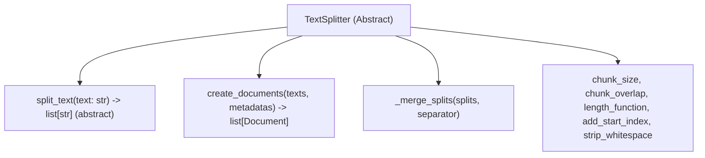
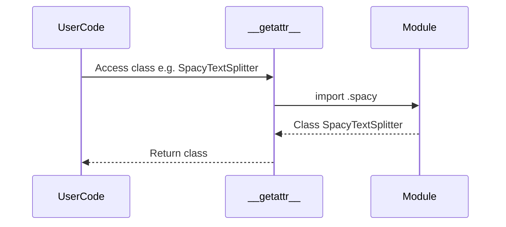
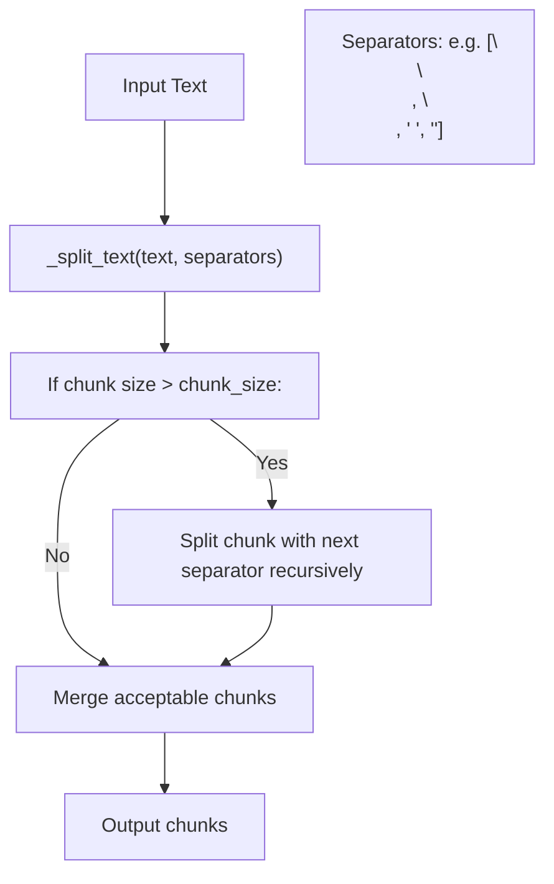
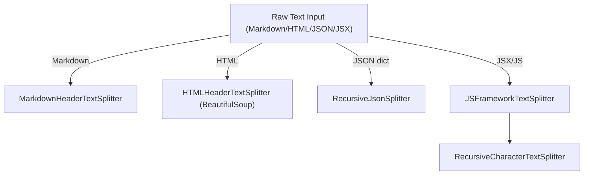
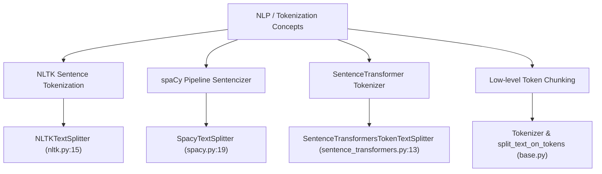
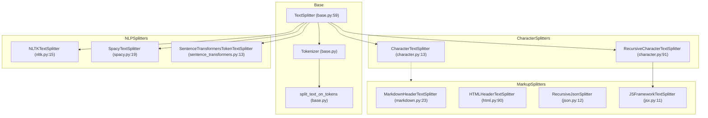

<!-- source: DeepWiki mcp.deepwiki.com · repo langchain-ai/langchain · page 6.1 Text Splitters · fetched 2026-10-26 -->

# Text Splitters

Relevant source files

The following files were used as context for generating this wiki page:

- [libs/text-splitters/langchain_text_splitters/__init__.py](libs/text-splitters/langchain_text_splitters/__init__.py)
- [libs/text-splitters/langchain_text_splitters/base.py](libs/text-splitters/langchain_text_splitters/base.py)
- [libs/text-splitters/langchain_text_splitters/character.py](libs/text-splitters/langchain_text_splitters/character.py)
- [libs/text-splitters/langchain_text_splitters/html.py](libs/text-splitters/langchain_text_splitters/html.py)
- [libs/text-splitters/langchain_text_splitters/json.py](libs/text-splitters/langchain_text_splitters/json.py)
- [libs/text-splitters/langchain_text_splitters/jsx.py](libs/text-splitters/langchain_text_splitters/jsx.py)
- [libs/text-splitters/langchain_text_splitters/konlpy.py](libs/text-splitters/langchain_text_splitters/konlpy.py)
- [libs/text-splitters/langchain_text_splitters/markdown.py](libs/text-splitters/langchain_text_splitters/markdown.py)
- [libs/text-splitters/langchain_text_splitters/nltk.py](libs/text-splitters/langchain_text_splitters/nltk.py)
- [libs/text-splitters/langchain_text_splitters/sentence_transformers.py](libs/text-splitters/langchain_text_splitters/sentence_transformers.py)
- [libs/text-splitters/langchain_text_splitters/spacy.py](libs/text-splitters/langchain_text_splitters/spacy.py)
- [libs/text-splitters/tests/integration_tests/test_nlp_text_splitters.py](libs/text-splitters/tests/integration_tests/test_nlp_text_splitters.py)
- [libs/text-splitters/tests/integration_tests/test_text_splitter.py](libs/text-splitters/tests/integration_tests/test_text_splitter.py)
- [libs/text-splitters/tests/unit_tests/conftest.py](libs/text-splitters/tests/unit_tests/conftest.py)
- [libs/text-splitters/tests/unit_tests/test_text_splitters.py](libs/text-splitters/tests/unit_tests/test_text_splitters.py)

## Purpose and Scope
The `langchain-text-splitters` package (`libs/text-splitters/`) is a dedicated library for splitting large textual content from diverse formats — raw text, structured markup (Markdown, HTML), code files (Python, JSX/TSX), hierarchical data (JSON), and natural language documents — into smaller, semantically meaningful chunks. These chunks are optimized to fit within common LLM context windows and are useful for embedding generation, retrieval, and processing.

This page elaborates in full technical detail the implementation and workflow of the `TextSplitter` base interface, recursive splitting strategies, structured splitters for markup/code, and advanced NLP-based and token-aware splitters.

---

## 1. Base Architecture and Lazy Import System

### `TextSplitter` Base Class

At the core lies the abstract base class `TextSplitter` [libs/text-splitters/langchain_text_splitters/base.py:59-190], which implements the interface `BaseDocumentTransformer` from `langchain_core.documents`. It manages validation of chunk size parameters and foundational logic common across all splitters:

- `chunk_size` (int): Maximum allowed chunk length.
- `chunk_overlap` (int): Overlap between consecutive chunks.
- `length_function` (Callable[[str], int]): A function measuring chunk size, defaulting to `len`.
- `keep_separator` (bool or "start"/"end"): Whether and where to keep split separators.
- `add_start_index` (bool): If true, includes the chunk's start index in Document metadata.
- `strip_whitespace` (bool): Strips whitespace around chunks by default.

The base class mandates subclasses implement the `split_text(text: str) -> list[str]` method, which returns a list of text chunks.

It provides utilities like `_merge_splits` for grouping splits to respect chunk size and chunk_overlap and methods to convert between raw texts and lists of `Document` objects.

### Lazy Import System for Heavy Dependencies

To prevent unnecessary loading of large NLP or ML dependencies (e.g. `nltk`, `spacy`, `sentence_transformers`, `konlpy`), the package uses a lazy loading mechanism implemented in the module-level `__getattr__` hook [libs/text-splitters/langchain_text_splitters/__init__.py:78-100]:

- The class-to-module mapping `_LAZY_SPLITTERS` defers import until the class is accessed.
- This keeps initial import times low and avoids errors in environments lacking optional dependencies.
- Explicit import triggers to load classes like `SpacyTextSplitter`, `NLTKTextSplitter`, etc.

Sources:  
`libs/text-splitters/langchain_text_splitters/base.py:59-190`  
`libs/text-splitters/langchain_text_splitters/__init__.py:78-100`  

---

## 2. Character and Recursive Character Splitters

### `CharacterTextSplitter`

A straightforward splitter that partitions text based on a fixed separator string or regex pattern provided at construction [libs/text-splitters/langchain_text_splitters/character.py:13-62]:

- Supports keeping separators optionally at start or end.
- Uses a regex splitting utility `_split_text_with_regex` for flexible matching.
- Merges resulting segments respecting chunk size and overlap.

### `RecursiveCharacterTextSplitter`

An advanced splitter that attempts hierarchical splitting based on multiple levels of separators (usually from coarse to fine) [libs/text-splitters/langchain_text_splitters/character.py:91-163]:

- Default separators sequence: `["\n\n", "\n", " ", ""]`
- Algorithm:
  - Attempt split on the current separator.
  - For any chunk exceeding the size limit, recursively split with the next finer separator.
  - Continue until chunks are acceptable or no finer separator remains.
- Supports language-specific separator initialization (`from_language`) with predefined sets.
- Retains or removes separators per config, manages overlap intelligently.

This recursive approach improves semantic chunking by choosing the "best" boundary granularity dynamically.

Sources:  
`libs/text-splitters/langchain_text_splitters/character.py:13-163`  

---

## 3. Structured and Markup Splitters

### Markdown Splitters

- **`MarkdownTextSplitter`**: Simple recursive character splitter specialized for Markdown content with Markdown-specific separators [libs/text-splitters/langchain_text_splitters/markdown.py:14-21].

- **`MarkdownHeaderTextSplitter`**: Parses Markdown line-by-line, tracking header structure in a stack (`header_stack`) to build nested metadata [libs/text-splitters/langchain_text_splitters/markdown.py:23-132]:
  - Receives a list of target headers (e.g. `#`, `##`) to split on.
  - Maintains hierarchical association of content to headers in `Document.metadata`.
  - Supports custom header patterns, optional header stripping.
  - Aggregates lines into chunks controlled by header metadata equivalence.

### HTML Splitters

- **`HTMLHeaderTextSplitter`**: Parses HTML using `BeautifulSoup` to identify semantic sections based on header tags (`h1`-`h6`) [libs/text-splitters/langchain_text_splitters/html.py:40-181]:
  - Sorts headers by numeric level to manage hierarchical splits.
  - Aggregates sibling elements under respective header metadata.
  - Configurable to return either aggregated or individual elements as `Document`s.
  - Falls back to single document if no specified headers found.
  - Utilizes `BeautifulSoup`, with lazy import and helpful error messages on missing packages.

### JSON Splitters

- **`RecursiveJsonSplitter`**: Specifically designed for JSON objects [libs/text-splitters/langchain_text_splitters/json.py:12-152]:
  - Operates on Python dict/list JSON structures.
  - Recursively traverses nested keys to pack content into chunks with respect to size.
  - Respects configurable max and min chunk sizes defined on serialized JSON character length.
  - Optionally converts lists to indexed dicts for finer chunking.
  - Generates JSON string chunks or `Document`s with metadata.

### JSX and Frontend Framework Splitters

- **`JSFrameworkTextSplitter`**: Extends recursive character splitter for JavaScript frameworks like React (JSX), Vue, and Svelte [libs/text-splitters/langchain_text_splitters/jsx.py:11-109]:
  - Extracts unique component opening tags via regex.
  - Constructs separators from component tags and standard JS keywords (`function`, `export`, `const`, etc.).
  - Splits source code preserving logical component boundaries.
  - Combines specialized regex-based extraction with recursive character splitting logic.

Sources:  
`libs/text-splitters/langchain_text_splitters/markdown.py:14-132`  
`libs/text-splitters/langchain_text_splitters/html.py:40-181`  
`libs/text-splitters/langchain_text_splitters/json.py:12-152`  
`libs/text-splitters/langchain_text_splitters/jsx.py:11-109`  

---

## 4. NLP and Token-Based Splitters

These splitters leverage linguistic models and tokenization methods for semantically aware sentence or token chunking.

### `NLTKTextSplitter`

- Uses NLTK's `sent_tokenize` or `span_tokenize` to split input text into sentences [libs/text-splitters/langchain_text_splitters/nltk.py:15-85].
- Configurable separator for joining sentences.
- Enforces separator empty string if using `span_tokenize`.
- Raises explicit `ImportError` with helpful install message if NLTK missing.

### `SpacyTextSplitter`

- Uses spaCy pipelines (`en_core_web_sm` or lightweight `sentencizer`) to segment text into sentences [libs/text-splitters/langchain_text_splitters/spacy.py:19-51].
- Returns merged sentence splits with configured separator.
- Supports configuring spaCy pipeline max length.
- Raises detailed import errors if spaCy library missing.

### `SentenceTransformersTokenTextSplitter`

- Employs HuggingFace-backed sentence-transformer models for token-level text splitting [libs/text-splitters/langchain_text_splitters/sentence_transformers.py:13-135].
- Respects model's maximum token length (`max_seq_length`), validating input chunk sizes.
- Uses an internal `Tokenizer` utility wrapping model's tokenizer encode/decode methods.
- Uses `split_text_on_tokens` helper for chunk splitting on token boundaries.
- Lazy-imports heavy `sentence_transformers` package on instantiation.

### Diagram: Natural Language & Tokenization Space to Code Entities

Sources:  
`libs/text-splitters/langchain_text_splitters/nltk.py:15-85`  
`libs/text-splitters/langchain_text_splitters/spacy.py:19-51`  
`libs/text-splitters/langchain_text_splitters/sentence_transformers.py:13-135`  
`libs/text-splitters/langchain_text_splitters/base.py:1-190`  

---

# Summary Mermaid Diagram Linking Major Components

---

This architecture provides comprehensive, extensible building blocks to split any text input into optimized, semantically consistent chunks for downstream LLM and embedding use-cases.

# References

- `libs/text-splitters/langchain_text_splitters/base.py:1-190`  
- `libs/text-splitters/langchain_text_splitters/__init__.py:78-100`  
- `libs/text-splitters/langchain_text_splitters/character.py:13-180`  
- `libs/text-splitters/langchain_text_splitters/markdown.py:14-132`  
- `libs/text-splitters/langchain_text_splitters/html.py:40-181`  
- `libs/text-splitters/langchain_text_splitters/json.py:12-152`  
- `libs/text-splitters/langchain_text_splitters/jsx.py:11-109`  
- `libs/text-splitters/langchain_text_splitters/nltk.py:15-85`  
- `libs/text-splitters/langchain_text_splitters/spacy.py:19-51`  
- `libs/text-splitters/langchain_text_splitters/sentence_transformers.py:13-135`

---

