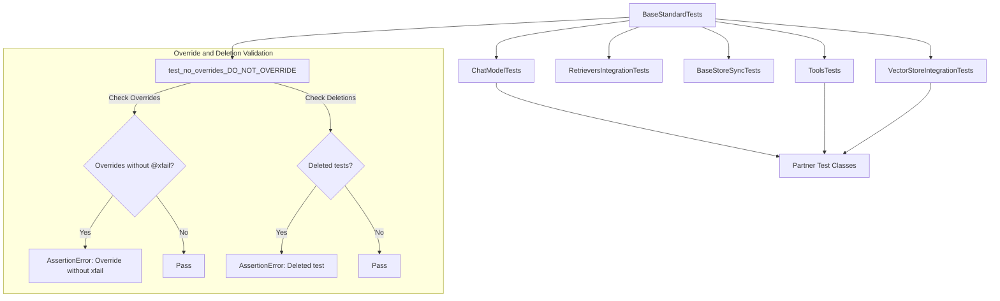
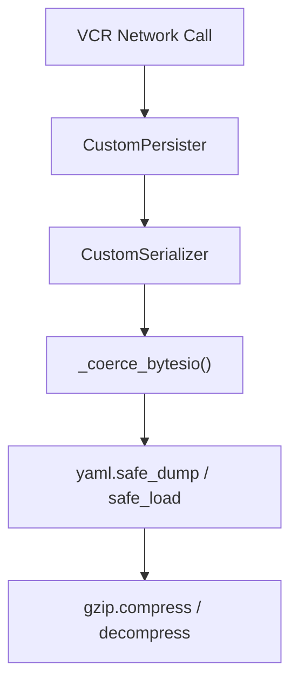
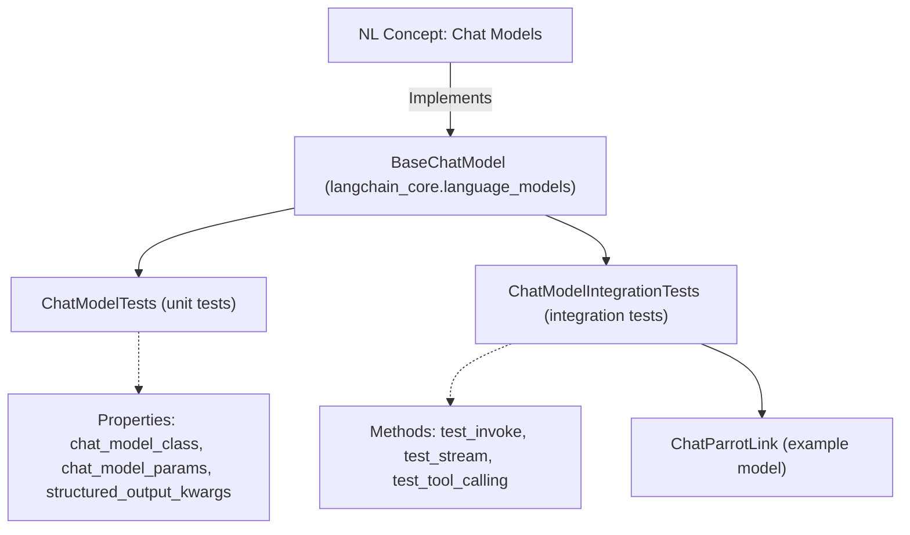
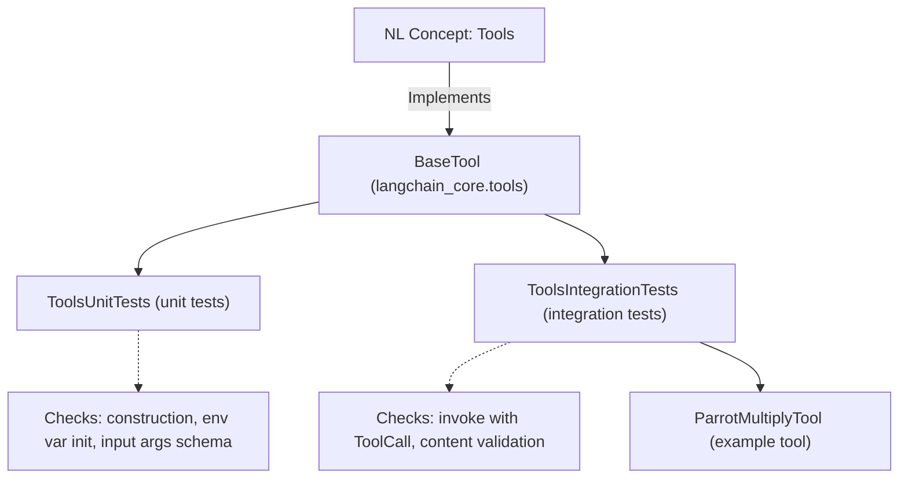

<!-- source: DeepWiki mcp.deepwiki.com · repo langchain-ai/langchain · page 6.2 Standard Tests (langchain-tests) · fetched 2026-10-26 -->

# Standard Tests (langchain-tests)

<details>
<summary>Relevant source files</summary>

The following files were used as context for generating this wiki page:

- [libs/standard-tests/langchain_tests/__init__.py](libs/standard-tests/langchain_tests/__init__.py)
- [libs/standard-tests/langchain_tests/base.py](libs/standard-tests/langchain_tests/base.py)
- [libs/standard-tests/langchain_tests/conftest.py](libs/standard-tests/langchain_tests/conftest.py)
- [libs/standard-tests/langchain_tests/integration_tests/__init__.py](libs/standard-tests/langchain_tests/integration_tests/__init__.py)
- [libs/standard-tests/langchain_tests/integration_tests/base_store.py](libs/standard-tests/langchain_tests/integration_tests/base_store.py)
- [libs/standard-tests/langchain_tests/integration_tests/cache.py](libs/standard-tests/langchain_tests/integration_tests/cache.py)
- [libs/standard-tests/langchain_tests/integration_tests/chat_models.py](libs/standard-tests/langchain_tests/integration_tests/chat_models.py)
- [libs/standard-tests/langchain_tests/integration_tests/embeddings.py](libs/standard-tests/langchain_tests/integration_tests/embeddings.py)
- [libs/standard-tests/langchain_tests/integration_tests/indexer.py](libs/standard-tests/langchain_tests/integration_tests/indexer.py)
- [libs/standard-tests/langchain_tests/integration_tests/retrievers.py](libs/standard-tests/langchain_tests/integration_tests/retrievers.py)
- [libs/standard-tests/langchain_tests/integration_tests/sandboxes.py](libs/standard-tests/langchain_tests/integration_tests/sandboxes.py)
- [libs/standard-tests/langchain_tests/integration_tests/tools.py](libs/standard-tests/langchain_tests/integration_tests/tools.py)
- [libs/standard-tests/langchain_tests/integration_tests/vectorstores.py](libs/standard-tests/langchain_tests/integration_tests/vectorstores.py)
- [libs/standard-tests/langchain_tests/unit_tests/chat_models.py](libs/standard-tests/langchain_tests/unit_tests/chat_models.py)
- [libs/standard-tests/langchain_tests/unit_tests/embeddings.py](libs/standard-tests/langchain_tests/unit_tests/embeddings.py)
- [libs/standard-tests/langchain_tests/unit_tests/tools.py](libs/standard-tests/langchain_tests/unit_tests/tools.py)
- [libs/standard-tests/langchain_tests/utils/pydantic.py](libs/standard-tests/langchain_tests/utils/pydantic.py)
- [libs/standard-tests/tests/unit_tests/custom_chat_model.py](libs/standard-tests/tests/unit_tests/custom_chat_model.py)
- [libs/standard-tests/tests/unit_tests/test_basic_retriever.py](libs/standard-tests/tests/unit_tests/test_basic_retriever.py)
- [libs/standard-tests/tests/unit_tests/test_basic_tool.py](libs/standard-tests/tests/unit_tests/test_basic_tool.py)
- [libs/standard-tests/tests/unit_tests/test_custom_chat_model.py](libs/standard-tests/tests/unit_tests/test_custom_chat_model.py)
- [libs/standard-tests/tests/unit_tests/test_decorated_tool.py](libs/standard-tests/tests/unit_tests/test_decorated_tool.py)
- [libs/standard-tests/tests/unit_tests/test_embeddings.py](libs/standard-tests/tests/unit_tests/test_embeddings.py)
- [libs/standard-tests/tests/unit_tests/test_in_memory_base_store.py](libs/standard-tests/tests/unit_tests/test_in_memory_base_store.py)

</details>


## 1. Overview and Package Scope
The `langchain-tests` package, located at `libs/standard-tests/langchain_tests/`, provides a suite of conformance test frameworks to verify the correct implementation of critical LangChain interfaces. It targets core components and partner implementations such as:

- Chat Models
- Tools
- Vector Stores
- Retrievers
- Key-Value Stores (BaseStore)
- Caches
- Embeddings

By running these tests, partner integrations (e.g., `langchain-openai`, `langchain-chroma`) can ensure their implementations work correctly with LangChain's abstractions and meet defined API contracts. The package also includes a customized Pytest plugin to manage network recording and replay safely using compressed VCR cassettes.

*Sources: [libs/standard-tests/langchain_tests/__init__.py:1-5]()*


---

## 2. Test Suite Architecture and Enforcement (`BaseStandardTests`)
Central to `langchain-tests` is the abstract base class `BaseStandardTests`, defined in `base.py` [libs/standard-tests/langchain_tests/base.py:4-70](). This class enforces strict compliance requirements with the standard tests, preventing accidental deletion or unsupported overrides of test methods.

### 2.1. Override and Deletion Prevention Mechanism
`BaseStandardTests` introduces a special test method `test_no_overrides_DO_NOT_OVERRIDE` that executes for every inherited test suite implementation. It performs two key validations:

- **No Deletions**: Verifies that none of the standard test methods inherited from the LangChain test bases are removed in the subclass.
- **Controlled Overrides**: Checks if any standard test methods are overridden by the subclass. If so, these must be decorated with `@pytest.mark.xfail(reason="...")` to document expected failures or justified reasons for deviation.

This approach ensures that partners maintain the integrity of standard tests, only marking genuine exceptions while preserving full suite coverage by default.

### 2.2. Compliance Flow Diagram



*Sources: [libs/standard-tests/langchain_tests/base.py:4-70](), [libs/standard-tests/langchain_tests/unit_tests/chat_models.py:43-48](), [libs/standard-tests/langchain_tests/integration_tests/vectorstores.py:21-69](), [libs/standard-tests/tests/unit_tests/test_basic_tool.py:33-56]()*


---

## 3. Core Component Conformance Suites

The standard tests are organized into both unit and integration tests targeting major LangChain abstractions.

### 3.1. Chat Models

#### Unit Tests: `ChatModelTests`
- Abstract base class defining required properties such as `chat_model_class` and `chat_model_params`.
- Tests model features: initialization, support for tool calling, structured output, JSON mode, image/audio inputs, and usage metadata.
- Provides fixtures for creating model instances with default parameters.
- Performs schema validation for tool function schemas and checks method signatures [libs/standard-tests/langchain_tests/unit_tests/chat_models.py:43-144]().

#### Integration Tests: `ChatModelIntegrationTests`
- Subclasses unit tests and adds live tests for invocation (sync/async).
- Validates generation outputs, streaming responses, tool call messages, chunked tool call streaming, and multi-modal input support.
- Includes practical tool fixtures like magic functions and unicode customer tools to test tool calling integration.
- Base class for testing custom chat models, such as the illustrative `ChatParrotLink` [libs/standard-tests/langchain_tests/integration_tests/chat_models.py:194-208](), [libs/standard-tests/tests/unit_tests/custom_chat_model.py:18-40]().

---

### 3.2. Tools

#### Unit Tests: `ToolsUnitTests`
- Ensures tools construct properly from classes or instances.
- Tests initialization via environment variables.
- Validates presence of input schemas (`args_schema`) and example invocation arguments.
- Confirms tool naming and input schema correctness [libs/standard-tests/langchain_tests/unit_tests/tools.py:17-128]().

#### Integration Tests: `ToolsIntegrationTests`
- Ensures tool `invoke` and async `ainvoke` accept `ToolCall` objects and return valid `ToolMessage` content.
- Checks output format including support for content and artifacts.
- Tests invocation without explicit `ToolCall`, verifying error-free operation.
- A concrete example is `ParrotMultiplyTool` and its artifact-supporting variant used as demonstration tools [libs/standard-tests/langchain_tests/integration_tests/tools.py:9-94](), [libs/standard-tests/tests/unit_tests/test_basic_tool.py:10-56]().

---

### 3.3. Vector Stores

#### Integration Tests: `VectorStoreIntegrationTests`
- Abstract class requiring fixture that provides an empty vector store.
- Uses a deterministic fake embeddings model (`DeterministicFakeEmbedding`) for reproducible embedding vectors.
- Tests verify empty state, document insertion, similarity search correctness, and that original documents are not mutated.
- Supports configuration to enable/disable sync or async tests and conditional support for `get_by_ids`.
- Test subclasses must clean up after themselves to maintain isolation [libs/standard-tests/langchain_tests/integration_tests/vectorstores.py:21-136]().

---

### 3.4. Retrievers

#### Integration Tests: `RetrieversIntegrationTests`
- Abstract test base for `BaseRetriever` subclasses.
- Tests constructor and `invoke` method correctly handle configuration of number of results to return (`k` or custom param).
- Validates return types are always lists of LangChain `Document` objects.
- Supports both synchronous and asynchronous invoke tests.
- Allows skipping tests if the retriever implementation doesn't support configurable `k` parameters [libs/standard-tests/langchain_tests/integration_tests/retrievers.py:13-182]().

---

### 3.5. Key-Value Stores (BaseStore)

#### Sync and Async Suites: `BaseStoreSyncTests` and `BaseStoreAsyncTests`
- Test suites for LangChain's `BaseStore` key-value store interface.
- Verify correctness of setting, getting, deleting values (single and bulk), and key enumeration.
- Test idempotency of setting values and fixture isolation (store reset per test).
- Abstract tests require fixture with empty store and a tuple of three example values.
- Sync and async variants support both synchronous and asynchronous store implementations [libs/standard-tests/langchain_tests/integration_tests/base_store.py:19-193]().


---

## 4. Pytest Plugin, VCR Cassettes, and Serialization

`langchain-tests` extends Pytest with advanced support for recording and replaying HTTP interactions securely and efficiently using the VCR library.

### 4.1. Custom Cassette Serialization and Compression

By default, VCR serializes cassettes to plain YAML, which is unsafe for untrusted inputs and verbose. The package replaces this with a safe, compressed variant:

- Recursively converts any `io.BytesIO` stream objects to raw bytes to ensure serializability.
- Uses gzip compression for compact storage.
- Saves and loads cassettes as compressed YAML files.
- This allows easier inspection of network interactions and mitigates security risks associated with YAML deserialization.

Key implementations in `conftest.py`:

- `_coerce_bytesio(value)` recursively replaces any `io.BytesIO` instances within nested data structures [libs/standard-tests/langchain_tests/conftest.py:21-44]().
- `CustomSerializer` performs serializing with `yaml.safe_dump` and gzip compression, and deserializes with decompression and safe loading [libs/standard-tests/langchain_tests/conftest.py:47-82]().
- `CustomPersister` integrates this custom serializer into VCR's loading and saving lifecycle [libs/standard-tests/langchain_tests/conftest.py:85-118]().



---

### 4.2. VCR Configuration Parameters

The `base_vcr_config()` function specifies the default configuration used in the test suites:

- Records network interactions only once, then replays subsequently.
- Filters out common sensitive headers like `authorization` and API keys, replacing them with placeholders.
- Matches requests based on HTTP method, URI, and body.
- Allows playback of recorded requests multiple times.
- Automatically decodes compressed HTTP responses.
- Stores cassettes in the `tests/cassettes` subdirectory with `.yaml` suffix enforced.
  
```python
def base_vcr_config() -> dict[str, Any]:
    return {
        "record_mode": "once",
        "filter_headers": [
            ("authorization", "PLACEHOLDER"),
            ("x-api-key", "PLACEHOLDER"),
            ("api-key", "PLACEHOLDER"),
        ],
        "match_on": ["method", "uri", "body"],
        "allow_playback_repeats": True,
        "decode_compressed_response": True,
        "cassette_library_dir": "tests/cassettes",
        "path_transformer": VCR.ensure_suffix(".yaml"),
    }
```

*Sources: [libs/standard-tests/langchain_tests/conftest.py:120-144]()*


---

## 5. Summary of Standard Test Modules

| Module Path                                      | Primary Test Base Classes                | Key Behaviors Verified                                                                            |
|-------------------------------------------------|----------------------------------------|-------------------------------------------------------------------------------------------------|
| `unit_tests/chat_models.py`                      | `ChatModelTests`                       | Model initialization, tool calling support, feature flags, structured output, schema validation |
| `integration_tests/chat_models.py`               | `ChatModelIntegrationTests`            | Sync/async invocation, streaming, tool call handling, multi-modal inputs, usage metadata         |
| `unit_tests/tools.py`                             | `ToolsUnitTests`                      | Tool instantiation, env var initialization, input schema correctness                             |
| `integration_tests/tools.py`                      | `ToolsIntegrationTests`                | Tool invocation with `ToolCall`, output content & artifact validation                            |
| `integration_tests/vectorstores.py`               | `VectorStoreIntegrationTests`          | Empty state, document add/search, sync/async support, cleanup                                   |
| `integration_tests/retrievers.py`                 | `RetrieversIntegrationTests`             | Configurable `k` param support in construction and invoke, returns `Document` list              |
| `integration_tests/base_store.py`                  | `BaseStoreSyncTests`, `BaseStoreAsyncTests` | Key-value CRUD, bulk delete, key iteration, idempotency                                        |

*Sources: All detailed in Sections 3 and 5 citations above.*

---

# 6. Bridging Natural Language Concepts to Code Entities

### Diagram 1: Chat Model Standard Tests



### Diagram 2: Tools Standard Tests



*Sources: [libs/standard-tests/langchain_tests/integration_tests/chat_models.py:194-208](), [libs/standard-tests/langchain_tests/unit_tests/chat_models.py:43-144](), [libs/standard-tests/langchain_tests/unit_tests/tools.py:17-128](), [libs/standard-tests/langchain_tests/integration_tests/tools.py:9-94](), [libs/standard-tests/tests/unit_tests/test_basic_tool.py:10-56]()*


---

# Summary

The `langchain-tests` package is a cornerstone of LangChain's quality assurance, enabling partners to verify strict interface and behavior conformance across a variety of core abstractions. It offers reusable base test classes for chat models, tools, vector stores, retrievers, stores, and caches, enforcing consistency and facilitating smooth integration of new providers.

The inclusion of a custom Pytest plugin with secure, compressed VCR cassette handling substantially improves reproducibility and security of integration tests involving network calls.

Maintainers of LangChain partner packages are highly encouraged to adopt these test suites as part of their CI pipelines to guarantee robust, compatible, and maintainable implementations.

*Sources: Entire collection of cited files above.*

---

