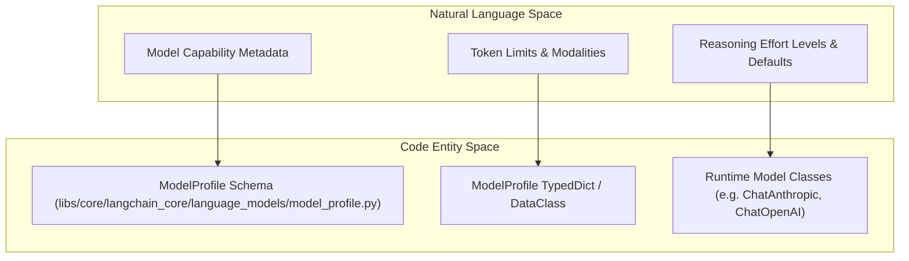
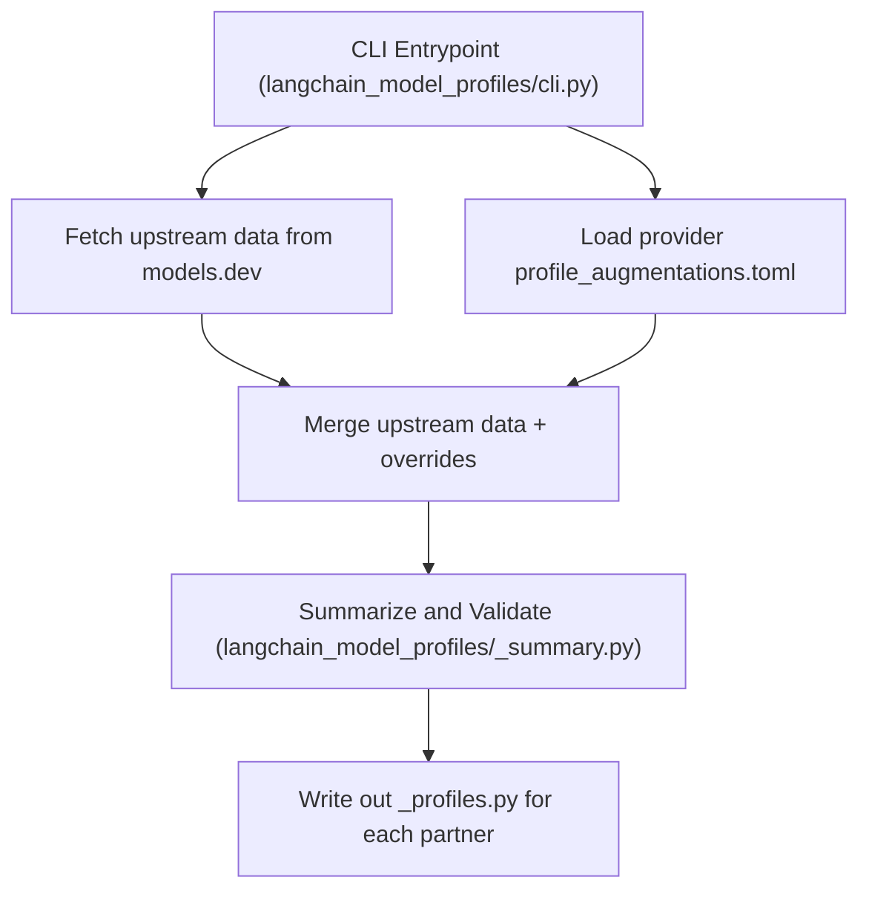
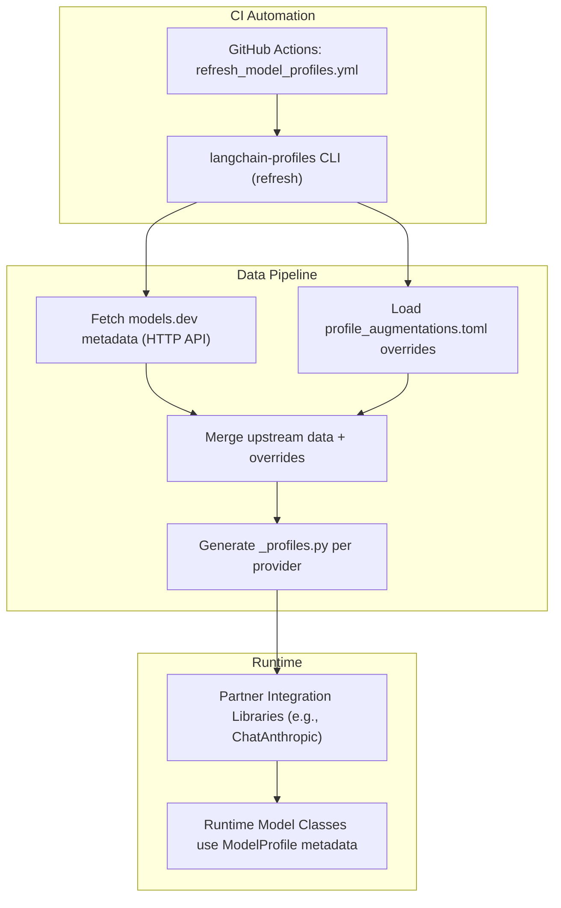
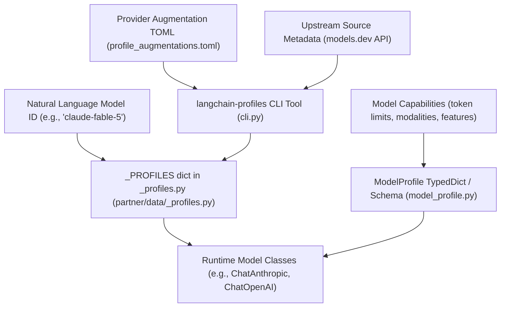

<!-- source: DeepWiki mcp.deepwiki.com · repo langchain-ai/langchain · page 6.3 Model Profiles · fetched 2026-10-26 -->

# Model Profiles

<details>
<summary>Relevant source files</summary>

The following files were used as context for generating this wiki page:

- [.github/scripts/pr-labeler-config.json](.github/scripts/pr-labeler-config.json)
- [.github/scripts/pr-labeler.js](.github/scripts/pr-labeler.js)
- [.github/workflows/_refresh_model_profiles.yml](.github/workflows/_refresh_model_profiles.yml)
- [.github/workflows/close_unchecked_issues.yml](.github/workflows/close_unchecked_issues.yml)
- [.github/workflows/pr_labeler.yml](.github/workflows/pr_labeler.yml)
- [.github/workflows/pr_labeler_backfill.yml](.github/workflows/pr_labeler_backfill.yml)
- [.github/workflows/refresh_model_profiles.yml](.github/workflows/refresh_model_profiles.yml)
- [.github/workflows/reopen_on_assignment.yml](.github/workflows/reopen_on_assignment.yml)
- [.github/workflows/require_issue_link.yml](.github/workflows/require_issue_link.yml)
- [.github/workflows/tag-external-issues.yml](.github/workflows/tag-external-issues.yml)
- [libs/model-profiles/langchain_model_profiles/_summary.py](libs/model-profiles/langchain_model_profiles/_summary.py)
- [libs/model-profiles/langchain_model_profiles/cli.py](libs/model-profiles/langchain_model_profiles/cli.py)
- [libs/model-profiles/tests/unit_tests/test_cli.py](libs/model-profiles/tests/unit_tests/test_cli.py)
- [libs/model-profiles/tests/unit_tests/test_summary.py](libs/model-profiles/tests/unit_tests/test_summary.py)
- [libs/partners/anthropic/langchain_anthropic/data/_profiles.py](libs/partners/anthropic/langchain_anthropic/data/_profiles.py)
- [libs/partners/deepseek/langchain_deepseek/data/_profiles.py](libs/partners/deepseek/langchain_deepseek/data/_profiles.py)
- [libs/partners/fireworks/langchain_fireworks/data/_profiles.py](libs/partners/fireworks/langchain_fireworks/data/_profiles.py)
- [libs/partners/groq/langchain_groq/data/_profiles.py](libs/partners/groq/langchain_groq/data/_profiles.py)
- [libs/partners/huggingface/langchain_huggingface/data/_profiles.py](libs/partners/huggingface/langchain_huggingface/data/_profiles.py)
- [libs/partners/mistralai/langchain_mistralai/data/_profiles.py](libs/partners/mistralai/langchain_mistralai/data/_profiles.py)
- [libs/partners/openai/langchain_openai/data/_profiles.py](libs/partners/openai/langchain_openai/data/_profiles.py)
- [libs/partners/openrouter/langchain_openrouter/data/_profiles.py](libs/partners/openrouter/langchain_openrouter/data/_profiles.py)
- [libs/partners/perplexity/langchain_perplexity/data/_profiles.py](libs/partners/perplexity/langchain_perplexity/data/_profiles.py)
- [libs/partners/xai/langchain_xai/data/_profiles.py](libs/partners/xai/langchain_xai/data/_profiles.py)

</details>


### Purpose and Scope

This page documents the **Model Profiles** subsystem implemented mainly under `libs/model-profiles` and the core schema in `libs/core/langchain_core/language_models/model_profile.py`. The subsystem establishes a standardized, structured representation of capabilities and metadata for language models supported by LangChain partner integrations.

These profiles capture detailed feature flags and usage constraints such as token limits, enabled input/output modalities (text, images, audio, video, PDF), reasoning and tool-calling capabilities, temperature support, structured output, streaming tool calls, and reasoning effort levels.

At a high-level, the subsystem maintains a specification schema, automated tooling for ingesting upstream model metadata (notably from the external `models.dev` project), applies provider-specific augmentations expressed in TOML files, and generates static, immutable profile dictionaries (`_profiles.py`) embedded inside each partner integration. The generated profiles are then consumed at runtime by partner model classes to drive behavior and validation.

---

### ModelProfile Schema and Core Abstraction

The foundational schema defining a `ModelProfile` is located in the core package at:

```
libs/core/langchain_core/language_models/model_profile.py
```

This schema shapes the interface for model metadata and acts as the canonical source of truth for model capabilities.

Key attributes of the `ModelProfile` schema include:

- **Capacity and Token Limits**  
  - `max_input_tokens` (int): Maximum tokens accepted in input prompts.  
  - `max_output_tokens` (int): Maximum tokens generated in output.

- **Input modalities supported**  
  - `text_inputs` (bool), `image_inputs` (bool), `audio_inputs` (bool), `video_inputs` (bool), `pdf_inputs` (bool), etc.

- **Output modalities supported**  
  - `text_outputs` (bool), `image_outputs` (bool), `audio_outputs` (bool), `video_outputs` (bool), etc.

- **Advanced Capabilities**  
  - `tool_calling` (bool): Support for calling external tools/plugins.  
  - `structured_output` (bool): Support for structured data output formats.  
  - `reasoning_output` (bool): Model provides reasoning capabilities.  
  - `temperature` (bool): Supports sampling temperature parameter.  
  - `tool_call_streaming` (bool): Support for streaming responses during tool calls.

- **Reasoning Configuration**  
  - `reasoning_effort_levels` (list[str]): Supported reasoning effort presets (e.g., "low", "medium", "high")  
  - `reasoning_effort_default` (str): Default reasoning effort level.

This schema is used to enforce consistent metadata structures across all partner model integrations.

#### Diagram: ModelProfile Schema Mapping



Sources:  
`libs/core/langchain_core/language_models/model_profile.py`  
`libs/partners/anthropic/langchain_anthropic/data/_profiles.py`  

---

### The `langchain-profiles` CLI and Management Package

The `libs/model-profiles` package contains the tooling responsible for **fetching, validating, summarizing, augmenting, and generating** model profile data.

- The CLI interface is defined in `libs/model-profiles/langchain_model_profiles/cli.py`. It supports commands like `refresh` which updates all partner profiles by fetching upstream data and applying augmentations.
- Summarization and validation utilities reside in `libs/model-profiles/langchain_model_profiles/_summary.py`, enabling metadata inspection, drift detection, and reporting.

#### Core CLI Refresh Workflow

The typical refresh workflow for model profiles involves:

1. Fetching raw upstream metadata from the external `models.dev` project.
2. Loading local provider augmentation overrides from `profile_augmentations.toml` files.
3. Merging upstream data with augmentations to produce consistent provider profiles.
4. Validating and summarizing to detect inconsistencies or missing fields.
5. Writing a generated immutable `_profiles.py` file inside each provider's data subdirectory.

#### Diagram: Model Profiles CLI Refresh Data Flow



This automation is integrated into the repository CI pipelines for periodic updates and auditing.

Sources:  
`libs/model-profiles/langchain_model_profiles/cli.py`  
`libs/model-profiles/langchain_model_profiles/_summary.py`  
`.github/workflows/refresh_model_profiles.yml`

---

### Provider Augmentation TOMLs and Merge Strategy

While `models.dev` serves as the canonical upstream source for model metadata, providers often require overrides or additional attributes not expressed upstream or to correct differences.

These adjustments are stored in `profile_augmentations.toml` files inside each partner package's `data/` directory. These TOML files override or extend attributes for models from that provider to better reflect true capabilities or provider-specific tweaks.

As an example, Anthropic provider augmentations include flags for enabling image & PDF inputs, tool streaming, and detailed reasoning effort level enumerations:

```toml
provider = "anthropic"

[overrides]
image_url_inputs = true
pdf_inputs = true
pdf_tool_message = true
image_tool_message = true
structured_output = false
tool_call_streaming = true

[overrides."claude-sonnet-4-6"]
structured_output = true
reasoning_effort_levels = ["low", "medium", "high", "max"]
reasoning_effort_default = "high"
```

This approach lets LangChain adapt upstream metadata for accuracy and provider-specific model variants.

Sources:  
`libs/partners/anthropic/langchain_anthropic/data/profile_augmentations.toml`  
`libs/partners/openai/langchain_openai/data/profile_augmentations.toml`  
`libs/partners/fireworks/langchain_fireworks/data/profile_augmentations.toml`

---

### Generated Provider Profiles (`_profiles.py`) and Data Pipeline Architecture

The final product of the automated data pipeline is a generated `_profiles.py` module inside each partner's integration package under the `data/` folder.

- These files declare a dictionary `_PROFILES` keyed by model string identifiers.
- Each profile is a dictionary matching the `ModelProfile` schema capturing dates, token limits, capabilities flags, and features.
- They are explicitly marked as auto-generated with warnings to avoid manual edits.

Example snippet extracted from `libs/partners/openrouter/langchain_openrouter/data/_profiles.py`:

```python
_PROFILES: dict[str, dict[str, Any]] = {
    "aion-labs/aion-2.0": {
        "name": "Aion-2.0",
        "release_date": "2026-02-23",
        "max_input_tokens": 131072,
        "max_output_tokens": 32768,
        "text_inputs": True,
        "image_inputs": False,
        "tool_calling": True,
        "reasoning_output": True,
        "structured_output": False,
        "temperature": True,
        "tool_call_streaming": True,
    },
    "amazon/nova-2-lite-v1": {
        "name": "Nova 2 Lite",
        "release_date": "2025-12-02",
        "max_input_tokens": 1000000,
        "max_output_tokens": 65535,
        "text_inputs": True,
        "image_inputs": True,
        "pdf_inputs": True,
        "video_inputs": True,
        "tool_calling": True,
        "attachment": True,
        "temperature": True,
        "tool_call_streaming": True,
    }
}
```

#### Data Flow Architecture Diagram



Generated `_profiles.py` modules are imported and referenced by partner model classes at runtime to conditionally adjust behavior and validate usage based on model capabilities.

Sources:  
`libs/partners/anthropic/langchain_anthropic/data/_profiles.py`  
`libs/partners/openai/langchain_openai/data/_profiles.py`  
`libs/partners/fireworks/langchain_fireworks/data/_profiles.py`  
`libs/partners/openrouter/langchain_openrouter/data/_profiles.py`  
`libs/model-profiles/langchain_model_profiles/cli.py`  
`.github/workflows/refresh_model_profiles.yml`

---

### Bridging Natural Language Model Concepts to Code Entities

The following diagram maps natural language model capability concepts to precise code artifacts to clarify the system's design and data flow:



### Summary Table of Key Code Entities

| Natural Language Concept          | Code Artifact                                           | Description                                               |
|---------------------------------|--------------------------------------------------------|-----------------------------------------------------------|
| Model capability metadata        | `_PROFILES` dict in partner `data/_profiles.py`        | Static profile dict generated and consumed at runtime     |
| Standardized schema for profiles | `ModelProfile` TypedDict in `language_models/model_profile.py` | Defines exact profile data contract                        |
| Automated sync tool              | CLI implemented in `langchain_model_profiles/cli.py`    | Fetches data from models.dev, applies augmentations       |
| Provider augmentations           | `profile_augmentations.toml` in partner data dirs       | Provider-specific profile overrides & extensions          |
| Runtime model integration        | Partner Chat Model classes (e.g., `ChatAnthropic`)      | Use profile metadata for validation and behavior          |

---

# Conclusion

The Model Profiles subsystem is a critical component of LangChain’s partner infrastructure that systematically manages rich metadata describing the capabilities, limits, and features of large language models.

By integrating data from upstream sources, applying curated provider augmentations, validating against a strict schema, and generating static profile modules, LangChain ensures that partner model implementations have consistent, detailed knowledge about model behavior.

This supports robust runtime behavior, usage validation, automated tooling, and continuous profile data refresh integrated into the repository’s CI/CD pipelines.

---

# Appendix: Selected Profile Examples

Example excerpt from `libs/partners/openrouter/langchain_openrouter/data/_profiles.py`:

```python
_PROFILES = {
    "aion-labs/aion-2.0": {
        "name": "Aion-2.0",
        "release_date": "2026-02-23",
        "max_input_tokens": 131072,
        "max_output_tokens": 32768,
        "text_inputs": True,
        "image_inputs": False,
        "tool_calling": True,
        "reasoning_output": True,
        "structured_output": False,
        "temperature": True,
        "tool_call_streaming": True,
    },
    "amazon/nova-2-lite-v1": {
        "name": "Nova 2 Lite",
        "release_date": "2025-12-02",
        "max_input_tokens": 1000000,
        "max_output_tokens": 65535,
        "text_inputs": True,
        "image_inputs": True,
        "pdf_inputs": True,
        "video_inputs": True,
        "tool_calling": True,
        "attachment": True,
        "temperature": True,
        "tool_call_streaming": True,
    }
}
```

Sources:  
`libs/partners/openrouter/langchain_openrouter/data/_profiles.py`  

---

# References

- [LangChain Model Profiles Documentation on Updating Profiles](https://docs.langchain.com/oss/python/langchain/models#updating-or-overwriting-profile-data)  
- `libs/model-profiles/langchain_model_profiles/cli.py`  
- `libs/core/langchain_core/language_models/model_profile.py`  
- Partners `_profiles.py` and augmentation TOML files

---

Sources:  
`libs/core/langchain_core/language_models/model_profile.py`  
`libs/model-profiles/langchain_model_profiles/cli.py`  
`libs/model-profiles/langchain_model_profiles/_summary.py`  
`libs/partners/anthropic/langchain_anthropic/data/profile_augmentations.toml`  
`libs/partners/anthropic/langchain_anthropic/data/_profiles.py`  
`libs/partners/openai/langchain_openai/data/_profiles.py`  
`libs/partners/fireworks/langchain_fireworks/data/_profiles.py`  
`libs/partners/openrouter/langchain_openrouter/data/_profiles.py`  
`libs/partners/xai/langchain_xai/data/_profiles.py`  
`.github/workflows/refresh_model_profiles.yml`

---

