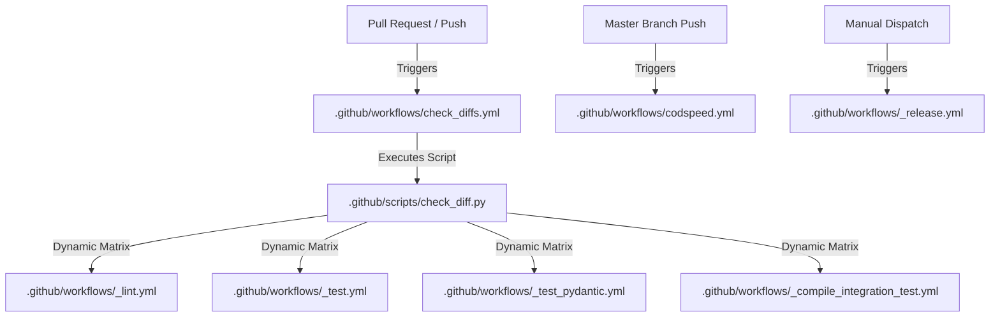
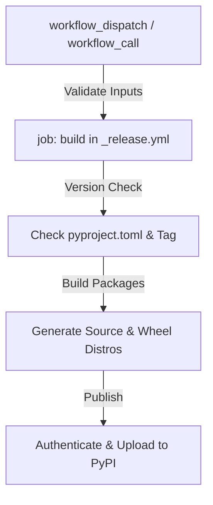

<!-- source: DeepWiki mcp.deepwiki.com · repo langchain-ai/langchain · page 7 CI/CD and Repository Automation · fetched 2026-10-26 -->

# CI/CD and Repository Automation

Relevant source files

The following files were used as context for generating this wiki page:

- [.github/actions/uv_setup/action.yml](.github/actions/uv_setup/action.yml)
- [.github/scripts/check_diff.py](.github/scripts/check_diff.py)
- [.github/workflows/_compile_integration_test.yml](.github/workflows/_compile_integration_test.yml)
- [.github/workflows/_lint.yml](.github/workflows/_lint.yml)
- [.github/workflows/_release.yml](.github/workflows/_release.yml)
- [.github/workflows/_test.yml](.github/workflows/_test.yml)
- [.github/workflows/_test_pydantic.yml](.github/workflows/_test_pydantic.yml)
- [.github/workflows/check_diffs.yml](.github/workflows/check_diffs.yml)
- [.github/workflows/codspeed.yml](.github/workflows/codspeed.yml)
- [.github/workflows/integration_tests.yml](.github/workflows/integration_tests.yml)

This page provides an overview of the continuous integration, continuous deployment (CI/CD), and repository automation systems used within the LangChain monorepo. The automation framework is engineered to handle a multi-package workspace via `uv` workspaces, intelligent diff-based test scheduling, trusted publishing pipelines, and automated repository maintenance.

For comprehensive deep-dives into specific subsystems, refer to the child pages:
- [CI Pipelines and Diff-Based Test Selection](#7.1)
- [Release Process](#7.2)
- [Issue/PR Automation and Templates](#7.3)

---

### CI/CD Pipeline Architecture and Workflow Relationships

This diagram illustrates how different workflows interact. Pull requests and pushes trigger the `check_diffs.yml` workflow, which calls a Python script to analyze changed files and produce dynamic test and lint job matrices. These matrices then invoke package-specific linting, testing, and compatibility checks. Full performance benchmarks execute separately on master pushes. Releases are managed through a dedicated manual or reusable workflow.

Sources:  
[.github/workflows/check_diffs.yml:1-74](),  
[.github/scripts/check_diff.py:1-62](),  
[.github/workflows/_release.yml:1-55](),  
[.github/workflows/codspeed.yml:1-20]()

---

## 7.1. CI Pipelines and Diff-Based Test Selection

At the core of the CI setup is the `.github/workflows/check_diffs.yml` workflow. This workflow triggers on pushes and pull requests targeting the `master` branch or PRs, selectively running tests and linting on only those packages affected by code changes instead of the entire monorepo [.github/workflows/check_diffs.yml:1-19]().

The core mechanism is the `.github/scripts/check_diff.py` script that:
- Parses the set of changed files, maps them to package directories within the workspace such as `libs/core`, `libs/partners/*`, etc.
- Builds a dependency graph of packages by analyzing `pyproject.toml` dependencies and extended testing dependencies to identify transitively affected packages.
- Filters out unstable or ignored partners from dependents if required to maintain CI stability.
- Generates JSON matrices describing which packages to lint, unit test (across multiple Python versions), perform Pydantic version compatibility testing on, run integration compile checks for, and execute VCR cassette-backed playback tests.

The modular design allows the following reusable workflows to consume these matrices and execute jobs dynamically:
- `_lint.yml`: Runs package and test code linting using the package Makefile targets
- `_test.yml`: Runs unit tests twice per package — once with current dependencies, then again with minimal versions to ensure compatibility across dependency ranges
- `_test_pydantic.yml`: Runs unit tests specifically targeting different Pydantic versions, critical for stability across Pydantic upgrades
- `_compile_integration_test.yml`: Quickly verifies that integration tests compile successfully without running them, providing faster feedback on test correctness
- `_test_vcr.yml`: Executes playback-only integration tests that depend on VCR cassettes to verify against recorded external API interaction

In parallel, the `codspeed.yml` workflow triggers for master branch pushes only, running performance benchmarks on changed packages with results uploaded to CodSpeed for monitoring regressions or improvements [.github/workflows/codspeed.yml:1-85]().

The daily `integration_tests.yml` workflow runs full integration tests involving live interactions with partner APIs. This workflow supports manual triggering and selective library testing via dropdowns and overrides, ensuring partners’ runtime code remains operational [.github/workflows/integration_tests.yml:1-75]().

This intelligent CI strategy yields a significant reduction in total test time, optimizes resource usage, and protects against breaking changes through dependency-aware test expansion.

For detailed internals of diff-analysis algorithms, dependents graph construction, test selection heuristics, and VCR integration details, see the child page [CI Pipelines and Diff-Based Test Selection](#7.1).

Sources:  
[.github/workflows/check_diffs.yml:1-187](),  
[.github/scripts/check_diff.py:1-187](),  
[.github/workflows/codspeed.yml:1-85](),  
[.github/workflows/integration_tests.yml:1-75](),  
[.github/workflows/_test.yml:55-74](),  
[.github/workflows/_lint.yml:1-81](),  
[.github/workflows/_compile_integration_test.yml:1-65](),  
[.github/workflows/_test_pydantic.yml:1-73]()

---

## 7.2. Release Process

LangChain package releases are centrally managed by the `.github/workflows/_release.yml` workflow. This workflow operates primarily via manual dispatch through GitHub Actions or can be programmatically called from other workflows to release any package in the monorepo workspace, including core libraries, variants, tooling packages, and partner integrations [.github/workflows/_release.yml:1-120]().

Important capabilities and safeguards include:
- Input validation for parameters like working directory, release version, and flags for prerelease allowance or non-master branch releases (hotfixes).
- Constructs the effective working directory path for the package to release, accommodating common aliases and full override paths.
- Enforces branch restrictions, primarily allowing releases from `master`, while permitting overrides with explicit flags.
- Runs isolated jobs that:
  - Validate that the released version matches the `pyproject.toml` file.
  - Build the source distribution and wheel packages.
  - Publish the package securely to PyPI using authenticated tokens.
- Supports skipping checks against prior published partner packages on certain releases to speed up core releases.

The workflow ensures that releases are reproducible, version-synchronized, and securely published to PyPI, preventing inconsistent or unintentional releases.

For more detailed coverage of each release step—including version verification, artifact building, and trusted publishing mechanisms—see the child page [Release Process](#7.2).

---

### Release Pipeline Execution Flow

This diagram displays the main conceptual stages in the release workflow from dispatch through to publishing packages on PyPI.

Sources:  
[.github/workflows/_release.yml:1-172]()

---

## 7.3. Issue/PR Automation and Templates

To ensure efficient repository maintenance and improve contributor workflows, the LangChain repo employs automation bots and template-driven policies:

- **Issue and Pull Request Templates**: Predefined templates guide contributors on bug report formats, feature requests, or other issue types, simplifying triage and support.
- **Labelers and Automated Tagging**: GitHub Actions workflows automatically assign labels to new issues and PRs based on contents or paths to facilitate categorization.
- **Dependabot**: Automated dependency update bot configured to open pull requests for dependency bumps or security fixes on project dependencies.
- **Issue-Link Enforcement**: Custom checks that ensure issues or PRs reference related issue links to maintain traceability.
- **Scheduled Profile Refresh**: Periodic workflows refresh model profile data and metadata caches to keep integrations current without manual intervention.

These systems collectively reduce manual triaging overhead, enforce repository standards, and keep dependencies and metadata current for all contributors.

For comprehensive explanations of how these bots function and their configuration details, see the child page [Issue/PR Automation and Templates](#7.3).

Sources:  
[.github/workflows/check_diffs.yml:43-47](),  
[.github/workflows/codspeed.yml:29-33]()

---

This overview highlights how the LangChain repository automates testing, release, and maintenance workflows to ensure high code quality, maintainability, and security across a complex multi-package workspace. For comprehensive technical implementation and best practices, consult the referenced child pages.

---

