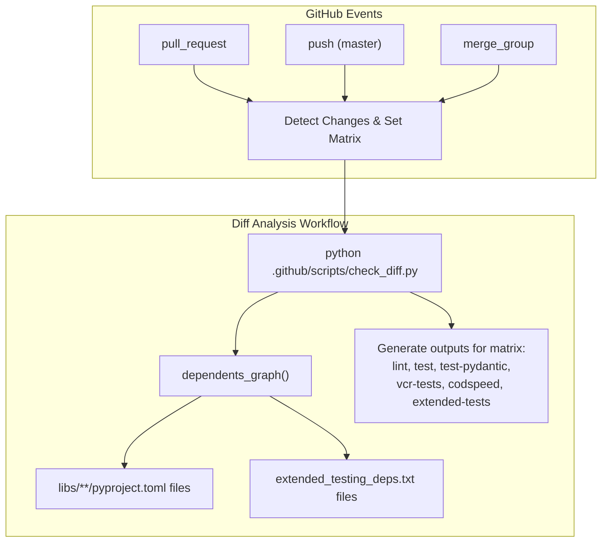
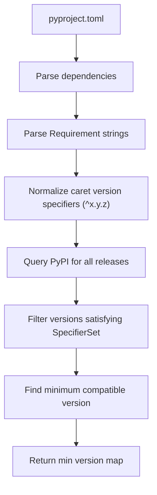
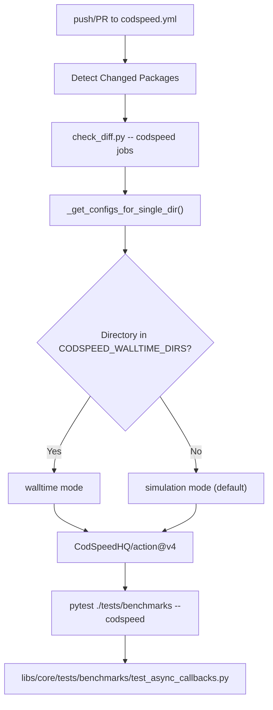
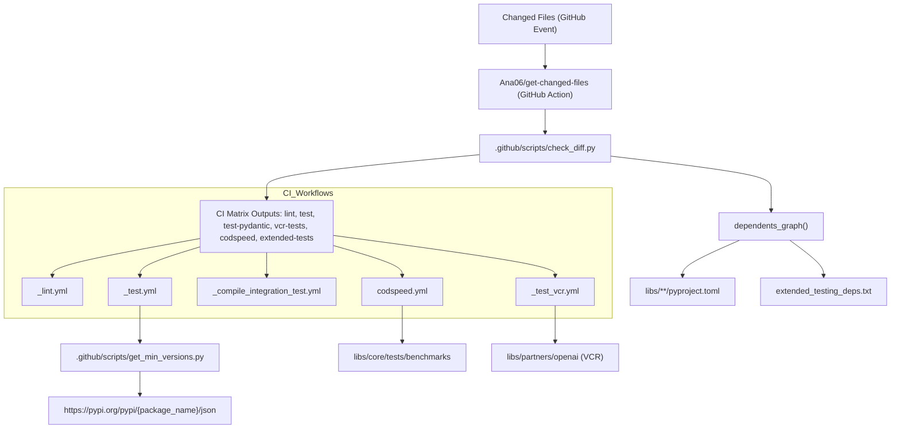

<!-- source: DeepWiki mcp.deepwiki.com · repo langchain-ai/langchain · page 7.1 CI Pipelines and Diff-Based Test Selection · fetched 2026-10-26 -->

# CI Pipelines and Diff-Based Test Selection

<details>
<summary>Relevant source files</summary>

The following files were used as context for generating this wiki page:

- [.github/actions/uv_setup/action.yml](.github/actions/uv_setup/action.yml)
- [.github/scripts/check_diff.py](.github/scripts/check_diff.py)
- [.github/scripts/get_min_versions.py](.github/scripts/get_min_versions.py)
- [.github/scripts/test_get_min_versions.py](.github/scripts/test_get_min_versions.py)
- [.github/workflows/_compile_integration_test.yml](.github/workflows/_compile_integration_test.yml)
- [.github/workflows/_lint.yml](.github/workflows/_lint.yml)
- [.github/workflows/_release.yml](.github/workflows/_release.yml)
- [.github/workflows/_test.yml](.github/workflows/_test.yml)
- [.github/workflows/_test_pydantic.yml](.github/workflows/_test_pydantic.yml)
- [.github/workflows/check_diffs.yml](.github/workflows/check_diffs.yml)
- [.github/workflows/check_release_deps.yml](.github/workflows/check_release_deps.yml)
- [.github/workflows/check_versions.yml](.github/workflows/check_versions.yml)
- [.github/workflows/codspeed.yml](.github/workflows/codspeed.yml)
- [.github/workflows/integration_tests.yml](.github/workflows/integration_tests.yml)
- [libs/core/tests/benchmarks/test_async_callbacks.py](libs/core/tests/benchmarks/test_async_callbacks.py)
- [libs/core/tests/benchmarks/test_imports.py](libs/core/tests/benchmarks/test_imports.py)
- [libs/partners/anthropic/langchain_anthropic/_sdk_compat.py](libs/partners/anthropic/langchain_anthropic/_sdk_compat.py)
- [libs/partners/anthropic/tests/unit_tests/_httpx_compat.py](libs/partners/anthropic/tests/unit_tests/_httpx_compat.py)
- [libs/partners/anthropic/tests/unit_tests/test_sdk_compat.py](libs/partners/anthropic/tests/unit_tests/test_sdk_compat.py)

</details>


## Purpose and Scope

This document details the Continuous Integration (CI) and repository automation architecture for the LangChain monorepo. It focuses on the diff-based test selection mechanism implemented by the script `check_diff.py` and the primary workflow `check_diffs.yml`. This system dynamically computes testing matrices to run linting, testing, minimum-version compatibility runs, VCR cassette tests, performance benchmarks (via CodSpeed), and integration compile checks only on the packages affected by the changed files and their transitive dependents.

This approach is designed to optimize CI resource usage and feedback latency, making CI runs more efficient by targeting only relevant parts of the monorepo.

Sources:
- [.github/workflows/check_diffs.yml:1-73]()
- [.github/scripts/check_diff.py:1-187]()
- [.github/workflows/_lint.yml:1-81]()
- [.github/workflows/_test.yml:55-74]()
- [.github/workflows/codspeed.yml:1-85]()

---

## 1. Diff Detection and Dependency Graph (`check_diffs.yml` & `check_diff.py`)

The main CI workflow is `.github/workflows/check_diffs.yml`, triggered on pushes to master, pull requests, and merge group events. Its first job (`build`) performs the key step of identifying changed files using the third-party action `Ana06/get-changed-files` and then analyzes those diffs with the Python script `.github/scripts/check_diff.py` to determine relevant packages and their dependents requiring testing or linting.



### Dependency Graph Construction

The function `dependents_graph()` constructs a map from each package to the set of packages that depend on it to ensure that when a core package changes, dependent packages are also rebuilt and tested.

The process:

- Iterate all `pyproject.toml` files under `libs/` excluding templates and `standard-tests`.
- Parse the `dependencies` and `test` dependency groups and record dependent packages for any dependency matching "langchain".
- Additionally, parse `extended_testing_deps.txt` files for extended editable dependencies referencing partner libraries.
- Filter out ignored partners (e.g., `huggingface`) from being added as dependents due to CI instability.

```python
def dependents_graph() -> dict:
    """Construct a mapping of package -> dependents for CI test selection."""
    dependents = defaultdict(set)
    # For each pyproject.toml in libs/
    for path in glob.glob("./libs/**/pyproject.toml", recursive=True):
        if "template" in path:
            continue
        with open(path, "rb") as f:
            pyproject = tomllib.load(f)
        pkg_dir = "libs" + "/".join(path.split("libs")[1].split("/")[:-1])
        # Read normal and test dependencies to find langchain deps
        for dep in pyproject["project"]["dependencies"] + pyproject["dependency-groups"]["test"]:
            requirement = Requirement(dep)
            package_name = requirement.name
            if "langchain" in dep:
                dependents[package_name].add(pkg_dir)
                continue
        # Read extended testing deps for editable partner installs
        extended_req_path = Path(path).parent / "extended_testing_deps.txt"
        if extended_req_path.exists():
            with open(extended_req_path, "r") as f:
                extended_deps = f.read().splitlines()
            for dep_line in extended_deps:
                if dep_line.startswith("-e "):
                    # Editable dependencies point to partners, e.g. -e ../partners/openai
                    assert dep_line.startswith("-e ../partners/")
                    partner = dep_line.split("partners/")[1]
                    dep = f"langchain-{partner}"
                else:
                    dep = dep_line.split("==")[0]
                if "langchain" in dep:
                    dependents[dep].add(pkg_dir)
    # Filter ignored partners from dependents listing
    for k in dependents:
        for ignored in ["huggingface"]:
            ignore_path = f"libs/partners/{ignored}"
            if ignore_path in dependents[k]:
                dependents[k].remove(ignore_path)
    return dependents
```

Another helper function, `add_dependents()`, uses this graph to take an initial list of directories to evaluate and augment it by including all dependent directories.

Key notes:

- The `libs/core` directory is treated specially because of its large number of dependents; it’s added as is and optionally can skip its dependents to allow easier CI runs on dependent packages individually.
- This behavior is controlled by the flag `IGNORE_CORE_DEPENDENTS`.

Sources:
- [.github/workflows/check_diffs.yml:16-73]()
- [.github/scripts/check_diff.py:28-127]()

---

## 2. Reusable Workflows for Linting, Testing, and Compilation

The `check_diffs.yml` workflow orchestrates multiple jobs by passing matrix configurations generated by `check_diff.py` as JSON outputs for each type of job, invoking reusable workflows with standardized inputs for the package directory and Python version.

This DRY strategy centralizes test logic into reusable workflows (`_lint.yml`, `_test.yml`, `_test_pydantic.yml`, `_compile_integration_test.yml`, `_test_vcr.yml`) enabling specialized CI jobs per package with minimal duplication.

### Linting Workflow (`_lint.yml`)

- Executes `make lint_package` and `make lint_tests` targets to verify code style and type correctness in both library and test files.
- Installs linting and typing dependencies via `uv sync --group lint --group typing`.
- Supports both partner packages and non-partner packages by conditionally adding `test_integration` dependencies for partners.

### Unit Testing Workflow (`_test.yml`)

- Runs unit tests twice:
  1. Using the current locked dependencies.
  2. Using dynamically computed minimum supported versions, ensuring compatibility.
- Computes minimum versions by calling `.github/scripts/get_min_versions.py` with the current `pyproject.toml`.
- Uses `uv` package manager to isolate environments and install specified dependencies.
- Uses `make test` to run tests silently (`PYTEST_EXTRA=-q`).

### Pydantic Version Testing Workflow (`_test_pydantic.yml`)

- Specialized workflow to test package compatibility with specific Pydantic versions.
- Installs selected Pydantic version and runs tests via `make test`.
- Parameters allow control over Python version and Pydantic minor version tested.

### Integration Test Compilation Check (`_compile_integration_test.yml`)

- Runs integration tests with `pytest` marker `-m compile` which checks syntax and import errors without full test execution.
- Ensures integration tests do not have basic syntax or runtime import failures.

Sources:
- [.github/workflows/check_diffs.yml:78-144]()
- [.github/workflows/_lint.yml:1-81]()
- [.github/workflows/_test.yml:27-74]()
- [.github/workflows/_test_pydantic.yml:1-73]()
- [.github/workflows/_compile_integration_test.yml:1-54]()

---

## 3. Minimum Version Testing (`get_min_versions.py`)

The script `.github/scripts/get_min_versions.py` extracts minimum versions of dependencies from the `pyproject.toml` file constraints by:

- Parsing dependency version specifiers.
- Normalizing caret (`^`) version ranges to equivalent multiple constraints.
- Querying PyPI for all published versions of the dependency.
- Filtering versions to those satisfying the specifiers.
- Returning the minimum valid version.

This provides a minimum supported dependency version mapping that is used in `_test.yml` jobs to guarantee that LangChain libraries remain compatible across dependency version ranges.

It skips full minimum version checks on some core packages during pull requests to avoid unnecessary complexity, running them instead on releases.



Sources:
- [.github/scripts/get_min_versions.py:1-159]()
- [.github/workflows/_test.yml:55-74]()

---

## 4. Performance Benchmarking with CodSpeed (`codspeed.yml`)

The performance benchmarking pipeline, defined in `.github/workflows/codspeed.yml`, runs benchmarks on only the packages affected by changes and uploads results to CodSpeed for historical regression tracking.

Key features:

- Separate workflow from main CI to avoid cancellation on push to master.
- Uses `check_diff.py` to select relevant packages for CodSpeed runs.
- Differentiates benchmark mode between CPU simulation (default, low variance) and walltime mode (for heavy SDK init packages like `libs/partners/openai`).
- Runs `pytest` benchmarks under the `tests/benchmarks` directory.
- Example benchmark: asynchronous callback processing performance in `libs/core`.



Sources:
- [.github/workflows/codspeed.yml:1-85]()
- [.github/scripts/check_diff.py:134-149]()
- [libs/core/tests/benchmarks/test_async_callbacks.py:47-56]()

---

## 5. VCR Cassette Testing (`check_diff.py` & `check_diffs.yml`)

Certain partner packages use VCR cassettes to record HTTP interactions and enable playback-only tests without API keys. The `check_diff.py` script identifies such packages (currently `libs/partners/openai`) and marks them to trigger dedicated VCR test jobs that run only cassette replays.

This enables verification that:

- Cassettes are up-to-date with actual API interactions.
- No live API calls or secrets are needed during PR validation.
- The SDK API compatibility remains stable.

Sources:
- [.github/scripts/check_diff.py:36-40]()
- [.github/workflows/check_diffs.yml:132-144]()

---

# Summary Diagram: Mapping Natural Language System Components to Code Entities



---

# Summary Table: Key Files and Their CI Roles

| File / Workflow                                | Role                                            | Description                                                |
|------------------------------------------------|-------------------------------------------------|------------------------------------------------------------|
| `.github/scripts/check_diff.py`                 | Diff Analyzer & Matrix Generator                 | Parses changed files, builds dependency graph, outputs CI job matrices for affected packages.|
| `.github/workflows/check_diffs.yml`              | Primary CI Orchestrator                           | Runs diff detection job, then delegates to reusable lint/test workflows based on diff analysis. |
| `.github/workflows/_lint.yml`                    | Reusable Lint Workflow                            | Sets up Python/UV, runs linting on package and test code.  |
| `.github/workflows/_test.yml`                    | Reusable Unit Test Workflow                       | Runs tests with locked deps, calculates and tests with min versions. |
| `.github/workflows/_test_pydantic.yml`           | Pydantic Version Compatibility Testing           | Runs tests on specific Pydantic versions to check compatibility. |
| `.github/workflows/_compile_integration_test.yml`| Integration Test Compilation Validation           | Runs pytest compile marker to check integration test syntax/imports. |
| `.github/scripts/get_min_versions.py`             | Minimum Dependency Version Resolver               | Determines minimal satisfying versions for dependencies from PyPI and pyproject.toml specs. |
| `.github/workflows/codspeed.yml`                 | Performance Benchmarking Pipeline                 | Runs benchmarks on changed packages, submits results to CodSpeed. |
| `.github/workflows/_test_vcr.yml`                  | VCR Playback Tests Workflow                        | Runs playback-only tests against VCR cassettes to validate integration test recordings. |

---

# References

All references to code and configurations for this page are from the following files:

- `.github/workflows/check_diffs.yml:1-187`  
- `.github/scripts/check_diff.py:1-187`  
- `.github/workflows/_lint.yml:1-82`  
- `.github/workflows/_test.yml:1-86`  
- `.github/scripts/get_min_versions.py:1-200`  
- `.github/workflows/codspeed.yml:1-86`  
- `.github/workflows/_compile_integration_test.yml:1-66`  
- `.github/workflows/_test_pydantic.yml:1-74`  
- `libs/core/tests/benchmarks/test_async_callbacks.py:47-56`

---

