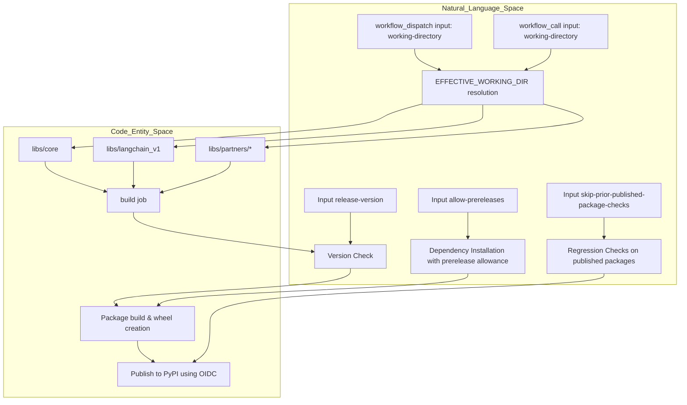
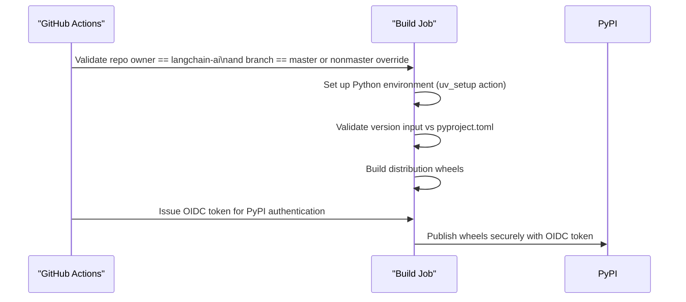
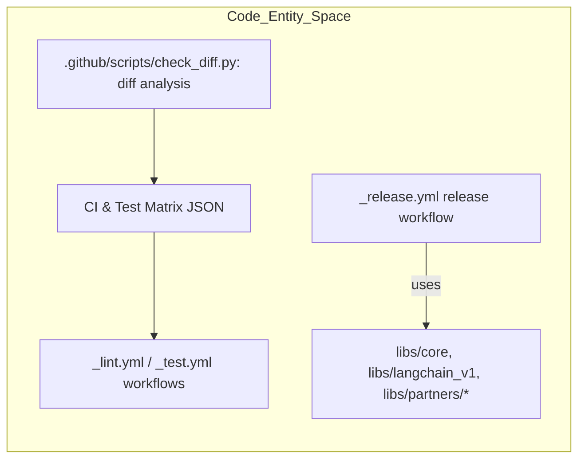

<!-- source: DeepWiki mcp.deepwiki.com · repo langchain-ai/langchain · page 7.2 Release Process · fetched 2026-10-26 -->

# Release Process

Relevant source files

The following files were used as context for generating this wiki page:

- [.github/scripts/check_diff.py](.github/scripts/check_diff.py)
- [.github/scripts/get_min_versions.py](.github/scripts/get_min_versions.py)
- [.github/scripts/test_get_min_versions.py](.github/scripts/test_get_min_versions.py)
- [.github/workflows/_compile_integration_test.yml](.github/workflows/_compile_integration_test.yml)
- [.github/workflows/_lint.yml](.github/workflows/_lint.yml)
- [.github/workflows/_release.yml](.github/workflows/_release.yml)
- [.github/workflows/_test.yml](.github/workflows/_test.yml)
- [.github/workflows/_test_pydantic.yml](.github/workflows/_test_pydantic.yml)
- [.github/workflows/check_diffs.yml](.github/workflows/check_diffs.yml)
- [.github/workflows/check_release_deps.yml](.github/workflows/check_release_deps.yml)
- [.github/workflows/check_versions.yml](.github/workflows/check_versions.yml)
- [.github/workflows/codspeed.yml](.github/workflows/codspeed.yml)
- [.github/workflows/integration_tests.yml](.github/workflows/integration_tests.yml)
- [libs/partners/anthropic/langchain_anthropic/_sdk_compat.py](libs/partners/anthropic/langchain_anthropic/_sdk_compat.py)
- [libs/partners/anthropic/tests/unit_tests/_httpx_compat.py](libs/partners/anthropic/tests/unit_tests/_httpx_compat.py)
- [libs/partners/anthropic/tests/unit_tests/test_sdk_compat.py](libs/partners/anthropic/tests/unit_tests/test_sdk_compat.py)

## Purpose and Scope
This page documents the release orchestration infrastructure for the LangChain monorepo, focused on the `.github/workflows/_release.yml` GitHub Actions workflow. The release process ensures secure and trusted publishing to PyPI, strict version validation, handling of prerelease dependencies, and prior published package regression checks for the monorepo's packages including core libraries, legacy packages, and partner integrations.

The workflow supports both manual invocation and programmatic calls and integrates with CI machinery controlling linting, testing, and dependency compatibility validation.

Sources:  
[.github/workflows/_release.yml:1-135]()  
[.github/workflows/_release.yml:137-172]()  
[.github/scripts/check_diff.py:1-130]()  
[.github/workflows/_lint.yml:1-81]()  
[.github/workflows/_test.yml:1-85]()  
[.github/workflows/check_release_deps.yml:1-146]()  
[.github/scripts/get_min_versions.py:1-200]()

---

## Release Workflow Architecture (`.github/workflows/_release.yml`)

The release workflow is designed as a reusable, manually triggerable GitHub Actions pipeline that can be invoked via `workflow_dispatch` or through a `workflow_call` from downstream workflows. It orchestrates the build, version validation, packaging, and publishing for individual LangChain packages.

### Input Normalization and Package Directory Resolution

- The main input is `working-directory`, which specifies the package to release. It accepts either:
  - A short name such as `"core"`, `"openai"`, `"langchain_v1"`, `"text-splitters"`, etc.
  - A full folder path override (e.g., `"libs/partners/partner-xyz"`).

- The environment variable `EFFECTIVE_WORKING_DIR` dynamically resolves this input to a canonical package path under `libs/` or `libs/partners/`. For example:
  - `core` → `libs/core`
  - `openai` → `libs/partners/openai`
  - `langchain_v1` → `libs/langchain_v1`

This allows consistent use of package paths internally regardless of how the input was specified.

### Core Workflow Inputs

| Input                            | Type     | Description                                                                                                        |
|---------------------------------|----------|--------------------------------------------------------------------------------------------------------------------|
| `working-directory`             | string   | Required. Package folder short name or full path to release.                                                       |
| `release-version`               | string   | Required. Exact version string expected for this release. Must match `pyproject.toml`.                             |
| `allow-prereleases`             | boolean  | Optional. Enables passing `--prerelease=allow` to package installation, resolving transitive prerelease dependencies.|
| `skip-prior-published-package-checks` | string   | Optional. Skips regression compatibility checks against prior published partner packages when releasing core packages. Valid values: `"none"`, `"anthropic"`, `"openai"`, `"all"`. |

### Job Summary and Flow

- **Build Job**: Checks out the code, sets up Python environment (default 3.11), installs dependencies with optional prerelease allowance, validates the version from `pyproject.toml` matches `release-version` input, and prepares the package for publishing.

- **Version Check**: Confirm `release-version` matches the package definition exactly to prevent accidental mismatches.

- **Publishing**: Uses GitHub Actions' OpenID Connect (OIDC) tokens to authenticate securely to PyPI, without static credentials, and uploads the built wheels.

- **Regression Tests**: Depending on the inputs, regression compatibility tests may run against previously published packages to ensure backward compatibility.

*Figure 1: Workflow input mapping and job flow in the `_release.yml` release workflow.*

Sources: [.github/workflows/_release.yml:1-135]()

---

## Trusted Publishing to PyPI and Security Controls

- **Repository Owner Enforcement**: The workflow only runs release jobs if the repository owner is `langchain-ai`.

- **Branch Restriction**: Releases are only allowed on the `master` branch or explicitly authorized non-master branches labeled dangerous (used only for hotfixes).

- **Job Isolation and Minimal Permissions**: The `build` job isolates environment setup and version validation under minimal GitHub token permissions (`contents: read`) before any secret usage.

- **Authentication with OIDC**: The publishing step leverages GitHub Actions OIDC tokens to securely and ephemeral authenticate to PyPI, avoiding static PyPI token storage and improving supply chain security.

- **Controlled Build Environment**: Uses the custom `uv_setup` action to prepare a reproducible Python environment with specified Python version and dependency cache control.

*Figure 2: Security and authentication flow during package publishing.*

Sources: [.github/workflows/_release.yml:137-172]()

---

## Version Checks and Consistency Validation

Prior to releasing, it is critical to verify that the provided `release-version` matches exactly the version declared in the package's `pyproject.toml`. This guard prevents publishing packages with unintended version mismatches that could break dependency resolution for downstream consumers.

### Mechanism

- The workflow reads the `pyproject.toml` in the target package folder and extracts its `version`.
- Compares the extracted version string with the `release-version` input.
- Rejects the release if versions do not match.

### Local Developer Checks

Corresponding make targets and pre-commit hooks in each package enforce that version files and manifests stay synchronized, examples include:

| Package Directory           | Command                  | Description                              |
|----------------------------|--------------------------|------------------------------------------|
| `libs/core`                | `make -C libs/core check_version` | Check `version.py` matches manifest    |
| `libs/langchain_v1`        | `make -C libs/langchain_v1 check_version` | Verify `_version.py` vs `pyproject.toml` |
| `libs/partners/anthropic`  | `make -C libs/partners/anthropic check_version` | Version consistency check              |

These prevent accidental version drifts before triggering release workflows.

Sources: [.github/workflows/_release.yml:141-155]() (implied), local Makefiles (not shown explicitly)

---

## Prerelease Dependency Checks

LangChain packages sometimes depend on prerelease versions of other internal or partner packages (e.g., alpha releases of `langgraph-checkpoint`). Typical dependency resolvers do not accept prerelease versions by default, causing resolution failures.

### Workflow Handling

- The release workflow input `allow-prereleases` toggles passing the flag `--prerelease=allow` to the UV package manager during dependency installation steps.
- This flag enables transitive dependencies that are prereleases to be resolved and installed properly.
- Use this flag exclusively when the release itself is a prerelease and at least one dependency is also a prerelease version.

### Example Scenario

If releasing `langchain-core` version `1.4.0a1` which depends on a partner package at a prerelease version (e.g., `langgraph-checkpoint>=4.1.0a3`), the workflow must allow resolving this prerelease dependency.

Sources: [.github/workflows/_release.yml:34-41]()  
[.github/workflows/_release.yml:102-109]()

---

## Prior Published Package Regression Checks

To ensure release candidates remain backward compatible with previously published versions in the package ecosystem, regression checks run against prior published partner dependencies.

### Key Points

- The input `skip-prior-published-package-checks` controls if these regression checks are skipped.
- `none` means all regression tests run.
- For core library releases, checks against partners like `anthropic` and `openai` can be skipped (`skip-prior-published-package-checks` set to those values or `all`).
- This guard prevents regressions where new releases break consumers depending on older versions.

### Workflow Impact

- During release, the workflow fetches prior published package versions from PyPI for runtime dependencies.
- It verifies that the release candidate’s declared dependencies resolve correctly against these known published versions.
- Any unresolved or unpublished dependency versions cause the release to fail early.

Sources: [.github/workflows/_release.yml:42-52]()  
[.github/workflows/check_release_deps.yml:1-146]()

---

## Integration with CI Pipelines and Diff-Based Test Selection

Though separate from release, CI pipelines share knowledge of package directories and dependencies crucial for effective testing and validation before releases.

- The `.github/scripts/check_diff.py` script analyzes Git diffs to determine which packages are affected by changes.
- It produces a test matrix to run linting, unit tests, extended tests, and compilation checks only on relevant packages and their dependents.
- This improves CI speed and releases quality by ensuring releases build on well-tested bases.

### Shared Directory Mapping

The release workflow and CI workflows share the package directory resolution logic (`libs/core`, `libs/langchain_v1`, `libs/partners/*`) for consistent operations.

*Figure 3: CI pipeline coordination through directory and package knowledge shared with release process.*

Sources:  
[.github/scripts/check_diff.py:1-130]()  
[.github/workflows/_lint.yml:1-81]()  
[.github/workflows/_test.yml:1-85]()  

---

## Summary

The release process for LangChain's monorepo is governed by a sophisticated, secure GitHub Actions workflow (`_release.yml`). It orchestrates:

- Precise package directory resolution and version consistency enforcement
- Secure publishing to PyPI using ephemeral OIDC authentication
- Handling of challenging prerelease dependency resolution
- Regression checks with prior published package versions to prevent breakage
- Integration and alignment with broader CI pipelines for efficient testing and validation

This architecture ensures that LangChain packages are published reliably, securely, and with compatible dependencies, enabling rapid iterative releases across core, partner, and legacy components.

---

# Appendix: Key Files and Their Roles in Release Process

| File Path                           | Role                                                                            |
|-----------------------------------|---------------------------------------------------------------------------------|
| `.github/workflows/_release.yml`  | Main reusable GitHub Actions workflow for building, verifying versions, and publishing LangChain packages to PyPI. |
| `.github/scripts/check_diff.py`   | Analyzes git diffs to identify affected packages for selective testing and CI optimization.        |
| `.github/workflows/_lint.yml`     | Linting workflow called in CI to check code and test style correctness in changed packages.          |
| `.github/workflows/_test.yml`     | Unit testing workflow supporting current and minimum dependency version tests.                        |
| `.github/workflows/check_release_deps.yml` | Checks that release PR dependencies are already published on PyPI to prevent broken releases.        |
| `.github/workflows/_test_pydantic.yml` | Pydantic compatibility testing workflow for minimum version support across packages.                   |
| `.github/scripts/get_min_versions.py` | Utility script to compute minimum package versions from pyproject.toml and PyPI metadata.            |
| Package Makefiles and Version Files | Enforce local developer version checks and build consistency for release readiness.                   |

Sources: Multiple above

---

This detailed release process documentation empowers maintainers and contributors to understand the technical underpinnings of LangChain's secure, multi-package release lifecycle.

---

