# Page: Overview

# Overview

<details>
<summary>Relevant source files</summary>

The following files were used as context for generating this wiki page:

- [.github/CODEOWNERS](.github/CODEOWNERS)
- [.github/PULL_REQUEST_TEMPLATE.md](.github/PULL_REQUEST_TEMPLATE.md)
- [.github/workflows/pr_lint.yml](.github/workflows/pr_lint.yml)
- [AGENTS.md](AGENTS.md)
- [README.md](README.md)
- [libs/README.md](libs/README.md)
- [libs/core/Makefile](libs/core/Makefile)
- [libs/core/README.md](libs/core/README.md)
- [libs/langchain/Makefile](libs/langchain/Makefile)
- [libs/langchain/README.md](libs/langchain/README.md)
- [libs/langchain/pyproject.toml](libs/langchain/pyproject.toml)
- [libs/langchain/tests/unit_tests/conftest.py](libs/langchain/tests/unit_tests/conftest.py)
- [libs/langchain/tests/unit_tests/test_dependencies.py](libs/langchain/tests/unit_tests/test_dependencies.py)
- [libs/langchain/uv.lock](libs/langchain/uv.lock)
- [libs/langchain_v1/Makefile](libs/langchain_v1/Makefile)
- [libs/langchain_v1/README.md](libs/langchain_v1/README.md)
- [libs/langchain_v1/langchain/__init__.py](libs/langchain_v1/langchain/__init__.py)
- [libs/langchain_v1/pyproject.toml](libs/langchain_v1/pyproject.toml)
- [libs/langchain_v1/uv.lock](libs/langchain_v1/uv.lock)
- [libs/model-profiles/pyproject.toml](libs/model-profiles/pyproject.toml)
- [libs/model-profiles/uv.lock](libs/model-profiles/uv.lock)
- [libs/partners/README.md](libs/partners/README.md)
- [libs/standard-tests/README.md](libs/standard-tests/README.md)
- [libs/standard-tests/pyproject.toml](libs/standard-tests/pyproject.toml)
- [libs/standard-tests/uv.lock](libs/standard-tests/uv.lock)
- [libs/text-splitters/Makefile](libs/text-splitters/Makefile)
- [libs/text-splitters/README.md](libs/text-splitters/README.md)
- [libs/text-splitters/pyproject.toml](libs/text-splitters/pyproject.toml)
- [libs/text-splitters/uv.lock](libs/text-splitters/uv.lock)

</details>


The LangChain monorepo serves as the core development repository for the LangChain agent engineering framework and its surrounding ecosystem [README.md:12-25](). It is organized as a multi-package Python project managed via `uv`, containing base abstractions, runtime orchestrators, legacy pipelines, third-party provider integrations, and shared utility packages [AGENTS.md:15-37]().

The repository is structured to cleanly separate low-level interfaces from high-level agent implementations and vendor-specific integrations. Below is an architectural overview of how the monorepo packages interrelate:

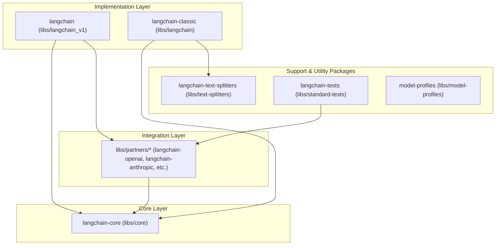

The core layer provides foundational abstractions and protocols upon which all other packages build. The implementation layer consists of two primary packages:

- **`langchain_v1`**: The actively maintained implementation with modern agent architecture and workflow orchestration.
- **`langchain-classic`**: A legacy package preserving traditional chains and agent executors, maintained for backward compatibility with no new features.

The integration layer (`libs/partners/`) contains service-specific code implementing models, embeddings, and tools for third-party providers such as OpenAI, Anthropic, and local model supports. Support and utility packages provide shared tooling like text splitting utilities, standard test suites for validating integrations, and model profile metadata.

*Sources: [AGENTS.md:15-37](), [libs/core/pyproject.toml:5-37](), [libs/langchain_v1/pyproject.toml:5-31](), [libs/langchain/pyproject.toml:5-34]()*


---

## 1.1. Repository Layout and Packages

The `libs/` directory houses multiple independently versioned Python packages. Each package maintains its own `pyproject.toml`, `uv.lock`, and `Makefile` to manage metadata, dependencies, and development workflows independently [AGENTS.md:17-54](). Inter-package dependencies are linked locally during development using `[tool.uv.sources]` entries, allowing editable installs that reference local paths instead of PyPI releases [libs/langchain/pyproject.toml:117-122]().

Key packages include:

| Package Name            | Directory (libs/)       | Description                                                                                                              |
|-------------------------|------------------------|--------------------------------------------------------------------------------------------------------------------------|
| `langchain-core`        | core                   | Foundational runtime abstractions, core interfaces such as Runnables and messages, and serialization layers. This is the base building block used by all client-facing packages. |
| `langchain_v1`          | langchain_v1            | Actively maintained implementation package featuring `create_agent` factory, LangGraph workflows, modern API surface including unified model/embedding initialization via `init_chat_model`. |
| `langchain-classic`     | langchain               | Legacy package preserving classical chains, memory and evaluation components, legacy agents, and output parsers. No feature development occurs here. |
| Partner Integration Packages | partners/*             | Third-party provider integrations (e.g. openai, anthropic, ollama). Each integrates models, tools, and embeddings conforming to the core protocols. |
| `langchain-text-splitters` | text-splitters          | Utilities for text chunking and document splitting to prepare inputs for LLMs and retrievers.                           |
| `langchain-tests`       | standard-tests          | Shared pytest-based test suites validating provider implementations to ensure consistent behavior.                       |
| `model-profiles`        | model-profiles          | Model metadata, capability schemas, and CLI tooling to manage model profiles and augmentations.                         |

Developers typically work with these packages independently but within the monorepo context for consistent integration and release management.

For detailed package structure, versioning, and inter-package dependency layout, see [Repository Layout and Packages](#1.1).

*Sources: [AGENTS.md:15-54](), [libs/core/pyproject.toml:5-88](), [libs/langchain/pyproject.toml:5-122](), [libs/langchain_v1/pyproject.toml:5-106]*


---

## 1.2. Developer Setup and Workflows

Development across the LangChain monorepo relies on the `uv` toolchain for environment and dependency management [AGENTS.md:46-53](). Unlike other monorepos, there is no root-level workspace configuration file; developers must enter an individual package directory (e.g., `libs/core` or `libs/langchain_v1`) before running commands [AGENTS.md:54]().

Common workflows include:

- **Dependency Syncing**: `uv sync --all-groups` installs all dependency groups for the current package, including test and lint dependencies. Selective sync with `--group <name>` is supported for incremental installs [AGENTS.md:56-64]().
- **Testing**: Running `make test` in each package triggers pytest runs suited for that package's code, often with network isolation to prevent unexpected calls to external services [AGENTS.md:67-68]().
- **Linting and Formatting**: `make lint` invokes the `ruff` linter, while `make format` runs auto-formatting [AGENTS.md:48](), [AGENTS.md:75-79]().
- **Static Typing**: Type-checking runs under `uv run --group lint mypy .`, ensuring strict adherence to type hints and preventing regressions [AGENTS.md:81-83]().

The monorepo enforces strict commit message and branch naming conventions as defined in CI pipelines and pre-commit hooks. This ensures consistent code quality and traceability across packages [.github/workflows/pr_lint.yml:1-129]().

For detailed environment setup instructions, development workflows, and contribution guidelines, see [Developer Setup and Workflows](#1.2).

*Sources: [AGENTS.md:44-151](), [.github/workflows/pr_lint.yml:1-130]*


---

## 1.3. Generated Wiki (openwiki/) and Docs Automation

The `openwiki/` directory contains a generated, just-in-time evidence index used to bridge the LangChain codebase with human-readable documentation and high-level concepts [AGENTS.md:35](). It stores claim files that map assertions about the code, page manifests, and structural metadata crucial for automated doc generation and code ownership.

This evidence layer enables automated workflows like `openwiki-update` that synchronize code changes with documentation updates, maintaining accuracy and freshness of LangChain's public-facing references.

For more information on how the openwiki system works and its integration into LangChain's docs release process, see [Generated Wiki (openwiki/) and Docs Automation](#1.3).

*Sources: [AGENTS.md:35]*


---

## Bridging Natural Language Concepts to Code Entities

Below are diagrams illustrating how conceptual system components map to code entities and package boundaries.

### Diagram 1: From "Natural Language Space" to "Code Entity Space" - Core and Implementation Layer

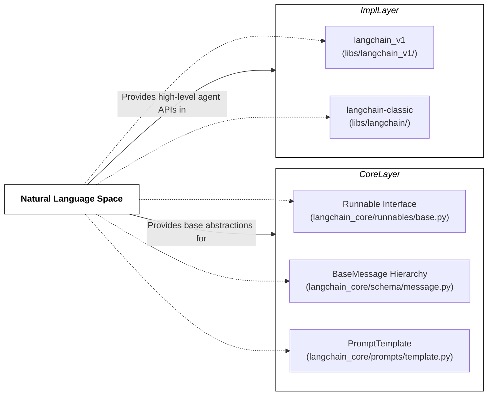

This diagram shows core abstractions such as `Runnable` and message schemas that form the foundation, with higher-level LangChain implementation packages built on top managing user-oriented API functionality.

---

### Diagram 2: From "Natural Language Space" to "Code Entity Space" - Integrations and Support Packages

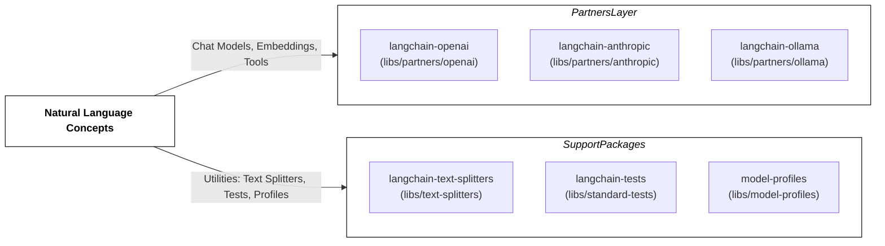

This diagram clarifies how provider integration packages deliver functionality for third-party services, while support packages provide utilities and testing frameworks to aid consistent development and quality assurance.

---

For further exploration of these topics, examine the detailed child pages:

- [Repository Layout and Packages](#1.1)
- [Developer Setup and Workflows](#1.2)
- [Generated Wiki (openwiki/) and Docs Automation](#1.3)

---

*Sources: [README.md:12-25](), [AGENTS.md:15-54](), [libs/core/pyproject.toml:5-88](), [libs/langchain_v1/pyproject.toml:5-31](), [libs/langchain/pyproject.toml:5-122](), [libs/text-splitters/pyproject.toml:5-54](), [libs/standard-tests/pyproject.toml:5-60](), [libs/model-profiles/uv.lock:1-60]()*

---

# Page: Repository Layout and Packages

# Repository Layout and Packages

<details>
<summary>Relevant source files</summary>

The following files were used as context for generating this wiki page:

- [libs/core/langchain_core/version.py](libs/core/langchain_core/version.py)
- [libs/core/pyproject.toml](libs/core/pyproject.toml)
- [libs/core/tests/unit_tests/runnables/__snapshots__/test_fallbacks.ambr](libs/core/tests/unit_tests/runnables/__snapshots__/test_fallbacks.ambr)
- [libs/core/tests/unit_tests/runnables/__snapshots__/test_runnable.ambr](libs/core/tests/unit_tests/runnables/__snapshots__/test_runnable.ambr)
- [libs/core/tests/unit_tests/runnables/test_fallbacks.py](libs/core/tests/unit_tests/runnables/test_fallbacks.py)
- [libs/core/uv.lock](libs/core/uv.lock)
- [libs/langchain/pyproject.toml](libs/langchain/pyproject.toml)
- [libs/langchain/tests/unit_tests/conftest.py](libs/langchain/tests/unit_tests/conftest.py)
- [libs/langchain/tests/unit_tests/test_dependencies.py](libs/langchain/tests/unit_tests/test_dependencies.py)
- [libs/langchain/uv.lock](libs/langchain/uv.lock)
- [libs/langchain_v1/langchain/__init__.py](libs/langchain_v1/langchain/__init__.py)
- [libs/langchain_v1/pyproject.toml](libs/langchain_v1/pyproject.toml)
- [libs/langchain_v1/uv.lock](libs/langchain_v1/uv.lock)
- [libs/model-profiles/pyproject.toml](libs/model-profiles/pyproject.toml)
- [libs/model-profiles/uv.lock](libs/model-profiles/uv.lock)
- [libs/partners/deepseek/pyproject.toml](libs/partners/deepseek/pyproject.toml)
- [libs/partners/deepseek/uv.lock](libs/partners/deepseek/uv.lock)
- [libs/partners/fireworks/langchain_fireworks/_version.py](libs/partners/fireworks/langchain_fireworks/_version.py)
- [libs/partners/fireworks/pyproject.toml](libs/partners/fireworks/pyproject.toml)
- [libs/partners/fireworks/uv.lock](libs/partners/fireworks/uv.lock)
- [libs/partners/groq/pyproject.toml](libs/partners/groq/pyproject.toml)
- [libs/partners/groq/uv.lock](libs/partners/groq/uv.lock)
- [libs/partners/huggingface/pyproject.toml](libs/partners/huggingface/pyproject.toml)
- [libs/partners/huggingface/uv.lock](libs/partners/huggingface/uv.lock)
- [libs/partners/mistralai/pyproject.toml](libs/partners/mistralai/pyproject.toml)
- [libs/partners/mistralai/uv.lock](libs/partners/mistralai/uv.lock)
- [libs/partners/perplexity/pyproject.toml](libs/partners/perplexity/pyproject.toml)
- [libs/partners/perplexity/uv.lock](libs/partners/perplexity/uv.lock)
- [libs/partners/xai/pyproject.toml](libs/partners/xai/pyproject.toml)
- [libs/partners/xai/uv.lock](libs/partners/xai/uv.lock)
- [libs/standard-tests/pyproject.toml](libs/standard-tests/pyproject.toml)
- [libs/standard-tests/uv.lock](libs/standard-tests/uv.lock)
- [libs/text-splitters/pyproject.toml](libs/text-splitters/pyproject.toml)
- [libs/text-splitters/uv.lock](libs/text-splitters/uv.lock)

</details>


## Purpose and Scope
This page provides a detailed technical overview of the LangChain monorepo layout under the `libs/` directory. It focuses on the key packages such as `langchain-core`, `langchain` (v1), `langchain-classic`, text-splitters, standard-tests, model-profiles, and partner integrations. The discussion covers their `pyproject.toml` configurations, `uv.lock` dependency lockfiles, versioning schemes, and how local workspace linking is implemented within the monorepo through `uv` source overrides.

---

## 1. Monorepo Package Topology and System Roles

LangChain's monorepo organizes functionality into modular packages under `libs/` with clear separation of core primitives, runtime frameworks, legacy implementations, and partner integrations. This design supports maintainability, flexible dependency management, and workspace development.

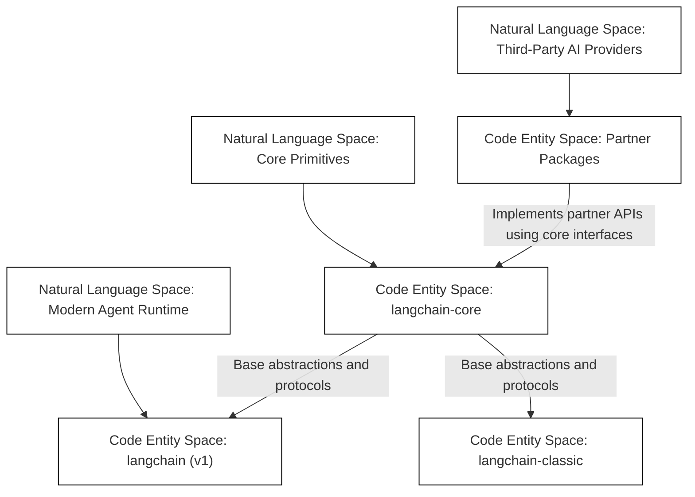
*Diagram 1: Mapping of natural language conceptual spaces to core code packages.*

**Explanation:**

- **langchain-core** (distribution name: `langchain-core`) provides foundational abstractions such as runnables, messages, prompts, tools, serialization schemas, and protocol definitions used across LangChain.
- **langchain** (v1) (distribution name: `langchain`) implements the modern agent runtime including agent factories, middleware systems, and unified model/embedding initialization built on top of langchain-core.
- **langchain-classic** (distribution name: `langchain-classic`) contains legacy chains, agents, memory modules, and evaluation tools, also leveraging langchain-core interfaces.
- **Partner packages** under `libs/partners/*` implement third-party AI provider integrations standardized around langchain-core's abstractions.

Sources:  
`libs/core/pyproject.toml:6-37`  
`libs/langchain_v1/pyproject.toml:5-30`  
`libs/langchain/pyproject.toml:6-34`  

---

## 2. Tour of `libs/*` Packages

### `libs/core` (`langchain-core`)

This package houses the fundamental core abstractions and interfaces used across LangChain. It contains base classes and utilities for messages, prompts, tools, runnables, serialization mechanisms, and protocol definitions. It is designed to be a minimal stable foundation with relatively few external dependencies.

- **Package Name:** `langchain-core`  
- **Version:** `1.6.6` (declared in `langchain_core/version.py`)  
- **Key dependencies:**  
  - `langsmith` (for tracing and external tooling support)  
  - `httpx` (async HTTP client)  
  - `tenacity` (for retries)  
  - `jsonpatch` (JSON patch operations)  
  - `PyYAML` (YAML parsing)  
  - `pydantic` (data validation)  
  - `uuid-utils` (UUID handling utilities)  
  - `langchain-protocol` (protocol schemas)  
- **Configuration source:** `libs/core/pyproject.toml` lines 6-37  
- **Version constant:** Found at `libs/core/langchain_core/version.py:3`  

This package enforces strict typing and linting, with mypy plugins and ruff rules configured for code quality.

---

### `libs/langchain_v1` (`langchain`)

This is the modern LangChain runtime package built atop `langchain-core` and `langgraph`. It provides:

- Agent factory method `create_agent`.
- Middleware framework with hooks for model and tool call wrapping.
- Unified initialization for language models and embeddings.
- Modern graph-based execution model for agents.

- **Package Name:** `langchain`  
- **Version:** `1.4.3`  
- **Key dependencies:**  
  - `langchain-core>=1.6.3`  
  - `langgraph>=1.2.11` (graph execution library)  
  - `pydantic>=2.7.4`  
- **Configuration source:** `libs/langchain_v1/pyproject.toml` lines 5-30  
- **Version declared:** `libs/langchain_v1/langchain/__init__.py:3`

---

### `libs/langchain` (`langchain-classic`)

Houses legacy implementations maintained for backward compatibility and gradual migration:

- Classic chains and memory modules.
- Older agent executors and output parsers.
- Evaluation tools and smith frameworks.
- Strong dependencies on SQLAlchemy and `requests`.

- **Package Name:** `langchain-classic`  
- **Version:** `1.0.8`  
- **Key dependencies:**  
  - `langchain-core>=1.4.7`  
  - `langchain-text-splitters`  
  - `langsmith`  
  - `pydantic`  
  - `SQLAlchemy`  
  - `requests`  
- **Configuration source:** `libs/langchain/pyproject.toml` lines 6-34  

---

### `libs/standard-tests` (`langchain-tests`)

Provides standardized conformance test suites and pytest plugin infrastructure for validating:

- Chat models and language models.
- Tools and vector stores.
- Retrievers and store integrations.

- **Package Name:** `langchain-tests`  
- **Version:** `1.1.9` (from dependency declarations)  
- **Key dependencies:**  
  - `langchain-core`  
  - `pytest`  
  - `httpx`  
  - `syrupy` (snapshot testing)  
  - `vcrpy` (HTTP cassette recording)  
  - `numpy`  
- **Configuration source:** `libs/standard-tests/pyproject.toml` lines 6-38  

---

### Additional Notable Packages

- **`libs/text-splitters`**: Document chunking and text splitting utilities, isolated with minimal dependencies.
- **`libs/model-profiles`**: Provides schemas for model metadata, CLI tools for refreshing and summarizing profiles.
- **`libs/partners/*`**: Separate provider integration packages, each with its own pyproject.toml and lockfiles, implementing integrations for OpenAI, Anthropic, HuggingFace, Fireworks, Groq, Mistral, XAI, DeepSeek, Perplexity, and others.

Sources:  
`libs/core/pyproject.toml:6-37`  
`libs/langchain_v1/pyproject.toml:5-30`  
`libs/langchain/pyproject.toml:6-34`  
`libs/standard-tests/pyproject.toml:6-38`  

---

## 3. Workspace Links and Build Configurations

LangChain uses the `uv` build system to manage workspace dependencies within the monorepo. Each package declares local editable references to sibling packages under `[tool.uv.sources]` in their `pyproject.toml`. This enables seamless local development without the need to publish intermediate versions.

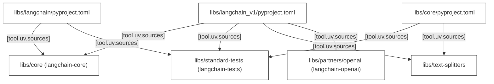
*Diagram 2: Inter-package workspace linking topology configured through `uv.sources`.*

Examples of workspace links:

From `libs/langchain_v1/pyproject.toml`:

```toml
[tool.uv.sources]
langchain-core = { path = "../core", editable = true }
langchain-tests = { path = "../standard-tests", editable = true }
langchain-text-splitters = { path = "../text-splitters", editable = true }
langchain-openai = { path = "../partners/openai", editable = true }
langchain-anthropic = { path = "../partners/anthropic", editable = true }
```

From `libs/core/pyproject.toml`:

```toml
[tool.uv.sources]
langchain-tests = { path = "../standard-tests" }
langchain-text-splitters = { path = "../text-splitters" }
```

This setup means code in `langchain-v1` or `langchain-classic` directly observes latest changes in core, tests, or partner packages during development.

Sources:  
`libs/langchain_v1/pyproject.toml:100-105`  
`libs/core/pyproject.toml:85-87`  
`libs/langchain/pyproject.toml:117-121`  

---

## 4. Summary Table of Monorepo Packages

| Package Directory         | Distribution Name       | Version  | Primary Purpose                                           |
|--------------------------|------------------------|----------|------------------------------------------------------------|
| `libs/core`              | `langchain-core`       | 1.6.6    | Core primitives, runnables, messages, tools, protocols       |
| `libs/langchain_v1`      | `langchain`            | 1.4.3    | Modern agent runtime, middleware, model initialization       |
| `libs/langchain`         | `langchain-classic`    | 1.0.8    | Legacy chains, agents, memory modules                        |
| `libs/text-splitters`    | `langchain-text-splitters` | varies | Document splitting utilities                                 |
| `libs/standard-tests`    | `langchain-tests`      | 1.1.9    | Standardized conformance tests and pytest plugins           |
| `libs/model-profiles`    | `langchain-profiles`   | varies   | Model metadata schemas and profiling CLI                     |
| `libs/partners/*`        | `langchain-{provider}` | varies   | Provider integrations for OpenAI, Anthropic, HuggingFace, etc.|

Sources:  
`libs/core/pyproject.toml:24`  
`libs/langchain_v1/pyproject.toml:24`  
`libs/langchain/pyproject.toml:23`  
`libs/standard-tests/pyproject.toml:24`  

---

## 5. Bridging Natural Language Concepts to Code Entities

LangChain’s design bridges high-level natural language system concepts with concrete code implementations organized in different packages and modules. The following diagrams illustrate these mappings clearly.

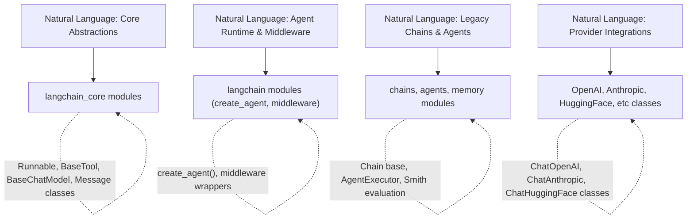
*Diagram 3: Mapping natural language system concepts to representative code entities in respective packages.*

---

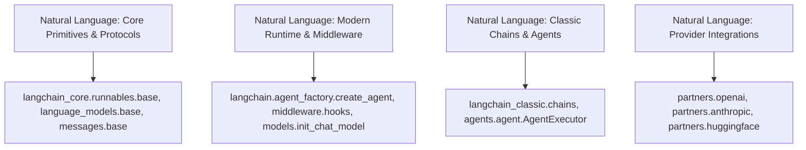
*Diagram 4: Code entities illustrating concrete classes and functions where key system concepts are implemented.*

---

# Summary

This page elaborates on the LangChain monorepo's modular design, highlighting the division between core abstractions, modern runtime, legacy implementations, and third-party provider integrations. Each package's `pyproject.toml` defines its dependencies and versioning with local editable workspace links for development via `uv` source mappings.

Understanding this layered package structure is essential for navigating, developing, and extending LangChain efficiently.

---

Sources:  
- `libs/core/pyproject.toml:6-37`  
- `libs/core/langchain_core/version.py:1-4`  
- `libs/langchain_v1/pyproject.toml:5-30,100-105`  
- `libs/langchain_v1/langchain/__init__.py:1-4`  
- `libs/langchain/pyproject.toml:6-34,117-121`  
- `libs/standard-tests/pyproject.toml:6-38`  
- `libs/core/uv.lock:1-80`  
- `libs/langchain_v1/uv.lock:1-95`  
- `libs/langchain/uv.lock:1-64`  
- `libs/standard-tests/uv.lock:1-60`

---

# Page: Developer Setup and Workflows

# Developer Setup and Workflows

<details>
<summary>Relevant source files</summary>

The following files were used as context for generating this wiki page:

- [.devcontainer/README.md](.devcontainer/README.md)
- [.devcontainer/devcontainer.json](.devcontainer/devcontainer.json)
- [.devcontainer/docker-compose.yaml](.devcontainer/docker-compose.yaml)
- [.github/CODEOWNERS](.github/CODEOWNERS)
- [.github/PULL_REQUEST_TEMPLATE.md](.github/PULL_REQUEST_TEMPLATE.md)
- [.github/workflows/pr_lint.yml](.github/workflows/pr_lint.yml)
- [.gitignore](.gitignore)
- [.pre-commit-config.yaml](.pre-commit-config.yaml)
- [.vscode/extensions.json](.vscode/extensions.json)
- [.vscode/settings.json](.vscode/settings.json)
- [AGENTS.md](AGENTS.md)
- [README.md](README.md)
- [libs/README.md](libs/README.md)
- [libs/core/Makefile](libs/core/Makefile)
- [libs/core/langchain_core/messages/content.py](libs/core/langchain_core/messages/content.py)
- [libs/core/scripts/check_imports.py](libs/core/scripts/check_imports.py)
- [libs/core/scripts/check_version.py](libs/core/scripts/check_version.py)
- [libs/langchain/Makefile](libs/langchain/Makefile)
- [libs/langchain/dev.Dockerfile](libs/langchain/dev.Dockerfile)
- [libs/langchain_v1/Makefile](libs/langchain_v1/Makefile)
- [libs/langchain_v1/scripts/check_imports.py](libs/langchain_v1/scripts/check_imports.py)
- [libs/langchain_v1/scripts/check_version.py](libs/langchain_v1/scripts/check_version.py)
- [libs/partners/README.md](libs/partners/README.md)
- [libs/partners/anthropic/Makefile](libs/partners/anthropic/Makefile)
- [libs/partners/chroma/Makefile](libs/partners/chroma/Makefile)
- [libs/partners/deepseek/Makefile](libs/partners/deepseek/Makefile)
- [libs/partners/exa/Makefile](libs/partners/exa/Makefile)
- [libs/partners/fireworks/Makefile](libs/partners/fireworks/Makefile)
- [libs/partners/groq/Makefile](libs/partners/groq/Makefile)
- [libs/partners/huggingface/Makefile](libs/partners/huggingface/Makefile)
- [libs/partners/mistralai/Makefile](libs/partners/mistralai/Makefile)
- [libs/partners/nomic/Makefile](libs/partners/nomic/Makefile)
- [libs/partners/ollama/Makefile](libs/partners/ollama/Makefile)
- [libs/partners/openai/Makefile](libs/partners/openai/Makefile)
- [libs/partners/qdrant/Makefile](libs/partners/qdrant/Makefile)
- [libs/partners/xai/Makefile](libs/partners/xai/Makefile)
- [libs/text-splitters/Makefile](libs/text-splitters/Makefile)

</details>


This page details the developer setup, build orchestration, dependency management via `uv`, Makefile targets, pre-commit validation gates, and containerized development workflows across the LangChain monorepo.

---

## 1. Package-Level Makefiles and `uv` Workflows

The LangChain monorepo is organized as a multi-package Python workspace under the `libs/` directory. Each package (such as `core`, `langchain_v1`, partner integrations like `partners/anthropic` and `partners/openai`, and utility packages like `text-splitters`) manages its own independent development lifecycle. This includes an isolated `pyproject.toml` for package metadata and dependencies, a locked `uv.lock` for deterministic dependency resolution, and a `Makefile` defining common development targets.

### Dependency and Environment Management with `uv`
- `uv` is the monorepo-wide Python package installer and environment manager used throughout the LangChain repo. It replaces traditional tools like `pip` and `poetry` to provide:
  - Automatic environment activation
  - Precise dependency resolution & locking per package
  - Isolated editable installs within each package folder
- Developers **must never run `pip`, `poetry`, or create virtual environments manually**. Instead, run `uv sync` to install dependencies and `uv run` to execute commands with environment control.
- Dependency constraints, including Python compatibility, are specified per package in `pyproject.toml`.
- Editable installs use `[tool.uv.sources]` to reference local packages for efficient development workflows [see `AGENTS.md:17-93`].

### Standard Makefile Targets
Each package's Makefile provides a consistent interface for development commands, including the following primary targets:

| Target              | Description                                                                             |
|---------------------|-----------------------------------------------------------------------------------------|
| `test` / `tests`      | Runs unit tests using `pytest`. Tests run with network calls disabled by default (`--disable-socket`) for hermetic builds. Supports parallelism and selective test files. Example flags include `-n auto`, `--allow-unix-socket`. |
| `integration_test` / `integration_tests` | Runs live integration tests that require network access to external APIs. Often includes smoke tests across multiple SDK versions for compatibility validation. |
| `lint`               | Executes `ruff` linter for code quality checks and style violations.                     |
| `format`             | Runs code formatters provided by `ruff`, e.g. auto-formatting fixes.                     |
| `type`               | Runs static type checking via `mypy` with package-level cache directories to speed repeated checks. |
| `check_version`      | Validates version number consistency between `pyproject.toml` and internal source code versions to avoid release conflicts. |
| `check_imports`      | Runs custom import lint scripts to enforce module boundaries and architectural constraints. |

These targets use `uv run` internally to ensure commands run with the appropriate environment and dependencies activated.

#### Example Makefile and UV Lifecycle Diagram

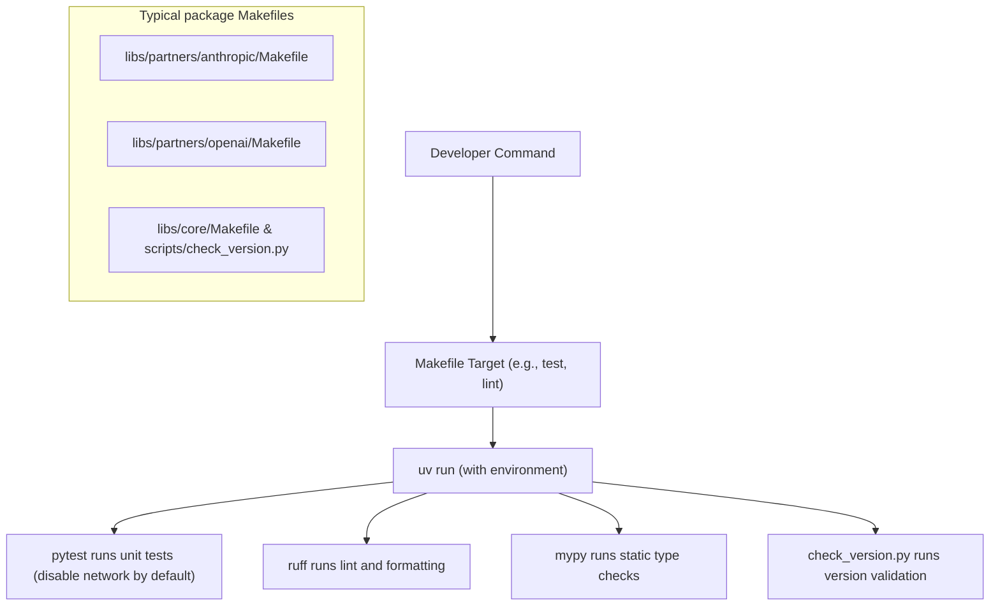

Sources: [libs/partners/anthropic/Makefile:1-81](), [libs/partners/openai/Makefile:1-101](), [libs/core/Makefile:1-89](), [libs/core/scripts/check_version.py:1-65](), [AGENTS.md:17-93]()

---

## 2. Pre-Commit Hooks and Code Quality Gates

LangChain uses `pre-commit` hooks configured centrally in `.pre-commit-config.yaml` to enforce code quality, style, and package consistency before commits are accepted.

### Pre-Commit Hook Components:

- **Basic Git Safety & Syntax Hooks:**
  - `no-commit-to-branch` prevents direct commits to protected branches like `master`.
  - `check-yaml`, `check-toml` validate syntax correctness of project config files.
  - `end-of-file-fixer` and `trailing-whitespace` ensure clean trailing formatting.
- **Text Normalization:**
  - Hooks like `fix-smartquotes` and `fix-spaces` from `texthooks` ensure consistent ASCII characters.
- **Package-Specific Hooks:**
  - For each package, the pre-commit runs its Makefile `format` and `lint` targets. This provides uniform formatting and linting without manual commands.
  - Version consistency checks via `check_version` targets run to avoid version drifts.
- **Package Coverage:**
  - Core packages (`core`, `langchain`, `standard-tests`, `text-splitters`) and partner integrations (`anthropic`, `chroma`, `openai`, etc.) all have hooks that invoke their local Makefiles for formatting/linting.

### Architecture of Pre-Commit Validation

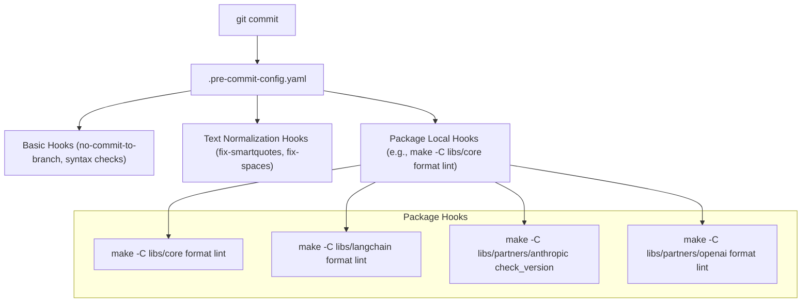

This setup enforces that all committed code conforms to style, passes lint/type checks, and maintains version hygiene, reducing manual errors and maintaining the project's quality standards.

Sources: [.pre-commit-config.yaml:1-171]()

---

## 3. Containerized Development (Devcontainers)

To facilitate environment consistency and simplify setup, LangChain offers a VS Code devcontainer configuration, backed by Docker and Docker Compose.

### Main Components

- **Dockerfile** (`libs/langchain/dev.Dockerfile`):
  - Based on official Python 3.14 slim image.
  - Installs essential OS dependencies: build tools, curl, git, vim, less, certificates.
  - Installs `uv` globally for dependency management.
  - Copies the entire repo and runs `uv sync --dev` inside `libs/langchain_v1` to install dev dependencies in editable mode.
  - Creates a dedicated non-root `vscode` user with appropriate permissions.
  - Sets shell and working directory for smooth interactive usage [libs/langchain/dev.Dockerfile:1-43].

- **Devcontainer JSON Configuration** (`.devcontainer/devcontainer.json`):
  - Uses Docker Compose to launch the `langchain` service container.
  - Mounts a persistent Docker volume for the workspace.
  - Adds useful VS Code extensions, e.g. Python, Mypy, isort, markdown linting, Jupyter, GitHub Copilot.
  - Sets Python interpreter path inside the container workspace to `libs/langchain_v1/.venv/bin/python`.
  - Runs a post-create command to `uv sync` dependencies automatically upon container startup [`.devcontainer/devcontainer.json:1-58`].

This combination ensures that developers get an out-of-the-box ready environment that matches repo dependency constraints and uses proper virtual environments with consistent tooling.

### Container Dev Environment Bootstrap Diagram

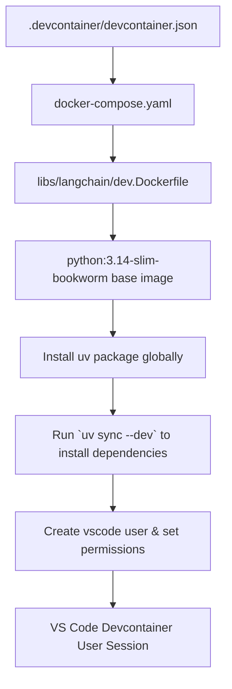

Sources: [.devcontainer/devcontainer.json:1-58](), [libs/langchain/dev.Dockerfile:1-43]()

---

## 4. Linting, Import Checks, and Version Consistency

### Version Consistency Checks

- Run by `check_version` Makefile targets in each package (e.g. `libs/partners/anthropic/Makefile`, `libs/core/Makefile`).
- Invokes the Python script `libs/core/scripts/check_version.py` which:
  - Reads `pyproject.toml` version metadata.
  - Compares with internal `version.py` constants.
  - Throws errors if mismatch detected.
- Prevents release and merge errors due to version drift.

### Import Boundary Linting

- Custom import checks are run by targets like `check_imports` calling scripts (`scripts/check_imports.py`).
- Ensures packages do not import internals from other packages that would break architectural layering.
- Maintains strict modular boundaries in the monorepo.

These linting and checking conventions integrate into `pre-commit` and are regularly executed on CI pipelines.

Sources: [libs/core/scripts/check_version.py:1-65](), [libs/partners/anthropic/Makefile:62-63](), [libs/core/Makefile:34-35]()

---

## 5. Pull Request Conventions

The LangChain repo enforces a consistent commit and PR title format using Conventional Commits, verified by a GitHub Actions workflow `.github/workflows/pr_lint.yml`.

Key points:

- Titles must follow `<type>(<scope>): <message>` format.
- `type` must be lowercase (e.g., `feat`, `fix`, `docs`, `style`, `refactor`, `test`, `ci`, `chore`).
- Scope must never be empty; it must identify the affected package (e.g., `core`, `anthropic`, `langchain`, `partners`).
- Allowed scopes and types are strictly enumerated in the workflow config.
- Breaking changes append an exclamation mark after type/scope (e.g., `feat!: ...`).
- The workflow rejects PRs with malformed titles or empty scopes to maintain clean semantic history.

This convention facilitates automated changelog generation, release automation, and clearer code review patterns.

Sources: [.github/workflows/pr_lint.yml:1-129]()

---

# Summary

This page outlined developer setup and workflows in the LangChain monorepo:

- **Per-package Makefiles** that use `uv` to manage dependencies and run tests, linting, formatting, and type checking.
- **Pre-commit hooks** configured centrally to auto-run formatting, linting, and version checks on commits.
- **Containerized development environment** based on Docker, Docker Compose, and VS Code devcontainers, ensuring consistent developer setups.
- **Version consistency and import boundary validations** to maintain architectural hygiene.
- **Conventional Commits enforcement** via GitHub Actions to guarantee clean, descriptive commit and PR messages.

These tooling and workflow conventions enable a streamlined, reliable, and high-quality development experience across the LangChain project.

---

# Appendix: Key File Locations for Setup

| Purpose                     | Primary Files                                      |
|-----------------------------|--------------------------------------------------|
| Core development Makefile   | `libs/core/Makefile`                              |
| Anthropic partner Makefile  | `libs/partners/anthropic/Makefile`                |
| OpenAI partner Makefile     | `libs/partners/openai/Makefile`                    |
| Pre-commit config           | `.pre-commit-config.yaml`                         |
| Devcontainer config         | `.devcontainer/devcontainer.json`                 |
| Dockerfile for devcontainer | `libs/langchain/dev.Dockerfile`                    |
| Version consistency script  | `libs/core/scripts/check_version.py`              |
| PR lint GitHub action       | `.github/workflows/pr_lint.yml`                     |

---

# Detailed Diagram: Natural Language to Code Entities – Makefile to Code Integration

```mermaid
flowchart TD
    NL["Developer runs command `make test` or `make lint`"] --> MF["Makefile target (e.g. `test`, `lint`)"]
    MF --> UV["Invokes `uv run` with environment and dependencies"]
    UV --> PYTEST["`pytest` runs tests located in `tests/` directories"]
    UV --> RUFF["`ruff` runs lint and format on package source files"]
    UV --> MYPY["`mypy` runs static type checks with caching"]

    subgraph "Representative Package Makefiles"
    MF1[libs/partners/anthropic/Makefile]
    MF2[libs/partners/openai/Makefile]
    MF3[libs/core/Makefile]
    end

    MF --> MF1
    MF --> MF2
    MF --> MF3
```

---

# Detailed Diagram: From Pre-Commit to Final Build Validation

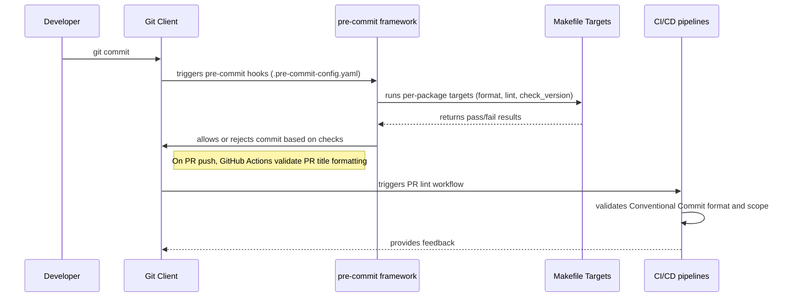

---

Sources:  
[libs/partners/anthropic/Makefile:1-81](), [libs/partners/openai/Makefile:1-101](), [libs/core/Makefile:1-89](), [libs/core/scripts/check_version.py:1-65](),  
[.pre-commit-config.yaml:1-171](), [.devcontainer/devcontainer.json:1-58](), [libs/langchain/dev.Dockerfile:1-43](),  
[.github/workflows/pr_lint.yml:1-129](), [AGENTS.md:17-93]()

---

# Page: Generated Wiki (openwiki/) and Docs Automation

# Generated Wiki (openwiki/) and Docs Automation

<details>
<summary>Relevant source files</summary>

The following files were used as context for generating this wiki page:

- [.github/workflows/openwiki-update.yml](.github/workflows/openwiki-update.yml)
- [openwiki/.claims/agent-execution.json](openwiki/.claims/agent-execution.json)
- [openwiki/.claims/agent-factory.json](openwiki/.claims/agent-factory.json)
- [openwiki/.claims/architecture.json](openwiki/.claims/architecture.json)
- [openwiki/.claims/ci-workflows.json](openwiki/.claims/ci-workflows.json)
- [openwiki/.claims/composability.json](openwiki/.claims/composability.json)
- [openwiki/.claims/dev-commands.json](openwiki/.claims/dev-commands.json)
- [openwiki/.claims/integration-tests.json](openwiki/.claims/integration-tests.json)
- [openwiki/.claims/mcp-integration.json](openwiki/.claims/mcp-integration.json)
- [openwiki/.claims/openai-provider.json](openwiki/.claims/openai-provider.json)
- [openwiki/.claims/partner-pattern.json](openwiki/.claims/partner-pattern.json)
- [openwiki/.claims/quickstart.json](openwiki/.claims/quickstart.json)
- [openwiki/.claims/source-map.json](openwiki/.claims/source-map.json)
- [openwiki/.last-update.json](openwiki/.last-update.json)
- [openwiki/.page-manifest.json](openwiki/.page-manifest.json)
- [openwiki/architecture.md](openwiki/architecture.md)
- [openwiki/dev-commands.md](openwiki/dev-commands.md)
- [openwiki/openai-provider.md](openwiki/openai-provider.md)
- [openwiki/partner-pattern.md](openwiki/partner-pattern.md)
- [openwiki/quickstart.md](openwiki/quickstart.md)
- [openwiki/source-map.md](openwiki/source-map.md)

</details>


The `openwiki/` directory and its associated automation provide a continuously synchronized and AI-assisted documentation framework embedded within the LangChain monorepo. This system links natural language wiki pages to verified code evidence using claim files, maintains a page manifest for tracking, and automates updates via a GitHub Actions workflow to keep docs current with code changes.

---

## 1. The `openwiki/` Directory and Page Architecture

Documentation pages live as Markdown files inside `openwiki/`. Each page begins with a structured YAML frontmatter section specifying metadata fields such as page type, title, description, tags, and references to source files that constitute the evidence for factual claims made in the documentation [openwiki/.page-manifest.json:1-125](), [openwiki/quickstart.md:1-47]().

### Frontmatter Schema Example

An example frontmatter from a wiki page:

```yaml
---
type: "Getting Started"
title: "LangChain Repository Quick Start"
description: "Entry point for engineers: orient to the monorepo structure, run first tests, understand what to edit for common tasks, and route to major development areas."
tags: [quickstart, getting-started, monorepo, setup]
sources:
  - id: openwiki-source-4d1645cb6317345817452838
    resource: repo://.pre-commit-config.yaml
  - id: openwiki-source-8e384445ccfbaf00747b3e18
    resource: repo://libs/core/langchain_core/__init__.py
generated: { by: "openwiki/0.5.0", at: "2026-09-21T08:30:16.745Z" }
verified:
  - by: openwiki/0.5.0
    at: 2026-09-22T08:27:06.345Z
---
```

This schema enables effective categorization, searching, and traceability of documentation content down to exact code versions.

```Sources: [openwiki/quickstart.md:1-47](), [openwiki/.page-manifest.json:1-125]()```

---

## 2. Claim Files and Evidence Binding (`openwiki/.claims/`)

To enforce accuracy and maintain provenance, all key factual statements in the text are extracted as individual *claims* stored as JSON files under `openwiki/.claims/`. Each claim includes a unique ID, the claim statement, and a list of *evidence* entries — source code files anchored by cryptographic hashes that uniquely identify the exact file version supporting the claim [openwiki/.claims/quickstart.json:1-22]().

### Example Claim JSON

```json
{
  "schemaVersion": 1,
  "pageVersion": "sha256:37b10d0b8065a18260ed5cc5af20f81cfbc6872d2057a39aef73c3cda08f81db",
  "claims": [
    {
      "id": "claim_7425c73f5e4c4667b8babba66c3663a0",
      "statement": "LangChain is organized as a three-layer architecture in /libs/: core (base abstractions including Runnable, BaseChatModel, tools, prompts, messages), langchain_v1 (agent orchestration, factory, middleware), and partners (provider-specific integrations)",
      "evidence": [
        {
          "resource": "repo://libs/core/langchain_core/__init__.py",
          "version": "repo-file-v1:sha256:fa4e54cbdf24eb2cfc4fd24776115853a9bc7977447b4d072a470f6765d2a781"
        }
      ]
    }
  ]
}
```

This binding mechanism guarantees all documentation assertions are verifiable and tied to code, facilitating automated validation and regeneration when code changes invalidate claims.

```Sources: [openwiki/.claims/quickstart.json:1-22](), [openwiki/.claims/architecture.json:1-26]()```

---

## 3. Page Manifest (`openwiki/.page-manifest.json`)

The wiki maintains a manifest file that tracks every page's synchronization state, generation metadata, fingerprints of source code references, and the git commit at the time of generation. This manifest enables efficient identification of stale pages that must be regenerated when underlying source code evolves [openwiki/.page-manifest.json:1-125]().

### Manifest Structure Overview

```json
{
  "schemaVersion": 1,
  "pages": {
    "/openwiki/architecture.md": {
      "pageVersion": "sha256:4bcc27e623ef816245eaea9630b852b1c8e3d01cfb4d739ba4ec040e531d087a",
      "completedBy": "openwiki/0.5.0",
      "completedRunId": "42beb1a0-aed2-4fc6-b6b4-a39607bfb92c",
      "gitHead": "9e4ea7a3495992c02a79de6fa5788e028b03df11",
      "sourceFingerprint": "sha256:fcf377c645402ec15df777e711a9634a4c0a1cac2ec0791da74fc9406df78122"
    }
  }
}
```

| Field                | Description                                                      |
|----------------------|------------------------------------------------------------------|
| `pageVersion`        | Hash of compiled Markdown content                                 |
| `completedBy`        | Generator tool/version string                                    |
| `completedRunId`     | Unique run identifier for the CI pipeline execution              |
| `gitHead`            | Commit SHA at time of generation                                 |
| `sourceFingerprint`  | Combined hash of all source files referenced by this page       |

This data structure supports incremental regeneration by detecting changes at the granularity of page dependency source sets.

```Sources: [openwiki/.page-manifest.json:1-125](), [openwiki/.last-update.json:1-8]()```

---

## 4. Automation and the `openwiki-update` Workflow

The `openwiki-update.yml` GitHub Actions workflow automates the regeneration of the wiki pages:

- It triggers on push or pull request events affecting source files referenced by the wiki claims.
- The automation engine compares the current source fingerprints in the manifest against the newly computed ones.
- On detecting any change, it regenerates claim files, updates Markdown wiki pages, refreshes the page manifest, and writes update timing metadata in `.last-update.json` [openwiki/.last-update.json:1-8]().

### Last Update Metadata Example

```json
{
  "updatedAt": "2026-09-29T08:33:44.890Z",
  "command": "update",
  "gitHead": "78a3cbcc6b5e7e39fafda5d7b8df384a4a2c821d",
  "model": "claude-haiku-4-5",
  "status": "complete",
  "language": "en"
}
```

This pipeline ensures documentation stays seamlessly aligned with the current codebase state without manual intervention.

```Sources: [openwiki/.last-update.json:1-8]()```

---

## 5. System Integration & Data Flow Architecture

The two diagrams below map the layered relationship between natural language documentation and code entities, and the automated update flow keeping them synchronized.

### Diagram 1: Mapping Natural Language Documentation to Code Entities

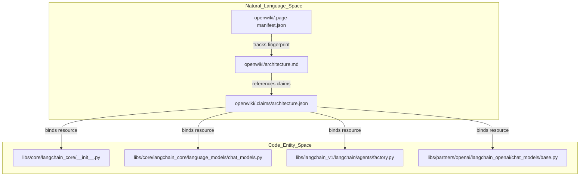

This diagram illustrates how wiki pages associate to claim files, each claim binds to concrete source code files, providing transparent traceability from natural language docs to code implementations.

```Sources: [openwiki/architecture.md:1-41](), [openwiki/.claims/architecture.json:1-26](), [openwiki/.page-manifest.json:1-125]()```

---

### Diagram 2: `openwiki-update` Automation Workflow


This flow depicts the continuous integration pipeline where source changes trigger claim and page regeneration, keeping documentation synchronized with the codebase.

```Sources: [openwiki/.page-manifest.json:1-125](), [openwiki/.last-update.json:1-8]()```

---

# Summary

- The `openwiki/` folder houses rich Markdown documentation pages with structured frontmatter connecting textual descriptions to precise source versions.
- Claim files in `openwiki/.claims/` explicitly encode factual assertions and code evidence relationships.
- A manifest tracks page build state and source fingerprints, enabling incremental regeneration detection.
- The `openwiki-update` GitHub Actions workflow automates regeneration upon code changes, ensuring docs always reflect the current implementation.
- Together, they form a tightly coupled, AI-assisted doc generation system that tightly integrates prose and code provenance in LangChain.

```Sources: [openwiki/quickstart.md:1-47](), [openwiki/.claims/quickstart.json:1-22](), [openwiki/.page-manifest.json:1-125](), [openwiki/.last-update.json:1-8]()```

---

# Page: langchain-core Architecture

# langchain-core Architecture

<details>
<summary>Relevant source files</summary>

The following files were used as context for generating this wiki page:

- [libs/core/langchain_core/callbacks/base.py](libs/core/langchain_core/callbacks/base.py)
- [libs/core/langchain_core/callbacks/manager.py](libs/core/langchain_core/callbacks/manager.py)
- [libs/core/langchain_core/output_parsers/string.py](libs/core/langchain_core/output_parsers/string.py)
- [libs/core/langchain_core/rate_limiters.py](libs/core/langchain_core/rate_limiters.py)
- [libs/core/langchain_core/runnables/base.py](libs/core/langchain_core/runnables/base.py)
- [libs/core/langchain_core/runnables/branch.py](libs/core/langchain_core/runnables/branch.py)
- [libs/core/langchain_core/runnables/config.py](libs/core/langchain_core/runnables/config.py)
- [libs/core/langchain_core/runnables/configurable.py](libs/core/langchain_core/runnables/configurable.py)
- [libs/core/langchain_core/runnables/fallbacks.py](libs/core/langchain_core/runnables/fallbacks.py)
- [libs/core/langchain_core/runnables/passthrough.py](libs/core/langchain_core/runnables/passthrough.py)
- [libs/core/langchain_core/runnables/retry.py](libs/core/langchain_core/runnables/retry.py)
- [libs/core/langchain_core/runnables/schema.py](libs/core/langchain_core/runnables/schema.py)
- [libs/core/langchain_core/runnables/utils.py](libs/core/langchain_core/runnables/utils.py)
- [libs/core/langchain_core/version.py](libs/core/langchain_core/version.py)
- [libs/core/pyproject.toml](libs/core/pyproject.toml)
- [libs/core/tests/unit_tests/callbacks/test_sync_callback_manager.py](libs/core/tests/unit_tests/callbacks/test_sync_callback_manager.py)
- [libs/core/tests/unit_tests/runnables/__snapshots__/test_fallbacks.ambr](libs/core/tests/unit_tests/runnables/__snapshots__/test_fallbacks.ambr)
- [libs/core/tests/unit_tests/runnables/__snapshots__/test_runnable.ambr](libs/core/tests/unit_tests/runnables/__snapshots__/test_runnable.ambr)
- [libs/core/tests/unit_tests/runnables/test_config.py](libs/core/tests/unit_tests/runnables/test_config.py)
- [libs/core/tests/unit_tests/runnables/test_configurable.py](libs/core/tests/unit_tests/runnables/test_configurable.py)
- [libs/core/tests/unit_tests/runnables/test_fallbacks.py](libs/core/tests/unit_tests/runnables/test_fallbacks.py)
- [libs/core/tests/unit_tests/runnables/test_runnable.py](libs/core/tests/unit_tests/runnables/test_runnable.py)
- [libs/core/tests/unit_tests/runnables/test_utils.py](libs/core/tests/unit_tests/runnables/test_utils.py)
- [libs/core/uv.lock](libs/core/uv.lock)

</details>


## Purpose and Scope

The `langchain-core` package serves as the foundational abstraction layer for the LangChain ecosystem [libs/core/README.md:1-21](). It defines modular, decoupled interfaces that enable seamless interoperability between model providers, tool developers, and framework components. This architecture abstracts core concepts such as execution units (Runnables), conversational messages, language models, prompts, tools, outputs, tracing, and retrieval primitives, providing a stable base for the rest of LangChain.

This page offers a high-level overview of these core abstractions and their relationships. Detailed technical content is available on dedicated child pages listed at the end.

---

## 2.1. Runnables and LCEL

At the core is the `Runnable` interface, representing a unit of executable work that can be invoked synchronously or asynchronously, batched, or streamed. It supports functional composition with operators like `|` (producing `RunnableSequence`) and mappings (producing `RunnableParallel`) to build complex execution pipelines [libs/core/langchain_core/runnables/base.py:133-197]().

Runnables are configurable via `RunnableConfig`, which propagates runtime metadata such as tags, concurrency limits, callbacks, and recursion limits dynamically through execution contexts [libs/core/langchain_core/runnables/config.py:57-78](). They support retries (`RunnableRetry`), fallbacks (`RunnableWithFallbacks`), and customizable configurable fields for flexible behavior [libs/core/langchain_core/fallbacks.py:37-66](), [libs/core/langchain_core/runnables/configurable.py:50-55](). Rate limiting is implemented via components such as the `InMemoryRateLimiter` [libs/core/rate_limiters.py:67-75]().

Runnables also provide introspection for graph construction and support rendering their execution graphs visually using Mermaid or other formats, aiding debugging and understanding of pipeline structures [libs/core/langchain_core/runnables/base.py:104-106]().

For more details, see [Runnables and LCEL](#2.1).

### LCEL Execution Flow Architecture

```mermaid
graph TD
    "UserInput" --> ["RunnableSequence"]
    ["RunnableSequence"] --> ["RunnableParallel"]
    ["RunnableParallel"] --> |"BranchA"| ["ChatOpenAI"]
    ["RunnableParallel"] --> |"BranchB"| ["StructuredTool"]
    ["ChatOpenAI"] --> ["RunnableRetry"]
    ["RunnableRetry"] --> ["InMemoryRateLimiter"]
```

Sources: `[libs/core/langchain_core/runnables/base.py:133-197]`, `[libs/core/langchain_core/runnables/config.py:57-78]`, `[libs/core/langchain_core/fallbacks.py:37-66]`, `[libs/core/rate_limiters.py:67-75]`

### 2.1.1. Graph Rendering and Visualization

Runnable compositions expose their graph structure which can be rendered in multiple formats including Mermaid diagrams, ASCII art, or PNG images. This feature helps visualize the sequencing and parallelism in the execution pipeline [libs/core/langchain_core/runnables/base.py:104-106]().

See [Graph Rendering and Visualization](#2.1.1) for implementation specifics.

Sources: `[libs/core/langchain_core/runnables/base.py:104-106]`

### 2.1.2. Streaming, Events and Chat History Runnables

Streaming methods (`astream_events` v1/v2) emit intermediate results progressively during execution, enabling reactive consumption of outputs. Stateful wrappers like `RunnableWithMessageHistory` integrate chat message history management with runnable execution to provide conversational context [libs/core/langchain_core/runnables/base.py:87-94](), [libs/core/callbacks/base.py:128-154]().

Details on streaming and chat-aware runnables are covered in [Streaming, Events and Chat History Runnables](#2.1.2).

Sources: `[libs/core/langchain_core/runnables/base.py:87-94]`, `[libs/core/callbacks/base.py:128-154]`

---

## 2.2. Messages and Content Blocks

Conversation in LangChain is modeled via the `BaseMessage` class hierarchy, with subclasses such as `HumanMessage`, `AIMessage`, `SystemMessage`, and `ToolMessage`. These message types encapsulate content, metadata, and support chunk merging for efficient streaming and resumption [libs/core/tests/unit_tests/runnables/test_runnable.py:46-47](). Messages also track token usage metadata for billing and monitoring purposes.

Underlying message content is organized as `ContentBlock`s, facilitating multi-modal and structured inputs to be seamlessly handled.

Refer to [Messages and Content Blocks](#2.2) for exhaustive details.

Sources: `[libs/core/tests/unit_tests/runnables/test_runnable.py:46-47]`

---

### 2.2.1. Block Translators for Providers

LangChain includes standardized content block translators that normalize conversational content and tool calls across different model providers, including OpenAI, Anthropic, Google GenAI, Bedrock, and Groq. This harmonization supports multi-provider interoperability and consistent event streaming [libs/core/callbacks/base.py:128-154]().

See [Block Translators for Providers](#2.2.1).

Sources: `[libs/core/callbacks/base.py:128-154]`

---

## 2.3. Language Model Base Classes

Base classes like `BaseChatModel` and `BaseLLM` define the interface for language model providers. They manage lifecycle operations such as invocation, prompt formatting, caching, streaming bridging, and maintenance of model metadata/profiles. These abstractions ensure that any concrete language model implementation can plug into runnable pipelines transparently [libs/core/tests/unit_tests/runnables/test_runnable.py:38-43]().

Implementation details and extension points reside in [Language Model Base Classes](#2.3).

Sources: `[libs/core/tests/unit_tests/runnables/test_runnable.py:38-43]`

---

## 2.4. Tools and Function Calling

Tools represent external capabilities and integrations within LangChain, formalized via classes like `BaseTool` and `StructuredTool`. The `@tool` decorator wraps Python callables to define argument schemas, enable injected arguments, and support structured invocation. This facilitates reliable function calling from language models with strict typing and validation [libs/core/tests/unit_tests/runnables/test_runnable.py:86]().

Tools naturally integrate with runnable execution graphs and messaging.

For more insight, see [Tools and Function Calling](#2.4).

### Model and Tool Integration Mapping

```mermaid
graph TD
    "UserPrompt" --> ["BaseChatModel"]
    ["BaseChatModel"] --> |"ToolCall"| ["StructuredTool"]
    ["StructuredTool"] --> ["ToolMessage"]
    ["ToolMessage"] --> ["BaseChatModel"]
```

Sources: `[libs/core/tests/unit_tests/runnables/test_runnable.py:86]`

---

## 2.5. Prompts and Example Selectors

Prompt construction is handled via `PromptTemplate` and `ChatPromptTemplate`. They support mustache or Python f-string formatting, few-shot prompting, and example selectors for dynamically choosing contextual examples. These facilities enable intricate prompt engineering within runnable chains [libs/core/tests/unit_tests/runnables/test_runnable.py:56-62]().

Explore the details in [Prompts and Example Selectors](#2.5).

Sources: `[libs/core/tests/unit_tests/runnables/test_runnable.py:56-62]`

---

## 2.6. Outputs, Output Parsers and Callbacks

Model outputs return structured types such as `Generation` and `ChatResult`. Output parsers—including JSON, XML, Pydantic model parsers, and tool-call parsers—convert raw outputs into usable Python objects. The `CallbackManager` orchestrates telemetry, usage monitoring, logging, and lifecycle event handling for runs [libs/core/callbacks/manager.py:55-98]().

See [Outputs, Output Parsers and Callbacks](#2.6) for in-depth information.

Sources: `[libs/core/callbacks/manager.py:55-98]`, `[libs/core/tests/unit_tests/runnables/test_runnable.py:48-52]`

---

## 2.7. Tracing and LangSmith Integration

Tracing infrastructure uses `BaseTracer` and the `LangChainTracer` to record execution runs with rich metadata, context propagation tokens, and gateway-specific data. Traces are schema-validated and exported to LangSmith for visualization and analysis of application runs [libs/core/tests/unit_tests/runnables/test_runnable.py:127-145]().

Details are found in [Tracing and LangSmith Integration](#2.7).

Sources: `[libs/core/tests/unit_tests/runnables/test_runnable.py:127-145]`

---

## 2.8. Retrieval Primitives: Documents, Vector Stores, Indexing

Retrieval abstractions unify document formats (`Document`, `Blob`), loading pipelines, embedding interfaces, vector stores (including `InMemoryVectorStore`), retrievers, and indexing APIs. This foundation supports building search, memory, and knowledge retrieval layers for LangChain applications [libs/core/tests/unit_tests/runnables/test_runnable.py:37]().

See [Retrieval Primitives: Documents, Vector Stores, Indexing](#2.8) for complete coverage.

Sources: `[libs/core/tests/unit_tests/runnables/test_runnable.py:37]`

---

## 2.9. Core Infrastructure: Serialization, Caches, Utils, Security

The core infrastructure layer contains serialization frameworks for saving/loading components with version schema, caching systems, global state management, Pydantic utilities, decorators for deprecation and beta features, SSRF protection, and system/environment info utilities [libs/core/tests/unit_tests/runnables/test_runnable.py:44-45]().

Refer to [Core Infrastructure: Serialization, Caches, Utils, Security](#2.9).

Sources: `[libs/core/tests/unit_tests/runnables/test_runnable.py:44-45]`

---

## Bridging Natural Language Space to Code Entities

The following diagrams illustrate how LangChain concepts bridge from natural language user interactions to concrete runnable and model classes in code, providing insight into the system architecture and flow.

### Conceptual Mapping: Natural Language Interaction to Runnable Execution

```mermaid
graph TD
    "UserInput:<NL_Message>" --> ["RunnableSequence:<ChatPromptTemplate>"]
    ["RunnableSequence:<ChatPromptTemplate>"] --> ["RunnableParallel:<ToolBranch><LLMBranch>"]
    ["RunnableParallel:<ToolBranch>"] --> ["StructuredTool:<BaseTool>"]
    ["RunnableParallel:<LLMBranch>"] --> ["BaseChatModel:<ProviderModel>"]
    ["BaseChatModel:<ProviderModel>"] --> ["RunnableWithFallbacks:<Retry/FallbackLogic>"]
    ["RunnableWithFallbacks:<Retry/FallbackLogic>"] --> ["RunnableRetry:<RetryPolicy>"]
    ["RunnableRetry:<RetryPolicy>"] --> ["InMemoryRateLimiter:<RateLimiting>"]
```

Sources: `[libs/core/langchain_core/runnables/base.py:133-197]`, `[libs/core/langchain_core/fallbacks.py:37-66]`, `[libs/core/langchain_core/runnables/retry.py:48-55]`, `[libs/core/rate_limiters.py:67-75]`

### Provider Messaging Flow in Code

```mermaid
graph TD
    "UserPrompt:<HumanMessage>" --> ["BaseChatModel:<_call_methods>"]
    ["BaseChatModel:<_call_methods>"] --> |"ToolCall"| ["StructuredTool:<@tool_decorator>"]
    ["StructuredTool:<@tool_decorator>"] --> ["ToolMessage:<ToolMessage>"]
    ["ToolMessage:<ToolMessage>"] --> ["BaseChatModel:<_streaming_call>"]
```

Sources: `[libs/core/tests/unit_tests/runnables/test_runnable.py:86]`

---

This overview presents `langchain-core` as a modular, composable platform that bridges human language inputs to code-level abstractions, enabling robust, scalable, and extensible large language model applications.

For detailed technical information, please consult the following child pages:

- [Runnables and LCEL](#2.1)
- [Messages and Content Blocks](#2.2)
- [Language Model Base Classes](#2.3)
- [Tools and Function Calling](#2.4)
- [Prompts and Example Selectors](#2.5)
- [Outputs, Output Parsers and Callbacks](#2.6)
- [Tracing and LangSmith Integration](#2.7)
- [Retrieval Primitives: Documents, Vector Stores, Indexing](#2.8)
- [Core Infrastructure: Serialization, Caches, Utils, Security](#2.9)

---

# Page: Runnables and LCEL

# Runnables and LCEL

<details>
<summary>Relevant source files</summary>

The following files were used as context for generating this wiki page:

- [libs/core/langchain_core/callbacks/base.py](libs/core/langchain_core/callbacks/base.py)
- [libs/core/langchain_core/callbacks/manager.py](libs/core/langchain_core/callbacks/manager.py)
- [libs/core/langchain_core/output_parsers/string.py](libs/core/langchain_core/output_parsers/string.py)
- [libs/core/langchain_core/rate_limiters.py](libs/core/langchain_core/rate_limiters.py)
- [libs/core/langchain_core/runnables/base.py](libs/core/langchain_core/runnables/base.py)
- [libs/core/langchain_core/runnables/branch.py](libs/core/langchain_core/runnables/branch.py)
- [libs/core/langchain_core/runnables/config.py](libs/core/langchain_core/runnables/config.py)
- [libs/core/langchain_core/runnables/configurable.py](libs/core/langchain_core/runnables/configurable.py)
- [libs/core/langchain_core/runnables/fallbacks.py](libs/core/langchain_core/runnables/fallbacks.py)
- [libs/core/langchain_core/runnables/passthrough.py](libs/core/langchain_core/runnables/passthrough.py)
- [libs/core/langchain_core/runnables/retry.py](libs/core/langchain_core/runnables/retry.py)
- [libs/core/langchain_core/runnables/schema.py](libs/core/langchain_core/runnables/schema.py)
- [libs/core/langchain_core/runnables/utils.py](libs/core/langchain_core/runnables/utils.py)
- [libs/core/langchain_core/version.py](libs/core/langchain_core/version.py)
- [libs/core/pyproject.toml](libs/core/pyproject.toml)
- [libs/core/tests/unit_tests/callbacks/test_sync_callback_manager.py](libs/core/tests/unit_tests/callbacks/test_sync_callback_manager.py)
- [libs/core/tests/unit_tests/runnables/__snapshots__/test_fallbacks.ambr](libs/core/tests/unit_tests/runnables/__snapshots__/test_fallbacks.ambr)
- [libs/core/tests/unit_tests/runnables/__snapshots__/test_runnable.ambr](libs/core/tests/unit_tests/runnables/__snapshots__/test_runnable.ambr)
- [libs/core/tests/unit_tests/runnables/test_config.py](libs/core/tests/unit_tests/runnables/test_config.py)
- [libs/core/tests/unit_tests/runnables/test_configurable.py](libs/core/tests/unit_tests/runnables/test_configurable.py)
- [libs/core/tests/unit_tests/runnables/test_fallbacks.py](libs/core/tests/unit_tests/runnables/test_fallbacks.py)
- [libs/core/tests/unit_tests/runnables/test_runnable.py](libs/core/tests/unit_tests/runnables/test_runnable.py)
- [libs/core/tests/unit_tests/runnables/test_utils.py](libs/core/tests/unit_tests/runnables/test_utils.py)
- [libs/core/uv.lock](libs/core/uv.lock)

</details>


## Purpose and Scope

This page provides a high-level architectural overview of **Runnables** and **LangChain Expression Language (LCEL)** within the `langchain-core` package. The Runnable interface is a foundational abstraction that standardizes units of work capable of synchronous and asynchronous execution, streaming, batching, and declarative composition.

As a parent page, it briefly introduces core concepts including composition, configuration propagation, retries/fallbacks, configurable runtime fields, and rate limiters. Detailed technical implementations and subsystem specifics are covered in child pages:
- [Graph Rendering and Visualization](#2.1.1)
- [Streaming, Events and Chat History Runnables](#2.1.2)

---

## 1. The Runnable Interface and LCEL Composition

At the core of `langchain-core` is the abstract base class `Runnable`, which defines how inputs are transformed into outputs. This abstraction applies uniformly to prompts, language models, output parsers, tools, or arbitrary business logic.

### Core Runnable Methods

- **`invoke`/`ainvoke`**: Execute a single input synchronously/asynchronously to produce an output.
- **`batch`/`abatch`**: Process multiple inputs efficiently in batch concurrently.
- **`stream`/`astream`**: Stream output tokens or chunks incrementally from a single input.
- **`astream_log`**: (Deprecated) Stream output with detailed intermediate events for tracing.

The interface also exposes input, output, and configuration schemas for static analysis and validation.

### Declarative Composition via LCEL

The LangChain Expression Language (LCEL) enables declarative creation of complex workflows using `Runnable` instances as building blocks:

- The **`|` operator** builds a `RunnableSequence`, invoking runnables sequentially, passing output from one to the next.
- Dictionary literals create a `RunnableParallel`, invoking runnables concurrently with the same input, returning a dict of outputs keyed per runnable.

This compositional model supports deep nesting and chaining while preserving all execution modes (sync, async, batch, streaming).

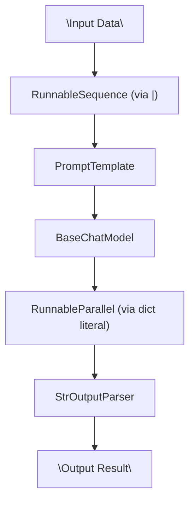

*Figure 1: LCEL composition pipeline mapping components to execution flow.*

Sources: `[libs/core/langchain_core/runnables/base.py:133-210]()`


---

## 2. Configuration Propagation and `RunnableConfig`

To control execution at runtime, `Runnable` methods accept an optional `RunnableConfig` dict-like object. This encapsulates configuration for the run, including:

- Callback managers for tracing and logging
- Tags, metadata, and run names for observability
- Concurrency limits and recursion depth for execution control
- Runtime values for configurable fields defined on runnables

When a runnable invokes child runnables, the config merges and propagates automatically, preserving context and observability metadata transparently.

Utility functions like `merge_configs` and `patch_config` aid in layering configs cleanly.

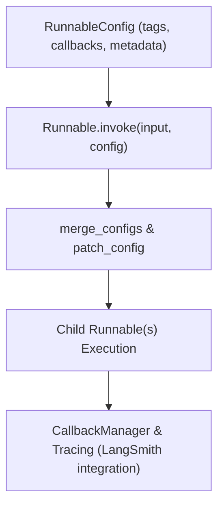

*Figure 2: Propagation of `RunnableConfig` and integration with tracing callbacks.*

Sources: `[libs/core/langchain_core/runnables/base.py:52-65]()`, `[libs/core/langchain_core/runnables/config.py:1-60]()`


---

## 3. Retries, Fallbacks, and Rate Limiters

To support resilient production workflows, the runnable system provides composable wrappers:

- **Fallbacks:** `RunnableWithFallbacks` wraps a base `Runnable` with alternate fallbacks. If the primary runnable raises specified exceptions, fallbacks are tried in order until one succeeds. Optionally, the exception can be passed to fallbacks for informed handling. This supports graceful degradation between providers or logic paths.

- **Retries:** Retry wrappers add retry policies with exponential backoff, jitter, etc., automatically retrying transient failures.

- **Rate Limiters:** Provide generalized request throttling via a `BaseRateLimiter` interface. An in-memory token bucket implementation `InMemoryRateLimiter` allows controlling calls/sec with max burst capacity, suitable for API quota compliance.

These resilient features are declaratively added through methods such as `.with_fallbacks()` and `.with_retry()` on any runnable, including composed pipelines.

Sources: `[libs/core/langchain_core/runnables/fallbacks.py:1-196]()`, `[libs/core/langchain_core/runnables/retry.py:1-50]()`, `[libs/core/langchain_core/rate_limiters.py:1-181]()`


---

## 4. Configurable Fields and Runtime Selection

Runnables support dynamically configurable parameters exposed as `ConfigurableField` and described by `ConfigurableFieldSpec`. Fields allow injecting runtime values for attributes like temperature, system prompts, or nested runnables.

The `DynamicRunnable` orchestrates runtime selection among alternatives based on config values. It overrides its `prepare` method to instantiate or select the effective runnable for a given call, enabling runtime model selection or prompt variant injection without code modifications.

Advanced scenarios can leverage single-option or multi-option configurable fields to drive variant chains or parameter selection dynamically.

Sources: `[libs/core/langchain_core/runnables/configurable.py:1-216]()`, `[libs/core/langchain_core/runnables/utils.py:67-70]()`


---

## 5. Child Pages

For specialized runnable subsystems and detailed technical insights, please consult the following child pages:

- **[Graph Rendering and Visualization](#2.1.1)**  
  Covers construction, inspection, and rendering of runnable composition graphs in Mermaid, ASCII, and PNG formats.

- **[Streaming, Events and Chat History Runnables](#2.1.2)**  
  Details asynchronous streaming event implementations (`astream_events` v1/v2), log streaming utilities, memory event streams, and chat history integration with `RunnableWithMessageHistory`.


---

# Bridging Natural Language Concepts to Code Entities

Below are two diagrams that map key LangChain runtime concepts and architecture from natural language system terminology to concrete code components and source files.

```mermaid
%% Title: Natural Language Space to Runnable Code Entities

graph LR
    NLS1["Unit of work for prompt/models/tools"] --> CE1[Runnable<br/>`Runnable` abstract class<br/>libs/core/langchain_core/runnables/base.py]
    NLS2["Declarative composition"] --> CE2[LCEL operators<br/>`|` operator, dict literal<br/>`RunnableSequence`, `RunnableParallel`<br/>libs/core/langchain_core/runnables/base.py]
    NLS3["Streaming and batching interface"] --> CE1
    NLS4["Retries and fallback wrappers"] --> CE3[Fallback & Retry classes<br/>`RunnableWithFallbacks`<br/>libs/core/langchain_core/runnables/fallbacks.py]
    NLS5["Runtime config and metadata"] --> CE4[`RunnableConfig` dict<br/>libs/core/langchain_core/runnables/config.py]
    NLS6["Configurable runtime switching"] --> CE5[`DynamicRunnable` and fields<br/>libs/core/langchain_core/runnables/configurable.py]
    NLS7["Rate limiting"] --> CE6[Rate limiter interfaces<br/>`BaseRateLimiter`, `InMemoryRateLimiter`<br/>libs/core/langchain_core/rate_limiters.py]

    classDef codeEntity fill:#fff,stroke:#000,stroke-width:1px;

    CE1:::codeEntity
    CE2:::codeEntity
    CE3:::codeEntity
    CE4:::codeEntity
    CE5:::codeEntity
    CE6:::codeEntity
```

```mermaid
%% Title: Runnable Execution Flow and Config Lifecycle

graph TD
    Input["Input to Runnable.invoke()"] --> RunnableObj["Runnable Instance<br/>`invoke`, `ainvoke`, `batch`, `stream`"]
    RunnableObj --> ConfigPropagate["Propagate `RunnableConfig`"]
    ConfigPropagate --> ChildRunnable["Child Runnable(s) Executed"]
    ChildRunnable --> Execution["Actual Execution<br/>Prompt / Model / Tool"]
    Execution --> Output["Output Result"]

    ConfigPropagate -.-> CallbackMgr["Callback Manager & Tracing<br/>(LangSmith integration)"]
    CallbackMgr --> TraceStore["Persistent Trace Storage"]

    RetryWrapper["`with_retry()` wrapper"] --> RunnableObj
    FallbackWrapper["`with_fallbacks()` wrapper"] --> RunnableObj
    RateLimiter["Rate Limiter (e.g. `InMemoryRateLimiter`)"] -.-> RunnableObj

    classDef codeEntity fill:#fff,stroke:#000,stroke-width:1px;
```

Sources:  
- `[libs/core/langchain_core/runnables/base.py:133-212]()`  
- `[libs/core/langchain_core/runnables/config.py:1-60]()`  
- `[libs/core/langchain_core/runnables/fallbacks.py:1-196]()`  
- `[libs/core/langchain_core/runnables/configurable.py:1-216]()`  
- `[libs/core/langchain_core/rate_limiters.py:1-181]()`

---

# Page: Graph Rendering and Visualization

# Graph Rendering and Visualization

<details>
<summary>Relevant source files</summary>

The following files were used as context for generating this wiki page:

- [libs/core/langchain_core/runnables/graph.py](libs/core/langchain_core/runnables/graph.py)
- [libs/core/langchain_core/runnables/graph_ascii.py](libs/core/langchain_core/runnables/graph_ascii.py)
- [libs/core/langchain_core/runnables/graph_mermaid.py](libs/core/langchain_core/runnables/graph_mermaid.py)
- [libs/core/langchain_core/runnables/graph_png.py](libs/core/langchain_core/runnables/graph_png.py)
- [libs/core/tests/unit_tests/runnables/__snapshots__/test_graph.ambr](libs/core/tests/unit_tests/runnables/__snapshots__/test_graph.ambr)
- [libs/core/tests/unit_tests/runnables/test_graph.py](libs/core/tests/unit_tests/runnables/test_graph.py)

</details>


## Overview and Scope

The graph rendering and visualization subsystem in `langchain-core` provides the mechanism for constructing, inspecting, and visually rendering execution workflows of composed `Runnable` objects. These `Runnable` workflows are expressed as directed acyclic graphs (DAGs) and rendered in multiple formats:

- **Mermaid.js syntax**, enabling rendering inside Markdown or web interfaces,
- **ASCII art**, suitable for terminal display or simple textual interfaces,
- **PNG images**, generated programmatically to create high-quality visual graphs.

This subsystem facilitates introspection, documentation, and debugging of complex `Runnable` workflows by offering structured and customizable visualizations of the underlying execution graphs.

The key implementation modules include:

- Core graph data structures (`Graph`, `Node`, `Edge`): [libs/core/langchain_core/runnables/graph.py:1-242]()
- Mermaid graph rendering utilities: [libs/core/langchain_core/runnables/graph_mermaid.py:1-201]()
- ASCII art graph renderer using hierarchical layout: [libs/core/langchain_core/runnables/graph_ascii.py:1-222]()
- PNG raster graphic renderer leveraging Graphviz and PyGraphviz: [libs/core/langchain_core/runnables/graph_png.py:1-215]()

---

## Core Graph Data Structures (`Graph`, `Node`, `Edge`)

This layer defines the graph abstraction used by `Runnable` objects to represent their internal structure.

### Entities

- **`Edge`**  
  Represents a directed edge with:  
  - `source` node ID (str)  
  - `target` node ID (str)  
  - Optional `data` field carrying label or metadata (stringifiable)  
  - `conditional` boolean flag indicating whether the edge represents a conditional branch  
  [libs/core/langchain_core/runnables/graph.py:65-92]()

- **`Node`**  
  Represents a graph node with:  
  - Unique `id` (str)  
  - `name` for display purposes (str)  
  - Optional `data` containing either a `Runnable` instance or a Pydantic schema class (for data barriers)  
  - Optional `metadata` dictionary for additional attributes  
  [libs/core/langchain_core/runnables/graph.py:95-128]()

- **`Branch`**  
  Defines branching control logic with a predicate callable determining the active branch, and optional end node mappings per branch [libs/core/langchain_core/runnables/graph.py:130-138]()

### Graph Construction and Representation

The `Graph` class (not fully excerpted) acts as a container holding nodes and edges, with utility methods for adding nodes/edges, and determining key nodes such as start and end in the workflow. `Runnable` compositional objects expose graph views of their internal execution flow via `.get_graph()`, thus mapping logical computations to nodes and edges that can be rendered [libs/core/langchain_core/runnables/graph.py:30, 65-138]()

### Diagram: Code Entities to Runtime Graph Model

```mermaid
classDiagram
    class Runnable {
        +get_graph() Graph
    }
    class Graph {
        +dict nodes
        +list edges
        +add_node() Node
        +add_edge() Edge
        +draw_mermaid() str
        +draw_ascii() str
    }
    class Node {
        +str id
        +str name
        +Any data
        +dict metadata
    }
    class Edge {
        +str source
        +str target
        +Any data
        +bool conditional
    }
    Runnable --> Graph : "generates via get_graph()"
    Graph *-- Node : "contains"
    Graph *-- Edge : "contains"
```

*Sources: [libs/core/langchain_core/runnables/graph.py:65-138](), [libs/core/langchain_core/runnables/graph.py:30]()*


---

## Mermaid Rendering (`draw_mermaid`)

Mermaid is a flowchart and diagram syntax that renders easily in Markdown and web environments. The Mermaid renderer builds graph definition text conforming to Mermaid's syntax from the `Graph` nodes and edges.

### Key Features of `draw_mermaid`

- Renders nodes with customizable labels and styles.  
- Supports nested subgraphs derived from colon-separated node IDs, reflecting hierarchical grouping.  
- Allows highlighting of first and last nodes with distinct styling and Mermaid classes.  
- Supports rich node labels with minimal Markdown sanitization, embedding metadata inline as HTML fragments.  
- Wraps long edge labels for readability using HTML `<br>` tags.  
- Adds customizable Mermaid frontmatter YAML config for theming, styling, and curve styles (e.g., linear, cardinal) [libs/core/langchain_core/runnables/graph_mermaid.py:45-111]()

### Mermaid Rendering Steps

1. **Initialize Mermaid frontmatter config**, merging provided options and enforcing edge curve style.  
2. **Partition nodes** into regular nodes and subgraph nodes based on colon-delimited IDs.  
3. **Render nodes** using HTML-safe labels and optional metadata tooltips.  
4. **Group edges** by common prefix to generate hierarchical subgraphs.  
5. **Render edges** with label wrapping.  
6. **Output Mermaid graph string** with frontmatter at the top if styles enabled.

### Mermaid Rendering Pipeline Diagram

```mermaid
graph TD;
    G["Graph object"]
    DM["draw_mermaid(nodes, edges, ...)"]
    SC["_to_safe_id and label sanitization"]
    SG["Subgraph grouping and rendering"]
    OUT["Mermaid graph syntax with frontmatter"]
    G --> DM
    DM --> SC
    SC --> SG
    SG --> OUT
```

*Sources: [libs/core/langchain_core/runnables/graph_mermaid.py:45-111](), [libs/core/langchain_core/runnables/graph_mermaid.py:112-190]()*


---

## ASCII Rendering (`graph_ascii.py`)

To support environments without graphical UI, the ASCII renderer produces textual diagrams using ASCII characters to display the workflow graph.

### Implementation Highlights

- **VertexViewer**  
  Defines each node's bounding box: fixed height (3) and dynamic width based on text length. This supports layout calculations. [libs/core/langchain_core/runnables/graph_ascii.py:27-56]()

- **AsciiCanvas**  
  Mutable 2D grid canvas to draw nodes as boxes (`+`, `-`, `|`), text within boxes, and edges as lines (`*`, `-`, `|`). Provides drawing primitives like `point`, `line`, `box`, and `text`. [libs/core/langchain_core/runnables/graph_ascii.py:57-192]()

- **Sugiyama Layout Algorithm**  
  Converts nodes and edges to `grandalf` graph primitives, applying hierarchical graph layout and routing algorithms to find ideal node positions and edge paths. This yields layered, crossing-minimized graphs. [libs/core/langchain_core/runnables/graph_ascii.py:201-222]()

- **Rendering Output**  
  Executes drawing onto `AsciiCanvas` to create legible terminal diagrams. Utilizes vertical/horizontal lines and box drawing characters for clarity.

### Visual Sample (conceptual snippet)

```
+-------------+
| PromptInput |
+-------------+
     *
     *
+----------------+
| PromptTemplate |
+----------------+
     *
     *
+-------------+
| FakeListLLM |
+-------------+
     *
     *
+-------------------------------+
| CommaSeparatedListOutputParser |
+-------------------------------+
     *
     *
+--------------------------------------+
| CommaSeparatedListOutputParserOutput |
+--------------------------------------+
```

*Sources: [libs/core/langchain_core/runnables/graph_ascii.py:1-222]()

---

## PNG Renderer (`PngDrawer`)

This class enables export of a graph to a PNG image, facilitating high-quality graphical visualization. It leverages the Graphviz engine through the `pygraphviz` Python bindings.

### Features

- **Customizable font and labels:** Fonts default to Arial; node and edge labels can be globally customized via mappings `[libs/core/langchain_core/runnables/graph_png.py:28-53]()`.
- **Node styling:** Nodes are styled filled yellow with bold labels for clarity.  
- **Subgraph support:** Nodes with common ID prefixes form cluster subgraphs named accordingly, preserving nested hierarchical structure visually. [libs/core/langchain_core/runnables/graph_png.py:160-190]()
- **Edge styling:** Conditional edges rendered as dotted lines for distinction; normal edges with solid lines. [libs/core/langchain_core/runnables/graph_png.py:191-199]()
- **Rendering and output:** Graph is rendered with `dot` layout and saved as PNG to disk or returned as bytes buffer. The underlying graph is properly closed to prevent resource leaks. [libs/core/langchain_core/runnables/graph_png.py:120-154]()

### Workflow Diagram

```mermaid
graph TD
    PngDrawer
    subgraph Setup
        Fontname
        LabelsDict
    end
    subgraph GraphViz Stage
        pgv.AGraph
        Add_Nodes
        Add_Subgraphs
        Add_Edges
        Update_Styles
    end
    Output -->|write PNG or bytes| File_System_or_Memory
    PngDrawer --> Fontname
    PngDrawer --> LabelsDict
    PngDrawer --> pgv.AGraph
    pgv.AGraph --> Add_Nodes
    pgv.AGraph --> Add_Subgraphs
    pgv.AGraph --> Add_Edges
    pgv.AGraph --> Update_Styles
```

*Sources: [libs/core/langchain_core/runnables/graph_png.py:28-215]()

---

## Summary Diagram: Natural Language Runnable Composition to Graph Visualization

This overview diagram outlines the flow from user-level runnable composition, through graph generation, to the multiple rendering outputs available:

```mermaid
graph TD
    NL["Natural Language Input: Runnable Composition"]
    RG["Runnable.get_graph()"]
    G["Graph(nodes: dict, edges: list)"]
    MR["Graph.draw_mermaid()"]
    AR["Graph.draw_ascii()"]
    PR["PngDrawer.draw()"]
    MM["GraphMermaid Module"]
    AA["GraphAscii Module"]
    PP["GraphPNG Module"]

    NL --> RG
    RG --> G
    G --> MR
    G --> AR
    G --> PR

    MR --> MM["libs/core/langchain_core/runnables/graph_mermaid.py"]
    AR --> AA["libs/core/langchain_core/runnables/graph_ascii.py"]
    PR --> PP["libs/core/langchain_core/runnables/graph_png.py"]
```

*Sources: [libs/core/langchain_core/runnables/graph.py:1-242](), [libs/core/langchain_core/runnables/graph_mermaid.py:1-201](), [libs/core/langchain_core/runnables/graph_ascii.py:1-222](), [libs/core/langchain_core/runnables/graph_png.py:1-215]()*

---

## Additional Features

### Graph JSON Serialization and Metadata

The `Node` and `Edge` entities support conversion to JSON-serializable formats including:

- For nodes with runnable data, serializing class identifiers and runtime names.  
- For Pydantic schema nodes, optionally embedding full JSON schema metadata.  
- Defaulting to simple ID strings for unannotated nodes.

This enables inspection, debugging, and export of graph definitions in structured formats for external tooling [libs/core/langchain_core/runnables/graph.py:199-242]().

### Testing and Validation

The unit tests in `libs/core/tests/unit_tests/runnables/test_graph.py` verify:

- Correct graph construction from simple runnable chains and composed sequences.  
- Trimming methods to remove unnecessary nodes (excluding entry/exit nodes when multi-edges exist).  
- Consistency between Mermaid and ASCII output formats via snapshot testing.  
- Handling of nested subgraphs and duplicate naming errors.  
- Special character escaping within node names and frontmatter configuration application.  
- Integration of runnable metadata into graph node labels.  
- Graph serialization results with/without embedded Pydantic schemas [libs/core/tests/unit_tests/runnables/test_graph.py:27-159]().

---

# References

| Component                         | File Path                                            |
|----------------------------------|-----------------------------------------------------|
| Core Graph Types and Utilities    | `libs/core/langchain_core/runnables/graph.py`       |
| Mermaid Renderer Implementation  | `libs/core/langchain_core/runnables/graph_mermaid.py`|
| ASCII Art Renderer Implementation| `libs/core/langchain_core/runnables/graph_ascii.py` |
| PNG Renderer Implementation       | `libs/core/langchain_core/runnables/graph_png.py`   |
| Unit Test Examples                | `libs/core/tests/unit_tests/runnables/test_graph.py`|

*Sources: [libs/core/langchain_core/runnables/graph.py:1-242](), [libs/core/langchain_core/runnables/graph_mermaid.py:1-201](), [libs/core/langchain_core/runnables/graph_ascii.py:1-222](), [libs/core/langchain_core/runnables/graph_png.py:1-215](), [libs/core/tests/unit_tests/runnables/test_graph.py:1-159]()*

---

# Page: Streaming, Events and Chat History Runnables

# Streaming, Events and Chat History Runnables

<details>
<summary>Relevant source files</summary>

The following files were used as context for generating this wiki page:

- [libs/core/langchain_core/chat_history.py](libs/core/langchain_core/chat_history.py)
- [libs/core/langchain_core/chat_loaders.py](libs/core/langchain_core/chat_loaders.py)
- [libs/core/langchain_core/chat_sessions.py](libs/core/langchain_core/chat_sessions.py)
- [libs/core/langchain_core/runnables/__init__.py](libs/core/langchain_core/runnables/__init__.py)
- [libs/core/langchain_core/runnables/history.py](libs/core/langchain_core/runnables/history.py)
- [libs/core/langchain_core/tools/__init__.py](libs/core/langchain_core/tools/__init__.py)
- [libs/core/langchain_core/tracers/event_stream.py](libs/core/langchain_core/tracers/event_stream.py)
- [libs/core/langchain_core/tracers/log_stream.py](libs/core/langchain_core/tracers/log_stream.py)
- [libs/core/langchain_core/tracers/memory_stream.py](libs/core/langchain_core/tracers/memory_stream.py)
- [libs/core/tests/unit_tests/chat_history/__init__.py](libs/core/tests/unit_tests/chat_history/__init__.py)
- [libs/core/tests/unit_tests/chat_history/test_chat_history.py](libs/core/tests/unit_tests/chat_history/test_chat_history.py)
- [libs/core/tests/unit_tests/runnables/test_history.py](libs/core/tests/unit_tests/runnables/test_history.py)
- [libs/core/tests/unit_tests/runnables/test_imports.py](libs/core/tests/unit_tests/runnables/test_imports.py)
- [libs/core/tests/unit_tests/runnables/test_runnable_events_v1.py](libs/core/tests/unit_tests/runnables/test_runnable_events_v1.py)
- [libs/core/tests/unit_tests/runnables/test_runnable_events_v2.py](libs/core/tests/unit_tests/runnables/test_runnable_events_v2.py)
- [libs/core/tests/unit_tests/test_imports.py](libs/core/tests/unit_tests/test_imports.py)
- [libs/core/tests/unit_tests/test_pydantic_imports.py](libs/core/tests/unit_tests/test_pydantic_imports.py)
- [libs/core/tests/unit_tests/tracers/test_memory_stream.py](libs/core/tests/unit_tests/tracers/test_memory_stream.py)

</details>


## Purpose and Scope

This page provides an in-depth technical overview of key runnable primitives within `langchain-core` that enable:

- Streaming of fine-grained lifecycle and run events via the `astream_events` API (versions v1 and v2),
- Streaming of runnable execution logs with patch updates via `astream_log` and the `LogStreamCallbackHandler`,
- Thread-safe asynchronous event queuing using the `_MemoryStream` primitive,
- Management of conversational chat message history through the `RunnableWithMessageHistory` runnable wrapper.

These primitives empower developers to build robust, observable, and stateful asynchronous execution pipelines with rich event streaming and context continuation capabilities.

---

## 1. Unified Event Streaming: `astream_events` v1 and v2

The `astream_events()` method on a `Runnable` enables streaming every relevant lifecycle event emitted during execution of runnable chains, tools, prompts, or language models. This interface returns an asynchronous iterator over `StreamEvent` objects that represent granular run events.

### Core Implementation: `_AstreamEventsCallbackHandler`

The internal engine powering `astream_events` is `_AstreamEventsCallbackHandler`, defined in `tracers/event_stream.py`. This class extends both asynchronous callback handling and a streaming callback interface, collecting all runtime events and dispatching them via an internal asynchronous queue.

Key details:

- **Run Tracking:**  
  It maintains a `run_map` dictionary keyed by run UUIDs, storing run metadata for each active run (name, tags, run type, inputs). Alongside, a `parent_map` tracks parent-child run relationships, enabling hierarchical event context.

- **Event Filtering:**  
  `_RootEventFilter` allows filtering on run names, types, and tags to control which events to include or exclude based on user criteria.

- **Stream Delivery:**  
  Events passing the filter are pushed into a `_MemoryStream` send queue accessed by the caller as an async iterator (`__aiter__`).

- **Parent ID Resolution:**  
  Parent run IDs are provided in reverse order so receivers can reconstruct the run nesting from root to immediate parent.

- **Tap Output Async Iterator:**  
  Supports tapping outputs that are asynchronous iterators, converting each chunk into a stream event.

### Versions v1 vs v2

- **v1** event streaming has a flatter event structure without explicit parent ID tracking and minimal metadata. Marked deprecated but serves legacy compatibility.

- **v2** event streaming enhances metadata, explicitly tracks parent-child run relationships, and uses more structured payloads for streamed chunks, improving integration with external tooling and observability.

LangChain recommends using **v2** for all new integrations.

### Event Flow Diagram: `astream_events` mechanism

```mermaid
graph TD
    subgraph NL["Natural Language Space"]
    UserRequest["User calls `Runnable.astream_events(version='v1/v2')`"] --> EventHandlerCall["_AstreamEventsCallbackHandler instantiated"]
    end

    subgraph CE["Code Entity Space"]
    EventHandlerCall --> RunMaps["Maintains run_map and parent_map"]
    RunMaps --> Filter["_RootEventFilter applies event include/exclude rules"]
    Filter --> StreamQueue["_MemoryStream send stream (async queue)"]
    StreamQueue --> AsyncIteratorOutput["`__aiter__` yields `StreamEvent`s to caller"]
    end

    NL --> CE
```

*Diagram 1: Natural Language request triggers creating a streaming callback handler that manages run metadata, filters events, and produces an async stream.*

---

## 2. Run Log Streaming: `astream_log` and `LogStreamCallbackHandler`

Besides event streams, LangChain supports streamed **run logs** as incremental JSONPatch-based snapshots representing the entire runnable execution tree.

### Core Concepts

- **LogEntry:**  
  Represents an atomic execution record for a sub-run. Includes fields such as ID, name, type (prompt, chain, LLM, etc.), tags, metadata, start/end timestamps, streamed output chunks, and final output.  

- **RunState:**  
  The complete current state of the runnable execution including all nested runs (logs dictionary), streamed output aggregates, and final outputs.

- **RunLogPatch:**  
  A JSONPatch sequence encoding minimal operations needed to transform an empty state into the current partial state. This compact representation supports incremental updates.

- **RunLog:**  
  Combines patches with a concrete `RunState` snapshot, allowing efficient patch addition and state reconstruction.

### `LogStreamCallbackHandler`

- Captures lifecycle events, assembles `RunLogPatch` objects describing state mutations and streamed data.

- Provides an async event stream for consumers with all logs and incremental updates.

- Internally uses `_MemoryStream` for emitting updates to ensure thread-safe asynchronous communication.

This log streaming mechanism is useful for building UIs or diagnostic tooling that require a snapshot consistent view of execution progress.

---

## 3. Asynchronous Memory and Queue Primitives: `_MemoryStream`

The low-level asynchronous streaming is built atop `_MemoryStream` implemented in `tracers/memory_stream.py`.

### Purpose

Designed for safe bridging between synchronous contexts (e.g., blocking run invocations) and asynchronous consumers, `_MemoryStream` provides:

- Thread-safe send and receive interfaces,
- An internal asyncio queue for event buffering,
- Support for managing event loops, including creating a dedicated event loop when used from threads without one.

### Structure: Separate Send and Receive Streams

- **Send Stream:**  
  Used by producers (often synchronous threads or callback handlers) to push events via thread-safe methods like `send_nowait`.

- **Receive Stream:**  
  An async iterator exposing the buffered items for consumption by async code downstream.

### Operational Flow Diagram

```mermaid
graph TD
    subgraph NL["Natural Language Space"]
    SynchronousThread["Runnable or Callback in sync thread"] --> SendStream["_MemoryStream.get_send_stream()"]
    end

    subgraph CE["Code Entity Space"]
    SendStream --> AsyncQueue["Internal Asyncio Queue"]
    AsyncQueue --> ReceiveStream["_MemoryStream.get_receive_stream()"]
    ReceiveStream --> AsyncConsumer["Async Iterator consuming events"]
    end

    NL --> CE
```

*Diagram 2: `_MemoryStream` as a queue bridging sync event producers and async event consumers.*

---

## 4. Chat History Management: `RunnableWithMessageHistory`

The `RunnableWithMessageHistory` class wraps any runnable to provide automated conversational chat history persistence and injection.

### Overview

- Wraps an inner `Runnable` that takes chat messages or dictionaries containing message sequences.

- Uses a user-provided callable (a session factory) that returns a `BaseChatMessageHistory` instance corresponding to a session identifier (e.g., `session_id`).

- Before forwarding inputs to the wrapped runnable, loads prior messages from history and injects them into the input.

- After the wrapped runnable returns output messages, appends both input and output messages to the chat history store.

- Supports sync and async invocation, preserving full compatibility with LangChain's runnable lifecycle.

### Input and Output Handling

- Input can be a sequence of `BaseMessage` or a dictionary containing a key pointing to the messages.

- Output, typically AI-generated messages, is appended back with the user inputs to the message history.

### `BaseChatMessageHistory`

- Abstract base class defining interface for chat message historic storage.

- Defines sync and async variants of:

  - `add_messages(messages: Sequence[BaseMessage])`

  - `aget_messages() -> list[BaseMessage]`

  - `clear()`

- Must be subclassed to provide concrete persistent or in-memory implementations (e.g., `InMemoryChatMessageHistory`).

### Typical Usage

```python
from langchain_core.chat_history import BaseChatMessageHistory
from langchain_core.messages import BaseMessage, AIMessage, HumanMessage
from langchain_core.runnables import RunnableLambda
from langchain_core.runnables.history import RunnableWithMessageHistory

# Simple in-memory message history store
class InMemoryHistory(BaseChatMessageHistory):
    def __init__(self):
        self.messages = []
    def add_messages(self, messages):
        self.messages.extend(messages)
    @property
    def messages(self):
        return self._messages

# Factory function to get history by session_id
store = {}
def get_history(session_id: str) -> BaseChatMessageHistory:
    if session_id not in store:
        store[session_id] = InMemoryHistory()
    return store[session_id]

# Create a simple runnable
def echo_runnable(messages: list[BaseMessage]) -> str:
    return "\n".join(m.content for m in messages if isinstance(m, HumanMessage))

runnable = RunnableLambda(echo_runnable)
wrapped = RunnableWithMessageHistory(runnable, get_history)

# Invocation with session config
config = {"configurable": {"session_id": "session1"}}
response = wrapped.invoke([HumanMessage(content="Hello")], config)
```

### Data Flow Diagram: `RunnableWithMessageHistory`

```mermaid
graph LR
  UserInput["User Input Messages"] --> RWMH["RunnableWithMessageHistory"]
  RWMH --> SessionFactory["Call GetSessionHistoryCallable(session_id)"]
  SessionFactory --> ChatHistory["BaseChatMessageHistory instance"]
  ChatHistory --> LoadMsgs["Load prior stored messages"]
  LoadMsgs --> RWMH[Inject prior messages into input]
  RWMH --> InnerRunnable["Invoke Wrapped Runnable"]
  InnerRunnable --> OutputMsgs["Receive AI Output Messages"]
  OutputMsgs --> SaveMsgs["Append input and output messages to ChatHistory"]
  SaveMsgs --> ChatHistory
  RWMH --> UserOutput["Return Output to Caller"]
```

---

## Summary Table of Core Primitives and Files

| Concept                               | Key Classes/Functions                       | File and Line Reference                         |
|-------------------------------------|--------------------------------------------|------------------------------------------------|
| Event Stream Handler                 | `_AstreamEventsCallbackHandler`            | `tracers/event_stream.py:101-204`              |
| Event Filter                        | `_RootEventFilter`                          | `tracers/event_stream.py:133-140`              |
| Stream Event Schema                 | `StreamEvent` (schema)                      | `runnables/schema.py` (not provided here)      |
| Run Log Streaming                   | `LogStreamCallbackHandler`, `RunLog`, `RunLogPatch` | `tracers/log_stream.py:40-222`                  |
| Async Event Queue                  | `_MemoryStream`, `_get_or_create_loop`     | `tracers/memory_stream.py` and usage in `event_stream.py` |
| Abstract Chat History               | `BaseChatMessageHistory`                    | `chat_history.py:31-185`                        |
| Chat History Runnable Wrapper      | `RunnableWithMessageHistory`                | `runnables/history.py:39-185`                   |
| Runnable Event Stream Tests         | `test_event_stream_with_simple_function_tool`, etc. | `tests/unit_tests/runnables/test_runnable_events_v2.py` |
| Chat History Wrapper Tests          | `test_input_messages`, `test_input_dict`   | `tests/unit_tests/runnables/test_history.py`   |

---

## Additional Notes

- The `RunnableWithMessageHistory` class is deprecated; LangChain encourages usage of LangGraph’s built-in persistence features for chat history in newer applications.

- Event streaming APIs (`astream_events`) support fine-grained filtering on run names, types, and tags, enabling highly configurable observability.

- Thread-safe asynchronous queuing via `_MemoryStream` accommodates complex concurrency scenarios involving synchronous execution and asynchronous event consumption, including cross-thread and cross-event loop contexts.

- Streaming outputs from runnables (including chunked LLM tokens) are carefully intercepted and emitted as stream events or log patches for reactive interfaces.

---

# References and Sources

- `libs/core/langchain_core/tracers/event_stream.py:101-204`  
- `libs/core/langchain_core/runnables/history.py:39-185`  
- `libs/core/langchain_core/tracers/log_stream.py:40-222`  
- `libs/core/langchain_core/tracers/memory_stream.py`  
- `libs/core/langchain_core/chat_history.py:31-185`  
- `libs/core/tests/unit_tests/runnables/test_runnable_events_v2.py`  
- `libs/core/tests/unit_tests/runnables/test_history.py`  
- `libs/core/tests/unit_tests/tracers/test_memory_stream.py`

---

# Page: Messages and Content Blocks

# Messages and Content Blocks

<details>
<summary>Relevant source files</summary>

The following files were used as context for generating this wiki page:

- [libs/core/langchain_core/messages/ai.py](libs/core/langchain_core/messages/ai.py)
- [libs/core/langchain_core/messages/base.py](libs/core/langchain_core/messages/base.py)
- [libs/core/langchain_core/messages/chat.py](libs/core/langchain_core/messages/chat.py)
- [libs/core/langchain_core/messages/function.py](libs/core/langchain_core/messages/function.py)
- [libs/core/langchain_core/messages/human.py](libs/core/langchain_core/messages/human.py)
- [libs/core/langchain_core/messages/modifier.py](libs/core/langchain_core/messages/modifier.py)
- [libs/core/langchain_core/messages/system.py](libs/core/langchain_core/messages/system.py)
- [libs/core/langchain_core/messages/tool.py](libs/core/langchain_core/messages/tool.py)
- [libs/core/langchain_core/messages/utils.py](libs/core/langchain_core/messages/utils.py)
- [libs/core/langchain_core/utils/_merge.py](libs/core/langchain_core/utils/_merge.py)
- [libs/core/langchain_core/utils/formatting.py](libs/core/langchain_core/utils/formatting.py)
- [libs/core/tests/unit_tests/messages/test_utils.py](libs/core/tests/unit_tests/messages/test_utils.py)
- [libs/core/tests/unit_tests/prompts/__snapshots__/test_chat.ambr](libs/core/tests/unit_tests/prompts/__snapshots__/test_chat.ambr)
- [libs/core/tests/unit_tests/test_messages.py](libs/core/tests/unit_tests/test_messages.py)
- [libs/core/tests/unit_tests/utils/test_formatting.py](libs/core/tests/unit_tests/utils/test_formatting.py)

</details>


Messages and Content Blocks form the standardized communication layer in `langchain-core` (`libs/core/langchain_core/messages/`). They provide a unified, provider-agnostic abstraction for interacting with chat models and tooling. This abstraction manages various content forms including plain text, multi-modal content blocks, tool invocation requests and responses, streaming chunks, and detailed token usage metadata to facilitate robust agent workflows and analytics.

---

## 1. BaseMessage Hierarchy and Message Types

The foundation of LangChain's chat input/output system is the `BaseMessage` class (`libs/core/langchain_core/messages/base.py:93-144`). It defines core fields like `content` (which can be plain text or structured content blocks), optional identifiers, and extensible metadata. From this base, various specialized message types derive, representing distinct conversational roles or operational semantics:

| Message Class      | Purpose                                                                                     | File Reference                               |
|--------------------|---------------------------------------------------------------------------------------------|----------------------------------------------|
| `HumanMessage`     | User-supplied input messages                                                                | `libs/core/langchain_core/messages/human.py:9-30` |
| `AIMessage`        | Responses generated by a language model                                                     | `libs/core/langchain_core/messages/ai.py:160-184` |
| `SystemMessage`    | System-level instructions that prime model behavior                                         | `libs/core/langchain_core/messages/system.py:9-30` |
| `ToolMessage`      | Tool execution results sent back to the model                                              | `libs/core/langchain_core/messages/tool.py:26-174` |
| `RemoveMessage`    | Special message to mark removal of another message, used in stateful graph flows            | `libs/core/langchain_core/messages/modifier.py:8-13` |

Each message type has a corresponding streaming chunk variant (`BaseMessageChunk` derivatives) for incremental token delivery. These chunk classes support merging partial data streams, essential for streaming model interfaces ([libs/core/tests/unit_tests/test_messages.py:10-32]()).

```mermaid
graph TD
    BM["BaseMessage (Serializable)"] --> HM["HumanMessage"]
    BM --> AIM["AIMessage"]
    BM --> SM["SystemMessage"]
    BM --> TM["ToolMessage"]
    BM --> ChatM["ChatMessage"]
    BM --> RM["RemoveMessage"]
    
    BMC["BaseMessageChunk"] --> HMC["HumanMessageChunk"]
    BMC --> AIMC["AIMessageChunk"]
    BMC --> SMC["SystemMessageChunk"]
    BMC --> TMC["ToolMessageChunk"]
    
    style BM fill:#fff,stroke:#000,stroke-width:1px
    style TM fill:#fff,stroke:#000,stroke-width:1px
```

*Sources: `libs/core/langchain_core/messages/base.py:93-144`, `libs/core/langchain_core/messages/human.py:9-63`, `libs/core/langchain_core/messages/ai.py:160-184`, `libs/core/langchain_core/messages/tool.py:26-174`*

---

## 2. AIMessage, ToolMessage and Structured Model Outputs

Two key message types facilitate tool-calling integration and structured output handling:

- **AIMessage**: Represents a language model's response, containing textual or structured multi-modal `content`, and a list of `tool_calls` indicating any requested tool executions. It also includes `invalid_tool_calls` for encoding parse errors encountered in tool call outputs. This message type carries `usage_metadata` capturing token usage to facilitate cost tracking ([libs/core/langchain_core/messages/ai.py:170-180]).

- **ToolMessage**: Encapsulates the results from a tool execution triggered by an AIMessage's tool call. Each ToolMessage is uniquely associated with a `tool_call_id`. To handle large or complex outputs, ToolMessage supports an `artifact` field storing full result data (e.g., images or logs) separate from the `content` sent to the model, allowing efficient interaction with models without overloading prompts ([libs/core/langchain_core/messages/tool.py:26-83]).

```mermaid
graph LR
    Model["BaseChatModel"] -->|"Returns"| AIM["AIMessage"]
    AIM -->|"Requests Tool Invocations"| ToolExec["Tool.invoke()"]
    ToolExec --> TM["ToolMessage"]
    TM -->|"Feeds Results Back"| Model
    
    subgraph AIM_block["AIMessage Fields"]
        Content["content: string | list[str | dict]"]
        ToolCalls["tool_calls: list[ToolCall]"]
        InvalidToolCalls["invalid_tool_calls: list[InvalidToolCall]"]
        UsageMeta["usage_metadata: UsageMetadata"]
    end
    
    subgraph TM_block["ToolMessage Fields"]
        TContent["content: string | list[str | dict]"]
        ToolCallID["tool_call_id: string"]
        Artifact["artifact: Any (non-model data)"]
        Status["status: success | error"]
    end
    
    AIM -- Contains --> AIM_block
    TM -- Contains --> TM_block
```

*Sources: `libs/core/langchain_core/messages/ai.py:160-180`, `libs/core/langchain_core/messages/tool.py:26-83`*

---

## 3. Chunk Merging and Streaming Architecture

To support token-level streaming with chat models, each message type has a chunk variant (`BaseMessageChunk`) which supports merging via operator overloading (`__add__`). The merging logic ensures that partial data or chunks of streamed content are combined correctly:

- For string or array content, chunks concatenate seamlessly.
- Partial JSON fragments in tool call arguments stream asynchronously and get merged to reconstruct complete JSON objects.
- Token usage metadata fields aggregate by summing counts across chunks, preserving accurate usage tracking across streamed output pieces.

This design allows incremental partial messages to be combined into cohesive full messages dynamically during streaming ([libs/core/tests/unit_tests/test_messages.py:50-125], [libs/core/langchain_core/utils/_merge.py:6-95], [libs/core/tests/unit_tests/messages/test_utils.py:87-152]).

```mermaid
graph LR
    MsgChunk1["MessageChunk 1"] + MsgChunk2["MessageChunk 2"] --> MergedChunk["Merged MessageChunk"]
    
    subgraph MergingLogic
        TextContent["Concatenate text content"]
        ToolCallChunks["Merge partial tool call JSON by index"]
        UsageMetadata["Sum input/output tokens"]
    end
    
    MsgChunk1 --> MergingLogic
    MsgChunk2 --> MergingLogic
    MergingLogic --> MergedChunk
```

*Sources: `libs/core/tests/unit_tests/test_messages.py:50-125`, `libs/core/langchain_core/utils/_merge.py:6-95`, `libs/core/tests/unit_tests/messages/test_utils.py:87-152`*

---

## 4. Usage Metadata and Token Accounting

`AIMessage` supports detailed usage tracking through the `UsageMetadata` typed dictionary (`libs/core/langchain_core/messages/ai.py:104-158`). This provides a standardized token accounting schema across all models and providers, enabling consistent cost analysis and analytics.

| Field                 | Type                 | Description                                                                                  |
|-----------------------|----------------------|----------------------------------------------------------------------------------------------|
| `input_tokens`        | `int`                | Total prompt tokens consumed                                                                 |
| `output_tokens`       | `int`                | Total completion tokens generated                                                            |
| `total_tokens`        | `int`                | Sum of input and output tokens                                                               |
| `input_token_details` | `InputTokenDetails`   | Optional detailed breakdown by input source (e.g., audio tokens, cache reads or creations)    |
| `output_token_details`| `OutputTokenDetails`  | Optional detailed breakdown by output type (e.g., audio, reasoning tokens)                    |

This metadata format supports enhanced observability and cost transparency in downstream monitoring systems such as LangSmith.

*Sources: `libs/core/langchain_core/messages/ai.py:104-158`*

---

## 5. Message Utilities (Filtering, Conversion, Formatting)

Several utility functions in `libs/core/langchain_core/messages/utils.py` facilitate robust message handling:

- **`filter_messages()`**: Filter messages by criteria such as name, type, ID, and tool call presence. Useful to extract relevant subsets of conversation history or to exclude certain message types before processing [libs/core/tests/unit_tests/messages/test_utils.py:140-185].

- **`merge_message_runs()`**: Concatenate consecutive messages of the same class into a single message. It merges textual content or content blocks with an optional separator, reducing prompt fragmentation and optimizing model inputs [libs/core/tests/unit_tests/messages/test_utils.py:35-85].

- **`convert_to_messages()`**: Deserialize raw dicts or tuples into validated `BaseMessage` instances for consistent downstream processing.

- **`get_buffer_string()`**: Serialize a sequence of messages into a readable string transcript format, which aids debugging and logging.

These tools enable flexible, high-level management of conversational message sequences in LangChain workflows.

*Sources: `libs/core/langchain_core/messages/utils.py:1-130`, `libs/core/tests/unit_tests/messages/test_utils.py`*

---

## 6. Provider Block Translators

AI providers such as OpenAI, Anthropic, Google GenAI, AWS Bedrock, and Groq each have their own formats for content blocks and tool call payloads. LangChain core includes provider-specific *block translators* that convert between LangChain's standardized content blocks and provider native message formats.

These translators assure consistent, idiomatic communication with each provider API, including support for multiparty chat formats, streaming, tool call protocols, and multi-modal content.

For details, see the child page:

- [Block Translators for Providers](#2.2.1) — Standard content block translation for OpenAI, Anthropic, Google GenAI, Bedrock, Groq.

---

This modular, composable message layer sits at the core of LangChain's chat and agent frameworks, bridging natural language interactions with structured tooling and multi-modal content, while tracking usage and enabling downstream monitoring and tooling.

---

# Page: Block Translators for Providers

# Block Translators for Providers

<details>
<summary>Relevant source files</summary>

The following files were used as context for generating this wiki page:

- [libs/core/langchain_core/messages/block_translators/anthropic.py](libs/core/langchain_core/messages/block_translators/anthropic.py)
- [libs/core/langchain_core/messages/block_translators/bedrock.py](libs/core/langchain_core/messages/block_translators/bedrock.py)
- [libs/core/langchain_core/messages/block_translators/bedrock_converse.py](libs/core/langchain_core/messages/block_translators/bedrock_converse.py)
- [libs/core/langchain_core/messages/block_translators/google_genai.py](libs/core/langchain_core/messages/block_translators/google_genai.py)
- [libs/core/langchain_core/messages/block_translators/groq.py](libs/core/langchain_core/messages/block_translators/groq.py)
- [libs/core/langchain_core/messages/block_translators/openai.py](libs/core/langchain_core/messages/block_translators/openai.py)
- [libs/core/tests/unit_tests/messages/block_translators/test_anthropic.py](libs/core/tests/unit_tests/messages/block_translators/test_anthropic.py)
- [libs/core/tests/unit_tests/messages/block_translators/test_bedrock_converse.py](libs/core/tests/unit_tests/messages/block_translators/test_bedrock_converse.py)
- [libs/core/tests/unit_tests/messages/block_translators/test_google_genai.py](libs/core/tests/unit_tests/messages/block_translators/test_google_genai.py)
- [libs/core/tests/unit_tests/messages/block_translators/test_openai.py](libs/core/tests/unit_tests/messages/block_translators/test_openai.py)
- [libs/core/tests/unit_tests/messages/test_ai.py](libs/core/tests/unit_tests/messages/test_ai.py)
- [libs/partners/anthropic/README.md](libs/partners/anthropic/README.md)
- [libs/partners/anthropic/langchain_anthropic/_compat.py](libs/partners/anthropic/langchain_anthropic/_compat.py)
- [libs/partners/anthropic/langchain_anthropic/data/profile_augmentations.toml](libs/partners/anthropic/langchain_anthropic/data/profile_augmentations.toml)
- [libs/partners/anthropic/tests/unit_tests/test_compat.py](libs/partners/anthropic/tests/unit_tests/test_compat.py)
- [libs/partners/anthropic/tests/unit_tests/test_sonnet55.py](libs/partners/anthropic/tests/unit_tests/test_sonnet55.py)

</details>


## Purpose and Scope
The block translators subsystem within `langchain_core` standardizes provider-specific model response formats—covering OpenAI, Anthropic, Google GenAI, Amazon Bedrock, and Groq—into unified LangChain v1 content blocks (`ContentBlock`). This harmonization enables consistent processing of complex multi-modal content including text, images, files, citations, reasoning, and tool call metadata across disparate LLM backend providers. It abstracts away vendor-specific payload formats so downstream application logic can interact with a uniform content block schema.

---

## 1. Translator Architecture and Registry

Block translators act as protocol adapters, mapping disparate source-specific payload structures to the LangChain canonical v1 message and content block representation. This involves parsing raw API message content and response metadata, then translating to standard objects like `AIMessage`, `AIMessageChunk`, and associated content blocks.

Each supported provider has a dedicated translator module incorporating conversions for:

- **Text, images, audio, files** in multiple formats (URLs, base64 data, IDs)
- **Tool calls and tool call chunks**
- **Reasoning/thinking content blocks**
- **Citations and grounding metadata**

### Diagram: Provider Block Translators to Code Entities

```mermaid
graph TD
    subgraph "Natural Language Space"
        OpenAI["OpenAI Chat Completions / Responses"]
        Anthropic["Anthropic Messages API"]
        Google["Google GenAI Grounding / Multimodal"]
        Bedrock["Bedrock Converse"]
        Groq["Groq Reasoning / Built-in Tools"]
    end

    subgraph "Code Entity Space"
        OpenAIModule["libs/core/langchain_core/messages/block_translators/openai.py"]
        AnthropicModule["libs/core/langchain_core/messages/block_translators/anthropic.py"]
        GoogleModule["libs/core/langchain_core/messages/block_translators/google_genai.py"]
        BedrockModule["libs/core/langchain_core/messages/block_translators/bedrock_converse.py"]
        GroqModule["libs/core/langchain_core/messages/block_translators/groq.py"]
    end

    OpenAI --> OpenAIModule
    Anthropic --> AnthropicModule
    Google --> GoogleModule
    Bedrock --> BedrockModule
    Groq --> GroqModule
```

*Sources: `libs/core/langchain_core/messages/block_translators/openai.py:1-153`(), `libs/core/langchain_core/messages/block_translators/anthropic.py:33-163`(), `libs/core/langchain_core/messages/block_translators/google_genai.py:25-181`(), `libs/core/langchain_core/messages/block_translators/bedrock_converse.py:33-125`(), `libs/core/langchain_core/messages/block_translators/groq.py:51-118`()*.

---

## 2. OpenAI Block Translation

The OpenAI block translator converts LangChain standard content blocks into the appropriate OpenAI Chat Completions or Responses API payloads, handling nuances across image, file, and audio block formats.

### Key Functions

- **`convert_to_openai_image_block(block)`**  
  Converts an `ImageContentBlock` to OpenAI's expected `image_url` structure.  
  - Supports `url` or base64-encoded image data with MIME type.  
  - Raises `ValueError` for missing required fields or unsupported source types.  
  [libs/core/langchain_core/messages/block_translators/openai.py:22-55]()

- **`convert_to_openai_data_block(block, api="chat/completions")`**  
  Formats a standard data block (`image`, `file`, or `audio`) for the targeted OpenAI API endpoint (Chat Completions or Responses).  
  - Handles base64 data and file IDs.  
  - For `file` type blocks, ensures required filename metadata or uses a placeholder with warning.  
  - Validates support depending on API type (e.g., file URLs unsupported in Chat Completions).  
  [libs/core/langchain_core/messages/block_translators/openai.py:58-153]()

### Data Flow Diagram

```mermaid
graph TD
    InputBlock["ContentBlock (image/file/audio)"] --> CheckType{Block Type?}
    CheckType -- "image" --> ImgConv["convert_to_openai_image_block()"]
    CheckType -- "file" --> FileConv["Process base64/file_id/URL"]
    CheckType -- "audio" --> AudioConv["Format input_audio"]
    ImgConv --> ReturnBlock["OpenAI API Payload Dict"]
    FileConv --> ReturnBlock
    AudioConv --> ReturnBlock
```

*Sources: `libs/core/langchain_core/messages/block_translators/openai.py:22-153`()*.

---

## 3. Anthropic and Bedrock Translators

### Anthropic Translator

Anthropic's model responses contain extended content types such as:

- `tool_use` blocks representing tool calls
- `thinking` blocks for reasoning/thinking processes
- `server_tool_use` and `server_tool_result` for server-initiated tool actions and results
- Rich search and document citations

These are normalized through conversion routines such as `_convert_to_v1_from_anthropic_input()`, which attempt to extract standard LangChain v1 content blocks from Anthropic's native block formats, preserving unknown keys in `extras` fields. For example, document content with base64 data or URLs are converted to standard `file` or `image` blocks with metadata preserved.

### Implementation Details

- The translator unwraps or converts keys like `source` with types (`base64`, `url`, `file`, or `text`) into respective LangChain content blocks such as `FileContentBlock` or `PlainTextContentBlock`.  
- It preserves any unknown keys in an `extras` dictionary for forward compatibility.  
- Tool calls and reasoning blocks translate into recognized v1 types (`tool_call`, `reasoning`).  
- Annotation conversion supports transforming Anthropic native citations into LangChain standardized annotations.

*Sources:* `libs/core/langchain_core/messages/block_translators/anthropic.py:33-163`(), `libs/partners/anthropic/langchain_anthropic/_compat.py:9-183`().

### Bedrock Converse Translator

Amazon Bedrock Converse API returns content with unique nested structures:

- Document blocks with possible PDF embedded bytes or plain-text
- Image blocks supporting base64 or URL sources
- Text blocks and citations

The `_convert_to_v1_from_converse_input()` function unwraps these provider-native blocks and translates them to LangChain v1 blocks, including:

- `FileContentBlock` with base64-encoded pdf bytes or URLs
- `PlainTextContentBlock` for text documents
- `ImageContentBlock` with base64 data or URL
- Calls `_populate_extras()` to retain unknown additional metadata under `extras`

Citations are normalized in `_convert_citation_to_v1()`, concatenating source content text and extracting titles.

*Sources:* `libs/core/langchain_core/messages/block_translators/bedrock_converse.py:15-150`(), `libs/core/langchain_core/messages/block_translators/anthropic.py:33-163`().

---

## 4. Google GenAI and Groq Translators

### Google GenAI Grounding Translator

Google GenAI provides grounding metadata including:

- Web search query strings
- Grounding chunks representing sources (web URLs, map places)
- Grounding supports mapping segments of text to grounding chunk references and confidence scores

The function `translate_grounding_metadata_to_citations(grounding_metadata)` parses these nested structures and converts them to LangChain's `Citation` content blocks. Each citation includes:

- URL and title from chunk web or map info
- Character-based indices of the cited segment
- The original cited text segment
- An `extras` dictionary with Google AI-specific metadata like web search queries, grounding chunk index, confidence scores, and map place IDs

This translation enables consistent use of Google GenAI grounding within LangChain's annotation and citation model.

### Data Flow Diagram for Google GenAI Grounding Translation

```mermaid
graph TD
    Metadata["Grounding Metadata Dict"] --> ExtractChunks["Extract grounding_chunks & grounding_supports"]
    ExtractChunks --> LoopSupports["Iterate over grounding_supports"]
    LoopSupports --> ExtractIndices["Get grounding_chunk_indices"]
    ExtractIndices --> CreateCitation["Call create_citation() with url, title, indices"]
    CreateCitation --> ReturnList["Return list of Citation ContentBlocks"]
```

### GenAI Format Conversion

Additionally, `_convert_to_v1_from_genai_input()` translates Google GenAI native content blocks into LangChain standard v1 blocks when not directly detected, preserving unrecognized blocks as `non_standard`.

*Sources:* `libs/core/langchain_core/messages/block_translators/google_genai.py:25-181`(), `libs/core/tests/unit_tests/messages/block_translators/test_google_genai.py:1-134`().

### Groq Translator

Groq messages include specialized reasoning blocks and server tool executions, such as:

- `executed_tools` array containing tool call and tool result payloads, including web search and Python interpreter tools
- Custom `reasoning` content blocks

The `_convert_to_v1_from_groq()` function converts these extras and message content into LangChain v1 blocks representing `server_tool_call` and `server_tool_result` content, working with tool input/output data and metadata.

*Sources:* `libs/core/langchain_core/messages/block_translators/groq.py:51-118`().

---

# Summary

The block translators decouple vendor-specific message formats from the application-facing LangChain v1 content block schema, thereby standardizing:

- Text and multi-modal content representation
- Tool calls and streaming chunks
- Reasoning and thinking content types
- Citation and grounding metadata

These modules provide a clean, extensible interface to integrate new providers or adapt to evolving LLM model APIs without disrupting core downstream logic.

---

# Additional Technical Notes

- Conversion helpers often implement a two-step process: unwrapping non-standard blocks carrying native data, then mapping recognized native keys to standard LangChain block fields.
- Unknown or unhandled keys are preserved in an `extras` dictionary within the LangChain block to not discard metadata.
- Base64 binary data conversions ensure consistent MIME type and encoding representation between native and standard blocks.
- Tool calls and invalid tool call conversions handle provider idiosyncrasies in payload structure and error reporting.
- Annotations/citations across providers are normalized but retain provider-specific metadata fields inside `extras` for advanced use cases.

---

# References

| Provider  | Translator Module                                               | Notes                                                      |
|-----------|-----------------------------------------------------------------|------------------------------------------------------------|
| OpenAI    | `libs/core/langchain_core/messages/block_translators/openai.py`  | Image/file/audio block formatting for chat completions and responses APIs |
| Anthropic | `libs/core/langchain_core/messages/block_translators/anthropic.py` | Tool use, reasoning, structured output, and annotation translation |
| Bedrock   | `libs/core/langchain_core/messages/block_translators/bedrock_converse.py` | Converse API message normalization, support for PDF bytes and multi-format docs |
| Google GenAI | `libs/core/langchain_core/messages/block_translators/google_genai.py` | Grounding metadata to citations and multimodal content blocks |
| Groq      | `libs/core/langchain_core/messages/block_translators/groq.py`  | Reasoning blocks, executed_tools parsing with server tool calls/results |

---

# Mermaid Bridges: Associate Providers with Core Code Entities

### Bridge 1: Provider Names → Block Translator Modules

```mermaid
graph LR
    OpenAI("OpenAI") --> OpenAIModule["openai.py"]
    Anthropic("Anthropic") --> AnthropicModule["anthropic.py"]
    GoogleGenAI("Google GenAI") --> GoogleModule["google_genai.py"]
    Bedrock("Amazon Bedrock Converse") --> BedrockModule["bedrock_converse.py"]
    Groq("Groq AI") --> GroqModule["groq.py"]
```

### Bridge 2: Provider Names → Typical Message Format Types

```mermaid
graph LR
    OpenAI["OpenAI"] --> OC["OpenAI Chat Completion messages"]
    Anthropic["Anthropic"] --> AM["Anthropic native messages"]
    GoogleGenAI["Google GenAI"] --> GM["GenAI grounding and multi-format content"]
    Bedrock["Bedrock"] --> BM["Bedrock Converse documents & images"]
    Groq["Groq"] --> GMQ["Groq executed_tools and reasoning blocks"]
```

*These bridges enable developers to quickly locate relevant code for provider-specific content translation and understand common message formats encountered.*

---

*Sources:*

- `libs/core/langchain_core/messages/block_translators/openai.py:1-153`  
- `libs/core/langchain_core/messages/block_translators/anthropic.py:33-163`  
- `libs/core/langchain_core/messages/block_translators/google_genai.py:25-181`  
- `libs/core/langchain_core/messages/block_translators/bedrock_converse.py:33-125`  
- `libs/core/langchain_core/messages/block_translators/groq.py:51-118`  
- `libs/core/tests/unit_tests/messages/block_translators/test_google_genai.py`  
- `libs/partners/anthropic/langchain_anthropic/_compat.py`

---

# Page: Language Model Base Classes

# Language Model Base Classes

<details>
<summary>Relevant source files</summary>

The following files were used as context for generating this wiki page:

- [libs/core/langchain_core/language_models/_compat_bridge.py](libs/core/langchain_core/language_models/_compat_bridge.py)
- [libs/core/langchain_core/language_models/_utils.py](libs/core/langchain_core/language_models/_utils.py)
- [libs/core/langchain_core/language_models/base.py](libs/core/langchain_core/language_models/base.py)
- [libs/core/langchain_core/language_models/chat_model_stream.py](libs/core/langchain_core/language_models/chat_model_stream.py)
- [libs/core/langchain_core/language_models/chat_models.py](libs/core/langchain_core/language_models/chat_models.py)
- [libs/core/langchain_core/language_models/fake_chat_models.py](libs/core/langchain_core/language_models/fake_chat_models.py)
- [libs/core/langchain_core/language_models/llms.py](libs/core/langchain_core/language_models/llms.py)
- [libs/core/tests/unit_tests/fake/test_fake_chat_model.py](libs/core/tests/unit_tests/fake/test_fake_chat_model.py)
- [libs/core/tests/unit_tests/language_models/chat_models/test_base.py](libs/core/tests/unit_tests/language_models/chat_models/test_base.py)
- [libs/core/tests/unit_tests/language_models/chat_models/test_cache.py](libs/core/tests/unit_tests/language_models/chat_models/test_cache.py)
- [libs/core/tests/unit_tests/language_models/llms/test_base.py](libs/core/tests/unit_tests/language_models/llms/test_base.py)
- [libs/core/tests/unit_tests/language_models/llms/test_cache.py](libs/core/tests/unit_tests/language_models/llms/test_cache.py)
- [libs/core/tests/unit_tests/language_models/test_chat_model_stream.py](libs/core/tests/unit_tests/language_models/test_chat_model_stream.py)
- [libs/core/tests/unit_tests/language_models/test_chat_model_streamer.py](libs/core/tests/unit_tests/language_models/test_chat_model_streamer.py)
- [libs/core/tests/unit_tests/language_models/test_chat_model_v3_stream.py](libs/core/tests/unit_tests/language_models/test_chat_model_v3_stream.py)
- [libs/core/tests/unit_tests/language_models/test_compat_bridge.py](libs/core/tests/unit_tests/language_models/test_compat_bridge.py)
- [libs/core/tests/unit_tests/language_models/test_v1_parity.py](libs/core/tests/unit_tests/language_models/test_v1_parity.py)
- [libs/langchain/tests/unit_tests/agents/test_agent.py](libs/langchain/tests/unit_tests/agents/test_agent.py)
- [libs/langchain/tests/unit_tests/llms/test_fake_chat_model.py](libs/langchain/tests/unit_tests/llms/test_fake_chat_model.py)
- [libs/langchain/tests/unit_tests/stubs.py](libs/langchain/tests/unit_tests/stubs.py)

</details>


## Purpose and Scope
This page documents the core architecture, execution lifecycle, caching mechanisms, streaming bridges, testing fakes, and model profile integrations for LangChain's language model base classes (`BaseLanguageModel`, `BaseChatModel`, and `BaseLLM`) defined in the langchain-core codebase.

---

## 1. Architectural Hierarchy: `BaseLanguageModel`, `BaseChatModel`, and `BaseLLM`

All language model wrappers inherit from the abstract base class `BaseLanguageModel`, which itself extends the `RunnableSerializable` interface. This base class provides common interfaces for serialization, batching, asynchronous execution, and configuration management. It represents a unified abstraction over various language model interactions [libs/core/langchain_core/language_models/base.py:181-188]().

Two main subclasses specialize the base class for different uses:

- **`BaseChatModel`**: Designed for conversational models. It primarily operates with structured message inputs (`Sequence[BaseMessage]`, `ChatPromptValue`, etc.) and returns structured chat outputs (e.g., `AIMessage`) wrapped in `ChatResult` or `ChatGeneration`. It supports both synchronous and asynchronous generation and streaming of `ChatGenerationChunk`s [libs/core/langchain_core/language_models/chat_models.py]().

- **`BaseLLM`**: Intended for classic large language models that operate on raw text prompts (`str` or `PromptValue`) and output plain text completions via `LLMResult` and `Generation` objects. It also supports streaming text output with less structural rigor compared to chat models [libs/core/langchain_core/language_models/llms.py]().

### Diagram: Conceptual and Code Entity Hierarchy for Chat Models
```mermaid
graph TD
    subgraph "Natural Language Space"
        NL_Conv["Conversational Input Messages"]
        NL_Resp["Structured AIMessage Output"]
        NL_Conv --> Invoke["Invoke BaseChatModel.invoke()"]
        Invoke --> NL_Resp
    end

    subgraph "Code Entity Space"
        BaseLM["BaseLanguageModel"]
        RunnableSerial["RunnableSerializable"]
        BaseChatModel["BaseChatModel"]
        InternalGen["_generate/_agenerate methods"]
        Streaming["_stream/_astream methods"]

        BaseLM --> RunnableSerial
        RunnableSerial --> BaseChatModel
        BaseChatModel --> InternalGen
        BaseChatModel --> Streaming
    end

    NL_Conv -.-> BaseChatModel
    NL_Resp -.-> InternalGen
```
Sources: [libs/core/langchain_core/language_models/base.py:181-188](), [libs/core/langchain_core/language_models/chat_models.py]()

---

## 2. Invocation and Streaming Lifecycle

### Invocation Flow in `BaseChatModel`

The synchronous `.invoke()` and asynchronous `.ainvoke()` methods follow a multi-step lifecycle:

1. **Input Normalization**: Input prompts of various types (strings, sequences of messages, `PromptValue`, etc.) are normalized into a consistent internal format (usually `ChatPromptValue` with a message sequence). Internal helpers like `_normalize_messages` ensure normalized structured message input [libs/core/langchain_core/language_models/chat_models.py:38]().

2. **Callback Manager Setup**: Callback managers (`CallbackManager` or `AsyncCallbackManager`) are prepared for run lifecycle event handling, enabling integrated tracing, logging, and telemetry instrumentation.

3. **Cache Lookup**: Before generation, the cache subsystem is queried for existing cached results keyed by the prompt and the model configuration parameters.

4. **Core Execution**: On cache misses, the abstract model-specific generation method `_generate()` or `_agenerate()` is invoked, typically by concrete subclasses implementing provider-specific calls.

5. **Result Return**: The model returns a `ChatResult` containing one or more `ChatGeneration`s, which embed the generated `AIMessage`s. Tracing and callback events are dispatched accordingly.

### Streaming Output Handling

Streaming generation returns incremental `ChatGenerationChunk`s wrapping `AIMessageChunk`s which represent partial content slices.

- Streaming chunks are passed through a **compatibility bridge** (`chunks_to_events`, `achunks_to_events` in `_compat_bridge.py`), converting incremental `AIMessageChunk` content blocks into standardized protocol events compliant with the LangChain event schema.

- The lifecycle events in streams include `message-start`, `content-block-start`, multiple `content-block-delta`, `content-block-finish`, and finally `message-finish`.

- Wrappers `ChatModelStream` and `AsyncChatModelStream` expose iterable interfaces for streaming consumers and integrate advanced callback handlers such as `_V2StreamingCallbackHandler` for rich instrumentation and lifecycle event propagation [libs/core/langchain_core/language_models/_compat_bridge.py](), [libs/core/langchain_core/language_models/chat_model_stream.py]().

### Diagram: Streaming Lifecycle and Protocol Event Conversion
```mermaid
graph TD
    subgraph "Provider Streaming (Natural Language Space)"
        SSE["Raw SSE Token Stream (Provider)"] --> TokenChunks["Token Chunks (AIMessageChunk)"]
        TokenChunks --> ContentBlocks["Unified Content Block Stream"]
    end

    subgraph "Internal Streaming Pipeline (Code Entity Space)"
        CompatBridge["chunks_to_events()/achunks_to_events()"]
        ChatStream["ChatModelStream / AsyncChatModelStream"]
        CallbackHandler["_V2StreamingCallbackHandler"]
        
        TokenChunks --> CompatBridge
        CompatBridge --> ChatStream
        ChatStream --> CallbackHandler
    end

    SSE -.-> TokenChunks
    ContentBlocks -.-> ChatStream
```
Sources: [libs/core/langchain_core/language_models/_compat_bridge.py:1-32](), [libs/core/langchain_core/language_models/chat_model_stream.py:1-15]()

---

## 3. Caching Subsystem

### Cache Configuration and Resolution

The `BaseLanguageModel` class supports response caching via its `cache` property, configurable as:

- `True`: Use a globally-set cache instance (configured via `set_llm_cache()`).
- `False`: Disable caching.
- `None`: Use global cache if available, else no cache.
- Instance of `BaseCache`: Use this explicit cache instance.

The cache resolution logic occurs in `llms.py` via the `_resolve_cache()` function, enforcing that `True` without a global cache raises an exception.

### Cache Lookup and Insertion Flow

1. The prompt text and generation parameters are assembled into a cache key.

2. The cache is queried: if there is a cache hit, cached generations are returned immediately.

3. On a cache miss, the model performs generation by calling the underlying provider.

4. The result is then inserted back into the cache for future reuse.

### Caching Table

| Cache Parameter     | Cache Used                  | Behavior on Cache Miss            |
|---------------------|-----------------------------|---------------------------------|
| `True`              | Global LLM Cache             | Generate + store in global cache |
| Instance of `BaseCache` | Custom Cache Instance        | Generate + store in custom cache |
| `False`             | None (caching disabled)      | Generate only, do not store       |
| `None`              | Global LLM Cache if set else no cache | Same as above                  |

### Conceptual Cache Resolution Snippet

```python
def _resolve_cache(cache: BaseCache | bool | None) -> BaseCache | None:
    if isinstance(cache, BaseCache):
        return cache
    if cache is True:
        llm_cache = get_llm_cache()
        if llm_cache is None:
            raise ValueError("Global cache not set")
        return llm_cache
    if cache is None:
        return get_llm_cache()
    return None
```
Sources: [libs/core/langchain_core/language_models/base.py:190-199](), [libs/core/langchain_core/language_models/llms.py:135-156](), [libs/core/tests/unit_tests/language_models/chat_models/test_cache.py]()

---

## 4. Fakes and Testing Utilities

To facilitate development and testing without external API dependencies or costs, LangChain provides fake model implementations:

- **`FakeListChatModel`**: Returns pre-defined string responses cycling through a list for each invocation. Supports optional sleep delays and error injection on streaming chunks. Batch methods are overridden to maintain order without concurrency [libs/core/langchain_core/language_models/fake_chat_models.py:59-154]()

- **`FakeMessagesListChatModel`**: Like `FakeListChatModel`, but cycles through a list of predefined `BaseMessage` responses [libs/core/langchain_core/language_models/fake_chat_models.py:21-47]()

- **`GenericFakeChatModel`**: Accepts an infinite iterator of `AIMessage`s and supports streaming of message chunks, enabling comprehensive testing of callback handlers, chunk accumulation, and streaming behaviors with rich message content [libs/core/tests/unit_tests/fake/test_fake_chat_model.py]()

- **`FakeListLLM`**: Analogous fake LLM that cycles string outputs for plain text prompt input, useful for traditional LLM interface testing [libs/core/tests/unit_tests/language_models/llms/test_base.py:28-35]()

These fake models allow unit and integration testing of caching, tracing, batch processing, callbacks, error handling, and streaming without reliance on external API calls.

---

## 5. Model Profiles

`ModelProfile` schemas standardize metadata describing a model's capabilities, default parameter ranges, token limits, feature flags (e.g. function calling), and provider-specific attributes.

- Model profiles facilitate tooling, UI, and agent adaptations based on the model's documented strengths and limitations.

- The `ModelProfile` class is imported and optionally attached to model wrappers such as `BaseChatModel`. Unknown profile keys warn users to maintain schema correctness [libs/core/langchain_core/language_models/chat_models.py:50-53]().

This structured profile metadata supports consistent multi-provider handling and enables advanced usage scenarios in LangChain's ecosystem.

---

# Summary Diagrams: Mapping Natural Language Concepts to Core Code Entities

### Chat Model Call Lifecycle
```mermaid
graph TD
    NL["Natural Language Input: User Messages"] --> Invoke["BaseChatModel.invoke() / ainvoke()"]
    Invoke --> Normalize["_normalize_messages"]
    Normalize --> Call["_generate() or _agenerate()"]
    Call --> Result["ChatResult / ChatGeneration"]
    Result --> Output["Structured AIMessage Output"]
    Invoke -->|Uses| Cache["Cache Lookup & Storage"]
    Invoke -->|Uses| Callbacks["CallbackManager / AsyncCallbackManager"]
    Callbacks --> Tracing["LangSmith Tracing & Logging"]
```

### Cache Resolution and Usage in Base Language Model
```mermaid
graph TD
    User["User calls BaseLanguageModel.invoke()"] --> ResolveCache["_resolve_cache(cache)"]
    ResolveCache -->|Global Cache| GlobalCache["Global LLM Cache (set_llm_cache)"]
    ResolveCache -->|Local Cache| LocalCache["Instance Cache (BaseCache)"]
    ResolveCache -->|No Cache| NoneCache["Caching Disabled"]
    Invoke["_generate() or _call()"] --> CacheStore["Cache Store"]
    CacheStore -->|Hit| ReturnCached["Return Cached Results"]
    CacheStore -->|Miss| CallAPI["Call Underlying Provider"]
    CallAPI --> CacheStore
```

Sources:  
- [libs/core/langchain_core/language_models/base.py:181-188]()  
- [libs/core/langchain_core/language_models/chat_models.py]()  
- [libs/core/langchain_core/language_models/llms.py:135-156]()  
- [libs/core/langchain_core/language_models/fake_chat_models.py:59-154]()  
- [libs/core/tests/unit_tests/fake/test_fake_chat_model.py]()  
- [libs/core/tests/unit_tests/language_models/chat_models/test_cache.py]()  
- [libs/core/langchain_core/language_models/_compat_bridge.py:1-32]()  
- [libs/core/langchain_core/language_models/chat_model_stream.py:1-15]()

---

# Page: Tools and Function Calling

# Tools and Function Calling

<details>
<summary>Relevant source files</summary>

The following files were used as context for generating this wiki page:

- [libs/core/langchain_core/tools/base.py](libs/core/langchain_core/tools/base.py)
- [libs/core/langchain_core/tools/convert.py](libs/core/langchain_core/tools/convert.py)
- [libs/core/langchain_core/tools/simple.py](libs/core/langchain_core/tools/simple.py)
- [libs/core/langchain_core/tools/structured.py](libs/core/langchain_core/tools/structured.py)
- [libs/core/langchain_core/utils/function_calling.py](libs/core/langchain_core/utils/function_calling.py)
- [libs/core/langchain_core/utils/pydantic.py](libs/core/langchain_core/utils/pydantic.py)
- [libs/core/tests/unit_tests/pydantic_utils.py](libs/core/tests/unit_tests/pydantic_utils.py)
- [libs/core/tests/unit_tests/test_tools.py](libs/core/tests/unit_tests/test_tools.py)
- [libs/core/tests/unit_tests/test_tools_postponed_annotations.py](libs/core/tests/unit_tests/test_tools_postponed_annotations.py)
- [libs/core/tests/unit_tests/utils/test_function_calling.py](libs/core/tests/unit_tests/utils/test_function_calling.py)
- [libs/core/tests/unit_tests/utils/test_pydantic.py](libs/core/tests/unit_tests/utils/test_pydantic.py)

</details>


### Purpose and Scope
This page covers the architecture, implementation, and utilities for defining, executing, and serializing tools within `langchain-core`. It details the `BaseTool` and `StructuredTool` classes, the `@tool` decorator for automatic schema inference from Python functions and docstrings, argument schema validation via Pydantic, runtime injected arguments (such as `RunnableConfig` and `ToolRuntime`), and conversion utilities like `convert_to_openai_function` and `convert_to_openai_tool` for LLM interoperability.

Sources: `libs/core/langchain_core/tools/base.py`, `libs/core/langchain_core/tools/structured.py`, `libs/core/langchain_core/tools/convert.py`, `libs/core/langchain_core/utils/function_calling.py` []()

---

### 1. BaseTool and StructuredTool Architecture

LangChain's tool system is built upon the `BaseTool` class, which extends `RunnableSerializable`. This enables tools to behave as runnables in the LangChain Expression Language (LCEL) framework, allowing them to be invoked, composed, serialized, and integrated cleanly with language models.

#### BaseTool (`libs/core/langchain_core/tools/base.py`)
- **Purpose:** Abstract base for all tools.
- **Key Attributes:**
  - `name`: String name identifier for the tool.
  - `description`: Human-readable description used for documentation and OpenAI function metadata.
  - `args_schema`: Defines the shape and typing of the tool's inputs, typically a Pydantic model or dict schema.
  - `return_direct`: Boolean flag indicating if the tool's output should be returned directly instead of further processing.
- **Core Methods:**
  - `_run(...)`: Abstract synchronous tool execution method; subclass implementations override this.
  - `_arun(...)`: Optional asynchronous variant.
- **Runtime Behavior:** Supports runtime argument injection (`RunnableConfig`, callbacks), validation of inputs against schemas, and consistent invocation interface.

#### StructuredTool (`libs/core/langchain_core/tools/structured.py`)
- **Purpose:** Concrete subclass for tools with strongly typed structured inputs.
- **Input Schema:** `args_schema` must be a Pydantic `BaseModel` subclass or a compatible dict schema.
- **Function Wrappers:**
  - `func`: The synchronous callable that implements the tool logic.
  - `coroutine`: Optional asynchronous callable version.
- **Implementation Details:**
  - Supports invocation with typed arguments validated against `args_schema`.
  - Injected arguments (e.g., `config`, `callbacks`) are automatically handled and excluded from the public schema.
  - Asynchronous execution falls back to thread pool if no `coroutine` is defined.
  - Provides class method `from_function` to construct a structured tool from a plain Python function with type annotations, easing tool creation.

```mermaid
graph TD
    LCEL["RunnableSerializable (LCEL)"]
    BaseTool["BaseTool"]
    StructuredTool["StructuredTool"]

    BaseTool --> LCEL
    StructuredTool --> BaseTool

    StructuredTool --> Func["func (sync callable)"]
    StructuredTool --> Coroutine["coroutine (async callable)"]

    subgraph "Natural Language Space"
        NL_Input["Tool Input (dict or str)"]
        NL_Call["Tool Invocation (invoke/ainvoke)"]
    end

    subgraph "Code Entity Space"
        NL_Call --> StructuredTool
        StructuredTool --> Func
        StructuredTool --> Coroutine
    end
```

Sources: `libs/core/langchain_core/tools/base.py`, `libs/core/langchain_core/tools/structured.py` []()

---

### 2. The `@tool` Decorator and Schema Inference

The `@tool` decorator (`libs/core/langchain_core/tools/convert.py`) simplifies converting regular Python callables or `Runnable` instances into LangChain tools. It supports a flexible interface including usage as a no-argument decorator, a parameterized decorator, or a direct function call.

#### Main Features
- **Automatic Argument Schema Inference:**
  - When `infer_schema=True` (default), the decorator automatically generates a Pydantic input schema from function parameter type hints.
  - Avoids listing injected runtime arguments like `config` or `callbacks` in the schema.
- **Docstring Parsing:**
  - If `parse_docstring=True`, Google-style docstrings are parsed to extract function and parameter descriptions.
  - Descriptions override or augment schema and tool metadata, improving generated OpenAI function documentation.
- **Response Format Options:**
  - `"content"` (default): The function's output forms the main content of a ToolMessage.
  - `"content_and_artifact"`: Output is a tuple `(content, artifact)` for enhanced ToolMessage formation, e.g., with metadata.
- **Integration with Runnables:**
  - Supports decoration of sync/async functions or subclasses of `Runnable`.
  - If a `Runnable` is given, a string `name` must be supplied explicitly.
- **Error Handling:**
  - Raises `ValueError` if too many positional arguments are passed or if required arguments are missing.
  - Reserved parameter names for injected arguments (`config`, `run_manager`, `callbacks`) are filtered or cause errors to prevent runtime conflicts.

#### Example Flow

```mermaid
graph TD
    PF["Plain Python Function / Runnable"]
    TD["Google-Style Docstring Parsing"]
    AS["Type Hint Schema Inference"]
    ToolDec["@tool Decorator"]

    PF -->|decorate| ToolDec
    ToolDec --> AS
    ToolDec --> TD
    ToolDec --> ST["Produces StructuredTool / Tool"]
```

Sources: `libs/core/langchain_core/tools/convert.py`, `libs/core/langchain_core/tools/base.py` []()

---

### 3. Argument Schemas and Runtime Injected Arguments

Tools accept arguments described by `args_schema`, usually a Pydantic model or a dict specifying the JSON schema of expected inputs. This schema is used for both validation and function calling metadata.

#### Runtime Argument Injection
- Some arguments to tool functions are intended only for runtime use by the framework and **must not** be included in user-visible schemas or exposed to the LLM.
- The following argument names are **reserved** and are injected at runtime:
  - `config` (type: `RunnableConfig`)
  - `run_manager` or `callbacks` (callback manager instances)
- These reserved names are stripped from the serialized schema and omitted from the JSON schema passed to the LLM.
- Additional runtime injection is supported via `Annotated` types with the `InjectedToolArg` marker annotation to explicitly mark arguments as injected.
- This enables tools to receive execution context (e.g., tracing, metrics) without leaking those parameters into the language model's function calling interface.

#### Injected Arguments and Schema Filtering
- When building the tool's JSON schema for OpenAI compatible function specification, injected arguments are excluded, ensuring a clean input interface.
- Injected arguments receive values internally at runtime when invoking the tool.
- This separation is fundamental to supporting tooling runtime metadata and context propagation without polluting the user's tool interface.

Sources: `libs/core/langchain_core/tools/base.py`, `libs/core/langchain_core/tools/convert.py`, `libs/core/tests/unit_tests/test_tools.py` []()

---

### 4. Function Calling and OpenAI Conversion Utilities

To use LangChain tools via OpenAI's function calling API or similar LLM interfaces, the tool's argument schema and metadata must be converted to the expected OpenAI function specification format.

#### Core Utility: `convert_to_openai_function` (`libs/core/langchain_core/utils/function_calling.py`)
- Converts a Pydantic model or TypedDict schema into a dictionary matching OpenAI's `functions` schema.
- Returns:
  - `name`: Name of the function (usually the tool's name).
  - `description`: Description string.
  - `parameters`: JSON schema object representing inputs.
- Cleans up schema:
  - Removes redundant `"title"` keys to reduce size.
  - Dereferences `$ref`s in schemas if any.
  - Handles compatibility with both Pydantic v1 and v2.
- Raises `TypeError` for non-Pydantic models or unsupported schema types.

#### Extended Utility: `convert_to_openai_tool`
- Wraps the output of `convert_to_openai_function` in the expected envelope with `"type": "function"` for OpenAI tooling.
- Encapsulates all metadata necessary to register the tool as an OpenAI function model can call.

#### Data Flow

```mermaid
graph TD
    T["BaseTool / StructuredTool"]
    AS["args_schema (Pydantic Model / TypedDict)"]
    CTOF["convert_to_openai_function(model)"]
    CTO["convert_to_openai_tool(function_description)"]
    API["OpenAI function_call API"]

    T --> AS
    AS --> CTOF
    CTOF --> CTO
    CTO --> API
```

Sources: `libs/core/langchain_core/utils/function_calling.py`, `libs/core/langchain_core/utils/json_schema.py` []()

---

# Summary

LangChain's tool and function calling infrastructure hinges on:

- `BaseTool` and `StructuredTool` classes that formalize tools as typed, structured, and callable entities.
- The flexible and powerful `@tool` decorator to easily convert ordinary Python functions or `Runnable`s into LangChain tools with inferred argument schemas and rich descriptions.
- Runtime argument injection design that cleanly separates user-facing input parameters from execution-time context and callback handlers.
- Conversion utilities targeting OpenAI's function calling schema, enabling seamless interoperability and schema-based validation.

These components collectively enable type-safe, self-documenting, and interoperable tools that are seamlessly integrated into LangChain's agent and runnable ecosystem, facilitating robust natural language interfaces with executable backend logic.

# References

- `libs/core/langchain_core/tools/base.py`
- `libs/core/langchain_core/tools/structured.py`
- `libs/core/langchain_core/tools/convert.py`
- `libs/core/langchain_core/utils/function_calling.py`
- `libs/core/tests/unit_tests/test_tools.py`

---

# Page: Prompts and Example Selectors

# Prompts and Example Selectors

<details>
<summary>Relevant source files</summary>

The following files were used as context for generating this wiki page:

- [libs/core/langchain_core/example_selectors/base.py](libs/core/langchain_core/example_selectors/base.py)
- [libs/core/langchain_core/example_selectors/length_based.py](libs/core/langchain_core/example_selectors/length_based.py)
- [libs/core/langchain_core/example_selectors/semantic_similarity.py](libs/core/langchain_core/example_selectors/semantic_similarity.py)
- [libs/core/langchain_core/prompts/base.py](libs/core/langchain_core/prompts/base.py)
- [libs/core/langchain_core/prompts/chat.py](libs/core/langchain_core/prompts/chat.py)
- [libs/core/langchain_core/prompts/dict.py](libs/core/langchain_core/prompts/dict.py)
- [libs/core/langchain_core/prompts/few_shot.py](libs/core/langchain_core/prompts/few_shot.py)
- [libs/core/langchain_core/prompts/few_shot_with_templates.py](libs/core/langchain_core/prompts/few_shot_with_templates.py)
- [libs/core/langchain_core/prompts/image.py](libs/core/langchain_core/prompts/image.py)
- [libs/core/langchain_core/prompts/loading.py](libs/core/langchain_core/prompts/loading.py)
- [libs/core/langchain_core/prompts/message.py](libs/core/langchain_core/prompts/message.py)
- [libs/core/langchain_core/prompts/prompt.py](libs/core/langchain_core/prompts/prompt.py)
- [libs/core/langchain_core/prompts/string.py](libs/core/langchain_core/prompts/string.py)
- [libs/core/langchain_core/utils/image.py](libs/core/langchain_core/utils/image.py)
- [libs/core/langchain_core/utils/mustache.py](libs/core/langchain_core/utils/mustache.py)
- [libs/core/tests/unit_tests/example_selectors/test_base.py](libs/core/tests/unit_tests/example_selectors/test_base.py)
- [libs/core/tests/unit_tests/example_selectors/test_similarity.py](libs/core/tests/unit_tests/example_selectors/test_similarity.py)
- [libs/core/tests/unit_tests/load/test_secret_injection.py](libs/core/tests/unit_tests/load/test_secret_injection.py)
- [libs/core/tests/unit_tests/prompts/test_chat.py](libs/core/tests/unit_tests/prompts/test_chat.py)
- [libs/core/tests/unit_tests/prompts/test_dict.py](libs/core/tests/unit_tests/prompts/test_dict.py)
- [libs/core/tests/unit_tests/prompts/test_few_shot.py](libs/core/tests/unit_tests/prompts/test_few_shot.py)
- [libs/core/tests/unit_tests/prompts/test_image.py](libs/core/tests/unit_tests/prompts/test_image.py)
- [libs/core/tests/unit_tests/prompts/test_loading.py](libs/core/tests/unit_tests/prompts/test_loading.py)
- [libs/core/tests/unit_tests/prompts/test_prompt.py](libs/core/tests/unit_tests/prompts/test_prompt.py)
- [libs/core/tests/unit_tests/prompts/test_string.py](libs/core/tests/unit_tests/prompts/test_string.py)

</details>


This page covers in detail the implementation, architecture, and data flow of prompt templates and example selectors in `langchain-core`. It covers the base prompt abstraction, string prompt formatting (f-string, mustache, jinja2), chat prompt templates with message role support, few-shot prompt composition and example selectors, and multimodal prompts for images and dicts.

---

## 1. Base Prompt Abstraction and Runnable Integration (`BasePromptTemplate`)

All prompt templates in LangChain derive from the abstract base class `BasePromptTemplate`, which itself inherits from `RunnableSerializable[dict[str, Any], PromptValue]`. This tight integration with LangChain's Runnable interface allows prompts to be invoked programmatically with validation, caching, streaming, and composability using LCEL pipelines.

Key fields and behaviors:

- **`input_variables: list[str]`** — Names of variables required to format the prompt template. These are validated for correctness and uniqueness. [libs/core/langchain_core/prompts/base.py:43-46]()

- **`optional_variables: list[str]`** — Optional input variable names, often related to placeholders or message containers which do not require user input. [libs/core/langchain_core/prompts/base.py:48-53]()

- **`partial_variables: Mapping[str, Any]`** — Variables with fixed values baked into the prompt so users don't need to supply them on each call. These are combined with user-provided inputs during formatting. [libs/core/langchain_core/prompts/base.py:67-72]()

- **`input_types: dict[str, Any]`** — Specifies data types for input variables to generate Pydantic schemas for validation. If omitted, variables default to strings. [libs/core/langchain_core/prompts/base.py:55-59]()

- **Validation Logic** ensures reserved variable names (`"stop"`) are not used and that input and partial variables do not overlap, maintaining runtime correctness and avoiding conflicts. [libs/core/langchain_core/prompts/base.py:80-106]()

`BasePromptTemplate` defines:

- `get_input_schema(config)` — Dynamically builds Pydantic input schemas from variables and types, enabling tight validation during prompt invocation.

- `format_prompt(**kwargs)` — Abstract method implemented by subclasses to produce formatted prompt output.

- Integration with Runnable (LCEL) guarantees that prompt templates can participate in LangChain's execution framework, including streaming and batching.

### Diagram: Base Prompt Abstraction in Natural Language and Code

```mermaid
graph TD
    NLP["Natural Language Concept"] --> Code["Code Entity Space"]

    NLP["Prompt Template Concept"] --> BPT["BasePromptTemplate (libs/core/langchain_core/prompts/base.py)"]
    NLP["Prompt Inputs, Partial Inputs, Outputs"] --> Fields["input_variables, partial_variables, output_parser"]
    NLP["Runnable, Serializable"] --> Runnable["RunnableSerializable[dict[str, Any], PromptValue]"]

    BPT --> Fields
    BPT --> Runnable

    Fields --> Schema["get_input_schema() : Pydantic model"]
    BPT --> Format["format_prompt() — format prompt output"]
```

Sources: [libs/core/langchain_core/prompts/base.py:38-160]()

---

## 2. String-Based Prompt Templates and Formatting Engines (`PromptTemplate`)

`PromptTemplate` is the primary class for string-based text prompts, extending `StringPromptTemplate` with support for multiple template engines and input validation. It supports these template formats:

- **`f-string`** (default): Uses Python's built-in f-string formatting semantics, implemented using a safe custom formatter over `string.Formatter`. Supports standard `{var}` substitution syntax. [libs/core/langchain_core/prompts/string.py:7-16]()

- **`mustache`**: A logic-less templating engine implemented via the `mustache` package (adapted from Chevron). Supports nested variables, sections, inverted sections, and skips HTML escaping. [libs/core/langchain_core/utils/mustache.py:1-244]()

- **`jinja2`**: Supports the popular Jinja2 engine, but with critical security warnings. LangChain enforces rendering with Jinja2's `SandboxedEnvironment` which restricts access to dunder attributes but does not guarantee complete sandboxing. Users are cautioned never to use untrusted Jinja templates. [libs/core/langchain_core/prompts/string.py:33-72]()

The `PromptTemplate` class performs:

- **Input Variables Extraction**: Automatically extracts template variables based on the chosen formatter. For example, it supports nested keys like `obj.foo` for mustache and jinja2. [libs/core/langchain_core/prompts/prompt.py:115-125]()

- **Template Validation**: Optionally validates the template against the input variables to detect missing or extra placeholders. Mustache templates do not support validation due to their dynamic nature. [libs/core/langchain_core/prompts/prompt.py:86-115]()

- **Template Combination**: Supports the `+` operator for combining two prompt templates with the same format, merging input variables and concatenating templates into a single prompt. This gives a convenient way to build larger prompt bodies dynamically. [libs/core/langchain_core/prompts/prompt.py:142-184]()

### Diagram: String Prompt Formatting Engines & Control Flow

```mermaid
flowchart TD
    UI["User Input"] --> PT["PromptTemplate.format(**kwargs)"]
    PT --> |"Template Format"| SelectFmt{"Choose Formatter"}
    SelectFmt -->|f-string| FStringFmt["F-string Formatter (string.Formatter)"]
    SelectFmt -->|mustache| MustacheFmt["Mustache Formatter (Chevron Adaptation)"]
    SelectFmt -->|jinja2| JinjaFmt["Jinja2 SandboxedEnvironment Formatter"]
    FStringFmt --> Out["Formatted String Output"]
    MustacheFmt --> Out
    JinjaFmt --> Out
```

Sources: [libs/core/langchain_core/prompts/prompt.py:24-193](), [libs/core/langchain_core/prompts/string.py:30-123](), [libs/core/langchain_core/utils/mustache.py:1-244]()

---

## 3. Chat Prompts: Multi-Message Prompt Construction (`ChatPromptTemplate` and `MessagesPlaceholder`)

LangChain provides advanced chat prompt templating with message-level granularity, supporting multiple message roles and integration of dynamic message history or context.

- **`ChatPromptTemplate`** — Composes a sequence of message prompt templates (subclasses of `BaseMessagePromptTemplate`) representing individual turns or message roles in a chat conversation. Roles include System, Human, AI, and general Chat messages. The final result is a `ChatPromptValue` which encapsulates a list of fully formatted message objects. [libs/core/langchain_core/prompts/chat.py:25-42]()

- **`MessagesPlaceholder`** — A special message prompt template allowing the prompt to receive a variable bound to a list of pre-existing messages (such as chat history). It supports features like:

  - `variable_name` — The key in the input dict that holds the message list.

  - `optional` — Whether this input is required or can be omitted (returning empty list).

  - `n_messages` — To limit the count of messages inserted (e.g., keep only the last N messages).

  It converts each tuple (role, content) or `BaseMessage` objects into corresponding message objects like `SystemMessage` or `HumanMessage`. [libs/core/langchain_core/prompts/chat.py:53-191]()

### Chat Prompt Processing Flow

When a `ChatPromptTemplate` is invoked:

1. The user provides input variables, potentially including a message list under a `MessagesPlaceholder` key (e.g., `history`).

2. Each constituent `BaseMessagePromptTemplate` in the `messages` list formats its part of the prompt:

   - Static messages (like system messages) format their templates.

   - `MessagesPlaceholder` extracts and converts the provided message list.

3. The messages are concatenated preserving order to build a `ChatPromptValue`.

4. The `ChatPromptValue` can be converted to a list of fully realized `BaseMessage` objects for sending to chat models.

### Diagram: Chat Prompt and MessagesPlaceholder Integration

```mermaid
sequenceDiagram
    participant User as "User Invocation"
    participant ChatPrompt as "ChatPromptTemplate"
    participant MsgTemplate as "BaseMessagePromptTemplate"
    participant MsgPlaceholder as "MessagesPlaceholder"
    participant ChatOutput as "ChatPromptValue"

    User->>ChatPrompt: invoke({"question": "...", "history": [...]})
    ChatPrompt->>MsgTemplate: format(system/human/ai templates)
    ChatPrompt->>MsgPlaceholder: format_messages(history=...)
    MsgPlaceholder-->>ChatPrompt: List[BaseMessage]
    ChatPrompt->>ChatOutput: aggregate messages into ChatPromptValue
    ChatOutput-->>User: Return formatted chat prompt
```

Sources: [libs/core/langchain_core/prompts/chat.py:53-191]()

---

## 4. Few-Shot Prompt Templates and Dynamic Example Selectors (`FewShotPromptTemplate`)

Few-shot prompting involves prefixing a prompt with examples to illustrate the task to the language model.

### Core Few-Shot Architecture

Few-shot prompt templates extend a mixin `_FewShotPromptTemplateMixin`, combining the ability to handle either a fixed list of `examples` or leverage an `example_selector` to dynamically select examples at formatting time. The mixin validates exclusive presence of one of these two inputs [libs/core/langchain_core/prompts/few_shot.py:34-81]().

- **`examples: list[dict[str, Any]]`** — Static list of example input-output pairs or structured data.

- **`example_selector: BaseExampleSelector`** — Abstract selector interface that filters or ranks examples per input context, e.g., via semantic similarity or length constraints.

The main class `FewShotPromptTemplate` defines:

- `example_prompt: PromptTemplate` — Template applied to each example to render it into the prompt string.

- `prefix: str` and `suffix: str` — Strings placed before and after the examples.

- `example_separator: str` — Separator string to join examples.

### Formatting Flow

During formatting:

1. Input variables are merged with partials.

2. The example list is retrieved either statically or via selector.

3. Each example dict is formatted using `example_prompt`.

4. The prefix, formatted examples (joined by separator), and suffix are concatenated.

5. The final combined prompt string is formatted with remaining variables.

### Dynamic Example Selection

`BaseExampleSelector` subclasses enable strategies like semantic similarity search, length filtering, or retrieval from vector stores to dynamically pick the best examples given input context.

### Diagram: Few-Shot Prompt with Example Selector Flow

```mermaid
flowchart TD
    UserInput["User Input kwargs"] --> FewShot["FewShotPromptTemplate.format()"]
    FewShot --> MergeVars["Merge partial_variables + user input"]
    MergeVars --> GetExamples["_get_examples()"]
    GetExamples -->|Static examples| StaticEx["examples[]"]
    GetExamples -->|Dynamic| Selector["example_selector.select_examples(input)"]

    StaticEx & Selector --> FormatExamples["Format each example with example_prompt"]
    FormatExamples --> JoinEx["Join examples with example_separator"]
    JoinEx --> BuildFinal["Combine prefix + examples + suffix"]
    BuildFinal --> FinalFmt["Format final combined string with variables"]
    FinalFmt --> Result["Return formatted prompt string"]
```

Sources: [libs/core/langchain_core/prompts/few_shot.py:34-200](), [libs/core/langchain_core/prompts/few_shot_with_templates.py:19-188]()

---

## 5. Multimodal and Structured Prompts (`ImagePromptTemplate` and `DictPromptTemplate`)

LangChain supports prompt templates beyond raw strings to accommodate multimodal and structured data such as images or dictionaries.

### Image Prompt Template

`ImagePromptTemplate` extends `BasePromptTemplate[ImageURL]` and generates prompts consisting of image URLs and optional detail flags for multimodal vision models [libs/core/langchain_core/prompts/image.py:17-177]().

Key implementation details:

- The `template` is a dictionary (e.g., `{"url": "...", "detail": "high"}`) with string values formatted by one of the supported template engines.

- Input variables must not overlap with reserved keys: `"url"`, `"path"`, or `"detail"`.

- Filesystem paths (`path`) are no longer supported for security; only URLs are allowed.

The `format()` method applies formatting to each dictionary value independently, then validates the presence of a `url` (string), and assembles the final output dict.

### Dict Prompt Template

`DictPromptTemplate` (code not fully shown here) provides similar behavior to `ImagePromptTemplate` but is generalized to arbitrary key-value pairs in dictionaries, formatting each independently and returning structured prompt values.

### Diagram: Multimodal Prompt Template Flow

```mermaid
flowchart TD
    InputVars["Input Variables"] --> TemplateDict["template: dict[str, Any]"]
    TemplateDict --> FormatVals["Format each dict value with template engine"]
    FormatVals --> Validate["Validate reserved keys ('url', 'path' etc)"]
    Validate --> Assemble["Assemble final dict prompt value"]
    Assemble --> Output["Return ImageURL or DictPromptValue"]

    Output -.-> ChatModel["Send prompt to multimodal model"]
```

Sources: [libs/core/langchain_core/prompts/image.py:1-177](), [libs/core/langchain_core/prompts/dict.py]()

---

# Summary Table of Prompt Types and Their Roles

| Prompt Template Type          | Base Class                    | Input Type                     | Output Type                 | Template Formats Supported  | Key Features                                  |
|------------------------------|-------------------------------|--------------------------------|-----------------------------|-----------------------------|----------------------------------------------|
| `PromptTemplate`              | `StringPromptTemplate`         | Dict of variables              | Formatted string             | f-string (default), mustache, jinja2* | General text prompt with flexible syntax    |
| `ChatPromptTemplate`          | `BasePromptTemplate`           | Dict incl. messages & variables | `ChatPromptValue` (list of messages) | Composed of message templates               | Multi-turn chat prompt with roles            |
| `FewShotPromptTemplate`       | `StringPromptTemplate` + mixin | Dict with examples             | Formatted string             | f-string, jinja2                           | Supports prepending examples dynamically    |
| `ImagePromptTemplate`         | `BasePromptTemplate`           | Dict variables                | Dict with URL + detail       | f-string, mustache, jinja2                  | Multi-modal image prompts with URL handling |
| `MessagesPlaceholder` (chat) | `BaseMessagePromptTemplate`    | Named variable list of messages | List of `BaseMessage`        | N/A                                         | Inject dynamic message history                |

_*Jinja2 usage discouraged for untrusted templates due to security risks._

---

# Detailed Mermaid Diagrams Mapping Natural Language Concepts to Code Entities

### Diagram 1: PromptTemplate and Formatting Engines

```mermaid
graph TD
    userInput["User Input Variables"]
    promptTemplate["PromptTemplate (libs/core/langchain_core/prompts/prompt.py)"]
    stringPromptTemplate["StringPromptTemplate (libs/core/langchain_core/prompts/string.py)"]

    formatterFS["F-string Formatter (string.Formatter)"]
    formatterMC["Mustache Formatter (libs/core/langchain_core/utils/mustache.py)"]
    formatterJinja["Jinja2 Formatter (sandboxed)"]

    userInput --> promptTemplate
    promptTemplate --> stringPromptTemplate
    stringPromptTemplate --> formatterFS
    stringPromptTemplate --> formatterMC
    stringPromptTemplate --> formatterJinja
```

### Diagram 2: ChatPromptTemplate and Message Handling

```mermaid
graph TD
    userInput["User Input kwargs including variables & messages"]
    chatPrompt["ChatPromptTemplate (libs/core/langchain_core/prompts/chat.py)"]
    baseMsgTemplate["BaseMessagePromptTemplate Instances"]
    messagesPlaceholder["MessagesPlaceholder (inject dynamic message list)"]
    chatPromptValue["ChatPromptValue (final message list)"]

    userInput --> chatPrompt
    chatPrompt --> baseMsgTemplate
    baseMsgTemplate --> chatPromptValue
    chatPrompt --> messagesPlaceholder
    messagesPlaceholder --> chatPromptValue
```

---

# Conclusion

The `langchain-core` prompt subsystem provides a rich and extensible abstraction enabling:

- Typed, validated prompt inputs unified under runnable interfaces.

- Multiple templating engines tailored for flexibility and security (preferring f-string).

- Chat-specific prompts supporting dynamic multi-message sequences, message history injection.

- Few-shot prompt templates facilitating example-driven prompting both statically and dynamically via selectors.

- Multimodal prompt support for images and dicts, supporting evolving LLM modalities beyond text.

These building blocks integrate tightly with LangChain's larger architecture, facilitating prompt engineering, reuse, and robust execution in complex AI pipelines.

---

Sources:

- [libs/core/langchain_core/prompts/base.py:38-160]()
- [libs/core/langchain_core/prompts/prompt.py:24-193]()
- [libs/core/langchain_core/prompts/string.py:30-153]()
- [libs/core/langchain_core/utils/mustache.py:1-244]()
- [libs/core/langchain_core/prompts/chat.py:53-191]()
- [libs/core/langchain_core/prompts/few_shot.py:34-200]()
- [libs/core/langchain_core/prompts/few_shot_with_templates.py:19-188]()
- [libs/core/langchain_core/prompts/image.py:1-177]()
- [libs/core/langchain_core/prompts/dict.py]()

---

# Page: Outputs, Output Parsers and Callbacks

# Outputs, Output Parsers and Callbacks

<details>
<summary>Relevant source files</summary>

The following files were used as context for generating this wiki page:

- [libs/core/langchain_core/_api/__init__.py](libs/core/langchain_core/_api/__init__.py)
- [libs/core/langchain_core/callbacks/__init__.py](libs/core/langchain_core/callbacks/__init__.py)
- [libs/core/langchain_core/callbacks/file.py](libs/core/langchain_core/callbacks/file.py)
- [libs/core/langchain_core/callbacks/stdout.py](libs/core/langchain_core/callbacks/stdout.py)
- [libs/core/langchain_core/callbacks/streaming_stdout.py](libs/core/langchain_core/callbacks/streaming_stdout.py)
- [libs/core/langchain_core/callbacks/usage.py](libs/core/langchain_core/callbacks/usage.py)
- [libs/core/langchain_core/document_loaders/__init__.py](libs/core/langchain_core/document_loaders/__init__.py)
- [libs/core/langchain_core/documents/__init__.py](libs/core/langchain_core/documents/__init__.py)
- [libs/core/langchain_core/language_models/__init__.py](libs/core/langchain_core/language_models/__init__.py)
- [libs/core/langchain_core/load/__init__.py](libs/core/langchain_core/load/__init__.py)
- [libs/core/langchain_core/messages/__init__.py](libs/core/langchain_core/messages/__init__.py)
- [libs/core/langchain_core/output_parsers/__init__.py](libs/core/langchain_core/output_parsers/__init__.py)
- [libs/core/langchain_core/output_parsers/base.py](libs/core/langchain_core/output_parsers/base.py)
- [libs/core/langchain_core/output_parsers/json.py](libs/core/langchain_core/output_parsers/json.py)
- [libs/core/langchain_core/output_parsers/list.py](libs/core/langchain_core/output_parsers/list.py)
- [libs/core/langchain_core/output_parsers/openai_functions.py](libs/core/langchain_core/output_parsers/openai_functions.py)
- [libs/core/langchain_core/output_parsers/openai_tools.py](libs/core/langchain_core/output_parsers/openai_tools.py)
- [libs/core/langchain_core/output_parsers/pydantic.py](libs/core/langchain_core/output_parsers/pydantic.py)
- [libs/core/langchain_core/output_parsers/xml.py](libs/core/langchain_core/output_parsers/xml.py)
- [libs/core/langchain_core/outputs/chat_generation.py](libs/core/langchain_core/outputs/chat_generation.py)
- [libs/core/langchain_core/outputs/chat_result.py](libs/core/langchain_core/outputs/chat_result.py)
- [libs/core/langchain_core/outputs/generation.py](libs/core/langchain_core/outputs/generation.py)
- [libs/core/langchain_core/outputs/llm_result.py](libs/core/langchain_core/outputs/llm_result.py)
- [libs/core/langchain_core/outputs/run_info.py](libs/core/langchain_core/outputs/run_info.py)
- [libs/core/langchain_core/prompts/__init__.py](libs/core/langchain_core/prompts/__init__.py)
- [libs/core/langchain_core/tracers/__init__.py](libs/core/langchain_core/tracers/__init__.py)
- [libs/core/langchain_core/tracers/evaluation.py](libs/core/langchain_core/tracers/evaluation.py)
- [libs/core/langchain_core/tracers/root_listeners.py](libs/core/langchain_core/tracers/root_listeners.py)
- [libs/core/langchain_core/tracers/run_collector.py](libs/core/langchain_core/tracers/run_collector.py)
- [libs/core/langchain_core/tracers/stdout.py](libs/core/langchain_core/tracers/stdout.py)
- [libs/core/tests/unit_tests/callbacks/test_imports.py](libs/core/tests/unit_tests/callbacks/test_imports.py)
- [libs/core/tests/unit_tests/callbacks/test_usage_callback.py](libs/core/tests/unit_tests/callbacks/test_usage_callback.py)
- [libs/core/tests/unit_tests/embeddings/test_deterministic_embedding.py](libs/core/tests/unit_tests/embeddings/test_deterministic_embedding.py)
- [libs/core/tests/unit_tests/messages/test_imports.py](libs/core/tests/unit_tests/messages/test_imports.py)
- [libs/core/tests/unit_tests/output_parsers/test_base_parsers.py](libs/core/tests/unit_tests/output_parsers/test_base_parsers.py)
- [libs/core/tests/unit_tests/output_parsers/test_imports.py](libs/core/tests/unit_tests/output_parsers/test_imports.py)
- [libs/core/tests/unit_tests/output_parsers/test_json.py](libs/core/tests/unit_tests/output_parsers/test_json.py)
- [libs/core/tests/unit_tests/output_parsers/test_list_parser.py](libs/core/tests/unit_tests/output_parsers/test_list_parser.py)
- [libs/core/tests/unit_tests/output_parsers/test_openai_tools.py](libs/core/tests/unit_tests/output_parsers/test_openai_tools.py)
- [libs/core/tests/unit_tests/output_parsers/test_pydantic_parser.py](libs/core/tests/unit_tests/output_parsers/test_pydantic_parser.py)
- [libs/core/tests/unit_tests/output_parsers/test_xml_parser.py](libs/core/tests/unit_tests/output_parsers/test_xml_parser.py)
- [libs/core/tests/unit_tests/outputs/test_chat_generation.py](libs/core/tests/unit_tests/outputs/test_chat_generation.py)
- [libs/core/tests/unit_tests/test_pydantic_serde.py](libs/core/tests/unit_tests/test_pydantic_serde.py)
- [libs/langchain/tests/unit_tests/callbacks/test_file.py](libs/langchain/tests/unit_tests/callbacks/test_file.py)
- [libs/langchain/tests/unit_tests/callbacks/test_stdout.py](libs/langchain/tests/unit_tests/callbacks/test_stdout.py)

</details>


## Purpose and Scope
This page documents the foundational execution result types, structured output transformation pipelines, and telemetry/callback infrastructure in `langchain-core`. It covers the core data structures for generation and chat results (`Generation`, `ChatGeneration`, `ChatResult`), built-in output parsers including JSON, Pydantic, XML, and OpenAI-style tool call parsers, as well as callback handlers used for logging, streaming, and usage metadata tracking.

---

## 1. Generation and Result Data Structures

Language models return normalized container objects encapsulating generated outputs and metadata. These serve as a standardized representation of model responses.

- **`Generation`**  
  Represents a single generation output from a base LLM. It holds `text` (the generated string), optional `generation_info` (metadata about the generation such as tokens used), and a type discriminator. This class is implemented in [libs/core/langchain_core/outputs/generation.py]().

- **`ChatGeneration`**  
  Extends `Generation` specifically for chat models. Instead of just raw text, it contains a `message` of type `BaseMessage` that may represent rich chat message content like an `AIMessage`. It also maintains `text` synced from the chat message content via a Pydantic validator (`model_validator`) that runs after object creation. This ensures legacy support and compatibility with message content blocks. See [libs/core/langchain_core/outputs/chat_generation.py:17-74]().

- **`ChatGenerationChunk`**  
  A chunk of a streaming chat generation used to represent partial pieces of a chat message as they stream in. Supports the `__add__` operator to concatenate multiple chunks, merging their message content and generation info. See [libs/core/langchain_core/outputs/chat_generation.py:77-128]().

- **`ChatResult`**  
  Aggregates multiple chat generations from a model invocation along with overall model-level output metadata (`LLMOutput`). This represents the full response from a chat model, potentially containing multiple alternative generations. See [libs/core/langchain_core/outputs/chat_result.py]().

### Data Flow Diagram: Natural Language to Generation Data Structures

```mermaid
graph TD
    NL["Natural Language Space"] --> |"LLM Invocation"| CE["Code Entity Space"]
    CE --> BaseChatModel["BaseChatModel (Model)"]
    BaseChatModel --> ChatResult["ChatResult (Full Response)"]
    ChatResult --> ChatGeneration["ChatGeneration (Single Message)"]
    ChatGeneration --> AIMessage["AIMessage (BaseMessage Subclass)"]
    AIMessage --> UsageMetadata["UsageMetadata (Token/Cost Info)"]

    style NL fill:none
    style CE fill:none
```

Sources:
- `libs/core/langchain_core/outputs/generation.py`
- `libs/core/langchain_core/outputs/chat_generation.py:17-128`
- `libs/core/langchain_core/outputs/chat_result.py`

---

## 2. Output Parsers

Output parsers transform raw generation outputs (plain strings or messages) into structured Python objects such as dictionaries, Pydantic models, XML trees, or tool call abstractions.

All output parsers extend from one of two base classes:

- `BaseTransformOutputParser`: Transforms a single raw string input to output.
- `BaseCumulativeTransformOutputParser`: Designed to handle streaming partial parsing by cumulatively accumulating input.

### JSON and Pydantic Parsers

- **`JsonOutputParser`**  
  Parses string output that contains JSON or JSON markdown code blocks into a Python dictionary or JSON-like object. Supports partial streaming parse with incremental JSON patch deltas. It attempts robust markdown codeblock extraction and partial JSON parsing [libs/core/langchain_core/output_parsers/json.py:31-92]().  
  Format instructions leverage any attached Pydantic schema if provided to specify the expected JSON format precisely.

- **`PydanticOutputParser`**  
  Extends `JsonOutputParser` to further validate and parse JSON data against a specified Pydantic model class. It supports both Pydantic v1 and v2 models, using `model_validate` or `parse_obj` respectively. Errors are wrapped in `OutputParserException` for clarity. Also provides a format instruction method that renders the Pydantic JSON schema for LLM prompt guidance [libs/core/langchain_core/output_parsers/pydantic.py:19-124]().

### XML Parser

- **`XMLOutputParser`**  
  Uses an XML pull parser either from the standard library `xml.etree.ElementTree` or the safer `defusedxml` package, if installed. It uses a streaming implementation encapsulated in `_StreamingParser` to parse XML chunks and yield nested dictionaries representing XML trees. The parser robustly detects XML content start in inputs and handles nested tags. It also protects against XML entity attacks, raising `OutputParserException` on malformed or malicious XML. This parser converts XML elements into nested `dict[str, Any]` structures reflecting the XML hierarchy, keyed by tag names, supporting multiple children of the same tag as lists. See [libs/core/langchain_core/output_parsers/xml.py:42-182]().

### OpenAI Tool Call Parsers

- **`JsonOutputToolsParser`**  
  Reads model outputs that contain encoded tool calls conforming to the OpenAI function-calling protocol. It attempts to parse tool call payloads, including their JSON argument strings, and converts them into Python objects (e.g., `ToolCall` or `InvalidToolCall`) for use by tools in LangChain. It supports partial parsing, strict JSON checking, and can return either all calls or only the first based on configuration. Parsing errors raise `OutputParserException` with detailed context. See [libs/core/langchain_core/output_parsers/openai_tools.py:26-164]().

### Data Flow Diagram: Output Parsers Bridging Raw LLM Output and Structured Code Entities

```mermaid
graph TD
    RawLLMOutput["Natural Language Space (Raw LLM String)"] --> |"Parse"| CodeEntitySpace["Code Entity Space (Parsers)"]

    CodeEntitySpace --> JsonParser["JsonOutputParser"]
    CodeEntitySpace --> PydanticParser["PydanticOutputParser"]
    CodeEntitySpace --> XMLParser["XMLOutputParser"]
    CodeEntitySpace --> ToolsParser["JsonOutputToolsParser"]

    JsonParser --> DictOutput["dict / Any"]
    PydanticParser --> PydanticModel["TBaseModel (Pydantic)"]
    XMLParser --> XMLDict["dict[str, Any] (XML Tree)"]
    ToolsParser --> ToolCalls["list[ToolCall]"]

    style RawLLMOutput fill:none
    style CodeEntitySpace fill:none
```

Sources:
- `libs/core/langchain_core/output_parsers/json.py:31-92`
- `libs/core/langchain_core/output_parsers/pydantic.py:19-124`
- `libs/core/langchain_core/output_parsers/xml.py:42-182`
- `libs/core/langchain_core/output_parsers/openai_tools.py:26-164`

---

## 3. Callback Handlers and Usage Tracking

Callbacks implement the `BaseCallbackHandler` interface to receive lifecycle event notifications from runnables, chains, agents, and language models. They can emit logs, write to files, collect usage data, stream chunks, or integrate with tracing tools.

### UsageMetadataCallbackHandler

This handler tracks token usage and generation metadata by intercepting `AIMessage.usage_metadata` from chat model outputs. It accumulates usage statistics per model name in a thread-safe manner. Internally it locks a shared dict keyed by model names and sums usage metadata as messages arrive. Clients can instantiate this handler directly or use the `get_usage_metadata_callback()` context manager which installs the handler in a contextvar and ensures lifecycle scoped usage collection. See [libs/core/langchain_core/callbacks/usage.py:18-124]().

### FileCallbackHandler

Writes callback event data, such as chain and agent execution logs, to a file with optional text color. It supports both direct instantiation and recommended context-manager usage. Using it without a context manager emits a deprecation warning. This handler manages the file resource lifecycle properly, closing the file on context exit or object deletion. It listens to chain start/end, agent actions, and tool ends and writes their logs to the file. See [libs/core/langchain_core/callbacks/file.py:21-161]().

### Callback Usage Lifecycle Diagram

```mermaid
graph TD
    RunnableExecution["Natural Language Space (Runnable Execution Lifecycle)"] --> CallbackCodeSpace["Code Entity Space (Callback Handlers)"]

    CallbackCodeSpace --> BaseCallbackHandler["BaseCallbackHandler"]
    BaseCallbackHandler --> UsageHandler["UsageMetadataCallbackHandler"]
    BaseCallbackHandler --> FileHandler["FileCallbackHandler"]
    BaseCallbackHandler --> LangChainTracer["LangChainTracer (Telemetry)"]

    UsageHandler --> TokenUsage["Track AIMessage.usage_metadata"]
    FileHandler --> FileOutput["Write logs to text file"]
    LangChainTracer --> LangSmithAPI["LangSmith Telemetry API"]

    style RunnableExecution fill:none
    style CallbackCodeSpace fill:none
```

Sources:
- `libs/core/langchain_core/callbacks/usage.py:18-125`
- `libs/core/langchain_core/callbacks/file.py:21-161`

---

# Summary

This section documents the reusable building blocks handling the outputs from language and chat models (`Generation`, `ChatGeneration`), their transformation into structured data with multiple parsers (such as JSON, Pydantic, XML, OpenAI Tools), and the callback infrastructure responsible for telemetry, logging, and usage tracking. The abstractions ensure smooth bridging from raw natural language model outputs to rich structured internal representations and provide tools for observability and extensibility across the LangChain framework.

---

# Page: Tracing and LangSmith Integration

# Tracing and LangSmith Integration

<details>
<summary>Relevant source files</summary>

The following files were used as context for generating this wiki page:

- [libs/core/langchain_core/tracers/base.py](libs/core/langchain_core/tracers/base.py)
- [libs/core/langchain_core/tracers/context.py](libs/core/langchain_core/tracers/context.py)
- [libs/core/langchain_core/tracers/core.py](libs/core/langchain_core/tracers/core.py)
- [libs/core/langchain_core/tracers/langchain.py](libs/core/langchain_core/tracers/langchain.py)
- [libs/core/langchain_core/tracers/schemas.py](libs/core/langchain_core/tracers/schemas.py)
- [libs/core/langchain_core/utils/_gateway.py](libs/core/langchain_core/utils/_gateway.py)
- [libs/core/tests/unit_tests/conftest.py](libs/core/tests/unit_tests/conftest.py)
- [libs/core/tests/unit_tests/runnables/test_tracing_interops.py](libs/core/tests/unit_tests/runnables/test_tracing_interops.py)
- [libs/core/tests/unit_tests/tracers/test_async_base_tracer.py](libs/core/tests/unit_tests/tracers/test_async_base_tracer.py)
- [libs/core/tests/unit_tests/tracers/test_automatic_metadata.py](libs/core/tests/unit_tests/tracers/test_automatic_metadata.py)
- [libs/core/tests/unit_tests/tracers/test_base_tracer.py](libs/core/tests/unit_tests/tracers/test_base_tracer.py)
- [libs/core/tests/unit_tests/tracers/test_imports.py](libs/core/tests/unit_tests/tracers/test_imports.py)
- [libs/core/tests/unit_tests/tracers/test_langchain.py](libs/core/tests/unit_tests/tracers/test_langchain.py)
- [libs/core/tests/unit_tests/tracers/test_schemas.py](libs/core/tests/unit_tests/tracers/test_schemas.py)
- [libs/core/tests/unit_tests/utils/test_gateway.py](libs/core/tests/unit_tests/utils/test_gateway.py)
- [libs/langchain/langchain_classic/callbacks/tracers/schemas.py](libs/langchain/langchain_classic/callbacks/tracers/schemas.py)
- [libs/langchain/langchain_classic/schema/callbacks/tracers/schemas.py](libs/langchain/langchain_classic/schema/callbacks/tracers/schemas.py)

</details>


## Purpose and Scope
This page provides a comprehensive technical explanation of the tracing architecture and LangSmith integration within `langchain-core`. It covers the core abstract tracer base classes, the `LangChainTracer` implementation that persists tracing runs to the LangSmith endpoint, the run schemas and hierarchical run structure, context management utilities for tracing, and handling of LangSmith gateway metadata.

---

## 1. Tracer Core and Base Architecture

Tracing in LangChain tracks the execution of various components such as LLM calls, chains, and tools by reacting to callback lifecycle events like `on_llm_start`, `on_chain_start`, `on_tool_start` and their corresponding end or error events. These events form a tree structure of nested runs, capturing a full execution graph.

### Key Components

- **_TracerCore** (in `libs/core/langchain_core/tracers/core.py`) is an abstract base class that manages key internal data structures:
  - `run_map`: Maps run IDs to `Run` objects, representing currently active runs.
  - `order_map`: Maps run IDs to tuples `(trace_id, dotted_order)` which encode hierarchical trace order.
  - `_external_run_ids`: Tracks refcounts for externally injected run IDs to avoid premature cleanup.

- The class also handles constructing the hierarchical identifiers:
  - `trace_id`: The root UUID shared among all runs in a trace.
  - `dotted_order`: A lexicographically sortable string reflecting start time and the run's position in the hierarchy (e.g., `20230405T123456789000Z<root_id>.childid`).

- **BaseTracer** (in `libs/core/langchain_core/tracers/base.py`) inherits from `_TracerCore` and the callback handler interface `BaseCallbackHandler`. It implements orchestration of run lifecycle hooks including starting and ending traces, managing run maps, and delegates persistence of runs to subclasses.

### Data Flow

Tracing events from runnables and LLMs trigger callback events processed by `BaseTracer`. This constructs and maintains `Run` objects representing the hierarchical execution tree. Runs are stored in maps and ordering metadata is tracked to maintain trace hierarchy. Upon run completion, persistence logic is called to store or forward run data.

```mermaid
graph TD
    Callback["Callback Events (on_llm_start, on_chain_start, etc.)"]
    BaseCallback["BaseCallbackHandler Interface"]
    TracerCore["_TracerCore (run_map, order_map)"]
    BaseTracer["BaseTracer (lifecycle management)"]
    LangChainTracer["LangChainTracer (LangSmith persistence)"]

    Callback --> BaseCallback
    BaseCallback --> TracerCore
    TracerCore --> BaseTracer
    BaseTracer --> LangChainTracer
```

| Class                | Module Path                                      | Role                                                         |
|----------------------|-------------------------------------------------|--------------------------------------------------------------|
| `_TracerCore`        | `langchain_core.tracers.core`                    | Abstract base with run and ordering maps, hierarchy handling |
| `BaseTracer`         | `langchain_core.tracers.base`                    | Implements lifecycle hooks, abstracts persistence             |
| `LangChainTracer`    | `langchain_core.tracers.langchain`               | Concrete tracer persisting runs remotely to LangSmith API     |

Sources: `libs/core/langchain_core/tracers/core.py:66-180`(), `libs/core/langchain_core/tracers/base.py:33-60`()

---

## 2. LangChainTracer and Remote Persistence

`LangChainTracer` extends `BaseTracer` to enable persistence of tracing runs by sending serialized run data to the LangSmith endpoint through the `langsmith.Client` SDK.

### Characteristics and Features

- **Client and Project Resolution**:
  - Uses a `langsmith.Client` either explicitly passed or cached globally via `get_client()`.
  - Project name for runs is resolved with priority:
    1. `project_name` parameter if given
    2. Environment variable `LANGCHAIN_PROJECT`
    3. Legacy environment variable `LANGCHAIN_SESSION`
    4. Defaults to `"default"`
- **Metadata and Tagging**:
  - Accepts explicit tags and metadata dict on initialization.
  - Maintains a set of special metadata keys (`OVERRIDABLE_LANGSMITH_INHERITABLE_METADATA_KEYS`) that override normal metadata inheritance to allow nested tracer calls to replace LangSmith-specific metadata like `"ls_agent_type"`.
- **Streaming Token Event Support**:
  - Maintains a map `run_has_token_event_map` to track which runs have streaming token events enabled.
- **Usage Metadata Aggregation**:
  - Uses functions like `_get_usage_metadata_from_generations` to aggregate token usage metadata embedded in serialized generation messages.

### Core Data Flow for Persistence

1. Run starts: the run is serialized as a `RunTree` object.
2. The run data is sent asynchronously to LangSmith's remote API using `Client.create_run()`.
3. Run state is tracked locally in `run_map`.
4. Streaming token events and usage metadata are tracked and aggregated across runs.

```mermaid
graph TD
    StartRun["Start Run (on_*_start)"]
    SerializeRun["Serialize Run as RunTree"]
    SendRun["Send run data via Client.create_run()"]
    TrackRun["Track run state in run_map"]
    TokenMap["Update run_has_token_event_map"]
    AggregateUsage["Aggregate usage metadata from generations"]

    StartRun --> SerializeRun
    SerializeRun --> SendRun
    SendRun --> TrackRun
    TrackRun --> TokenMap
    TokenMap --> AggregateUsage
```

Sources: `libs/core/langchain_core/tracers/langchain.py:1-197`()

---

## 3. Run Schemas and Tree Structure

Tracing runs are modeled using the `RunTree` object from LangSmith, aliased as `Run` in `langchain-core` for backwards compatibility (`libs/core/langchain_core/tracers/schemas.py`).

### Important Run Attributes

- `id` (UUID): Unique identifier for the run.
- `trace_id` (UUID): The root run ID shared across all nested runs in the trace.
- `dotted_order` (str): A sortable string form encoding timestamp and hierarchical position.
- `child_runs` (list of `Run`): Nested child run objects forming the call graph.

The hierarchical structure supports nested runs such as chains calling LLM runs and tools, with each run linked to its parent.

```mermaid
graph TD
    RootRun["Run (trace_id = A)"]
    ChildChain["Chain Run (dotted_order = A.1)"]
    GrandchildLLM["LLM Run (dotted_order = A.1.1)"]
    ToolRun["Tool Run (dotted_order = A.1.2)"]

    RootRun --> ChildChain
    ChildChain --> GrandchildLLM
    ChildChain --> ToolRun
```

This hierarchy is built and maintained by `_TracerCore` during the lifecycle of runs.

Sources: `libs/core/langchain_core/tracers/core.py:133-176`(), `libs/core/langchain_core/tracers/schemas.py:5-10`()

---

## 4. Context Management and Callback Handlers

To integrate tracing cleanly without forcing explicit callback passing, `langchain-core` provides context management utilities that automatically inject tracing into runnable execution contexts.

### Key Context Variables and APIs (`libs/core/langchain_core/tracers/context.py`)

- `tracing_v2_callback_var`: A `ContextVar` holding the current active `LangChainTracer`.
- `run_collector_var`: Holds a special `RunCollectorCallbackHandler` to locally collect runs, useful for debugging/testing.
- Context Managers:
  - `tracing_v2_enabled`: Enables tracing for all runs in an execution context by setting the current `LangChainTracer` in `tracing_v2_callback_var`. It accepts options like project name, example ID, client and tags.
  - `collect_runs`: Enables local run collection by setting `run_collector_var` within the context.
- `register_configure_hook`: Registers hooks for setting up callback handlers and environment-driven configuration on context variables.

```mermaid
graph TD
    ContextManagerAPI["Context Management API"]
    V2ContextVar["tracing_v2_callback_var: LangChainTracer"]
    CollectorContextVar["run_collector_var: RunCollectorCallbackHandler"]

    ContextManagerAPI --> V2ContextVar
    ContextManagerAPI --> CollectorContextVar

    V2ContextVar -.->|Context Manager| tracing_v2_enabled["tracing_v2_enabled()"]
    CollectorContextVar -.->|Context Manager| collect_runs["collect_runs()"]
```

These utilities abstract the complexity of configuring tracing, enabling implicit instrumentation within scopes for LangChain objects.

Sources: `libs/core/langchain_core/tracers/context.py:30-103`()

---

## 5. LangSmith Gateway Metadata and Configuration

LangSmith acts as a gateway to route model calls through a proxy while attaching enriched metadata useful for observability and debugging.

### Gateway Metadata Extraction

- The key `lc_gateway_metadata` (aliased as `GATEWAY_METADATA_RESPONSE_KEY`) is attached to the `generation_info` of `LLMResult`'s generations.
- Function `_extract_gateway_metadata` (in `libs/core/langchain_core/tracers/core.py`) iterates through generations to extract this metadata dict if present.

### Metadata Propagation to Runs

- Extracted gateway info is promoted into run metadata under keys:
  - `"ls_gateway_info"`: The raw gateway info dict.
  - `"ls_model_name"`: Resolved model name.
  - `"ls_provider"`: Resolved provider name.

This enables better trace filtering and display in LangSmith UI.

### Gateway Configuration Resolution

- The `_resolve_gateway_config` utility function in `utils/_gateway.py` honors environment variables and explicit parameters to determine the base URL and API key for model providers.
- It handles:
  - Enabling/disabling the gateway with environment variables (`LANGSMITH_GATEWAY`, `LANGSMITH_GATEWAY_API_KEY`, `LANGSMITH_API_KEY`).
  - Precedence rules to favor explicit configuration, fallback to environment, or the default gateway host.

```mermaid
graph LR
    ModelResponse["Model Response"]
    GenInfo["Generation Info: {lc_gateway_metadata: {...}}"]
    Extractor["_extract_gateway_metadata()"]
    RunMetadata["Run Metadata: ls_gateway_info, ls_model_name, ls_provider"]

    ModelResponse --> GenInfo
    GenInfo --> Extractor
    Extractor --> RunMetadata
```

Sources: `libs/core/langchain_core/tracers/core.py:44-63`(), `libs/core/langchain_core/utils/_gateway.py:1-181`()

---

# Summary

The tracing system in `langchain-core` provides robust, hierarchical instrumentation of LangChain executions, capturing call graphs of LLMs, chains, and tools as `Run` objects managed by `_TracerCore` and extended by `LangChainTracer` for remote persistence via LangSmith.

Context management APIs enable automatic instrumentation without forcing explicit callback wiring, and LangSmith gateway metadata integration enriches traces with provider routing information. This architecture supports sophisticated features like streaming token events, usage metadata aggregation, error handling, and metadata inheritance with override controls.

---

# References to Code and Tests

- Tracer core and base lifecycle:  
  `libs/core/langchain_core/tracers/core.py:66-180`(),  
  `libs/core/langchain_core/tracers/base.py:33-60`()
- LangChainTracer implementation:  
  `libs/core/langchain_core/tracers/langchain.py:1-197`()
- Run schemas:  
  `libs/core/langchain_core/tracers/schemas.py:5-10`()
- Context management utilities:  
  `libs/core/langchain_core/tracers/context.py:30-103`()
- Gateway metadata extraction:  
  `libs/core/langchain_core/tracers/core.py:44-63`()
- Gateway base URL and key resolution:  
  `libs/core/langchain_core/utils/_gateway.py:1-181`()

Additional tests for tracing context, metadata inheritance, and thread safety are found in:  
`libs/core/tests/unit_tests/tracers/test_langchain.py`(),  
`libs/core/tests/unit_tests/runnables/test_tracing_interops.py`()

Sources:  
`libs/core/langchain_core/tracers/core.py`(),  
`libs/core/langchain_core/tracers/base.py`(),  
`libs/core/langchain_core/tracers/langchain.py`(),  
`libs/core/langchain_core/tracers/schemas.py`(),  
`libs/core/langchain_core/tracers/context.py`(),  
`libs/core/langchain_core/utils/_gateway.py`(),  
`libs/core/tests/unit_tests/tracers/test_langchain.py`(),  
`libs/core/tests/unit_tests/runnables/test_tracing_interops.py`()

---

# Page: Retrieval Primitives: Documents, Vector Stores, Indexing

# Retrieval Primitives: Documents, Vector Stores, Indexing

<details>
<summary>Relevant source files</summary>

The following files were used as context for generating this wiki page:

- [libs/core/langchain_core/document_loaders/base.py](libs/core/langchain_core/document_loaders/base.py)
- [libs/core/langchain_core/document_loaders/blob_loaders.py](libs/core/langchain_core/document_loaders/blob_loaders.py)
- [libs/core/langchain_core/document_loaders/langsmith.py](libs/core/langchain_core/document_loaders/langsmith.py)
- [libs/core/langchain_core/documents/base.py](libs/core/langchain_core/documents/base.py)
- [libs/core/langchain_core/documents/compressor.py](libs/core/langchain_core/documents/compressor.py)
- [libs/core/langchain_core/documents/transformers.py](libs/core/langchain_core/documents/transformers.py)
- [libs/core/langchain_core/embeddings/embeddings.py](libs/core/langchain_core/embeddings/embeddings.py)
- [libs/core/langchain_core/embeddings/fake.py](libs/core/langchain_core/embeddings/fake.py)
- [libs/core/langchain_core/indexing/__init__.py](libs/core/langchain_core/indexing/__init__.py)
- [libs/core/langchain_core/indexing/api.py](libs/core/langchain_core/indexing/api.py)
- [libs/core/langchain_core/indexing/base.py](libs/core/langchain_core/indexing/base.py)
- [libs/core/langchain_core/retrievers.py](libs/core/langchain_core/retrievers.py)
- [libs/core/langchain_core/vectorstores/base.py](libs/core/langchain_core/vectorstores/base.py)
- [libs/core/langchain_core/vectorstores/in_memory.py](libs/core/langchain_core/vectorstores/in_memory.py)
- [libs/core/langchain_core/vectorstores/utils.py](libs/core/langchain_core/vectorstores/utils.py)
- [libs/core/tests/unit_tests/document_loaders/__init__.py](libs/core/tests/unit_tests/document_loaders/__init__.py)
- [libs/core/tests/unit_tests/document_loaders/test_base.py](libs/core/tests/unit_tests/document_loaders/test_base.py)
- [libs/core/tests/unit_tests/document_loaders/test_langsmith.py](libs/core/tests/unit_tests/document_loaders/test_langsmith.py)
- [libs/core/tests/unit_tests/documents/test_imports.py](libs/core/tests/unit_tests/documents/test_imports.py)
- [libs/core/tests/unit_tests/documents/test_str.py](libs/core/tests/unit_tests/documents/test_str.py)
- [libs/core/tests/unit_tests/embeddings/__init__.py](libs/core/tests/unit_tests/embeddings/__init__.py)
- [libs/core/tests/unit_tests/indexing/__init__.py](libs/core/tests/unit_tests/indexing/__init__.py)
- [libs/core/tests/unit_tests/indexing/test_hashed_document.py](libs/core/tests/unit_tests/indexing/test_hashed_document.py)
- [libs/core/tests/unit_tests/indexing/test_in_memory_record_manager.py](libs/core/tests/unit_tests/indexing/test_in_memory_record_manager.py)
- [libs/core/tests/unit_tests/indexing/test_indexing.py](libs/core/tests/unit_tests/indexing/test_indexing.py)
- [libs/core/tests/unit_tests/indexing/test_public_api.py](libs/core/tests/unit_tests/indexing/test_public_api.py)
- [libs/core/tests/unit_tests/vectorstores/test_in_memory.py](libs/core/tests/unit_tests/vectorstores/test_in_memory.py)
- [libs/core/tests/unit_tests/vectorstores/test_utils.py](libs/core/tests/unit_tests/vectorstores/test_utils.py)
- [libs/core/tests/unit_tests/vectorstores/test_vectorstore.py](libs/core/tests/unit_tests/vectorstores/test_vectorstore.py)
- [libs/langchain/tests/unit_tests/indexes/test_indexing.py](libs/langchain/tests/unit_tests/indexes/test_indexing.py)
- [libs/standard-tests/tests/unit_tests/__init__.py](libs/standard-tests/tests/unit_tests/__init__.py)
- [libs/standard-tests/tests/unit_tests/test_in_memory_vectorstore.py](libs/standard-tests/tests/unit_tests/test_in_memory_vectorstore.py)

</details>


## Purpose and Scope
This page documents the foundational retrieval primitives implemented in the `langchain-core` codebase. It covers the core data abstractions (`Blob`, `Document`), the document loader interfaces, the embeddings interface, vector store abstractions including the in-memory vector store implementation, retriever abstractions, and the indexing API which couples record managers to vector stores for efficient incremental indexing. 

The documentation explains the implementation details, data flows, and key classes and methods enabling retrieval-augmented workflows. Several mermaid diagrams illustrate relationships bridging high-level natural language concepts to code entities.

---

## 1. Documents, Blobs, and Media Types

At the very base of retrieval pipelines are media and document representations, defined in `langchain_core.documents.base`.  

- **`BaseMedia`** is a serializable base class implementing common content metadata and an optional unique ID field coerced to string.
- **`Blob`** extends `BaseMedia` to represent raw data (text or bytes), either in-memory or referenced by file path. It provides convenience methods such as `as_string()`, `as_bytes()`, and byte-stream context manager `as_bytes_io()` to access contents transparently whether stored or file-backed. MIME type and encoding metadata are also tracked.
- **`Document`** (not fully shown here but implied and related) extends `BaseMedia` to wrap textual content (`page_content`) used extensively for retrieval, vector storage, and retrieval augmented generation (RAG).

This abstraction cleanly separates raw byte content (`Blob`) from processed textual content (`Document`), both extending a base identifier and metadata container.

```mermaid
graph TD
  A["Natural Language: Base Media"] --> B["BaseMedia (Serializable)"]
  B --> C1["id: str | None"]
  B --> C2["metadata: dict[Any, Any]"]
  B --> D1["Blob"]
  B --> D2["Document"]
  D1 --> E1["Raw data (bytes or string)"]
  D1 --> E2["path: Optional file path"]
  D2 --> F1["page_content: str"]
  D2 --> F2["metadata: dict"]

  classDef default font-family: monospace;
```
*Figure 1: Media and Document class hierarchy linking base identification to structured text and raw blobs.*

**Sources:**  
`libs/core/langchain_core/documents/base.py:34-210`()

---

## 2. Document Loaders and LangSmith Loader

Document loaders provide an interface for lazy ingestion of external content sources, yielding streams of `Document` objects.

- The base loader interface `BaseLoader` (from `langchain_core.document_loaders.base`) defines synchronous `lazy_load()` and asynchronous `alazy_load()` methods returning iterators or async iterators of `Document`s.
- The **`LangSmithLoader`** specializes this for LangSmith datasets, loading dataset examples via a LangSmith client and extracting specific nested fields from example inputs as document text using a configurable nested key path `content_key`.
- It supports lazy loading of documents with optional filtering, content formatting, and metadata inclusion.
- The nested content extraction logic is handled in the helper `_get_content_from_inputs()` which safely traverses hierarchical dictionaries by the provided key path, throwing comprehensible errors on missing keys.

```mermaid
graph TD
  A["Natural Language: Dataset"] --> B["LangSmithLoader"]
  B --> C["_get_content_from_inputs(inputs, content_key)"]
  C --> D["Document(page_content, metadata)"]
  B -. lazy_load() .-> D

  classDef default font-family: monospace;
```
*Figure 2: Document loading flow from LangSmith dataset examples into `Document` instances.*

**Sources:**  
`libs/core/langchain_core/document_loaders/langsmith.py:17-176`(),  
`libs/core/tests/unit_tests/indexing/test_indexing.py:26-44`()

---

## 3. Embeddings Interface

Embeddings are the vector representation transform layer for textual data. The embedding interface (defined in `langchain_core.embeddings`) standardizes:

- `embed_documents(texts: list[str]) -> list[list[float]]`: Synchronously embed a batch of texts into vectors for insertion into vector stores.
- `embed_query(text: str) -> list[float]`: Synchronously embed a single query for retrieval similarity computations.
- Corresponding asynchronous methods for embedding are also supported.

This interface allows vector stores and retrievers to work generically with any embedding backend.

**Sources:**  
(This interface is implied and referenced, but code not explicitly included in excerpt.)

---

## 4. VectorStore Base and InMemoryVectorStore

The vector store interface abstracts storage and fuzzy retrieval over embedded documents.

### `VectorStore` (Abstract Base Class)
Defined in `langchain_core.vectorstores.base`, it specifies core methods:

- `add_texts(texts, metadatas=None, ids=None, **kwargs)`: Embed and add multiple texts.
- `add_documents(documents, ids=None, **kwargs)`: Add `Document` objects with embeddings.
- `delete(ids)`: Delete documents by ID.
- `get_by_ids(ids)`: Retrieve documents by ID.
- `similarity_search(query, k, **kwargs)`: Search for top-k documents similar to query.
- Support for asynchronous versions of these methods.

Special rules ensure that subclasses can override either `add_texts` or `add_documents` to implement insertion logic.

### `InMemoryVectorStore`

A concrete `VectorStore` implementation holding vectors and documents purely in-memory using a dictionary keyed by document id.

- The store maps ids to dictionaries with keys: `"id"`, `"vector"` (embedding), `"text"` (page_content), and `"metadata"`.
- Embeddings are computed synchronously or asynchronously using the `Embeddings` interface.
- Uses numpy (if available) for vector cosine similarity calculations and optionally simsimd for acceleration.
- Supports search ranking by cosine similarity and also maximal marginal relevance (MMR) for diverse results.
- Exposes filtering predicates on search results.
- Implements synchronous and asynchronous add, delete, search, and retrieval by id.
- The class allows dumping to and loading from JSON files for persistence.

```mermaid
graph TD
  A["Natural Language: Stored Vectors & Docs"] --> B["VectorStore (ABC)"]
  B --> C["InMemoryVectorStore"]
  C --> D1["self.store: dict[str, dict]"]
  C --> D2["_cosine_similarity()"]
  C --> D3["maximal_marginal_relevance()"]
  C --> D4["add_documents(), delete(), similarity_search()"]

  classDef default font-family: monospace;
```
*Figure 3: Vector store architecture: abstract interface and in-memory concrete implementation.*

**Sources:**  
`libs/core/langchain_core/vectorstores/base.py:43-186`(),  
`libs/core/langchain_core/vectorstores/in_memory.py:34-171`(),  
`libs/core/langchain_core/vectorstores/utils.py:39-163`()

---

## 5. Retrievers

Retrievers wrap document retrieval workflows, given a string query producing relevant documents for further processing.

- `BaseRetriever` in `langchain_core.retrievers` inherits `RunnableSerializable[str, list[Document]]`, implementing the runnable interface for integration into LangChain.
- Subclasses override `_get_relevant_documents(query: str) -> list[Document]` synchronously to perform retrieval.
- Optionally, asynchronous retrieval can be implemented by overriding `_aget_relevant_documents`.
- Class initialization introspects method signatures to support backward compatibility and async fallbacks running synchronous methods in executors.
- Provides metadata and tagging to identify retriever instances and support tracing systems.

Typical retrievers are backed by vector stores or alternate retrieval backends.

```mermaid
graph LR
  NLQuery["Natural Language Query"] --> BaseRetriever["_get_relevant_documents(query)"]
  BaseRetriever --> VectorStore["VectorStore.similarity_search()"]
  VectorStore --> Document["Document (text + metadata)"]

  classDef default font-family: monospace;
```
*Figure 4: Retriever querying documents via vector store similarity search.*

**Sources:**  
`libs/core/langchain_core/retrievers.py:55-187`()

---

## 6. Indexing API and Record Managers

Efficient incremental indexing is vital to maintain current vectors and documents in the vector store without redundant re-indexing.

#### Record Managers

- The `RecordManager` abstract base in `langchain_core.indexing.base` maintains metadata tracking:
  - Document hash keys
  - Group/source IDs
  - Timestamp of last indexing/update
- It supports atomic upsert (`update`/`aupdate`), existence queries (`exists`/`aexists`), and key listing with filtering (`list_keys`).
- This enables the indexing system to detect previously indexed documents and efficiently update only changed or new documents.

#### Hashing and Document Fingerprinting

- The function `_get_document_with_hash` in `indexing.api` computes a stable hash UUID for documents based on content and metadata.
- Supported algorithms include `sha1` (default, with warning on collision resistance), `sha256`, `sha512`, and `blake2b`.
- This hash serves as a unique document fingerprint to identify documents in indexing cycles.

#### Indexing Functions: `index()` and `aindex()`

- These API functions accept a `BaseLoader`, `RecordManager`, and `VectorStore` to perform document ingestion, hashing, deduplication, persistence, and record updates.
- Process flow:
  1. Load documents from the loader (sync or async).
  2. Compute hash keys per document.
  3. Use record manager `exists()` to skip already indexed documents.
  4. Add new or updated documents to the vector store.
  5. Update record manager with new keys and timestamps.
  6. Optionally clean up old keys and remove deleted documents (`cleanup='full'`).
- They use batching (`_batch` and `_abatch`) utilities for processing large sets.
- Deduplication preserves document order.

```mermaid
graph LR
  SOURCE["BaseLoader (document source)"] --> LOAD["Load documents"]
  LOAD --> HASH["_calculate_hash(document)"]
  HASH --> CHECK["RecordManager.exists(keys)"]
  CHECK -->|new docs| ADD["VectorStore.add_documents(documents)"]
  CHECK -->|existing docs| SKIP["Skip indexing"]
  ADD --> UPDATE["RecordManager.update(keys, timestamps)"]
  UPDATE --> CLEANUP["RecordManager.list_keys() & cleanup"]
  CLEANUP --> DELETE["VectorStore.delete(old_ids)"]

  classDef default font-family: monospace;
```
*Figure 5: Indexing data flow showing document ingestion, hash key generation, existence check, vector persistence, record update, and cleanup.*

**Sources:**  
`libs/core/langchain_core/indexing/api.py:1-200`(),  
`libs/core/langchain_core/indexing/base.py:22-189`()

---

# Summary

This page detailed the core retrieval building blocks in `langchain-core`:

- Low-level media and document abstractions (`BaseMedia`, `Blob`, `Document`) with flexible content access.
- Lazy-loading document loaders, highlighted by the LangSmith loader extracting nested fields.
- The embeddings interface facilitating vectorization.
- The `VectorStore` base class with an in-memory concrete implementation backed by numpy-based similarity and MMR ranking.
- Retriever abstraction wrapping query to document retrieval logic supporting both sync and async runtimes.
- The indexing API coupling loaders, record managers, and vector stores to implement efficient incremental indexing with robust hashing and metadata tracking.

Together, these components form the foundation for building scalable retrieval-augmented generation and search-based applications.

---

# Additional Mermaid Diagram: System Components Bridging Natural Language and Code Entities

```mermaid
graph LR
  NL1["Natural Language Query"] --> RETRIEVER["BaseRetriever._get_relevant_documents"]
  RETRIEVER --> VSTORE["VectorStore.similarity_search"]
  VSTORE --> DOCS["Document (Text + Metadata)"]
  DOCS --> LOADER["BaseLoader.lazy_load()/alazy_load()"]
  LOADER --> NL2["Raw Data Source"]

  classDef default font-family: monospace;
```
*Figure 6: Query flow from natural language input to document retrieval, through retriever and vector store, fed by documents loaded from data sources.*

---

# Additional Mermaid Diagram: Indexing Workflow from Source to Vector Store

```mermaid
graph LR
  SOURCE["BaseLoader (document source)"] --> LOAD["Load documents"]
  LOAD --> HASH["_calculate_hash(document)"]
  HASH --> CHECK["RecordManager.exists(keys)"]
  CHECK -->|new docs| ADD["VectorStore.add_documents(documents)"]
  CHECK -->|existing docs| SKIP["Skip indexing"]
  ADD --> UPDATE["RecordManager.update(keys, timestamps)"]
  UPDATE --> CLEANUP["RecordManager.list_keys() & cleanup"]
  CLEANUP --> DELETE["VectorStore.delete(old_ids)"]

  classDef default font-family: monospace;
```
*Figure 7: Indexing data flow showing document ingestion, hash key generation, existence check, vector persistence, record update, and cleanup.*

---

# References and Further Reading

- `libs/core/langchain_core/documents/base.py`  
- `libs/core/langchain_core/document_loaders/langsmith.py`  
- `libs/core/langchain_core/vectorstores/base.py`  
- `libs/core/langchain_core/vectorstores/in_memory.py`  
- `libs/core/langchain_core/vectorstores/utils.py`  
- `libs/core/langchain_core/retrievers.py`  
- `libs/core/langchain_core/indexing/api.py`  
- `libs/core/langchain_core/indexing/base.py`  

**Sources:**  
- `libs/core/langchain_core/documents/base.py:34-210`  
- `libs/core/langchain_core/document_loaders/langsmith.py:17-176`  
- `libs/core/langchain_core/vectorstores/base.py:43-186`  
- `libs/core/langchain_core/vectorstores/in_memory.py:34-171`  
- `libs/core/langchain_core/vectorstores/utils.py:39-163`  
- `libs/core/langchain_core/retrievers.py:55-187`  
- `libs/core/langchain_core/indexing/api.py:1-200`  
- `libs/core/langchain_core/indexing/base.py:22-189`

---

# Page: Core Infrastructure: Serialization, Caches, Utils, Security

# Core Infrastructure: Serialization, Caches, Utils, Security

<details>
<summary>Relevant source files</summary>

The following files were used as context for generating this wiki page:

- [libs/core/langchain_core/_api/beta_decorator.py](libs/core/langchain_core/_api/beta_decorator.py)
- [libs/core/langchain_core/_api/deprecation.py](libs/core/langchain_core/_api/deprecation.py)
- [libs/core/langchain_core/_security/__init__.py](libs/core/langchain_core/_security/__init__.py)
- [libs/core/langchain_core/_security/_exceptions.py](libs/core/langchain_core/_security/_exceptions.py)
- [libs/core/langchain_core/_security/_policy.py](libs/core/langchain_core/_security/_policy.py)
- [libs/core/langchain_core/_security/_ssrf_protection.py](libs/core/langchain_core/_security/_ssrf_protection.py)
- [libs/core/langchain_core/_security/_transport.py](libs/core/langchain_core/_security/_transport.py)
- [libs/core/langchain_core/agents.py](libs/core/langchain_core/agents.py)
- [libs/core/langchain_core/caches.py](libs/core/langchain_core/caches.py)
- [libs/core/langchain_core/env.py](libs/core/langchain_core/env.py)
- [libs/core/langchain_core/exceptions.py](libs/core/langchain_core/exceptions.py)
- [libs/core/langchain_core/globals.py](libs/core/langchain_core/globals.py)
- [libs/core/langchain_core/load/dump.py](libs/core/langchain_core/load/dump.py)
- [libs/core/langchain_core/load/load.py](libs/core/langchain_core/load/load.py)
- [libs/core/langchain_core/load/mapping.py](libs/core/langchain_core/load/mapping.py)
- [libs/core/langchain_core/load/serializable.py](libs/core/langchain_core/load/serializable.py)
- [libs/core/langchain_core/prompt_values.py](libs/core/langchain_core/prompt_values.py)
- [libs/core/langchain_core/prompts/structured.py](libs/core/langchain_core/prompts/structured.py)
- [libs/core/langchain_core/stores.py](libs/core/langchain_core/stores.py)
- [libs/core/langchain_core/sys_info.py](libs/core/langchain_core/sys_info.py)
- [libs/core/langchain_core/utils/__init__.py](libs/core/langchain_core/utils/__init__.py)
- [libs/core/langchain_core/utils/aiter.py](libs/core/langchain_core/utils/aiter.py)
- [libs/core/langchain_core/utils/iter.py](libs/core/langchain_core/utils/iter.py)
- [libs/core/langchain_core/utils/json.py](libs/core/langchain_core/utils/json.py)
- [libs/core/langchain_core/utils/json_schema.py](libs/core/langchain_core/utils/json_schema.py)
- [libs/core/langchain_core/utils/strings.py](libs/core/langchain_core/utils/strings.py)
- [libs/core/langchain_core/utils/utils.py](libs/core/langchain_core/utils/utils.py)
- [libs/core/tests/unit_tests/_api/test_beta_decorator.py](libs/core/tests/unit_tests/_api/test_beta_decorator.py)
- [libs/core/tests/unit_tests/_api/test_deprecation.py](libs/core/tests/unit_tests/_api/test_deprecation.py)
- [libs/core/tests/unit_tests/load/test_serializable.py](libs/core/tests/unit_tests/load/test_serializable.py)
- [libs/core/tests/unit_tests/prompts/test_structured.py](libs/core/tests/unit_tests/prompts/test_structured.py)
- [libs/core/tests/unit_tests/test_ssrf_policy_transport.py](libs/core/tests/unit_tests/test_ssrf_policy_transport.py)
- [libs/core/tests/unit_tests/test_ssrf_protection.py](libs/core/tests/unit_tests/test_ssrf_protection.py)
- [libs/core/tests/unit_tests/utils/test_aiter.py](libs/core/tests/unit_tests/utils/test_aiter.py)
- [libs/core/tests/unit_tests/utils/test_imports.py](libs/core/tests/unit_tests/utils/test_imports.py)
- [libs/core/tests/unit_tests/utils/test_iter.py](libs/core/tests/unit_tests/utils/test_iter.py)
- [libs/core/tests/unit_tests/utils/test_json_schema.py](libs/core/tests/unit_tests/utils/test_json_schema.py)
- [libs/core/tests/unit_tests/utils/test_strings.py](libs/core/tests/unit_tests/utils/test_strings.py)
- [libs/core/tests/unit_tests/utils/test_utils.py](libs/core/tests/unit_tests/utils/test_utils.py)
- [libs/langchain/langchain_classic/evaluation/schema.py](libs/langchain/langchain_classic/evaluation/schema.py)
- [libs/langchain/langchain_classic/storage/file_system.py](libs/langchain/langchain_classic/storage/file_system.py)
- [libs/langchain/tests/integration_tests/conftest.py](libs/langchain/tests/integration_tests/conftest.py)
- [libs/langchain/tests/unit_tests/embeddings/test_caching.py](libs/langchain/tests/unit_tests/embeddings/test_caching.py)
- [libs/langchain/tests/unit_tests/storage/test_filesystem.py](libs/langchain/tests/unit_tests/storage/test_filesystem.py)

</details>


This page details the foundational infrastructure components implemented in the `langchain_core` library, which support critical system functionalities including serialization and deserialization of LangChain objects, caching mechanisms, utility helpers, API lifecycle decorators, security mitigations against SSRF attacks, and system environment introspection tools.

---

## 1. Serialization and Deserialization Architecture

LangChain objects serialize to and deserialize from structured JSON using rigorously managed mappings, versioning, and allowlists to maintain backwards compatibility and enforce security constraints when loading potentially hostile input.

### 1.1 The `Serializable` Base Class

At the heart of LangChain serialization lies the abstract base class `Serializable`, extending Pydantic's `BaseModel`. To be serializable, a subclass must explicitly override `is_lc_serializable()` to `True`, preventing accidental exposure of arbitrary Python objects.

Each serialized object produces a dictionary with fields including:

- **`lc`**: Serialization format version (an integer).
- **`id`**: A list of strings that uniquely identify the class by its namespace path (e.g., `["langchain_core", "messages", "ai", "AIMessage"]`).
- **`type`**: Describes the serialization mode, such as `"constructor"` (normal), `"secret"` (masked secret value), or `"not_implemented"` (stub).
- **`kwargs`** (optional): The dictionary of constructor arguments needed to reinstantiate the object.
- Additional fields like `repr` for `"not_implemented"` types.

This design imposes explicit serialization opt-in via `is_lc_serializable` and leverages Pydantic's model field introspection for kwargs extraction, including support for secret masking. These mechanics are implemented in [`libs/core/langchain_core/load/serializable.py:106-193`]().

### 1.2 Serialization Mapping and Namespace Compatibility

Classes in LangChain may relocate across packages or modules over time. To preserve deserialization compatibility, the `SERIALIZABLE_MAPPING` dictionary maps legacy serialization IDs (tuple of namespaces and class names) to their current Python import paths.

For example:

```python
("langchain", "schema", "messages", "AIMessage") -> ("langchain_core", "messages", "ai", "AIMessage")
```

This resolves deserialized objects' class locations dynamically, supporting cross-version loads. The mappings also cover legacy package names and their moved classes.

The mapping and resolution system is defined in [`libs/core/langchain_core/load/mapping.py:22-227`]().

### 1.3 The Loading Process and Security Considerations

Deserialization is executed via functions like `load()` or `loads()`. These:

- Validate that the serialized `'id'` is in an allowed set of classes, dictated by the `allowed_objects` parameter which may be:
  - Explicit lists of classes (most secure for untrusted input).
  - Named sets such as `'messages'` (safe chat messages only), `'core'` (default but broader and unsafe for untrusted manifests), or `'all'` (includes partner integrations; unsafe).
- Look up the runtime class location from `SERIALIZABLE_MAPPING`.
- Instantiate the class with the recorded `kwargs`, triggering `__init__` and validation.

Because deserialization calls constructors, side effects (network calls, file I/O) may be triggered if the class or its args permit it. This represents a significant security risk when loading data from untrusted sources. Of note:

- Custom endpoints configured in models may cause Server-Side Request Forgery (SSRF).
- Developers should avoid loading untrusted manifests or restrict `allowed_objects` accordingly.

Additionally, plain dictionaries containing an `'lc'` key are escaped during serialization by wrapping them with `{"__lc_escaped__": {...}}` to prevent them being interpreted as LC objects during deserialization.

These principles and implementations are described in detail in [`libs/core/langchain_core/load/load.py:1-166`]().

#### Serialization and Deserialization Data Flow Diagram

```mermaid
flowchart TD
    Serializable["Serializable Base Class (load/serializable.py)"]
    AIMessage["AIMessage"]
    ChatPrompt["ChatPromptTemplate"]
    Document["Document"]
    DumpFunc["dumpd() / dumps() (load/dump.py)"]

    Serializable --> AIMessage
    Serializable --> ChatPrompt
    Serializable --> Document

    AIMessage --> DumpFunc
    ChatPrompt --> DumpFunc
    Document --> DumpFunc

    DumpFunc --> JSONPayload["JSON Payload (dict with 'id', 'lc', 'type', 'kwargs')"]

    JSONPayload --> LoadFunc["load() / loads() (load/load.py)"]
    LoadFunc --> Lookup["Lookup in SERIALIZABLE_MAPPING (load/mapping.py)"]
    Lookup --> AllowlistCheck["Allowlist Verification (allowed_objects)"]
    AllowlistCheck --> Instantiate["Instantiate Python Object (calls __init__)"]
```

*Sources: [libs/core/langchain_core/load/serializable.py:106-193](), [libs/core/langchain_core/load/mapping.py:22-227](), [libs/core/langchain_core/load/load.py:1-166]()*


---

## 2. Caches and Key-Value Stores

Efficient reuse of expensive computations, especially LLM calls, requires caching and storage abstractions. `langchain_core` provides these at abstract and concrete levels.

### 2.1 Cache Interface and In-Memory Cache

The `BaseCache` abstract base class defines fundamental cache interfaces to support storing and retrieving generation results keyed by `(prompt, llm_string)` tuples.

Key methods:

- `lookup(prompt: str, llm_string: str) -> list[Generation] | None` — check cache for stored generations.
- `update(prompt: str, llm_string: str, return_val: list[Generation]) -> None` — add results to cache.
- Async versions `alookup` and `aupdate` calling synchronous defaults unless overridden.

The `InMemoryCache` implements an in-memory dictionary cache, storing generations keyed by prompt and model string. This cache is useful for ephemeral, testing, or simple use-cases.

Diagram - Cache Architecture:

```mermaid
flowchart TD
    BaseCache["BaseCache (caches.py)"]
    InMemoryCache["InMemoryCache (caches.py)"]
    alookup["alookup / lookup"]
    aupdate["aupdate / update"]
    MemoryDict["Internal memory dict storage"]

    BaseCache --> InMemoryCache
    InMemoryCache --> MemoryDict

    alookup --> BaseCache
    aupdate --> BaseCache

    alookup -->|results: seq[Generation] or None| Caller["Caller"]
    aupdate -->|store results| MemoryDict
```

*Sources: [libs/core/langchain_core/caches.py:32-175]()*


### 2.2 Key-Value Store Abstraction

The generic `BaseStore[str, V]` defines batch operations for key-value stores mapping strings to typed values:

- `mget(keys: Sequence[str]) -> Sequence[V | None]` — batch get values.
- `mset(keys: Sequence[str], values: Sequence[V]) -> None` — batch set values.
- `mdelete(keys: Sequence[str]) -> None` — batch delete keys.
- `yield_keys(prefix: str = "") -> Iterator[str]` — iterator over matching keys.
- `ayield_keys(prefix: str = "") -> AsyncIterator[str]` — async version.

`InMemoryBaseStore` is a threadsafe in-memory dictionary implementing these methods, enabling testing or ephemeral store usage.

*Sources: [libs/core/langchain_core/stores.py:26-197]()

---

## 3. Utility Functions and Pydantic Integrations

The `utils` module offers a suite of generic and Pydantic-aware helper functions:

- **Argument validation:** `xor_args` decorator validates that exactly one argument in each exclusive group is provided.
- **Version checking:** `check_package_version` compares installed package versions against bounds, raising errors for mismatches.
- **Dynamic guarded imports:** `guard_import` attempts to import modules gracefully, raising user-friendly errors if missing.
- **Testing utilities:** `mock_now` context manager mocks `datetime.datetime.now()` for deterministic tests.
- **Pydantic helpers:** Functions to get all Pydantic field names (including aliases) and to robustly check if a value differs from its default, avoiding side effects from default factories.
- **Secret value helpers:** Functions to unwrap secrets safely from environment variables.

This comprehensive utility toolbox is crucial for robust, error-tolerant code that interacts with external dependencies and complex Pydantic models [libs/core/langchain_core/utils/utils.py:1-208](), [libs/core/langchain_core/load/serializable.py:59-104]().

---

## 4. API Lifecycle Decorators: Deprecation and Beta Warnings

To enable smooth API evolution and inform users about unstable or deprecated features, LangChain includes decorators that emit runtime warnings.

### 4.1 `@deprecated` Decorator

Implemented in `_api/deprecation.py`, `deprecated()` marks functions, classes, methods, or properties as deprecated, optionally specifying:

- Since which version it's deprecated (`since`).
- Scheduled removal version (`removal`).
- Suggested alternative (`alternative` or `alternative_import`).
- Pending deprecation flag.
- Custom messages and object types.

It emits a user-visible `LangChainDeprecationWarning` on first usage (outside internal calls) and attaches a decorated docstring noting deprecation. The decorator supports sync/async callables, properties, static/class methods, and classes.

### 4.2 `@beta` Decorator

Similarly, `_api/beta_decorator.py` exposes a `beta()` decorator to mark API parts as beta, issuing a `LangChainBetaWarning` on first non-internal use.

### 4.3 Warning Emission Flow

```mermaid
flowchart TD
    UserCode["User code calls decorated object"]
    InternalCheck{"Is caller internal?"}
    AlreadyWarned{"Warning already emitted?"}
    Warn["Emit Deprecation or Beta warning"]
    Execute["Execute wrapped callable/class/property"]

    UserCode --> InternalCheck
    InternalCheck -- Yes --> Execute
    InternalCheck -- No --> AlreadyWarned
    AlreadyWarned -- Yes --> Execute
    AlreadyWarned -- No --> Warn --> Execute
```

This implementation prevents excessive warnings and ensures user clarity while avoiding noise from internal framework calls.

*Sources: [libs/core/langchain_core/_api/deprecation.py:120-185](), [libs/core/langchain_core/_api/beta_decorator.py:32-115]()*


---

## 5. Security: SSRF Protection and Policy Enforcement

LangChain integrates critical security modules in the `_security` namespace to mitigate Server-Side Request Forgery (SSRF) and related attacks. Key features include:

- **URL and IP validation policies:** Block requests to private, loopback, link-local, and reserved IP ranges to avoid internal network access.
- **Transport-layer wrappers:** Intercept outgoing network calls to enforce security checks transparently.
- **Custom exceptions:** Signal security violations in deserialization or model execution.

This complements deserialization allowlists to reduce attack surface from malicious serialized payloads or custom configured endpoints.

Tests validating SSRF protection reside in unit tests like `tests/unit_tests/test_ssrf_protection.py`.

---

## 6. System Information and Diagnostics

The `sys_info.py` module enables environment introspection useful for debugging installation and runtime issues. Features include:

- Enumerating installed packages starting with `langchain` and `langgraph` prefixes, as well as relevant related packages.
- Querying version numbers with `importlib.metadata`.
- Detecting sub-dependencies declared by these packages.
- Capturing OS and Python runtime information.
- Printing a neatly formatted summary of the above data on the terminal.

### Diagnostic Data Flow Diagram

```mermaid
flowchart TD
    PrintSysInfo["print_sys_info() (sys_info.py)"]
    OSInfo["Gather OS & Python info"]
    ModuleScan["Find installed langchain*, langgraph* packages"]
    VersionQuery["Get package versions via importlib.metadata"]
    SubDeps["Retrieve declared sub-dependencies"]
    Output["Print structured terminal output"]

    PrintSysInfo --> OSInfo
    PrintSysInfo --> ModuleScan
    PrintSysInfo --> VersionQuery
    PrintSysInfo --> SubDeps

    OSInfo --> Output
    ModuleScan --> Output
    VersionQuery --> Output
    SubDeps --> Output
```

*Sources: [libs/core/langchain_core/sys_info.py:1-135]()*


---

# Summary Table of Key Modules and Responsibilities

| Module / Class                                   | Responsibility                                                   |
| ------------------------------------------------|-----------------------------------------------------------------|
| `Serializable` [load/serializable.py]           | Base class for serializable LangChain objects                   |
| `SERIALIZABLE_MAPPING` [load/mapping.py]        | Maps legacy serialized IDs to current implementation namespaces |
| `load()` / `loads()` [load/load.py]              | Deserialize JSON to LC objects with allowlist security          |
| `dumpd()` / `dumps()` [load/dump.py]             | Serialize LC objects to JSON                                     |
| `BaseCache`, `InMemoryCache` [caches.py]        | Caching interface and in-memory implementation for model results |
| `BaseStore`, `InMemoryBaseStore` [stores.py]    | Abstract and in-memory key-value store abstractions             |
| `@deprecated`, `@beta` decorators [deprecation.py, beta_decorator.py] | API lifecycle decorators with user warnings                      |
| `_security` modules                              | SSRF protection policies and transport enforcement              |
| `sys_info.py`                                    | Environment and package diagnostics printing                     |
| `utils/utils.py`                                 | Common utilities including import guards, version checks, Pydantic helpers |

---

This core infrastructure underpins LangChain's reliable, extensible, and secure operation by enabling end-to-end faithful serialization, efficient caching, robust API management, and critical runtime diagnostics.

# End of 2.9 Core Infrastructure Wiki Page

---

# Page: langchain v1: Agents and Middleware

# langchain v1: Agents and Middleware

<details>
<summary>Relevant source files</summary>

The following files were used as context for generating this wiki page:

- [libs/langchain_v1/langchain/agents/__init__.py](libs/langchain_v1/langchain/agents/__init__.py)
- [libs/langchain_v1/langchain/agents/factory.py](libs/langchain_v1/langchain/agents/factory.py)
- [libs/langchain_v1/langchain/agents/middleware/__init__.py](libs/langchain_v1/langchain/agents/middleware/__init__.py)
- [libs/langchain_v1/langchain/agents/middleware/context_editing.py](libs/langchain_v1/langchain/agents/middleware/context_editing.py)
- [libs/langchain_v1/langchain/agents/middleware/todo.py](libs/langchain_v1/langchain/agents/middleware/todo.py)
- [libs/langchain_v1/langchain/agents/middleware/tool_selection.py](libs/langchain_v1/langchain/agents/middleware/tool_selection.py)
- [libs/langchain_v1/langchain/agents/middleware/types.py](libs/langchain_v1/langchain/agents/middleware/types.py)
- [libs/langchain_v1/langchain/agents/structured_output.py](libs/langchain_v1/langchain/agents/structured_output.py)
- [libs/langchain_v1/tests/unit_tests/agents/model.py](libs/langchain_v1/tests/unit_tests/agents/model.py)
- [libs/langchain_v1/tests/unit_tests/agents/test_react_agent.py](libs/langchain_v1/tests/unit_tests/agents/test_react_agent.py)
- [libs/langchain_v1/tests/unit_tests/agents/test_response_format.py](libs/langchain_v1/tests/unit_tests/agents/test_response_format.py)

</details>


Purpose and Scope: This page provides an overview of the `langchain_v1` package (`libs/langchain_v1/`), which introduces a modern, LangGraph-backed agent execution engine. It covers the `create_agent` factory, the composable middleware framework, structured output handling, and unified model/embedding initialization.

As a parent page, this document offers a high-level architectural view. For deep technical details, implementation specifics, and advanced configurations, refer to the following child pages:
- [Agent Factory and Structured Output](#3.1)
- [Middleware Framework](#3.2)
- [Tool Node and Model/Embedding Initialization](#3.3)

---

## Architecture Overview

The `langchain_v1` package bridges high-level agent orchestrations with robust state graph execution primitives provided by `langgraph`. The core entry point is `create_agent`, which compiles a state graph containing model request handling, middleware interceptors, and tool execution nodes.

```mermaid
graph TD
    NL["User Input (Natural Language)"] --> AGF["create_agent() \n(libs/langchain_v1/langchain/agents/factory.py)"]
    AGF --> SG["StateGraph \n(libs/langgraph/graph/state.py)"]
    SG --> MC["Model Call & wrap_model_call() \n(libs/langgraph/prebuilt/tool_node.py)"]
    SG --> TN["ToolNode \n(libs/langgraph/prebuilt/tool_node.py)"]
    MC --> LLM["BaseChatModel \n(langchain_core/language_models/chat_models.py)"]
    TN --> BT["BaseTool \n(langchain_core/tools.py)"]
```

This diagram highlights how natural language input flows through the `create_agent` factory to build a `StateGraph`. The StateGraph orchestrates calls to the language model and executes tools via nodes, integrating middleware interceptors throughout the execution flow.

*Sources: libs/langchain_v1/langchain/agents/factory.py:30-36(), libs/langchain_v1/langchain/agents/middleware/types.py:20-30()*

---

## 3.1. Agent Factory and Structured Output

The `create_agent` factory function is the primary interface for creating agents with middleware support. It compiles a `StateGraph` that manages the interaction between the chat model and multiple tools, maintaining conversation state and handling runtime context like checkpointers and stores.

Structured output support is a key feature. By specifying a `response_format`, users can enforce strong validation and structured parsing of model outputs into target schemas such as Pydantic models, dataclasses, TypedDicts, or JSON schemas.

Under the hood, the factory adapts the model and tools to either use provider-native structured output (for models that support it) or a tool-calling strategy where structured output is handled as tool calls validated against the provided schema. This ensures consistent, type-safe agent responses.

The factory also supports runtime injection configurations and an option for `return_direct` responses for quicker results bypassing some output wrapping.

For an in-depth guide on graph construction, agent state schema, response formats, runtime injection, and direct return modes, see the child page: [Agent Factory and Structured Output](#3.1).

*Sources: libs/langchain_v1/langchain/agents/factory.py:1-72(), libs/langchain_v1/langchain/agents/structured_output.py:29-104(), libs/langgraph/prebuilt/tool_node.py:34-36()*

---

## 3.2. Middleware Framework

The `langchain_v1` middleware system allows modular extension and interception of agent behavior at both the model call and tool call stages. Middleware components subclass `AgentMiddleware` and register hooks using decorators such as `wrap_model_call` and `wrap_tool_call`. These hooks intercept calls, allowing transformations, augmentations, retries, error handling, and more.

```mermaid
graph LR
    MR["ModelRequest \n(libs/langchain_v1/langchain/agents/middleware/types.py)"] --> OMW["Outer Middleware wrap_model_call"]
    OMW --> IMW["Inner Middleware wrap_model_call"]
    IMW --> LLMCall["BaseChatModel Call \n(langchain_core/language_models/chat_models.py)"]
    LLMCall --> MRsp["ModelResponse \n(libs/langchain_v1/langchain/agents/middleware/types.py)"]
```

This illustrates the middleware call stack wrapping the main model invocation. Similar stack composition applies for tool call interception.

Several middleware implementations provide sophisticated agent capabilities, including:
- Context summarization and pruning (`SummarizationMiddleware`)
- Task planning and management (`TodoListMiddleware`)
- Dynamic tool selection via LLMs (`LLMToolSelectorMiddleware`)
- Model fallback strategies (`ModelFallbackMiddleware`)
- Personally Identifiable Information (PII) detection and redaction (`PIIMiddleware`)

The framework supports composing these middleware layers, configuring their behavior, and managing trace policies for observability.

For detailed documentation on middleware types, hook configurations, specializations, composition patterns, and contextual state management, see [Middleware Framework](#3.2).

*Sources: libs/langchain_v1/langchain/agents/middleware/types.py:43-66(), libs/langchain_v1/langchain/agents/middleware/__init__.py:1-100(), libs/langchain_v1/langchain/agents/middleware/todo.py:1-144()*

---

## 3.3. Tool Node and Model/Embedding Initialization

Within the compiled agent execution graph, tools are represented as `ToolNode` instances. These nodes handle execution semantics including argument injection, async dispatch, tool call lifecycle management, and error transformation into structured `ToolMessage` objects. This enables seamless integration of tools into the message-based agent interactions.

```mermaid
graph LR
    TN["ToolNode \n(libs/langgraph/prebuilt/tool_node.py)"] --> BT["BaseTool \n(langchain_core/tools.py)"]
    BT --> TR["Tool Execution Result"]
    TR --> TM["ToolMessage \n(libs/langchain_core/messages.py)"]
```

In parallel, `langchain_v1` unifies model and embedding initialization via functions like `init_chat_model` and `init_embeddings`. These factory utilities abstract over underlying providers and configurations, harmonizing model instantiation across OpenAI, Anthropic, and other supported platforms. This consistent initialization enables easier middleware and agent integration.

For comprehensive implementation details on tool node semantics and unified initialization utilities, see [Tool Node and Model/Embedding Initialization](#3.3).

*Sources: libs/langchain_v1/langchain/agents/factory.py:71-72(), libs/langchain_v1/langchain/agents/middleware/todo.py:1-23(), libs/langgraph/prebuilt/tool_node.py:29-35()*

---

### Summary Table of Main Concepts

| Component                 | Role and Description                                                                                  | Code References                                |
|---------------------------|-----------------------------------------------------------------------------------------------------|-----------------------------------------------|
| `create_agent`            | Factory to create agents; builds StateGraph with integrated middleware and tool nodes.               | `agents/factory.py`                            |
| `StateGraph`              | Graph execution engine managing states, transitions, and runnable components like models/tools.      | `langgraph/graph/state.py`                     |
| `AgentMiddleware`         | Base class and hook decorators for intercepting model and tool calls; composable middleware layers. | `agents/middleware/types.py`                   |
| `ToolNode`                | Node representing tool execution including argument injection and error handling.                    | `langgraph/prebuilt/tool_node.py`              |
| `init_chat_model`         | Unified factory function initializing chat models with provider configuration abstractions.          | `langchain_v1/langchain/chat_models/__init__.py` (implied) |
| Structured Output Support | Enables validation and parsing of model outputs into schemas (Pydantic, dataclasses, TypedDicts).   | `agents/structured_output.py`                  |

---

For more detailed information, refer to the respective child pages covering each core area:

- [Agent Factory and Structured Output](#3.1)
- [Middleware Framework](#3.2)
- [Tool Node and Model/Embedding Initialization](#3.3)

---

# Bridging Natural Language Space to Code Entities

This diagram maps key system concepts in the natural language processing domain and shows the corresponding code entities that implement them within `langchain_v1`:

```mermaid
graph TD
    NLU["User Input & Intent (Natural Language)"] --> AgentFactory["create_agent() \n(agents/factory.py)"]
    AgentFactory --> GraphExec["StateGraph Execution \n(langgraph/graph/state.py)"]
    GraphExec --> MiddlewareWrap["Middleware Hooks \n(agents/middleware/types.py)"]
    MiddlewareWrap --> ModelCallHandler["wrap_model_call & ModelRequest \n(agents/middleware/types.py)"]
    MiddlewareWrap --> ToolCallHandler["wrap_tool_call & ToolCallRequest \n(agents/middleware/types.py)"]
    ModelCallHandler --> ChatModel["BaseChatModel \n(langchain_core/language_models/chat_models.py)"]
    ToolCallHandler --> ToolNodeExec["ToolNode Execution \n(langgraph/prebuilt/tool_node.py)"]
    ToolNodeExec --> BaseTool["BaseTool \n(langchain_core/tools.py)"]
    BaseTool --> ToolAction["Tool Invocation & Response"]
```

This flow shows how user natural language input triggers the agent factory, which builds a graph that facilitates both language model calls and tool calls wrapped by middleware layers. Those nodes invoke the actual chat models and tools implemented in the core LangChain packages.

---

# Bridging Middleware Concepts to Implementation

```mermaid
graph LR
    AgentMiddlewareInterface["AgentMiddleware (Base Interface) \n(agents/middleware/types.py)"]
    AgentMiddlewareInterface --> WrapModelCallHook["@wrap_model_call Decorator"]
    AgentMiddlewareInterface --> WrapToolCallHook["@wrap_tool_call Decorator"]
    WrapModelCallHook --> MiddlewareComposition["Middleware Composition Logic"]
    MiddlewareComposition --> ModelCallExecution["Model Call Execution \n(BaseChatModel)"]
    WrapToolCallHook --> ToolCallExecution["Tool Call Execution \n(ToolNode)"]
    MiddlewareComposition --> TracePolicy["TracePolicy Support \n(agents/middleware/_trace_policy.py)"]
```

This visualization clarifies how middleware interfaces use the `wrap_model_call` and `wrap_tool_call` decorators to intercept calls, apply transformations, and compose multiple middleware layers around the core model and tool execution.

---

# Summary

`langchain_v1` represents a modern, extensible approach to building agents powered by state graph execution and middleware. The unified `create_agent` factory simplifies agent setup while enabling rich structured output parsing and flexible runtime injection. The middleware system provides powerful interception points for runtime behaviors, safety, editing, and tool orchestration. Finally, integrated tool node execution and consistent model/embedding initialization unify the agent execution landscape under a coherent, graph-based paradigm.

For detailed guidance on each feature, consult the child pages linked above.

---

*Sources:*

- libs/langchain_v1/langchain/agents/factory.py:1-190  
- libs/langchain_v1/langchain/agents/middleware/types.py:43-66  
- libs/langchain_v1/langchain/agents/middleware/__init__.py:1-100  
- libs/langchain_v1/langchain/agents/structured_output.py:29-104  
- libs/langgraph/prebuilt/tool_node.py:29-36  
- libs/langchain_v1/langchain/agents/middleware/todo.py:1-144

---

# Page: Agent Factory and Structured Output

# Agent Factory and Structured Output

<details>
<summary>Relevant source files</summary>

The following files were used as context for generating this wiki page:

- [libs/langchain_v1/langchain/agents/factory.py](libs/langchain_v1/langchain/agents/factory.py)
- [libs/langchain_v1/langchain/agents/middleware/__init__.py](libs/langchain_v1/langchain/agents/middleware/__init__.py)
- [libs/langchain_v1/langchain/agents/middleware/context_editing.py](libs/langchain_v1/langchain/agents/middleware/context_editing.py)
- [libs/langchain_v1/langchain/agents/middleware/todo.py](libs/langchain_v1/langchain/agents/middleware/todo.py)
- [libs/langchain_v1/langchain/agents/middleware/tool_selection.py](libs/langchain_v1/langchain/agents/middleware/tool_selection.py)
- [libs/langchain_v1/langchain/agents/middleware/types.py](libs/langchain_v1/langchain/agents/middleware/types.py)
- [libs/langchain_v1/langchain/agents/structured_output.py](libs/langchain_v1/langchain/agents/structured_output.py)
- [libs/langchain_v1/tests/cassettes/test_inference_to_native_output[False].yaml.gz](libs/langchain_v1/tests/cassettes/test_inference_to_native_output[False].yaml.gz)
- [libs/langchain_v1/tests/cassettes/test_inference_to_native_output[True].yaml.gz](libs/langchain_v1/tests/cassettes/test_inference_to_native_output[True].yaml.gz)
- [libs/langchain_v1/tests/cassettes/test_inference_to_tool_output[False].yaml.gz](libs/langchain_v1/tests/cassettes/test_inference_to_tool_output[False].yaml.gz)
- [libs/langchain_v1/tests/cassettes/test_inference_to_tool_output[True].yaml.gz](libs/langchain_v1/tests/cassettes/test_inference_to_tool_output[True].yaml.gz)
- [libs/langchain_v1/tests/cassettes/test_strict_mode[False].yaml.gz](libs/langchain_v1/tests/cassettes/test_strict_mode[False].yaml.gz)
- [libs/langchain_v1/tests/cassettes/test_strict_mode[True].yaml.gz](libs/langchain_v1/tests/cassettes/test_strict_mode[True].yaml.gz)
- [libs/langchain_v1/tests/unit_tests/agents/__snapshots__/test_middleware_agent.ambr](libs/langchain_v1/tests/unit_tests/agents/__snapshots__/test_middleware_agent.ambr)
- [libs/langchain_v1/tests/unit_tests/agents/__snapshots__/test_middleware_decorators.ambr](libs/langchain_v1/tests/unit_tests/agents/__snapshots__/test_middleware_decorators.ambr)
- [libs/langchain_v1/tests/unit_tests/agents/__snapshots__/test_return_direct_graph.ambr](libs/langchain_v1/tests/unit_tests/agents/__snapshots__/test_return_direct_graph.ambr)
- [libs/langchain_v1/tests/unit_tests/agents/test_agent_name.py](libs/langchain_v1/tests/unit_tests/agents/test_agent_name.py)
- [libs/langchain_v1/tests/unit_tests/agents/test_create_agent_tool_validation.py](libs/langchain_v1/tests/unit_tests/agents/test_create_agent_tool_validation.py)
- [libs/langchain_v1/tests/unit_tests/agents/test_fetch_last_ai_and_tool_messages.py](libs/langchain_v1/tests/unit_tests/agents/test_fetch_last_ai_and_tool_messages.py)
- [libs/langchain_v1/tests/unit_tests/agents/test_injected_runtime_create_agent.py](libs/langchain_v1/tests/unit_tests/agents/test_injected_runtime_create_agent.py)
- [libs/langchain_v1/tests/unit_tests/agents/test_kwargs_tool_runtime_injection.py](libs/langchain_v1/tests/unit_tests/agents/test_kwargs_tool_runtime_injection.py)
- [libs/langchain_v1/tests/unit_tests/agents/test_response_format.py](libs/langchain_v1/tests/unit_tests/agents/test_response_format.py)
- [libs/langchain_v1/tests/unit_tests/agents/test_response_format_integration.py](libs/langchain_v1/tests/unit_tests/agents/test_response_format_integration.py)
- [libs/langchain_v1/tests/unit_tests/agents/test_responses_spec.py](libs/langchain_v1/tests/unit_tests/agents/test_responses_spec.py)
- [libs/langchain_v1/tests/unit_tests/agents/test_return_direct_graph.py](libs/langchain_v1/tests/unit_tests/agents/test_return_direct_graph.py)
- [libs/langchain_v1/tests/unit_tests/agents/test_return_direct_spec.py](libs/langchain_v1/tests/unit_tests/agents/test_return_direct_spec.py)
- [libs/langchain_v1/tests/unit_tests/agents/test_state_schema.py](libs/langchain_v1/tests/unit_tests/agents/test_state_schema.py)
- [libs/langchain_v1/tests/unit_tests/agents/test_subagent_streaming.py](libs/langchain_v1/tests/unit_tests/agents/test_subagent_streaming.py)
- [libs/langchain_v1/tests/unit_tests/agents/test_system_message.py](libs/langchain_v1/tests/unit_tests/agents/test_system_message.py)
- [libs/langchain_v1/tests/unit_tests/agents/utils.py](libs/langchain_v1/tests/unit_tests/agents/utils.py)

</details>


## Purpose and Scope

This page provides a detailed technical overview of the agent construction and structured output handling in the `langchain_v1` package, focusing on:

- The `create_agent` factory function and its LangGraph-based execution graph construction.
- The design and extension of agent state via typed schemas (`AgentState`, `InputAgentState`).
- Structured output handling with typed response formats and validation strategies.
- Runtime injection that allows tools to access contextual runtime data transparently.
- The semantics and workflow of `return_direct` tools for short-circuiting agent execution.

The explanations herein reference the implementation primarily in `libs/langchain_v1/langchain/agents/factory.py` along with middleware types and structured output modules.

---

## `create_agent` Graph Construction and Architecture

`create_agent` constructs an agent by building a LangGraph `StateGraph` that encodes agent execution steps, including middleware hooks, model calls, and tool invocations.

### Composition of the Agent Execution Graph

- **Start node (__start__)**: Entry point of the graph.
- **Middleware Hook Nodes**:
  - `before_agent`
  - `before_model`
  - `after_model`
  - `after_agent`
  
  These represent layers of middleware hooks that run before/after the model and agent steps.
  
- **Model Node**:
  
  The core LLM call wrapped by the middleware stack's `wrap_model_call`.
  
- **Check for Tool Calls**:
  
  A conditional node inspects if the model response contains tool calls.
  
- **Tool Node (ToolNode)**:
  
  Executes the tool calls emitted by the model, wrapped by the tool middleware's `wrap_tool_call`.

- **End node (__end__)**: Terminates the execution.

### Data Flow and Execution Semantics

1. The agent starts at the `START` node.
2. The `before_agent` middleware run.
3. Then `before_model` middleware run.
4. The main model node executes, producing an output that may contain tool calls.
5. A decision routes the flow:
   - If tool calls exist, the tool node executes each tool call, wrapped by middleware.
   - If no tool calls, flow continues to `after_agent`.
6. After tool execution, `after_model` middleware run.
7. Finally, `after_agent` middleware run, concluding at the `END` node.

This layered middleware composition allows interception and augmentation of calls.

### Diagram: `create_agent` Execution Graph Structure
```mermaid
graph TD
    START[["START Node (__start__)"]]
    BEFORE_AGENT["Middleware Layer: before_agent"]
    BEFORE_MODEL["Middleware Layer: before_model"]
    MODEL_NODE["Model Node (wrap_model_call)"]
    CHECK_TOOL_CALLS{"Model produced tool calls?"}
    TOOL_NODE["ToolNode (wrap_tool_call) / Tool Execution"]
    AFTER_MODEL["Middleware Layer: after_model / before_agent"]
    AFTER_AGENT["Middleware Layer: after_agent"]
    END[["END Node (__end__)"]]

    START --> BEFORE_AGENT
    BEFORE_AGENT --> BEFORE_MODEL
    BEFORE_MODEL --> MODEL_NODE
    MODEL_NODE --> CHECK_TOOL_CALLS
    CHECK_TOOL_CALLS -- Yes --> TOOL_NODE
    TOOL_NODE --> AFTER_MODEL
    CHECK_TOOL_CALLS -- No --> AFTER_AGENT
    AFTER_MODEL --> AFTER_AGENT
    AFTER_AGENT --> END
```

Sources:  
- `libs/langchain_v1/langchain/agents/factory.py:30-72()`  
- `libs/langchain_v1/tests/unit_tests/agents/__snapshots__/test_middleware_agent.ambr:9-24()`  

---

## State Schemas and Extension (`AgentState`, `InputAgentState`, `state_schema`)

Agents carry state across executions, usually representing conversations or task tracking. This state is modeled as a typed dictionary subclass (`AgentState`) which can be extended by users or middleware.

### Key Concepts

- **`AgentState`**: The comprehensive agent state including conversation messages and metadata.
- **`InputAgentState`**: Input-bound schema subclass for agent invocation inputs (e.g., user messages).
- **`state_schema` argument to `create_agent`**: Lets users provide custom subclasses extending agent state with new fields.

### Benefits and Usage

- Durable, typed fields for user and middleware data.
- Strongly typed state enables validation and clear data access in tools and middleware.
- Middleware can merge their own state requirements with user `state_schema`.

### Diagram: State Schemas and Schema Merging
```mermaid
graph TD
    UserInput["InputAgentState (User's inputs)"] --> AgentExecutionGraph["Compiled LangGraph StateGraph"]
    MiddlewareStateSchemas["Middleware-specific AgentState subclasses"] --> AgentExecutionGraph
    AgentExecutionGraph --> MergedStateSchema["Merged AgentState schema (runtime views and persistence)"]
```

### Classes and Files

| Concept          | Purpose                                | Module & Lines                             |
|------------------|--------------------------------------|-------------------------------------------|
| `AgentState`      | Default agent mutable state           | `langchain.agents.middleware.types.py:87-194` |
| `InputAgentState` | Schema for invocation input            | Same as above                             |
| `state_schema`    | User-defined or extended schema       | Used in `create_agent()`                  |

Sources:  
- `libs/langchain_v1/langchain/agents/middleware/types.py:87-194()`  
- `libs/langchain_v1/tests/unit_tests/agents/test_state_schema.py:38-130()`  

---

## Structured Output and Response Formats (`response_format`, `ToolStrategy`, `ProviderStrategy`, `AutoStrategy`)

`create_agent` accepts a `response_format` parameter allowing developers to define structured response schemas for the agent output. This enforces strong typing and validation on model or tool outputs, supporting types such as:

- Pydantic models.
- Python dataclasses.
- TypedDicts.
- Raw JSON schema dictionaries.

### Strategies for Structured Output

The response format determines how model output is parsed and validated via different strategies:

- **`ProviderStrategy`**: Uses provider-native structured output support if available.
- **`ToolStrategy`**: Treats the response format as a tool schema, intercepting tool calls to parse output.
- **`AutoStrategy`**: Automatically decides between provider-native or tool-calling based on model profile or fallback regexes.

### Strategy Selection Diagram
```mermaid
graph TD
    ResponseFormatParam["response_format param in create_agent"] --> StrategySelection{Strategy Detection}
    StrategySelection -->|Provider-native support| ProviderStrategy["ProviderStrategy"]
    StrategySelection -->|Via Tool Calling| ToolStrategy["ToolStrategy"]
    StrategySelection -->|Automatic feature-detection| AutoStrategy["AutoStrategy"]

    ProviderStrategy --> ProviderValidation["Validation with Provider-specific tooling"]
    ToolStrategy --> ToolValidation["Intercept & parse tool calling outputs"]
    AutoStrategy --> AutoDetection["Detect and select approach dynamically"]
```

### Exceptions for structured output errors

- `MultipleStructuredOutputsError` if the model returns multiple structured tool calls but only one expected.
- `StructuredOutputValidationError` for failures parsing tool call arguments against the schema.

### Core Types and Files

| Class / Concept      | Description                                             | Module & Lines                         |
|---------------------|---------------------------------------------------------|---------------------------------------|
| `ResponseFormat`    | Abstract encapsulation of schema and validation         | `langchain.agents.structured_output.py:66-70` |
| `ToolStrategy`      | Treats response as tool call with schema parsing        | `langchain.agents.structured_output.py:196-205` |
| `ProviderStrategy`  | Provider-native structured output validation             | `langchain.agents.structured_output.py:64-67`  |
| `AutoStrategy`      | Dynamic strategy selector                                  | `langchain.agents.factory.py:182-190`             |

Sources:  
- `libs/langchain_v1/langchain/agents/structured_output.py:1-472()`  
- `libs/langchain_v1/langchain/agents/factory.py:182-190()`  
- `libs/langchain_v1/tests/unit_tests/agents/test_response_format.py:1-205()`  

---

## Runtime Injection (`ToolRuntime`, `InjectedState`, `InjectedStore`)

### Overview

Agent tools decorated with `@tool` may require access to contextual runtime information like:

- Current agent state (messages, metadata).
- Tool call ID.
- Runtime context.
- Persistent store handles.
- Streaming output handlers.
- Current Runnable execution config.

Instead of manually passing these parameters, `create_agent` supports **runtime injection** of such context into tool function parameters automatically.

### Injection Workflow Diagram

```mermaid
graph TD
    ToolExecRequest["Incoming Tool Execution Request"] --> ToolRuntimeInjector["Runtime Injection Layer"]
    ToolRuntimeInjector -->|Injects| ToolRuntimeObj["ToolRuntime Runtime Wrapper"]
    ToolRuntimeInjector -->|Injects| InjectedState["Subset of AgentState"]
    ToolRuntimeInjector -->|Injects| InjectedStore["LangGraph BaseStore"]
    ToolRuntimeInjector -->|Injects| RunnableConfig["RunnableConfig"]
    ToolRuntimeObj --> ToolFunction["User-defined Tool (@tool)"]
```

### Key Classes

| Concept          | Purpose                                                    | Reference                                    |
|------------------|------------------------------------------------------------|----------------------------------------------|
| `ToolRuntime`    | Wrapper object exposing `.state`, `.tool_call_id`, `.config`, `.context`, `.store`, `.stream_writer` to tools | `libs/langchain_v1/tests/unit_tests/agents/test_injected_runtime_create_agent.py:36-83` |
| `InjectedState`  | Type for tool args to receive filtered or full agent state  | Same as above                               |
| `InjectedStore`  | Annotated parameter type to inject persistent store         | Same as above                               |

This automatic injection supports both sync and async tools gracefully, templating rich interaction with runtime state without verbose parameter passing.

Sources:  
- `libs/langchain_v1/tests/unit_tests/agents/test_injected_runtime_create_agent.py:1-183()`  

---

## `return_direct` and Specialized Execution Semantics

`return_direct` is a flag that can be set on tools to short-circuit the normal agent reasoning loop:

- When a `return_direct=True` tool is executed, its output is immediately returned as the agent response.
- This bypasses any further model calls, tool executions, or middleware after the tool completes.
- Used for final answer extraction or actions that do not require further reasoning.

### Implementation Notes

- During graph construction, tools marked `return_direct=True` alter the control flow.
- The agent execution halts and returns the tool result instantly.
- The graph and middleware coordinations respect this to optimize response time and resource usage.

Sources:  
- `libs/langchain_v1/tests/unit_tests/agents/test_return_direct_spec.py:1-50()`  

---

# Summary

This page detailed the inner workings of `create_agent` in `langchain_v1`:

- How the LangGraph state graph orchestrates middleware hooks, model calls, and tool execution.
- Using typed `AgentState` schemas to capture and extend agent execution state.
- Structured output strategies (`ToolStrategy`, `ProviderStrategy`, `AutoStrategy`) to type and validate model/tool responses.
- Runtime injection to seamlessly supply contextual data to tools during execution.
- The `return_direct` feature enabling immediate agent response return from certain tool calls.

This layered design offers flexible, type-safe, and extensible agent workflows with rich middleware and tool integration.

---

# Diagrams Recap

## Diagram 1: `create_agent` Execution Graph Structure
```mermaid
graph TD
    START[["START Node (__start__)"]]
    BEFORE_AGENT["Middleware Layer: before_agent"]
    BEFORE_MODEL["Middleware Layer: before_model"]
    MODEL_NODE["Model Node (wrap_model_call)"]
    CHECK_TOOL_CALLS{"Model produced tool calls?"}
    TOOL_NODE["ToolNode (wrap_tool_call) / Tool Execution"]
    AFTER_MODEL["Middleware Layer: after_model / before_agent"]
    AFTER_AGENT["Middleware Layer: after_agent"]
    END[["END Node (__end__)"]]

    START --> BEFORE_AGENT
    BEFORE_AGENT --> BEFORE_MODEL
    BEFORE_MODEL --> MODEL_NODE
    MODEL_NODE --> CHECK_TOOL_CALLS
    CHECK_TOOL_CALLS -- Yes --> TOOL_NODE
    TOOL_NODE --> AFTER_MODEL
    CHECK_TOOL_CALLS -- No --> AFTER_AGENT
    AFTER_MODEL --> AFTER_AGENT
    AFTER_AGENT --> END
```

## Diagram 2: State Schemas and Schema Merging
```mermaid
graph TD
    UserInput["InputAgentState (User's inputs)"] --> AgentExecutionGraph["Compiled LangGraph StateGraph"]
    MiddlewareStateSchemas["Middleware-specific AgentState subclasses"] --> AgentExecutionGraph
    AgentExecutionGraph --> MergedStateSchema["Merged AgentState schema (runtime views and persistence)"]
```

## Diagram 3: Response Format Strategy Resolution
```mermaid
graph TD
    ResponseFormatParam["response_format param in create_agent"] --> StrategySelection{Strategy Detection}
    StrategySelection -->|Provider-native support| ProviderStrategy["ProviderStrategy"]
    StrategySelection -->|Via Tool Calling| ToolStrategy["ToolStrategy"]
    StrategySelection -->|Automatic feature-detection| AutoStrategy["AutoStrategy"]

    ProviderStrategy --> ProviderValidation["Validation with Provider-specific tooling"]
    ToolStrategy --> ToolValidation["Intercept & parse tool calling outputs"]
    AutoStrategy --> AutoDetection["Detect and select approach dynamically"]
```

## Diagram 4: Runtime Injection for Tools
```mermaid
graph TD
    ToolExecRequest["Incoming Tool Execution Request"] --> ToolRuntimeInjector["Runtime Injection Layer"]
    ToolRuntimeInjector -->|Injects| ToolRuntimeObj["ToolRuntime Runtime Wrapper"]
    ToolRuntimeInjector -->|Injects| InjectedState["Subset of AgentState"]
    ToolRuntimeInjector -->|Injects| InjectedStore["LangGraph BaseStore"]
    ToolRuntimeInjector -->|Injects| RunnableConfig["RunnableConfig"]
    ToolRuntimeObj --> ToolFunction["User-defined Tool (@tool)"]
```

---

# References

- `libs/langchain_v1/langchain/agents/factory.py`  
- `libs/langchain_v1/langchain/agents/middleware/types.py`  
- `libs/langchain_v1/langchain/agents/structured_output.py`  
- `libs/langchain_v1/tests/unit_tests/agents/test_response_format.py`  
- `libs/langchain_v1/tests/unit_tests/agents/test_state_schema.py`  
- `libs/langchain_v1/tests/unit_tests/agents/test_injected_runtime_create_agent.py`  
- `libs/langchain_v1/tests/unit_tests/agents/test_return_direct_spec.py`

---

# Page: Middleware Framework

# Middleware Framework

<details>
<summary>Relevant source files</summary>

The following files were used as context for generating this wiki page:

- [libs/langchain_v1/langchain/agents/factory.py](libs/langchain_v1/langchain/agents/factory.py)
- [libs/langchain_v1/langchain/agents/middleware/__init__.py](libs/langchain_v1/langchain/agents/middleware/__init__.py)
- [libs/langchain_v1/langchain/agents/middleware/context_editing.py](libs/langchain_v1/langchain/agents/middleware/context_editing.py)
- [libs/langchain_v1/langchain/agents/middleware/model_fallback.py](libs/langchain_v1/langchain/agents/middleware/model_fallback.py)
- [libs/langchain_v1/langchain/agents/middleware/todo.py](libs/langchain_v1/langchain/agents/middleware/todo.py)
- [libs/langchain_v1/langchain/agents/middleware/tool_selection.py](libs/langchain_v1/langchain/agents/middleware/tool_selection.py)
- [libs/langchain_v1/langchain/agents/middleware/types.py](libs/langchain_v1/langchain/agents/middleware/types.py)
- [libs/langchain_v1/langchain/agents/structured_output.py](libs/langchain_v1/langchain/agents/structured_output.py)
- [libs/langchain_v1/tests/unit_tests/agents/any_str.py](libs/langchain_v1/tests/unit_tests/agents/any_str.py)
- [libs/langchain_v1/tests/unit_tests/agents/middleware/core/test_composition.py](libs/langchain_v1/tests/unit_tests/agents/middleware/core/test_composition.py)
- [libs/langchain_v1/tests/unit_tests/agents/middleware/core/test_decorators.py](libs/langchain_v1/tests/unit_tests/agents/middleware/core/test_decorators.py)
- [libs/langchain_v1/tests/unit_tests/agents/middleware/core/test_dynamic_tools.py](libs/langchain_v1/tests/unit_tests/agents/middleware/core/test_dynamic_tools.py)
- [libs/langchain_v1/tests/unit_tests/agents/middleware/core/test_framework.py](libs/langchain_v1/tests/unit_tests/agents/middleware/core/test_framework.py)
- [libs/langchain_v1/tests/unit_tests/agents/middleware/core/test_tools.py](libs/langchain_v1/tests/unit_tests/agents/middleware/core/test_tools.py)
- [libs/langchain_v1/tests/unit_tests/agents/middleware/core/test_wrap_model_call_state_update.py](libs/langchain_v1/tests/unit_tests/agents/middleware/core/test_wrap_model_call_state_update.py)
- [libs/langchain_v1/tests/unit_tests/agents/middleware/implementations/test_context_editing.py](libs/langchain_v1/tests/unit_tests/agents/middleware/implementations/test_context_editing.py)
- [libs/langchain_v1/tests/unit_tests/agents/middleware/implementations/test_model_fallback.py](libs/langchain_v1/tests/unit_tests/agents/middleware/implementations/test_model_fallback.py)
- [libs/langchain_v1/tests/unit_tests/agents/middleware/implementations/test_todo.py](libs/langchain_v1/tests/unit_tests/agents/middleware/implementations/test_todo.py)
- [libs/langchain_v1/tests/unit_tests/agents/test_response_format.py](libs/langchain_v1/tests/unit_tests/agents/test_response_format.py)
- [libs/langchain_v1/tests/unit_tests/agents/test_responses.py](libs/langchain_v1/tests/unit_tests/agents/test_responses.py)

</details>


## Purpose and Scope

The Middleware Framework in `langchain_v1` introduces a flexible, pluggable layer for intercepting and modifying agent executions built on the LangGraph runtime. This framework centers around the `AgentMiddleware` base type designed to allow custom extensions to agent behavior without deeply modifying the agent core logic [libs/langchain_v1/langchain/agents/factory.py:1-90](), [libs/langchain_v1/langchain/agents/middleware/types.py:1-66]().

Middleware can transform model requests, filter or emulate tool calls, enforce safety and retry policies, dynamically adjust agent context, and handle other cross-cutting concerns such as tool selection or context summarization.

This page presents a high-level overview of middleware types, core interceptor hooks (`wrap_model_call` and `wrap_tool_call`), middleware composition mechanics, and decorator utilities for middleware functions.

For concrete middleware implementations and detailed behaviors, see the dedicated child pages:

- [Context Management Middleware](#3.2.1) — Summarization, context editing, todo lists, tool selection, model fallback, and PII redaction.
- [Safety, Limits and Retry Middleware](#3.2.2) — Human-in-the-loop, shell execution policies, call limits, retries, and tool error handling.

Sources:  
- `libs/langchain_v1/langchain/agents/factory.py:1-90`  
- `libs/langchain_v1/langchain/agents/middleware/types.py:1-66`  
- `libs/langchain_v1/langchain/agents/middleware/__init__.py:1-50`  

---

## Middleware Types and Core Hooks

Middleware in LangChain agents acts as interceptors for two main kinds of operations:

- **Model calls**: Intercepting calls that send messages to and retrieve responses from chat or language models.
- **Tool calls**: Intercepting invocations of external or internal tools integrated with the agent.

### Key Middleware Hooks

- `wrap_model_call(request: ModelRequest, handler) -> ModelResponse | AIMessage | ExtendedModelResponse`

  Intercepts an outgoing model request encapsulated in a `ModelRequest` structure containing messages, available tools, system prompts, and options [libs/langchain_v1/langchain/agents/middleware/types.py:88-157](). Middleware can modify this request—such as injecting context, adjusting prompts, filtering tools—and then forward the call downstream by invoking `handler`. It can also modify or extend the model response.

- `wrap_tool_call(request: ToolCallRequest, handler) -> Any`

  Intercepts a tool execution request. Middleware may inspect, modify, emulate, or trace tool calls before forwarding to the actual tool executor [libs/langchain_v1/langchain/agents/middleware/types.py:27-60]().

Middleware layers are composed into ordered chains that wrap these calls, enabling an onion-like model of nested interception where each layer can pre- and post-process calls or responses.

```mermaid
graph TD
    subgraph "Natural Language Space"
        A["Agent Invocation"]
    end
    subgraph "Middleware Layer"
        B["AgentMiddleware.wrap_model_call(request, handler)"]
        C["AgentMiddleware.wrap_tool_call(request, handler)"]
    end
    subgraph "Code Entity Space"
        D["ModelRequest (ModelRequest)"]
        E["BaseChatModel (model)"]
        F["ModelResponse (ModelResponse)"]
        G["ToolCallRequest (ToolCallRequest)"]
        H["Tool Execution Node (ToolNode)"]
    end

    A --> B
    B --> D
    D --> E
    E --> F
    F --> C
    C --> G
    G --> H
```
*Figure 1: Flow from agent invocation through middleware hooks to model and tool code entities.*

Sources:  
- `libs/langchain_v1/langchain/agents/middleware/types.py:27-66, 88-157`  
- `libs/langchain_v1/langchain/agents/factory.py:74-123`  

---

## Middleware Composition and Decorators

### Middleware Composition

Multiple middleware instances attached to an agent compose into a layered stack. The innermost middleware runs first, with calls flowing outward through the chain [libs/langchain_v1/langchain/agents/factory.py:74-90](). Each middleware wraps the `wrap_model_call` and `wrap_tool_call` handlers of the next, allowing sequential transformation or augmentation of requests and responses.

Internally, compositions accumulate commands and side effects across middleware layers, allowing coordinated state updates and multiple cross-cutting concerns to coexist in modular fashion.

### Decorator Utilities

To simplify middleware creation, LangChain exposes decorators for function-based middleware components. These are alternative to full subclass implementations and allow concise injection of logic at specific points:

- `@before_model` and `@after_model`: Run logic before or after the core model call.
- `@before_agent` and `@after_agent`: Hooks at the boundaries of the agent invocation.
- `@dynamic_prompt`: For declarative prompt formatting before model calls.
- `@wrap_model_call` and `@wrap_tool_call`: Base decorators wrapping the full call lifecycle.

These decorators are composed under the hood into the same middleware chain applied by `create_agent` during agent construction.

```mermaid
graph TD
    subgraph "Decorator Space"
        BM["@before_model"]
        AM["@after_model"]
        BA["@before_agent"]
        AA["@after_agent"]
        DP["@dynamic_prompt"]
    end
    subgraph "Class-based Middleware"
        WM["wrap_model_call"]
        WT["wrap_tool_call"]
        AMW["AgentMiddleware"]
        CA["create_agent"]
    end

    BM --> WM
    AM --> WM
    BA --> WM
    AA --> WM
    DP --> WM

    WM --> AMW
    WT --> AMW
    AMW --> CA
```
*Figure 2: Relationship of decorators, middleware classes, and the agent factory.*

Sources:  
- `libs/langchain_v1/langchain/agents/factory.py:74-90`  
- `libs/langchain_v1/langchain/agents/middleware/types.py:58-65`  

---

## Child Page References

For detailed middleware implementations and usage patterns, consult the child pages:

### 3.2.1 Context Management Middleware

Focuses on handling agent context and tooling for better conversation management:

- **SummarizationMiddleware**: Compresses conversation histories to keep within token limits.
- **ContextEditingMiddleware**: Prunes or clears prior tool results to manage context size.
- **TodoListMiddleware**: Implements structured task planning and progress tracking within sessions.
- **LLMToolSelectorMiddleware**: Uses a helper LLM to dynamically choose relevant tools before model calls.
- **ModelFallbackMiddleware**: Provides fallback strategies for selecting alternative LLMs.
- **PIIMiddleware**: Detects and redacts personally identifiable information (PII).

See [Context Management Middleware](#3.2.1) for thorough descriptions and configuration options.

### 3.2.2 Safety, Limits and Retry Middleware

Ensures robust agent execution with safety controls and error handling:

- **HumanInTheLoopMiddleware**: Supports human interruption and intervention workflows.
- **ShellToolMiddleware**: Governs shell command execution with sandboxing and redaction policies.
- **ModelCallLimitMiddleware** and **ToolCallLimitMiddleware**: Enforce usage limits on model and tool calls.
- **ModelRetryMiddleware** and **ToolRetryMiddleware**: Automatically retry failed calls as configured.
- **ToolErrorMiddleware**: Captures and manages tool execution errors transparently.

For configuration patterns and safety guidelines, see [Safety, Limits and Retry Middleware](#3.2.2).

Sources:  
- `libs/langchain_v1/langchain/agents/middleware/__init__.py:1-50`  

---

# Summary

The Middleware Framework offers a modular interception layer for LangChain agents that can augment, transform, or gatekeep interactions with both language models and integrated tools. Core hooks `wrap_model_call` and `wrap_tool_call` enable full control over request and response flows. Flexible composition and decorator utilities facilitate building rich middleware pipelines for context management, safety, retry policies, and more.

Refer to the child pages for deep dives into specific middleware implementations and usage scenarios.

---

# References and Source Files

- Middleware core and types: `libs/langchain_v1/langchain/agents/middleware/types.py:1-66, 87-157`  
- Middleware entrypoint and exports: `libs/langchain_v1/langchain/agents/middleware/__init__.py:1-51`  
- Agent factory with middleware support: `libs/langchain_v1/langchain/agents/factory.py:1-90`

---

# Page: Context Management Middleware

# Context Management Middleware

<details>
<summary>Relevant source files</summary>

The following files were used as context for generating this wiki page:

- [libs/langchain_v1/langchain/agents/middleware/_redaction.py](libs/langchain_v1/langchain/agents/middleware/_redaction.py)
- [libs/langchain_v1/langchain/agents/middleware/internal_call_transformer.py](libs/langchain_v1/langchain/agents/middleware/internal_call_transformer.py)
- [libs/langchain_v1/langchain/agents/middleware/pii.py](libs/langchain_v1/langchain/agents/middleware/pii.py)
- [libs/langchain_v1/langchain/agents/middleware/summarization.py](libs/langchain_v1/langchain/agents/middleware/summarization.py)
- [libs/langchain_v1/langchain/agents/middleware/tool_emulator.py](libs/langchain_v1/langchain/agents/middleware/tool_emulator.py)
- [libs/langchain_v1/tests/unit_tests/agents/middleware/core/test_internal_call_transformer.py](libs/langchain_v1/tests/unit_tests/agents/middleware/core/test_internal_call_transformer.py)
- [libs/langchain_v1/tests/unit_tests/agents/middleware/core/test_transformers.py](libs/langchain_v1/tests/unit_tests/agents/middleware/core/test_transformers.py)
- [libs/langchain_v1/tests/unit_tests/agents/middleware/implementations/test_pii.py](libs/langchain_v1/tests/unit_tests/agents/middleware/implementations/test_pii.py)
- [libs/langchain_v1/tests/unit_tests/agents/middleware/implementations/test_summarization.py](libs/langchain_v1/tests/unit_tests/agents/middleware/implementations/test_summarization.py)
- [libs/langchain_v1/tests/unit_tests/agents/middleware/implementations/test_tool_emulator.py](libs/langchain_v1/tests/unit_tests/agents/middleware/implementations/test_tool_emulator.py)
- [libs/langchain_v1/tests/unit_tests/agents/middleware/implementations/test_tool_selection.py](libs/langchain_v1/tests/unit_tests/agents/middleware/implementations/test_tool_selection.py)
- [libs/langchain_v1/tests/unit_tests/agents/test_agent_streaming.py](libs/langchain_v1/tests/unit_tests/agents/test_agent_streaming.py)
- [libs/langchain_v1/tests/unit_tests/agents/test_subagent_transformer.py](libs/langchain_v1/tests/unit_tests/agents/test_subagent_transformer.py)

</details>


## Purpose and Scope

This document specifies the technical architecture and implementation details of the context management middleware subsystem in the `langchain_v1` package (`libs/langchain_v1/langchain/agents/middleware/`). The context management middleware suite encompasses modules for conversation summarization, context editing, todo list handling, dynamic tool selection, model fallback, and sensitive information (PII) redaction.

These middleware intercept key agent lifecycle hooks (such as `before_model`, `wrap_model_call`, and `wrap_tool_call`) as well as manipulate the streaming protocol events via `StreamTransformer` implementations. Their coordinated functions include regulating conversation length, redacting sensitive data in-flight, pruning or emulating available tools, isolating auxiliary internal model calls from public telemetry, and adapting model invocation requests depending on runtime conditions.

Sources: [libs/langchain_v1/langchain/agents/middleware/summarization.py:1-35](), [libs/langchain_v1/langchain/agents/middleware/pii.py:1-35]()

---

## 1. Summarization Middleware (`SummarizationMiddleware`)

The summarization middleware manages conversation history length by monitoring token usage. When conversation length surpasses a configured threshold (trigger), it compresses older messages into a structured AI-generated summary. This summary replaces obsolete conversation segments, preserving a configurable amount of recent context.

### Implementation and Data Flow

`SummarizationMiddleware` is implemented in `libs/langchain_v1/langchain/agents/middleware/summarization.py`. It registers as an agent middleware component and hooks into the agent runtime via the `before_model` lifecycle method to decide if summarization should trigger.

The general flow is:

```mermaid
graph TD
    A["AgentState.messages"] --> B["Count Tokens Using TokenCounter"]
    B --> C{"Is Token Count > Trigger Threshold?"}
    C -->|No| D["Return None (No Summarization)"]
    C -->|Yes| E["Partition Messages into 'to_summarize' and 'preserved' per 'keep' parameter"]
    E --> F["Prepare Prompt with DEFAULT_SUMMARY_PROMPT and 'to_summarize' messages"]
    F --> G["Invoke Auxiliary Model (Summarization Model) with prompt"]
    G --> H["Receive Summarized AIMessage"]
    H --> I["Construct RemoveMessage events for 'to_summarize' messages"]
    I --> J["Return Partial AgentState Update: RemoveMessages + Summary AIMessage + preserved messages"]
```
**Diagram 1: SummarizationMiddleware Lifecycle Data Flow**

Key implementation points:

- Uses customizable `trigger` and `keep` configurations to control when summarization activates (e.g., token counts, message counts, or fraction of model max tokens).

- Accepts either a `BaseChatModel` instance or a string model identifier, supporting lazy initialization via `init_chat_model`.

- Maintains a `token_counter` callable (default uses approximate counting heuristics), with the ability to plug in model-specific counters.

- Implements message partitioning logic to select which messages to summarize vs. which are preserved (`_partition_messages` method).

- Summarization prompt, `DEFAULT_SUMMARY_PROMPT`, defines structured sections (SESSION INTENT, SUMMARY, ARTIFACTS, NEXT STEPS), enforcing a standardized summary format.

- Effects updates on the conversation by creating `RemoveMessage` events to delete old messages and inserting the summary message.

- Uses LangGraph `RemoveMessage` primitives for message removal to maintain graph state consistency.

Sources: [libs/langchain_v1/langchain/agents/middleware/summarization.py:33-195]()

### Key Classes and Concepts

| Concept | Description | File Reference |
|---|---|---|
| `ContextSize` Union | Type supporting context size specifications via fraction of max tokens, absolute tokens, or number of messages. | [libs/langchain_v1/langchain/agents/middleware/summarization.py:125-170]() |
| `DEFAULT_SUMMARY_PROMPT` | The fixed prompt template used for instructing the summarization model with explicit sections to populate. | [libs/langchain_v1/langchain/agents/middleware/summarization.py:40-96]() |
| `_partition_messages` method | Internal helper to split messages between those to summarize and those to preserve according to the `keep` parameter count. | [libs/langchain_v1/langchain/agents/middleware/summarization.py:184-195]() |

---

## 2. PII Redaction and Safety Middleware (`PIIMiddleware`)

The PII middleware continuously scans conversational messages, tool inputs/outputs, and state snapshots to detect and redact sensitive personally identifiable information (PII) such as emails, credit cards, IP addresses, MAC addresses, and URLs.

### Detection and Redaction Engine

PII detection combines regex-based scanning with semantic validations (e.g., Luhn checksum for credit cards) implemented in the `_redaction.py` module. Identified instances generate `PIIMatch` records which the middleware then applies configured redaction strategies to (e.g., block, redact, mask, or hash).

```mermaid
graph TD
    A["Input Text Content"] --> B["PII Detector Functions"]
    B --> C["detect_email()"]
    B --> D["detect_credit_card()"]
    B --> E["detect_ip()"]
    B --> F["detect_mac_address()"]
    B --> G["detect_url()"]
    C & D & E & F & G --> H["List of PIIMatch Objects"]
    H --> I["Apply Selected Redaction Strategies to Matches"]
```
**Diagram 2: PII Detection and Redaction Pipeline**

Sources: [libs/langchain_v1/langchain/agents/middleware/_redaction.py:20-216]()

### Streaming Redaction Transformer: `_PIIStreamTransformer`

- Implemented in `libs/langchain_v1/langchain/agents/middleware/pii.py`, `_PIIStreamTransformer` subclasses LangGraph’s `StreamTransformer`.

- Intercepts `messages`, `tools`, and `values` protocol events in the data stream.

- Mutates content-block delta text in-flight to redact detected PII before it is visible to downstream consumers or logs.

- Maintains a sliding buffer keyed by `(run_id, content_block_index)` to handle PII patterns that span across message chunk boundaries (using a trailing buffer size `_DEFAULT_STREAM_LOOKBACK` of 128).

- Ensures redaction consistency for tool inputs, outputs, and conversation messages, preventing any leaking of sensitive data.

Sources: [libs/langchain_v1/langchain/agents/middleware/pii.py:50-115](), [libs/langchain_v1/langchain/agents/middleware/_redaction.py:1-45]()

---

## 3. Tool Selection and Emulation Middleware

This collection of middleware components manages the set of tools available to models dynamically, either restricting tools based on selection models or emulating tool execution responses using dedicated language models for testing and fault tolerance.

### Tool Emulation: `LLMToolEmulator`

`LLMToolEmulator` middleware intercepts calls to configured tools and substitutes actual tool execution with generated responses from an auxiliary language model.

```mermaid
graph TD
    A["ToolCallRequest"] --> B{"Should Emulate Tool?"}
    B -->|No| C["Execute Tool Normally via handler()"]
    B -->|Yes| D["Form Prompt with Tool Name, Description, and Arguments"]
    D --> E["Invoke Emulator LLM Model for Synthetic Response"]
    E --> F["Return Constructed ToolMessage with Emulated Output"]
```
**Diagram 3: Tool Emulation Middleware Execution Flow**

- Initialized with an optional list of tools to emulate (by name or instance). When the list is `None`, all tools are emulated.

- Uses a configurable emulator LLM model, defaulting to 'anthropic:claude-sonnet-4-5-20250929' (deprecated to encourage explicit model specification).

- Applies `InternalCallTransformer` to mark these auxiliary emulator calls as internal, preventing pollution of public message logs.

- If a non-emulated tool call is encountered, the middleware defers execution to the original handler unmodified.

Sources: [libs/langchain_v1/langchain/agents/middleware/tool_emulator.py:29-185]()

### Dynamic Tool Selection: `LLMToolSelectorMiddleware`

This middleware dynamically filters the active toolset before the primary model invocation by running a lightweight selection policy or model. It tailors which tools are exposed to the main model based on the current conversational context or state.

- Supports improved performance and relevance by exposing only a relevant subset of tools dynamically.

- The middleware intercepts model calls and rewrites the tool list as advised by the selection submodel.

- Detailed implementation and tests are included in the unit tests and related source files.

Sources: [libs/langchain_v1/tests/unit_tests/agents/middleware/implementations/test_tool_selection.py:1-172]()

---

## 4. Model Fallback Middleware (`ModelFallbackMiddleware`)

The model fallback middleware transparently retries alternate language models if the primary model fails or produces errors.

- Intercepts model call wrapping and mutates model requests to remove unsupported or provider-specific cache options before fallback attempts.

- Ensures safe switching between providers like Anthropic or Fireworks by sanitizing override config.

- Supports retry policies integrated with the model lifecycle hooks.

Sources: [libs/langchain_v1/langchain/agents/middleware/model_fallback.py:1-167]()

---

## 5. Internal Call Suppression (`InternalCallTransformer`)

Middleware that makes auxiliary model invocations (such as for summarization, tool emulation, or tool selection) must isolate these internal calls from the public event log and message history streams.

### Implementation Details

- `InternalCallTransformer` is a LangGraph `StreamTransformer` registered before built-in transformers to intercept `messages` events.

- It checks for the presence of internal call metadata tags, inserted with the utility function `internal_call_metadata()`.

- Tagged internal model call events are filtered out from the `run.messages` projection and raw event logs, preventing intermediate middleware calls from polluting user-visible history or telemetry.

```mermaid
graph TD
    A["Auxiliary Model Call from Middleware"] --> B["Attach internal_call_metadata() with Token"]
    B --> C["InternalCallTransformer.process() Intercepts Event"]
    C --> D{"Is Call Tagged as Internal?"}
    D -->|Yes| E["Drop Event from run.messages and Logs"]
    D -->|No| F["Forward Event Unchanged"]
```
**Diagram 4: Internal Call Suppression Pipeline**

- This transformer suppresses internal calls on a per-scope basis to avoid mixing auxiliary model calls with normal user calls.

- Multiple middleware components requesting internal call filtering are deduplicated to only register one transformer instance.

Sources: [libs/langchain_v1/langchain/agents/middleware/internal_call_transformer.py:1-108]()

---

# Summary Table of Middleware Components

| Middleware | Purpose | Key Classes / Functions | File Location |
|---|---|---|---|
| `SummarizationMiddleware` | Compress conversation history by summarizing when token/message limits exceeded | `SummarizationMiddleware`, `DEFAULT_SUMMARY_PROMPT`, `_partition_messages` | libs/langchain_v1/langchain/agents/middleware/summarization.py |
| `PIIMiddleware` | Detect and redact sensitive personal data in streamed messages and state | `_PIIStreamTransformer`, redaction detectors (`detect_email`, `detect_credit_card` etc.) | libs/langchain_v1/langchain/agents/middleware/pii.py, _redaction.py |
| `LLMToolEmulator` | Emulate tool responses via auxiliary LLM during testing or selective tool invocation | `LLMToolEmulator.wrap_tool_call`, uses `InternalCallTransformer` | libs/langchain_v1/langchain/agents/middleware/tool_emulator.py |
| `LLMToolSelectorMiddleware` | Dynamically select/narrow available tools based on context and policies | Model selection logic tested in unit tests | libs/langchain_v1/tests/unit_tests/agents/middleware/implementations/test_tool_selection.py |
| `ModelFallbackMiddleware` | Retry alternate LLM models on failure; sanitize cache settings on fallback | `ModelFallbackMiddleware._sanitize_request_for_fallback` | libs/langchain_v1/langchain/agents/middleware/model_fallback.py |
| `InternalCallTransformer` | Suppress internal auxiliary LLM call events from public message logs | `InternalCallTransformer.process()`, `internal_call_metadata()` | libs/langchain_v1/langchain/agents/middleware/internal_call_transformer.py |

---

# Detailed Data Flow: Bridging Natural Language Space to Code Entities

```mermaid
graph LR
    NL["Natural Language Input & Conversation"] --> Summarize["SummarizationMiddleware"]
    Summarize --> SummModel["BaseChatModel\n(summarization_model) Invoked"]
    SummModel --> SummaryAI["AIMessage (Summarized Context)"]
    SummaryAI --> RemoveOld["RemoveMessage Events"]
    RemoveOld --> AgentState["AgentState Messages Updated"]

    AgentState --> ModelCall["Model Call"]
    ModelCall -wrap_model_call-> ModelFallback["ModelFallbackMiddleware"]
    ModelFallback -sanitizes-> CleanRequest["Clean ModelRequest"]
    CleanRequest --> ModelCaller["BaseChatModel.invoke()"]
```
**Diagram 5: Flow from Conversational Input through Summarization and Model Fallback**

```mermaid
graph LR
    AgentCall["Agent/Evaluator Calls Tool"] --> ToolCall["wrap_tool_call: LLMToolEmulator or Real Execution"]
    ToolCall -->|Emulate| EmuModel["LLMToolEmulator.model\n(BaseChatModel)"]
    EmuModel --> ToolResponse["Generated ToolMessage"]
    ToolCall -->|Real| RunTool["Execute Actual BaseTool"]
    ToolResponse & RunTool --> AgentResponse["ToolMessage to Agent"]

    AgentResponse --> StateUpdate["AgentState Updated"]
    StateUpdate --> PIIRedactor["_PIIStreamTransformer (stream)"]
    PIIRedactor --> SanitizedLogs["Redacted Public Logs & Messages"]
```
**Diagram 6: Tool Call Processing and PII Redaction Integration**

---

# Closing Notes

The context management middleware suite in `langchain_v1` is designed for extensibility and robustness. By leveraging composable agent middleware, granular stream transformers, and auxiliary model invocations tagged for internal isolation, it provides a rich ecosystem for managing conversation context dynamically while safeguarding privacy and facilitating complex agent workflows.

Implementers and integrators can combine these middleware elements to enhance agent behavior around conversation length limits, PII safety, failover resilience, and development/testing environments with tool emulation and dynamic tool selection.

---

# References

- libs/langchain_v1/langchain/agents/middleware/summarization.py:1-195
- libs/langchain_v1/langchain/agents/middleware/pii.py:1-170
- libs/langchain_v1/langchain/agents/middleware/_redaction.py:1-216
- libs/langchain_v1/langchain/agents/middleware/tool_emulator.py:29-185
- libs/langchain_v1/langchain/agents/middleware/model_fallback.py:1-167
- libs/langchain_v1/langchain/agents/middleware/internal_call_transformer.py:1-108
- libs/langchain_v1/tests/unit_tests/agents/middleware/implementations/test_tool_selection.py:1-172

Sources: See above citations.

---

# Page: Safety, Limits and Retry Middleware

# Safety, Limits and Retry Middleware

<details>
<summary>Relevant source files</summary>

The following files were used as context for generating this wiki page:

- [libs/langchain_v1/langchain/agents/middleware/_execution.py](libs/langchain_v1/langchain/agents/middleware/_execution.py)
- [libs/langchain_v1/langchain/agents/middleware/_retry.py](libs/langchain_v1/langchain/agents/middleware/_retry.py)
- [libs/langchain_v1/langchain/agents/middleware/human_in_the_loop.py](libs/langchain_v1/langchain/agents/middleware/human_in_the_loop.py)
- [libs/langchain_v1/langchain/agents/middleware/model_call_limit.py](libs/langchain_v1/langchain/agents/middleware/model_call_limit.py)
- [libs/langchain_v1/langchain/agents/middleware/model_retry.py](libs/langchain_v1/langchain/agents/middleware/model_retry.py)
- [libs/langchain_v1/langchain/agents/middleware/shell_tool.py](libs/langchain_v1/langchain/agents/middleware/shell_tool.py)
- [libs/langchain_v1/langchain/agents/middleware/tool_call_limit.py](libs/langchain_v1/langchain/agents/middleware/tool_call_limit.py)
- [libs/langchain_v1/langchain/agents/middleware/tool_retry.py](libs/langchain_v1/langchain/agents/middleware/tool_retry.py)
- [libs/langchain_v1/tests/integration_tests/agents/middleware/__init__.py](libs/langchain_v1/tests/integration_tests/agents/middleware/__init__.py)
- [libs/langchain_v1/tests/integration_tests/agents/middleware/test_human_in_the_loop_integration.py](libs/langchain_v1/tests/integration_tests/agents/middleware/test_human_in_the_loop_integration.py)
- [libs/langchain_v1/tests/integration_tests/agents/middleware/test_shell_tool_integration.py](libs/langchain_v1/tests/integration_tests/agents/middleware/test_shell_tool_integration.py)
- [libs/langchain_v1/tests/unit_tests/agents/middleware/core/test_overrides.py](libs/langchain_v1/tests/unit_tests/agents/middleware/core/test_overrides.py)
- [libs/langchain_v1/tests/unit_tests/agents/middleware/core/test_wrap_model_call.py](libs/langchain_v1/tests/unit_tests/agents/middleware/core/test_wrap_model_call.py)
- [libs/langchain_v1/tests/unit_tests/agents/middleware/core/test_wrap_tool_call.py](libs/langchain_v1/tests/unit_tests/agents/middleware/core/test_wrap_tool_call.py)
- [libs/langchain_v1/tests/unit_tests/agents/middleware/implementations/test_human_in_the_loop.py](libs/langchain_v1/tests/unit_tests/agents/middleware/implementations/test_human_in_the_loop.py)
- [libs/langchain_v1/tests/unit_tests/agents/middleware/implementations/test_model_call_limit.py](libs/langchain_v1/tests/unit_tests/agents/middleware/implementations/test_model_call_limit.py)
- [libs/langchain_v1/tests/unit_tests/agents/middleware/implementations/test_model_retry.py](libs/langchain_v1/tests/unit_tests/agents/middleware/implementations/test_model_retry.py)
- [libs/langchain_v1/tests/unit_tests/agents/middleware/implementations/test_shell_execution_policies.py](libs/langchain_v1/tests/unit_tests/agents/middleware/implementations/test_shell_execution_policies.py)
- [libs/langchain_v1/tests/unit_tests/agents/middleware/implementations/test_shell_tool.py](libs/langchain_v1/tests/unit_tests/agents/middleware/implementations/test_shell_tool.py)
- [libs/langchain_v1/tests/unit_tests/agents/middleware/implementations/test_tool_call_limit.py](libs/langchain_v1/tests/unit_tests/agents/middleware/implementations/test_tool_call_limit.py)
- [libs/langchain_v1/tests/unit_tests/agents/middleware/implementations/test_tool_retry.py](libs/langchain_v1/tests/unit_tests/agents/middleware/implementations/test_tool_retry.py)
- [libs/langchain_v1/tests/unit_tests/agents/middleware_typing/test_middleware_backwards_compat.py](libs/langchain_v1/tests/unit_tests/agents/middleware_typing/test_middleware_backwards_compat.py)
- [libs/langchain_v1/tests/unit_tests/agents/middleware_typing/test_middleware_typing.py](libs/langchain_v1/tests/unit_tests/agents/middleware_typing/test_middleware_typing.py)

</details>


## Purpose and Scope
This document covers the technical architecture and implementation details of safety, execution governance, call limiting, and retry middlewares within the LangChain v1 agent framework (`libs/langchain_v1/langchain/agents/middleware/`) [libs/langchain_v1/langchain/agents/middleware/human_in_the_loop.py:1-212](). These components ensure controlled execution, human verification, secure environment isolation, resource quota enforcement, and fault-tolerant retry handling for both model and tool interactions.

---

## 1. Human-in-the-Loop Middleware (`HumanInTheLoopMiddleware`)

The `HumanInTheLoopMiddleware` inspects model-generated tool calls and pauses execution using LangGraph's `interrupt()` primitive when actions match pre-configured review rules. It enables a human overseer to approve, edit, reject, or respond on behalf of a tool call before its execution, providing an essential safety control to avoid undesired or unsafe operations [libs/langchain_v1/langchain/agents/middleware/human_in_the_loop.py:12-212]().

### Architecture and Decision Flow
When an agent generates tool calls (embedded in `AIMessage.tool_calls`), this middleware checks each tool call against its `interrupt_on` configuration predicate, which includes allowed decisions and optional schema-based validation. If a tool call requires human review, the middleware suspends execution by raising an interrupt carrying an `HITLRequest` payload describing the pending actions.

The human reviewer asynchronously returns an `HITLResponse` containing one or more decisions:

- **approve**: The original tool call is executed without modification.
- **edit**: The tool call is replaced with an edited action supplied by the human, while the original call is retained for audit with a prepended notice `_EDIT_NOTICE`.
- **reject**: The tool call is skipped; an optional textual rejection message is injected in the message stream.
- **respond**: Bypass tool execution by returning a synthetic successful tool message with the provided human response.

This flow ensures human-in-the-loop oversight and safe intervention to govern potentially unsafe or sensitive tool invocations.

```mermaid
graph TD
    A["AIMessage with ToolCalls"] --> B["HumanInTheLoopMiddleware.after_model"]
    B --> C{"ToolCall matches `interrupt_on` config?"}
    C -- "Yes" --> D["Raise langgraph.types.interrupt(HITLRequest)"]
    D --> E["Human Reviewer provides HITLResponse asynchronously"]
    E --> F{"Decision Type?"}
    F -- "approve" --> G["Execute Original ToolCall"]
    F -- "edit" --> H["Replace ToolCall with Edited Action, Add Audit Notice"]
    F -- "reject" --> I["Inject rejection ToolMessage into messages"]
    F -- "respond" --> J["Return synthetic ToolMessage with provided response"]
    C -- "No" --> G
```

*Sources: [libs/langchain_v1/langchain/agents/middleware/human_in_the_loop.py:15-150](), [libs/langchain_v1/tests/unit_tests/agents/middleware/implementations/test_human_in_the_loop.py:30-165]*


### Configuration and Payload Structure

- `interrupt_on`: A dictionary keyed by tool name mapping to `InterruptOnConfig` entries specifying:

  - `allowed_decisions`: Non-empty list of decision literals (`approve`, `edit`, `reject`, `respond`).
  
  - Optional `args_schema`: JSON Schema for validation when human edits are allowed.
  
  - Optional `description`: Human-readable text or factory function dynamically generating description per tool call.
  
  - Optional `when`: Predicate lambda to conditionally enable interrupt for specific tool calls.

- The middleware constructs an `HITLRequest` including all relevant pending tool calls for review with respective `ReviewConfig` embedded.
  
- Upon receiving an `HITLResponse`, the middleware updates the agent state to reflect changes (edited actions), injects audit notices into AI messages referencing tool calls replaced by human edits, or inserts rejection messages.
  
- The middleware guarantees that tool call IDs remain consistent on edits to maintain traceability.

---

## 2. Persistent Shell Tool and Execution Policies

`ShellToolMiddleware` provides a persistent shell environment as a system-level tool enabling agents to execute arbitrary shell commands safely within a controlled workspace. This is augmented by sandboxed execution policies enforcing resource limits and output redaction to protect sensitive information [libs/langchain_v1/langchain/agents/middleware/shell_tool.py:1-212]().

### Bridging Natural Language Concepts to Code Entities

This diagram maps shell tool conceptual components to their LangChain code entities:

```mermaid
graph TD
    subgraph "Natural Language Concepts"
        NL1["Persistent Terminal Session"]
        NL2["Execution & Resource Isolation Policy"]
        NL3["PII Redaction and Output Filtering"]
    end

    subgraph "LangChain Code Entities"
        CE1["ShellSession\n(Manages subprocess lifecycle, stdio threads)"]
        CE2["HostExecutionPolicy / DockerExecutionPolicy / CodexSandboxExecutionPolicy\n(Process spawning and resource limits)"]
        CE3["RedactionRule / ResolvedRedactionRule\n(PII detection and redaction in output)"]
        CE4["ShellToolMiddleware\n(Orchestrates command execution, state management)"]
    end

    NL1 --> CE1
    NL2 --> CE2
    NL3 --> CE3
    NL1 --> CE4
    NL2 --> CE4
    NL3 --> CE4
```
*Sources: [libs/langchain_v1/langchain/agents/middleware/shell_tool.py:125-212](), [libs/langchain_v1/langchain/agents/middleware/_redaction.py:35-40]()*


### ShellSession and Execution Flow

- **ShellSession** maintains a UNIX shell subprocess initialized inside the agent-configured workspace.

- Manages concurrent standard output and error streams with dedicated reader threads that enqueue data lines asynchronously into an internal queue.

- Commands are sent sequentially through the subprocess's stdin; the session maintains state like environment variables and working directory implicitly.

- Supports lifecycle control including `start()`, `stop(timeout)`, and `restart()` to ensure robust cleanup and session state reset.

- Output is carefully truncated and marked if exceeding line/byte limits to avoid overwhelming agents with excessive data.

### Execution Policies

Execution policies determine how shell subprocesses are launched and constrained:

- **HostExecutionPolicy**: Runs in the host OS shell environment, applying resource limits (CPU time, memory in bytes) via `prlimit` on Linux or `setrlimit` on macOS for subprocesses. Supports process group control flags and handles platform-specific nuances [libs/langchain_v1/tests/unit_tests/agents/middleware/implementations/test_shell_execution_policies.py:57-185]().

- **DockerExecutionPolicy**: Runs commands inside Docker containers for isolated sandboxing.

- **CodexSandboxExecutionPolicy**: Uses the Codex CLI sandbox tool if available for additional containment.

Each policy implements a `spawn(workspace, env, command)` method that returns a subprocess `Popen` instance configured with environment variables and resource limits.

### Redaction Rules

Outputs from shell commands pass through configurable `RedactionRule` chains that detect patterns corresponding to personally identifiable information (PII) such as emails. Matches are replaced with standardized placeholders (e.g., `[REDACTED_EMAIL]`), preventing leakage of sensitive data back into the agent's visible context [libs/langchain_v1/langchain/agents/middleware/_redaction.py:35-40]().

---

## 3. Call Limit Middlewares

To prevent runaway or excessive API usage and tool invocations, LangChain deploys middlewares limiting the number of model and tool calls, supporting both thread-persistent and single-run granularities.

### 3.1 Tool Call Limit Middleware (`ToolCallLimitMiddleware`)

- Tracks tool call counts in the agent state for each tool name and a global key (`__all__`) under data keys:

  - `thread_tool_call_count`: Persistent count across runs for each tool.

  - `run_tool_call_count`: Counts within the current invocation.

- When a tool call is about to execute, it increments counts and checks limits configured per tool globally and individually.

- `exit_behavior` determines how exceeding limits are handled:

  - `'continue'`: Block execution of exceeded tools with error `ToolMessage` responses but allow other tools and model execution to proceed.

  - `'error'`: Raise `ToolCallLimitExceededError` immediately to halt execution.

  - `'end'`: Immediately stop execution injecting error `ToolMessage`s for exceeded tools, skip pending parallel tool calls, and insert a final `AIMessage` clarifying the limit breach.

- Provides detailed error messages to the model for graceful fallback or user-facing explanation.

### 3.2 Model Call Limit Middleware (`ModelCallLimitMiddleware`)

- Analogous to tool call limits but tracks LLM model invocation counts:

  - State keys: `thread_model_call_count` and `run_model_call_count`.

  - Configured limits for thread and run scopes.

- `exit_behavior` options:

  - `'end'`: Jump to the end state, injecting an AI message explaining the call limit violation.

  - `'error'`: Raise `ModelCallLimitExceededError` to abort execution.

- Middleware hooks on `before_model` to perform limit checks and enforce exit policies proactively.

---

## 4. Retry Middlewares and Error Resilience

Retry middlewares automatically handle transient failures during tool or model calls, improving agent reliability.

### General Retry Control Flow

```mermaid
graph TD
    A["Invoke Callable (Model or Tool)"] --> B{"Exception Raised?"}
    B -- "No" --> C["Return Successful Result"]
    B -- "Yes" --> D["_should_retry_exception(exception)"]
    D -- "True" --> E{"Retry Attempts < max_retries?"}
    E -- "Yes" --> F["_calculate_delay(attempt) with optional jitter"]
    F --> G["Wait (sleep asynchronously or in thread)"]
    G --> A
    E -- "No" --> H["_handle_exhausted_retries"]
    H -- "'continue'" --> I["Return error message (ToolMessage/AIMessage)"]
    H -- "'error'" --> J["Raise exception to halt agent"]
    D -- "False" --> J
```

*Sources: [libs/langchain_v1/langchain/agents/middleware/_retry.py:1-20]()*


### Retry Parameters and Behavior

- **`max_retries`**: Maximum retry attempts after the initial call (must be ≥ 0).

- **`retry_on`**: Tuple of exception types or a callable predicate specifying which exceptions are retryable.

- **`backoff_factor`**: Multiplier controlling exponential backoff delay between retries:  
  Delay = `initial_delay * (backoff_factor ^ retry_attempt)`

- **`jitter`**: Optionally adds ±25% random jitter to retry delays to avoid thundering herd issues.

- **`on_failure`**: Defines behavior after exhausting retries:

  - `'continue'`: Return error message to agent for graceful handling.

  - `'error'`: Raise the final exception to stop execution.

  - Custom callable: Generates custom error message content.

### Specific Middleware Implementations

- **`ToolRetryMiddleware`**: Wraps tool call execution with retry logic honoring the above parameters, applying only to configured tools if specified [libs/langchain_v1/langchain/agents/middleware/tool_retry.py:32-199]().

- **`ModelRetryMiddleware`**: Wraps model call execution similarly, retrying on model-call related transient errors, passing parameters like delay, retry_on exceptions, and failure handling [libs/langchain_v1/langchain/agents/middleware/model_retry.py:33-201]().

Both middlewares integrate uniformly with the LangChain v1 middleware framework, using shared utilities in `_retry.py` for delay calculation, exception filtering, and retry orchestration.

---

# Summary Table of Middleware Roles

| Middleware Name           | Purpose                                  | Enforced Limits         | Key Classes / Functions                          |
|--------------------------|------------------------------------------|------------------------|-------------------------------------------------|
| `HumanInTheLoopMiddleware` | Human oversight on tool calls via pause & review | Conditional interrupts on configured tool calls | `HumanInTheLoopMiddleware`, `interrupt()`       |
| `ShellToolMiddleware`    | Persistent shell environment tool for agents | Resource/time limits via execution policies    | `ShellSession`, `HostExecutionPolicy`, `DockerExecutionPolicy` |
| `ToolCallLimitMiddleware` | Limits total tool calls to prevent abuse | Thread and run call limits, exit behaviors     | `ToolCallLimitMiddleware`, `ToolCallLimitState` |
| `ModelCallLimitMiddleware`| Limits total LLM model calls             | Thread and run call limits, exit behaviors     | `ModelCallLimitMiddleware`, `ModelCallLimitState` |
| `ToolRetryMiddleware`    | Retries transient tool call failures      | Max retry count, backoff, error handling       | `ToolRetryMiddleware`, shared `_retry` utils    |
| `ModelRetryMiddleware`   | Retries transient model call failures     | Max retry count, backoff, error handling       | `ModelRetryMiddleware`, shared `_retry` utils   |

---

This middleware stack forms a critical safety and reliability framework within LangChain agents, combining human oversight, resource isolation, call quotas, and automated retry handling to provide controlled, robust, and transparent agent execution.

# End of Page

---

## Sources

- libs/langchain_v1/langchain/agents/middleware/human_in_the_loop.py:1-212
- libs/langchain_v1/langchain/agents/middleware/shell_tool.py:1-212
- libs/langchain_v1/langchain/agents/middleware/_redaction.py:35-40
- libs/langchain_v1/langchain/agents/middleware/tool_call_limit.py:1-178
- libs/langchain_v1/langchain/agents/middleware/model_call_limit.py:1-190
- libs/langchain_v1/langchain/agents/middleware/_retry.py:1-20
- libs/langchain_v1/langchain/agents/middleware/tool_retry.py:30-199
- libs/langchain_v1/langchain/agents/middleware/model_retry.py:30-201
- libs/langchain_v1/tests/unit_tests/agents/middleware/implementations/test_human_in_the_loop.py:1-172
- libs/langchain_v1/tests/unit_tests/agents/middleware/implementations/test_shell_tool.py:1-188
- libs/langchain_v1/tests/unit_tests/agents/middleware/implementations/test_shell_execution_policies.py:1-192

---

# Page: Tool Node and Model/Embedding Initialization

# Tool Node and Model/Embedding Initialization

<details>
<summary>Relevant source files</summary>

The following files were used as context for generating this wiki page:

- [libs/langchain/langchain_classic/chat_models/base.py](libs/langchain/langchain_classic/chat_models/base.py)
- [libs/langchain/langchain_classic/embeddings/base.py](libs/langchain/langchain_classic/embeddings/base.py)
- [libs/langchain/tests/unit_tests/chat_models/test_base.py](libs/langchain/tests/unit_tests/chat_models/test_base.py)
- [libs/langchain_v1/langchain/chat_models/__init__.py](libs/langchain_v1/langchain/chat_models/__init__.py)
- [libs/langchain_v1/langchain/chat_models/base.py](libs/langchain_v1/langchain/chat_models/base.py)
- [libs/langchain_v1/langchain/embeddings/__init__.py](libs/langchain_v1/langchain/embeddings/__init__.py)
- [libs/langchain_v1/langchain/embeddings/base.py](libs/langchain_v1/langchain/embeddings/base.py)
- [libs/langchain_v1/langchain/tools/__init__.py](libs/langchain_v1/langchain/tools/__init__.py)
- [libs/langchain_v1/langchain/tools/tool_node.py](libs/langchain_v1/langchain/tools/tool_node.py)
- [libs/langchain_v1/tests/integration_tests/cache/fake_embeddings.py](libs/langchain_v1/tests/integration_tests/cache/fake_embeddings.py)
- [libs/langchain_v1/tests/integration_tests/embeddings/test_base.py](libs/langchain_v1/tests/integration_tests/embeddings/test_base.py)
- [libs/langchain_v1/tests/unit_tests/chat_models/test_chat_models.py](libs/langchain_v1/tests/unit_tests/chat_models/test_chat_models.py)
- [libs/langchain_v1/tests/unit_tests/embeddings/test_base.py](libs/langchain_v1/tests/unit_tests/embeddings/test_base.py)
- [libs/langchain_v1/tests/unit_tests/embeddings/test_imports.py](libs/langchain_v1/tests/unit_tests/embeddings/test_imports.py)
- [libs/langchain_v1/tests/unit_tests/tools/test_imports.py](libs/langchain_v1/tests/unit_tests/tools/test_imports.py)

</details>


## Purpose and Scope
This page provides a detailed technical examination of the tool node execution semantics and the initialization functions for chat models and embeddings in LangChain v1 (`libs/langchain_v1`) and the legacy classic package (`libs/langchain/langchain_classic`). It explains how LangGraph's tool execution nodes are wrapped and exposed by LangChain tools, how `init_chat_model` dynamically loads and instantiates chat models by parsing model strings and mapping providers to integration classes, and similarly how `init_embeddings` instantiates vector embedding models. The documentation covers internal registries, dynamic import patterns, factory functions, and relevant runtime data flows.

---

## 1. Tool Node Execution Semantics (`ToolNode`)

The `ToolNode` mechanism in LangChain v1 is implemented as a thin shim wrapping LangGraph's prebuilt tool execution primitives. The `langchain.tools.tool_node` module re-exports core classes and helpers to maintain backward compatibility and provide a centralized import location:

- **`ToolNode`**: The execution node responsible for processing tool call requests that are embedded within AI chat outputs.
- **`ToolCallRequest` and `ToolCallWithContext`**: Data models capturing the parameters and contextual metadata for individual tool calls.
- **`ToolCallWrapper`**: Utility class facilitating middleware-style wrapping around tool executions.
- **`InjectedState`**, **`InjectedStore`**, **`ToolRuntime`**: Special parameter annotations that enable automatic injection of execution state, persistent graph store, or runtime metadata directly into the tool call arguments during graph execution.

These APIs are re-exported from `langgraph.prebuilt.tool_node` and `langgraph.prebuilt` to keep the API consistent and compatible within LangChain [libs/langchain_v1/langchain/tools/tool_node.py:1-20](). 

**Role in Execution Flow:**  
When a chat model produces output containing embedded tool calls, these are compiled into `ToolCallRequest` instances. The `ToolNode` accepts these, resolves argument injection (by interpreting `InjectedState` etc.), and invokes the appropriate `BaseTool` instance. The tool's output is wrapped as a `ToolMessage` and returned to the LangChain runtime for further processing or response generation.

### Diagram: Tool Execution and Runtime Argument Injection

```mermaid
graph TD
    AIResp["AIMessage output with ToolCalls"] --> ToolNode["ToolNode (langgraph.prebuilt.tool_node)"]
    ToolNode --> ParseCall["Parse ToolCallRequest / ToolCallWithContext"]
    ParseCall --> InjectArgs["Inject args using InjectedState / InjectedStore / ToolRuntime"]
    InjectArgs --> ExecTool["Invoke BaseTool with resolved args"]
    ExecTool --> ToolMsg["Return ToolMessage output"]
```

Sources:  
`libs/langchain_v1/langchain/tools/tool_node.py`

---

## 2. Chat Model Initialization (`init_chat_model`)

### Overview
The `init_chat_model` factory function supports unified chat model initialization across multiple providers by leveraging dynamic module imports and cached factory functions. It is implemented with both a current v1 version (`libs/langchain_v1/langchain/chat_models/base.py`) and a legacy version (`libs/langchain/langchain_classic/chat_models/base.py`) for backward compatibility.

### Provider Registry
The cornerstone is `_BUILTIN_PROVIDERS`, a dictionary mapping provider keys (like `"openai"`, `"anthropic"`, `"langsmith"`) to tuples describing:

- **Module Path**: The Python module containing the integration's chat model class (e.g., `'langchain_openai'`).
- **Class Name**: The chat model class to instantiate (e.g., `'ChatOpenAI'`).
- **Creator Function**: A callable wrapping instantiation logic appropriately for the provider.

Example excerpt from the registry:

```python
_BUILTIN_PROVIDERS = {
    "openai": ("langchain_openai", "ChatOpenAI", _call),
    "anthropic": ("langchain_anthropic", "ChatAnthropic", _call),
    "langsmith": ("langchain_openai", "ChatOpenAI", _init_langsmith),
    # ... additional providers ...
}
```

This registry enables LangChain to support a wide range of providers while centralizing integration points [libs/langchain_v1/langchain/chat_models/base.py:56-99]().

### Dynamic Import and Instantiation
- The helper `_import_module` dynamically imports the specified module and handles `ImportError` by raising a message recommending `pip install` of the appropriate integration package.
- `_get_chat_model_creator` caches factory functions per provider to optimize repeated instantiations.
- For special cases like LangSmith, `_init_langsmith` applies configuration of base URL and API keys from environment variables or supplied parameters, enforcing specific gateway defaults.
- If the user provides just a raw model name, the code attempts to infer the provider via `_attempt_infer_model_provider` based on known prefixes or explicit specification of `model_provider`.

### Configurability
The returned chat model instances can be configured either as:

- **Fixed models**: Ready to use with parameters fixed at construction time.
- **Configurable models**: Capable of runtime configuration by passing parameters in a `RunnableConfig` (enabling switching models/providers dynamically).

This flexibility allows middleware layers to inject or override parameters during a graph execution or agent run.

### Usage Workflow
1. User calls `init_chat_model` with a model string (e.g., `"openai:gpt-5.5"`) or separate provider.
2. The provider and model name are parsed and validated.
3. The provider's integration module is imported dynamically.
4. A constructor callable is retrieved from the registry.
5. The chat model class is instantiated with passed kwargs and returned.

### Diagram: Chat Model Initialization Data Flow

```mermaid
graph TD
    Call["init_chat_model(model='openai:gpt-5.5')"] --> Parse["_attempt_infer_model_provider()"]
    Parse --> Registry["_BUILTIN_PROVIDERS lookup"]
    Registry --> Import["_import_module(module_path, class_name)"]
    Import --> Creator["_get_chat_model_creator(provider)"]
    Creator --> Instantiate["BaseChatModel subclass instance (e.g., ChatOpenAI)"]
```

Sources:  
- `libs/langchain_v1/langchain/chat_models/base.py`  
- `libs/langchain/langchain_classic/chat_models/base.py`

---

## 3. Embedding Initialization (`init_embeddings`)

### Overview
The `init_embeddings` function parallels chat model initialization to provide dynamic instantiation of embedding models from multiple supported providers. It is implemented separately in the v1 and classic codebases using similar patterns [libs/langchain_v1/langchain/embeddings/base.py](), [libs/langchain/langchain_classic/embeddings/base.py]().

### Provider Registry and Factory
A dedicated `_BUILTIN_PROVIDERS` dictionary maps embedding providers (e.g., `"openai"`, `"bedrock"`, `"huggingface"`) to tuples of:

- **Module Import Path**
- **Embedding Class Name**
- **Creator Function** (for instantiation)

Example segment:

```python
_BUILTIN_PROVIDERS = {
    "openai": ("langchain_openai", "OpenAIEmbeddings", _call),
    "bedrock": ("langchain_aws", "BedrockEmbeddings", lambda cls, model, **kwargs: cls(model_id=model, **kwargs)),
    "huggingface": ("langchain_huggingface", "HuggingFaceEmbeddings", lambda cls, model, **kwargs: cls(model_name=model, **kwargs)),
}
```

This registry is used to dynamically import and create embeddings classes as requested.

### Model String Parsing and Provider Inference
- The embedding factory enforces a model naming format `"provider:model-name"` and validates it against supported providers.
- Functions `_parse_model_string` and `_infer_model_and_provider` help in safe parsing and error messaging.
- Omitting the provider either results in an explicit error or must be specified separately.

### Factory Invocation
- Once the integration module is imported, the embeddings class is retrieved.
- A partial function wrapping the constructor is returned by `_get_embeddings_class_creator`.
- The final `init_embeddings` function calls this factory with user-provided arguments to produce an embeddings instance.

### Summary Initialization Flow

1. Input model string and optional provider are validated.
2. Provider registry is queried for import info.
3. Integration module is dynamically imported.
4. The embeddings class is located and constructor callable formed.
5. An embeddings object is instantiated and returned.

Sources:  
- `libs/langchain_v1/langchain/embeddings/base.py`  
- `libs/langchain/langchain_classic/embeddings/base.py`

---

## 4. Natural Language Space to Code Entity Space Mapping

To bridge understanding from usage in natural language or user API calls to code entities and runtime flow, two illustrative diagrams are presented.

### Diagram 1: Chat Model Initialization Flow from Call to Class

```mermaid
graph TD
    UserCall["User calls `init_chat_model('openai:gpt-5.5')`"] --> Infer["_attempt_infer_model_provider()"]
    Infer --> RegistryLookup["_BUILTIN_PROVIDERS['openai']"]
    RegistryLookup --> ImportModule["_import_module('langchain_openai', 'ChatOpenAI')"]
    ImportModule --> GetCreator["_get_chat_model_creator('openai')"]
    GetCreator --> Instantiate["Instantiate `ChatOpenAI` with kwargs"]
```

- Shows how a user-level call to initialize a chat model maps through provider inference, registry lookup, dynamic import, factory retrieval, and instance creation.
- All key named functions and dicts correspond to code entities for easy search and extension.

Sources:  
`libs/langchain_v1/langchain/chat_models/base.py`

---

### Diagram 2: Tool Execution Argument Injection and Runtime Flow from AI Output

```mermaid
graph TD
    ChatOutput["Model outputs AIMessage with embedded ToolCalls"] --> ToolNodeExec["ToolNode (langgraph.prebuilt.tool_node)"]
    ToolNodeExec --> CallRequestParse["Extract ToolCallRequest / ToolCallWithContext"]
    CallRequestParse --> RuntimeInjection["Inject runtime context via InjectedState / InjectedStore"]
    RuntimeInjection --> ToolInvoke["Execute BaseTool with resolved arguments"]
    ToolInvoke --> ToolResponse["Generate ToolMessage for response"]
```

- Illustrates the path from AI chat output embedding a tool call to the execution of a LangChain tool.
- Highlights automatic runtime contextual argument injection enabling seamless state-aware tool invocation.

Sources:  
`libs/langchain_v1/langchain/tools/tool_node.py`

---

# Summary

This page explains the architectural layers enabling LangChain's unified interfaces for tool node execution and for initializing chat models and embeddings. The `ToolNode` acts as the critical runtime executor that processes embedded tool calls within chat outputs, resolving argument injections seamlessly. The `init_chat_model` and `init_embeddings` functions provide extensible, dynamic factory mechanisms to instantiate models from multiple third-party integrations, driven by provider registries and dynamic imports, supporting both fixed and runtime configurable parameters. Understanding these internals aids developers in extending the LangChain ecosystem and debugging integrations.

---

# References

| Concept                          | Code Reference                                        |
|---------------------------------|-------------------------------------------------------|
| Tool Node Re-exports             | `libs/langchain_v1/langchain/tools/tool_node.py:1-20`            |
| Chat Model Registry & Factory    | `libs/langchain_v1/langchain/chat_models/base.py:1-172`          |
| Classic Chat Model Initialization| `libs/langchain/langchain_classic/chat_models/base.py:81-137`    |
| Embeddings Registry & Factory   | `libs/langchain_v1/langchain/embeddings/base.py:1-94`            |
| Classic Embeddings Initialization| `libs/langchain/langchain_classic/embeddings/base.py:140-182`    |

Sources:  
`libs/langchain_v1/langchain/tools/tool_node.py`  
`libs/langchain_v1/langchain/chat_models/base.py`  
`libs/langchain/langchain_classic/chat_models/base.py`  
`libs/langchain_v1/langchain/embeddings/base.py`  
`libs/langchain/langchain_classic/embeddings/base.py`

---

# Page: langchain-classic (Legacy Package)

# langchain-classic (Legacy Package)

<details>
<summary>Relevant source files</summary>

The following files were used as context for generating this wiki page:

- [libs/langchain/langchain_classic/agents/agent_toolkits/conversational_retrieval/openai_functions.py](libs/langchain/langchain_classic/agents/agent_toolkits/conversational_retrieval/openai_functions.py)
- [libs/langchain/langchain_classic/base_memory.py](libs/langchain/langchain_classic/base_memory.py)
- [libs/langchain/langchain_classic/chains/base.py](libs/langchain/langchain_classic/chains/base.py)
- [libs/langchain/langchain_classic/chains/conversation/base.py](libs/langchain/langchain_classic/chains/conversation/base.py)
- [libs/langchain/langchain_classic/embeddings/__init__.py](libs/langchain/langchain_classic/embeddings/__init__.py)
- [libs/langchain/langchain_classic/memory/buffer.py](libs/langchain/langchain_classic/memory/buffer.py)
- [libs/langchain/langchain_classic/memory/chat_memory.py](libs/langchain/langchain_classic/memory/chat_memory.py)
- [libs/langchain/langchain_classic/memory/combined.py](libs/langchain/langchain_classic/memory/combined.py)
- [libs/langchain/langchain_classic/memory/readonly.py](libs/langchain/langchain_classic/memory/readonly.py)
- [libs/langchain/langchain_classic/memory/simple.py](libs/langchain/langchain_classic/memory/simple.py)
- [libs/langchain/langchain_classic/memory/vectorstore.py](libs/langchain/langchain_classic/memory/vectorstore.py)
- [libs/langchain/langchain_classic/schema/__init__.py](libs/langchain/langchain_classic/schema/__init__.py)
- [libs/langchain/tests/integration_tests/embeddings/__init__.py](libs/langchain/tests/integration_tests/embeddings/__init__.py)
- [libs/langchain/tests/integration_tests/embeddings/test_base.py](libs/langchain/tests/integration_tests/embeddings/test_base.py)
- [libs/langchain/tests/unit_tests/agents/test_types.py](libs/langchain/tests/unit_tests/agents/test_types.py)
- [libs/langchain/tests/unit_tests/chains/test_base.py](libs/langchain/tests/unit_tests/chains/test_base.py)
- [libs/langchain/tests/unit_tests/chains/test_conversation.py](libs/langchain/tests/unit_tests/chains/test_conversation.py)
- [libs/langchain/tests/unit_tests/chains/test_llm_math.py](libs/langchain/tests/unit_tests/chains/test_llm_math.py)
- [libs/langchain/tests/unit_tests/chains/test_qa_with_sources.py](libs/langchain/tests/unit_tests/chains/test_qa_with_sources.py)
- [libs/langchain/tests/unit_tests/embeddings/test_base.py](libs/langchain/tests/unit_tests/embeddings/test_base.py)
- [libs/langchain/tests/unit_tests/embeddings/test_imports.py](libs/langchain/tests/unit_tests/embeddings/test_imports.py)
- [libs/langchain/tests/unit_tests/test_imports.py](libs/langchain/tests/unit_tests/test_imports.py)

</details>


The `langchain-classic` package houses the legacy orchestration primitives, pre-LCEL (LangChain Expression Language) execution chains, memory abstractions, legacy agents, evaluation utilities, and backward-compatibility import shims from earlier versions of LangChain. This package supports older workflows and facilitates gradual migration toward the newer LangGraph and LCEL-based architectures used in `langchain v1` and beyond.

While new development should use the modern `langchain.agents.create_agent` infrastructure, the `langchain-classic` package remains important for maintaining and evolving existing deployments that depend on the classic chains, memory models, and agent tooling.

For details, see the child pages:  
- [Chains and Memory](#4.1)  
- [Legacy Agents, Output Parsers and Evaluation](#4.2)  
- [Serialization Compatibility and Import Surface](#4.3)  

---

## Architecture and Component Mapping

This diagram maps natural language concepts and classic conceptual workflows to their primary code entities in the `langchain_classic` package, emphasizing the core legacy classes for chain orchestration, memory management, and legacy agent execution.

```mermaid
graph TD
    NL_StatefulConversation["Stateful Conversation Workflow"] -->|ImplementedBy| ConversationChain["ConversationChain (chains/conversation/base.py)"]
    NL_ExecutionPipeline["Execution Pipeline Base"] -->|ImplementedBy| Chain["Chain (chains/base.py)"]
    NL_ShortTermMemory["Short-Term Chat History"] -->|Uses| BaseChatMemory["BaseChatMemory (memory/chat_memory.py)"]
    NL_VectorRetrievalMemory["Vector Store Retriever Memory"] -->|Uses| VectorStoreRetrieverMemory["VectorStoreRetrieverMemory (memory/vectorstore.py)"]

    NL_Agents["Legacy Agent Execution"] -->|ImplementedBy| AgentExecutor["AgentExecutor (agents/executor.py)"]
    NL_OutputParsing["Output Parsers & Fixing"] -->|Utilizes| OutputFixingParser["OutputFixingParser (agents/output_parsers.py)"]
    NL_Evaluation["Smith Evaluation Runner"] -->|Utilities| RunEvalConfig["RunEvalConfig (evaluation/smith.py)"]

    style NL_StatefulConversation fill:none,stroke:#000,stroke-width:1px
    style NL_ExecutionPipeline fill:none,stroke:#000,stroke-width:1px
    style NL_ShortTermMemory fill:none,stroke:#000,stroke-width:1px
    style NL_VectorRetrievalMemory fill:none,stroke:#000,stroke-width:1px
    style NL_Agents fill:none,stroke:#000,stroke-width:1px
    style NL_OutputParsing fill:none,stroke:#000,stroke-width:1px
    style NL_Evaluation fill:none,stroke:#000,stroke-width:1px
```
*Figure 1: Natural language workflows mapped to legacy core code entities.*

Sources:  
[libs/langchain/langchain_classic/chains/base.py:52-185](),  
[libs/langchain/langchain_classic/chains/conversation/base.py:23-114](),  
[libs/langchain/langchain_classic/base_memory.py:30-119](),  
[libs/langchain/langchain_classic/memory/chat_memory.py:28-107](),  
[libs/langchain/langchain_classic/memory/vectorstore.py:26-125]()  

---

## 4.1 Chains and Memory

At the core of `langchain-classic` is the `Chain` abstract base class, which defines the interface for orchestrating sequences of operations such as calls to language models, document retrievers, or nested chains. `Chain` handles input validation, output formatting, callback invocation for lifecycle events, and supports both synchronous and asynchronous execution through methods like `__call__`, `invoke`, and `ainvoke` [chains/base.py:52-185](). 

A specialized subclass, `ConversationChain`, enables building stateful conversational workflows by combining an LLM, a prompt template, and a memory store. This chain uses classic memory implementations such as `ConversationBufferMemory` to persist dialogue history. This class is now deprecated in favor of the more flexible `RunnableWithMessageHistory`, which provides improved streaming, batching, and multi-threaded support for conversation memory [chains/conversation/base.py:23-114]().

Memory abstractions historically derive from `BaseMemory`, which represents state persistence across chain executions. Memories inject contextual data into inputs before a chain runs and capture relevant outputs afterward. Implementations include in-memory buffers (`ConversationBufferMemory`), chat-specific memory (`BaseChatMemory`), and vector-store backed retriever memory (`VectorStoreRetrieverMemory`), offering varied persistence and retrieval strategies for conversational and extraction flows [base_memory.py:30-119](), [memory/buffer.py:24-32](), [memory/vectorstore.py:26-125]().

This integration of Chains and Memory allows legacy chains to function as stateful agents capable of retaining context, enabling coherent multi-turn conversations or iterative workflows.

For detailed API and usage patterns, see [Chains and Memory](#4.1).

Sources:  
[libs/langchain/langchain_classic/chains/base.py:52-185](),  
[libs/langchain/langchain_classic/chains/conversation/base.py:23-114](),  
[libs/langchain/langchain_classic/base_memory.py:30-119](),  
[libs/langchain/langchain_classic/memory/buffer.py:24-32](),  
[libs/langchain/langchain_classic/memory/vectorstore.py:26-125]()  

---

## 4.2 Legacy Agents, Output Parsers and Evaluation

The `langchain-classic` package includes legacy agent runtime components, chiefly represented by `AgentExecutor`. This class orchestrates classical agent workflows, coordinating tool invocation and model reasoning cycles. It manages executing tool calls based on LLM outputs and parsing outputs for subsequent steps using dedicated output parsers [agents/executor.py] (not shown here, referenced for completeness).

Robust output parsing utilities add resilience by wrapping parsers with fix-and-retry logic, allowing correction of malformed or partial model outputs. These combinator-style parsers enhance the stability of agent tool interactions and response interpretation [agents/output_parsers.py] (not shown here).

For evaluation, LangSmith-compatible configurations (`RunEvalConfig`) and runners are provided to automate evaluation of agent/model performance on benchmark tasks or datasets. This facilitates systematic validation, error analysis, and quality assurance within legacy agent workflows [evaluation/smith.py] (not shown here).

```mermaid
graph TD
    Agent_Exec["AgentExecutor (agents/executor.py)"] -->|Manages| Legacy_Agents["Legacy Agent Execution"]
    Agent_Exec -->|ParsesOutputWith| OutParser["OutputFixingParser (agents/output_parsers.py)"]
    Legacy_Agents -->|EvaluatedUsing| EvalRunner["RunEvalConfig (evaluation/smith.py)"]

    style Agent_Exec fill:none,stroke:#000,stroke-width:1px
    style OutParser fill:none,stroke:#000,stroke-width:1px
    style EvalRunner fill:none,stroke:#000,stroke-width:1px
```
*Figure 2: Legacy agent execution, output parsing, and evaluation utilities.*

For detailed explanation and code examples, see [Legacy Agents, Output Parsers and Evaluation](#4.2).

Sources:  
[libs/langchain/langchain_classic/chains/base.py:52-73]()  

---

## 4.3 Serialization Compatibility and Import Surface

To support legacy use cases smoothly during migration, `langchain-classic` implements a broad import surface that dynamically handles deprecated imports and community extensions. The map `DEPRECATED_LOOKUP` provides a routing table for lazy loading deprecated components from `langchain_community` or other legacy namespaces.

The package includes rigorous unit tests (`test_imports.py`) that recursively import all submodules to ensure completeness and detect accidental new imports from deprecated namespaces. This disciplined import hygiene prevents unexpected dependencies or breaks during transitions [tests/unit_tests/test_imports.py:14-150]().

This serialization and import compatibility layer preserves backward compatibility and maintains a stable API surface for users relying on classic chains, memories, agents, and storage while preparing for full migration.

For specific import mechanics, snapshot load/dump, and deprecation handling, see [Serialization Compatibility and Import Surface](#4.3).

Sources:  
[libs/langchain/tests/unit_tests/test_imports.py:14-150]()  

---

This overview connects the legacy orchestration, memory, agent, evaluation, and compatibility subsystems in `langchain-classic` to their respective code entities and workflows. For deeper dives and API details, consult the dedicated child pages.

---

# Page: Chains and Memory

# Chains and Memory

<details>
<summary>Relevant source files</summary>

The following files were used as context for generating this wiki page:

- [libs/langchain/langchain_classic/agents/agent_toolkits/conversational_retrieval/openai_functions.py](libs/langchain/langchain_classic/agents/agent_toolkits/conversational_retrieval/openai_functions.py)
- [libs/langchain/langchain_classic/agents/agent_types.py](libs/langchain/langchain_classic/agents/agent_types.py)
- [libs/langchain/langchain_classic/base_memory.py](libs/langchain/langchain_classic/base_memory.py)
- [libs/langchain/langchain_classic/chains/base.py](libs/langchain/langchain_classic/chains/base.py)
- [libs/langchain/langchain_classic/chains/conversation/base.py](libs/langchain/langchain_classic/chains/conversation/base.py)
- [libs/langchain/langchain_classic/chains/openai_functions/extraction.py](libs/langchain/langchain_classic/chains/openai_functions/extraction.py)
- [libs/langchain/langchain_classic/chains/openai_functions/tagging.py](libs/langchain/langchain_classic/chains/openai_functions/tagging.py)
- [libs/langchain/langchain_classic/chains/openai_tools/extraction.py](libs/langchain/langchain_classic/chains/openai_tools/extraction.py)
- [libs/langchain/langchain_classic/chains/structured_output/base.py](libs/langchain/langchain_classic/chains/structured_output/base.py)
- [libs/langchain/langchain_classic/indexes/vectorstore.py](libs/langchain/langchain_classic/indexes/vectorstore.py)
- [libs/langchain/langchain_classic/memory/buffer.py](libs/langchain/langchain_classic/memory/buffer.py)
- [libs/langchain/langchain_classic/memory/chat_memory.py](libs/langchain/langchain_classic/memory/chat_memory.py)
- [libs/langchain/langchain_classic/memory/combined.py](libs/langchain/langchain_classic/memory/combined.py)
- [libs/langchain/langchain_classic/memory/readonly.py](libs/langchain/langchain_classic/memory/readonly.py)
- [libs/langchain/langchain_classic/memory/simple.py](libs/langchain/langchain_classic/memory/simple.py)
- [libs/langchain/langchain_classic/memory/vectorstore.py](libs/langchain/langchain_classic/memory/vectorstore.py)
- [libs/langchain/langchain_classic/schema/__init__.py](libs/langchain/langchain_classic/schema/__init__.py)
- [libs/langchain/langchain_classic/smith/__init__.py](libs/langchain/langchain_classic/smith/__init__.py)
- [libs/langchain/langchain_classic/smith/evaluation/__init__.py](libs/langchain/langchain_classic/smith/evaluation/__init__.py)
- [libs/langchain/tests/integration_tests/chat_models/test_base.py](libs/langchain/tests/integration_tests/chat_models/test_base.py)
- [libs/langchain/tests/unit_tests/chains/test_base.py](libs/langchain/tests/unit_tests/chains/test_base.py)
- [libs/langchain/tests/unit_tests/chains/test_conversation.py](libs/langchain/tests/unit_tests/chains/test_conversation.py)
- [libs/langchain_v1/tests/integration_tests/chat_models/test_base.py](libs/langchain_v1/tests/integration_tests/chat_models/test_base.py)
- [libs/langchain_v1/tests/unit_tests/conftest.py](libs/langchain_v1/tests/unit_tests/conftest.py)

</details>


## Purpose and Scope
This page documents the legacy `langchain-classic` package components for building chains and managing memory. It describes:

- The `Chain` abstract base class that defines the core execution lifecycle and API for composing sequential workflows.
- Specialized chains such as conversation chains that integrate memory and prompts.
- Structured-output and extraction chains/factories for parsing model outputs into structured data.
- Various memory implementations that manage conversation histories and state variables.

These components form the foundation for building sophisticated language model applications in a stateful, composable, and observable manner.

---

## 1. The Chain Base Class (`Chain`)

The `Chain` class is the fundamental abstraction for all sequential pipelines in the legacy `langchain-classic` package. It extends `RunnableSerializable` to support both classic chain behavior and LangChain Expression Language (LCEL) interoperability.

### Core Architecture and Data Flow

- **Input/Output:** Chains receive inputs as dictionaries (`dict[str, Any]`) and produce outputs as dictionaries.
- **Memory:** Optionally use a `BaseMemory` instance to maintain stateful context between calls.
- **Callbacks:** Supports `CallbackManager` integration to emit lifecycle and debug events during chain execution.
- **Tags/Metadata:** Chains can carry optional tags and metadata propagated through callbacks.
- **Validation:** Inputs and outputs are validated against declared `input_keys` and `output_keys` properties.

The invocation lifecycle proceeds as:

```mermaid
flowchart TD
  subgraph NaturalLanguageSpace
    UserCall["User invokes: chain.invoke(input)"]
  end

  subgraph CodeEntitySpace
    ChainInvoke["Chain.invoke() (libs/langchain/langchain_classic/chains/base.py:131-184)"]
    PrepInputs["Chain.prep_inputs()"]
    ConfigCB["CallbackManager.configure()"]
    StartCB["run_manager.on_chain_start()"]
    Validate["Chain._validate_inputs()"]
    CoreCall["Chain._call(inputs, run_manager)"]
    PrepOutputs["Chain.prep_outputs()"]
    EndCB["run_manager.on_chain_end()"]
    ReturnFinal["Return final_outputs"]

    UserCall --> ChainInvoke
    ChainInvoke --> PrepInputs --> ConfigCB --> StartCB --> Validate --> CoreCall
    CoreCall --> PrepOutputs --> EndCB --> ReturnFinal
  end
```

**Explanation:**

1. User calls `chain.invoke(input)` with input dict.
2. Input preprocessing via `prep_inputs()` (validates and massages inputs).
3. Callback manager configured for lifecycle event handling.
4. `on_chain_start` event fired on callbacks.
5. Input validation ensures all `input_keys` are present.
6. Core chain logic executed via `_call()`, optionally passing run manager.
7. Outputs post-processed with `prep_outputs()` (combines with inputs if needed).
8. `on_chain_end` event fired.
9. Final outputs returned including optional run info.

### Key Methods and Properties

| Feature                | Description                                                                                                                   | Location / Reference                                      |
|------------------------|-------------------------------------------------------------------------------------------------------------------------------|-----------------------------------------------------------|
| `input_keys`           | List of expected input keys                                                                                                   | Abstract property, e.g. `FakeChain` in test: `test_base.py:42-67`           |
| `output_keys`          | List of expected output keys                                                                                                  | Abstract property                                           |
| `invoke()`             | Primary synchronous execution method taking input dict, returning output dict possibly including run info                      | `Chain.invoke()` in `chains/base.py:131-184`               |
| `run()`                | Convenience method for chains with single input & single output key, returns output value                                     | Tested in `tests/unit_tests/chains/test_base.py:124-170`   |
| `_call()`              | Core method to implement actual chain logic, receives inputs and optional callback manager                                     | Abstract, subclasses override                              |
| `memory`               | Optional `BaseMemory` instance that loads variables before and saves state after execution                                     | Property on `Chain` class                                 |
| Input/Output Validation| Ensures all required keys are present and raises `ValueError` otherwise                                                       | Implemented in base chain `_validate_inputs()`             |
| `get_input_schema()`   | Dynamically creates Pydantic input model to aid validation and typing                                                         | `Chain.get_input_schema()` in base chain                   |
| `get_output_schema()`  | Similarly constructs Pydantic output model                                                                                    | Implemented in base chain                                  |

### Testing Notes

Extensive tests verify:

- Validation errors on missing input keys.
- Validation errors on missing output keys.
- `run()` behavior supports only one input key and one output key, raises error otherwise.
- Callback handlers receive lifecycle events.
- Inclusion of run metadata with outputs.
- Async invocation variants supported.

Sources: `libs/langchain/langchain_classic/chains/base.py:1-187`, `libs/langchain/tests/unit_tests/chains/test_base.py:1-225`

---

## 2. Conversation Chains (`ConversationChain`)

`ConversationChain` extends `LLMChain` (which is a subclass of `Chain`) to implement chat-based conversational workflows. It integrates a conversation memory and prompt template for structured dialog.

### Architecture and Data Flow

```mermaid
flowchart TD
  subgraph NaturalLanguageSpace
    ChatTurn["User sends chat message"]
  end

  subgraph CodeEntitySpace
    ConvInvoke["ConversationChain.invoke() (chains/conversation/base.py:23-154)"]
    MemLoad["BaseMemory.load_memory_variables()"]
    PromptInject["Fill prompt template with memory variables + input"]
    LLMCall["LLMChain._call() -> BaseChatModel.invoke()"]
    MemSave["BaseMemory.save_context(inputs, outputs)"]
    ReturnResp["Return {'response': result}"]

    ChatTurn --> ConvInvoke
    ConvInvoke --> MemLoad --> PromptInject --> LLMCall --> MemSave --> ReturnResp
```

**Explanation:**

- When invoked, the chain loads relevant memory variables (conversation history).
- Input and memory contents fill the prompt template.
- The prompt is passed to the LLM for generation.
- The output is saved back to memory for future context.
- The final output is returned as a dictionary with keys like `response`.

### Validations and Constraints

- The `input_key` property defines the expected input key (default `"input"`).
- Memory variables (e.g., chat history) must not overlap input keys.
- Prompt input variables must exactly match memory variables plus the input key.
- Model validators enforce consistent prompt setup to avoid ambiguous keys.

### Common Memory Classes with `ConversationChain`

- **ConversationBufferMemory:** Stores entire conversation as formatted string with prefixes for human/AI messages.
- **ConversationBufferWindowMemory:** Maintains a window of last k messages.
- **ConversationSummaryMemory:** Summarizes long histories using LLM.

### Async Support

- Async methods like `ainvoke()` supported.
- Awaitable memory load/save methods integrated.

Sources: `libs/langchain/langchain_classic/chains/conversation/base.py:1-154`,  
`libs/langchain/langchain_classic/memory/buffer.py:24-92`,  
`libs/langchain/tests/unit_tests/chains/test_conversation.py:1-172`

---

## 3. Structured-Output and Extraction Chains

Legacy factories exist to build chains that convert free-text or chat output into structured data using OpenAI function calling or JSON/Pydantic schemas.

### Factory Functions Summary

| Factory                                  | Description                                                                                         | Location                                             |
|------------------------------------------|-------------------------------------------------------------------------------------------------|------------------------------------------------------|
| `create_extraction_chain`                 | Creates an LLMChain for extracting entities from text with OpenAI function-call style JSON output parser | `chains/openai_functions/extraction.py:56-88`        |
| `create_extraction_chain_pydantic`       | Similar, but uses Pydantic schema for strong typing and validation                               | `chains/openai_functions/extraction.py:99-145`       |
| `create_extraction_chain_pydantic` (tools variant) | Creates a runnable pipeline using tools derived from Pydantic models                            | `chains/openai_tools/extraction.py:28-55`             |
| `create_tagging_chain`                    | Builds tagging chain extracting labeling info based on schema with JSON output parser           | `chains/openai_functions/tagging.py:45-104`           |
| `create_tagging_chain_pydantic`           | Tagging chain variant for Pydantic schema                                                      | `chains/openai_functions/tagging.py:115-178`          |
| `create_openai_fn_runnable`               | Generic runnable sequence that uses OpenAI function calling; supports multiple functions         | `chains/structured_output/base.py:40-147`             |
| `create_structured_output_runnable`       | Advanced runnable supporting different modes (openai-functions, openai-tools, openai-json) and output parsing | Partial in `chains/structured_output/base.py`          |

### Data Flow for Extraction Chain

```mermaid
flowchart TD
  subgraph NaturalLanguageSpace
    UserInput["Raw passage to extract info from"]
  end

  subgraph CodeEntitySpace
    FuncDef["Create OpenAI function schema from JSON or Pydantic"]
    LLMChainBuild["Build LLMChain with prompt, LLM, and output_parser"]
    ChainInvoke["Invoke chain with input passage"]
    OutputParse["Parse output JSON to native Python objects"]

    UserInput --> ChainInvoke
    ChainInvoke --> FuncDef --> LLMChainBuild --> OutputParse
```

### Deprecation Notes

- These legacy APIs are deprecated and scheduled for removal by 2.0.0.
- Recommended replacements use the `ChatModel.with_structured_output(...)` interface which offers richer tooling integration and easier structured output handling.

Sources:  
`libs/langchain/langchain_classic/chains/openai_functions/extraction.py:1-145`  
`libs/langchain/langchain_classic/chains/openai_tools/extraction.py:1-55`  
`libs/langchain/langchain_classic/chains/openai_functions/tagging.py:1-178`  
`libs/langchain/langchain_classic/chains/structured_output/base.py:1-158`

---

## 4. Memory Implementations

Memory classes provide stateful storage for conversational or contextual data between chain invocations. They define how conversation histories or variables are loaded before running the chain and saved afterward.

### Base Memory Interfaces

- **`BaseMemory`** defines core methods and properties:
  - `memory_variables` property: The list of keys it provides.
  - `load_memory_variables(inputs)` synchronous method to fetch memory context variables.
  - `save_context(inputs, outputs)` synchronous method to save result context.
  - `clear()` to reset stored memory.
  - Corresponding async methods: `aload_memory_variables()`, `asave_context()`, `aclear()`.

- **`BaseChatMemory`** extends `BaseMemory` and is tailored for chat message histories, working on `BaseMessage` objects instead of plain strings.

### Concrete Memory Implementations

| Class                           | Functionality                                                                                   | Location                        |
|---------------------------------|-----------------------------------------------------------------------------------------------|--------------------------------|
| `ConversationBufferMemory`       | Stores full chat history as formatted string or message list; supports `human_prefix` and `ai_prefix` | `memory/buffer.py:24-92`        |
| `ConversationBufferWindowMemory`| Maintains sliding window of recent messages for memory longevity                               | `memory/buffer_window.py`       |
| `ConversationSummaryMemory`      | Uses an LLM to summarize and compress long conversation histories                             | `memory/summary.py`             |
| `VectorStoreRetrieverMemory`    | Backed by a `VectorStoreRetriever` to save/load relevant conversation turns or documents      | `memory/vectorstore.py:26-126` |

### Memory Data Flow with ConversationChain

```mermaid
flowchart TD
  subgraph NaturalLanguageSpace
    Conversation["User inputs and AI responses"]
  end

  subgraph CodeEntitySpace
    LoadVars["ConversationBufferMemory.load_memory_variables()"]
    FormatPrompt["Format prompt with loaded history and current input"]
    ChainCall["ConversationChain._call() calls LLM"]
    SaveCtx["ConversationBufferMemory.save_context(inputs, outputs)"]

    Conversation --> LoadVars --> FormatPrompt --> ChainCall --> SaveCtx
```

### Usage Notes

- Memory is attached to chains to maintain conversational or contextual state.
- Conversations can have customizable prefixes (`human_prefix`, `ai_prefix`) to clarify roles in memory.
- Memory implementations differ in how they store data (string concatenation, message lists, vector stores).
- Memory clear operations reset stored history.
- Async methods allow compatibility with async chain invocations.

Sources:  
`libs/langchain/langchain_classic/base_memory.py:1-40`  
`libs/langchain/langchain_classic/memory/buffer.py:1-180`  
`libs/langchain/langchain_classic/memory/vectorstore.py:26-126`  
`libs/langchain/tests/unit_tests/chains/test_conversation.py:1-172`

---

# Summary

The legacy `langchain-classic` package implements a robust, abstracted, and extensible framework:

- `Chain` base class for structured sequential logic with lifecycle callbacks and validation.
- `ConversationChain` for chat-based stateful interaction integrating memories.
- Structured-output/extraction chains built on OpenAI function calling and JSON/Pydantic schemas, though deprecated.
- Memory implementations handling conversation buffers, message histories, and vector store-backed retrieval.

Together, these enable complex language model workflows with conversation awareness and structured data extraction, suitable for stateful applications. While some APIs are deprecated in favor of newer LangChain core and `ChatModel` style abstractions, they remain valuable reference points for chain and memory mechanics.

---

# Mermaid Diagram: Mapping Natural Language Concepts to Chain Base Class (`Chain`) Code

```mermaid
flowchart TD
  NL_User("User Input (Natural language)")

  Chain_Invoke["Chain.invoke(input: dict)"]
  Prep_Inputs["Chain.prep_inputs(input)"]
  CB_Configure["CallbackManager.configure(callbacks, chain.callbacks, verbose, tags, metadata)"]
  Chain_Start_CB["run_manager.on_chain_start()"]
  Validate_Inputs["Chain._validate_inputs(inputs)"]
  Core_Call["_call(inputs, run_manager)"]
  Prep_Outputs["Chain.prep_outputs(inputs, outputs)"]
  Chain_End_CB["run_manager.on_chain_end(outputs)"]

  NL_User --> Chain_Invoke
  Chain_Invoke --> Prep_Inputs --> CB_Configure --> Chain_Start_CB --> Validate_Inputs --> Core_Call --> Prep_Outputs --> Chain_End_CB
```

# Mermaid Diagram: Mapping Conversation Chain + Memory Integration

```mermaid
flowchart TD
  NL_ChatUser("User Chat Message")

  ConvChain_Invoke["ConversationChain.invoke()"]
  Mem_LoadVars["BaseMemory.load_memory_variables()"]
  Prompt_Format["PromptTemplate.format(memory_vars + input)"]
  LLM_Invocation["LLMChain._call() -> BaseChatModel.invoke()"]
  Mem_SaveCtx["BaseMemory.save_context(inputs, outputs)"]
  Return_Response["Return {'response': result}"]

  NL_ChatUser --> ConvChain_Invoke
  ConvChain_Invoke --> Mem_LoadVars --> Prompt_Format --> LLM_Invocation --> Mem_SaveCtx --> Return_Response
```

---

Sources:  
`libs/langchain/langchain_classic/chains/base.py:1-187`  
`libs/langchain/tests/unit_tests/chains/test_base.py:1-225`  
`libs/langchain/langchain_classic/chains/conversation/base.py:1-154`  
`libs/langchain/langchain_classic/memory/buffer.py:24-92`  
`libs/langchain/tests/unit_tests/chains/test_conversation.py:1-172`  
`libs/langchain/langchain_classic/chains/openai_functions/extraction.py:1-145`  
`libs/langchain/langchain_classic/chains/openai_tools/extraction.py:1-55`  
`libs/langchain/langchain_classic/chains/openai_functions/tagging.py:1-178`  
`libs/langchain/langchain_classic/chains/structured_output/base.py:1-158`  
`libs/langchain/langchain_classic/base_memory.py:1-40`  
`libs/langchain/langchain_classic/memory/vectorstore.py:26-126`

---

# Page: Legacy Agents, Output Parsers and Evaluation

# Legacy Agents, Output Parsers and Evaluation

<details>
<summary>Relevant source files</summary>

The following files were used as context for generating this wiki page:

- [libs/langchain/langchain_classic/agents/agent.py](libs/langchain/langchain_classic/agents/agent.py)
- [libs/langchain/langchain_classic/agents/agent_iterator.py](libs/langchain/langchain_classic/agents/agent_iterator.py)
- [libs/langchain/langchain_classic/agents/output_parsers/tools.py](libs/langchain/langchain_classic/agents/output_parsers/tools.py)
- [libs/langchain/langchain_classic/chains/api/base.py](libs/langchain/langchain_classic/chains/api/base.py)
- [libs/langchain/langchain_classic/chains/openai_functions/citation_fuzzy_match.py](libs/langchain/langchain_classic/chains/openai_functions/citation_fuzzy_match.py)
- [libs/langchain/langchain_classic/retrievers/document_compressors/listwise_rerank.py](libs/langchain/langchain_classic/retrievers/document_compressors/listwise_rerank.py)
- [libs/langchain/langchain_classic/retrievers/multi_vector.py](libs/langchain/langchain_classic/retrievers/multi_vector.py)
- [libs/langchain/langchain_classic/smith/evaluation/progress.py](libs/langchain/langchain_classic/smith/evaluation/progress.py)
- [libs/langchain/langchain_classic/smith/evaluation/runner_utils.py](libs/langchain/langchain_classic/smith/evaluation/runner_utils.py)
- [libs/langchain/tests/mock_servers/robot/server.py](libs/langchain/tests/mock_servers/robot/server.py)
- [libs/langchain/tests/unit_tests/agents/test_openai_assistant.py](libs/langchain/tests/unit_tests/agents/test_openai_assistant.py)
- [libs/langchain/tests/unit_tests/chains/query_constructor/test_parser.py](libs/langchain/tests/unit_tests/chains/query_constructor/test_parser.py)
- [libs/langchain/tests/unit_tests/output_parsers/test_fix.py](libs/langchain/tests/unit_tests/output_parsers/test_fix.py)
- [libs/langchain/tests/unit_tests/output_parsers/test_retry.py](libs/langchain/tests/unit_tests/output_parsers/test_retry.py)
- [libs/langchain/tests/unit_tests/smith/evaluation/test_runner_utils.py](libs/langchain/tests/unit_tests/smith/evaluation/test_runner_utils.py)
- [libs/partners/qdrant/langchain_qdrant/qdrant.py](libs/partners/qdrant/langchain_qdrant/qdrant.py)
- [libs/partners/qdrant/langchain_qdrant/vectorstores.py](libs/partners/qdrant/langchain_qdrant/vectorstores.py)
- [libs/partners/qdrant/tests/integration_tests/async_api/test_add_texts.py](libs/partners/qdrant/tests/integration_tests/async_api/test_add_texts.py)
- [libs/partners/qdrant/tests/integration_tests/async_api/test_from_texts.py](libs/partners/qdrant/tests/integration_tests/async_api/test_from_texts.py)
- [libs/partners/qdrant/tests/integration_tests/async_api/test_max_marginal_relevance.py](libs/partners/qdrant/tests/integration_tests/async_api/test_max_marginal_relevance.py)
- [libs/partners/qdrant/tests/integration_tests/async_api/test_similarity_search.py](libs/partners/qdrant/tests/integration_tests/async_api/test_similarity_search.py)
- [libs/partners/qdrant/tests/integration_tests/common.py](libs/partners/qdrant/tests/integration_tests/common.py)
- [libs/partners/qdrant/tests/integration_tests/test_add_texts.py](libs/partners/qdrant/tests/integration_tests/test_add_texts.py)
- [libs/partners/qdrant/tests/integration_tests/test_embedding_interface.py](libs/partners/qdrant/tests/integration_tests/test_embedding_interface.py)

</details>


## Purpose and Scope

This page documents the legacy agent execution frameworks, advanced output parsing mechanisms (including auto-fixing and retrying parsers), and LangSmith evaluation runner utilities housed within the `langchain-classic` legacy package. These components represent pre-LangGraph agent patterns (`AgentExecutor`), wrapper abstractions for the OpenAI Assistants API (`OpenAIAssistantRunnable`), robust error-correction layers for structured data extraction, and dataset evaluation pipelines.

---

## 1. Legacy Agent Execution Framework (`AgentExecutor`)

The `AgentExecutor` class and associated agent factories coordinate the classic LangChain agent loop: invoking a language model, parsing the output into an `AgentAction` or `AgentFinish`, executing requested tools, and feeding the resulting `AgentStep` back into the loop until completion.

### Key Classes and Functions

- **`AgentExecutor`**: The core runtime engine that manages iterations, time/iteration limits, and callback dispatch for legacy agents. It handles the orchestration of agent calls, tool invocations, error management, and output formatting [libs/langchain/langchain_classic/agents/agent.py:1-209]() (definition extends beyond shown lines, tests at [libs/langchain/tests/unit_tests/agents/test_agent.py:1-220]()).

- **`initialize_agent` and Factory Functions**: Convenience factory functions that bind a list of tools to an LLM or chat model using a specified legacy `AgentType` (e.g., `AgentType.ZERO_SHOT_REACT_DESCRIPTION`), constructing runnable agents suitable for the pre-LangGraph stack [libs/langchain/tests/unit_tests/agents/test_agent.py:30-37]().

### Data Flow and Execution Loop

The legacy agent loop works as follows:

1. A **user query** is input to the `AgentExecutor` via its `_call` method.
2. The agent internally calls the language model (`BaseChatModel._generate`) with the current context.
3. The language model output is parsed into an `AgentAction` or `AgentFinish` by an `AgentOutputParser`.
4. If an `AgentAction` is returned, the corresponding tool is invoked, and the observation (tool result) is appended.
5. The process repeats until an `AgentFinish` is reached, providing the final output.

```mermaid
graph TD
  subgraph "Natural Language Space"
    userQuery["User Query"] --> agentExecutor[AgentExecutor._call]
  end

  subgraph "Code Entity Space"
    agentExecutor --> llmCall[BaseChatModel._generate]
    llmCall --> parser[AgentOutputParser.parse]
    parser -->|AgentAction| toolExec[Tool.invoke]
    toolExec -->|AgentStep| agentExecutor
    parser -->|AgentFinish| finalOutput[Return Final Output]
  end
```

*Diagram 1: Legacy Agent Execution Loop bridging user input to tool invocation and termination via `AgentExecutor`.*

### Sources:
- `libs/langchain/langchain_classic/agents/agent.py:1-209`
- `libs/langchain/tests/unit_tests/agents/test_agent.py:1-220`

---

## 2. OpenAI Assistant Agents (`OpenAIAssistantRunnable`)

`OpenAIAssistantRunnable` integrates OpenAI's Assistants Beta API into LangChain's `Runnable` interface, providing a seamless execution model for assistant threads, runs, and tool outputs [libs/langchain/tests/unit_tests/agents/test_openai_assistant.py:7-143]().

### Key Classes and Methods

- **`OpenAIAssistantRunnable`**: A runnable wrapping around the OpenAI Assistants client, managing assistants, threads, runs, and tool output submission. Supports both synchronous and asynchronous operations.

- **`create_assistant()` and `acreate_assistant()`**: Factory methods for creating new assistant definitions synchronously or asynchronously on the OpenAI platform.

- **`ainvoke()`**: The async method to process user input; it creates threads, submits runs, polls for run status (`_await_for_run`), and retrieves completion messages or actions (tools to invoke). Handles run statuses such as 'completed' or 'requires_action' (requiring tool outputs to be submitted back).

```mermaid
graph TD
  subgraph "Natural Language Space"
    userInput["User Prompt Dictionary"] --> assistantRunnable[OpenAIAssistantRunnable.ainvoke]
  end

  subgraph "Code Entity Space"
    assistantRunnable --> createThread[client.beta.threads.create]
    createThread --> createRun[client.beta.threads.runs.create]
    createRun --> awaitRun[OpenAIAssistantRunnable._await_for_run]
    awaitRun --> statusCheck{Run Status}
    statusCheck -->|completed| getMessages[client.beta.threads.messages.list]
    statusCheck -->|requires_action| submitToolOutputs[client.beta.threads.runs.submit_tool_outputs]
  end
```

*Diagram 2: OpenAI Assistant lifecycle managed by `OpenAIAssistantRunnable`.*

### Sources:
- `libs/langchain/tests/unit_tests/agents/test_openai_assistant.py:7-143`

---

## 3. Fixing and Retry Output Parsers

LangChain classic includes robust output parsing wrappers designed to improve extraction reliability by automatically correcting malformed or erroneous outputs from language model completions.

### Key Classes and Functions

- **`OutputFixingParser`**: Wraps a base output parser that may raise `OutputParserException`. On parsing failure, it uses a configured retry chain (usually a runnable wrapping an LLM prompt) to generate a revised completion intended to fix the output. Constructible via `from_llm` for ease of use with any LLM [libs/langchain/tests/unit_tests/output_parsers/test_fix.py:1-196]().

- **`RetryOutputParser` and `RetryWithErrorOutputParser`**: Similar wrappers that on parsing failure re-run the LLM on a special retry prompt, optionally providing the original error message to the model, enabling more informed correction of outputs [libs/langchain/tests/unit_tests/output_parsers/test_retry.py:1-184]().

### Parser Correction Loop Data Flow

1. The **raw LLM completion** is first parsed by the base `BaseOutputParser`.
2. On parse success, the parsed output is returned.
3. On `OutputParserException` failure, the `OutputFixingParser` or `RetryOutputParser` triggers a retry chain.
4. The retry chain invokes the LLM with a repair prompt or a prompt enriched with the original error to generate a fixed completion.
5. The fixing parser tries parsing the new completion again.
6. This loop repeats up to `max_retries`.

```mermaid
graph TD
  subgraph "Natural Language Space"
    rawCompletion["Raw LLM Completion"] --> baseParser[BaseOutputParser.parse]
  end

  subgraph "Code Entity Space"
    baseParser -->|Success| parsedOutput[Parsed Output]
    baseParser -->|OutputParserException| fixParser[OutputFixingParser / RetryOutputParser]
    fixParser --> retryChain[retry_chain.invoke]
    retryChain --> repairModel[LLM Repair Prompt]
    repairModel --> baseParser
  end
```

*Diagram 3: Output parser correction loop handled by `OutputFixingParser` and `RetryOutputParser`.*

### Sources:
- `libs/langchain/tests/unit_tests/output_parsers/test_fix.py:1-196`
- `libs/langchain/tests/unit_tests/output_parsers/test_retry.py:1-184`

---

## 4. LangSmith Evaluation Runner Utilities

The `langchain_classic.smith.evaluation.runner_utils` module provides utilities to run language models, Chains, or Runnables over LangSmith datasets, capture evaluations, and aggregate results. This facilitates automated benchmarking and feedback collection within LangSmith evaluation workflows.

### Key Components and Data Flow

- **`run_on_dataset()` / `arun_on_dataset()`**: Functions that execute a given model, Chain, or runnable across all examples in a LangSmith dataset. They manage input validation, run execution, trace capturing with `LangChainTracer`, and submission of evaluation runs back to LangSmith [libs/langchain/langchain_classic/smith/evaluation/runner_utils.py:16-59,144-1764]().

- **`TestResult`**: A subclassed dictionary that stores individual evaluation results keyed by example IDs. It provides helper methods:

  - `to_dataframe()`: Converts all results into a pandas DataFrame for analysis.
  - `get_aggregate_feedback()`: Returns quantiles and descriptive statistics on feedback scores, excluding input/output columns [libs/langchain/langchain_classic/smith/evaluation/runner_utils.py:147-170]().

- **Git Metadata Sanitization**: Functions like `_sanitize_git_remote_url()` and `_format_git_tags()` clean local Git repository info by removing sensitive credentials or malformed URLs before attaching environment tags to evaluation runs [libs/langchain/langchain_classic/smith/evaluation/runner_utils.py:81-137]().

### LangSmith Evaluation Pipeline Data Flow

1. The **LangSmith Dataset Client** supplies evaluation examples.
2. `run_on_dataset` or `arun_on_dataset` iterates over examples, validating and running the target callable (Chain/LLM/Runnable).
3. Each run generates outputs and is optionally evaluated with a `RunEvaluator`.
4. Results are collected into a `TestResult` dictionary.
5. `TestResult` can be converted into a DataFrame and inspected for aggregate feedback statistics.

```mermaid
graph TD
  dsClient[LangSmith Dataset Client] --> runner[run_on_dataset / arun_on_dataset]
  runner --> targetExec[Runnable / Chain / LLM Execution]
  targetExec --> evaluator[RunEvaluator Evaluation]
  evaluator --> resultsDict[TestResult Dictionary]
  resultsDict --> toDF[TestResult.to_dataframe]
  toDF --> aggFeedback[TestResult.get_aggregate_feedback]
```

*Diagram 4: Data flow of LangSmith evaluation runners and `TestResult` aggregation.*

### Sources:
- `libs/langchain/langchain_classic/smith/evaluation/runner_utils.py:1-1765`
- `libs/langchain/tests/unit_tests/smith/evaluation/test_runner_utils.py:1-509`

---

# Summary

This page has detailed the legacy agent mechanism embodied in `AgentExecutor`, the stateful OpenAI assistant integration via `OpenAIAssistantRunnable`, sophisticated output parsers for self-correcting model outputs (`OutputFixingParser` and `RetryOutputParser`), and extensive utilities for running and aggregating LangSmith evaluation experiments (`runner_utils`). These legacy components underpin core LangChain functionalities while the project evolves towards modern LangGraph-agent patterns.

---

# Page: Serialization Compatibility and Import Surface

# Serialization Compatibility and Import Surface

<details>
<summary>Relevant source files</summary>

The following files were used as context for generating this wiki page:

- [libs/langchain/extended_testing_deps.txt](libs/langchain/extended_testing_deps.txt)
- [libs/langchain/langchain_classic/agents/openai_assistant/base.py](libs/langchain/langchain_classic/agents/openai_assistant/base.py)
- [libs/langchain/langchain_classic/chains/moderation.py](libs/langchain/langchain_classic/chains/moderation.py)
- [libs/langchain/langchain_classic/embeddings/__init__.py](libs/langchain/langchain_classic/embeddings/__init__.py)
- [libs/langchain/langchain_classic/evaluation/embedding_distance/base.py](libs/langchain/langchain_classic/evaluation/embedding_distance/base.py)
- [libs/langchain/langchain_classic/evaluation/loading.py](libs/langchain/langchain_classic/evaluation/loading.py)
- [libs/langchain/scripts/lint_imports.sh](libs/langchain/scripts/lint_imports.sh)
- [libs/langchain/tests/integration_tests/embeddings/__init__.py](libs/langchain/tests/integration_tests/embeddings/__init__.py)
- [libs/langchain/tests/integration_tests/embeddings/test_base.py](libs/langchain/tests/integration_tests/embeddings/test_base.py)
- [libs/langchain/tests/unit_tests/agents/test_types.py](libs/langchain/tests/unit_tests/agents/test_types.py)
- [libs/langchain/tests/unit_tests/chains/test_llm_math.py](libs/langchain/tests/unit_tests/chains/test_llm_math.py)
- [libs/langchain/tests/unit_tests/chains/test_qa_with_sources.py](libs/langchain/tests/unit_tests/chains/test_qa_with_sources.py)
- [libs/langchain/tests/unit_tests/embeddings/test_base.py](libs/langchain/tests/unit_tests/embeddings/test_base.py)
- [libs/langchain/tests/unit_tests/embeddings/test_imports.py](libs/langchain/tests/unit_tests/embeddings/test_imports.py)
- [libs/langchain/tests/unit_tests/load/__snapshots__/test_dump.ambr](libs/langchain/tests/unit_tests/load/__snapshots__/test_dump.ambr)
- [libs/langchain/tests/unit_tests/load/test_dump.py](libs/langchain/tests/unit_tests/load/test_dump.py)
- [libs/langchain/tests/unit_tests/load/test_load.py](libs/langchain/tests/unit_tests/load/test_load.py)
- [libs/langchain/tests/unit_tests/test_imports.py](libs/langchain/tests/unit_tests/test_imports.py)

</details>


## Purpose and Scope
This page details the mechanisms ensuring serialization compatibility, snapshot loading/dumping, import surface validation, and deprecated re-export shims within the LangChain ecosystem. The focus is primarily on the `langchain_classic` package and its integration with core and partner packages.

It covers:

- How composite LangChain objects (chains, prompts, LLMs, tools) are serialized/deserialized using the `langchain_core.load` API.
- Secrets management in serialization for safe snapshotting without leaking sensitive info.
- Import lint scripts enforcing strict module import boundaries preventing unintended dependency creep.
- Runtime import tests that verify completeness and correctness of public API imports.
- AST-based tests ensuring deprecated proxy community imports do not expand unexpectedly.

---

## 1. Serialization and Snapshot Loading (`langchain_core.load`)

### Overview
LangChain uses a custom serialization protocol centered around the `Serializable` base class (`langchain_core.load.serializable`) that encodes runnables, chains, prompts, models, etc., into JSON-compatible "snapshots". These snapshots are dictionaries or strings that contain:

- `"lc"`: Serialization version integer.
- `"type"`: Type indicator (e.g., `"constructor"`).
- `"id"`: A fully qualified identifier path as a list of namespace strings to the class.
- `"kwargs"`: Constructor keyword arguments capturing the object's configuration, including nested serializable attributes.
- Secret fields are replaced with references to environment variables rather than raw values, improving security.

Key serialization functions include:

- `dumpd(obj)` — Dump to a dictionary snapshot.
- `dumps(obj)` — Dump to JSON string snapshot.
- `load(obj)` — Load an object from a dictionary snapshot.
- `loads(str)` — Load an object from a JSON string snapshot.

The reconstruction process rehydrates complex LangChain objects fully with secrets re-injected from environment or mappings, returning instances with correct types.

### Serialization Flow Diagram

```mermaid
graph TD
  SerializableObj["Serializable LangChain Object"] -->|dumpd(obj)| DictSnapshot["Dict Snapshot: {'lc', 'type', 'id', 'kwargs'}"]
  DictSnapshot -->|dumps(dict)| JSONSnapshot["JSON String Snapshot"]
  JSONSnapshot -->|loads(json_str, secrets_map)| RehydratedObj["Rehydrated LangChain Object"]
  RehydratedObj -->|Validation and Reinit| FinalInstance["Fully Constructed Python Instance"]
```

### Secrets Handling and Namespaces

- Serializable classes may define the `lc_secrets` property: a mapping of attribute names to environment variable keys.
- During serialization, secret attributes are replaced with a special marker referencing environment variable secrets, never storing raw secret values.
- Classes also can extend or override the namespace for serialization IDs with `get_lc_namespace()`, providing hierarchical identifiers. This supports logical grouping and version-compatible serialization.

Example (from tests):

- `Person` class exposes a `"secret"` attribute tied to `"SECRET"` env var.
- `SpecialPerson` extends namespace and adds its own secret (`"another_secret"` mapped to `"ANOTHER_SECRET"`).
- Both secrets and regular visible attributes are serialized accordingly.

### Snapshot Testing Example (simplified)

```python
def test_person(snapshot: Any) -> None:
    p = Person(secret="parrot party")
    assert dumps(p, pretty=True) == snapshot

    sp = SpecialPerson(another_secret="Wooo", secret="Hmm")
    assert dumps(sp, pretty=True) == snapshot
```

The snapshots confirm exact, stable serialization output matching expected JSON structures.

### Deserialization With Secrets

The `loads` function supports receiving a `secrets_map` which supplies secret values referenced in the snapshot:

```python
llm2 = loads(llm_string, secrets_map={"OPENAI_API_KEY": "hello"})
```

If omitted, it falls back to environment variables. The deserialized object retains type integrity, e.g., restored as `OpenAI` LLM instance, not generic constructor.

### Error Handling

Non-serializable attributes or unsupported types (e.g., custom HTTP clients) cause `NotImplementedError` on loading, ensuring early failure detection.

---

## 2. Import Surface Enforcement and Linting

### Rationale

Strict import boundaries preserve modular architecture and avoid circular dependencies or unexpected runtime failures. The LangChain repo enforces:

- `langchain_classic` cannot broadly import everything from `langchain`; imports are limited to select submodules.
- Imports from `langchain_community` are deprecated except in narrowly allowed cases and must be explicit.
- No imports from `langchain_experimental` are allowed in the core packages.
- Each subpackage in `langchain_classic` can only import from designated namespaces.

### Lint Script (`scripts/lint_imports.sh`)

This shell script contains multiple `git grep` expressions to detect violations of import boundaries:

- Lines 9-23 enforce restricted import patterns inside `langchain_classic` folders.
- Lines 25 and 31 forbid any imports from `langchain_experimental` and global imports from `langchain_community` (except with an explicit comment for allowance).

If violations occur, the script exits with status 1, causing CI to fail and preventing merge with bad imports.

### Linting Flow Diagram

```mermaid
graph TD
  Lint["lint_imports.sh"] -->|Check 'from langchain import' in langchain_classic| Check1["Disallow general imports"]
  Lint -->|Check imports inside langchain_classic submodules| Check2["Restrict submodule imports"]
  Lint -->|Check for langchain_experimental imports| Check3["Disallow experimental imports"]
  Lint -->|Check for community imports outside allowed places| Check4["Prevent community imports"]
  Check1 -->|Errors?| Result{"Errors found?"}
  Check2 --> Result
  Check3 --> Result
  Check4 --> Result
  Result -->|Yes| Fail["Exit 1 (Lint fail)"]
  Result -->|No| Pass["Exit 0 (Lint pass)"]
```

This script is run as part of CI pipelines to maintain code hygiene.

### Import Unit Tests (`tests/unit_tests/test_imports.py`)

This pytest module performs:

- Recursive import of every `.py` file under `langchain_classic` to catch ImportErrors early.
- For each module, it tries to import all names from the module's `__all__`.
- Errors related to missing `langchain_community` are suppressed if that package is not installed (optional dependency).
- Includes a hash-based sentinel test to detect accidental additions to deprecated proxy imports.

### Import Test Flow Diagram

```mermaid
graph TD
  TestFunc["test_import_all()"] -->|Walk langchain_classic rglob *.py| Files["File list"]
  Files -->|Derive module names and import| ImportStep["importlib.import_module(module_name)"]
  ImportStep -->|Get __all__ and import names| AttrImport["for name in __all__: getattr(mod, name)"]
  AttrImport -->|Exceptions? ModuleNotFoundError| CheckCommunity["Is community package missing?"]
  CheckCommunity -- Yes --> Suppress["Suppress error and continue"]
  CheckCommunity -- No --> RaiseError["Raise AssertionError"]
```

This ensures the import surface is consistent and error-free at runtime.

---

## 3. Deprecated Re-Export Shims and Proxy Community Modules

### Background

`langchain_classic` historically re-exported many classes and functions from the `langchain_community` package using deprecated proxy imports to provide compatibility for existing consumers. New imports from `langchain_community` into the core repo have been deprecated to limit dependency growth and enforce modular clarity.

### AST-Based Proxy Lookup Test (Legacy Proxy Stability)

The test named `test_no_more_changes_to_proxy_community()` scans all `__init__.py` files in `langchain_classic`.

- It uses `ast` parsing to extract a dictionary variable named `DEPRECATED_LOOKUP` from each file if present.
- Computes a sum of the lengths of all sorted `DEPRECATED_LOOKUP.items()`.
- Asserts that the sum equals an "evil magic number" (`38644`).
- If the sum differs, it signals that new deprecated imports have been added improperly and fails the test.

This mechanism acts as a sentinel preventing accidental expansion of deprecated proxies.

### AST Extraction and Test Flow Diagram

```mermaid
graph TD
  Start["test_no_more_changes_to_proxy_community()"] --> Files["Find all langchain_classic __init__.py"]
  Files --> Extract["extract_deprecated_lookup() AST parses each file"]
  Extract --> Dict["Returns DEPRECATED_LOOKUP dict or None"]
  Dict --> Accumulate["Accumulate length of sorted dict items"]
  Accumulate --> AssertCheck["Assert total == 38644"]
  AssertCheck -- True --> Pass["Test passes"]
  AssertCheck -- False --> Fail["Raise Assertion: Deprecated proxy imports changed"]
```

---

## 4. Summary Table of Key Serialization and Import Controls

| Mechanism                         | Location/Module                                   | Role/Function                                               |
|----------------------------------|-------------------------------------------------|-------------------------------------------------------------|
| **Serializable Base**             | `langchain_core.load.serializable`               | Base class defining JSON snapshot format, secret masking, and namespace IDs |
| **Serialization Functions**       | `langchain_core.load.{load,loads,dumpd,dumps}` | Core API for serializing/deserializing LangChain objects with secret injection |
| **Import Lint Script**             | `libs/langchain/scripts/lint_imports.sh`        | Shell script enforcing strict import boundaries via git grep commands |
| **Import Unit Tests**              | `libs/langchain/tests/unit_tests/test_imports.py` | Recursive import checks and API attribute import validation |
| **Deprecated Proxy AST Test**     | `libs/langchain/tests/unit_tests/test_imports.py` | AST-based hash validation to detect changes in deprecated proxy import dicts |
| **Serialization Snapshot Tests**  | `libs/langchain/tests/unit_tests/load/test_dump.py` | Tests validating stable serialization output and aliases |

---

## Additional Technical Notes

- Serialization seamlessly integrates with optional external partner packages such as `langchain_openai` and `langchain_community`.
- Secret serialization replaces sensitive data with secure environment variable references, supporting safe snapshot archival without leaking secrets.
- Import linting and import tests preserve core LangChain architecture modularity, preventing dependency pollution.
- Deprecated proxy community imports are frozen to avoid broadening the legacy import surface, encouraging explicit dependency usage.

---

# Appendix: Visualizations Bridging Natural Language Concepts to Code Entities

### Diagram 1: Serialization Workflow from User Intent to Code

```mermaid
graph TD
  NL["User wants to Serialize/Deserialize LangChain Object"] -->|Serialize| Serializable["Serializable Base Class (langchain_core.load.serializable)"]
  Serializable --> dumpd["dumpd(obj) (langchain_core.load.dump)"]
  dumpd --> dict_snap["Dict Snapshot with 'lc', 'type', 'id', 'kwargs'"]
  dict_snap --> dumps["dumps(dict) (langchain_core.load.dump)"]
  dumps --> json_str["JSON Snapshot String"]
  json_str --> loads["loads(json_str, secrets_map) (langchain_core.load.load)"]
  loads --> inst["Reconstructed LangChain Object Instance"]

  subgraph Code Entities
    Serializable
    dumpd
    dumps
    loads
  end
```

### Diagram 2: Import Surface Validation Pipeline

```mermaid
graph LR
  Dev["Developer commits code"] -->|Run lint_imports.sh| LintScript["Shell Script (libs/langchain/scripts/lint_imports.sh)"]
  LintScript -->|Enforce import boundaries| ImportChecks["Git grep Import Checks"]

  ImportChecks -->|No Errors| PassCI["CI passes"]
  ImportChecks -->|Errors| FailCI["CI fails, block merge"]

  Dev -->|Run pytest| ImportTests["Import Unit Tests (libs/langchain/tests/unit_tests/test_imports.py)"]
  ImportTests -->|Recursive import and getattr| ModuleImports["importlib.import_module + __all__ attrs"]
  ModuleImports -->|Errors? No| TestPass["Tests pass"]
  ModuleImports -->|Errors? Yes| TestFail["Tests fail"]

  Dev -->|Run legacy proxy import test| ProxyTest["AST DEPRECATED_LOOKUP hash test"]
  ProxyTest -->|Hash matches| ProxyPass["Test passes, legacy import frozen"]
  ProxyTest -->|Mismatch| ProxyFail["Fail with Import Addition Alert"]
```

---

### Sources
- [libs/langchain/tests/unit_tests/load/test_load.py:4-196]()
- [libs/langchain/tests/unit_tests/load/test_dump.py:1-168]()
- [libs/langchain/tests/unit_tests/test_imports.py:8-165]()
- [libs/langchain/scripts/lint_imports.sh:1-38]()
- [libs/langchain/tests/unit_tests/test_imports.py:78-108]()
- [libs/langchain/tests/unit_tests/test_imports.py:111-164]()

---

# Page: Provider Integrations (libs/partners)

# Provider Integrations (libs/partners)

<details>
<summary>Relevant source files</summary>

The following files were used as context for generating this wiki page:

- [libs/partners/anthropic/Makefile](libs/partners/anthropic/Makefile)
- [libs/partners/chroma/Makefile](libs/partners/chroma/Makefile)
- [libs/partners/deepseek/Makefile](libs/partners/deepseek/Makefile)
- [libs/partners/deepseek/README.md](libs/partners/deepseek/README.md)
- [libs/partners/deepseek/pyproject.toml](libs/partners/deepseek/pyproject.toml)
- [libs/partners/deepseek/uv.lock](libs/partners/deepseek/uv.lock)
- [libs/partners/exa/Makefile](libs/partners/exa/Makefile)
- [libs/partners/fireworks/Makefile](libs/partners/fireworks/Makefile)
- [libs/partners/fireworks/README.md](libs/partners/fireworks/README.md)
- [libs/partners/fireworks/langchain_fireworks/_version.py](libs/partners/fireworks/langchain_fireworks/_version.py)
- [libs/partners/fireworks/pyproject.toml](libs/partners/fireworks/pyproject.toml)
- [libs/partners/fireworks/uv.lock](libs/partners/fireworks/uv.lock)
- [libs/partners/groq/Makefile](libs/partners/groq/Makefile)
- [libs/partners/groq/README.md](libs/partners/groq/README.md)
- [libs/partners/groq/pyproject.toml](libs/partners/groq/pyproject.toml)
- [libs/partners/groq/uv.lock](libs/partners/groq/uv.lock)
- [libs/partners/huggingface/Makefile](libs/partners/huggingface/Makefile)
- [libs/partners/huggingface/README.md](libs/partners/huggingface/README.md)
- [libs/partners/huggingface/pyproject.toml](libs/partners/huggingface/pyproject.toml)
- [libs/partners/huggingface/uv.lock](libs/partners/huggingface/uv.lock)
- [libs/partners/mistralai/Makefile](libs/partners/mistralai/Makefile)
- [libs/partners/mistralai/README.md](libs/partners/mistralai/README.md)
- [libs/partners/mistralai/pyproject.toml](libs/partners/mistralai/pyproject.toml)
- [libs/partners/mistralai/uv.lock](libs/partners/mistralai/uv.lock)
- [libs/partners/nomic/Makefile](libs/partners/nomic/Makefile)
- [libs/partners/ollama/Makefile](libs/partners/ollama/Makefile)
- [libs/partners/ollama/README.md](libs/partners/ollama/README.md)
- [libs/partners/openai/Makefile](libs/partners/openai/Makefile)
- [libs/partners/openai/README.md](libs/partners/openai/README.md)
- [libs/partners/perplexity/README.md](libs/partners/perplexity/README.md)
- [libs/partners/perplexity/pyproject.toml](libs/partners/perplexity/pyproject.toml)
- [libs/partners/perplexity/uv.lock](libs/partners/perplexity/uv.lock)
- [libs/partners/qdrant/Makefile](libs/partners/qdrant/Makefile)
- [libs/partners/xai/Makefile](libs/partners/xai/Makefile)
- [libs/partners/xai/README.md](libs/partners/xai/README.md)
- [libs/partners/xai/pyproject.toml](libs/partners/xai/pyproject.toml)
- [libs/partners/xai/uv.lock](libs/partners/xai/uv.lock)

</details>


## Purpose and Scope

This section provides a high-level overview of the partner integration packages located under `libs/partners/` in the LangChain monorepo. These packages separate third-party model and tool provider SDKs from `langchain-core` and primary runtime packages, allowing independent versioning, releasing, and dependency management.

Each package implements adapters that conform to LangChain’s core interfaces such as chat models, embeddings, or vector stores, facilitating seamless integration with external providers. Implementation details are available in the linked child pages.

---

## 1. Overview of Partner Package Architecture

Each partner integration under `libs/partners/` is an independent Python package managed with Hatchling and the `uv` tool. These packages specify dependencies including `langchain-core` and often other provider-specific SDKs, while sharing common test suites through `langchain-tests`. They maintain their own versioning and release cycles.

Dependencies on `langchain-core` enable these packages to implement core abstractions like `BaseChatModel` and `Embeddings`. The test packages (`langchain-tests`) provide standardized conformance tests used by all provider packages to validate compliance with LangChain interfaces.

```mermaid
graph TD
    subTypesafe["libs/partners/typesafe"]
    subChroma["libs/partners/chroma"]
    subMistralAI["libs/partners/mistralai"]
    subHuggingFace["libs/partners/huggingface"]
    subFireworks["libs/partners/fireworks"]
    subGroq["libs/partners/groq"]
    subOpenAI["libs/partners/openai"]

    Core["libs/core (langchain-core)"]
    Tests["libs/standard-tests (langchain-tests)"]

    subOpenAI -->|depends on| Core
    subGroq -->|depends on| Core
    subFireworks -->|depends on| Core
    subHuggingFace -->|depends on| Core
    subMistralAI -->|depends on| Core
    subChroma -->|depends on| Core
    subTypesafe -->|depends on| Core

    subOpenAI -.->|tested via| Tests
    subGroq -.->|tested via| Tests
    subFireworks -.->|tested via| Tests
    subHuggingFace -.->|tested via| Tests
    subMistralAI -.->|tested via| Tests
    subChroma -.->|tested via| Tests
    subTypesafe -.->|tested via| Tests
```

*Figure 5.1: Partner Package Dependency Graph showing integration packages' dependence on `langchain-core` and testing with `langchain-tests`.*

Sources:  
- `libs/partners/mistralai/pyproject.toml:1-64`  
- `libs/partners/fireworks/pyproject.toml:1-78`  
- `libs/partners/groq/pyproject.toml:1-63`  

---

## 2. Child Pages and Integration Index

The `libs/partners/` directory contains packages for distinct third-party providers. Each package exposes wrappers for chat models, embeddings, clients, tools, or vector stores compatible with LangChain core abstractions.

### 5.1 OpenAI Integration  
Implements OpenAI chat models (`ChatOpenAI`, `BaseChatOpenAI`), managing Chat Completions vs Responses APIs, multiple output compatibility versions, client utilities, Codex, embeddings, and LLMs.  
*For details, see [OpenAI Integration](#5.1).*

### 5.2 Anthropic Integration  
Provides Anthropic API integration with message formatting, beta header support, built-in tools, cache middleware, and specialized output parsers.  
*For details, see [Anthropic Integration](#5.2).*

### 5.3 OpenAI-Compatible Providers  
Hosts OpenAI-compatible providers such as Groq, Fireworks, DeepSeek, xAI, Perplexity, and OpenRouter, providing compatibility layers to interchangeably use these within LangChain.  
*For details, see [OpenAI-Compatible Providers](#5.3).*

### 5.4 Local and Open-Source Providers  
Supports local and open-source models like Ollama and HuggingFace, including chat models, LLMs, embeddings, and pipelines for local hosting or external hubs.  
*For details, see [Local and Open-Source Providers](#5.4).*

### 5.5 Mistral AI Integration  
Targets Mistral AI, offering `ChatMistralAI` and embeddings. Utilizes `httpx` and `tokenizers` for efficient API calls and tokenizer handling.  
*For details, see [Mistral AI Integration](#5.5).*

### 5.6 Vector Stores and Retrieval Partners  
Comprises connectors for vector stores and retrieval systems including Chroma, Qdrant, Nomic embeddings, and Exa retrievers/tools enhancing search and lookup.  
*For details, see [Vector Stores and Retrieval Partners](#5.6).*

### 5.7 Typesafe Partner Package  
Features typesafe classifiers, clients, an experimental model router, and auto-mode middleware for robust model orchestration.  
*For details, see [Typesafe Partner Package](#5.7).*

---

## 3. Conformance and Validation

All partner packages run test suites leveraging the `langchain-tests` conformance tests to ensure adherence to LangChain interface contracts for chat models, embeddings, and vector stores.

```mermaid
graph TD
    TestRunner["pytest (libs/partners/*/tests)"] --> StandardSuite["langchain_tests (libs/standard-tests)"]
    StandardSuite --> ChatModelConformance["BaseChatModel Conformance"]
    StandardSuite --> EmbeddingConformance["Embeddings Conformance"]
    StandardSuite --> VectorStoreConformance["VectorStore Conformance"]

    ChatModelConformance --> ModelImpl["BaseChatModel subclasses in libs/partners/"]
    EmbeddingConformance --> EmbedImpl["Embeddings subclasses in libs/partners/"]
    VectorStoreConformance --> VSImpl["VectorStore subclasses in libs/partners/"]
```

*Figure 5.2: Test Workflow Executing Standard Conformance Test Suites on Partner Implementations.*

This ensures all external provider integrations reliably conform to expected behavior within the LangChain ecosystem.

Sources:  
- `libs/partners/mistralai/pyproject.toml:43-51`  
- `libs/partners/fireworks/pyproject.toml:43-55`  
- `libs/partners/groq/pyproject.toml:40-49`  

---

## 4. Bridging Natural Language Providers to Code Entities

To aid understanding and navigation, these diagrams map real-world natural language model providers to LangChain partner package code entities.

### 4.1 Natural Language Providers to LangChain Core Classes

```mermaid
graph LR
    NL["Natural Language Space"] -->|implemented as| Code["Code Entity Space"]

    OpenAI["OpenAI"] --> ChatOpenAI["ChatOpenAI (libs/partners/openai/chat_openai.py)"]
    Anthropic["Anthropic"] --> ChatAnthropic["ChatAnthropic (libs/partners/anthropic/chat_anthropic.py)"]
    Fireworks["Fireworks"] --> FireworksChat["FireworksChat (libs/partners/fireworks/chat_fireworks.py)"]
    Groq["Groq"] --> GroqChat["GroqChat (libs/partners/groq/chat_groq.py)"]
    HuggingFace["HuggingFace"] --> HuggingFaceChat["HuggingFaceChat (libs/partners/huggingface/chat_hf.py)"]
    MistralAI["Mistral AI"] --> ChatMistralAI["ChatMistralAI (libs/partners/mistralai/chat_mistralai.py)"]
    xAI["xAI"] --> xAIChat["xAIChat (libs/partners/xai/chat_xai.py)"]
    Perplexity["Perplexity"] --> PerplexityChat["PerplexityChat (libs/partners/perplexity/chat_perplexity.py)"]
```

*Figure 5.3: Mapping of Natural Language Providers to Their Corresponding Chat Model Classes in Code.*

### 4.2 LangChain Partners Directory Structure and Core Entities

```mermaid
graph LR
    subgraph langchain-partners
        OpenAI["openai/"]
        Anthropic["anthropic/"]
        Fireworks["fireworks/"]
        Groq["groq/"]
        HuggingFace["huggingface/"]
        MistralAI["mistralai/"]
        xAI["xai/"]
        Perplexity["perplexity/"]
        Typesafe["typesafe/"]
        VectorStores["vectorstores/"]
    end

    OpenAI -->|contains| ChatOpenAI["ChatOpenAI class"]
    Anthropic -->|contains| ChatAnthropic["ChatAnthropic class"]
    Fireworks -->|contains| FireworksChat["FireworksChat class"]
    Groq -->|contains| GroqChat["GroqChat class"]
    HuggingFace -->|contains| HuggingFaceChat["HuggingFaceChat class"]
    MistralAI -->|contains| ChatMistralAI["ChatMistralAI class"]
    xAI -->|contains| xAIChat["xAIChat class"]
    Perplexity -->|contains| PerplexityChat["PerplexityChat class"]
    Typesafe -->|contains| TypesafeClient["Typesafe client and router"]
    VectorStores -->|contains| ChromaQdrantNomic["Vector store connectors"]
```

*Figure 5.4: Directory Layout of Partner Packages Showing Key Provider Integration Entities.*

---

## Summary

The `libs/partners/` directory forms a modular architecture isolating third-party provider SDKs and integrations from the LangChain core. Each package follows a consistent build, dependency, and testing style, exposing models and connectors that conform strictly to LangChain core interfaces. This design enables independent evolution, robust testing, and easy swap-in/out of models or vector stores.

For detailed technical documentation on each integration, please refer to the corresponding child pages:

- [OpenAI Integration](#5.1)  
- [Anthropic Integration](#5.2)  
- [OpenAI-Compatible Providers](#5.3)  
- [Local and Open-Source Providers](#5.4)  
- [Mistral AI Integration](#5.5)  
- [Vector Stores and Retrieval Partners](#5.6)  
- [Typesafe Partner Package](#5.7)  

Sources:  
- `libs/partners/mistralai/pyproject.toml`  
- `libs/partners/fireworks/pyproject.toml`  
- `libs/partners/groq/pyproject.toml`  
- `libs/partners/huggingface/pyproject.toml`  
- `libs/partners/xai/pyproject.toml`  
- `libs/partners/perplexity/uv.lock`  
- Repository directory structure and file manifests

---

# Page: OpenAI Integration

# OpenAI Integration

<details>
<summary>Relevant source files</summary>

The following files were used as context for generating this wiki page:

- [libs/partners/anthropic/tests/cassettes/test_system_tool_addition.yaml.gz](libs/partners/anthropic/tests/cassettes/test_system_tool_addition.yaml.gz)
- [libs/partners/openai/langchain_openai/__init__.py](libs/partners/openai/langchain_openai/__init__.py)
- [libs/partners/openai/langchain_openai/_compat.py](libs/partners/openai/langchain_openai/_compat.py)
- [libs/partners/openai/langchain_openai/_version.py](libs/partners/openai/langchain_openai/_version.py)
- [libs/partners/openai/langchain_openai/chat_models/__init__.py](libs/partners/openai/langchain_openai/chat_models/__init__.py)
- [libs/partners/openai/langchain_openai/chat_models/_client_utils.py](libs/partners/openai/langchain_openai/chat_models/_client_utils.py)
- [libs/partners/openai/langchain_openai/chat_models/_compat.py](libs/partners/openai/langchain_openai/chat_models/_compat.py)
- [libs/partners/openai/langchain_openai/chat_models/base.py](libs/partners/openai/langchain_openai/chat_models/base.py)
- [libs/partners/openai/langchain_openai/chat_models/codex.py](libs/partners/openai/langchain_openai/chat_models/codex.py)
- [libs/partners/openai/langchain_openai/chatgpt_oauth.py](libs/partners/openai/langchain_openai/chatgpt_oauth.py)
- [libs/partners/openai/pyproject.toml](libs/partners/openai/pyproject.toml)
- [libs/partners/openai/scripts/RECORD_CODEX_CASSETTES.md](libs/partners/openai/scripts/RECORD_CODEX_CASSETTES.md)
- [libs/partners/openai/tests/cassettes/test_system_additional_tools.yaml.gz](libs/partners/openai/tests/cassettes/test_system_additional_tools.yaml.gz)
- [libs/partners/openai/tests/integration_tests/chat_models/conftest.py](libs/partners/openai/tests/integration_tests/chat_models/conftest.py)
- [libs/partners/openai/tests/integration_tests/chat_models/test_azure.py](libs/partners/openai/tests/integration_tests/chat_models/test_azure.py)
- [libs/partners/openai/tests/integration_tests/chat_models/test_base.py](libs/partners/openai/tests/integration_tests/chat_models/test_base.py)
- [libs/partners/openai/tests/integration_tests/chat_models/test_codex.py](libs/partners/openai/tests/integration_tests/chat_models/test_codex.py)
- [libs/partners/openai/tests/integration_tests/chat_models/test_codex_standard.py](libs/partners/openai/tests/integration_tests/chat_models/test_codex_standard.py)
- [libs/partners/openai/tests/integration_tests/chat_models/test_responses_api.py](libs/partners/openai/tests/integration_tests/chat_models/test_responses_api.py)
- [libs/partners/openai/tests/integration_tests/llms/test_azure.py](libs/partners/openai/tests/integration_tests/llms/test_azure.py)
- [libs/partners/openai/tests/unit_tests/chat_models/test_base.py](libs/partners/openai/tests/unit_tests/chat_models/test_base.py)
- [libs/partners/openai/tests/unit_tests/chat_models/test_client_utils.py](libs/partners/openai/tests/unit_tests/chat_models/test_client_utils.py)
- [libs/partners/openai/tests/unit_tests/chat_models/test_codex.py](libs/partners/openai/tests/unit_tests/chat_models/test_codex.py)
- [libs/partners/openai/tests/unit_tests/chat_models/test_imports.py](libs/partners/openai/tests/unit_tests/chat_models/test_imports.py)
- [libs/partners/openai/tests/unit_tests/chat_models/test_stream_chunk_timeout.py](libs/partners/openai/tests/unit_tests/chat_models/test_stream_chunk_timeout.py)
- [libs/partners/openai/tests/unit_tests/test_chatgpt_oauth.py](libs/partners/openai/tests/unit_tests/test_chatgpt_oauth.py)
- [libs/partners/openai/tests/unit_tests/test_compat.py](libs/partners/openai/tests/unit_tests/test_compat.py)
- [libs/partners/openai/tests/unit_tests/test_imports.py](libs/partners/openai/tests/unit_tests/test_imports.py)
- [libs/partners/openai/tests/unit_tests/test_secrets.py](libs/partners/openai/tests/unit_tests/test_secrets.py)
- [libs/partners/openai/uv.lock](libs/partners/openai/uv.lock)

</details>


## Purpose and Scope

The `langchain-openai` partner package located at `libs/partners/openai/` bridges OpenAI's API and models with LangChain's core abstractions. It provides comprehensive support for OpenAI chat models (`ChatOpenAI`), legacy completion models, embeddings, and specialized runtimes such as Codex. This integration is designed to manage modern OpenAI features like function calling, tool integration, and the new Responses API while maintaining backward compatibility and extensibility `[libs/partners/openai/pyproject.toml:5-30](), [libs/partners/openai/langchain_openai/chat_models/base.py:1-236]()`.

This page serves as a high-level overview of the OpenAI integration focusing on:

- The `ChatOpenAI` chat model wrapper and related architecture.
- Differences between the Chat Completions and Responses APIs.
- The output version compatibility framework.
- Utilities managing HTTP clients and transport layers.
- Legacy support for Codex and embeddings.

For detailed technical exploration of Azure wrappers, embeddings/LLMs, and testing infrastructure, see the child pages:
- [Azure OpenAI and Embeddings/LLMs](#5.1.1)
- [OpenAI Test Suite, Cassettes and Snapshots](#5.1.2)

---

## 1. ChatOpenAI and Model Architecture

`ChatOpenAI` is the principal class encapsulating OpenAI chat model interactions, extending the base LangChain chat model abstraction `BaseChatModel` from `langchain-core`. It translates between LangChain message types (`HumanMessage`, `AIMessage`, `SystemMessage`, `ToolMessage`) and OpenAI's native chat request and response formats.

Its responsibilities include:

- Serialization of LangChain messages into OpenAI API request structures.
- Parsing streamed or batched OpenAI API responses into LangChain message and generation types.
- Managing tool calls, function calling, and embedding reasoning or refusal information inside message content.
- Utilizing model profiles for default parameters, token limits, and capability flags.

Internally, `ChatOpenAI` relies on dedicated client utilities for HTTP transport configuration and a compatibility layer for handling evolving output message formats.

```mermaid
%% Diagram: Natural Language to Code Entity Space: OpenAI Chat Models
graph TD
    subgraph "Natural Language Space"
        NL_PROMPT["User Prompt / Chat History"]
        NL_RESP["Generated Model Response & Tool Calls"]
    end

    subgraph "Code Entity Space"
        BASE_MODEL["BaseChatModel (langchain_core)"]
        CHAT_OPENAI["ChatOpenAI\n(libs/partners/openai/langchain_openai/chat_models/base.py)"]
        CLIENT_UTILS["_client_utils.py (HTTPX / Transport)"]
        COMPAT["_compat.py (Output Versions)"]
        OAI_SDK["openai SDK Client"]
    end

    NL_PROMPT --> CHAT_OPENAI
    BASE_MODEL --> CHAT_OPENAI
    CHAT_OPENAI --> CLIENT_UTILS
    CHAT_OPENAI --> COMPAT
    CLIENT_UTILS --> OAI_SDK
    OAI_SDK --> NL_RESP
```

Sources:  
`[libs/partners/openai/langchain_openai/chat_models/base.py:65-236]()`,  
`[libs/partners/openai/langchain_openai/chat_models/_client_utils.py:1-184]()`

---

## 2. Chat Completions vs. Responses API

`ChatOpenAI` supports two principal interaction modes with OpenAI's services:

- **Chat Completions API**: The standard, stateless chat interaction delivering text or function call completions. It sends chat messages and receives completions in a synchronous request-response style.

- **Responses API**: A newer OpenAI service with stateful chat context support and deeper tool integration. It supports passing a `previous_response_id` for maintaining conversation state, and leverages extended response formats with embedded reasoning, rich annotations, and built-in preview tools like `web_search_preview`.

Users enable the Responses API support in `ChatOpenAI` by setting the `use_responses_api=True` flag. Internally, this switches message serialization, request construction, and streaming logic to accommodate the Responses API format and semantics.

This API evolution enhances structured output, multi-tool orchestration, and longer context management `[libs/partners/openai/tests/integration_tests/chat_models/test_responses_api.py:83-160]()`

---

## 3. Output Versions and Compatibility Layer

To support both historical and current OpenAI response formats, the integration defines an `output_version` parameter controlling the format of `AIMessage` content:

| Output Version     | Description                                                                                   |
|--------------------|-----------------------------------------------------------------------------------------------|
| `None` or `'v0'`   | Legacy style (v0.3) encoding reasoning, tool outputs, and refusal data inside `additional_kwargs` of the `AIMessage`. This preserves backward compatibility with early LangChain/OpenAI models `[libs/partners/openai/langchain_openai/chat_models/_compat.py:91-159]()`. |
| `'responses/v1'`   | Native Responses API style where reasoning, refusals, and tool calls appear as distinct content blocks within the top-level `AIMessage.content` list. This preserves message sequencing and supports richer metadata `[libs/partners/openai/langchain_openai/chat_models/_compat.py:35-59]()`. |

The `_compat.py` module provides functions to convert between these formats dynamically. This abstraction allows `ChatOpenAI` to surface a consistent interface while embracing the latest OpenAI features and formats without breaking existing code.

---

## 4. Client Utilities and HTTP Transport Tuning

HTTP communication with OpenAI is handled through reusable, cached clients leveraging the `httpx` library:

- Clients are constructed with environmental proxy awareness and configurable timeout settings.
- Socket options like `TCP_KEEPALIVE` and Linux-specific options like `TCP_USER_TIMEOUT` are applied when supported to improve network reliability.
- Separate sync and async clients are provided for blocking and asynchronous invocation paths.
- A wrapper enforces a per-chunk timeout on streaming SSE responses to avoid stalled token generation.

This careful design balances performance, reliability, and user configurability while minimizing overhead on repeated instantiations `[libs/partners/openai/langchain_openai/chat_models/_client_utils.py:1-184]()`, `[libs/partners/openai/langchain_openai/chat_models/base.py:149-161]()`.

```mermaid
%% Diagram: Client Utilities Transport Flow
graph TD
    subgraph "Initialization"
        INIT["ChatOpenAI(timeout, base_url, proxy)"]
        RESOLVE["_resolve_sync_and_async_api_keys()"]
        INIT --> RESOLVE
    end

    subgraph "Transport Construction"
        RESOLVE --> BUILD_SYNC["_build_proxied_sync_httpx_client()"]
        RESOLVE --> BUILD_ASYNC["_build_proxied_async_httpx_client()"]
        BUILD_SYNC --> SOCKET_OPTS["_default_socket_options() & filter supported options"]
        BUILD_ASYNC --> SOCKET_OPTS
    end

    subgraph "Execution & Streaming"
        SOCKET_OPTS --> HTTPX_CLIENT["httpx.Client / httpx.AsyncClient"]
        HTTPX_CLIENT --> STREAM_TIMEOUT["_astream_with_chunk_timeout()"]
    end
```

---

## 5. Codex, Embeddings, and Legacy LLMs

Beyond chat-centric functionality, `langchain-openai` provides support for:

- **Codex Models:** Specialized wrappers for OpenAI Codex code generation models that support streaming code completions and OAuth-based authorization. This enables integration with code synthesis workflows `[libs/partners/openai/langchain_openai/chat_models/codex.py]()`.
- **Embeddings:** Embeddings classes (e.g., `OpenAIEmbeddings`) connect OpenAI's text embedding endpoints with LangChain vector store and retrieval abstractions.
- **Legacy Completion Models:** Support for older OpenAI text completion APIs alongside chat models, allowing a unified user experience and a migration path as OpenAI evolves.

This multi-model support provides comprehensive coverage for diverse OpenAI use cases inside LangChain.

---

## Child Pages

For further detailed reading on specific facets of the OpenAI integration, consult the following sub-pages:

- **[Azure OpenAI and Embeddings/LLMs](#5.1.1)**  
  Covers the Azure-specific `AzureChatOpenAI` subclass, Azure identity authentication, deployment configuration, API versioning, and embeddings adaptations.

- **[OpenAI Test Suite, Cassettes and Snapshots](#5.1.2)**  
  Details the extensive testing framework including streaming tests, VCR cassette recording for API responses, snapshot-based integration testing, and fixtures for robust quality assurance of the OpenAI integration.

---

# Summary Diagram: LangChain OpenAI Integration Components

```mermaid
graph TD
    subgraph "Natural Language Interaction"
        USER_PROMPT["User Input (HumanMessage)"]
        MODEL_RESPONSE["AIMessage with content, tools, reasoning"]
    end

    subgraph "LangChain Core"
        BASE_CHAT_MODEL["BaseChatModel (langchain_core)"]
        MESSAGE_TYPES["Message Hierarchy\n(HumanMessage, AIMessage, ToolMessage, etc.)"]
        COMPAT_LAYER["_compat.py (Output Versions)"]
    end

    subgraph "OpenAI Partner Package (libs/partners/openai)"
        CHAT_OPENAI["ChatOpenAI\n(chat_models/base.py)"]
        CLIENT_UTILS["_client_utils.py (HTTPX client construction)"]
        CODEX_RUNTIME["_ChatOpenAICodex (codex.py)"]
        EMBEDDINGS["OpenAIEmbeddings"]
    end

    subgraph "OpenAI API"
        OPENAI_SDK["OpenAI Python SDK"]
        RESPONSES_API["Responses API (stateful, tool integration)"]
        CHAT_COMPLETIONS_API["Chat Completions API (legacy)"]
    end

    USER_PROMPT --> CHAT_OPENAI
    CHAT_OPENAI --> BASE_CHAT_MODEL
    MESSAGE_TYPES --> BASE_CHAT_MODEL
    CHAT_OPENAI --> COMPAT_LAYER
    CHAT_OPENAI --> CLIENT_UTILS
    CLIENT_UTILS --> OPENAI_SDK
    OPENAI_SDK --> RESPONSES_API
    OPENAI_SDK --> CHAT_COMPLETIONS_API
    CODEX_RUNTIME -.-> OPENAI_SDK
    EMBEDDINGS -.-> OPENAI_SDK
    OPENAI_SDK --> MODEL_RESPONSE
```

Sources:  
- `[libs/partners/openai/langchain_openai/chat_models/base.py:1-236]()`  
- `[libs/partners/openai/langchain_openai/chat_models/_compat.py:1-178]()`  
- `[libs/partners/openai/langchain_openai/chat_models/_client_utils.py:1-184]()`  
- `[libs/partners/openai/pyproject.toml:5-30]()`  
- `[libs/partners/openai/langchain_openai/chat_models/codex.py:1-140]()`  
- `[libs/partners/openai/tests/integration_tests/chat_models/test_responses_api.py:1-191]()`  
- `[libs/partners/openai/tests/integration_tests/chat_models/test_base.py:1-196]()`

---

# Page: Azure OpenAI and Embeddings/LLMs

# Azure OpenAI and Embeddings/LLMs

<details>
<summary>Relevant source files</summary>

The following files were used as context for generating this wiki page:

- [libs/partners/openai/langchain_openai/chat_models/azure.py](libs/partners/openai/langchain_openai/chat_models/azure.py)
- [libs/partners/openai/langchain_openai/embeddings/azure.py](libs/partners/openai/langchain_openai/embeddings/azure.py)
- [libs/partners/openai/langchain_openai/embeddings/base.py](libs/partners/openai/langchain_openai/embeddings/base.py)
- [libs/partners/openai/langchain_openai/llms/azure.py](libs/partners/openai/langchain_openai/llms/azure.py)
- [libs/partners/openai/langchain_openai/llms/base.py](libs/partners/openai/langchain_openai/llms/base.py)
- [libs/partners/openai/tests/cassettes/test_langchain_openai_embeddings_equivalent_to_raw.yaml.gz](libs/partners/openai/tests/cassettes/test_langchain_openai_embeddings_equivalent_to_raw.yaml.gz)
- [libs/partners/openai/tests/cassettes/test_langchain_openai_embeddings_equivalent_to_raw_async.yaml.gz](libs/partners/openai/tests/cassettes/test_langchain_openai_embeddings_equivalent_to_raw_async.yaml.gz)
- [libs/partners/openai/tests/integration_tests/embeddings/test_azure.py](libs/partners/openai/tests/integration_tests/embeddings/test_azure.py)
- [libs/partners/openai/tests/integration_tests/embeddings/test_base.py](libs/partners/openai/tests/integration_tests/embeddings/test_base.py)
- [libs/partners/openai/tests/unit_tests/chat_models/test_azure.py](libs/partners/openai/tests/unit_tests/chat_models/test_azure.py)
- [libs/partners/openai/tests/unit_tests/conftest.py](libs/partners/openai/tests/unit_tests/conftest.py)
- [libs/partners/openai/tests/unit_tests/embeddings/test_azure_embeddings.py](libs/partners/openai/tests/unit_tests/embeddings/test_azure_embeddings.py)
- [libs/partners/openai/tests/unit_tests/embeddings/test_base.py](libs/partners/openai/tests/unit_tests/embeddings/test_base.py)
- [libs/partners/openai/tests/unit_tests/llms/test_base.py](libs/partners/openai/tests/unit_tests/llms/test_base.py)

</details>


This page details the implementation of Azure OpenAI integrations within the `langchain-openai` partner package (`libs/partners/openai/`). It covers the core wrapper classes (`AzureChatOpenAI`, `AzureOpenAIEmbeddings`, `AzureOpenAI`), their parameter handling mapped to the underlying `openai` SDK client, and comprehensive secrets and credential management including API keys, Azure Active Directory tokens, and support for Kubernetes Workload Identity.

---

## 1. Core Integration Classes

Azure OpenAI services require specific endpoint URLs, deployment names, and API versions distinct from the standard OpenAI API. The LangChain `langchain-openai` partner package provides dedicated wrapper classes to accommodate these Azure-specific configurations, extending base OpenAI classes for seamless integration.

---

### AzureChatOpenAI

The `AzureChatOpenAI` class inherits from `BaseChatOpenAI` and bridges LangChain chat models with Azure OpenAI Chat Completion deployments [libs/partners/openai/langchain_openai/chat_models/azure.py:65-133]().  

**Key parameters:**

- `azure_deployment`: (required) The name of the Azure deployment to use, mapping to an Azure resource.
- `azure_endpoint`: The Azure OpenAI resource base URL, e.g., `https://your-resource.openai.azure.com/`.
- `api_version`: Specifies the Azure OpenAI REST API version to use, e.g., `"2024-05-01-preview"`.
- Authentication options:
  - `openai_api_key`: Azure API Key for authentication.
  - `azure_ad_token`: Azure Active Directory token for token-based auth.
  - `azure_ad_token_provider`: Callable returning sync tokens.
  - `azure_ad_async_token_provider`: Async callable returning tokens.
- Additional params like `temperature`, `max_tokens`, `logprobs`, `model`, and `model_version` can be specified, and extra unsupported params are passed directly to SDK calls for flexibility.

**Usage example:**

```python
from langchain_openai import AzureChatOpenAI

model = AzureChatOpenAI(
    azure_deployment="your-deployment-name",
    api_version="2024-05-01-preview",
    azure_endpoint="https://your-endpoint.openai.azure.com/",
)
```

**Invocation:**

When invoking, the class converts LangChain message structures into the format expected by Azure OpenAI Chat Completion API, using the `openai.AzureOpenAI.chat.completions.create` client method under the hood. This maintains compatibility and allows passing through of parameters such as `logprobs` or streaming flags.

---

### AzureOpenAIEmbeddings

`AzureOpenAIEmbeddings` extends `OpenAIEmbeddings` to run embedding computation on Azure OpenAI deployments [libs/partners/openai/langchain_openai/embeddings/azure.py:16-160]().  

**Key features:**

- Supports Azure-specific parameters:
  - `azure_endpoint`: Azure resource URL.
  - `azure_deployment`: Azure model deployment.
  - `openai_api_version`: API version string, e.g., `"2024-02-01"`.
- `chunk_size` default is set to 2048 to align with Azure's batching limits.
- Authentication via environment or explicit parameters:
  - Supports `AZURE_OPENAI_API_KEY`, `AZURE_OPENAI_ENDPOINT`, `AZURE_OPENAI_API_VERSION`.
- Fully supports synchronous and asynchronous embedding calls.
- Internally manages tokenization, input chunking, and handles empty strings gracefully.
- Builds and calls the appropriate Azure OpenAI embeddings client (`openai.AzureOpenAI.embeddings.create`).

**Instantiation example:**

```python
from langchain_openai import AzureOpenAIEmbeddings

embeddings = AzureOpenAIEmbeddings(
    model="text-embedding-3-large",
    azure_endpoint="https://your-endpoint.openai.azure.com/",
    azure_deployment="your-deployment-name",
    api_version="2024-02-01",
)
```

It supports embedding single or batch documents with token limit-aware chunking strategies to respect Azure API constraints.

---

### AzureOpenAI

`AzureOpenAI` extends the `BaseOpenAI` class for legacy (non-chat) large language model completions on Azure [libs/partners/openai/langchain_openai/llms/azure.py:21-162]().  

**Core aspects:**

- Recognizes Azure-specific:
  - `azure_endpoint` (resource URL).
  - `deployment_name` (alias for `azure_deployment`) to select the model deployment.
  - `openai_api_version`.
- Provides validation logic to prevent incompatible streaming with batching options (`n > 1` or `best_of > 1`).
- Enforces Azure endpoint URL includes `/openai` suffix required by the SDK or raises a `ValueError`.
- Authentication parameters:
  - Supports API keys (`AZURE_OPENAI_API_KEY`).
  - Supports Azure Active Directory tokens and token providers.
- Passes through model invocation params including temperature, max tokens, penalties, and logit biases.

**Example usage:**

```python
from langchain_openai import AzureOpenAI

llm = AzureOpenAI(
    azure_deployment="mydeployment",
    azure_endpoint="https://myresource.openai.azure.com/",
    api_version="2023-05-15",
    openai_api_key="your-api-key",
)
```

---

## 2. Architecture and Entity Mapping

To clarify the relationship between natural language user concepts and their exact code implementations within LangChain's Azure integration, the following diagram shows class mappings and key interactions:

### Natural Language to Code Entity Mapping

```mermaid
graph TD
  NL_AzureChat["Natural Language: Azure Chat Model"]
  NL_AzureEmb["Natural Language: Azure Embeddings"]
  NL_AzureLLM["Natural Language: Azure Legacy LLM"]

  NL_AzureChat -->|Instantiates| AzureChatOpenAI["AzureChatOpenAI\n(chat_models/azure.py)"]
  NL_AzureEmb -->|Instantiates| AzureOpenAIEmbeddings["AzureOpenAIEmbeddings\n(embeddings/azure.py)"]
  NL_AzureLLM -->|Instantiates| AzureOpenAI["AzureOpenAI\n(llms/azure.py)"]

  AzureChatOpenAI -->|Extends| BaseChatOpenAI["BaseChatOpenAI\n(chat_models/base.py)"]
  AzureOpenAIEmbeddings -->|Extends| OpenAIEmbeddings["OpenAIEmbeddings\n(embeddings/base.py)"]
  AzureOpenAI -->|Extends| BaseOpenAI["BaseOpenAI\n(llms/base.py)"]

  AzureChatOpenAI -->|Calls| OpenAI_SDK["openai.AzureOpenAI\n(OpenAI SDK)"]
  AzureOpenAIEmbeddings -->|Calls| OpenAI_SDK
  AzureOpenAI -->|Calls| OpenAI_SDK
```

---

## 3. Secrets Handling and Credential Management

Azure OpenAI integration handles authentication via multiple modes with careful secrets management to avoid accidental leaks.

### Secrets Masking and Storage

- Credentials like API keys (`openai_api_key`) or Azure AD tokens (`azure_ad_token`) are stored as `pydantic.SecretStr`, which masks the actual token values in logs or printouts.
- Tokens and keys can be supplied as strings, Pydantic secret types, or via environment variables.
- Environment variables used include:
  - `AZURE_OPENAI_API_KEY`
  - `AZURE_OPENAI_ENDPOINT`
  - `AZURE_OPENAI_API_VERSION`
  - `AZURE_OPENAI_AD_TOKEN`
  - `OPENAI_API_VERSION`
  - `OPENAI_ORG_ID`

### Azure Workload Identity Integration

When running in Kubernetes or cloud environments that use Azure Workload Identity, LangChain can dynamically obtain tokens without static secrets:

- On model initialization, the system checks for these environment variables:

  - `AZURE_CLIENT_ID`
  - `AZURE_TENANT_ID`
  - `AZURE_FEDERATED_TOKEN_FILE`

- If all present, it attempts to import the `azure.identity` and `azure.identity.aio` modules dynamically.
- Calls `get_bearer_token_provider()` with `WorkloadIdentityCredential()` against the Azure OpenAI scope:  
  `"https://cognitiveservices.azure.com/.default"`.
- Returns both synchronous and asynchronous token provider callables.
- These callables become the `azure_ad_token_provider` and `azure_ad_async_token_provider` attributes of the model.
- During request execution, these providers are called to fetch access tokens dynamically and transparently.
- If the Azure identity packages are missing, it falls back to using static API keys or explicitly provided tokens.

### Workload Identity Token Provider Setup Dataflow

```mermaid
graph TD
  Init["AzureChatOpenAI Initialization"] --> CheckEnv{"Check Env Vars\nAZURE_CLIENT_ID\nAZURE_TENANT_ID\nAZURE_FEDERATED_TOKEN_FILE"}
  CheckEnv -->|All present| ImportAzureId["Import azure.identity and azure.identity.aio\n_calls _get_azure_workload_identity_token_providers()"]
  CheckEnv -->|Missing| StandardAuth["Use Static API Key or Azure AD Token"]

  ImportAzureId -->|Import Success| BindProviders["Create WorkloadIdentityCredential()\nGet bearer token providers:\n - sync_provider\n - async_provider"]
  ImportAzureId -->|ImportError| ReturnNone["Return (None, None) token providers"]

  BindProviders --> AssignProviders["Assign to\nazure_ad_token_provider\nazure_ad_async_token_provider\nUsed in HTTP client authentication"]
```

---

## 4. Summary Table of Azure Integration Classes

| Class Name             | Module Path                              | Base Class           | Key Environment Variables                                 |
|------------------------|----------------------------------------|----------------------|----------------------------------------------------------|
| `AzureChatOpenAI`      | `langchain_openai.chat_models.azure`   | `BaseChatOpenAI`     | `AZURE_OPENAI_API_KEY`, `AZURE_OPENAI_ENDPOINT`, `AZURE_OPENAI_API_VERSION` |
| `AzureOpenAIEmbeddings`| `langchain_openai.embeddings.azure`    | `OpenAIEmbeddings`   | `AZURE_OPENAI_API_KEY`, `AZURE_OPENAI_ENDPOINT`, `AZURE_OPENAI_API_VERSION` |
| `AzureOpenAI`          | `langchain_openai.llms.azure`           | `BaseOpenAI`         | `AZURE_OPENAI_API_KEY`, `AZURE_OPENAI_ENDPOINT`, `AZURE_OPENAI_API_VERSION` |

---

# Summary

LangChain's Azure OpenAI integration offers specialized, cloud-provider-aware client wrappers for Azure-hosted OpenAI services. These wrappers extend LangChain's base classes for chat models, embeddings, and non-chat LLMs, adding required Azure-specific parameters such as deployment names, API versions, and endpoints. They also embed robust authentication support including static API keys, Azure Active Directory tokens, and Kubernetes Workload Identity integration, ensuring secure and scalable deployment in diverse Azure cloud environments.

All secrets are carefully managed using Pydantic's `SecretStr` to avoid exposure. The integration supports synchronous and asynchronous usage, batch processing, and respects Azure API constraints such as token limits and request chunking.

---

Sources:  
- libs/partners/openai/langchain_openai/chat_models/azure.py:1-191,65-133  
- libs/partners/openai/langchain_openai/embeddings/azure.py:1-160  
- libs/partners/openai/langchain_openai/llms/azure.py:1-162  
- libs/partners/openai/tests/unit_tests/chat_models/test_azure.py:1-196  
- libs/partners/openai/langchain_openai/embeddings/base.py:1-84  
- libs/partners/openai/langchain_openai/llms/base.py:1-130

---

# Page: OpenAI Test Suite, Cassettes and Snapshots

# OpenAI Test Suite, Cassettes and Snapshots

<details>
<summary>Relevant source files</summary>

The following files were used as context for generating this wiki page:

- [libs/partners/openai/tests/cassettes/test_code_interpreter.yaml.gz](libs/partners/openai/tests/cassettes/test_code_interpreter.yaml.gz)
- [libs/partners/openai/tests/cassettes/test_image_generation_multi_turn.yaml.gz](libs/partners/openai/tests/cassettes/test_image_generation_multi_turn.yaml.gz)
- [libs/partners/openai/tests/cassettes/test_image_generation_streaming.yaml.gz](libs/partners/openai/tests/cassettes/test_image_generation_streaming.yaml.gz)
- [libs/partners/openai/tests/cassettes/test_mcp_builtin.yaml.gz](libs/partners/openai/tests/cassettes/test_mcp_builtin.yaml.gz)
- [libs/partners/openai/tests/cassettes/test_mcp_builtin_zdr.yaml.gz](libs/partners/openai/tests/cassettes/test_mcp_builtin_zdr.yaml.gz)
- [libs/partners/openai/tests/cassettes/test_reasoning.yaml.gz](libs/partners/openai/tests/cassettes/test_reasoning.yaml.gz)
- [libs/partners/openai/tests/cassettes/test_stream_encrypted_reasoning.yaml.gz](libs/partners/openai/tests/cassettes/test_stream_encrypted_reasoning.yaml.gz)
- [libs/partners/openai/tests/cassettes/test_stream_reasoning_summary.yaml.gz](libs/partners/openai/tests/cassettes/test_stream_reasoning_summary.yaml.gz)
- [libs/partners/openai/tests/cassettes/test_web_search.yaml.gz](libs/partners/openai/tests/cassettes/test_web_search.yaml.gz)
- [libs/partners/openai/tests/integration_tests/chat_models/test_azure_standard.py](libs/partners/openai/tests/integration_tests/chat_models/test_azure_standard.py)
- [libs/partners/openai/tests/integration_tests/chat_models/test_base_standard.py](libs/partners/openai/tests/integration_tests/chat_models/test_base_standard.py)
- [libs/partners/openai/tests/integration_tests/chat_models/test_responses_standard.py](libs/partners/openai/tests/integration_tests/chat_models/test_responses_standard.py)
- [libs/partners/openai/tests/unit_tests/chat_models/__snapshots__/test_azure_standard.ambr](libs/partners/openai/tests/unit_tests/chat_models/__snapshots__/test_azure_standard.ambr)
- [libs/partners/openai/tests/unit_tests/chat_models/__snapshots__/test_base_standard.ambr](libs/partners/openai/tests/unit_tests/chat_models/__snapshots__/test_base_standard.ambr)
- [libs/partners/openai/tests/unit_tests/chat_models/__snapshots__/test_responses_standard.ambr](libs/partners/openai/tests/unit_tests/chat_models/__snapshots__/test_responses_standard.ambr)
- [libs/partners/openai/tests/unit_tests/chat_models/test_azure_standard.py](libs/partners/openai/tests/unit_tests/chat_models/test_azure_standard.py)
- [libs/partners/openai/tests/unit_tests/chat_models/test_base_standard.py](libs/partners/openai/tests/unit_tests/chat_models/test_base_standard.py)
- [libs/partners/openai/tests/unit_tests/chat_models/test_responses_standard.py](libs/partners/openai/tests/unit_tests/chat_models/test_responses_standard.py)
- [libs/partners/openai/tests/unit_tests/chat_models/test_responses_stream.py](libs/partners/openai/tests/unit_tests/chat_models/test_responses_stream.py)
- [libs/partners/openai/tests/unit_tests/embeddings/test_azure_standard.py](libs/partners/openai/tests/unit_tests/embeddings/test_azure_standard.py)
- [libs/partners/openai/tests/unit_tests/embeddings/test_base_standard.py](libs/partners/openai/tests/unit_tests/embeddings/test_base_standard.py)
- [libs/partners/xai/tests/unit_tests/__snapshots__/test_chat_models_standard.ambr](libs/partners/xai/tests/unit_tests/__snapshots__/test_chat_models_standard.ambr)

</details>


## Purpose and Scope
This page documents the testing infrastructure for the `langchain-openai` partner package (`libs/partners/openai`). It details the comprehensive standardized conformance test suites, specialized unit and integration tests for both the classic OpenAI Chat Completions API and the newer Responses API, the streaming responses validation methodology, management of HTTP interaction mocking through VCR cassettes, and the usage of Syrupy snapshot testing to validate serialization and stable constructor configuration mappings.

---

## 1. Standard Conformance Test Suites

The `langchain-openai` package rigorously validates its chat model implementations by extending LangChain’s well-defined test interfaces:

- **Integration Tests:** Utilize `ChatModelIntegrationTests` to validate live interactions with the OpenAI service or their simulated replays.
- **Unit Tests:** Use `ChatModelUnitTests` to isolate internal logic without network dependencies.

These test suites check the models' compatibility against expected LangChain capabilities such as:

- Support for image inputs, image URLs, and PDF inputs
- JSON mode for structured prompts and parsing
- Acceptance of Anthropic-flavored inputs (due to provider compatibility layering)
- Usage metadata reporting for cache reads and reasoning outputs
- Streaming response handling and validation
- Cache-read input and reasoning output validations

### Key Test Classes Overview

| Test Class                         | Type         | Description                                                                                      | Source File & Lines                              |
|----------------------------------|--------------|------------------------------------------------------------------------------------------------|-------------------------------------------------|
| `TestOpenAIStandard`              | Integration  | Tests `ChatOpenAI` with model `"gpt-4o-mini"`, enabling advanced features like image inputs and streaming usage. | `[libs/partners/openai/tests/integration_tests/chat_models/test_base_standard.py:16-75]()` |
| `TestOpenAIResponses`             | Integration  | Extends `TestOpenAIStandard`, but switches to the OpenAI Responses API mode with `"use_responses_api": True`. | `[libs/partners/openai/tests/integration_tests/chat_models/test_responses_standard.py:16-89]()` |
| `TestAzureOpenAIStandard`         | Integration  | Azure-specific deployment testing using `AzureChatOpenAI`, checking config param loading and feature support. | `[libs/partners/openai/tests/integration_tests/chat_models/test_azure_standard.py:15-54]()` |
| `TestAzureOpenAIResponses`        | Integration  | Azure variant ensuring Responses API compatibility on Azure-specific clients.                  | `[libs/partners/openai/tests/integration_tests/chat_models/test_azure_standard.py:41-54]()` |
| `TestOpenAIStandard` (unit)       | Unit         | Unit tests for `ChatOpenAI` checking environment variable mapping, serialization, and defaults. | `[libs/partners/openai/tests/unit_tests/chat_models/test_base_standard.py:9-19]()` |
| `TestOpenAIResponses` (unit)      | Unit         | Unit tests for the OpenAI Responses API mode in the `ChatOpenAI` model.                        | `[libs/partners/openai/tests/unit_tests/chat_models/test_responses_standard.py:9-21]()` |

---

### Diagram: Test Class Inheritance Hierarchy (Natural Language → Code Entity Space)

```mermaid
graph TD
    NL_Int["Natural Language Integration Suite"]
    NL_Unit["Natural Language Unit Suite"]
    Int_Base["ChatModelIntegrationTests<br/>(langchain_tests.integration_tests)"]
    Unit_Base["ChatModelUnitTests<br/>(langchain_tests.unit_tests)"]

    NL_Int --> Int_Base
    NL_Unit --> Unit_Base

    Int_Base --> OpenAI_Std["TestOpenAIStandard<br/>libs/partners/openai/tests/integration_tests/chat_models/test_base_standard.py"]
    Int_Base --> Azure_Std["TestAzureOpenAIStandard<br/>libs/partners/openai/tests/integration_tests/chat_models/test_azure_standard.py"]

    OpenAI_Std --> OpenAI_Resp["TestOpenAIResponses<br/>libs/partners/openai/tests/integration_tests/chat_models/test_responses_standard.py"]
    Azure_Std --> Azure_Resp["TestAzureOpenAIResponses<br/>libs/partners/openai/tests/integration_tests/chat_models/test_azure_standard.py"]

    Unit_Base --> OpenAI_Std_Unit["TestOpenAIStandard (Unit)<br/>libs/partners/openai/tests/unit_tests/chat_models/test_base_standard.py"]
    Unit_Base --> OpenAI_Resp_Unit["TestOpenAIResponses (Unit)<br/>libs/partners/openai/tests/unit_tests/chat_models/test_responses_standard.py"]
```

Sources:  
`[libs/partners/openai/tests/integration_tests/chat_models/test_base_standard.py:16-75]()`  
`[libs/partners/openai/tests/integration_tests/chat_models/test_responses_standard.py:16-89]()`  
`[libs/partners/openai/tests/integration_tests/chat_models/test_azure_standard.py:15-54]()`  
`[libs/partners/openai/tests/unit_tests/chat_models/test_base_standard.py:9-19]()`  
`[libs/partners/openai/tests/unit_tests/chat_models/test_responses_standard.py:9-21]()`  

---

## 2. Responses API and Streaming Test Architecture

The OpenAI Responses API offers a sophisticated streaming interface, where responses arrive as a detailed event stream composed of multiple event types describing creation, progress, partial content additions, function calls, reasoning summaries, usage data, and completion status.

The LangChain OpenAI integration (`ChatOpenAI`) processes these granular server-sent events into LangChain-specific message chunks (`AIMessageChunk` and other `BaseMessageChunk` variants), which support incremental streaming and partial receipt of outputs in the SDK.

### Key Components and Flow

- **Fixture `responses_stream`:** A list of detailed mock event objects (e.g., `ResponseCreatedEvent`, `ResponseInProgressEvent`, `ResponseOutputItemAddedEvent`, `ResponseReasoningSummaryTextDeltaEvent`, etc.) representing a full lifecycle of a streamed response with reasoning and summary blocks. These simulate live streamed events for unit tests.  
- **Transformation function:** `_convert_responses_chunk_to_generation_chunk` (defined in `libs/partners/openai/langchain_openai/chat_models/base.py`) converts raw response event chunks to `langchain_core.messages` chunk objects used internally in LangChain.  
- **Stream Lifecycle Validation:** The `assert_valid_event_stream` utility (from `langchain_tests.utils.stream_lifecycle`) verifies the correctness of event sequencing, ensures no invalid state transitions, and confirms the integrity of streaming partials.  
- **Context Managers (MockSyncContextManager / MockAsyncContextManager):** Used to mock streaming interfaces for unit tests, simulating real-world asynchronous streaming scenarios.

---

### Diagram: Responses Streaming Event Processing Pipeline

```mermaid
graph TD
    A["OpenAI Responses API Event Stream<br/>responses_stream (Fixture)"] --> B["ResponseCreatedEvent / ResponseInProgressEvent"]
    A --> C["ResponseOutputItemAddedEvent"]
    A --> D["ResponseReasoningSummaryTextDeltaEvent"]
    A --> E["ResponseTextDeltaEvent"]
    
    B --> F["_convert_responses_chunk_to_generation_chunk()<br/>libs/partners/openai/langchain_openai/chat_models/base.py"]
    C --> F
    D --> F
    E --> F
    
    F --> G["AIMessageChunk / BaseMessageChunk<br/>langchain_core.messages"]
    G --> H["assert_valid_event_stream()<br/>langchain_tests.utils.stream_lifecycle"]
```

Sources:  
`[libs/partners/openai/tests/unit_tests/chat_models/test_responses_stream.py:1-125]()`  
`[libs/partners/openai/langchain_openai/chat_models/base.py:53-55]()`  
`[langchain_tests.utils.stream_lifecycle:full module]()`  

---

## 3. VCR Cassettes and Network Mocking

To enable robust and reproducible integration testing with the external OpenAI services without incurring API rate limits or network unreliability, LangChain employs VCR cassettes.

### Features and Usage

- **VCR Integration:** Tests record HTTP interactions in YAML-formatted cassette files (compressed via gzip). Recorded cassettes store HTTP requests and corresponding responses.
- **Replay Mode:** During test execution, HTTP calls are intercepted and mocked by replaying stored responses rather than hitting live endpoints.
- **Control Flag:** The property `enable_vcr_tests` in the test classes returns `True` to activate VCR usage. This flag is used in `TestOpenAIStandard` integration tests.  
- **Cassette Storage:** The cassettes reside under `libs/partners/openai/tests/cassettes`. These include specialized scenarios such as:
  - `test_code_interpreter.yaml.gz`: Interactions related to the code interpreter module.  
  - `test_mcp_builtin_zdr.yaml.gz`: Cassettes capturing multi-turn reasoning dialogues and chained processing tests.

This approach optimizes test stability and developer experience by making tests faster, deterministic, and network-agnostic.

---

### Diagram: Network Mocking Flow with VCR Cassettes

```mermaid
graph TD
    T["Integration Test (e.g. TestOpenAIStandard)"] -->|HTTP Request| O["OpenAI API Server"]
    T -->|Record/Replay Request| VCR["VCR Manager<br/>libs/partners/openai/tests/cassettes/*.yaml.gz"]
    O -->|HTTP Response| T
    VCR -->|Mocked HTTP Response| T
```

Sources:  
`[libs/partners/openai/tests/integration_tests/chat_models/test_base_standard.py:59-60]()`  
`[libs/partners/openai/tests/cassettes/test_code_interpreter.yaml.gz:1-23]()`  
`[libs/partners/openai/tests/cassettes/test_mcp_builtin_zdr.yaml.gz:1-42]()`  

---

## 4. Syrupy Snapshots (`.ambr` files)

Syrupy snapshot testing is utilized to guarantee serialization stability and consistent constructor parameter mappings for OpenAI chat models.

### Characteristics

- Snapshots capture a precise serialized dictionary representation of the model constructor configuration, including:

  - Model names and parameters (e.g. temperature, max tokens)
  - API keys (mocked and obfuscated as secrets)
  - API endpoints and base URLs
  - Streaming usage flags
  - Disabled or legacy parameters

- These snapshots are stored as `.ambr` files under:

  ```
  libs/partners/openai/tests/unit_tests/chat_models/__snapshots__/
  ```

- The snapshots act as a regression detector during CI/CD, alerting maintainers if inadvertent changes affect serialization formats or constructor configs.

### Representative Snapshot Files

| Filename                            | Description                                               | Source File & Lines                        |
|-----------------------------------|-----------------------------------------------------------|-------------------------------------------|
| `test_base_standard.ambr`          | Snapshot capturing `ChatOpenAI` constructor serialized output with default params. | `[libs/partners/openai/tests/unit_tests/chat_models/__snapshots__/test_base_standard.ambr:1-31]()` |
| `test_azure_standard.ambr`         | Snapshot representing Azure-specific `AzureChatOpenAI` constructor config serialization. | `[libs/partners/openai/tests/unit_tests/chat_models/__snapshots__/test_azure_standard.ambr:1-37]()` |
| `test_responses_standard.ambr`     | Snapshot verifying `ChatOpenAI` constructor output with Responses API enabled. | `[libs/partners/openai/tests/unit_tests/chat_models/__snapshots__/test_responses_standard.ambr:1-33]()` |

---

# Summary Diagram: LangChain OpenAI Partner Testing Architecture

```mermaid
flowchart LR
    NL["Natural Language Tests"]
    CI["ChatModelIntegrationTests<br/>(libs/langchain_tests)"]
    CU["ChatModelUnitTests<br/>(libs/langchain_tests)"]
    M["OpenAI Models"]
    S["Streaming Responses<br/>(_convert_responses_chunk_to_generation_chunk)"]
    VCR["VCR Cassettes<br/>(libs/partners/openai/tests/cassettes)"]
    SNAP["Syrupy Snapshots<br/>(libs/partners/openai/tests/unit_tests/chat_models/__snapshots__)"]
    RESP["OpenAI Responses API<br/>(ChatOpenAI use_responses_api)"]
    CC["Chat Completions API"]

    NL --> CI
    NL --> CU

    CI --> M
    CU --> M

    M --> CC["ChatOpenAI, AzureChatOpenAI"]
    M --> RESP

    RESP --> S

    CI --> VCR
    CU --> SNAP

    VCR -. Test Replays .-> CI
    SNAP -. Serialization Checks .-> CU

    OPENAI["libs/partners/openai"] -. contains .-> CI
    OPENAI -. contains .-> CU
    OPENAI -. contains .-> VCR
    OPENAI -. contains .-> SNAP
    OPENAI -. implements .-> RESP
```

---

# Additional Notes

- The detailed streaming test fixtures simulate realistic complex event flows, including reasoning summaries, encrypted content flags, and function call deltas, closely following the OpenAI Responses API structure.
- Integration tests leverage VCR for efficient repeatability with less dependency on OpenAI API availability or cost.
- Syrupy snapshotting ensures robustness across LangChain releases protecting against unintended serialization changes.
- The test classes inherit well-defined standard method signatures to facilitate shared testing logic across various model/provider implementations.

---

# References

- `[libs/partners/openai/tests/integration_tests/chat_models/test_base_standard.py:16-75]()`
- `[libs/partners/openai/tests/integration_tests/chat_models/test_responses_standard.py:16-89]()`
- `[libs/partners/openai/tests/integration_tests/chat_models/test_azure_standard.py:15-54]()`
- `[libs/partners/openai/tests/unit_tests/chat_models/test_responses_stream.py:1-125]()`
- `[libs/partners/openai/tests/unit_tests/chat_models/test_base_standard.py:9-19]()`
- `[libs/partners/openai/tests/unit_tests/chat_models/test_responses_standard.py:9-21]()`
- `[libs/partners/openai/tests/unit_tests/chat_models/__snapshots__/test_base_standard.ambr:1-31]()`
- `[libs/partners/openai/tests/unit_tests/chat_models/__snapshots__/test_azure_standard.ambr:1-37]()`
- `[libs/partners/openai/tests/unit_tests/chat_models/__snapshots__/test_responses_standard.ambr:1-33]()`
- `[libs/partners/openai/tests/cassettes/test_code_interpreter.yaml.gz:1-23]()`
- `[libs/partners/openai/tests/cassettes/test_mcp_builtin_zdr.yaml.gz:1-42]()`

---

# Page: Anthropic Integration

# Anthropic Integration

<details>
<summary>Relevant source files</summary>

The following files were used as context for generating this wiki page:

- [libs/core/langchain_core/messages/block_translators/anthropic.py](libs/core/langchain_core/messages/block_translators/anthropic.py)
- [libs/core/tests/unit_tests/messages/block_translators/test_anthropic.py](libs/core/tests/unit_tests/messages/block_translators/test_anthropic.py)
- [libs/core/tests/unit_tests/messages/test_ai.py](libs/core/tests/unit_tests/messages/test_ai.py)
- [libs/partners/anthropic/README.md](libs/partners/anthropic/README.md)
- [libs/partners/anthropic/langchain_anthropic/_compat.py](libs/partners/anthropic/langchain_anthropic/_compat.py)
- [libs/partners/anthropic/langchain_anthropic/_version.py](libs/partners/anthropic/langchain_anthropic/_version.py)
- [libs/partners/anthropic/langchain_anthropic/chat_models.py](libs/partners/anthropic/langchain_anthropic/chat_models.py)
- [libs/partners/anthropic/langchain_anthropic/data/profile_augmentations.toml](libs/partners/anthropic/langchain_anthropic/data/profile_augmentations.toml)
- [libs/partners/anthropic/langchain_anthropic/experimental.py](libs/partners/anthropic/langchain_anthropic/experimental.py)
- [libs/partners/anthropic/langchain_anthropic/llms.py](libs/partners/anthropic/langchain_anthropic/llms.py)
- [libs/partners/anthropic/langchain_anthropic/output_parsers.py](libs/partners/anthropic/langchain_anthropic/output_parsers.py)
- [libs/partners/anthropic/pyproject.toml](libs/partners/anthropic/pyproject.toml)
- [libs/partners/anthropic/scripts/check_version.py](libs/partners/anthropic/scripts/check_version.py)
- [libs/partners/anthropic/tests/integration_tests/test_chat_models.py](libs/partners/anthropic/tests/integration_tests/test_chat_models.py)
- [libs/partners/anthropic/tests/integration_tests/test_llms.py](libs/partners/anthropic/tests/integration_tests/test_llms.py)
- [libs/partners/anthropic/tests/unit_tests/test_chat_models.py](libs/partners/anthropic/tests/unit_tests/test_chat_models.py)
- [libs/partners/anthropic/tests/unit_tests/test_compat.py](libs/partners/anthropic/tests/unit_tests/test_compat.py)
- [libs/partners/anthropic/tests/unit_tests/test_output_parsers.py](libs/partners/anthropic/tests/unit_tests/test_output_parsers.py)
- [libs/partners/anthropic/tests/unit_tests/test_sonnet55.py](libs/partners/anthropic/tests/unit_tests/test_sonnet55.py)
- [libs/partners/anthropic/uv.lock](libs/partners/anthropic/uv.lock)

</details>


The `langchain-anthropic` package (`libs/partners/anthropic/pyproject.toml`) provides official LangChain integrations for Anthropic's Claude models. It bridges LangChain's core abstractions with the native Anthropic Python SDK, supporting advanced features such as chat message formatting, beta headers for experimental API features, built-in tools integration, middleware-based prompt caching, and robust output parsers for structured tool calling. A deprecated legacy text completion wrapper is also included for backward compatibility.

---

## 1. Package Layout and Dependencies

The `langchain-anthropic` package resides in `libs/partners/anthropic/` inside the LangChain monorepo. It manages dependencies and workspace links through standard `pyproject.toml` and lock files (`uv.lock`).

Key dependencies include:

- `anthropic` Python SDK (version >=0.120.0, <2.0.0),
- `langchain-core` (version >=1.6.6, <2.0.0),
- `pydantic` (version >=2.7.4, <3.0.0)

Development and testing utilize various tools such as `pytest`, `vcrpy` for HTTP interaction recording, and `langchain-tests` for integration tests (`libs/partners/anthropic/pyproject.toml:25-59`).

```mermaid
graph TD
    subgraph "Code Entity Space"
        CM["ChatAnthropic (chat_models.py)"]
        ACL["anthropic.Client (anthropic SDK)"]
        AACL["anthropic.AsyncClient (anthropic SDK)"]
        ACM["AnthropicPromptCachingMiddleware (middleware/prompt_caching.py)"]
        AL["AnthropicLLM (llms.py)"]
    end
    
    subgraph "Natural Language Space"
        CLAUDE["Claude Chat Models"]
        PROMPT_CACHE["Prompt Caching & TTL"]
        LEGACY_LLM["Legacy Text Completion"]
    end

    CLAUDE --> CM
    PROMPT_CACHE --> ACM
    LEGACY_LLM --> AL
    CM --> ACL
    CM --> AACL
    ACM --> CM
    AL --> ACL
```
*Figure 1: Mapping between LangChain's Anthropic integration components and the Anthropic SDK.*

Sources: `libs/partners/anthropic/pyproject.toml`, `libs/partners/anthropic/langchain_anthropic/chat_models.py`, `libs/partners/anthropic/langchain_anthropic/middleware/prompt_caching.py`, `libs/partners/anthropic/langchain_anthropic/llms.py`

---

## 2. ChatAnthropic and Message Formatting

At the core of the integration is the `ChatAnthropic` class, implemented in `chat_models.py`. It provides a LangChain `BaseChatModel` interface to Anthropic Claude models. This class handles:

- Converting LangChain's standardized message types (`HumanMessage`, `SystemMessage`, `AIMessage`, `ToolMessage`) into Anthropic's expected message format with precise role mapping (`_message_type_lookups`).

- Managing both synchronous (`anthropic.Client`) and asynchronous (`anthropic.AsyncClient`) API calls.

- Emitting detailed usage metadata (`UsageMetadata`) that tracks tokens consumed.

- Streaming generation support with chunked responses (`AIMessageChunk` aggregation).

- Injecting LangSmith gateway metadata observed on API responses into LangChain's callback events to surface rich diagnostic data (`_add_gateway_metadata`).

`ChatAnthropic` also supports modern API beta headers and built-in tool usage seamlessly (see next sections).

The legacy `AnthropicLLM` class in `llms.py` provides traditional text completion capabilities but is deprecated in favor of `ChatAnthropic`'s modern chat completions and should be avoided for new code.

Sources: `libs/partners/anthropic/langchain_anthropic/chat_models.py`, `libs/partners/anthropic/langchain_anthropic/llms.py`

---

## 3. Beta Headers and Built-in Tools

Anthropic has introduced multiple experimental features requiring "beta" headers in API requests. `langchain-anthropic` manages these via:

- A mapping `_TOOL_TYPE_TO_BETA` that associates tool type strings (e.g., `"computer_20250124"`, `"web_fetch_20250910"`, `"advisor_20260301"`) with their required beta header tokens which enable access to these preview features.

- A collection `_BUILTIN_TOOL_PREFIXES` used to detect built-in tool invocations that require special passthrough handling, bypassing the usual tool conversion to ensure the original tool definition is sent to the Anthropic API.

When `ChatAnthropic` sends requests invoking these built-in tools, it applies the appropriate beta header to enable Anthropic's feature flag for that tool, ensuring correct access and behavior. This mechanism supports new Anthropic capabilities like code execution, web search, memory management, and advisory tools within the LangChain framework.

Sources: `libs/partners/anthropic/langchain_anthropic/chat_models.py:180-208`

---

## 4. Prompt Caching and Middleware Overview

To optimize multi-turn interactions and reduce token consumption, `langchain-anthropic` implements advanced prompt caching middleware:

- The `AnthropicPromptCachingMiddleware` (found in `middleware/prompt_caching.py`) intercepts model calls and identifies stable prompt parts, such as system messages and contiguous tool declarations, as cache candidates.

- It adds ephemeral cache control tokens and manages TTL settings to allow efficient reuse of these stable prompt components across calls.

- The middleware integrates tightly with model settings for cache propagations and influences prompt construction transparently to the user.

- This caching strategy is critical in reducing redundant token costs in agent loops, especially when invoking built-in tools or repeated system instructions.

```mermaid
graph TD
    subgraph "Code Entity Space"
        WMC["AnthropicPromptCachingMiddleware.wrap_model_call"]
        SA["AnthropicPromptCachingMiddleware._should_apply_caching"]
        AC["AnthropicPromptCachingMiddleware._apply_caching"]
        TS["_tag_system_message"]
        TT["_tag_tools"]
        CM["ChatAnthropic"]
    end

    subgraph "Natural Language Space"
        AR["Agent Request Evaluation"]
        TTL["TTL & Ephemeral Cache Selection"]
        CSP["Cached System Prompt & Tool Block"]
    end

    AR --> WMC
    WMC --> SA
    SA --> AC
    AC --> TS
    AC --> TT
    TS --> CM
    TT --> CM
    TTL --> AC
    CSP --> CM
```
*Figure 2: Execution flow of the Anthropic prompt caching middleware during agent model calls.*

For detailed designs, hook implementations, and related middleware including tooling support, please see the dedicated child page:

- [Anthropic Middleware (Prompt Caching, Tools)](#5.2.1)

Sources: `libs/partners/anthropic/langchain_anthropic/middleware/prompt_caching.py`

---

## 5. Output Parsers and Tool Calling

`ChatAnthropic` supports LangChain's structured output parsing framework, enabling sophisticated tool calling workflows:

- Output parsers such as `ToolsOutputParser` parse tool invocation information encoded in Anthropic chat message blocks (e.g., `"tool_use"` blocks). They extract, validate, and transform this data into executable tool calls or Pydantic-validated arguments.

- Custom `AnthropicTool` definitions provide a schema to convert from LangChain tool formats, Pydantic models, or plain functions into Anthropic's own tool schema. This supports compliance with Anthropic's input validation, deferred tool loading, cache controls, and caller restrictions.

- This parsing capability enables LangChain agents to invoke external or built-in tools seamlessly, preserving rigorous type safety and flexible extensions.

The output parsing system also converts between LangChain's internal content block formats and Anthropic-specific formats, managing compatibility and ensuring reliable serialization/deserialization of messages and tool usage.

Sources:  
`libs/partners/anthropic/langchain_anthropic/chat_models.py`,  
`libs/partners/anthropic/langchain_anthropic/output_parsers.py`

---

# Summary

The `langchain-anthropic` package is a comprehensive integration that:

- Provides a first-class `ChatAnthropic` chat model interface for Anthropic Claude models, with detailed message and usage handling.

- Manages beta headers automatically to enable Anthropic's evolving suite of built-in tools and experimental API features.

- Implements sophisticated prompt caching middleware to optimize multi-turn agent interactions and token efficiency.

- Integrates rich output parsers for structured tool invocation supporting both user-defined and built-in Anthropic tools.

- Includes a deprecated legacy LLM wrapper for text completions for backward compatibility.

For a deep dive into middleware and tooling specifics, please visit the child page:

- [Anthropic Middleware (Prompt Caching, Tools)](#5.2.1)

---

Sources:  
`libs/partners/anthropic/pyproject.toml`  
`libs/partners/anthropic/langchain_anthropic/chat_models.py`  
`libs/partners/anthropic/langchain_anthropic/llms.py`  
`libs/partners/anthropic/langchain_anthropic/middleware/prompt_caching.py`  
`libs/partners/anthropic/langchain_anthropic/output_parsers.py`

---

# Page: Anthropic Middleware (Prompt Caching, Tools)

# Anthropic Middleware (Prompt Caching, Tools)

<details>
<summary>Relevant source files</summary>

The following files were used as context for generating this wiki page:

- [libs/core/tests/unit_tests/language_models/test_imports.py](libs/core/tests/unit_tests/language_models/test_imports.py)
- [libs/core/tests/unit_tests/prompts/test_few_shot_with_templates.py](libs/core/tests/unit_tests/prompts/test_few_shot_with_templates.py)
- [libs/langchain_v1/langchain/agents/middleware/file_search.py](libs/langchain_v1/langchain/agents/middleware/file_search.py)
- [libs/langchain_v1/langchain/agents/middleware/tool_error.py](libs/langchain_v1/langchain/agents/middleware/tool_error.py)
- [libs/langchain_v1/tests/unit_tests/agents/middleware/implementations/test_file_search.py](libs/langchain_v1/tests/unit_tests/agents/middleware/implementations/test_file_search.py)
- [libs/langchain_v1/tests/unit_tests/agents/middleware/implementations/test_tool_error.py](libs/langchain_v1/tests/unit_tests/agents/middleware/implementations/test_tool_error.py)
- [libs/partners/anthropic/langchain_anthropic/__init__.py](libs/partners/anthropic/langchain_anthropic/__init__.py)
- [libs/partners/anthropic/langchain_anthropic/middleware/__init__.py](libs/partners/anthropic/langchain_anthropic/middleware/__init__.py)
- [libs/partners/anthropic/langchain_anthropic/middleware/anthropic_tools.py](libs/partners/anthropic/langchain_anthropic/middleware/anthropic_tools.py)
- [libs/partners/anthropic/langchain_anthropic/middleware/bash.py](libs/partners/anthropic/langchain_anthropic/middleware/bash.py)
- [libs/partners/anthropic/langchain_anthropic/middleware/file_search.py](libs/partners/anthropic/langchain_anthropic/middleware/file_search.py)
- [libs/partners/anthropic/langchain_anthropic/middleware/prompt_caching.py](libs/partners/anthropic/langchain_anthropic/middleware/prompt_caching.py)
- [libs/partners/anthropic/tests/integration_tests/test_standard.py](libs/partners/anthropic/tests/integration_tests/test_standard.py)
- [libs/partners/anthropic/tests/unit_tests/__snapshots__/test_standard.ambr](libs/partners/anthropic/tests/unit_tests/__snapshots__/test_standard.ambr)
- [libs/partners/anthropic/tests/unit_tests/middleware/test_anthropic_tools.py](libs/partners/anthropic/tests/unit_tests/middleware/test_anthropic_tools.py)
- [libs/partners/anthropic/tests/unit_tests/middleware/test_bash.py](libs/partners/anthropic/tests/unit_tests/middleware/test_bash.py)
- [libs/partners/anthropic/tests/unit_tests/middleware/test_file_search.py](libs/partners/anthropic/tests/unit_tests/middleware/test_file_search.py)
- [libs/partners/anthropic/tests/unit_tests/middleware/test_prompt_caching.py](libs/partners/anthropic/tests/unit_tests/middleware/test_prompt_caching.py)
- [libs/partners/anthropic/tests/unit_tests/test_imports.py](libs/partners/anthropic/tests/unit_tests/test_imports.py)
- [libs/partners/anthropic/tests/unit_tests/test_llms.py](libs/partners/anthropic/tests/unit_tests/test_llms.py)
- [libs/partners/anthropic/tests/unit_tests/test_standard.py](libs/partners/anthropic/tests/unit_tests/test_standard.py)

</details>


### Purpose and Scope
This page documents the Anthropic-specific middleware implementations provided in the `langchain-anthropic` partner package (`libs/partners/anthropic/langchain_anthropic/middleware/`) and related agent file search utilities (`libs/langchain_v1/langchain/agents/middleware/file_search.py`). These components extend LangChain v1 agent capabilities with native Anthropic optimizations, including ephemeral prompt caching, virtual file system management (text editor and memory tools), secure file search (glob and grep), and execution sandboxes.

Sources:  
- `libs/partners/anthropic/langchain_anthropic/middleware/prompt_caching.py` [libs/partners/anthropic/langchain_anthropic/middleware/prompt_caching.py:1-189]()  
- `libs/partners/anthropic/langchain_anthropic/middleware/anthropic_tools.py` [libs/partners/anthropic/langchain_anthropic/middleware/anthropic_tools.py:1-204]()  
- `libs/partners/anthropic/langchain_anthropic/middleware/file_search.py` [libs/partners/anthropic/langchain_anthropic/middleware/file_search.py:1-202]()  
- `libs/langchain_v1/langchain/agents/middleware/file_search.py` [libs/langchain_v1/langchain/agents/middleware/file_search.py:1-152]()

---

## 1. Prompt Caching Middleware

The `AnthropicPromptCachingMiddleware` class enables optimization of Anthropic chat model calls by utilizing Anthropic's ephemeral prompt caching. This reduces token usage and latency by caching conversation prefixes, particularly stable system messages and tool definitions, across requests.

### Implementation and Data Flow

- The middleware is an `AgentMiddleware` subclass designed for use with LangChain agents, intercepting model invocation requests through the `wrap_model_call` (sync) and `awrap_model_call` (async) hooks.  
- It verifies that the model is an instance of `ChatAnthropic` and that the conversation length satisfies a configurable minimum (`min_messages_to_cache`) before applying caching optimizations [libs/partners/anthropic/langchain_anthropic/middleware/prompt_caching.py:106-135]().  
- When caching is applicable:  
  - A `cache_control` dictionary (with `type` like `"ephemeral"` and TTL `"5m"` or `"1h"`) is injected into the request's `model_settings`, enabling the underlying Anthropic model to apply prompt caching semantics [libs/partners/anthropic/langchain_anthropic/middleware/prompt_caching.py:102-104,152-155]().  
  - The last content block of the system message and the last tool definition are tagged with the `cache_control` metadata as cacheable content blocks. This tagging guides the Anthropic API in recognizing stable conversation segments to cache [libs/partners/anthropic/langchain_anthropic/middleware/prompt_caching.py:157-163]().  
- If the request model is not supported (not a `ChatAnthropic` instance), the middleware can be configured to ignore, warn, or raise an error on misuse.  

### Key Methods

| Method                  | Description                                         |
|-------------------------|-----------------------------------------------------|
| `_should_apply_caching`  | Checks if caching policies apply based on model type and message count |
| `_apply_caching`         | Produces a modified `ModelRequest` decorated with caching metadata |
| `wrap_model_call`        | Sync handler applying prompt caching to model requests |
| `awrap_model_call`       | Async handler analog applying caching |

### Prompt Caching Data Flow

```mermaid
graph TD
    MR["ModelRequest"] --> ShouldApply["AnthropicPromptCachingMiddleware._should_apply_caching"]
    ShouldApply -- True --> ApplyCaching["AnthropicPromptCachingMiddleware._apply_caching"]
    ShouldApply -- False --> Handler["Model Handler Invocation"]
    ApplyCaching --> TagSystemMessage["Tag trailing SystemMessage content block"]
    ApplyCaching --> TagTools["Tag trailing Tool definitions"]
    ApplyCaching --> InjectSettings["Inject `cache_control` in model_settings"]
    TagSystemMessage --> ModifiedRequest["Modified ModelRequest"]
    TagTools --> ModifiedRequest
    InjectSettings --> ModifiedRequest
    ModifiedRequest --> Handler
```

Sources:  
`libs/partners/anthropic/langchain_anthropic/middleware/prompt_caching.py` [libs/partners/anthropic/langchain_anthropic/middleware/prompt_caching.py:47-189]()  
`libs/partners/anthropic/tests/unit_tests/middleware/test_prompt_caching.py`()

---

## 2. Anthropic Tools & Virtual File System Middleware

Anthropic models support advanced persistent tools to augment conversational context and state. This middleware layer simulates Anthropic's text editor and memory tools on the client side, managing virtual file systems within agent state and mapping tool commands to file operations.

### Key Components

- **`AnthropicToolsState`** extends base agent state with two virtual file store mappings [libs/partners/anthropic/langchain_anthropic/middleware/anthropic_tools.py:86-94]():  
  - `text_editor_files`: Virtual filesystem for the text editor tool.  
  - `memory_files`: Virtual filesystem for the memory tool.  

- **`files_reducer`** is a custom reducer function merging file dictionaries on state updates. It overwrites entries with new data or deletes files when values are `None`, enabling incremental virtual filesystem edits [libs/partners/anthropic/langchain_anthropic/middleware/anthropic_tools.py:60-84]().  

- **Path Validation Helpers**  
  - `_validate_path` normalizes paths, rejects path traversal attempts (like `"../"` or `"~"`), and enforces allowed prefix constraints with exact segment boundary checks to avoid sibling directory escapes [libs/partners/anthropic/langchain_anthropic/middleware/anthropic_tools.py:96-156]().  
  - This security validation is essential to prevent unauthorized state file access or manipulation.  

- **Middleware Classes**  
  - `StateClaudeTextEditorMiddleware` intercepts tool calls for text editing commands (`view`, `create`, `update`, `delete`), and applies operations against `text_editor_files` in state.  
  - `StateClaudeMemoryMiddleware` behaves similarly for `memory_files`, managing memory tool files with a default or customizable system prompt for the memory protocol.  

### Data Flow and Relationships

```mermaid
graph TD
    subgraph AnthropicToolsModule
    ATS["AnthropicToolsState (state schema)"] --> FR["files_reducer (merges file dict updates)"]
    FR --> VP["_validate_path (normalize & validate)"]
    VP --> TE["StateClaudeTextEditorMiddleware (handles text_editor_files state)"]
    VP --> MEM["StateClaudeMemoryMiddleware (handles memory_files state)"]
    end
```

Sources:  
`libs/partners/anthropic/langchain_anthropic/middleware/anthropic_tools.py` [libs/partners/anthropic/langchain_anthropic/middleware/anthropic_tools.py:60-204]()  
`libs/partners/anthropic/tests/unit_tests/middleware/test_anthropic_tools.py`()

---

## 3. File Search Middleware (State and Filesystem)

File search middleware enables agents to search files either in the virtual file state or on the physical filesystem. Both state-based and filesystem middleware provide glob pattern and regex-based content search (grep) tools.

### State-Based File Search: `StateFileSearchMiddleware`

- Searches virtual files stored in agent state under keys like `"text_editor_files"` or `"memory_files"`, conforming to `AnthropicToolsState` [libs/partners/anthropic/langchain_anthropic/middleware/file_search.py:89-202]().  
- Provides two tools as LangChain `@tool` functions:  
  - `glob_search`: Matches file paths based on glob expressions and returns sorted results by modification time.  
  - `grep_search`: Searches file content using regex patterns with options for file filters (`include`) and output modes (`files_with_matches`, `content`, `count`).  
- Tools are executed within the agent runtime context, accessing current state to obtain file contents.  

### Filesystem-Based File Search: `FilesystemFileSearchMiddleware`

- Performs searches on the local filesystem rooted at a specified directory, strictly enforcing path containment (no symlink or path escaping) [libs/langchain_v1/langchain/agents/middleware/file_search.py:25-96,108-152]().  
- Supports the same two tools:  
  - `glob_search`: Uses `Path.glob` with safety checks to find matching files in the real filesystem.  
  - `grep_search`: Uses external `ripgrep` command if enabled or falls back to a Python regex search of files, respecting file size limits and inclusion patterns.  
- Returns newline-separated lists of file paths or matching content lines formatted as `file:line:content`.

### Middleware Tools and Data Flow

```mermaid
graph TD
    subgraph StateBasedSearch
    SFS["StateFileSearchMiddleware"]
    SFS --> GS1["glob_search Tool"]
    SFS --> GPS1["grep_search Tool"]
    end

    subgraph FilesystemSearch
    FFS["FilesystemFileSearchMiddleware"]
    FFS --> GS2["glob_search Tool"]
    FFS --> GPS2["grep_search Tool (ripgrep / Python fallback)"]
    end
```

Sources:  
`libs/partners/anthropic/langchain_anthropic/middleware/file_search.py` [libs/partners/anthropic/langchain_anthropic/middleware/file_search.py:89-202]()  
`libs/langchain_v1/langchain/agents/middleware/file_search.py` [libs/langchain_v1/langchain/agents/middleware/file_search.py:25-152]()  

---

## 4. Additional Anthropic Middleware Highlights

The Anthropic partner package also contains middleware to enable shell and bash command execution within agents:

- **Shell Tool Middleware** enables a persistent shell session environment, managing command execution, session lifecycle, output truncation, and redaction in a sandbox context. It supports different sandboxing policies such as Docker and Codex sandboxing [libs/langchain_v1/langchain/agents/middleware/shell_tool.py:1-212]() (not detailed here).  
- **Bash Middleware** exposes bash command execution as tools specific to Anthropic usage, integrating with the broader middleware and tool call system.

These provide advanced capabilities for agents to execute OS-level commands safely and with user-friendly control over environment and errors.

Sources:  
- `libs/langchain_v1/langchain/agents/middleware/shell_tool.py` [libs/langchain_v1/langchain/agents/middleware/shell_tool.py:1-212]()  
- `libs/partners/anthropic/langchain_anthropic/middleware/bash.py` ()

---

# Summary

The Anthropic middleware cluster contributes significant capabilities to LangChain v1 agents configured with Anthropic models (`ChatAnthropic`):

- Ephemeral prompt caching middleware reduces token usage and latency by caching stable parts of conversations including system messages and tool definitions.  
- Virtual file system tools simulate Anthropic's text editor and memory tools, enabling persistent stateful file editing and memory management with strong path validation for security.  
- Comprehensive file search middleware enables powerful glob and grep operations on both agent state and the host filesystem with containment safeguards and regex filtering.  
- Shell and bash middleware layers provide safe command execution environments, allowing agents to incorporate shell tooling as part of their workflows.

Together, these specialized middlewares integrate tightly with Anthropic models and LangChain's agent middleware framework to provide optimized, secure, and feature-rich agent experiences tailored for Anthropic usage.

---

# References

| Module                                           | Description                          | Lines Covered          |
|-------------------------------------------------|----------------------------------|-----------------------|
| `prompt_caching.py`                              | Anthropic ephemeral prompt caching | 1-189                 |
| `anthropic_tools.py`                             | Anthropic virtual file system tools | 1-204                 |
| `file_search.py` (partners/anthropic)           | State-based file search middleware | 1-202                 |
| `file_search.py` (langchain_v1/agents/middleware) | Filesystem file search middleware  | 1-152                 |
| `shell_tool.py`                                  | Persistent shell tool middleware   | 1-212 (partial shown) |

Sources:  
- `libs/partners/anthropic/langchain_anthropic/middleware/prompt_caching.py`  
- `libs/partners/anthropic/langchain_anthropic/middleware/anthropic_tools.py`  
- `libs/partners/anthropic/langchain_anthropic/middleware/file_search.py`  
- `libs/langchain_v1/langchain/agents/middleware/file_search.py`  
- `libs/langchain_v1/langchain/agents/middleware/shell_tool.py`

---

# Page: OpenAI-Compatible Providers

# OpenAI-Compatible Providers

<details>
<summary>Relevant source files</summary>

The following files were used as context for generating this wiki page:

- [libs/partners/deepseek/langchain_deepseek/chat_models.py](libs/partners/deepseek/langchain_deepseek/chat_models.py)
- [libs/partners/deepseek/scripts/check_imports.py](libs/partners/deepseek/scripts/check_imports.py)
- [libs/partners/deepseek/tests/integration_tests/test_chat_models.py](libs/partners/deepseek/tests/integration_tests/test_chat_models.py)
- [libs/partners/deepseek/tests/integration_tests/test_compile.py](libs/partners/deepseek/tests/integration_tests/test_compile.py)
- [libs/partners/deepseek/tests/unit_tests/test_chat_models.py](libs/partners/deepseek/tests/unit_tests/test_chat_models.py)
- [libs/partners/fireworks/langchain_fireworks/chat_models.py](libs/partners/fireworks/langchain_fireworks/chat_models.py)
- [libs/partners/fireworks/langchain_fireworks/data/profile_augmentations.toml](libs/partners/fireworks/langchain_fireworks/data/profile_augmentations.toml)
- [libs/partners/fireworks/langchain_fireworks/embeddings.py](libs/partners/fireworks/langchain_fireworks/embeddings.py)
- [libs/partners/fireworks/langchain_fireworks/llms.py](libs/partners/fireworks/langchain_fireworks/llms.py)
- [libs/partners/fireworks/langchain_fireworks/middleware/__init__.py](libs/partners/fireworks/langchain_fireworks/middleware/__init__.py)
- [libs/partners/fireworks/langchain_fireworks/middleware/prompt_caching.py](libs/partners/fireworks/langchain_fireworks/middleware/prompt_caching.py)
- [libs/partners/fireworks/tests/integration_tests/test_chat_models.py](libs/partners/fireworks/tests/integration_tests/test_chat_models.py)
- [libs/partners/fireworks/tests/integration_tests/test_compile.py](libs/partners/fireworks/tests/integration_tests/test_compile.py)
- [libs/partners/fireworks/tests/integration_tests/test_llms.py](libs/partners/fireworks/tests/integration_tests/test_llms.py)
- [libs/partners/fireworks/tests/integration_tests/test_standard.py](libs/partners/fireworks/tests/integration_tests/test_standard.py)
- [libs/partners/fireworks/tests/unit_tests/middleware/__init__.py](libs/partners/fireworks/tests/unit_tests/middleware/__init__.py)
- [libs/partners/fireworks/tests/unit_tests/middleware/test_prompt_caching.py](libs/partners/fireworks/tests/unit_tests/middleware/test_prompt_caching.py)
- [libs/partners/fireworks/tests/unit_tests/test_chat_models.py](libs/partners/fireworks/tests/unit_tests/test_chat_models.py)
- [libs/partners/fireworks/tests/unit_tests/test_embeddings.py](libs/partners/fireworks/tests/unit_tests/test_embeddings.py)
- [libs/partners/fireworks/tests/unit_tests/test_embeddings_standard.py](libs/partners/fireworks/tests/unit_tests/test_embeddings_standard.py)
- [libs/partners/fireworks/tests/unit_tests/test_llms.py](libs/partners/fireworks/tests/unit_tests/test_llms.py)
- [libs/partners/fireworks/tests/unit_tests/test_standard.py](libs/partners/fireworks/tests/unit_tests/test_standard.py)
- [libs/partners/groq/langchain_groq/chat_models.py](libs/partners/groq/langchain_groq/chat_models.py)
- [libs/partners/groq/scripts/check_imports.py](libs/partners/groq/scripts/check_imports.py)
- [libs/partners/groq/tests/cassettes/test_code_interpreter.yaml.gz](libs/partners/groq/tests/cassettes/test_code_interpreter.yaml.gz)
- [libs/partners/groq/tests/integration_tests/test_chat_models.py](libs/partners/groq/tests/integration_tests/test_chat_models.py)
- [libs/partners/groq/tests/integration_tests/test_compile.py](libs/partners/groq/tests/integration_tests/test_compile.py)
- [libs/partners/groq/tests/integration_tests/test_standard.py](libs/partners/groq/tests/integration_tests/test_standard.py)
- [libs/partners/groq/tests/unit_tests/fake/callbacks.py](libs/partners/groq/tests/unit_tests/fake/callbacks.py)
- [libs/partners/groq/tests/unit_tests/test_chat_models.py](libs/partners/groq/tests/unit_tests/test_chat_models.py)
- [libs/partners/groq/tests/unit_tests/test_standard.py](libs/partners/groq/tests/unit_tests/test_standard.py)
- [libs/partners/openai/langchain_openai/data/profile_augmentations.toml](libs/partners/openai/langchain_openai/data/profile_augmentations.toml)
- [libs/partners/openrouter/langchain_openrouter/_version.py](libs/partners/openrouter/langchain_openrouter/_version.py)
- [libs/partners/openrouter/langchain_openrouter/chat_models.py](libs/partners/openrouter/langchain_openrouter/chat_models.py)
- [libs/partners/openrouter/pyproject.toml](libs/partners/openrouter/pyproject.toml)
- [libs/partners/openrouter/tests/integration_tests/test_chat_models.py](libs/partners/openrouter/tests/integration_tests/test_chat_models.py)
- [libs/partners/openrouter/tests/integration_tests/test_standard.py](libs/partners/openrouter/tests/integration_tests/test_standard.py)
- [libs/partners/openrouter/tests/unit_tests/__snapshots__/test_standard.ambr](libs/partners/openrouter/tests/unit_tests/__snapshots__/test_standard.ambr)
- [libs/partners/openrouter/tests/unit_tests/test_chat_models.py](libs/partners/openrouter/tests/unit_tests/test_chat_models.py)
- [libs/partners/openrouter/tests/unit_tests/test_standard.py](libs/partners/openrouter/tests/unit_tests/test_standard.py)
- [libs/partners/openrouter/uv.lock](libs/partners/openrouter/uv.lock)
- [libs/partners/perplexity/langchain_perplexity/_utils.py](libs/partners/perplexity/langchain_perplexity/_utils.py)
- [libs/partners/perplexity/langchain_perplexity/chat_models.py](libs/partners/perplexity/langchain_perplexity/chat_models.py)
- [libs/partners/perplexity/langchain_perplexity/retrievers.py](libs/partners/perplexity/langchain_perplexity/retrievers.py)
- [libs/partners/perplexity/langchain_perplexity/tools.py](libs/partners/perplexity/langchain_perplexity/tools.py)
- [libs/partners/perplexity/langchain_perplexity/types.py](libs/partners/perplexity/langchain_perplexity/types.py)
- [libs/partners/perplexity/tests/integration_tests/test_chat_models.py](libs/partners/perplexity/tests/integration_tests/test_chat_models.py)
- [libs/partners/perplexity/tests/integration_tests/test_chat_models_standard.py](libs/partners/perplexity/tests/integration_tests/test_chat_models_standard.py)
- [libs/partners/perplexity/tests/integration_tests/test_search_api.py](libs/partners/perplexity/tests/integration_tests/test_search_api.py)
- [libs/partners/perplexity/tests/unit_tests/test_chat_models.py](libs/partners/perplexity/tests/unit_tests/test_chat_models.py)
- [libs/partners/perplexity/tests/unit_tests/test_chat_models_responses.py](libs/partners/perplexity/tests/unit_tests/test_chat_models_responses.py)
- [libs/partners/xai/langchain_xai/chat_models.py](libs/partners/xai/langchain_xai/chat_models.py)
- [libs/partners/xai/langchain_xai/data/profile_augmentations.toml](libs/partners/xai/langchain_xai/data/profile_augmentations.toml)
- [libs/partners/xai/tests/integration_tests/test_chat_models.py](libs/partners/xai/tests/integration_tests/test_chat_models.py)
- [libs/partners/xai/tests/integration_tests/test_chat_models_standard.py](libs/partners/xai/tests/integration_tests/test_chat_models_standard.py)
- [libs/partners/xai/tests/unit_tests/test_chat_models.py](libs/partners/xai/tests/unit_tests/test_chat_models.py)
- [libs/partners/xai/tests/unit_tests/test_chat_models_standard.py](libs/partners/xai/tests/unit_tests/test_chat_models_standard.py)

</details>


This wiki page covers the technical architecture, class structures, error translation, and feature integration of OpenAI-compatible chat model providers in LangChain (`libs/partners`). This includes Groq, Fireworks, DeepSeek, xAI, Perplexity, and OpenRouter.

---

## 1. Architectural Patterns for OpenAI-Compatible Wrappers

LangChain integrates non-OpenAI providers that implement OpenAI-compatible APIs or expose vendor-specific Python SDKs mainly via two inheritance patterns:

1. **Direct `BaseChatOpenAI` Subclassing**  
   Providers that have close wire-protocol compatibility with OpenAI's Chat Completions endpoint subclass `BaseChatOpenAI` from `langchain_openai`. This inheritance allows sharing of sophisticated features — such as request batching, streaming, OpenAI-style tool calling, and support for OpenAI-specific kwargs — with minimal wrapping overhead. Examples:  
   - `ChatXAI`  
   - `ChatDeepSeek`

2. **Direct `BaseChatModel` Subclassing with Vendor SDKs**  
   Providers that require non-trivial request/response translation or use their own SDKs inherit directly from `BaseChatModel` (`langchain_core.language_models.chat_models.BaseChatModel`). These define custom request formatting, response parsing, and specialized error handling tailored to each SDK. Examples:  
   - `ChatGroq`  
   - `ChatFireworks`  
   - `ChatPerplexity`  
   - `ChatOpenRouter`

```mermaid
graph TD
    BaseChatModel["BaseChatModel<br/>(langchain_core)"] --> BaseChatOpenAI["BaseChatOpenAI<br/>(langchain_openai)"]
    BaseChatOpenAI --> ChatXAI["ChatXAI<br/>(langchain-xai)"]
    BaseChatOpenAI --> ChatDeepSeek["ChatDeepSeek<br/>(langchain-deepseek)"]
    BaseChatModel --> ChatGroq["ChatGroq<br/>(langchain-groq)"]
    BaseChatModel --> ChatFireworks["ChatFireworks<br/>(langchain-fireworks)"]
    BaseChatModel --> ChatOpenRouter["ChatOpenRouter<br/>(langchain-openrouter)"]
    BaseChatModel --> ChatPerplexity["ChatPerplexity<br/>(langchain-perplexity)"]

    %% Styling for clarity
    classDef baseClass fill:none,stroke:#000,stroke-width:2px;
    class BaseChatModel,BaseChatOpenAI baseClass;
```
*Figure 1: Class inheritance hierarchy bridging core LangChain abstractions to OpenAI-compatible chat model implementations.*

Sources:  
`libs/partners/xai/langchain_xai/chat_models.py:1-199`(),  
`libs/partners/deepseek/langchain_deepseek/chat_models.py:1-203`(),  
`libs/partners/groq/langchain_groq/chat_models.py:1-190`(),  
`libs/partners/fireworks/langchain_fireworks/chat_models.py:1-215`(),  
`libs/partners/openrouter/langchain_openrouter/chat_models.py:1-195`(),  
`libs/partners/perplexity/langchain_perplexity/chat_models.py:1-193`()

---

## 2. Provider-Specific Implementations

### Groq (`langchain-groq`)

`ChatGroq` provides LangChain integration for Groq LLMs using the official `groq` Python SDK. It implements custom request format translation and response parsing independent of OpenAI.

- **Key Features**:  
  - Supports `reasoning_format` parameter allowing control over the reasoning content output style:
    - `'parsed'`: Places reasoning in `additional_kwargs.reasoning_content` of the message for structured reasoning extraction.
    - `'raw'`: Embeds reasoning inline with `<think>` tags.
    - `'hidden'`: Suppresses reasoning content in the response.
    
    These behaviors are controlled internally during request construction and response parsing [libs/partners/groq/langchain_groq/chat_models.py:151-163]().
  - Error handling promotes Groq-specific 400 `BadRequestError`s caused by context length overflow to a specialized `GroqContextOverflowError` (which subclasses LangChain's `ContextOverflowError`). The `_handle_groq_invalid_request` function examines error messages for known overflow indicators and raises this exception for graceful handling [libs/partners/groq/langchain_groq/chat_models.py:93-123]().
  - Provides environment variable configuration (`GROQ_API_KEY`).

- **Example usage**:
```python
from langchain_groq import ChatGroq
from langchain_core.messages import HumanMessage

model = ChatGroq(
    model="openai/gpt-oss-20b",
    temperature=0.7,
    max_tokens=100,
    reasoning_format='parsed',
)
response = model.invoke([HumanMessage(content="Hello Groq!")])
```

Sources:  
`libs/partners/groq/langchain_groq/chat_models.py:1-190`()

---

### Fireworks (`langchain-fireworks`)

`ChatFireworks` wraps the Fireworks vendor SDK (generated via Stainless) by subclassing `BaseChatModel` and managing complex request/response adaptations:

- **Content Sanitization**:  
  Before sending chat completions, `_sanitize_chat_completions_content` strips LangChain-generated IDs from text blocks as Fireworks rejects unknown keys on message parts, ensuring strict API compatibility [libs/partners/fireworks/tests/unit_tests/test_chat_models.py:164-181]().

- **Dynamic Schema Introspection**:  
  `_allowed_content_part_keys()` dynamically infers the allowed keys in Fireworks' content parts by parsing the imported Stainless client's TypedDict annotations at runtime. This guards against drifting API schemas and prevents silent incompatibilities [libs/partners/fireworks/langchain_fireworks/chat_models.py:199-213]().

- **Error Mapping**: Captures Fireworks SDK exceptions (like `BadRequestError`, `APIConnectionError`, `AuthenticationError`) and maps them to LangChain core exceptions (`ContextOverflowError`, `ModelAuthenticationError`, `ModelConnectionError`, etc.) for consistent error handling.

- Requires `FIREWORKS_API_KEY` in environment.

Sources:  
`libs/partners/fireworks/langchain_fireworks/chat_models.py:1-215`(),  
`libs/partners/fireworks/tests/unit_tests/test_chat_models.py:160-181`()

---

### DeepSeek (`langchain-deepseek`)

`ChatDeepSeek` subclasses `BaseChatOpenAI` to reuse OpenAI-compatible features and extends them with DeepSeek-specific behavior:

- **Prompt Cache Token Accounting**:  
  DeepSeek returns caching usage tokens at the top level (`prompt_cache_hit_tokens`, `prompt_cache_miss_tokens`) instead of nested like OpenAI.  
  `_get_prompt_cache_hit_tokens()` reads the cache hit tokens from response data, while `_add_cache_read_tokens()` injects this count under `"cache_read"` in the usage metadata of `AIMessage` [libs/partners/deepseek/langchain_deepseek/chat_models.py:49-108]().  
  This integration lets downstream tooling accurately reason about prompt caching benefits.

- Requires environment variable `DEEPSEEK_API_KEY`.

Sources:  
`libs/partners/deepseek/langchain_deepseek/chat_models.py:110-203`()

---

### xAI (`langchain-xai`)

`ChatXAI` subclasses `BaseChatOpenAI` to integrate with xAI's Grok-style chat models:

- **Stop Parameter Handling**:  
  The `_model_rejects_stop` method uses name pattern matching to decide whether to exclude the OpenAI `stop` parameter for some Grok models that reject it, avoiding runtime errors (e.g., models starting with `"grok-3"`, `"grok-4"`, or containing `"grok-code-fast"`) [libs/partners/xai/langchain_xai/chat_models.py:44-59]().
  
- Supports standard OpenAI-like parameters and streaming.

- Environment variable to configure is `XAI_API_KEY`.

Sources:  
`libs/partners/xai/langchain_xai/chat_models.py:61-199`()

---

### Perplexity (`langchain-perplexity`)

`ChatPerplexity` inherits directly from `BaseChatModel` and routes requests either to Perplexity's Chat Completions API or Responses (Agent) API, based on presence of agent-like keys:

- **API Routing Logic**:  
  If any keys in `_RESPONSES_ONLY_ARGS` (e.g., `"instructions"`, `"include"`, `"previous_response_id"`) or built-in tool types are found in the request, the call routes through `perplexity.Perplexity.responses.create()` to enable agent features. Otherwise, calls go to `perplexity.Perplexity.chat.completions()` [libs/partners/perplexity/langchain_perplexity/chat_models.py:114-175]().

- **Parameter Filtering**:  
  Sampling/control parameters like `temperature`, `top_p`, `stop` are dropped with logged warnings when forwarding to the Responses API because it rejects them [libs/partners/perplexity/langchain_perplexity/chat_models.py:148-164]().

- Requires API key configured according to provider docs (details not shown here).

Sources:  
`libs/partners/perplexity/langchain_perplexity/chat_models.py:1-193`()

---

### OpenRouter (`langchain-openrouter`)

`ChatOpenRouter` subclasses `BaseChatModel`, wrapping the `openrouter.OpenRouter` SDK to provide unified access to hundreds of models across multiple vendors:

- **Application Attribution**:  
  Supports injection of app-level attributes (`app_url`, `app_title`, `app_categories`) to add HTTP referer and custom headers to requests. This enables tracking and attribution on the OpenRouter platform for usage statistics and billing purposes [libs/partners/openrouter/langchain_openrouter/chat_models.py:179-193]().
  
- **Streaming Response Metadata Enrichment**:  
  `_create_stream_generation_info` annotates streaming chunks with `model_name`, `provider`, `id`, `created` timestamp, and other metadata fields from the raw OpenRouter response. This consistent enrichment aids LangChain in tracking response provenance and usage [libs/partners/openrouter/langchain_openrouter/chat_models.py:86-103]().

- Environment variable is `OPENROUTER_API_KEY`.

Sources:  
`libs/partners/openrouter/langchain_openrouter/chat_models.py:1-195`(),  
`libs/partners/openrouter/pyproject.toml:27-27`()

---

## 3. Data Flow and Request Processing

The diagram below summarizes the message passing and provider dispatch pipeline underlying these OpenAI-compatible integrations.

```mermaid
graph TD
    LMInput["Input: BaseMessage[] or str"] --> SelectProvider{"Choose Provider by Class / Config"}

    SelectProvider -->|ChatDeepSeek / ChatXAI<br/>(BaseChatOpenAI subclass)| BaseChatOpenAI_Gen["BaseChatOpenAI._generate()"]

    SelectProvider -->|ChatGroq| GroqSDK["groq.Client.chat.completions.create()"]
    SelectProvider -->|ChatFireworks| FireworksSDK["fireworks.Client.chat.completions.create()"]
    SelectProvider -->|ChatOpenRouter| OpenRouterSDK["openrouter.OpenRouter.chat.create()"]
    SelectProvider -->|ChatPerplexity| CheckParams{"Check special Params"}

    CheckParams -->|No Responses Params| PerplexityChat["perplexity.Perplexity.chat.completions()"]
    CheckParams -->|Has Responses Params| PerplexityResponses["perplexity.Perplexity.responses.create()"]

    BaseChatOpenAI_Gen --> NormalizeOpenAIOut["Normalize OpenAI ChatResult"]
    GroqSDK --> ParseGroqResp["Groq response parsing"]
    FireworksSDK --> SanitizeFireworksReq["Sanitize request content"]
    FireworksSDK --> ParseFireworksResp["Parse Fireworks response"]
    OpenRouterSDK --> ParseOpenRouterResp["OpenRouter streaming + metadata parse"]
    PerplexityChat --> ParsePerplexity["Parse Perplexity chat completions response"]
    PerplexityResponses --> ParsePerplexity

    ParseGroqResp --> FinalLCMessage["AIMessage with UsageMetadata"]
    ParseFireworksResp --> FinalLCMessage
    ParseOpenRouterResp --> FinalLCMessage
    ParsePerplexity --> FinalLCMessage
    NormalizeOpenAIOut --> FinalLCMessage

    style LMInput fill:none,stroke:#000,stroke-width:2px
    style SelectProvider fill:none,stroke:#000,stroke-width:2px
    style BaseChatOpenAI_Gen fill:none,stroke:#000,stroke-width:2px
    style GroqSDK fill:none,stroke:#000,stroke-width:2px
    style FireworksSDK fill:none,stroke:#000,stroke-width:2px
    style OpenRouterSDK fill:none,stroke:#000,stroke-width:2px
    style CheckParams fill:none,stroke:#000,stroke-width:2px
    style PerplexityChat fill:none,stroke:#000,stroke-width:2px
    style PerplexityResponses fill:none,stroke:#000,stroke-width:2px
    style ParseGroqResp fill:none,stroke:#000,stroke-width:2px
    style SanitizeFireworksReq fill:none,stroke:#000,stroke-width:2px
    style ParseFireworksResp fill:none,stroke:#000,stroke-width:2px
    style ParseOpenRouterResp fill:none,stroke:#000,stroke-width:2px
    style ParsePerplexity fill:none,stroke:#000,stroke-width:2px
    style NormalizeOpenAIOut fill:none,stroke:#000,stroke-width:2px
    style FinalLCMessage fill:none,stroke:#000,stroke-width:2px
```
*Figure 2: Data flow mapping invocation input messages through provider-specific SDK clients and parsers to standardized LangChain chat message outputs.*

Sources:  
`libs/partners/groq/langchain_groq/chat_models.py`  
`libs/partners/fireworks/langchain_fireworks/chat_models.py`  
`libs/partners/deepseek/langchain_deepseek/chat_models.py`  
`libs/partners/xai/langchain_xai/chat_models.py`  
`libs/partners/perplexity/langchain_perplexity/chat_models.py`  
`libs/partners/openrouter/langchain_openrouter/chat_models.py`

---

## 4. Summary of Provider Integration Features

| Provider Package           | Base Class                 | Underlying SDK         | Key Integration Adaptations                                                                                           |
|---------------------------|----------------------------|-----------------------|----------------------------------------------------------------------------------------------------------------------|
| `langchain-groq`          | `BaseChatModel`            | `groq`                | Custom error wrapping for context overflow (`GroqContextOverflowError`), reasoning format parsing                    |
| `langchain-fireworks`     | `BaseChatModel`            | `fireworks`           | Strict schema compliance via content part key filtering, dynamic allowed keys, Stainless SDK error mapping            |
| `langchain-deepseek`      | `BaseChatOpenAI`           | `openai`              | Extension of OpenAI adapter with DeepSeek-specific prompt cache token usage tracking                                  |
| `langchain-xai`           | `BaseChatOpenAI`           | `openai`              | Stop parameter exclusion for model families that reject `stop` parameter                                             |
| `langchain-perplexity`    | `BaseChatModel`            | `perplexity`          | Dual routing between Chat Completion and Agent Responses API; parameter filtering for incompatible keys              |
| `langchain-openrouter`    | `BaseChatModel`            | `openrouter`           | Multi-provider aggregation; app attribution headers support; enriched streaming response metadata processing          |

Sources: Aggregated from all above provider source files.

---

This page details the internal client adaptations and data flow necessary to use alternative OpenAI-compatible chat models seamlessly in LangChain. These wrappers allow uniform invocation patterns while honoring provider-specific nuances such as error handling, API quirks, and metadata extraction.

---

# Page: Local and Open-Source Providers

# Local and Open-Source Providers

<details>
<summary>Relevant source files</summary>

The following files were used as context for generating this wiki page:

- [libs/partners/exa/pyproject.toml](libs/partners/exa/pyproject.toml)
- [libs/partners/exa/uv.lock](libs/partners/exa/uv.lock)
- [libs/partners/huggingface/langchain_huggingface/chat_models/__init__.py](libs/partners/huggingface/langchain_huggingface/chat_models/__init__.py)
- [libs/partners/huggingface/langchain_huggingface/chat_models/huggingface.py](libs/partners/huggingface/langchain_huggingface/chat_models/huggingface.py)
- [libs/partners/huggingface/langchain_huggingface/embeddings/huggingface.py](libs/partners/huggingface/langchain_huggingface/embeddings/huggingface.py)
- [libs/partners/huggingface/langchain_huggingface/embeddings/huggingface_endpoint.py](libs/partners/huggingface/langchain_huggingface/embeddings/huggingface_endpoint.py)
- [libs/partners/huggingface/langchain_huggingface/llms/huggingface_endpoint.py](libs/partners/huggingface/langchain_huggingface/llms/huggingface_endpoint.py)
- [libs/partners/huggingface/langchain_huggingface/llms/huggingface_pipeline.py](libs/partners/huggingface/langchain_huggingface/llms/huggingface_pipeline.py)
- [libs/partners/huggingface/langchain_huggingface/utils/import_utils.py](libs/partners/huggingface/langchain_huggingface/utils/import_utils.py)
- [libs/partners/huggingface/tests/integration_tests/test_chat_models.py](libs/partners/huggingface/tests/integration_tests/test_chat_models.py)
- [libs/partners/huggingface/tests/integration_tests/test_compile.py](libs/partners/huggingface/tests/integration_tests/test_compile.py)
- [libs/partners/huggingface/tests/integration_tests/test_llms.py](libs/partners/huggingface/tests/integration_tests/test_llms.py)
- [libs/partners/huggingface/tests/integration_tests/test_standard.py](libs/partners/huggingface/tests/integration_tests/test_standard.py)
- [libs/partners/huggingface/tests/unit_tests/test_chat_models.py](libs/partners/huggingface/tests/unit_tests/test_chat_models.py)
- [libs/partners/huggingface/tests/unit_tests/test_huggingface_endpoint.py](libs/partners/huggingface/tests/unit_tests/test_huggingface_endpoint.py)
- [libs/partners/huggingface/tests/unit_tests/test_huggingface_pipeline.py](libs/partners/huggingface/tests/unit_tests/test_huggingface_pipeline.py)
- [libs/partners/nomic/pyproject.toml](libs/partners/nomic/pyproject.toml)
- [libs/partners/nomic/uv.lock](libs/partners/nomic/uv.lock)
- [libs/partners/ollama/langchain_ollama/__init__.py](libs/partners/ollama/langchain_ollama/__init__.py)
- [libs/partners/ollama/langchain_ollama/_utils.py](libs/partners/ollama/langchain_ollama/_utils.py)
- [libs/partners/ollama/langchain_ollama/chat_models.py](libs/partners/ollama/langchain_ollama/chat_models.py)
- [libs/partners/ollama/langchain_ollama/embeddings.py](libs/partners/ollama/langchain_ollama/embeddings.py)
- [libs/partners/ollama/langchain_ollama/llms.py](libs/partners/ollama/langchain_ollama/llms.py)
- [libs/partners/ollama/pyproject.toml](libs/partners/ollama/pyproject.toml)
- [libs/partners/ollama/tests/integration_tests/chat_models/test_chat_models.py](libs/partners/ollama/tests/integration_tests/chat_models/test_chat_models.py)
- [libs/partners/ollama/tests/integration_tests/chat_models/test_chat_models_reasoning.py](libs/partners/ollama/tests/integration_tests/chat_models/test_chat_models_reasoning.py)
- [libs/partners/ollama/tests/integration_tests/chat_models/test_chat_models_standard.py](libs/partners/ollama/tests/integration_tests/chat_models/test_chat_models_standard.py)
- [libs/partners/ollama/tests/integration_tests/test_llms.py](libs/partners/ollama/tests/integration_tests/test_llms.py)
- [libs/partners/ollama/tests/unit_tests/test_auth.py](libs/partners/ollama/tests/unit_tests/test_auth.py)
- [libs/partners/ollama/tests/unit_tests/test_chat_models.py](libs/partners/ollama/tests/unit_tests/test_chat_models.py)
- [libs/partners/ollama/tests/unit_tests/test_embeddings.py](libs/partners/ollama/tests/unit_tests/test_embeddings.py)
- [libs/partners/ollama/tests/unit_tests/test_llms.py](libs/partners/ollama/tests/unit_tests/test_llms.py)
- [libs/partners/ollama/uv.lock](libs/partners/ollama/uv.lock)
- [libs/partners/qdrant/pyproject.toml](libs/partners/qdrant/pyproject.toml)
- [libs/partners/qdrant/uv.lock](libs/partners/qdrant/uv.lock)

</details>


## Purpose and Scope

This page documents the integration packages for running local and open-source models within the LangChain monorepo: `langchain-ollama` (`libs/partners/ollama`) and `langchain-huggingface` (`libs/partners/huggingface`). These packages provide LangChain-compatible chat models, large language models (LLMs), embeddings, and pipeline wrappers that bridge local or hosted open-weight inference runtimes (such as Ollama servers, Text Generation Inference (TGI), and Hugging Face pipelines) with the `langchain-core` execution and messaging abstractions.

---

## 1. Ollama Integration (`langchain-ollama`)

The `langchain-ollama` package connects LangChain to local Ollama instances via the official `ollama` Python client library [libs/partners/ollama/pyproject.toml:25-28](). It supports text generation (`OllamaLLM`) [libs/partners/ollama/langchain_ollama/llms.py:26-192](), chat models with tools and reasoning (`ChatOllama`) [libs/partners/ollama/langchain_ollama/chat_models.py:1-40](), and text embeddings (`OllamaEmbeddings`) [libs/partners/ollama/langchain_ollama/embeddings.py:25-218]().

### 1.1 Chat and LLM Execution Flow

LangChain messages (`BaseMessage` array) are converted into Ollama's proprietary `Message` format by `_convert_messages_to_ollama_messages()`. Model parameters (temperature, top-p, reasoning mode, tools) are assembled via `_chat_params()` using the Ollama `Options` class or parameters for the client. The prepared payload is sent to the synchronous or asynchronous Ollama client (`ollama.Client` or `ollama.AsyncClient`) for inference.

The Ollama server streams back dictionary chunks containing partial message content, tool calls, completion flags, and generation metadata. The `_iterate_over_stream()` function parses this stream incrementally, extracting:

- Textual content into `AIMessageChunk` or completed `AIMessage`
- Tool calls decoded to LangChain `ToolCall` objects, using resilient JSON and Python-literal parsing
- Reasoning/thinking content separated under `additional_kwargs["reasoning_content"]`
- Usage metadata representing input/output token counts

The output is either a streaming generator yielding `ChatGenerationChunk` or a batched `ChatResult`, depending on the call mode.

```mermaid
graph TD
    subgraph "LangChain Input Space"
        LCInput["BaseMessage[]"]
    end
    LCInput --> convMsgs["_convert_messages_to_ollama_messages()"]
    
    subgraph "Ollama Client Layer"
        convMsgs --> chatParams["_chat_params() / Ollama Options"]
        chatParams --> OllamaClient["ollama.Client / ollama.AsyncClient"]
        OllamaClient --> streamResp["Stream dict chunks: {message, done, done_reason, usage}"]
    end
    
    subgraph "Response Processing"
        streamResp --> iterStream["_iterate_over_stream()"]
        iterStream --> parsedOutput["ChatGenerationChunk / AIMessageChunk or ChatResult / AIMessage"]
    end
```

### 1.2 Key Components and Translation Logic

| Class/Function                         | Description                                                                                           | Location                                    |
|-------------------------------------|------------------------------------------------------------------------------------------------------|---------------------------------------------|
| `OllamaLLM`                          | LLM wrapper supporting Ollama model generation with sampling and reasoning options                   | `langchain_ollama/llms.py:26-192`           |
| `ChatOllama`                        | Chat model with support for tools and reasoning mode; performs message translation                    | `langchain_ollama/chat_models.py:1-40`      |
| `_convert_messages_to_ollama_messages()` | Transforms LangChain `BaseMessage` list into Ollama `Message` objects, extracting content, images, tool calls | `langchain_ollama/chat_models.py:5-15`      |
| `_chat_params()`                    | Combines messages and options (sampling, reasoning, tool inclusion) into Ollama invocation parameters  | `langchain_ollama/chat_models.py:10-20`    |
| `_iterate_over_stream()`            | Parses streamed Ollama responses incrementally extracting generated text, tool calls, and usage data  | `langchain_ollama/chat_models.py:27-40`    |
| `_parse_json_string()`              | Robust JSON/Python-literal parser for tool call arguments, enabling recovery from common model JSON output errors | `langchain_ollama/chat_models.py:120-170`  |
| `_parse_arguments_from_tool_call()`| Corrects inconsistent Ollama tool call argument formatting issues by shallow decoding                 | `langchain_ollama/chat_models.py:172-185`  |

### 1.3 Reasoning Capability

Some Ollama models support a "reasoning" or "thinking" mode (enabled via the `reasoning` flag or `think` parameter). In this mode, the model generates explicit reasoning traces wrapped in `<think>` tags or as separate thinking messages. The client handler detects these tokens and extracts reasoning content into the `additional_kwargs["reasoning_content"]` property of the `AIMessage`. This separation enables applications requiring interpretable reasoning steps alongside the final response.

---

## 2. Ollama Embeddings

`OllamaEmbeddings` implements the `Embeddings` interface to generate dense vector representations from text inputs using Ollama models locally or through proxied endpoints [libs/partners/ollama/langchain_ollama/embeddings.py:1-218]().

### 2.1 Configuration

- **Model name:** `model` property specifies which Ollama embedding model to use, e.g., `"llama3"`.
- **Embedding dimensions:** Optionally specified by `dimensions`, validated as positive integer or defaults to model’s inherent dimension.
- **Custom base URL:** Supports `base_url` for specifying Ollama server address, including `userinfo`-style auth via parsing utilities `parse_url_with_auth` and `merge_auth_headers`.
- **Client kwargs:** Separate sync and async HTTP client options can be passed via `sync_client_kwargs` and `async_client_kwargs`.
- **Validation:** Optional validation on init to check the model exists locally.

### 2.2 Usage

Embedding methods `embed_query` and `embed_documents` can be called synchronously or asynchronously. The queries are sent to Ollama REST or socket API clients and responses decoded into lists of floating-point vectors.

---

## 3. Hugging Face Integration (`langchain-huggingface`)

The `langchain-huggingface` package provides wrappers for Hugging Face chat models, LLMs, pipelines, and embeddings, integrating them with LangChain’s messaging and runnable abstractions. It supports:

- Local transformer pipelines (`HuggingFacePipeline`)
- Hosted Hugging Face endpoint API access (`HuggingFaceEndpoint`)
- Text Generation Inference (TGI) compatible message payloads and streaming

### 3.1 Message Conversion Pipeline

LangChain `BaseMessage` objects and subclasses are converted to JSON-like dicts matching TGI/Hugging Face endpoint chat format by `_convert_message_to_dict()`. This includes serializing content, function calls, tool calls, and roles (`user`, `assistant`, `system`, `function`, `tool`).

Incoming responses with a list of choices and usage metadata are parsed into LangChain message objects with `_convert_dict_to_message()`. This function also robustly interprets `tool_calls` and invalid tool call objects to maintain compatibility with OpenAI-style function calling.

```mermaid
graph TD
    subgraph "LangChain Message Space"
        LCMsg["BaseMessage"]
    end
    LCMsg --> convDict["_convert_message_to_dict()"]
    
    subgraph "HuggingFace Remote Invocation"
        convDict --> TGIPayload["TGI / HuggingFace Endpoint API Payload"]
        TGIPayload --> RemoteAPI["HuggingFace Endpoint / TGI Server"]
        RemoteAPI --> TGIResp["TGI_RESPONSE (choices list, usage)"]
    end

    subgraph "Response Parsing"
        TGIResp --> convMsg["_convert_dict_to_message()"]
        convMsg --> FinalMsg["AIMessage / ToolMessage (LangChain)"]
    end
```

### 3.2 Key Translation Functions and Classes

| Function/Class                  | Description                                        | Location                                             |
|--------------------------------|---------------------------------------------------|------------------------------------------------------|
| `_convert_message_to_dict()`    | Converts LangChain messages to dicts for TGI/HF APIs | `langchain_huggingface/chat_models/huggingface.py:126-181` |
| `_convert_dict_to_message()`    | Parses dictionary responses into LangChain message objects, including tool calls | `langchain_huggingface/chat_models/huggingface.py:184-207` |
| `HuggingFacePipeline`           | Wraps local transformer pipelines as LangChain chat models | `langchain_huggingface/llms/huggingface_pipeline.py` (not fully shown)      |
| `HuggingFaceEndpoint`           | Client wrapper for Hugging Face hosted inference endpoints | `langchain_huggingface/llms/huggingface_endpoint.py` (not fully shown)    |

The integration supports OpenAI-compatible function calling and tool invocation, maintaining standardized message and tool call formats.

---

## 4. Hugging Face Pipelines and Endpoints

- **HuggingFacePipeline:** Executes local Hugging Face transformer pipelines with batch and streaming support, adapting to LangChain’s `BaseChatModel` interface. Supports synchronous and asynchronous inference.
- **HuggingFaceEndpoint:** Remote client for Hugging Face hosted API endpoints, managing token authorization, streaming responses, and payload formatting. Enables low-latency remote model access.

These abstractions unify local and hosted Hugging Face model usage into consistent, composable LangChain runtimes.

---

# Summary: Mapping Natural Language Systems to LangChain Code Entities

```mermaid
graph TD
    NFLang["Natural Language Space: Local/Open-Source Providers"]

    NFLang --> OllamaSys["System: Ollama Local Server"]
    NFLang --> HuggingFaceSys["System: Hugging Face Endpoints / Pipelines"]

    OllamaSys --> OllamaClientEntity["Code: ollama.Client / AsyncClient"]
    OllamaSys --> OllamaLLMEntity["Code: OllamaLLM (langchain_ollama/llms.py)"]
    OllamaSys --> OllamaChatEntity["Code: ChatOllama (langchain_ollama/chat_models.py)"]
    OllamaSys --> OllamaEmbeddingsEntity["Code: OllamaEmbeddings (langchain_ollama/embeddings.py)"]

    HuggingFaceSys --> HFEndpointEntity["Code: HuggingFaceEndpoint (langchain_huggingface/llms/huggingface_endpoint.py)"]
    HuggingFaceSys --> HFPipelineEntity["Code: HuggingFacePipeline (langchain_huggingface/llms/huggingface_pipeline.py)"]
    HuggingFaceSys --> HFChatEntity["Code: HF Chat Models (langchain_huggingface/chat_models/huggingface.py)"]

    classDef sys fill:#f9f9f9,stroke:#000,stroke-width:1px;
    class OllamaSys,HuggingFaceSys sys;
```

```mermaid
graph TD
    LangChainInput["LangChain Input Objects: BaseMessage, HumanMessage, AIMessage, ToolCall"]
    LangChainOutput["LangChain Output Objects: ChatGenerationChunk, ChatResult, AIMessage with ToolCalls"]

    LangChainInput --> OllamaConv["Ollama Conversion:\n_convert_messages_to_ollama_messages(), _chat_params()"]
    OllamaConv --> OllamaClient["Ollama Client: ollama.Client / ollama.AsyncClient"]
    OllamaClient --> OllamaStream["Stream Response Processing:\n_iterate_over_stream() -> LangChain Output"]

    LangChainInput --> HFConv["Hugging Face Conversion:\n_convert_message_to_dict()"]
    HFConv --> HFAPI["Hugging Face Endpoint / TGI Server API"]
    HFAPI --> HFRespParse["_convert_dict_to_message() -> LangChain Output"]

    LangChainOutput <-- OllamaStream
    LangChainOutput <-- HFRespParse
```

---

# Conclusion

The LangChain monorepo provides robust, native integration packages for prominent local and open-source LLM infrastructures including Ollama and Hugging Face. These integrations implement detailed message transformation pipelines, support for tool calls/function calling, handling of reasoning content, and embedding generation, enabling seamless utilization of these providers under the unified LangChain composable AI framework.

This page guides readers through the technical implementation, data flows, and primary code entities mapping natural language user interaction through LangChain messages to local and remote inference system APIs, helping developers understand and extend these local and open-source provider connectors.

---

Sources:  
- `libs/partners/ollama/langchain_ollama/chat_models.py:1-40`  
- `libs/partners/ollama/langchain_ollama/llms.py:26-192`  
- `libs/partners/ollama/langchain_ollama/embeddings.py:1-218`  
- `libs/partners/huggingface/langchain_huggingface/chat_models/huggingface.py:1-207`  
- `libs/partners/huggingface/langchain_huggingface/chat_models/huggingface.py:12-15`

---

# Page: Mistral AI Integration

# Mistral AI Integration

<details>
<summary>Relevant source files</summary>

The following files were used as context for generating this wiki page:

- [libs/partners/fireworks/tests/unit_tests/__snapshots__/test_standard.ambr](libs/partners/fireworks/tests/unit_tests/__snapshots__/test_standard.ambr)
- [libs/partners/groq/tests/unit_tests/__snapshots__/test_standard.ambr](libs/partners/groq/tests/unit_tests/__snapshots__/test_standard.ambr)
- [libs/partners/mistralai/langchain_mistralai/_compat.py](libs/partners/mistralai/langchain_mistralai/_compat.py)
- [libs/partners/mistralai/langchain_mistralai/chat_models.py](libs/partners/mistralai/langchain_mistralai/chat_models.py)
- [libs/partners/mistralai/langchain_mistralai/embeddings.py](libs/partners/mistralai/langchain_mistralai/embeddings.py)
- [libs/partners/mistralai/tests/integration_tests/test_chat_models.py](libs/partners/mistralai/tests/integration_tests/test_chat_models.py)
- [libs/partners/mistralai/tests/integration_tests/test_compile.py](libs/partners/mistralai/tests/integration_tests/test_compile.py)
- [libs/partners/mistralai/tests/integration_tests/test_embeddings.py](libs/partners/mistralai/tests/integration_tests/test_embeddings.py)
- [libs/partners/mistralai/tests/integration_tests/test_standard.py](libs/partners/mistralai/tests/integration_tests/test_standard.py)
- [libs/partners/mistralai/tests/unit_tests/__snapshots__/test_standard.ambr](libs/partners/mistralai/tests/unit_tests/__snapshots__/test_standard.ambr)
- [libs/partners/mistralai/tests/unit_tests/test_chat_models.py](libs/partners/mistralai/tests/unit_tests/test_chat_models.py)
- [libs/partners/mistralai/tests/unit_tests/test_embeddings.py](libs/partners/mistralai/tests/unit_tests/test_embeddings.py)

</details>


## Purpose and Scope
This page documents the integration of Mistral AI models into LangChain via the `langchain_mistralai` package. It covers:

- The `ChatMistralAI` chat model class implementing Mistral chat completions.
- The `MistralAIEmbeddings` class providing access to embeddings.
- Compatibility layer handling Mistral-specific content blocks and citations.
- Utilities for normalizing tool call IDs for Mistral's API.
- Key classes, data flows, and retry mechanisms.

Sources: `libs/partners/mistralai/langchain_mistralai/chat_models.py:1-199`, `libs/partners/mistralai/langchain_mistralai/embeddings.py:1-211`, `libs/partners/mistralai/langchain_mistralai/_compat.py:1-182`


---

## Chat Model Architecture (`ChatMistralAI`)

The `ChatMistralAI` class extends LangChain's `BaseChatModel` ([chat_models.py:39-199]()) and provides a full client system to interact with Mistral's chat completions API. It implements both synchronous and asynchronous invocation, streaming token generation, and integrates features like tool calling, retries, and normalization of Mistral-specific response formats and metadata.

### Core Features
- Interacts with the Mistral REST API at endpoint `/v1/chat/completions`.
- Converts LangChain's `BaseMessage` instances (e.g., `HumanMessage`, `AIMessage`) into Mistral's expected JSON message structures with roles (`user`, `assistant`, `system`).
- Normalizes received content to preserve citation/reference blocks by rewriting `"reference"` chunks into `"text"` blocks with embedded metadata for LangChain compatibility.
- Implements a retry decorator (`_create_retry_decorator`) handling network-related errors such as timeouts and stream failures.
- Enforces Mistral's tool call ID format, a 9-character alphanumeric string, via validation and normalization utilities.
- Supports structured JSON-based output parsing for advanced reasoning and schema-based extraction.
- Employs `httpx` clients with secure SSL context for API communication.

### Essential Classes and Functions

| Class / Function                      | Description                                                                                     | Location                 |
|-------------------------------------|-------------------------------------------------------------------------------------------------|--------------------------|
| `ChatMistralAI`                     | Main chat model interface to Mistral's chat API                                                 | `chat_models.py:39-199`  |
| `_create_retry_decorator`           | Generates retry decorators on request errors like timeouts or stream errors                      | `chat_models.py:115-123` |
| `_normalize_mistral_content`        | Normalizes Mistral message content to expose citation/reference text blocks cleanly              | `chat_models.py:157-190` |
| `_convert_tool_call_id_to_mistral_compatible` | Ensures tool call IDs conform to 9-char base62 alpha-numeric string required by Mistral          | `chat_models.py:145-155` |

### Data Flow Diagram: ChatMistralAI Invocation Pipeline

```mermaid
graph TD
  U["User Inputs Messages (BaseMessage)"] --> I[ChatMistralAI.invoke()]
  I --> T[_convert_message_to_mistral_chat_message()]
  T --> H[httpx.Client.post("/v1/chat/completions")]
  H --> MAPI["Mistral Chat Completions API"]
  MAPI --> R[Response JSON]
  R --> N[_normalize_mistral_content()]
  N --> P[Parse to ChatResult / AIMessage]
  P --> Out["Return final LangChain message to user"]
```

This diagram shows the lifecycle from user message input, conversion into Mistral request format, sending the HTTP request, normalization of received message with citation support, and returning LangChain-native message objects.

Sources: `libs/partners/mistralai/langchain_mistralai/chat_models.py:39-199`, `libs/partners/mistralai/tests/integration_tests/test_chat_models.py:1-189`


---

## Embeddings Integration (`MistralAIEmbeddings`)

The `MistralAIEmbeddings` class is a Pydantic model implementing the `Embeddings` interface from LangChain, wrapping calls to Mistral's embedding API ([embeddings.py:59-211]()).

### Highlights

- Supports synchronous and asynchronous embedding generation using internal `httpx.Client` and `httpx.AsyncClient`.
- Automatically reads API key from environment variable `MISTRAL_API_KEY` or constructor argument.
- Uses a batch token limit (`MAX_TOKENS = 16,000`) to control the size of requests across multiple inputs.
- Implements retry logic with custom retry conditions using `tenacity`, retrying only on transient errors like timeouts, 429 rate limits, or 5xx server errors.
- Uses a Huggingface tokenizer to estimate input token counts for batching; falls back to a `DummyTokenizer` when unavailable.
- Embeddings endpoint base URL is `https://api.mistral.ai/v1/` with embedding model default `"mistral-embed"`.
- Embedding vectors are 1024 floating-point numbers.

### Key Classes and Functions

| Class / Function      | Description                                                        | Location              |
|----------------------|--------------------------------------------------------------------|-----------------------|
| `MistralAIEmbeddings`| Embeddings wrapper handling requests, batching, async and sync clients | `embeddings.py:59-170`|
| `_is_retryable_error` | Determines if an exception merits retry based on type/status code  | `embeddings.py:32-48` |
| `DummyTokenizer`      | Simple fallback tokenizer returning character tokens when needed   | `embeddings.py:51-56` |

### Natural Language to Code Entity Space Diagram: Embeddings Pipeline

```mermaid
graph TD
  TextInput["Natural Language Text"] --> E[MistralAIEmbeddings.embed_query()]
  E --> ValEnv[validate_environment()]
  ValEnv --> Client[httpx.Client (sync) / httpx.AsyncClient (async)]
  Client --> PostReq["POST /v1/embeddings"]
  PostReq --> APIResp["Mistral Embeddings API Response"]
  APIResp --> VectorOut[1024-dim Float Vector Embedding]
```

This flow illustrates user text input submission through the embedding client, environment validation, HTTP calls to Mistral's embedding endpoint, and receipt of vector embeddings.

Sources: `libs/partners/mistralai/langchain_mistralai/embeddings.py:1-211`, `libs/partners/mistralai/tests/integration_tests/test_embeddings.py:1-91`


---

## Content Block Translation and Compatibility Layer (`_compat.py`)

Mistral's API embeds rich structure in its chat completion message content to express citations, reasoning, and tool calls differently from LangChain’s classic message content blocks.

The compatibility module converts between LangChain's v1 content blocks with annotations and Mistral's native multi-type content blocks for better composability and downstream compatibility ([_compat.py:1-182]()).

### Core Functions Overview

| Function                     | Description                                                                                               |
|------------------------------|-----------------------------------------------------------------------------------------------------------|
| `_convert_from_v1_to_mistral` | Translates LangChain v1 content blocks (including citations and reasoning) into Mistral native formats.  |
| `_convert_to_v1_from_mistral` | Converts Mistral native content blocks back to LangChain v1 text, reasoning, citation, and tool_call blocks.|

### Content Block Mappings

| Mistral Format                                      | LangChain v1 Content Block & Annotations                                                 | Translation Function          |
|----------------------------------------------------|-----------------------------------------------------------------------------------------|-------------------------------|
| `{"type": "text", "text": "...", "reference": {...}}` | `TextContentBlock` with `Citation` annotation                                          | `_convert_to_v1_from_mistral` ([lines 100-123]) |
| `{"type": "thinking", "thinking": [...]}`          | `ReasoningContentBlock`                                                                | `_convert_to_v1_from_mistral` ([lines 125-139]) |
| `{"type": "tool_call", "name":..., "args":..., "id":...}` | `ToolCall` content block                                                               | `_convert_to_v1_from_mistral` ([lines 158-166]) |

This bidirectional compatibility ensures LangChain consumers benefit from Mistral's advanced reasoning, citation, and tool call features while maintaining standard message block structures.

Sources: `libs/partners/mistralai/langchain_mistralai/_compat.py:1-182`, `libs/partners/mistralai/langchain_mistralai/chat_models.py:157-190`


---

## Tool Call ID Formatting and Validation

Mistral AI requires tool call IDs to strictly follow a pattern: a 9-character alphanumeric string matching the regex `/^[a-zA-Z0-9]{9}$/`. LangChain provides utilities in the Mistral integration to validate and transform arbitrary tool call IDs into Mistral-compatible IDs ([chat_models.py:98-155]()).

### Important Functions

| Function                          | Purpose                                                                                      |
|----------------------------------|----------------------------------------------------------------------------------------------|
| `_is_valid_mistral_tool_call_id` | Checks if a tool call ID matches the required 9 alphanumeric character pattern ([lines 126-128])      |
| `_base62_encode`                  | Encodes a large integer as a base62 string                                                   |
| `_convert_tool_call_id_to_mistral_compatible` | Converts arbitrary tool call IDs by SHA256 hashing, base62 encoding, and trimming/padding to 9 characters ([lines 145-155]) |

### Tool Call ID Normalization Flow Diagram

```mermaid
graph TD
  InputID["User Provided ToolCallID"] --> ValidChk[_is_valid_mistral_tool_call_id()]
  ValidChk -->|Valid| OutID[Return Original ID]
  ValidChk -->|Invalid| HashID[SHA256 Hash of InputID]
  HashID --> IntHash[Convert Hash Bytes to Integer]
  IntHash --> Base62Enc[_base62_encode()]
  Base62Enc --> SizedID[Trim or Pad to 9 Characters]
  SizedID --> OutID[Return Normalized Mistral ToolCallID]
```

This process guarantees that all tool call IDs comply with Mistral's strict API requirements, avoiding request rejections or errors.

Sources: `libs/partners/mistralai/langchain_mistralai/chat_models.py:98-155`, `libs/partners/mistralai/tests/unit_tests/test_chat_models.py:59-70`


---

# Summary

The Mistral AI Integration (`langchain_mistralai`) equips LangChain with full-featured support for Mistral models:

- `ChatMistralAI` provides robust chat completions with streaming, structured output, tool calls, retry policies, and normalization of Mistral's rich content blocks.
- `MistralAIEmbeddings` enables easy embedding generation with batching, concurrency controls, retry mechanisms, and both sync and async interfaces.
- Compatibility layers translate between Mistral's advanced content block types (citations, reasoning, tool calls) and LangChain's standard message block schema, preserving semantic context.
- Utilities ensure tool call IDs conform to Mistral's format requirements, preventing API errors.
- The integration utilizes `httpx` with secure SSL and certificates for robust HTTP client communication.

Together these components provide a seamless and idiomatic LangChain experience for developers working with Mistral AI's chat and embedding offerings.

Sources:  
- `libs/partners/mistralai/langchain_mistralai/chat_models.py:1-199`  
- `libs/partners/mistralai/langchain_mistralai/embeddings.py:1-211`  
- `libs/partners/mistralai/langchain_mistralai/_compat.py:1-182`  
- `libs/partners/mistralai/tests/unit_tests/test_chat_models.py:1-206`  
- `libs/partners/mistralai/tests/integration_tests/test_chat_models.py:1-189`  
- `libs/partners/mistralai/tests/integration_tests/test_embeddings.py:1-91`

---

# Page: Vector Stores and Retrieval Partners

# Vector Stores and Retrieval Partners

<details>
<summary>Relevant source files</summary>

The following files were used as context for generating this wiki page:

- [libs/langchain/langchain_classic/agents/agent.py](libs/langchain/langchain_classic/agents/agent.py)
- [libs/langchain/langchain_classic/agents/agent_iterator.py](libs/langchain/langchain_classic/agents/agent_iterator.py)
- [libs/langchain/langchain_classic/retrievers/multi_vector.py](libs/langchain/langchain_classic/retrievers/multi_vector.py)
- [libs/partners/chroma/.gitignore](libs/partners/chroma/.gitignore)
- [libs/partners/chroma/LICENSE](libs/partners/chroma/LICENSE)
- [libs/partners/chroma/langchain_chroma/__init__.py](libs/partners/chroma/langchain_chroma/__init__.py)
- [libs/partners/chroma/langchain_chroma/py.typed](libs/partners/chroma/langchain_chroma/py.typed)
- [libs/partners/chroma/langchain_chroma/vectorstores.py](libs/partners/chroma/langchain_chroma/vectorstores.py)
- [libs/partners/chroma/pyproject.toml](libs/partners/chroma/pyproject.toml)
- [libs/partners/chroma/scripts/check_imports.py](libs/partners/chroma/scripts/check_imports.py)
- [libs/partners/chroma/tests/integration_tests/fake_embeddings.py](libs/partners/chroma/tests/integration_tests/fake_embeddings.py)
- [libs/partners/chroma/tests/integration_tests/test_compile.py](libs/partners/chroma/tests/integration_tests/test_compile.py)
- [libs/partners/chroma/tests/integration_tests/test_vectorstores.py](libs/partners/chroma/tests/integration_tests/test_vectorstores.py)
- [libs/partners/chroma/tests/unit_tests/test_standard.py](libs/partners/chroma/tests/unit_tests/test_standard.py)
- [libs/partners/chroma/tests/unit_tests/test_vectorstores.py](libs/partners/chroma/tests/unit_tests/test_vectorstores.py)
- [libs/partners/chroma/uv.lock](libs/partners/chroma/uv.lock)
- [libs/partners/exa/README.md](libs/partners/exa/README.md)
- [libs/partners/exa/langchain_exa/__init__.py](libs/partners/exa/langchain_exa/__init__.py)
- [libs/partners/exa/langchain_exa/_utilities.py](libs/partners/exa/langchain_exa/_utilities.py)
- [libs/partners/exa/langchain_exa/retrievers.py](libs/partners/exa/langchain_exa/retrievers.py)
- [libs/partners/exa/langchain_exa/tools.py](libs/partners/exa/langchain_exa/tools.py)
- [libs/partners/exa/tests/integration_tests/test_compile.py](libs/partners/exa/tests/integration_tests/test_compile.py)
- [libs/partners/exa/tests/integration_tests/test_retriever.py](libs/partners/exa/tests/integration_tests/test_retriever.py)
- [libs/partners/exa/tests/integration_tests/test_search_tool.py](libs/partners/exa/tests/integration_tests/test_search_tool.py)
- [libs/partners/exa/tests/unit_tests/test_retrievers.py](libs/partners/exa/tests/unit_tests/test_retrievers.py)
- [libs/partners/nomic/README.md](libs/partners/nomic/README.md)
- [libs/partners/qdrant/langchain_qdrant/qdrant.py](libs/partners/qdrant/langchain_qdrant/qdrant.py)
- [libs/partners/qdrant/langchain_qdrant/vectorstores.py](libs/partners/qdrant/langchain_qdrant/vectorstores.py)
- [libs/partners/qdrant/tests/integration_tests/async_api/test_add_texts.py](libs/partners/qdrant/tests/integration_tests/async_api/test_add_texts.py)
- [libs/partners/qdrant/tests/integration_tests/async_api/test_from_texts.py](libs/partners/qdrant/tests/integration_tests/async_api/test_from_texts.py)
- [libs/partners/qdrant/tests/integration_tests/async_api/test_max_marginal_relevance.py](libs/partners/qdrant/tests/integration_tests/async_api/test_max_marginal_relevance.py)
- [libs/partners/qdrant/tests/integration_tests/async_api/test_similarity_search.py](libs/partners/qdrant/tests/integration_tests/async_api/test_similarity_search.py)
- [libs/partners/qdrant/tests/integration_tests/common.py](libs/partners/qdrant/tests/integration_tests/common.py)
- [libs/partners/qdrant/tests/integration_tests/test_add_texts.py](libs/partners/qdrant/tests/integration_tests/test_add_texts.py)
- [libs/partners/qdrant/tests/integration_tests/test_embedding_interface.py](libs/partners/qdrant/tests/integration_tests/test_embedding_interface.py)
- [libs/partners/xai/langchain_xai/__init__.py](libs/partners/xai/langchain_xai/__init__.py)

</details>


## Purpose and Scope
This page documents the partner integrations for vector stores, embeddings, and retrieval primitives within the LangChain monorepo (`libs/partners/`). It covers architectural implementations, core classes, data transformation pipelines, and advanced retrieval patterns for:

- **Chroma** (`langchain-chroma`)
- **Qdrant** (`langchain-qdrant`)
- **Nomic** embeddings
- **Exa** retrievers/tools
- and classic multi-vector retrieval utilities.

These integrations enable LangChain to connect with powerful vector storage backends and external retrieval APIs to support various search and embedding workloads.

---

## 1. Chroma Integration (`langchain-chroma`)

The `langchain-chroma` package is an integration layer bridging LangChain’s `VectorStore` abstraction to the `chromadb` client library. It offers dense vector similarity search with support for maximal marginal relevance (MMR) reranking, configuration for local or cloud persistence, and flexible client parameters [libs/partners/chroma/pyproject.toml:6-28](), [libs/partners/chroma/langchain_chroma/vectorstores.py:155-207]().

### Core Class: `Chroma`

- Subclass of `VectorStore`.
- Connects to a ChromaDB collection by name.
- Accepts an embedding function object implementing embedding calls.
- Supports client connection through parameters such as:
  - `client`: a chromadb client instance.
  - `client_settings`: configuration for the client.
  - `persist_directory`: local directory for persistent storage.
  - `host`, `port`, `ssl`, `headers`: connection options for Chroma server.
  - `chroma_cloud_api_key`, `tenant`, `database`: credentials and tenancy for Chroma Cloud.

### Data Transformation and Result Handling

Conversion utilities translate raw ChromaDB query results to LangChain documents:

| Function                  | Purpose                                             |
|---------------------------|-----------------------------------------------------|
| `_results_to_docs`        | Extracts list of `Document` without scores.         |
| `_results_to_docs_and_scores`| Extracts list of `(Document, score)` tuples.     |
| `_results_to_docs_and_vectors`| Extracts list of `(Document, numpy.ndarray vector)` tuples.|

These parse the nested result dict returned by Chroma into consistent LangChain `Document` objects for seamless downstream usage [libs/partners/chroma/langchain_chroma/vectorstores.py:35-73]().

### Vector Similarity and Maximal Marginal Relevance (MMR)

Implemented fully in NumPy for efficiency and compatibility:

- `cosine_similarity(X, Y)`: Row-wise cosine similarity between two 2D matrices `X` and `Y`, computing similarity scores for candidate reranking [libs/partners/chroma/langchain_chroma/vectorstores.py:79-107]().

- `maximal_marginal_relevance(query_embedding, embedding_list, lambda_mult=0.5, k=4)`: Iteratively selects documents balancing relevance and diversity using a `lambda_mult` tradeoff parameter, for improved retrieval variety [libs/partners/chroma/langchain_chroma/vectorstores.py:109-153]().

### Data Flow Diagram: Chroma Vector Store Query Processing

```mermaid
graph TD
    NLQuery["\"Natural Language Query\""] -->|embed_query()| EmbedFunc[EmbeddingFunction]
    EmbedFunc -->|query_embedding| ChromaAPI{chromadb.Client}
    ChromaAPI -->|search()| RawResults[Raw Dict Result]
    RawResults -->|_results_to_docs_and_scores()| ParsedResults[List of (Document, Score)]
    ParsedResults --> Output["Retrieved Documents with Scores"]
```

### Usage Example

```python
from langchain_chroma import Chroma
from langchain_openai import OpenAIEmbeddings

vector_store = Chroma(
    collection_name="example_collection",
    embedding_function=OpenAIEmbeddings(),
)
```

Add documents and perform similarity or MMR search using standard VectorStore methods.

*Sources: [libs/partners/chroma/langchain_chroma/vectorstores.py:1-207](), [libs/partners/chroma/pyproject.toml:6-28](), [libs/partners/chroma/tests/integration_tests/test_vectorstores.py:1-210]()*


---

## 2. Qdrant Integration (`langchain-qdrant`)

`langchain-qdrant` provides integration with the Qdrant vector search engine. It supports dense, sparse, and hybrid vector retrieval modes, compatible with LangChain’s `VectorStore` abstraction [libs/partners/qdrant/langchain_qdrant/qdrant.py:28-36]().

### Core Class: `QdrantVectorStore`

- Extends `VectorStore`.
- Uses `QdrantClient` from the Qdrant SDK to interface with vector collections.
- Supports embedding and sparse embedding functions:
  - Dense embeddings for typical vector search.
  - Sparse embeddings enabling inverted-index style retrieval.
- Provides a `retrieval_mode` that chooses between `DENSE`, `SPARSE`, or `HYBRID` search modes.

### Initialization Parameters

- `client`: Qdrant client instance.
- `collection_name`: collection in Qdrant.
- `embedding`: optional dense embedding function instance.
- `sparse_embedding`: optional sparse embedding function for hybrid retrieval.
- Other parameters including vector names, distance metric, and payload keys.

### Legacy Class: `Qdrant`

- A deprecated older wrapper for Qdrant exists with synchronous and asynchronous support.
- Uses a decorator `sync_call_fallback` to fallback on sync methods when async ones are not implemented.
- Recommended to use the modern `QdrantVectorStore` class instead [libs/partners/qdrant/langchain_qdrant/vectorstores.py:35-56]().

### Execution Flow Diagram: Qdrant Vector Store Retrieval Pathways

```mermaid
graph TD
    UserQuery["\"User Query\""] -->|invoke()/asimilarity_search()| QdrantVS[QdrantVectorStore]
    QdrantVS -->|RetrievalMode.DENSE| DenseMode["Dense Search Path"]
    QdrantVS -->|RetrievalMode.SPARSE| SparseMode["Sparse Search Path"]
    QdrantVS -->|RetrievalMode.HYBRID| HybridMode["Hybrid Fusion Search"]
    DenseMode --> QdrantClientAPI[QdrantClient Backend]
    SparseMode --> QdrantClientAPI
    HybridMode --> QdrantClientAPI
    QdrantClientAPI --> SearchResults["List of Documents"]
```

*Sources: [libs/partners/qdrant/langchain_qdrant/qdrant.py:1-221](), [libs/partners/qdrant/langchain_qdrant/vectorstores.py:1-193](), [libs/partners/qdrant/tests/integration_tests/common.py:1-87]*

---

## 3. Nomic Embeddings Integration

Nomic embeddings are supported as a specialized embedding provider. While specific source files are not detailed here, Nomic follows standard embedding interfaces and vector store patterns analogous to Chroma and Qdrant. This enables LangChain to utilize Nomic's vector creation capabilities in downstream retrieval workflows.

---

## 4. Exa Search Retriever and Tools (`langchain-exa`)

`langchain-exa` integrates with the Exa AI-powered web search API. It enables LangChain to perform web searches and retrieve clean, structured document results with rich metadata, advanced filtering options, and live crawling capabilities [libs/partners/exa/README.md:18](), [libs/partners/exa/langchain_exa/retrievers.py:36-107]().

### `ExaSearchRetriever`

- Extends LangChain’s `BaseRetriever`.
- Wraps calls to the Exa client search interface.
- Supports parameters for:
  - Number of results (`k`).
  - Domain inclusion/exclusion filters.
  - Crawl date and published date ranges.
  - Live crawling options (`always`, `fallback`, `never`).
  - Summary and highlights inclusion.

#### Metadata Extraction Helper

```python
def _get_metadata(result: Any) -> dict[str, Any]:
    metadata = {
        "title": result.title,
        "url": result.url,
        "id": result.id,
        "score": result.score,
        "published_date": result.published_date,
        "author": result.author,
    }
    for attribute in ("highlights", "highlight_scores", "summary"):
        if value := getattr(result, attribute, None):
            metadata[attribute] = value
    return metadata
```

This extracts enriched metadata from raw Exa result objects to LangChain documents [libs/partners/exa/langchain_exa/retrievers.py:20-107]().

### `ExaSearchResults` Tool

- Implements a LangChain `BaseTool`.
- Provides a callable interface to Exa search, returning JSON-formatted query results.
- Supports parameters similar to the retriever: query, number of results, filtering, content options, and summaries.
- Enables easy incorporation within LangChain agent chains and pipelines [libs/partners/exa/langchain_exa/tools.py:21-130]().

*Sources: [libs/partners/exa/langchain_exa/tools.py:21-130](), [libs/partners/exa/langchain_exa/retrievers.py:36-107](), [libs/partners/exa/README.md:18-27]()*


---

## 5. Advanced Retrieval Pattern: Multi-Vector Retrieval (`langchain-classic`)

A classic and advanced retriever scenario supports:

- Documents split into chunks with separate embeddings.
- Retrieval over chunk embeddings.
- Returning original full parent documents corresponding to chunk metadata.

### `MultiVectorRetriever`

- Inherits from `BaseRetriever`.
- Wraps a `VectorStore` holding chunk embeddings.
- Uses a backing `docstore` (usually a `BaseStore` or a `ByteStore`) containing parent documents.
- Employs a metadata key (default `doc_id`) for linking chunks to parents.
- Supports search types:
  - Similarity search
  - Similarity search with score threshold
  - Maximal Marginal Relevance (MMR) reranking.

### Retrieval Data Flow

```mermaid
graph TD
    Query["\"User Query\""] -->|_get_relevant_documents()| MVR[MultiVectorRetriever]
    MVR -->|vectorstore.similarity_search()| ChunkDocs["Child Chunk Docs in VectorStore"]
    ChunkDocs -->|extract parent IDs via metadata 'id_key'| ParentIDs["Parent Document IDs"]
    ParentIDs -->|docstore.mget()| ParentDocs["Original Parent Documents from DocStore"]
    ParentDocs --> Output["Grounded Full Documents"]
```

This pattern is highly effective in RAG pipelines to provide contextually complete documents rather than fragmented retrievals [libs/langchain/langchain_classic/retrievers/multi_vector.py:29-155]().

---

# Summary Table of Vector Store Partners

| Integration   | Core Class               | Key Features                              | Async Support | Typical Use Case                       |
|---------------|--------------------------|------------------------------------------|---------------|-------------------------------------|
| Chroma        | `Chroma`                 | Native MMR, persistent storage options  | Yes           | Dense vector similarity search      |
| Qdrant        | `QdrantVectorStore`      | Dense/sparse/hybrid retrieval modes     | Yes           | Flexible hybrid vector search       |
| Nomic         | (Nomic embeddings)       | Specialized embedding provider           | TBD           | Embeddings for custom workflows     |
| Exa           | `ExaSearchRetriever`, `ExaSearchResults` tool | Web search API, live crawl & summaries | No native vectors | Web-based content retrieval       |
| Classic Multi | `MultiVectorRetriever`   | Retrieves parent docs from chunk vectors| Yes           | Document chunking + grounding search|

---

This document serves as a comprehensive technical reference for vector store partners and retrieval integration implementations in LangChain, providing detailed insights into system behavior, key classes and functions, data flows, and example usage patterns.

# End of Section 5.6

---

Sources:  
- libs/partners/chroma/langchain_chroma/vectorstores.py:1-207  
- libs/partners/chroma/pyproject.toml:6-28  
- libs/partners/chroma/tests/integration_tests/test_vectorstores.py:1-210  
- libs/partners/qdrant/langchain_qdrant/qdrant.py:1-221  
- libs/partners/qdrant/langchain_qdrant/vectorstores.py:1-193  
- libs/partners/exa/langchain_exa/retrievers.py:1-108  
- libs/partners/exa/langchain_exa/tools.py:1-130  
- libs/partners/exa/README.md:1-28  
- libs/langchain/langchain_classic/retrievers/multi_vector.py:1-156

---

# Page: Typesafe Partner Package

# Typesafe Partner Package

<details>
<summary>Relevant source files</summary>

The following files were used as context for generating this wiki page:

- [libs/partners/typesafe/README.md](libs/partners/typesafe/README.md)
- [libs/partners/typesafe/langchain_typesafe/__init__.py](libs/partners/typesafe/langchain_typesafe/__init__.py)
- [libs/partners/typesafe/langchain_typesafe/_version.py](libs/partners/typesafe/langchain_typesafe/_version.py)
- [libs/partners/typesafe/langchain_typesafe/classifier.py](libs/partners/typesafe/langchain_typesafe/classifier.py)
- [libs/partners/typesafe/langchain_typesafe/client.py](libs/partners/typesafe/langchain_typesafe/client.py)
- [libs/partners/typesafe/langchain_typesafe/experimental/__init__.py](libs/partners/typesafe/langchain_typesafe/experimental/__init__.py)
- [libs/partners/typesafe/langchain_typesafe/experimental/middleware/__init__.py](libs/partners/typesafe/langchain_typesafe/experimental/middleware/__init__.py)
- [libs/partners/typesafe/langchain_typesafe/experimental/middleware/auto_mode.py](libs/partners/typesafe/langchain_typesafe/experimental/middleware/auto_mode.py)
- [libs/partners/typesafe/langchain_typesafe/experimental/middleware/model_router.py](libs/partners/typesafe/langchain_typesafe/experimental/middleware/model_router.py)
- [libs/partners/typesafe/langchain_typesafe/types.py](libs/partners/typesafe/langchain_typesafe/types.py)
- [libs/partners/typesafe/pyproject.toml](libs/partners/typesafe/pyproject.toml)
- [libs/partners/typesafe/tests/integration_tests/experimental/__init__.py](libs/partners/typesafe/tests/integration_tests/experimental/__init__.py)
- [libs/partners/typesafe/tests/integration_tests/experimental/middleware/__init__.py](libs/partners/typesafe/tests/integration_tests/experimental/middleware/__init__.py)
- [libs/partners/typesafe/tests/integration_tests/experimental/middleware/test_auto_mode.py](libs/partners/typesafe/tests/integration_tests/experimental/middleware/test_auto_mode.py)
- [libs/partners/typesafe/tests/integration_tests/experimental/middleware/test_model_router.py](libs/partners/typesafe/tests/integration_tests/experimental/middleware/test_model_router.py)
- [libs/partners/typesafe/tests/integration_tests/test_classifier.py](libs/partners/typesafe/tests/integration_tests/test_classifier.py)
- [libs/partners/typesafe/tests/unit_tests/experimental/__init__.py](libs/partners/typesafe/tests/unit_tests/experimental/__init__.py)
- [libs/partners/typesafe/tests/unit_tests/experimental/middleware/__init__.py](libs/partners/typesafe/tests/unit_tests/experimental/middleware/__init__.py)
- [libs/partners/typesafe/tests/unit_tests/experimental/middleware/test_auto_mode.py](libs/partners/typesafe/tests/unit_tests/experimental/middleware/test_auto_mode.py)
- [libs/partners/typesafe/tests/unit_tests/experimental/middleware/test_model_router.py](libs/partners/typesafe/tests/unit_tests/experimental/middleware/test_model_router.py)
- [libs/partners/typesafe/tests/unit_tests/test_classifier.py](libs/partners/typesafe/tests/unit_tests/test_classifier.py)
- [libs/partners/typesafe/tests/unit_tests/test_imports.py](libs/partners/typesafe/tests/unit_tests/test_imports.py)
- [libs/partners/typesafe/uv.lock](libs/partners/typesafe/uv.lock)

</details>


## Purpose and Scope

The `langchain-typesafe` partner package (`libs/partners/typesafe/`) provides seamless integration for TypeSafe's probabilistic classification and scoring platform within the LangChain ecosystem. It exposes a primary `TypeSafeClassifier` as a standard LangChain `Runnable` for composable classification workflows. Additionally, the package includes experimental agent middleware—`ModelRouterMiddleware` and `AutoModeMiddleware`—to support dynamic model routing and risk-aware tool execution within LangChain agents.

This offering enables advanced use cases such as routing tasks to different models based on content and blocking high-risk tool calls before execution based on probabilistic risk assessments.

Sources: `libs/partners/typesafe/README.md:1-18`, `libs/partners/typesafe/pyproject.toml:5-10`


---

## Package Structure and Configuration

The `langchain-typesafe` package is organized as a standalone partner workspace with a dedicated `pyproject.toml`. It depends primarily on:

- `httpx2` for HTTP/HTTPS transport.
- `langchain-core` for core runnable interfaces and message types.
- Optional LangChain agent dependencies under the `experimental` extra for advanced middleware features.

| Component                | Path / Target                                  | Description                                                                                          |
|-------------------------|------------------------------------------------|--------------------------------------------------------------------------------------------------|
| **Package Definition**   | `libs/partners/typesafe/pyproject.toml`        | Defines project metadata, dependencies, optional extras (e.g., `experimental`), and lint/test settings. |
| **Main Classifier**      | `libs/partners/typesafe/langchain_typesafe/classifier.py` | Implements the `TypeSafeClassifier` runnable that serializes structured state to TypeSafe API requests. |
| **Experimental Middleware** | `libs/partners/typesafe/langchain_typesafe/experimental/middleware/`        | Contains `ModelRouterMiddleware` and `AutoModeMiddleware` classes for dynamic model routing and tool risk classification respectively. |

The experimental middleware requires optional extras and depends on LangChain’s agent framework, enabling lifecycle hooks and agent state management.

Sources: `libs/partners/typesafe/pyproject.toml:1-55`, `libs/partners/typesafe/langchain_typesafe/experimental/middleware/__init__.py:1-9`


---

## Core Classifier: `TypeSafeClassifier`

`TypeSafeClassifier` is a LangChain `RunnableSerializable` enabling querying one or more typed questions about JSON-compatible or LangChain message state. It supports these question types:

- **Noul**: Binary yes/no questions returning a probability.
- **Choice**: Categorical questions selecting a single label with probabilities and confidence.
- **Score**: Ordinal scoring with expected values and probability distributions.

### Data Flow and Invocation

```mermaid
title "TypeSafeClassifier Invocation Data Flow"
graph TD
    Req["ClassifierRequest (state + questions)"] -->|invoke()/ainvoke()| Classifier["TypeSafeClassifier"]
    Classifier -->|serialize_state(long JSON)| JSONPayload["Serialized JSON Payload"]
    JSONPayload -->|HTTP POST request| HTTPClient["httpx2.Client / AsyncClient"]
    HTTPClient -->|POST to https://api.typesafe.ai/v1/systemone| API["TypeSafe Web API"]
    API -->|HTTP response| Resp["Raw JSON Response"]
    Resp -->|parse_response()| ParsedResp["ClassifierResponse (answers, usage, metadata)"]
```

- The input includes `state`, which can be native JSON or LangChain `BaseMessage` or nested structures.
- The classifier serializes state to conform to TypeSafe API expectations, converting LangChain messages into role/content JSON.
- Both synchronous (`invoke`) and asynchronous (`ainvoke`) HTTP clients handle communication to TypeSafe's API.
- The returned JSON is parsed into structured `ClassifierResponse` objects with full probabilistic answers and usage info.

### Implementation Details

- **State Serialization**: Uses recursive transformation (`serialize_state`) to convert LangChain's message formats and complex JSON structures into API-ready JSON.
- **Credential Loading**: API key defaults to `TYPESAFE_API_KEY` environment variable, or can be overridden in constructor, stored securely as `SecretStr`.
- **HTTP Client Management**: Supports injected HTTP clients or creates default clients respecting configurable timeouts and connection pooling.
- **Error Handling**: Wraps provider HTTP errors into specialized exceptions that inherit LangChain's `ModelAPIError` hierarchy for fine-grained error management.

Sources: `libs/partners/typesafe/langchain_typesafe/classifier.py:44-148,157-176`, `libs/partners/typesafe/tests/unit_tests/test_classifier.py:138-203`


---

## Experimental Agent Middleware

The package offers experimental middleware classes that integrate TypeSafe’s classification into LangChain agent lifecycle, enabling intelligent model routing and risk-aware tool execution. This requires the `experimental` extra in package installation and depends on LangChain agent middleware APIs.

```mermaid
title "Natural Language to Code Entity Space: Agent Middleware Integration"
graph TD
    subgraph "Natural Language Space"
        U1["User Request: Task Routing"]
        U2["Tool Execution: File Deletion Risk Assessment"]
    end
    subgraph "Code Entity Space"
        U1 -->|runs before agent| MRM["ModelRouterMiddleware (model_router.py)"]
        MRM -->|uses| TSC["TypeSafeClassifier (classifier.py)"]
        TSC -->|produces ChoiceAnswer| State["_ModelRouterState"]
        State -->|routes model calls| Model["BaseChatModel instance"]
        
        U2 -->|wraps tool calls| AMM["AutoModeMiddleware (auto_mode.py)"]
        AMM -->|uses| TSC
        TSC -->|produces NoulAnswer| RiskDecision{"Probability >= threshold?"}
        RiskDecision -->|Yes| BlockMsg["ToolMessage error: call blocked"]
        RiskDecision -->|No| ToolRun["BaseTool executes normally"]
    end
```

Sources: `libs/partners/typesafe/langchain_typesafe/experimental/middleware/model_router.py:79-196`, `libs/partners/typesafe/langchain_typesafe/experimental/middleware/auto_mode.py:84-187`


### `ModelRouterMiddleware`

Routes agent execution to a selected model based on classification of the latest human message using a TypeSafe `Choice` question.

- **Key Functionality**: Before agent execution, classifies the latest human input to decide which model to use for the agent run.
- **Configuration**:
  - `choices`: Mapping of route keys to `ModelChoice` objects, each including a LangChain model instance or model string and descriptive criteria.
  - `instructions`: Additional guiding text passed to TypeSafe for routing decisions.
- **State Management**: Stores the full `ChoiceAnswer` as `model_route` in the agent state, enabling downstream use and visibility of probabilities and confidence scores.
- **Model Dispatch**: Wraps model calls during the agent run, redirecting calls to the chosen model instance.
- **Validation**: Enforces non-empty choice mapping; validation errors thrown for empty configurations.
- **Model Initialization**: Converts model strings into LangChain chat model instances once during construction.

```mermaid
title "ModelRouterMiddleware: Flow and Key Classes"
graph TD
    Config["_ModelRouterConfig\nchoices: dict[str, ModelChoice]\ninstructions: str or JSON"] -->|validated| Router["ModelRouterMiddleware"]
    Router -->|creates| Classifier["TypeSafeClassifier"]
    Router -->|initializes| Models["models: dict[str, BaseChatModel]"]
    Router -->|before_agent hook| LatestMsg["_latest_human_message(state)"]
    Classifier -->|invokes and returns| Answer["ChoiceAnswer stored in _ModelRouterState"]
    Router -->|wrap_model_call| Dispatch[ "Model call dispatch to selected model" ]
```

Sources: `libs/partners/typesafe/langchain_typesafe/experimental/middleware/model_router.py:41-153`


### `AutoModeMiddleware`

Provides risk classification and enforcement on explicitly configured tool calls, blocking calls predicted as risky or unauthorized based on a TypeSafe `Noul` question.

- **Purpose**: Before a tool executes, assess the risk level of the tool call with recent message context to prevent unsafe or unauthorized executions.
- **Behavior**: Calls with risk probability >= 0.5 are blocked, returning an error `ToolMessage` without executing the tool. Calls below the threshold proceed normally.
- **Configuration**:
  - `tools`: List of names or `BaseTool` instances that are guarded by this middleware.
  - `instructions`: Text instructions given to TypeSafe to describe what defines risk.
  - `criteria`: Optional detailed true/false criteria for risk outcomes.
- **Fail-safe**: Classification failures propagate errors to avoid unsafe execution (fail-closed).
- **Trace Policy**: Excludes tool arguments and authorization contexts from telemetry for security.

```mermaid
title "AutoModeMiddleware: Tool Execution Risk Analysis"
graph TD
    Tools["Configured tools (names or BaseTool instances)"] -->|tracked by| AutoMode["AutoModeMiddleware"]
    AutoMode -->|instantiates| Classifier["TypeSafeClassifier"]
    ToolCall["Incoming tool_call (id, name, args)"] -->|intercepted by| AutoMode
    AutoMode -->|build classification state| State["{messages, tool_call, optional tool_description}"]
    State -->|invoke classifier| Answer["NoulAnswer with risk probability"]
    Answer -->|compare probability >= 0.5?| Decision{"Risk decision"}
    Decision -->|Yes| Blocked["Return error ToolMessage; block execution"]
    Decision -->|No| Permitted["ToolHandler executes tool call normally"]
```

Sources: `libs/partners/typesafe/langchain_typesafe/experimental/middleware/auto_mode.py:61-168`


---

# Summary

The `langchain-typesafe` package offers:

- **`TypeSafeClassifier`**: A LangChain runnable integrating TypeSafe’s advanced classification API with LangChain’s state, message, and error systems.
- **Experimental Middleware**:
  - **`ModelRouterMiddleware`**: Dynamically routes agent model calls based on classification of input messages.
  - **`AutoModeMiddleware`**: Enforces runtime risk assessment on sensitive tool calls, blocking unsafe executions.

This package is a prime example of leveraging probabilistic AI classifications in LangChain for advanced routing and safe execution control.

---

# References

| Source File                                         | Lines                          |
|----------------------------------------------------|--------------------------------|
| libs/partners/typesafe/README.md                    | 1-18                          |
| libs/partners/typesafe/pyproject.toml               | 1-55                          |
| libs/partners/typesafe/langchain_typesafe/classifier.py | 44-148,157-176              |
| libs/partners/typesafe/langchain_typesafe/experimental/middleware/model_router.py | 41-153, 79-196      |
| libs/partners/typesafe/langchain_typesafe/experimental/middleware/auto_mode.py | 61-168               |
| libs/partners/typesafe/langchain_typesafe/experimental/middleware/__init__.py | 1-9                 |
| libs/partners/typesafe/tests/unit_tests/test_classifier.py | 138-203                  |
| libs/partners/typesafe/tests/unit_tests/experimental/middleware/test_model_router.py | 1-188                |
| libs/partners/typesafe/tests/unit_tests/experimental/middleware/test_auto_mode.py | 1-202                |

---

# Page: Shared Tooling Packages

# Shared Tooling Packages

<details>
<summary>Relevant source files</summary>

The following files were used as context for generating this wiki page:

- [libs/standard-tests/langchain_tests/__init__.py](libs/standard-tests/langchain_tests/__init__.py)
- [libs/standard-tests/langchain_tests/base.py](libs/standard-tests/langchain_tests/base.py)
- [libs/standard-tests/langchain_tests/conftest.py](libs/standard-tests/langchain_tests/conftest.py)
- [libs/standard-tests/langchain_tests/integration_tests/base_store.py](libs/standard-tests/langchain_tests/integration_tests/base_store.py)
- [libs/standard-tests/langchain_tests/integration_tests/cache.py](libs/standard-tests/langchain_tests/integration_tests/cache.py)
- [libs/standard-tests/langchain_tests/integration_tests/chat_models.py](libs/standard-tests/langchain_tests/integration_tests/chat_models.py)
- [libs/standard-tests/langchain_tests/integration_tests/embeddings.py](libs/standard-tests/langchain_tests/integration_tests/embeddings.py)
- [libs/standard-tests/langchain_tests/integration_tests/indexer.py](libs/standard-tests/langchain_tests/integration_tests/indexer.py)
- [libs/standard-tests/langchain_tests/integration_tests/retrievers.py](libs/standard-tests/langchain_tests/integration_tests/retrievers.py)
- [libs/standard-tests/langchain_tests/integration_tests/tools.py](libs/standard-tests/langchain_tests/integration_tests/tools.py)
- [libs/standard-tests/langchain_tests/integration_tests/vectorstores.py](libs/standard-tests/langchain_tests/integration_tests/vectorstores.py)
- [libs/standard-tests/langchain_tests/unit_tests/chat_models.py](libs/standard-tests/langchain_tests/unit_tests/chat_models.py)
- [libs/standard-tests/langchain_tests/unit_tests/embeddings.py](libs/standard-tests/langchain_tests/unit_tests/embeddings.py)
- [libs/standard-tests/langchain_tests/unit_tests/tools.py](libs/standard-tests/langchain_tests/unit_tests/tools.py)
- [libs/standard-tests/langchain_tests/utils/pydantic.py](libs/standard-tests/langchain_tests/utils/pydantic.py)
- [libs/standard-tests/tests/unit_tests/custom_chat_model.py](libs/standard-tests/tests/unit_tests/custom_chat_model.py)
- [libs/standard-tests/tests/unit_tests/test_basic_retriever.py](libs/standard-tests/tests/unit_tests/test_basic_retriever.py)
- [libs/standard-tests/tests/unit_tests/test_basic_tool.py](libs/standard-tests/tests/unit_tests/test_basic_tool.py)
- [libs/standard-tests/tests/unit_tests/test_custom_chat_model.py](libs/standard-tests/tests/unit_tests/test_custom_chat_model.py)
- [libs/standard-tests/tests/unit_tests/test_decorated_tool.py](libs/standard-tests/tests/unit_tests/test_decorated_tool.py)
- [libs/standard-tests/tests/unit_tests/test_embeddings.py](libs/standard-tests/tests/unit_tests/test_embeddings.py)
- [libs/standard-tests/tests/unit_tests/test_in_memory_base_store.py](libs/standard-tests/tests/unit_tests/test_in_memory_base_store.py)
- [libs/text-splitters/langchain_text_splitters/__init__.py](libs/text-splitters/langchain_text_splitters/__init__.py)
- [libs/text-splitters/langchain_text_splitters/base.py](libs/text-splitters/langchain_text_splitters/base.py)
- [libs/text-splitters/langchain_text_splitters/character.py](libs/text-splitters/langchain_text_splitters/character.py)
- [libs/text-splitters/langchain_text_splitters/html.py](libs/text-splitters/langchain_text_splitters/html.py)
- [libs/text-splitters/langchain_text_splitters/json.py](libs/text-splitters/langchain_text_splitters/json.py)
- [libs/text-splitters/langchain_text_splitters/jsx.py](libs/text-splitters/langchain_text_splitters/jsx.py)
- [libs/text-splitters/langchain_text_splitters/konlpy.py](libs/text-splitters/langchain_text_splitters/konlpy.py)
- [libs/text-splitters/langchain_text_splitters/markdown.py](libs/text-splitters/langchain_text_splitters/markdown.py)
- [libs/text-splitters/langchain_text_splitters/nltk.py](libs/text-splitters/langchain_text_splitters/nltk.py)
- [libs/text-splitters/langchain_text_splitters/sentence_transformers.py](libs/text-splitters/langchain_text_splitters/sentence_transformers.py)
- [libs/text-splitters/langchain_text_splitters/spacy.py](libs/text-splitters/langchain_text_splitters/spacy.py)
- [libs/text-splitters/tests/integration_tests/test_text_splitter.py](libs/text-splitters/tests/integration_tests/test_text_splitter.py)
- [libs/text-splitters/tests/unit_tests/test_text_splitters.py](libs/text-splitters/tests/unit_tests/test_text_splitters.py)

</details>


## Purpose and Scope

The LangChain monorepo includes several standalone support and tooling packages located under `libs/` that provide cross-cutting capabilities for text manipulation, conformance testing, and model metadata management. These packages decouple heavy testing dependencies, NLP libraries, and CLI utilities from `langchain-core` while providing standardized infrastructure utilized across partner integration packages and the primary runtime packages.

For detailed documentation, refer to the child pages:
- [Text Splitters](#6.1)
- [Standard Tests (langchain-tests)](#6.2)
- [Model Profiles](#6.3)

---

## Big Picture: Shared Tooling in the Monorepo Architecture

The shared tooling packages act as utility layers supporting core abstractions, partner packages, and continuous integration pipelines. They enable consistent text chunking, ensuring model inputs adhere to prompt size limits and semantic boundaries; rigorous conformance testing across multiple ecosystem components to maintain reliability; and structured metadata management of diverse model providers for runtime introspection.

```mermaid
graph TD
    subgraph "Natural Language Space: Text Processing"
        NL_Text["Raw Document Corpus"] --> TS["langchain-text-splitters package libs/text-splitters"]
    end
    
    subgraph "Code Entity Space: Splitter Classes"
        TS --> TS_Base["TextSplitter class (libs/text-splitters/langchain_text_splitters/base.py)"]
        TS --> TS_Character["CharacterTextSplitter, RecursiveCharacterTextSplitter (libs/text-splitters/langchain_text_splitters/character.py)"]
        TS --> TS_Markdown["MarkdownTextSplitter, MarkdownHeaderTextSplitter (libs/text-splitters/langchain_text_splitters/markdown.py)"]
        TS --> TS_HTML["HTMLHeaderTextSplitter (libs/text-splitters/langchain_text_splitters/html.py)"]
        TS --> TS_JSON["RecursiveJsonSplitter (libs/text-splitters/langchain_text_splitters/json.py)"]
        TS --> TS_JSX["JSFrameworkTextSplitter (libs/text-splitters/langchain_text_splitters/jsx.py)"]
        TS --> TS_Spacy["SpacyTextSplitter (libs/text-splitters/langchain_text_splitters/spacy.py)"]
        TS --> TS_SentenceTransformers["SentenceTransformersTokenTextSplitter (libs/text-splitters/langchain_text_splitters/sentence_transformers.py)"]
    end

    subgraph "Testing & Conformance Space"
        ST["langchain-tests package (libs/standard-tests)"] --> TestRunner["pytest-based Conformance Suites (langchain_tests.conftest and test modules)"]
        TestRunner --> ChatModelTests["Chat Model Conformance Tests (libs/standard-tests/langchain_tests/integration_tests/chat_models.py)"]
        TestRunner --> VectorStoreTests["Vector Store Conformance Tests (libs/standard-tests/langchain_tests/integration_tests/vectorstores.py)"]
        TestRunner --> ToolsTests["Tool and Retriever Conformance Tests (libs/standard-tests/langchain_tests/integration_tests/tools.py, retrievers.py)"]
    end

    subgraph "Model Metadata Space"
        MP["langchain-model-profiles package (libs/model-profiles)"] --> CLI["langchain-profiles CLI (entrypoint script)"]
        CLI --> Profiles["Generated _profiles.py files per provider (schemas and augmentation TOMLs)"]
    end

    %% Bridges from Natural Language Space to Code Entity Space
    NL_Text -->|chunking| TS_Base
    NL_Text -->|tokenizer support| TS_SentenceTransformers

    %% Bridge from Testing Space to Model Metadata Space by provider metadata
    ChatModelTests --> MP
```

Sources:  
- [libs/text-splitters/langchain_text_splitters/base.py:59-190]()  
- [libs/text-splitters/langchain_text_splitters/character.py:1-189]()  
- [libs/text-splitters/langchain_text_splitters/markdown.py:1-175]()  
- [libs/text-splitters/langchain_text_splitters/html.py:1-197]()  
- [libs/text-splitters/langchain_text_splitters/json.py:1-185]()  
- [libs/text-splitters/langchain_text_splitters/spacy.py:1-69]()  
- [libs/text-splitters/langchain_text_splitters/sentence_transformers.py:1-134]()  
- [libs/standard-tests/langchain_tests/integration_tests/chat_models.py:1-208]()  
- [libs/standard-tests/langchain_tests/integration_tests/vectorstores.py:1-191]()  
- [libs/standard-tests/langchain_tests/__init__.py:1-5]() (implied)  
- [libs/model-profiles/pyproject.toml:5-34]()  

---

## 6.1. Text Splitters

The `langchain-text-splitters` package (`libs/text-splitters`) offers a modular and extensible framework for chunking large texts and structured data into manageable segments suitable for LLM input.

At its core is the `TextSplitter` abstract base class, defining split parameters like chunk size, overlap, separator handling, and optional metadata enrichment with chunk start indices. This flexible base enables specialized splitters tailored to different data formats and languages:

- **Character-based Splitters**:  
  - `CharacterTextSplitter` splits text based on specified character separators.  
  - `RecursiveCharacterTextSplitter` recursively tries multiple separators (e.g., `\n\n`, `\n`, space) to produce optimally sized chunks.

- **Markdown Splitters**:  
  - `MarkdownTextSplitter` leverages `RecursiveCharacterTextSplitter` with markdown-specific separators.  
  - `MarkdownHeaderTextSplitter` splits markdown documents by hierarchical headers, optionally aggregating lines under header metadata.

- **HTML Splitters**:  
  - `HTMLHeaderTextSplitter` uses HTML parsing (via BeautifulSoup) to split HTML content according to header tags, producing structured `Document` objects enriched with header metadata.

- **JSON Splitters**:  
  - `RecursiveJsonSplitter` breaks down large JSON objects into smaller chunks while preserving nested structure, with options to convert JSON lists into dicts for better chunking.

- **JSX Splitters**:  
  - Provide specialized chunking of React-style JSX code (details on child page).

- **NLP Tokenizer Splitters**:  
  - `SpacyTextSplitter` uses the spaCy processing pipeline to split text into sentence segments.  
  - `SentenceTransformersTokenTextSplitter` applies tokenizers from the `sentence-transformers` package for token-aware splitting, adhering to token limits.

Together, these splitters provide fine-grained control over text chunking respecting semantic, syntactic, and tokenization concerns, foundational for feeding language model pipelines.

For details, see [Text Splitters](#6.1).

Sources:  
- [libs/text-splitters/langchain_text_splitters/base.py:59-190]()  
- [libs/text-splitters/langchain_text_splitters/character.py:1-189]()  
- [libs/text-splitters/langchain_text_splitters/markdown.py:1-175]()  
- [libs/text-splitters/langchain_text_splitters/html.py:1-197]()  
- [libs/text-splitters/langchain_text_splitters/json.py:1-185]()  
- [libs/text-splitters/langchain_text_splitters/spacy.py:1-69]()  
- [libs/text-splitters/langchain_text_splitters/sentence_transformers.py:1-134]()  

---

## 6.2. Standard Tests (langchain-tests)

The `langchain-tests` package (`libs/standard-tests`) provides a comprehensive suite of conformance and integration tests for key LangChain ecosystem components. These tests form the backbone for ensuring consistent and reliable behavior across models, tools, stores, and retrievers implemented by various providers.

Key features include:

- **Chat Model Conformance Tests**:  
  Implemented in `chat_models.py`, these tests verify model lifecycle behavior, structured output formats, tool calling conventions, and streaming APIs. They utilize base classes like `ChatModelIntegrationTests` to standardize tests across different chat model implementations.

- **Vector Store and Retriever Tests**:  
  Defined in `vectorstores.py` and `retrievers.py`, these verify vector store functionality, including indexing, similarity searching, document addition, and asynchronous API support.

- **Tools Tests**:  
  Validate that tools declare proper schemas, can be initialized from environment variables, have required `name` and input schemas, and behave as expected when invoked.

- **Pytest Plugin and Utilities**:  
  The package includes pytest fixtures for sandboxed testing environments, parametrized test cases supporting synchronous and asynchronous variations, VCR-based snapshot replay testing, and integration with snapshot testing frameworks.

These tests form critical guardrails for maintaining high code quality, compatibility, and correctness across evolving implementations.

For details, see [Standard Tests (langchain-tests)](#6.2).

Sources:  
- [libs/standard-tests/langchain_tests/integration_tests/chat_models.py:1-208]()  
- [libs/standard-tests/langchain_tests/integration_tests/vectorstores.py:1-191]()  
- [libs/standard-tests/langchain_tests/unit_tests/tools.py:1-128]()  
- [libs/standard-tests/langchain_tests/unit_tests/chat_models.py:1-226]()  
- [libs/standard-tests/pyproject.toml:6-53]() (implied)  

---

## 6.3. Model Profiles

The `langchain-model-profiles` package (`libs/model-profiles`) codifies structured metadata about individual language and chat model providers. It captures capabilities such as context window sizes, model features, supported input modalities, and augmentation hints in standardized schemas.

Main components:

- **ModelProfile Schema**:  
  Defines formal schema structures representing model characteristics and provider-specific configurations. This enables runtime introspection and tailored behavior per provider.

- **langchain-profiles CLI**:  
  A command line interface tool to refresh profiles from provider sources, summarize capabilities, and regenerate Python profile modules (`_profiles.py`). These generated files are consumed by partner integration packages to keep in-sync with provider updates.

- **Augmentation TOMLs and Generated Code**:  
  Profiles support augmentation via TOML files to define additional metadata heuristics and capabilities. The CLI produces generated Python code to provide static programmatic access to model profiles.

This package supports dynamic and static runtime features by maintaining authoritative model metadata for LangChain components.

For details, see [Model Profiles](#6.3).

Sources:  
- [libs/model-profiles/pyproject.toml:5-34]()  
- (CLI & implementation details inferred from package metadata)

---

This overview highlights the architectural role and contents of the shared tooling packages, clarifying their relationships and providing entry points to detailed child documentation pages. Together, they provide essential infrastructure supporting text preparation, standardized testing, and metadata management across LangChain’s ecosystem.

---

# Page: Text Splitters

# Text Splitters

<details>
<summary>Relevant source files</summary>

The following files were used as context for generating this wiki page:

- [libs/text-splitters/langchain_text_splitters/__init__.py](libs/text-splitters/langchain_text_splitters/__init__.py)
- [libs/text-splitters/langchain_text_splitters/base.py](libs/text-splitters/langchain_text_splitters/base.py)
- [libs/text-splitters/langchain_text_splitters/character.py](libs/text-splitters/langchain_text_splitters/character.py)
- [libs/text-splitters/langchain_text_splitters/html.py](libs/text-splitters/langchain_text_splitters/html.py)
- [libs/text-splitters/langchain_text_splitters/json.py](libs/text-splitters/langchain_text_splitters/json.py)
- [libs/text-splitters/langchain_text_splitters/jsx.py](libs/text-splitters/langchain_text_splitters/jsx.py)
- [libs/text-splitters/langchain_text_splitters/konlpy.py](libs/text-splitters/langchain_text_splitters/konlpy.py)
- [libs/text-splitters/langchain_text_splitters/markdown.py](libs/text-splitters/langchain_text_splitters/markdown.py)
- [libs/text-splitters/langchain_text_splitters/nltk.py](libs/text-splitters/langchain_text_splitters/nltk.py)
- [libs/text-splitters/langchain_text_splitters/sentence_transformers.py](libs/text-splitters/langchain_text_splitters/sentence_transformers.py)
- [libs/text-splitters/langchain_text_splitters/spacy.py](libs/text-splitters/langchain_text_splitters/spacy.py)
- [libs/text-splitters/tests/integration_tests/test_nlp_text_splitters.py](libs/text-splitters/tests/integration_tests/test_nlp_text_splitters.py)
- [libs/text-splitters/tests/integration_tests/test_text_splitter.py](libs/text-splitters/tests/integration_tests/test_text_splitter.py)
- [libs/text-splitters/tests/unit_tests/conftest.py](libs/text-splitters/tests/unit_tests/conftest.py)
- [libs/text-splitters/tests/unit_tests/test_text_splitters.py](libs/text-splitters/tests/unit_tests/test_text_splitters.py)

</details>


## Purpose and Scope
The `langchain-text-splitters` package (`libs/text-splitters/`) is a dedicated library for splitting large textual content from diverse formats — raw text, structured markup (Markdown, HTML), code files (Python, JSX/TSX), hierarchical data (JSON), and natural language documents — into smaller, semantically meaningful chunks. These chunks are optimized to fit within common LLM context windows and are useful for embedding generation, retrieval, and processing.

This page elaborates in full technical detail the implementation and workflow of the `TextSplitter` base interface, recursive splitting strategies, structured splitters for markup/code, and advanced NLP-based and token-aware splitters.

---

## 1. Base Architecture and Lazy Import System

### `TextSplitter` Base Class

At the core lies the abstract base class `TextSplitter` [libs/text-splitters/langchain_text_splitters/base.py:59-190], which implements the interface `BaseDocumentTransformer` from `langchain_core.documents`. It manages validation of chunk size parameters and foundational logic common across all splitters:

- `chunk_size` (int): Maximum allowed chunk length.
- `chunk_overlap` (int): Overlap between consecutive chunks.
- `length_function` (Callable[[str], int]): A function measuring chunk size, defaulting to `len`.
- `keep_separator` (bool or "start"/"end"): Whether and where to keep split separators.
- `add_start_index` (bool): If true, includes the chunk's start index in Document metadata.
- `strip_whitespace` (bool): Strips whitespace around chunks by default.

The base class mandates subclasses implement the `split_text(text: str) -> list[str]` method, which returns a list of text chunks.

It provides utilities like `_merge_splits` for grouping splits to respect chunk size and chunk_overlap and methods to convert between raw texts and lists of `Document` objects.

```mermaid
flowchart TD
    Abstract["TextSplitter (Abstract)"]
    Method1["split_text(text: str) -> list[str] (abstract)"]
    Method2["create_documents(texts, metadatas) -> list[Document]"]
    Utils["_merge_splits(splits, separator)"]
    Params["chunk_size, chunk_overlap, length_function, add_start_index, strip_whitespace"]

    Abstract --> Method1
    Abstract --> Method2
    Abstract --> Utils
    Abstract --> Params
```

### Lazy Import System for Heavy Dependencies

To prevent unnecessary loading of large NLP or ML dependencies (e.g. `nltk`, `spacy`, `sentence_transformers`, `konlpy`), the package uses a lazy loading mechanism implemented in the module-level `__getattr__` hook [libs/text-splitters/langchain_text_splitters/__init__.py:78-100]:

- The class-to-module mapping `_LAZY_SPLITTERS` defers import until the class is accessed.
- This keeps initial import times low and avoids errors in environments lacking optional dependencies.
- Explicit import triggers to load classes like `SpacyTextSplitter`, `NLTKTextSplitter`, etc.

```mermaid
sequenceDiagram
    participant UserCode
    participant LazyImporter as __getattr__
    participant Module

    UserCode->>LazyImporter: Access class e.g. SpacyTextSplitter
    LazyImporter->>Module: import .spacy
    Module-->>LazyImporter: Class SpacyTextSplitter
    LazyImporter-->>UserCode: Return class
```

Sources:  
`libs/text-splitters/langchain_text_splitters/base.py:59-190`  
`libs/text-splitters/langchain_text_splitters/__init__.py:78-100`  

---

## 2. Character and Recursive Character Splitters

### `CharacterTextSplitter`

A straightforward splitter that partitions text based on a fixed separator string or regex pattern provided at construction [libs/text-splitters/langchain_text_splitters/character.py:13-62]:

- Supports keeping separators optionally at start or end.
- Uses a regex splitting utility `_split_text_with_regex` for flexible matching.
- Merges resulting segments respecting chunk size and overlap.

### `RecursiveCharacterTextSplitter`

An advanced splitter that attempts hierarchical splitting based on multiple levels of separators (usually from coarse to fine) [libs/text-splitters/langchain_text_splitters/character.py:91-163]:

- Default separators sequence: `["\n\n", "\n", " ", ""]`
- Algorithm:
  - Attempt split on the current separator.
  - For any chunk exceeding the size limit, recursively split with the next finer separator.
  - Continue until chunks are acceptable or no finer separator remains.
- Supports language-specific separator initialization (`from_language`) with predefined sets.
- Retains or removes separators per config, manages overlap intelligently.

This recursive approach improves semantic chunking by choosing the "best" boundary granularity dynamically.

```mermaid
flowchart TD
    Text["Input Text"]
    SeparatorList["Separators: e.g. [\\n\\n, \\n, ' ', '']"]
    RecursiveSplit["_split_text(text, separators)"]
    ChunkCheck["If chunk size > chunk_size:"]
    Recurse["Split chunk with next separator recursively"]
    Merge["Merge acceptable chunks"]
    Output["Output chunks"]

    Text --> RecursiveSplit
    RecursiveSplit --> ChunkCheck
    ChunkCheck -->|Yes| Recurse
    ChunkCheck -->|No| Merge
    Recurse --> Merge
    Merge --> Output
```

Sources:  
`libs/text-splitters/langchain_text_splitters/character.py:13-163`  

---

## 3. Structured and Markup Splitters

### Markdown Splitters

- **`MarkdownTextSplitter`**: Simple recursive character splitter specialized for Markdown content with Markdown-specific separators [libs/text-splitters/langchain_text_splitters/markdown.py:14-21].

- **`MarkdownHeaderTextSplitter`**: Parses Markdown line-by-line, tracking header structure in a stack (`header_stack`) to build nested metadata [libs/text-splitters/langchain_text_splitters/markdown.py:23-132]:
  - Receives a list of target headers (e.g. `#`, `##`) to split on.
  - Maintains hierarchical association of content to headers in `Document.metadata`.
  - Supports custom header patterns, optional header stripping.
  - Aggregates lines into chunks controlled by header metadata equivalence.

### HTML Splitters

- **`HTMLHeaderTextSplitter`**: Parses HTML using `BeautifulSoup` to identify semantic sections based on header tags (`h1`-`h6`) [libs/text-splitters/langchain_text_splitters/html.py:40-181]:
  - Sorts headers by numeric level to manage hierarchical splits.
  - Aggregates sibling elements under respective header metadata.
  - Configurable to return either aggregated or individual elements as `Document`s.
  - Falls back to single document if no specified headers found.
  - Utilizes `BeautifulSoup`, with lazy import and helpful error messages on missing packages.

### JSON Splitters

- **`RecursiveJsonSplitter`**: Specifically designed for JSON objects [libs/text-splitters/langchain_text_splitters/json.py:12-152]:
  - Operates on Python dict/list JSON structures.
  - Recursively traverses nested keys to pack content into chunks with respect to size.
  - Respects configurable max and min chunk sizes defined on serialized JSON character length.
  - Optionally converts lists to indexed dicts for finer chunking.
  - Generates JSON string chunks or `Document`s with metadata.

### JSX and Frontend Framework Splitters

- **`JSFrameworkTextSplitter`**: Extends recursive character splitter for JavaScript frameworks like React (JSX), Vue, and Svelte [libs/text-splitters/langchain_text_splitters/jsx.py:11-109]:
  - Extracts unique component opening tags via regex.
  - Constructs separators from component tags and standard JS keywords (`function`, `export`, `const`, etc.).
  - Splits source code preserving logical component boundaries.
  - Combines specialized regex-based extraction with recursive character splitting logic.

```mermaid
graph TD
    Text["Raw Text Input (Markdown/HTML/JSON/JSX)"]

    MarkdownSplitter["MarkdownHeaderTextSplitter"]
    HtmlSplitter["HTMLHeaderTextSplitter (BeautifulSoup)"]
    JsonSplitter["RecursiveJsonSplitter"]

    JSXSeparatorExtractor["JSFrameworkTextSplitter"]
    RecursiveCharSplitter["RecursiveCharacterTextSplitter"]

    Text -->|Markdown| MarkdownSplitter
    Text -->|HTML| HtmlSplitter
    Text -->|JSON dict| JsonSplitter
    Text -->|JSX/JS| JSXSeparatorExtractor --> RecursiveCharSplitter

```

Sources:  
`libs/text-splitters/langchain_text_splitters/markdown.py:14-132`  
`libs/text-splitters/langchain_text_splitters/html.py:40-181`  
`libs/text-splitters/langchain_text_splitters/json.py:12-152`  
`libs/text-splitters/langchain_text_splitters/jsx.py:11-109`  

---

## 4. NLP and Token-Based Splitters

These splitters leverage linguistic models and tokenization methods for semantically aware sentence or token chunking.

### `NLTKTextSplitter`

- Uses NLTK's `sent_tokenize` or `span_tokenize` to split input text into sentences [libs/text-splitters/langchain_text_splitters/nltk.py:15-85].
- Configurable separator for joining sentences.
- Enforces separator empty string if using `span_tokenize`.
- Raises explicit `ImportError` with helpful install message if NLTK missing.

### `SpacyTextSplitter`

- Uses spaCy pipelines (`en_core_web_sm` or lightweight `sentencizer`) to segment text into sentences [libs/text-splitters/langchain_text_splitters/spacy.py:19-51].
- Returns merged sentence splits with configured separator.
- Supports configuring spaCy pipeline max length.
- Raises detailed import errors if spaCy library missing.

### `SentenceTransformersTokenTextSplitter`

- Employs HuggingFace-backed sentence-transformer models for token-level text splitting [libs/text-splitters/langchain_text_splitters/sentence_transformers.py:13-135].
- Respects model's maximum token length (`max_seq_length`), validating input chunk sizes.
- Uses an internal `Tokenizer` utility wrapping model's tokenizer encode/decode methods.
- Uses `split_text_on_tokens` helper for chunk splitting on token boundaries.
- Lazy-imports heavy `sentence_transformers` package on instantiation.

### Diagram: Natural Language & Tokenization Space to Code Entities

```mermaid
graph TD
    NLConcept["NLP / Tokenization Concepts"]
    NLConcept --> NLTK["NLTK Sentence Tokenization"]
    NLConcept --> Spacy["spaCy Pipeline Sentencizer"]
    NLConcept --> SentenceTransformers["SentenceTransformer Tokenizer"]
    NLConcept --> TokenizerUtil["Low-level Token Chunking"]

    NLTK --> NLTKClass["NLTKTextSplitter (nltk.py:15)"]
    Spacy --> SpacyClass["SpacyTextSplitter (spacy.py:19)"]
    SentenceTransformers --> STClass["SentenceTransformersTokenTextSplitter (sentence_transformers.py:13)"]
    TokenizerUtil --> BaseTokenizer["Tokenizer & split_text_on_tokens (base.py)"]
```

Sources:  
`libs/text-splitters/langchain_text_splitters/nltk.py:15-85`  
`libs/text-splitters/langchain_text_splitters/spacy.py:19-51`  
`libs/text-splitters/langchain_text_splitters/sentence_transformers.py:13-135`  
`libs/text-splitters/langchain_text_splitters/base.py:1-190`  

---

# Summary Mermaid Diagram Linking Major Components

```mermaid
graph TD
    subgraph Base
        TextSplitter["TextSplitter (base.py:59)"]
        Tokenizer["Tokenizer (base.py)"]
        split_text_on_tokens["split_text_on_tokens (base.py)"]
    end
    subgraph CharacterSplitters
        CharSplitter["CharacterTextSplitter (character.py:13)"]
        RecCharSplitter["RecursiveCharacterTextSplitter (character.py:91)"]
    end
    subgraph MarkupSplitters
        MarkdownSplitter["MarkdownHeaderTextSplitter (markdown.py:23)"]
        HTMLSplitter["HTMLHeaderTextSplitter (html.py:90)"]
        JSONSplitter["RecursiveJsonSplitter (json.py:12)"]
        JSXSplitter["JSFrameworkTextSplitter (jsx.py:11)"]
    end
    subgraph NLPSplitters
        NLTKSplitter["NLTKTextSplitter (nltk.py:15)"]
        SpacySplitter["SpacyTextSplitter (spacy.py:19)"]
        SentenceTransformerSplitter["SentenceTransformersTokenTextSplitter (sentence_transformers.py:13)"]
    end

    TextSplitter --> CharSplitter
    TextSplitter --> RecCharSplitter
    TextSplitter --> NLTKSplitter
    TextSplitter --> SpacySplitter
    TextSplitter --> SentenceTransformerSplitter
    RecCharSplitter --> JSXSplitter
    TextSplitter --> Tokenizer
    Tokenizer --> split_text_on_tokens
    CharSplitter -.-> MarkupSplitters
```

---

This architecture provides comprehensive, extensible building blocks to split any text input into optimized, semantically consistent chunks for downstream LLM and embedding use-cases.

# References

- `libs/text-splitters/langchain_text_splitters/base.py:1-190`  
- `libs/text-splitters/langchain_text_splitters/__init__.py:78-100`  
- `libs/text-splitters/langchain_text_splitters/character.py:13-180`  
- `libs/text-splitters/langchain_text_splitters/markdown.py:14-132`  
- `libs/text-splitters/langchain_text_splitters/html.py:40-181`  
- `libs/text-splitters/langchain_text_splitters/json.py:12-152`  
- `libs/text-splitters/langchain_text_splitters/jsx.py:11-109`  
- `libs/text-splitters/langchain_text_splitters/nltk.py:15-85`  
- `libs/text-splitters/langchain_text_splitters/spacy.py:19-51`  
- `libs/text-splitters/langchain_text_splitters/sentence_transformers.py:13-135`

---

# Page: Standard Tests (langchain-tests)

# Standard Tests (langchain-tests)

<details>
<summary>Relevant source files</summary>

The following files were used as context for generating this wiki page:

- [libs/standard-tests/langchain_tests/__init__.py](libs/standard-tests/langchain_tests/__init__.py)
- [libs/standard-tests/langchain_tests/base.py](libs/standard-tests/langchain_tests/base.py)
- [libs/standard-tests/langchain_tests/conftest.py](libs/standard-tests/langchain_tests/conftest.py)
- [libs/standard-tests/langchain_tests/integration_tests/__init__.py](libs/standard-tests/langchain_tests/integration_tests/__init__.py)
- [libs/standard-tests/langchain_tests/integration_tests/base_store.py](libs/standard-tests/langchain_tests/integration_tests/base_store.py)
- [libs/standard-tests/langchain_tests/integration_tests/cache.py](libs/standard-tests/langchain_tests/integration_tests/cache.py)
- [libs/standard-tests/langchain_tests/integration_tests/chat_models.py](libs/standard-tests/langchain_tests/integration_tests/chat_models.py)
- [libs/standard-tests/langchain_tests/integration_tests/embeddings.py](libs/standard-tests/langchain_tests/integration_tests/embeddings.py)
- [libs/standard-tests/langchain_tests/integration_tests/indexer.py](libs/standard-tests/langchain_tests/integration_tests/indexer.py)
- [libs/standard-tests/langchain_tests/integration_tests/retrievers.py](libs/standard-tests/langchain_tests/integration_tests/retrievers.py)
- [libs/standard-tests/langchain_tests/integration_tests/sandboxes.py](libs/standard-tests/langchain_tests/integration_tests/sandboxes.py)
- [libs/standard-tests/langchain_tests/integration_tests/tools.py](libs/standard-tests/langchain_tests/integration_tests/tools.py)
- [libs/standard-tests/langchain_tests/integration_tests/vectorstores.py](libs/standard-tests/langchain_tests/integration_tests/vectorstores.py)
- [libs/standard-tests/langchain_tests/unit_tests/chat_models.py](libs/standard-tests/langchain_tests/unit_tests/chat_models.py)
- [libs/standard-tests/langchain_tests/unit_tests/embeddings.py](libs/standard-tests/langchain_tests/unit_tests/embeddings.py)
- [libs/standard-tests/langchain_tests/unit_tests/tools.py](libs/standard-tests/langchain_tests/unit_tests/tools.py)
- [libs/standard-tests/langchain_tests/utils/pydantic.py](libs/standard-tests/langchain_tests/utils/pydantic.py)
- [libs/standard-tests/tests/unit_tests/custom_chat_model.py](libs/standard-tests/tests/unit_tests/custom_chat_model.py)
- [libs/standard-tests/tests/unit_tests/test_basic_retriever.py](libs/standard-tests/tests/unit_tests/test_basic_retriever.py)
- [libs/standard-tests/tests/unit_tests/test_basic_tool.py](libs/standard-tests/tests/unit_tests/test_basic_tool.py)
- [libs/standard-tests/tests/unit_tests/test_custom_chat_model.py](libs/standard-tests/tests/unit_tests/test_custom_chat_model.py)
- [libs/standard-tests/tests/unit_tests/test_decorated_tool.py](libs/standard-tests/tests/unit_tests/test_decorated_tool.py)
- [libs/standard-tests/tests/unit_tests/test_embeddings.py](libs/standard-tests/tests/unit_tests/test_embeddings.py)
- [libs/standard-tests/tests/unit_tests/test_in_memory_base_store.py](libs/standard-tests/tests/unit_tests/test_in_memory_base_store.py)

</details>


## 1. Overview and Package Scope
The `langchain-tests` package, located at `libs/standard-tests/langchain_tests/`, provides a suite of conformance test frameworks to verify the correct implementation of critical LangChain interfaces. It targets core components and partner implementations such as:

- Chat Models
- Tools
- Vector Stores
- Retrievers
- Key-Value Stores (BaseStore)
- Caches
- Embeddings

By running these tests, partner integrations (e.g., `langchain-openai`, `langchain-chroma`) can ensure their implementations work correctly with LangChain's abstractions and meet defined API contracts. The package also includes a customized Pytest plugin to manage network recording and replay safely using compressed VCR cassettes.

*Sources: [libs/standard-tests/langchain_tests/__init__.py:1-5]()*


---

## 2. Test Suite Architecture and Enforcement (`BaseStandardTests`)
Central to `langchain-tests` is the abstract base class `BaseStandardTests`, defined in `base.py` [libs/standard-tests/langchain_tests/base.py:4-70](). This class enforces strict compliance requirements with the standard tests, preventing accidental deletion or unsupported overrides of test methods.

### 2.1. Override and Deletion Prevention Mechanism
`BaseStandardTests` introduces a special test method `test_no_overrides_DO_NOT_OVERRIDE` that executes for every inherited test suite implementation. It performs two key validations:

- **No Deletions**: Verifies that none of the standard test methods inherited from the LangChain test bases are removed in the subclass.
- **Controlled Overrides**: Checks if any standard test methods are overridden by the subclass. If so, these must be decorated with `@pytest.mark.xfail(reason="...")` to document expected failures or justified reasons for deviation.

This approach ensures that partners maintain the integrity of standard tests, only marking genuine exceptions while preserving full suite coverage by default.

### 2.2. Compliance Flow Diagram

```mermaid
graph TD
  BST["BaseStandardTests"]
  CM["ChatModelTests"]
  TM["ToolsTests"]
  VS["VectorStoreIntegrationTests"]
  RT["RetrieversIntegrationTests"]
  BS["BaseStoreSyncTests"]

  PT["Partner Test Classes"]

  BST --> CM
  BST --> TM
  BST --> VS
  BST --> RT
  BST --> BS

  CM --> PT
  TM --> PT
  VS --> PT

  subgraph "Override and Deletion Validation"
    OV["test_no_overrides_DO_NOT_OVERRIDE"]
    OV -->|Check Overrides| OVCheck{"Overrides without @xfail?"}
    OVCheck -- Yes --> FailO["AssertionError: Override without xfail"]
    OVCheck -- No --> PassO["Pass"]
    OV -->|Check Deletions| DelCheck{"Deleted tests?"}
    DelCheck -- Yes --> FailD["AssertionError: Deleted test"]
    DelCheck -- No --> PassD["Pass"]
  end

  BST --> OV
```

*Sources: [libs/standard-tests/langchain_tests/base.py:4-70](), [libs/standard-tests/langchain_tests/unit_tests/chat_models.py:43-48](), [libs/standard-tests/langchain_tests/integration_tests/vectorstores.py:21-69](), [libs/standard-tests/tests/unit_tests/test_basic_tool.py:33-56]()*


---

## 3. Core Component Conformance Suites

The standard tests are organized into both unit and integration tests targeting major LangChain abstractions.

### 3.1. Chat Models

#### Unit Tests: `ChatModelTests`
- Abstract base class defining required properties such as `chat_model_class` and `chat_model_params`.
- Tests model features: initialization, support for tool calling, structured output, JSON mode, image/audio inputs, and usage metadata.
- Provides fixtures for creating model instances with default parameters.
- Performs schema validation for tool function schemas and checks method signatures [libs/standard-tests/langchain_tests/unit_tests/chat_models.py:43-144]().

#### Integration Tests: `ChatModelIntegrationTests`
- Subclasses unit tests and adds live tests for invocation (sync/async).
- Validates generation outputs, streaming responses, tool call messages, chunked tool call streaming, and multi-modal input support.
- Includes practical tool fixtures like magic functions and unicode customer tools to test tool calling integration.
- Base class for testing custom chat models, such as the illustrative `ChatParrotLink` [libs/standard-tests/langchain_tests/integration_tests/chat_models.py:194-208](), [libs/standard-tests/tests/unit_tests/custom_chat_model.py:18-40]().

---

### 3.2. Tools

#### Unit Tests: `ToolsUnitTests`
- Ensures tools construct properly from classes or instances.
- Tests initialization via environment variables.
- Validates presence of input schemas (`args_schema`) and example invocation arguments.
- Confirms tool naming and input schema correctness [libs/standard-tests/langchain_tests/unit_tests/tools.py:17-128]().

#### Integration Tests: `ToolsIntegrationTests`
- Ensures tool `invoke` and async `ainvoke` accept `ToolCall` objects and return valid `ToolMessage` content.
- Checks output format including support for content and artifacts.
- Tests invocation without explicit `ToolCall`, verifying error-free operation.
- A concrete example is `ParrotMultiplyTool` and its artifact-supporting variant used as demonstration tools [libs/standard-tests/langchain_tests/integration_tests/tools.py:9-94](), [libs/standard-tests/tests/unit_tests/test_basic_tool.py:10-56]().

---

### 3.3. Vector Stores

#### Integration Tests: `VectorStoreIntegrationTests`
- Abstract class requiring fixture that provides an empty vector store.
- Uses a deterministic fake embeddings model (`DeterministicFakeEmbedding`) for reproducible embedding vectors.
- Tests verify empty state, document insertion, similarity search correctness, and that original documents are not mutated.
- Supports configuration to enable/disable sync or async tests and conditional support for `get_by_ids`.
- Test subclasses must clean up after themselves to maintain isolation [libs/standard-tests/langchain_tests/integration_tests/vectorstores.py:21-136]().

---

### 3.4. Retrievers

#### Integration Tests: `RetrieversIntegrationTests`
- Abstract test base for `BaseRetriever` subclasses.
- Tests constructor and `invoke` method correctly handle configuration of number of results to return (`k` or custom param).
- Validates return types are always lists of LangChain `Document` objects.
- Supports both synchronous and asynchronous invoke tests.
- Allows skipping tests if the retriever implementation doesn't support configurable `k` parameters [libs/standard-tests/langchain_tests/integration_tests/retrievers.py:13-182]().

---

### 3.5. Key-Value Stores (BaseStore)

#### Sync and Async Suites: `BaseStoreSyncTests` and `BaseStoreAsyncTests`
- Test suites for LangChain's `BaseStore` key-value store interface.
- Verify correctness of setting, getting, deleting values (single and bulk), and key enumeration.
- Test idempotency of setting values and fixture isolation (store reset per test).
- Abstract tests require fixture with empty store and a tuple of three example values.
- Sync and async variants support both synchronous and asynchronous store implementations [libs/standard-tests/langchain_tests/integration_tests/base_store.py:19-193]().


---

## 4. Pytest Plugin, VCR Cassettes, and Serialization

`langchain-tests` extends Pytest with advanced support for recording and replaying HTTP interactions securely and efficiently using the VCR library.

### 4.1. Custom Cassette Serialization and Compression

By default, VCR serializes cassettes to plain YAML, which is unsafe for untrusted inputs and verbose. The package replaces this with a safe, compressed variant:

- Recursively converts any `io.BytesIO` stream objects to raw bytes to ensure serializability.
- Uses gzip compression for compact storage.
- Saves and loads cassettes as compressed YAML files.
- This allows easier inspection of network interactions and mitigates security risks associated with YAML deserialization.

Key implementations in `conftest.py`:

- `_coerce_bytesio(value)` recursively replaces any `io.BytesIO` instances within nested data structures [libs/standard-tests/langchain_tests/conftest.py:21-44]().
- `CustomSerializer` performs serializing with `yaml.safe_dump` and gzip compression, and deserializes with decompression and safe loading [libs/standard-tests/langchain_tests/conftest.py:47-82]().
- `CustomPersister` integrates this custom serializer into VCR's loading and saving lifecycle [libs/standard-tests/langchain_tests/conftest.py:85-118]().

```mermaid
graph TD
    VC["VCR Network Call"]
    CP["CustomPersister"]
    CS["CustomSerializer"]
    CO["_coerce_bytesio()"]
    YD["yaml.safe_dump / safe_load"]
    GZ["gzip.compress / decompress"]

    VC --> CP
    CP --> CS
    CS --> CO
    CO --> YD
    YD --> GZ
```

---

### 4.2. VCR Configuration Parameters

The `base_vcr_config()` function specifies the default configuration used in the test suites:

- Records network interactions only once, then replays subsequently.
- Filters out common sensitive headers like `authorization` and API keys, replacing them with placeholders.
- Matches requests based on HTTP method, URI, and body.
- Allows playback of recorded requests multiple times.
- Automatically decodes compressed HTTP responses.
- Stores cassettes in the `tests/cassettes` subdirectory with `.yaml` suffix enforced.
  
```python
def base_vcr_config() -> dict[str, Any]:
    return {
        "record_mode": "once",
        "filter_headers": [
            ("authorization", "PLACEHOLDER"),
            ("x-api-key", "PLACEHOLDER"),
            ("api-key", "PLACEHOLDER"),
        ],
        "match_on": ["method", "uri", "body"],
        "allow_playback_repeats": True,
        "decode_compressed_response": True,
        "cassette_library_dir": "tests/cassettes",
        "path_transformer": VCR.ensure_suffix(".yaml"),
    }
```

*Sources: [libs/standard-tests/langchain_tests/conftest.py:120-144]()*


---

## 5. Summary of Standard Test Modules

| Module Path                                      | Primary Test Base Classes                | Key Behaviors Verified                                                                            |
|-------------------------------------------------|----------------------------------------|-------------------------------------------------------------------------------------------------|
| `unit_tests/chat_models.py`                      | `ChatModelTests`                       | Model initialization, tool calling support, feature flags, structured output, schema validation |
| `integration_tests/chat_models.py`               | `ChatModelIntegrationTests`            | Sync/async invocation, streaming, tool call handling, multi-modal inputs, usage metadata         |
| `unit_tests/tools.py`                             | `ToolsUnitTests`                      | Tool instantiation, env var initialization, input schema correctness                             |
| `integration_tests/tools.py`                      | `ToolsIntegrationTests`                | Tool invocation with `ToolCall`, output content & artifact validation                            |
| `integration_tests/vectorstores.py`               | `VectorStoreIntegrationTests`          | Empty state, document add/search, sync/async support, cleanup                                   |
| `integration_tests/retrievers.py`                 | `RetrieversIntegrationTests`             | Configurable `k` param support in construction and invoke, returns `Document` list              |
| `integration_tests/base_store.py`                  | `BaseStoreSyncTests`, `BaseStoreAsyncTests` | Key-value CRUD, bulk delete, key iteration, idempotency                                        |

*Sources: All detailed in Sections 3 and 5 citations above.*

---

# 6. Bridging Natural Language Concepts to Code Entities

### Diagram 1: Chat Model Standard Tests

```mermaid
graph TD
    NLChat["NL Concept: Chat Models"] -->|Implements| BaseChatModel["BaseChatModel (langchain_core.language_models)"]
    BaseChatModel --> ChatModelTests["ChatModelTests (unit tests)"]
    BaseChatModel --> ChatModelIntegrationTests["ChatModelIntegrationTests (integration tests)"]
    
    ChatModelTests -.-> Props["Properties: chat_model_class, chat_model_params, structured_output_kwargs"]
    ChatModelIntegrationTests -.-> Methods["Methods: test_invoke, test_stream, test_tool_calling"]
    
    ChatModelIntegrationTests --> ChatParrotLink["ChatParrotLink (example model)"]
```

### Diagram 2: Tools Standard Tests

```mermaid
graph TD
    NLTools["NL Concept: Tools"] -->|Implements| BaseTool["BaseTool (langchain_core.tools)"]
    BaseTool --> ToolsUnitTests["ToolsUnitTests (unit tests)"]
    BaseTool --> ToolsIntegrationTests["ToolsIntegrationTests (integration tests)"]
    
    ToolsUnitTests -.-> Checks["Checks: construction, env var init, input args schema"]
    ToolsIntegrationTests -.-> ExecChecks["Checks: invoke with ToolCall, content validation"]
    
    ToolsIntegrationTests --> ParrotMultiplyTool["ParrotMultiplyTool (example tool)"]
```

*Sources: [libs/standard-tests/langchain_tests/integration_tests/chat_models.py:194-208](), [libs/standard-tests/langchain_tests/unit_tests/chat_models.py:43-144](), [libs/standard-tests/langchain_tests/unit_tests/tools.py:17-128](), [libs/standard-tests/langchain_tests/integration_tests/tools.py:9-94](), [libs/standard-tests/tests/unit_tests/test_basic_tool.py:10-56]()*


---

# Summary

The `langchain-tests` package is a cornerstone of LangChain's quality assurance, enabling partners to verify strict interface and behavior conformance across a variety of core abstractions. It offers reusable base test classes for chat models, tools, vector stores, retrievers, stores, and caches, enforcing consistency and facilitating smooth integration of new providers.

The inclusion of a custom Pytest plugin with secure, compressed VCR cassette handling substantially improves reproducibility and security of integration tests involving network calls.

Maintainers of LangChain partner packages are highly encouraged to adopt these test suites as part of their CI pipelines to guarantee robust, compatible, and maintainable implementations.

*Sources: Entire collection of cited files above.*

---

# Page: Model Profiles

# Model Profiles

<details>
<summary>Relevant source files</summary>

The following files were used as context for generating this wiki page:

- [.github/scripts/pr-labeler-config.json](.github/scripts/pr-labeler-config.json)
- [.github/scripts/pr-labeler.js](.github/scripts/pr-labeler.js)
- [.github/workflows/_refresh_model_profiles.yml](.github/workflows/_refresh_model_profiles.yml)
- [.github/workflows/close_unchecked_issues.yml](.github/workflows/close_unchecked_issues.yml)
- [.github/workflows/pr_labeler.yml](.github/workflows/pr_labeler.yml)
- [.github/workflows/pr_labeler_backfill.yml](.github/workflows/pr_labeler_backfill.yml)
- [.github/workflows/refresh_model_profiles.yml](.github/workflows/refresh_model_profiles.yml)
- [.github/workflows/reopen_on_assignment.yml](.github/workflows/reopen_on_assignment.yml)
- [.github/workflows/require_issue_link.yml](.github/workflows/require_issue_link.yml)
- [.github/workflows/tag-external-issues.yml](.github/workflows/tag-external-issues.yml)
- [libs/model-profiles/langchain_model_profiles/_summary.py](libs/model-profiles/langchain_model_profiles/_summary.py)
- [libs/model-profiles/langchain_model_profiles/cli.py](libs/model-profiles/langchain_model_profiles/cli.py)
- [libs/model-profiles/tests/unit_tests/test_cli.py](libs/model-profiles/tests/unit_tests/test_cli.py)
- [libs/model-profiles/tests/unit_tests/test_summary.py](libs/model-profiles/tests/unit_tests/test_summary.py)
- [libs/partners/anthropic/langchain_anthropic/data/_profiles.py](libs/partners/anthropic/langchain_anthropic/data/_profiles.py)
- [libs/partners/deepseek/langchain_deepseek/data/_profiles.py](libs/partners/deepseek/langchain_deepseek/data/_profiles.py)
- [libs/partners/fireworks/langchain_fireworks/data/_profiles.py](libs/partners/fireworks/langchain_fireworks/data/_profiles.py)
- [libs/partners/groq/langchain_groq/data/_profiles.py](libs/partners/groq/langchain_groq/data/_profiles.py)
- [libs/partners/huggingface/langchain_huggingface/data/_profiles.py](libs/partners/huggingface/langchain_huggingface/data/_profiles.py)
- [libs/partners/mistralai/langchain_mistralai/data/_profiles.py](libs/partners/mistralai/langchain_mistralai/data/_profiles.py)
- [libs/partners/openai/langchain_openai/data/_profiles.py](libs/partners/openai/langchain_openai/data/_profiles.py)
- [libs/partners/openrouter/langchain_openrouter/data/_profiles.py](libs/partners/openrouter/langchain_openrouter/data/_profiles.py)
- [libs/partners/perplexity/langchain_perplexity/data/_profiles.py](libs/partners/perplexity/langchain_perplexity/data/_profiles.py)
- [libs/partners/xai/langchain_xai/data/_profiles.py](libs/partners/xai/langchain_xai/data/_profiles.py)

</details>


### Purpose and Scope

This page documents the **Model Profiles** subsystem implemented mainly under `libs/model-profiles` and the core schema in `libs/core/langchain_core/language_models/model_profile.py`. The subsystem establishes a standardized, structured representation of capabilities and metadata for language models supported by LangChain partner integrations.

These profiles capture detailed feature flags and usage constraints such as token limits, enabled input/output modalities (text, images, audio, video, PDF), reasoning and tool-calling capabilities, temperature support, structured output, streaming tool calls, and reasoning effort levels.

At a high-level, the subsystem maintains a specification schema, automated tooling for ingesting upstream model metadata (notably from the external `models.dev` project), applies provider-specific augmentations expressed in TOML files, and generates static, immutable profile dictionaries (`_profiles.py`) embedded inside each partner integration. The generated profiles are then consumed at runtime by partner model classes to drive behavior and validation.

---

### ModelProfile Schema and Core Abstraction

The foundational schema defining a `ModelProfile` is located in the core package at:

```
libs/core/langchain_core/language_models/model_profile.py
```

This schema shapes the interface for model metadata and acts as the canonical source of truth for model capabilities.

Key attributes of the `ModelProfile` schema include:

- **Capacity and Token Limits**  
  - `max_input_tokens` (int): Maximum tokens accepted in input prompts.  
  - `max_output_tokens` (int): Maximum tokens generated in output.

- **Input modalities supported**  
  - `text_inputs` (bool), `image_inputs` (bool), `audio_inputs` (bool), `video_inputs` (bool), `pdf_inputs` (bool), etc.

- **Output modalities supported**  
  - `text_outputs` (bool), `image_outputs` (bool), `audio_outputs` (bool), `video_outputs` (bool), etc.

- **Advanced Capabilities**  
  - `tool_calling` (bool): Support for calling external tools/plugins.  
  - `structured_output` (bool): Support for structured data output formats.  
  - `reasoning_output` (bool): Model provides reasoning capabilities.  
  - `temperature` (bool): Supports sampling temperature parameter.  
  - `tool_call_streaming` (bool): Support for streaming responses during tool calls.

- **Reasoning Configuration**  
  - `reasoning_effort_levels` (list[str]): Supported reasoning effort presets (e.g., "low", "medium", "high")  
  - `reasoning_effort_default` (str): Default reasoning effort level.

This schema is used to enforce consistent metadata structures across all partner model integrations.

#### Diagram: ModelProfile Schema Mapping

```mermaid
graph TD
    subgraph "Natural Language Space"
        N1["Model Capability Metadata"]
        N2["Token Limits & Modalities"]
        N3["Reasoning Effort Levels & Defaults"]
    end
    subgraph "Code Entity Space"
        E1["ModelProfile Schema (libs/core/langchain_core/language_models/model_profile.py)"]
        E2["ModelProfile TypedDict / DataClass"]
        E3["Runtime Model Classes (e.g. ChatAnthropic, ChatOpenAI)"]
    end
    N1 --> E1
    N2 --> E2
    N3 --> E3
```

Sources:  
`libs/core/langchain_core/language_models/model_profile.py`  
`libs/partners/anthropic/langchain_anthropic/data/_profiles.py`  

---

### The `langchain-profiles` CLI and Management Package

The `libs/model-profiles` package contains the tooling responsible for **fetching, validating, summarizing, augmenting, and generating** model profile data.

- The CLI interface is defined in `libs/model-profiles/langchain_model_profiles/cli.py`. It supports commands like `refresh` which updates all partner profiles by fetching upstream data and applying augmentations.
- Summarization and validation utilities reside in `libs/model-profiles/langchain_model_profiles/_summary.py`, enabling metadata inspection, drift detection, and reporting.

#### Core CLI Refresh Workflow

The typical refresh workflow for model profiles involves:

1. Fetching raw upstream metadata from the external `models.dev` project.
2. Loading local provider augmentation overrides from `profile_augmentations.toml` files.
3. Merging upstream data with augmentations to produce consistent provider profiles.
4. Validating and summarizing to detect inconsistencies or missing fields.
5. Writing a generated immutable `_profiles.py` file inside each provider's data subdirectory.

#### Diagram: Model Profiles CLI Refresh Data Flow

```mermaid
graph TD
    A["CLI Entrypoint (langchain_model_profiles/cli.py)"] --> B["Fetch upstream data from models.dev"]
    A --> C["Load provider profile_augmentations.toml"]
    B --> D["Merge upstream data + overrides"]
    C --> D
    D --> E["Summarize and Validate (langchain_model_profiles/_summary.py)"]
    E --> F["Write out _profiles.py for each partner"]
```

This automation is integrated into the repository CI pipelines for periodic updates and auditing.

Sources:  
`libs/model-profiles/langchain_model_profiles/cli.py`  
`libs/model-profiles/langchain_model_profiles/_summary.py`  
`.github/workflows/refresh_model_profiles.yml`

---

### Provider Augmentation TOMLs and Merge Strategy

While `models.dev` serves as the canonical upstream source for model metadata, providers often require overrides or additional attributes not expressed upstream or to correct differences.

These adjustments are stored in `profile_augmentations.toml` files inside each partner package's `data/` directory. These TOML files override or extend attributes for models from that provider to better reflect true capabilities or provider-specific tweaks.

As an example, Anthropic provider augmentations include flags for enabling image & PDF inputs, tool streaming, and detailed reasoning effort level enumerations:

```toml
provider = "anthropic"

[overrides]
image_url_inputs = true
pdf_inputs = true
pdf_tool_message = true
image_tool_message = true
structured_output = false
tool_call_streaming = true

[overrides."claude-sonnet-4-6"]
structured_output = true
reasoning_effort_levels = ["low", "medium", "high", "max"]
reasoning_effort_default = "high"
```

This approach lets LangChain adapt upstream metadata for accuracy and provider-specific model variants.

Sources:  
`libs/partners/anthropic/langchain_anthropic/data/profile_augmentations.toml`  
`libs/partners/openai/langchain_openai/data/profile_augmentations.toml`  
`libs/partners/fireworks/langchain_fireworks/data/profile_augmentations.toml`

---

### Generated Provider Profiles (`_profiles.py`) and Data Pipeline Architecture

The final product of the automated data pipeline is a generated `_profiles.py` module inside each partner's integration package under the `data/` folder.

- These files declare a dictionary `_PROFILES` keyed by model string identifiers.
- Each profile is a dictionary matching the `ModelProfile` schema capturing dates, token limits, capabilities flags, and features.
- They are explicitly marked as auto-generated with warnings to avoid manual edits.

Example snippet extracted from `libs/partners/openrouter/langchain_openrouter/data/_profiles.py`:

```python
_PROFILES: dict[str, dict[str, Any]] = {
    "aion-labs/aion-2.0": {
        "name": "Aion-2.0",
        "release_date": "2026-02-23",
        "max_input_tokens": 131072,
        "max_output_tokens": 32768,
        "text_inputs": True,
        "image_inputs": False,
        "tool_calling": True,
        "reasoning_output": True,
        "structured_output": False,
        "temperature": True,
        "tool_call_streaming": True,
    },
    "amazon/nova-2-lite-v1": {
        "name": "Nova 2 Lite",
        "release_date": "2025-12-02",
        "max_input_tokens": 1000000,
        "max_output_tokens": 65535,
        "text_inputs": True,
        "image_inputs": True,
        "pdf_inputs": True,
        "video_inputs": True,
        "tool_calling": True,
        "attachment": True,
        "temperature": True,
        "tool_call_streaming": True,
    }
}
```

#### Data Flow Architecture Diagram

```mermaid
graph TD
    subgraph "CI Automation"
        CI["GitHub Actions: refresh_model_profiles.yml"]
        CI --> CLI["langchain-profiles CLI (refresh)"]
    end

    subgraph "Data Pipeline"
        CLI --> UPSTREAM["Fetch models.dev metadata (HTTP API)"]
        CLI --> TOML["Load profile_augmentations.toml overrides"]
        UPSTREAM --> MERGE["Merge upstream data + overrides"]
        TOML --> MERGE
        MERGE --> GENERATE["Generate _profiles.py per provider"]
    end

    subgraph "Runtime"
        GENERATE --> PARTNER_LIBS["Partner Integration Libraries (e.g., ChatAnthropic)"]
        PARTNER_LIBS --> MODEL_RUNTIME["Runtime Model Classes use ModelProfile metadata"]
    end
```

Generated `_profiles.py` modules are imported and referenced by partner model classes at runtime to conditionally adjust behavior and validate usage based on model capabilities.

Sources:  
`libs/partners/anthropic/langchain_anthropic/data/_profiles.py`  
`libs/partners/openai/langchain_openai/data/_profiles.py`  
`libs/partners/fireworks/langchain_fireworks/data/_profiles.py`  
`libs/partners/openrouter/langchain_openrouter/data/_profiles.py`  
`libs/model-profiles/langchain_model_profiles/cli.py`  
`.github/workflows/refresh_model_profiles.yml`

---

### Bridging Natural Language Model Concepts to Code Entities

The following diagram maps natural language model capability concepts to precise code artifacts to clarify the system's design and data flow:

```mermaid
graph TD
    NL1["Natural Language Model ID (e.g., 'claude-fable-5')"]
    NL2["Model Capabilities (token limits, modalities, features)"]
    NL3["Provider Augmentation TOML (profile_augmentations.toml)"]
    NL4["Upstream Source Metadata (models.dev API)"]

    CE1["_PROFILES dict in _profiles.py (partner/data/_profiles.py)"]
    CE2["ModelProfile TypedDict / Schema (model_profile.py)"]
    CE3["langchain-profiles CLI Tool (cli.py)"]
    CE4["Runtime Model Classes (e.g., ChatAnthropic, ChatOpenAI)"]

    NL1 --> CE1
    NL2 --> CE2
    NL3 --> CE3
    NL4 --> CE3
    CE3 --> CE1
    CE1 --> CE4
    CE2 --> CE4
```

### Summary Table of Key Code Entities

| Natural Language Concept          | Code Artifact                                           | Description                                               |
|---------------------------------|--------------------------------------------------------|-----------------------------------------------------------|
| Model capability metadata        | `_PROFILES` dict in partner `data/_profiles.py`        | Static profile dict generated and consumed at runtime     |
| Standardized schema for profiles | `ModelProfile` TypedDict in `language_models/model_profile.py` | Defines exact profile data contract                        |
| Automated sync tool              | CLI implemented in `langchain_model_profiles/cli.py`    | Fetches data from models.dev, applies augmentations       |
| Provider augmentations           | `profile_augmentations.toml` in partner data dirs       | Provider-specific profile overrides & extensions          |
| Runtime model integration        | Partner Chat Model classes (e.g., `ChatAnthropic`)      | Use profile metadata for validation and behavior          |

---

# Conclusion

The Model Profiles subsystem is a critical component of LangChain’s partner infrastructure that systematically manages rich metadata describing the capabilities, limits, and features of large language models.

By integrating data from upstream sources, applying curated provider augmentations, validating against a strict schema, and generating static profile modules, LangChain ensures that partner model implementations have consistent, detailed knowledge about model behavior.

This supports robust runtime behavior, usage validation, automated tooling, and continuous profile data refresh integrated into the repository’s CI/CD pipelines.

---

# Appendix: Selected Profile Examples

Example excerpt from `libs/partners/openrouter/langchain_openrouter/data/_profiles.py`:

```python
_PROFILES = {
    "aion-labs/aion-2.0": {
        "name": "Aion-2.0",
        "release_date": "2026-02-23",
        "max_input_tokens": 131072,
        "max_output_tokens": 32768,
        "text_inputs": True,
        "image_inputs": False,
        "tool_calling": True,
        "reasoning_output": True,
        "structured_output": False,
        "temperature": True,
        "tool_call_streaming": True,
    },
    "amazon/nova-2-lite-v1": {
        "name": "Nova 2 Lite",
        "release_date": "2025-12-02",
        "max_input_tokens": 1000000,
        "max_output_tokens": 65535,
        "text_inputs": True,
        "image_inputs": True,
        "pdf_inputs": True,
        "video_inputs": True,
        "tool_calling": True,
        "attachment": True,
        "temperature": True,
        "tool_call_streaming": True,
    }
}
```

Sources:  
`libs/partners/openrouter/langchain_openrouter/data/_profiles.py`  

---

# References

- [LangChain Model Profiles Documentation on Updating Profiles](https://docs.langchain.com/oss/python/langchain/models#updating-or-overwriting-profile-data)  
- `libs/model-profiles/langchain_model_profiles/cli.py`  
- `libs/core/langchain_core/language_models/model_profile.py`  
- Partners `_profiles.py` and augmentation TOML files

---

Sources:  
`libs/core/langchain_core/language_models/model_profile.py`  
`libs/model-profiles/langchain_model_profiles/cli.py`  
`libs/model-profiles/langchain_model_profiles/_summary.py`  
`libs/partners/anthropic/langchain_anthropic/data/profile_augmentations.toml`  
`libs/partners/anthropic/langchain_anthropic/data/_profiles.py`  
`libs/partners/openai/langchain_openai/data/_profiles.py`  
`libs/partners/fireworks/langchain_fireworks/data/_profiles.py`  
`libs/partners/openrouter/langchain_openrouter/data/_profiles.py`  
`libs/partners/xai/langchain_xai/data/_profiles.py`  
`.github/workflows/refresh_model_profiles.yml`

---

# Page: CI/CD and Repository Automation

# CI/CD and Repository Automation

<details>
<summary>Relevant source files</summary>

The following files were used as context for generating this wiki page:

- [.github/actions/uv_setup/action.yml](.github/actions/uv_setup/action.yml)
- [.github/scripts/check_diff.py](.github/scripts/check_diff.py)
- [.github/workflows/_compile_integration_test.yml](.github/workflows/_compile_integration_test.yml)
- [.github/workflows/_lint.yml](.github/workflows/_lint.yml)
- [.github/workflows/_release.yml](.github/workflows/_release.yml)
- [.github/workflows/_test.yml](.github/workflows/_test.yml)
- [.github/workflows/_test_pydantic.yml](.github/workflows/_test_pydantic.yml)
- [.github/workflows/check_diffs.yml](.github/workflows/check_diffs.yml)
- [.github/workflows/codspeed.yml](.github/workflows/codspeed.yml)
- [.github/workflows/integration_tests.yml](.github/workflows/integration_tests.yml)

</details>


This page provides an overview of the continuous integration, continuous deployment (CI/CD), and repository automation systems used within the LangChain monorepo. The automation framework is engineered to handle a multi-package workspace via `uv` workspaces, intelligent diff-based test scheduling, trusted publishing pipelines, and automated repository maintenance.

For comprehensive deep-dives into specific subsystems, refer to the child pages:
- [CI Pipelines and Diff-Based Test Selection](#7.1)
- [Release Process](#7.2)
- [Issue/PR Automation and Templates](#7.3)

---

### CI/CD Pipeline Architecture and Workflow Relationships

```mermaid
graph TD
    PR[Pull Request / Push] -->|Triggers| CheckDiffs[".github/workflows/check_diffs.yml"]
    CheckDiffs -->|Executes Script| CheckDiffScript[".github/scripts/check_diff.py"]
    CheckDiffScript -->|Dynamic Matrix| LintWorkflow[".github/workflows/_lint.yml"]
    CheckDiffScript -->|Dynamic Matrix| TestWorkflow[".github/workflows/_test.yml"]
    CheckDiffScript -->|Dynamic Matrix| PydanticWorkflow[".github/workflows/_test_pydantic.yml"]
    CheckDiffScript -->|Dynamic Matrix| CompileWorkflow[".github/workflows/_compile_integration_test.yml"]

    Master[Master Branch Push] -->|Triggers| CodspeedWorkflow[".github/workflows/codspeed.yml"]
    Manual[Manual Dispatch] -->|Triggers| ReleaseWorkflow[".github/workflows/_release.yml"]
```

This diagram illustrates how different workflows interact. Pull requests and pushes trigger the `check_diffs.yml` workflow, which calls a Python script to analyze changed files and produce dynamic test and lint job matrices. These matrices then invoke package-specific linting, testing, and compatibility checks. Full performance benchmarks execute separately on master pushes. Releases are managed through a dedicated manual or reusable workflow.

Sources:  
[.github/workflows/check_diffs.yml:1-74](),  
[.github/scripts/check_diff.py:1-62](),  
[.github/workflows/_release.yml:1-55](),  
[.github/workflows/codspeed.yml:1-20]()

---

## 7.1. CI Pipelines and Diff-Based Test Selection

At the core of the CI setup is the `.github/workflows/check_diffs.yml` workflow. This workflow triggers on pushes and pull requests targeting the `master` branch or PRs, selectively running tests and linting on only those packages affected by code changes instead of the entire monorepo [.github/workflows/check_diffs.yml:1-19]().

The core mechanism is the `.github/scripts/check_diff.py` script that:
- Parses the set of changed files, maps them to package directories within the workspace such as `libs/core`, `libs/partners/*`, etc.
- Builds a dependency graph of packages by analyzing `pyproject.toml` dependencies and extended testing dependencies to identify transitively affected packages.
- Filters out unstable or ignored partners from dependents if required to maintain CI stability.
- Generates JSON matrices describing which packages to lint, unit test (across multiple Python versions), perform Pydantic version compatibility testing on, run integration compile checks for, and execute VCR cassette-backed playback tests.

The modular design allows the following reusable workflows to consume these matrices and execute jobs dynamically:
- `_lint.yml`: Runs package and test code linting using the package Makefile targets
- `_test.yml`: Runs unit tests twice per package — once with current dependencies, then again with minimal versions to ensure compatibility across dependency ranges
- `_test_pydantic.yml`: Runs unit tests specifically targeting different Pydantic versions, critical for stability across Pydantic upgrades
- `_compile_integration_test.yml`: Quickly verifies that integration tests compile successfully without running them, providing faster feedback on test correctness
- `_test_vcr.yml`: Executes playback-only integration tests that depend on VCR cassettes to verify against recorded external API interaction

In parallel, the `codspeed.yml` workflow triggers for master branch pushes only, running performance benchmarks on changed packages with results uploaded to CodSpeed for monitoring regressions or improvements [.github/workflows/codspeed.yml:1-85]().

The daily `integration_tests.yml` workflow runs full integration tests involving live interactions with partner APIs. This workflow supports manual triggering and selective library testing via dropdowns and overrides, ensuring partners’ runtime code remains operational [.github/workflows/integration_tests.yml:1-75]().

This intelligent CI strategy yields a significant reduction in total test time, optimizes resource usage, and protects against breaking changes through dependency-aware test expansion.

For detailed internals of diff-analysis algorithms, dependents graph construction, test selection heuristics, and VCR integration details, see the child page [CI Pipelines and Diff-Based Test Selection](#7.1).

Sources:  
[.github/workflows/check_diffs.yml:1-187](),  
[.github/scripts/check_diff.py:1-187](),  
[.github/workflows/codspeed.yml:1-85](),  
[.github/workflows/integration_tests.yml:1-75](),  
[.github/workflows/_test.yml:55-74](),  
[.github/workflows/_lint.yml:1-81](),  
[.github/workflows/_compile_integration_test.yml:1-65](),  
[.github/workflows/_test_pydantic.yml:1-73]()

---

## 7.2. Release Process

LangChain package releases are centrally managed by the `.github/workflows/_release.yml` workflow. This workflow operates primarily via manual dispatch through GitHub Actions or can be programmatically called from other workflows to release any package in the monorepo workspace, including core libraries, variants, tooling packages, and partner integrations [.github/workflows/_release.yml:1-120]().

Important capabilities and safeguards include:
- Input validation for parameters like working directory, release version, and flags for prerelease allowance or non-master branch releases (hotfixes).
- Constructs the effective working directory path for the package to release, accommodating common aliases and full override paths.
- Enforces branch restrictions, primarily allowing releases from `master`, while permitting overrides with explicit flags.
- Runs isolated jobs that:
  - Validate that the released version matches the `pyproject.toml` file.
  - Build the source distribution and wheel packages.
  - Publish the package securely to PyPI using authenticated tokens.
- Supports skipping checks against prior published partner packages on certain releases to speed up core releases.

The workflow ensures that releases are reproducible, version-synchronized, and securely published to PyPI, preventing inconsistent or unintentional releases.

For more detailed coverage of each release step—including version verification, artifact building, and trusted publishing mechanisms—see the child page [Release Process](#7.2).

---

### Release Pipeline Execution Flow

```mermaid
graph TD
    Dispatch["workflow_dispatch / workflow_call"] -->|Validate Inputs| BuildJob["job: build in _release.yml"]
    BuildJob -->|Version Check| VersionCheck["Check pyproject.toml & Tag"]
    VersionCheck -->|Build Packages| PackageDist["Generate Source & Wheel Distros"]
    PackageDist -->|Publish| PyPI["Authenticate & Upload to PyPI"]
```

This diagram displays the main conceptual stages in the release workflow from dispatch through to publishing packages on PyPI.

Sources:  
[.github/workflows/_release.yml:1-172]()

---

## 7.3. Issue/PR Automation and Templates

To ensure efficient repository maintenance and improve contributor workflows, the LangChain repo employs automation bots and template-driven policies:

- **Issue and Pull Request Templates**: Predefined templates guide contributors on bug report formats, feature requests, or other issue types, simplifying triage and support.
- **Labelers and Automated Tagging**: GitHub Actions workflows automatically assign labels to new issues and PRs based on contents or paths to facilitate categorization.
- **Dependabot**: Automated dependency update bot configured to open pull requests for dependency bumps or security fixes on project dependencies.
- **Issue-Link Enforcement**: Custom checks that ensure issues or PRs reference related issue links to maintain traceability.
- **Scheduled Profile Refresh**: Periodic workflows refresh model profile data and metadata caches to keep integrations current without manual intervention.

These systems collectively reduce manual triaging overhead, enforce repository standards, and keep dependencies and metadata current for all contributors.

For comprehensive explanations of how these bots function and their configuration details, see the child page [Issue/PR Automation and Templates](#7.3).

Sources:  
[.github/workflows/check_diffs.yml:43-47](),  
[.github/workflows/codspeed.yml:29-33]()

---

This overview highlights how the LangChain repository automates testing, release, and maintenance workflows to ensure high code quality, maintainability, and security across a complex multi-package workspace. For comprehensive technical implementation and best practices, consult the referenced child pages.

---

# Page: CI Pipelines and Diff-Based Test Selection

# CI Pipelines and Diff-Based Test Selection

<details>
<summary>Relevant source files</summary>

The following files were used as context for generating this wiki page:

- [.github/actions/uv_setup/action.yml](.github/actions/uv_setup/action.yml)
- [.github/scripts/check_diff.py](.github/scripts/check_diff.py)
- [.github/scripts/get_min_versions.py](.github/scripts/get_min_versions.py)
- [.github/scripts/test_get_min_versions.py](.github/scripts/test_get_min_versions.py)
- [.github/workflows/_compile_integration_test.yml](.github/workflows/_compile_integration_test.yml)
- [.github/workflows/_lint.yml](.github/workflows/_lint.yml)
- [.github/workflows/_release.yml](.github/workflows/_release.yml)
- [.github/workflows/_test.yml](.github/workflows/_test.yml)
- [.github/workflows/_test_pydantic.yml](.github/workflows/_test_pydantic.yml)
- [.github/workflows/check_diffs.yml](.github/workflows/check_diffs.yml)
- [.github/workflows/check_release_deps.yml](.github/workflows/check_release_deps.yml)
- [.github/workflows/check_versions.yml](.github/workflows/check_versions.yml)
- [.github/workflows/codspeed.yml](.github/workflows/codspeed.yml)
- [.github/workflows/integration_tests.yml](.github/workflows/integration_tests.yml)
- [libs/core/tests/benchmarks/test_async_callbacks.py](libs/core/tests/benchmarks/test_async_callbacks.py)
- [libs/core/tests/benchmarks/test_imports.py](libs/core/tests/benchmarks/test_imports.py)
- [libs/partners/anthropic/langchain_anthropic/_sdk_compat.py](libs/partners/anthropic/langchain_anthropic/_sdk_compat.py)
- [libs/partners/anthropic/tests/unit_tests/_httpx_compat.py](libs/partners/anthropic/tests/unit_tests/_httpx_compat.py)
- [libs/partners/anthropic/tests/unit_tests/test_sdk_compat.py](libs/partners/anthropic/tests/unit_tests/test_sdk_compat.py)

</details>


## Purpose and Scope

This document details the Continuous Integration (CI) and repository automation architecture for the LangChain monorepo. It focuses on the diff-based test selection mechanism implemented by the script `check_diff.py` and the primary workflow `check_diffs.yml`. This system dynamically computes testing matrices to run linting, testing, minimum-version compatibility runs, VCR cassette tests, performance benchmarks (via CodSpeed), and integration compile checks only on the packages affected by the changed files and their transitive dependents.

This approach is designed to optimize CI resource usage and feedback latency, making CI runs more efficient by targeting only relevant parts of the monorepo.

Sources:
- [.github/workflows/check_diffs.yml:1-73]()
- [.github/scripts/check_diff.py:1-187]()
- [.github/workflows/_lint.yml:1-81]()
- [.github/workflows/_test.yml:55-74]()
- [.github/workflows/codspeed.yml:1-85]()

---

## 1. Diff Detection and Dependency Graph (`check_diffs.yml` & `check_diff.py`)

The main CI workflow is `.github/workflows/check_diffs.yml`, triggered on pushes to master, pull requests, and merge group events. Its first job (`build`) performs the key step of identifying changed files using the third-party action `Ana06/get-changed-files` and then analyzes those diffs with the Python script `.github/scripts/check_diff.py` to determine relevant packages and their dependents requiring testing or linting.

```mermaid
flowchart TD
    subgraph GH_Events["GitHub Events"]
        PR["pull_request"]
        Push["push (master)"]
        Merge["merge_group"]
        PR --> Detect["Detect Changes & Set Matrix"]
        Push --> Detect
        Merge --> Detect
    end

    subgraph Diff_Script["Diff Analysis Workflow"]
        Detect --> Script["python .github/scripts/check_diff.py"]
        Script --> Graph["dependents_graph()"]
        Graph --> Toml["libs/**/pyproject.toml files"]
        Graph --> ExtDeps["extended_testing_deps.txt files"]
        Script --> Outputs["Generate outputs for matrix:\nlint, test, test-pydantic,\nvcr-tests, codspeed, extended-tests"]
    end
```

### Dependency Graph Construction

The function `dependents_graph()` constructs a map from each package to the set of packages that depend on it to ensure that when a core package changes, dependent packages are also rebuilt and tested.

The process:

- Iterate all `pyproject.toml` files under `libs/` excluding templates and `standard-tests`.
- Parse the `dependencies` and `test` dependency groups and record dependent packages for any dependency matching "langchain".
- Additionally, parse `extended_testing_deps.txt` files for extended editable dependencies referencing partner libraries.
- Filter out ignored partners (e.g., `huggingface`) from being added as dependents due to CI instability.

```python
def dependents_graph() -> dict:
    """Construct a mapping of package -> dependents for CI test selection."""
    dependents = defaultdict(set)
    # For each pyproject.toml in libs/
    for path in glob.glob("./libs/**/pyproject.toml", recursive=True):
        if "template" in path:
            continue
        with open(path, "rb") as f:
            pyproject = tomllib.load(f)
        pkg_dir = "libs" + "/".join(path.split("libs")[1].split("/")[:-1])
        # Read normal and test dependencies to find langchain deps
        for dep in pyproject["project"]["dependencies"] + pyproject["dependency-groups"]["test"]:
            requirement = Requirement(dep)
            package_name = requirement.name
            if "langchain" in dep:
                dependents[package_name].add(pkg_dir)
                continue
        # Read extended testing deps for editable partner installs
        extended_req_path = Path(path).parent / "extended_testing_deps.txt"
        if extended_req_path.exists():
            with open(extended_req_path, "r") as f:
                extended_deps = f.read().splitlines()
            for dep_line in extended_deps:
                if dep_line.startswith("-e "):
                    # Editable dependencies point to partners, e.g. -e ../partners/openai
                    assert dep_line.startswith("-e ../partners/")
                    partner = dep_line.split("partners/")[1]
                    dep = f"langchain-{partner}"
                else:
                    dep = dep_line.split("==")[0]
                if "langchain" in dep:
                    dependents[dep].add(pkg_dir)
    # Filter ignored partners from dependents listing
    for k in dependents:
        for ignored in ["huggingface"]:
            ignore_path = f"libs/partners/{ignored}"
            if ignore_path in dependents[k]:
                dependents[k].remove(ignore_path)
    return dependents
```

Another helper function, `add_dependents()`, uses this graph to take an initial list of directories to evaluate and augment it by including all dependent directories.

Key notes:

- The `libs/core` directory is treated specially because of its large number of dependents; it’s added as is and optionally can skip its dependents to allow easier CI runs on dependent packages individually.
- This behavior is controlled by the flag `IGNORE_CORE_DEPENDENTS`.

Sources:
- [.github/workflows/check_diffs.yml:16-73]()
- [.github/scripts/check_diff.py:28-127]()

---

## 2. Reusable Workflows for Linting, Testing, and Compilation

The `check_diffs.yml` workflow orchestrates multiple jobs by passing matrix configurations generated by `check_diff.py` as JSON outputs for each type of job, invoking reusable workflows with standardized inputs for the package directory and Python version.

This DRY strategy centralizes test logic into reusable workflows (`_lint.yml`, `_test.yml`, `_test_pydantic.yml`, `_compile_integration_test.yml`, `_test_vcr.yml`) enabling specialized CI jobs per package with minimal duplication.

### Linting Workflow (`_lint.yml`)

- Executes `make lint_package` and `make lint_tests` targets to verify code style and type correctness in both library and test files.
- Installs linting and typing dependencies via `uv sync --group lint --group typing`.
- Supports both partner packages and non-partner packages by conditionally adding `test_integration` dependencies for partners.

### Unit Testing Workflow (`_test.yml`)

- Runs unit tests twice:
  1. Using the current locked dependencies.
  2. Using dynamically computed minimum supported versions, ensuring compatibility.
- Computes minimum versions by calling `.github/scripts/get_min_versions.py` with the current `pyproject.toml`.
- Uses `uv` package manager to isolate environments and install specified dependencies.
- Uses `make test` to run tests silently (`PYTEST_EXTRA=-q`).

### Pydantic Version Testing Workflow (`_test_pydantic.yml`)

- Specialized workflow to test package compatibility with specific Pydantic versions.
- Installs selected Pydantic version and runs tests via `make test`.
- Parameters allow control over Python version and Pydantic minor version tested.

### Integration Test Compilation Check (`_compile_integration_test.yml`)

- Runs integration tests with `pytest` marker `-m compile` which checks syntax and import errors without full test execution.
- Ensures integration tests do not have basic syntax or runtime import failures.

Sources:
- [.github/workflows/check_diffs.yml:78-144]()
- [.github/workflows/_lint.yml:1-81]()
- [.github/workflows/_test.yml:27-74]()
- [.github/workflows/_test_pydantic.yml:1-73]()
- [.github/workflows/_compile_integration_test.yml:1-54]()

---

## 3. Minimum Version Testing (`get_min_versions.py`)

The script `.github/scripts/get_min_versions.py` extracts minimum versions of dependencies from the `pyproject.toml` file constraints by:

- Parsing dependency version specifiers.
- Normalizing caret (`^`) version ranges to equivalent multiple constraints.
- Querying PyPI for all published versions of the dependency.
- Filtering versions to those satisfying the specifiers.
- Returning the minimum valid version.

This provides a minimum supported dependency version mapping that is used in `_test.yml` jobs to guarantee that LangChain libraries remain compatible across dependency version ranges.

It skips full minimum version checks on some core packages during pull requests to avoid unnecessary complexity, running them instead on releases.

```mermaid
flowchart TD
    TOML["pyproject.toml"] --> ParseToml["Parse dependencies"]
    ParseToml --> ReqParse["Parse Requirement strings"]
    ReqParse --> Normalize["Normalize caret version specifiers (^x.y.z)"]
    Normalize --> PyPIQuery["Query PyPI for all releases"]
    PyPIQuery --> Filter["Filter versions satisfying SpecifierSet"]
    Filter --> MinVersion["Find minimum compatible version"]
    MinVersion --> Output["Return min version map"]
```

Sources:
- [.github/scripts/get_min_versions.py:1-159]()
- [.github/workflows/_test.yml:55-74]()

---

## 4. Performance Benchmarking with CodSpeed (`codspeed.yml`)

The performance benchmarking pipeline, defined in `.github/workflows/codspeed.yml`, runs benchmarks on only the packages affected by changes and uploads results to CodSpeed for historical regression tracking.

Key features:

- Separate workflow from main CI to avoid cancellation on push to master.
- Uses `check_diff.py` to select relevant packages for CodSpeed runs.
- Differentiates benchmark mode between CPU simulation (default, low variance) and walltime mode (for heavy SDK init packages like `libs/partners/openai`).
- Runs `pytest` benchmarks under the `tests/benchmarks` directory.
- Example benchmark: asynchronous callback processing performance in `libs/core`.

```mermaid
flowchart TD
    Event["push/PR to codspeed.yml"] --> DetectChanges["Detect Changed Packages"]
    DetectChanges --> Script["check_diff.py -- codspeed jobs"]
    Script --> Configs["_get_configs_for_single_dir()"]
    Configs --> ModeSelection{Directory in CODSPEED_WALLTIME_DIRS?}
    ModeSelection -- Yes --> Walltime["walltime mode"]
    ModeSelection -- No --> Simulation["simulation mode (default)"]
    Walltime --> Runner["CodSpeedHQ/action@v4"]
    Simulation --> Runner
    Runner --> Pytest["pytest ./tests/benchmarks --codspeed"]
    Pytest --> BenchmarkedCode["libs/core/tests/benchmarks/test_async_callbacks.py"]
```

Sources:
- [.github/workflows/codspeed.yml:1-85]()
- [.github/scripts/check_diff.py:134-149]()
- [libs/core/tests/benchmarks/test_async_callbacks.py:47-56]()

---

## 5. VCR Cassette Testing (`check_diff.py` & `check_diffs.yml`)

Certain partner packages use VCR cassettes to record HTTP interactions and enable playback-only tests without API keys. The `check_diff.py` script identifies such packages (currently `libs/partners/openai`) and marks them to trigger dedicated VCR test jobs that run only cassette replays.

This enables verification that:

- Cassettes are up-to-date with actual API interactions.
- No live API calls or secrets are needed during PR validation.
- The SDK API compatibility remains stable.

Sources:
- [.github/scripts/check_diff.py:36-40]()
- [.github/workflows/check_diffs.yml:132-144]()

---

# Summary Diagram: Mapping Natural Language System Components to Code Entities

```mermaid
flowchart TD
    NL_ChangedFiles["Changed Files (GitHub Event)"] --> GH_Action["Ana06/get-changed-files (GitHub Action)"]
    GH_Action --> CheckDiffPy[".github/scripts/check_diff.py"]
    
    CheckDiffPy --> DepGraph["dependents_graph()"]
    DepGraph --> PyprojectToml["libs/**/pyproject.toml"]
    DepGraph --> ExtTestingDeps["extended_testing_deps.txt"]
    CheckDiffPy --> OutputsMatrix["CI Matrix Outputs: lint, test, test-pydantic, vcr-tests, codspeed, extended-tests"]

    subgraph CI_Workflows
        OutputsMatrix --> LintWorkflow["_lint.yml"]
        OutputsMatrix --> TestWorkflow["_test.yml"]
        OutputsMatrix --> CompileIntegration["_compile_integration_test.yml"]
        OutputsMatrix --> VcrWorkflow["_test_vcr.yml"]
        OutputsMatrix --> CodspeedWorkflow["codspeed.yml"]
    end

    TestWorkflow --> MinVersionScript[".github/scripts/get_min_versions.py"]
    MinVersionScript --> PyPI["https://pypi.org/pypi/{package_name}/json"]

    CodspeedWorkflow --> BenchmarkTests["libs/core/tests/benchmarks"]
    
    VcrWorkflow --> VcrPackages["libs/partners/openai (VCR)"]
```

---

# Summary Table: Key Files and Their CI Roles

| File / Workflow                                | Role                                            | Description                                                |
|------------------------------------------------|-------------------------------------------------|------------------------------------------------------------|
| `.github/scripts/check_diff.py`                 | Diff Analyzer & Matrix Generator                 | Parses changed files, builds dependency graph, outputs CI job matrices for affected packages.|
| `.github/workflows/check_diffs.yml`              | Primary CI Orchestrator                           | Runs diff detection job, then delegates to reusable lint/test workflows based on diff analysis. |
| `.github/workflows/_lint.yml`                    | Reusable Lint Workflow                            | Sets up Python/UV, runs linting on package and test code.  |
| `.github/workflows/_test.yml`                    | Reusable Unit Test Workflow                       | Runs tests with locked deps, calculates and tests with min versions. |
| `.github/workflows/_test_pydantic.yml`           | Pydantic Version Compatibility Testing           | Runs tests on specific Pydantic versions to check compatibility. |
| `.github/workflows/_compile_integration_test.yml`| Integration Test Compilation Validation           | Runs pytest compile marker to check integration test syntax/imports. |
| `.github/scripts/get_min_versions.py`             | Minimum Dependency Version Resolver               | Determines minimal satisfying versions for dependencies from PyPI and pyproject.toml specs. |
| `.github/workflows/codspeed.yml`                 | Performance Benchmarking Pipeline                 | Runs benchmarks on changed packages, submits results to CodSpeed. |
| `.github/workflows/_test_vcr.yml`                  | VCR Playback Tests Workflow                        | Runs playback-only tests against VCR cassettes to validate integration test recordings. |

---

# References

All references to code and configurations for this page are from the following files:

- `.github/workflows/check_diffs.yml:1-187`  
- `.github/scripts/check_diff.py:1-187`  
- `.github/workflows/_lint.yml:1-82`  
- `.github/workflows/_test.yml:1-86`  
- `.github/scripts/get_min_versions.py:1-200`  
- `.github/workflows/codspeed.yml:1-86`  
- `.github/workflows/_compile_integration_test.yml:1-66`  
- `.github/workflows/_test_pydantic.yml:1-74`  
- `libs/core/tests/benchmarks/test_async_callbacks.py:47-56`

---

# Page: Release Process

# Release Process

<details>
<summary>Relevant source files</summary>

The following files were used as context for generating this wiki page:

- [.github/scripts/check_diff.py](.github/scripts/check_diff.py)
- [.github/scripts/get_min_versions.py](.github/scripts/get_min_versions.py)
- [.github/scripts/test_get_min_versions.py](.github/scripts/test_get_min_versions.py)
- [.github/workflows/_compile_integration_test.yml](.github/workflows/_compile_integration_test.yml)
- [.github/workflows/_lint.yml](.github/workflows/_lint.yml)
- [.github/workflows/_release.yml](.github/workflows/_release.yml)
- [.github/workflows/_test.yml](.github/workflows/_test.yml)
- [.github/workflows/_test_pydantic.yml](.github/workflows/_test_pydantic.yml)
- [.github/workflows/check_diffs.yml](.github/workflows/check_diffs.yml)
- [.github/workflows/check_release_deps.yml](.github/workflows/check_release_deps.yml)
- [.github/workflows/check_versions.yml](.github/workflows/check_versions.yml)
- [.github/workflows/codspeed.yml](.github/workflows/codspeed.yml)
- [.github/workflows/integration_tests.yml](.github/workflows/integration_tests.yml)
- [libs/partners/anthropic/langchain_anthropic/_sdk_compat.py](libs/partners/anthropic/langchain_anthropic/_sdk_compat.py)
- [libs/partners/anthropic/tests/unit_tests/_httpx_compat.py](libs/partners/anthropic/tests/unit_tests/_httpx_compat.py)
- [libs/partners/anthropic/tests/unit_tests/test_sdk_compat.py](libs/partners/anthropic/tests/unit_tests/test_sdk_compat.py)

</details>


## Purpose and Scope
This page documents the release orchestration infrastructure for the LangChain monorepo, focused on the `.github/workflows/_release.yml` GitHub Actions workflow. The release process ensures secure and trusted publishing to PyPI, strict version validation, handling of prerelease dependencies, and prior published package regression checks for the monorepo's packages including core libraries, legacy packages, and partner integrations.

The workflow supports both manual invocation and programmatic calls and integrates with CI machinery controlling linting, testing, and dependency compatibility validation.

Sources:  
[.github/workflows/_release.yml:1-135]()  
[.github/workflows/_release.yml:137-172]()  
[.github/scripts/check_diff.py:1-130]()  
[.github/workflows/_lint.yml:1-81]()  
[.github/workflows/_test.yml:1-85]()  
[.github/workflows/check_release_deps.yml:1-146]()  
[.github/scripts/get_min_versions.py:1-200]()

---

## Release Workflow Architecture (`.github/workflows/_release.yml`)

The release workflow is designed as a reusable, manually triggerable GitHub Actions pipeline that can be invoked via `workflow_dispatch` or through a `workflow_call` from downstream workflows. It orchestrates the build, version validation, packaging, and publishing for individual LangChain packages.

### Input Normalization and Package Directory Resolution

- The main input is `working-directory`, which specifies the package to release. It accepts either:
  - A short name such as `"core"`, `"openai"`, `"langchain_v1"`, `"text-splitters"`, etc.
  - A full folder path override (e.g., `"libs/partners/partner-xyz"`).

- The environment variable `EFFECTIVE_WORKING_DIR` dynamically resolves this input to a canonical package path under `libs/` or `libs/partners/`. For example:
  - `core` → `libs/core`
  - `openai` → `libs/partners/openai`
  - `langchain_v1` → `libs/langchain_v1`

This allows consistent use of package paths internally regardless of how the input was specified.

### Core Workflow Inputs

| Input                            | Type     | Description                                                                                                        |
|---------------------------------|----------|--------------------------------------------------------------------------------------------------------------------|
| `working-directory`             | string   | Required. Package folder short name or full path to release.                                                       |
| `release-version`               | string   | Required. Exact version string expected for this release. Must match `pyproject.toml`.                             |
| `allow-prereleases`             | boolean  | Optional. Enables passing `--prerelease=allow` to package installation, resolving transitive prerelease dependencies.|
| `skip-prior-published-package-checks` | string   | Optional. Skips regression compatibility checks against prior published partner packages when releasing core packages. Valid values: `"none"`, `"anthropic"`, `"openai"`, `"all"`. |

### Job Summary and Flow

- **Build Job**: Checks out the code, sets up Python environment (default 3.11), installs dependencies with optional prerelease allowance, validates the version from `pyproject.toml` matches `release-version` input, and prepares the package for publishing.

- **Version Check**: Confirm `release-version` matches the package definition exactly to prevent accidental mismatches.

- **Publishing**: Uses GitHub Actions' OpenID Connect (OIDC) tokens to authenticate securely to PyPI, without static credentials, and uploads the built wheels.

- **Regression Tests**: Depending on the inputs, regression compatibility tests may run against previously published packages to ensure backward compatibility.

```mermaid
graph TD
    subgraph Natural_Language_Space
    WD1["workflow_dispatch input: working-directory"] --> EWD["EFFECTIVE_WORKING_DIR resolution"]
    WD2["workflow_call input: working-directory"] --> EWD
    RVS["Input release-version"] --> VC["Version Check"]
    APRE["Input allow-prereleases"] --> INST["Dependency Installation with prerelease allowance"]
    SKIPP["Input skip-prior-published-package-checks"] --> RCT["Regression Checks on published packages"]
    end

    subgraph Code_Entity_Space
    EWD --> DIR_CORE["libs/core"]
    EWD --> DIR_V1["libs/langchain_v1"]
    EWD --> DIR_PARTNERS["libs/partners/*"]
    DIR_CORE --> BUILD["build job"]
    DIR_V1 --> BUILD
    DIR_PARTNERS --> BUILD
    BUILD --> VC
    VC --> PACK["Package build & wheel creation"]
    PACK --> PUB["Publish to PyPI using OIDC"]
    RCT --> PUB
    INST --> PACK
    end
```
*Figure 1: Workflow input mapping and job flow in the `_release.yml` release workflow.*

Sources: [.github/workflows/_release.yml:1-135]()

---

## Trusted Publishing to PyPI and Security Controls

- **Repository Owner Enforcement**: The workflow only runs release jobs if the repository owner is `langchain-ai`.

- **Branch Restriction**: Releases are only allowed on the `master` branch or explicitly authorized non-master branches labeled dangerous (used only for hotfixes).

- **Job Isolation and Minimal Permissions**: The `build` job isolates environment setup and version validation under minimal GitHub token permissions (`contents: read`) before any secret usage.

- **Authentication with OIDC**: The publishing step leverages GitHub Actions OIDC tokens to securely and ephemeral authenticate to PyPI, avoiding static PyPI token storage and improving supply chain security.

- **Controlled Build Environment**: Uses the custom `uv_setup` action to prepare a reproducible Python environment with specified Python version and dependency cache control.

```mermaid
sequenceDiagram
    participant GH as "GitHub Actions"
    participant BUILD as "Build Job"

    GH->>BUILD: Validate repo owner == langchain-ai\nand branch == master or nonmaster override
    BUILD->>BUILD: Set up Python environment (uv_setup action)
    BUILD->>BUILD: Validate version input vs pyproject.toml
    BUILD->>BUILD: Build distribution wheels
    GH->>BUILD: Issue OIDC token for PyPI authentication
    BUILD->>PyPI: Publish wheels securely with OIDC token
```
*Figure 2: Security and authentication flow during package publishing.*

Sources: [.github/workflows/_release.yml:137-172]()

---

## Version Checks and Consistency Validation

Prior to releasing, it is critical to verify that the provided `release-version` matches exactly the version declared in the package's `pyproject.toml`. This guard prevents publishing packages with unintended version mismatches that could break dependency resolution for downstream consumers.

### Mechanism

- The workflow reads the `pyproject.toml` in the target package folder and extracts its `version`.
- Compares the extracted version string with the `release-version` input.
- Rejects the release if versions do not match.

### Local Developer Checks

Corresponding make targets and pre-commit hooks in each package enforce that version files and manifests stay synchronized, examples include:

| Package Directory           | Command                  | Description                              |
|----------------------------|--------------------------|------------------------------------------|
| `libs/core`                | `make -C libs/core check_version` | Check `version.py` matches manifest    |
| `libs/langchain_v1`        | `make -C libs/langchain_v1 check_version` | Verify `_version.py` vs `pyproject.toml` |
| `libs/partners/anthropic`  | `make -C libs/partners/anthropic check_version` | Version consistency check              |

These prevent accidental version drifts before triggering release workflows.

Sources: [.github/workflows/_release.yml:141-155]() (implied), local Makefiles (not shown explicitly)

---

## Prerelease Dependency Checks

LangChain packages sometimes depend on prerelease versions of other internal or partner packages (e.g., alpha releases of `langgraph-checkpoint`). Typical dependency resolvers do not accept prerelease versions by default, causing resolution failures.

### Workflow Handling

- The release workflow input `allow-prereleases` toggles passing the flag `--prerelease=allow` to the UV package manager during dependency installation steps.
- This flag enables transitive dependencies that are prereleases to be resolved and installed properly.
- Use this flag exclusively when the release itself is a prerelease and at least one dependency is also a prerelease version.

### Example Scenario

If releasing `langchain-core` version `1.4.0a1` which depends on a partner package at a prerelease version (e.g., `langgraph-checkpoint>=4.1.0a3`), the workflow must allow resolving this prerelease dependency.

Sources: [.github/workflows/_release.yml:34-41]()  
[.github/workflows/_release.yml:102-109]()

---

## Prior Published Package Regression Checks

To ensure release candidates remain backward compatible with previously published versions in the package ecosystem, regression checks run against prior published partner dependencies.

### Key Points

- The input `skip-prior-published-package-checks` controls if these regression checks are skipped.
- `none` means all regression tests run.
- For core library releases, checks against partners like `anthropic` and `openai` can be skipped (`skip-prior-published-package-checks` set to those values or `all`).
- This guard prevents regressions where new releases break consumers depending on older versions.

### Workflow Impact

- During release, the workflow fetches prior published package versions from PyPI for runtime dependencies.
- It verifies that the release candidate’s declared dependencies resolve correctly against these known published versions.
- Any unresolved or unpublished dependency versions cause the release to fail early.

Sources: [.github/workflows/_release.yml:42-52]()  
[.github/workflows/check_release_deps.yml:1-146]()

---

## Integration with CI Pipelines and Diff-Based Test Selection

Though separate from release, CI pipelines share knowledge of package directories and dependencies crucial for effective testing and validation before releases.

- The `.github/scripts/check_diff.py` script analyzes Git diffs to determine which packages are affected by changes.
- It produces a test matrix to run linting, unit tests, extended tests, and compilation checks only on relevant packages and their dependents.
- This improves CI speed and releases quality by ensuring releases build on well-tested bases.

### Shared Directory Mapping

The release workflow and CI workflows share the package directory resolution logic (`libs/core`, `libs/langchain_v1`, `libs/partners/*`) for consistent operations.

```mermaid
graph LR
    CDiff[".github/scripts/check_diff.py: diff analysis"] --> Matrix["CI & Test Matrix JSON"]
    Matrix --> TestLint["_lint.yml / _test.yml workflows"]
    Release["_release.yml release workflow"] -- uses --> Packages["libs/core, libs/langchain_v1, libs/partners/*"]

    subgraph Code_Entity_Space
      CDiff
      Matrix
      TestLint
      Release
      Packages
    end
```
*Figure 3: CI pipeline coordination through directory and package knowledge shared with release process.*

Sources:  
[.github/scripts/check_diff.py:1-130]()  
[.github/workflows/_lint.yml:1-81]()  
[.github/workflows/_test.yml:1-85]()  

---

## Summary

The release process for LangChain's monorepo is governed by a sophisticated, secure GitHub Actions workflow (`_release.yml`). It orchestrates:

- Precise package directory resolution and version consistency enforcement
- Secure publishing to PyPI using ephemeral OIDC authentication
- Handling of challenging prerelease dependency resolution
- Regression checks with prior published package versions to prevent breakage
- Integration and alignment with broader CI pipelines for efficient testing and validation

This architecture ensures that LangChain packages are published reliably, securely, and with compatible dependencies, enabling rapid iterative releases across core, partner, and legacy components.

---

# Appendix: Key Files and Their Roles in Release Process

| File Path                           | Role                                                                            |
|-----------------------------------|---------------------------------------------------------------------------------|
| `.github/workflows/_release.yml`  | Main reusable GitHub Actions workflow for building, verifying versions, and publishing LangChain packages to PyPI. |
| `.github/scripts/check_diff.py`   | Analyzes git diffs to identify affected packages for selective testing and CI optimization.        |
| `.github/workflows/_lint.yml`     | Linting workflow called in CI to check code and test style correctness in changed packages.          |
| `.github/workflows/_test.yml`     | Unit testing workflow supporting current and minimum dependency version tests.                        |
| `.github/workflows/check_release_deps.yml` | Checks that release PR dependencies are already published on PyPI to prevent broken releases.        |
| `.github/workflows/_test_pydantic.yml` | Pydantic compatibility testing workflow for minimum version support across packages.                   |
| `.github/scripts/get_min_versions.py` | Utility script to compute minimum package versions from pyproject.toml and PyPI metadata.            |
| Package Makefiles and Version Files | Enforce local developer version checks and build consistency for release readiness.                   |

Sources: Multiple above

---

This detailed release process documentation empowers maintainers and contributors to understand the technical underpinnings of LangChain's secure, multi-package release lifecycle.

---

# Page: Issue/PR Automation and Templates

# Issue/PR Automation and Templates

<details>
<summary>Relevant source files</summary>

The following files were used as context for generating this wiki page:

- [.github/ISSUE_TEMPLATE/bug-report.yml](.github/ISSUE_TEMPLATE/bug-report.yml)
- [.github/ISSUE_TEMPLATE/config.yml](.github/ISSUE_TEMPLATE/config.yml)
- [.github/ISSUE_TEMPLATE/feature-request.yml](.github/ISSUE_TEMPLATE/feature-request.yml)
- [.github/ISSUE_TEMPLATE/privileged.yml](.github/ISSUE_TEMPLATE/privileged.yml)
- [.github/ISSUE_TEMPLATE/task.yml](.github/ISSUE_TEMPLATE/task.yml)
- [.github/dependabot.yml](.github/dependabot.yml)
- [.github/scripts/pr-labeler-config.json](.github/scripts/pr-labeler-config.json)
- [.github/scripts/pr-labeler.js](.github/scripts/pr-labeler.js)
- [.github/workflows/_refresh_model_profiles.yml](.github/workflows/_refresh_model_profiles.yml)
- [.github/workflows/auto-label-by-package.yml](.github/workflows/auto-label-by-package.yml)
- [.github/workflows/close_unchecked_issues.yml](.github/workflows/close_unchecked_issues.yml)
- [.github/workflows/pr_labeler.yml](.github/workflows/pr_labeler.yml)
- [.github/workflows/pr_labeler_backfill.yml](.github/workflows/pr_labeler_backfill.yml)
- [.github/workflows/refresh_model_profiles.yml](.github/workflows/refresh_model_profiles.yml)
- [.github/workflows/reopen_on_assignment.yml](.github/workflows/reopen_on_assignment.yml)
- [.github/workflows/require_issue_link.yml](.github/workflows/require_issue_link.yml)
- [.github/workflows/tag-external-issues.yml](.github/workflows/tag-external-issues.yml)
- [libs/model-profiles/langchain_model_profiles/_summary.py](libs/model-profiles/langchain_model_profiles/_summary.py)
- [libs/model-profiles/tests/unit_tests/test_summary.py](libs/model-profiles/tests/unit_tests/test_summary.py)

</details>


## Purpose and Scope
This page provides an in-depth technical overview of the LangChain monorepo's automation infrastructure for issue and PR management, dependency updates, and scheduled profile synchronization. It explains the mechanisms implemented using GitHub Issue Forms, GitHub Actions workflows, automated labelers, security enforcement gates, Dependabot configuration, and periodic model profile refreshing routines.

---

## 1. Issue Templates and Validation Automation

The repository leverages GitHub Issue Forms for structured issue reporting. These forms reside in `.github/ISSUE_TEMPLATE/` and help maintain consistent metadata collection for efficient triage.

### Issue Form Templates

- **Bug Report**  
  `.github/ISSUE_TEMPLATE/bug-report.yml` defines a rich form gathering:  
  - Confirmation checkboxes covering the submission checklist (all required).  
  - Explicit package(s) affected selections, matched to `langchain` packages.  
  - A reproduction snippet area (rendered as Python for easy copy-paste).  
  - Error message capture section and detailed description.  
  - System info to aid debugging (`python -m langchain_core.sys_info`).  
  - Optional social handles for shoutouts.  

- **Feature Request**  
  `.github/ISSUE_TEMPLATE/feature-request.yml` collects detailed feature descriptions, use cases, proposals, and alternatives with similar required checkboxes and package association.

- **Privileged Issue**  
  `.github/ISSUE_TEMPLATE/privileged.yml` restricts issue filing to maintainers or authorized contributors. Asks for explicit confirmation before accepting issue content.

### Global Configuration

The form system is configured by `.github/ISSUE_TEMPLATE/config.yml` with:  
- `blank_issues_enabled: false` to disallow blank issues.  
- Contact links for community forum and documentation prominently shown.

### Automated Validation Workflow: `close_unchecked_issues.yml`

This GitHub Actions workflow runs on issue creation (`issues: opened`) to make sure submitted issues adhere to required templates and checkboxes.

- **Process:**
  - Uses a GitHub App token to validate org membership status of issue author.
  - Checks presence of `type` field set by the form; external users submitting programmatic (API) issues without type are closed.
  - Parses markdown to detect required checkboxes (submission checklist and package selection). Closes issues lacking any checked required box.
  - Posts explanatory comment when closing to guide contributors.
- **Bypasses:** Maintainers and internal org members are exempted from closure.

This ensures high-quality, actionable issues and reduces noise from bots or improperly formatted submissions.

---

### 2. Package Auto-Labeling Workflow: `auto-label-by-package.yml`

Immediately after validation, this workflow adds GitHub labels matching the selected package(s) from the issue form.

- **Extraction:** It extracts the `## Package` or `### Package` section from the issue body via regex.
- **Mapping Table:** From the hardcoded map, the package strings (e.g., `langchain-core`) map to label names (`core`).
- **Checkbox and Dropdown Support:** Supports checkbox multi-select and dropdown single-select form options.
- **Label Application:** Compares current labels on the issue and adds missing ones or removes stale labels via GitHub Issues API calls.

This system enables seamless triaging and project board management by surfacing package-specific labels on issues.

```mermaid
title "Issue Validation and Labeling Pipeline"
graph TD
    A["GitHub Issue Event: opened"] --> B["close_unchecked_issues.yml"]
    B --> C{"Validate Issue Form: Type & Checklists"}
    C -->|Fail Validation| D["Close Issue & Comment"]
    C -->|Pass Validation| E["auto-label-by-package.yml"]
    E --> F["Extract Package Section"]
    F --> G["Map Packages to Labels"]
    G --> H["Add/Remove Labels on GitHub Issue"]

    %% Styling for clarity (no color, but outline)
    style A fill:#fff,stroke:#000,stroke-width:1px
    style B fill:#fff,stroke:#000,stroke-width:1px
    style C fill:#fff,stroke:#000,stroke-width:1px
    style D fill:#fff,stroke:#000,stroke-width:1px
    style E fill:#fff,stroke:#000,stroke-width:1px
    style F fill:#fff,stroke:#000,stroke-width:1px
    style G fill:#fff,stroke:#000,stroke-width:1px
    style H fill:#fff,stroke:#000,stroke-width:1px
```

*Sources:*
- `.github/ISSUE_TEMPLATE/bug-report.yml:1-166`  
- `.github/ISSUE_TEMPLATE/feature-request.yml:1-168`  
- `.github/ISSUE_TEMPLATE/privileged.yml:1-50`  
- `.github/ISSUE_TEMPLATE/config.yml:1-15`  
- `.github/workflows/close_unchecked_issues.yml:1-159`  
- `.github/workflows/auto-label-by-package.yml:1-118`  

---

## 2. Pull Request Labeling and Contributor Workflows

### Unified PR Labeler: `pr_labeler.yml`

This workflow labels pull requests based on contributor status, code impact, and metadata, enabling streamlined review and triaging.

- **Trigger:** On `pull_request_target` events: opened, synchronize, reopened, or edited.
- **Safe Execution:** Checks out the base branch (not the PR's head) to avoid running untrusted PR code.
- **Membership Validation:** Generates a GitHub App token to check contributor org membership.
- **Labeling Logic (via `.github/scripts/pr-labeler.js`):**  
  - **Size Labels:** Compute based on lines changed (e.g., `size/S`, `size/M`, etc.).  
  - **File-Based Labels:** Assign labels related to `libs/` directories touched (e.g., `core`, `openai`).  
  - **Title-Based Labels:** Map conventional commit prefixes like `fix`, `feat` etc., into labels.  
  - **Contributor Classification:** Labels `internal`, `external`, `trusted-contributor`, and `new-contributor` based on contribution history.
- **Application:** Labels are batch-added/removed to keep PR labels reflective of current state.

### PR Labeler Backfill: `pr_labeler_backfill.yml`

A manual-trigger workflow to re-label and synchronize labels on open PRs. Configurable `max_items` limits processing batch size for efficient API usage.

### Issue Link Enforcement: `require_issue_link.yml`

This workflow enforces a policy that external contributor PRs must reference an approved issue.

- **Trigger:** On PR label changes (specifically when the `external` label is added) and certain PR edits or reopens.
- **Checks Performed:**  
  - PR description contains a linked issue reference (e.g., `Fixes #123`).  
  - PR author is assigned to that linked issue.
- **Failure Actions:**  
  - Applies the `missing-issue-link` label.  
  - Posts explanatory comment requesting issue linkage and assignment.  
  - Closes the PR automatically to prevent unlinked external contributions.  
- **Maintainer Overrides:** Maintainers can remove the label or add `bypass-issue-check` to bypass this gate and reopen closed PRs.

```mermaid
title "Pull Request Labeling and Validation Pipeline"
graph TD
    A["pull_request_target Event"] --> B["pr_labeler.yml"]
    B --> C["Labeling Logic in pr-labeler.js"]
    C --> D["Compute labels: size, files, title, contributor"]
    D --> E["Apply labels via GitHub API"]
    E --> F["require_issue_link.yml"]
    F --> G{"Is External PR? Linked Issue Present?"}
    G -->|No| H["Add 'missing-issue-link' Label & Comment; Close PR"]
    G -->|Yes| I["Allow PR to Proceed"]

    style A fill:#fff,stroke:#000,stroke-width:1px
    style B fill:#fff,stroke:#000,stroke-width:1px
    style C fill:#fff,stroke:#000,stroke-width:1px
    style D fill:#fff,stroke:#000,stroke-width:1px
    style E fill:#fff,stroke:#000,stroke-width:1px
    style F fill:#fff,stroke:#000,stroke-width:1px
    style G fill:#fff,stroke:#000,stroke-width:1px
    style H fill:#fff,stroke:#000,stroke-width:1px
    style I fill:#fff,stroke:#000,stroke-width:1px
```

*Sources:*  
- `.github/workflows/pr_labeler.yml:1-168`  
- `.github/workflows/pr_labeler_backfill.yml:1-131`  
- `.github/workflows/require_issue_link.yml:1-148`  

---

## 3. Dependency Management with Dependabot

The LangChain monorepo uses Dependabot configured in `.github/dependabot.yml` to automate dependency updates for various ecosystems while minimizing noise.

### Key Configurations:

| Ecosystem / Directory                            | Schedule | Notes                                                   |
|-------------------------------------------------|----------|---------------------------------------------------------|
| GitHub Actions (`/`)                             | Monthly  | Groups minor/patch and major updates                    |
| Python packages via `uv` in `/libs/core/`, `/libs/langchain/`, `/libs/langchain_v1/` | Monthly  | Ignores internal monorepo packages to reduce churn     |
| Python packages under `/libs/partners/*/`       | Monthly  | Similar ignore policy as core packages                  |
| Python tooling packages (`text-splitters`, `standard-tests`, `model-profiles`) | Monthly | Allows grouped minor/patch updates                       |
| Docker images (`/.devcontainer/`, `/libs/langchain/`) | Monthly | Base container and image updates                         |

This setup balances update frequency and repository stability by strategic ignoring and grouping of dependency updates.

*Sources:*  
- `.github/dependabot.yml:1-141`  

---

## 4. Automated Model Profile Refresh Scheduling

LangChain maintains up-to-date model profile metadata for partner provider integrations using scheduled and manual-triggered automation pipelines.

### `refresh_model_profiles.yml`

- **Triggers:**  
  - Daily schedule at 08:00 UTC.  
  - Manual workflow dispatch with selectable provider filters or free-text override.
  
- **Jobs:**
  - `resolve-providers`: Processes the selected providers, normalizes aliases (e.g., maps `mistralai` to `mistral`), and outputs provider list plus PR title and body.
  - Calls reusable workflow `_refresh_model_profiles.yml`.

### Reusable Workflow: `_refresh_model_profiles.yml`

- Checks out the `langchain-profiles` CLI either from a local monorepo folder (`cli-path`) or freshly clones the LangChain repo sparse checkout of `libs/model-profiles`.
- Sets up Python 3.12 and `uv` package manager for environment provisioning.
- Runs `langchain-profiles refresh` CLI command sequentially for each specified provider and package data directory.
- Handles failures per provider gracefully, reporting errors in logs.
- Manages a PR branch `bot/refresh-model-profiles`, commits changes, and opens or updates the PR with proper labels (`bot` by default).

These automated model profile refreshes keep provider metadata current for internal tooling and testing.

```mermaid
title "Model Profile Refresh Automation Pipeline"
graph TD
    A["Scheduled daily or manual trigger"] --> B["refresh_model_profiles.yml"]
    B --> C["resolve-providers Job"]
    C --> D["_refresh_model_profiles.yml reusable workflow"]
    D --> E["Checkout model-profiles CLI (local or git)"]
    E --> F["Set up Python 3.12 and uv environment"]
    F --> G["Run `langchain-profiles refresh` per provider"]
    G --> H["Generate PR branch, commit changes"]
    H --> I["Open or update PR on GitHub"]

    style A fill:#fff,stroke:#000,stroke-width:1px
    style B fill:#fff,stroke:#000,stroke-width:1px
    style C fill:#fff,stroke:#000,stroke-width:1px
    style D fill:#fff,stroke:#000,stroke-width:1px
    style E fill:#fff,stroke:#000,stroke-width:1px
    style F fill:#fff,stroke:#000,stroke-width:1px
    style G fill:#fff,stroke:#000,stroke-width:1px
    style H fill:#fff,stroke:#000,stroke-width:1px
    style I fill:#fff,stroke:#000,stroke-width:1px
```

*Sources:*  
- `.github/workflows/refresh_model_profiles.yml:1-159`  
- `.github/workflows/_refresh_model_profiles.yml:1-228`  

---

## Summary: Natural Language to Code Entity Mapping Diagrams

### Diagram 1: Issue and PR Automation Mapping

```mermaid
title "Natural Language Space to Code Entities: Issue & PR Automation"
graph LR
    NL1["Issue Submission (Bug/Feature/Privileged)"] --> CT1["GitHub Issue Forms\n(.github/ISSUE_TEMPLATE/*.yml)"]
    CT1 --> WF1["CloseUncheckedIssues Workflow\n(.github/workflows/close_unchecked_issues.yml)"]
    CT1 --> WF2["AutoLabelByPackage Workflow\n(.github/workflows/auto-label-by-package.yml)"]
    WF2 --> JS1["pr-labeler.js: Package Labeling Logic"]

    NL2["Pull Request Submission"] --> WF3["PR Labeler Workflow\n(.github/workflows/pr_labeler.yml)"]
    WF3 --> JS1
    WF3 --> GHApp["GitHub App Token for Org Membership"]
    WF3 --> WF4["RequireIssueLink Workflow\n(.github/workflows/require_issue_link.yml)"]

    subgraph "Forms & Workflows"
        CT1
        WF1
        WF2
        WF3
        WF4
        JS1
    end

    style CT1 fill:#fff,stroke:#000,stroke-width:1px
    style WF1 fill:#fff,stroke:#000,stroke-width:1px
    style WF2 fill:#fff,stroke:#000,stroke-width:1px
    style WF3 fill:#fff,stroke:#000,stroke-width:1px
    style WF4 fill:#fff,stroke:#000,stroke-width:1px
    style JS1 fill:#fff,stroke:#000,stroke-width:1px
    style GHApp fill:#fff,stroke:#000,stroke-width:1px
```

### Diagram 2: Model Profiles Refresh Automation Bridge

```mermaid
title "Natural Language to Code Entities: Model Profiles Refresh"
graph TD
    NL["Scheduled or Manual Trigger"] --> WFB["refresh_model_profiles.yml"]
    WFB --> JOB1["resolve-providers Job"]
    JOB1 --> WFL["_refresh_model_profiles.yml Reusable Workflow"]
    WFL --> GH["GitHub API: PR Creation and Update"]
    WFL --> CLI["`langchain-profiles` CLI (libs/model-profiles)"]
    CLI --> PY["Python 3.12 + uv Package Manager Setup"]

    style WFB fill:#fff,stroke:#000,stroke-width:1px
    style JOB1 fill:#fff,stroke:#000,stroke-width:1px
    style WFL fill:#fff,stroke:#000,stroke-width:1px
    style GH fill:#fff,stroke:#000,stroke-width:1px
    style CLI fill:#fff,stroke:#000,stroke-width:1px
    style PY fill:#fff,stroke:#000,stroke-width:1px
```

---

# References

- GitHub Issue Forms:  
  - `.github/ISSUE_TEMPLATE/bug-report.yml`  
  - `.github/ISSUE_TEMPLATE/feature-request.yml`  
  - `.github/ISSUE_TEMPLATE/privileged.yml`  
  - `.github/ISSUE_TEMPLATE/config.yml`
- Issue Validation Workflow:  
  - `.github/workflows/close_unchecked_issues.yml`
- Package Auto-Labeling Workflow:  
  - `.github/workflows/auto-label-by-package.yml`
- PR Labeling Workflows and Logic:  
  - `.github/workflows/pr_labeler.yml`  
  - `.github/workflows/pr_labeler_backfill.yml`  
  - `.github/scripts/pr-labeler.js`
- PR Issue Link Enforcement:  
  - `.github/workflows/require_issue_link.yml`
- Dependabot Configuration:  
  - `.github/dependabot.yml`
- Model Profiles Refresh Workflows:  
  - `.github/workflows/refresh_model_profiles.yml`  
  - `.github/workflows/_refresh_model_profiles.yml`

*Sources included inline above*

---

# Page: Glossary

# Glossary

<details>
<summary>Relevant source files</summary>

The following files were used as context for generating this wiki page:

- [libs/core/langchain_core/callbacks/base.py](libs/core/langchain_core/callbacks/base.py)
- [libs/core/langchain_core/callbacks/manager.py](libs/core/langchain_core/callbacks/manager.py)
- [libs/core/langchain_core/messages/ai.py](libs/core/langchain_core/messages/ai.py)
- [libs/core/langchain_core/messages/base.py](libs/core/langchain_core/messages/base.py)
- [libs/core/langchain_core/messages/tool.py](libs/core/langchain_core/messages/tool.py)
- [libs/core/langchain_core/messages/utils.py](libs/core/langchain_core/messages/utils.py)
- [libs/core/langchain_core/output_parsers/string.py](libs/core/langchain_core/output_parsers/string.py)
- [libs/core/langchain_core/rate_limiters.py](libs/core/langchain_core/rate_limiters.py)
- [libs/core/langchain_core/runnables/base.py](libs/core/langchain_core/runnables/base.py)
- [libs/core/langchain_core/runnables/branch.py](libs/core/langchain_core/runnables/branch.py)
- [libs/core/langchain_core/runnables/config.py](libs/core/langchain_core/runnables/config.py)
- [libs/core/langchain_core/runnables/configurable.py](libs/core/langchain_core/runnables/configurable.py)
- [libs/core/langchain_core/runnables/fallbacks.py](libs/core/langchain_core/runnables/fallbacks.py)
- [libs/core/langchain_core/runnables/passthrough.py](libs/core/langchain_core/runnables/passthrough.py)
- [libs/core/langchain_core/runnables/retry.py](libs/core/langchain_core/runnables/retry.py)
- [libs/core/langchain_core/runnables/schema.py](libs/core/langchain_core/runnables/schema.py)
- [libs/core/langchain_core/runnables/utils.py](libs/core/langchain_core/runnables/utils.py)
- [libs/core/langchain_core/utils/_merge.py](libs/core/langchain_core/utils/_merge.py)
- [libs/core/langchain_core/utils/formatting.py](libs/core/langchain_core/utils/formatting.py)
- [libs/core/tests/unit_tests/callbacks/test_sync_callback_manager.py](libs/core/tests/unit_tests/callbacks/test_sync_callback_manager.py)
- [libs/core/tests/unit_tests/messages/test_utils.py](libs/core/tests/unit_tests/messages/test_utils.py)
- [libs/core/tests/unit_tests/prompts/__snapshots__/test_chat.ambr](libs/core/tests/unit_tests/prompts/__snapshots__/test_chat.ambr)
- [libs/core/tests/unit_tests/runnables/test_config.py](libs/core/tests/unit_tests/runnables/test_config.py)
- [libs/core/tests/unit_tests/runnables/test_configurable.py](libs/core/tests/unit_tests/runnables/test_configurable.py)
- [libs/core/tests/unit_tests/runnables/test_runnable.py](libs/core/tests/unit_tests/runnables/test_runnable.py)
- [libs/core/tests/unit_tests/runnables/test_utils.py](libs/core/tests/unit_tests/runnables/test_utils.py)
- [libs/core/tests/unit_tests/test_messages.py](libs/core/tests/unit_tests/test_messages.py)
- [libs/core/tests/unit_tests/utils/test_formatting.py](libs/core/tests/unit_tests/utils/test_formatting.py)
- [libs/langchain_v1/langchain/agents/factory.py](libs/langchain_v1/langchain/agents/factory.py)
- [libs/langchain_v1/langchain/agents/middleware/__init__.py](libs/langchain_v1/langchain/agents/middleware/__init__.py)
- [libs/langchain_v1/langchain/agents/middleware/context_editing.py](libs/langchain_v1/langchain/agents/middleware/context_editing.py)
- [libs/langchain_v1/langchain/agents/middleware/todo.py](libs/langchain_v1/langchain/agents/middleware/todo.py)
- [libs/langchain_v1/langchain/agents/middleware/tool_selection.py](libs/langchain_v1/langchain/agents/middleware/tool_selection.py)
- [libs/langchain_v1/langchain/agents/middleware/types.py](libs/langchain_v1/langchain/agents/middleware/types.py)
- [libs/langchain_v1/langchain/agents/structured_output.py](libs/langchain_v1/langchain/agents/structured_output.py)
- [libs/langchain_v1/tests/unit_tests/agents/test_response_format.py](libs/langchain_v1/tests/unit_tests/agents/test_response_format.py)
- [libs/model-profiles/langchain_model_profiles/cli.py](libs/model-profiles/langchain_model_profiles/cli.py)
- [libs/model-profiles/tests/unit_tests/test_cli.py](libs/model-profiles/tests/unit_tests/test_cli.py)
- [libs/partners/anthropic/langchain_anthropic/data/_profiles.py](libs/partners/anthropic/langchain_anthropic/data/_profiles.py)
- [libs/partners/deepseek/langchain_deepseek/data/_profiles.py](libs/partners/deepseek/langchain_deepseek/data/_profiles.py)
- [libs/partners/fireworks/langchain_fireworks/data/_profiles.py](libs/partners/fireworks/langchain_fireworks/data/_profiles.py)
- [libs/partners/groq/langchain_groq/data/_profiles.py](libs/partners/groq/langchain_groq/data/_profiles.py)
- [libs/partners/huggingface/langchain_huggingface/data/_profiles.py](libs/partners/huggingface/langchain_huggingface/data/_profiles.py)
- [libs/partners/mistralai/langchain_mistralai/data/_profiles.py](libs/partners/mistralai/langchain_mistralai/data/_profiles.py)
- [libs/partners/openai/langchain_openai/data/_profiles.py](libs/partners/openai/langchain_openai/data/_profiles.py)
- [libs/partners/openrouter/langchain_openrouter/data/_profiles.py](libs/partners/openrouter/langchain_openrouter/data/_profiles.py)
- [libs/partners/perplexity/langchain_perplexity/data/_profiles.py](libs/partners/perplexity/langchain_perplexity/data/_profiles.py)
- [libs/partners/xai/langchain_xai/data/_profiles.py](libs/partners/xai/langchain_xai/data/_profiles.py)

</details>


## Purpose and Scope
This page provides a technical glossary of core terms, classes, interfaces, and design patterns specific to the LangChain monorepo architecture. Each term is paired with its functional definition, architectural role, and precise code pointers within the repository.

---

## 1. Core Abstractions & LCEL

### Runnable
- **Definition**: `Runnable` is the core abstraction representing a unit of work that supports invocation, batching, streaming, transformation, and composition.
- **Implementation**: The abstract generic class `Runnable[Input, Output]` defines essential methods:
  - `invoke(input, config)`: Synchronously transforms a single input to output.
  - `ainvoke(input, config)`: Asynchronous counterpart to `invoke`.
  - `batch(inputs, config)`: Processes a batch of inputs efficiently, by default running `invoke` in parallel.
  - `abatch(inputs, config)`: Async batch version.
  - `stream(input, config)`: Streams output tokens for a single input synchronously.
  - `astream(input, config)`: Async streaming output.
  - `astream_log(input, config)`: Streams output with intermediate logs (deprecated in favor of `astream`).
  
  Runnables optionally expose schemas describing input, output, and configuration. They can be composed into sequences or parallel collections, enabling complex pipelines.
- **Composition**:
  - `RunnableSequence`: Runs runnables sequentially, chaining output to input.
  - `RunnableParallel`: Runs runnables in parallel, with the same input sent to all, returning a dictionary of results.
- **Usage Example**:
  ```python
  from langchain_core.runnables import RunnableLambda

  # Compose two transformations in sequence
  sequence = RunnableLambda(lambda x: x + 1) | RunnableLambda(lambda x: x * 2)
  result = sequence.invoke(1)  # returns 4
  ```
- **Code Pointer**: Implementation and docs near lines 133-212 in `libs/core/langchain_core/runnables/base.py`


### LCEL (LangChain Expression Language)
- **Definition**: LCEL is the idiomatic, declarative language for composing `Runnable` objects into directed execution graphs supporting sequential and parallel execution.
- **Key Concepts**:
  - `RunnableSequence` composes runnables sequentially via the `|` operator or Python lists.
  - `RunnableParallel` composes runnables concurrently via dicts or explicit construction.
- **Code Pointer**: Composition details in `libs/core/langchain_core/runnables/base.py:161-178`

### RunnableConfig
- **Definition**: Configuration container passed to runnable methods to manage runtime execution control such as retries, concurrency, callbacks, tracing tags, and metadata.
- **Implementation**: `RunnableConfig` is a typed Pydantic model or dict-like structure that is merged and propagated automatically during runnable composition and execution.
- **Code Pointer**: Defined in `libs/core/langchain_core/runnables/config.py`, used throughout runnable methods ([libs/core/langchain_core/runnables/base.py:52-65]() references it).


```mermaid
title Runnable and LCEL Composition Framework
graph TD
    subgraph NL["Natural Language Concepts"]
        direction TB
        ChainRequest["Chain Execution Request"] --> ConfigPropagation["Configuration Propagation"]
        Pipeline["Composable Pipeline"] --> ParallelFanout["Parallel Fan-Out"]
    end

    subgraph CodeEntities["Code Entities"]
        direction TB
        RunnableConfig["RunnableConfig"]
        Runnable["Runnable[Input, Output]"]
        RunnableSequence["RunnableSequence"]
        RunnableParallel["RunnableParallel"]
    end

    ChainRequest --> RunnableConfig
    ConfigPropagation --> RunnableConfig
    Pipeline --> Runnable
    Pipeline --> RunnableSequence
    ParallelFanout --> RunnableParallel

    classDef class fill:none,stroke:#000,stroke-width:1px;
```

*Sources: [libs/core/langchain_core/runnables/base.py:133-212](), [libs/core/langchain_core/runnables/config.py]()


---

## 2. Messages & Content

### AIMessageChunk
- **Definition**: A partial incremental stream chunk representing an AI-generated response fragment during chat streaming.
- **Implementation**: A subclass of `BaseMessageChunk` specialized for AI messages. Contains fields for the chunk content, streaming flags, tool call chunks, and usage metadata (tokens counts). Supports merging with other chunks to progressively assemble complete message outputs.
- **Code Pointer**: `libs/core/langchain_core/messages/ai.py` (definition), referenced in message utils [libs/core/langchain_core/messages/utils.py:36]()

### ContentBlock
- **Definition**: A unit of structured content inside messages, represented as dictionaries with a mandatory `type` key indicating content type (e.g., `"text"`, `"image"`, `"reasoning"`, `"tool_output"`).
- **Implementation**: ContentBlocks can carry text, URLs, embedded data, reasoning metadata, images, audio, video, and tool call results. Used heavily in message serialization, chunking, and provider interoperability.
- **Code Pointer**: Implementations and formatting utilities in `libs/core/langchain_core/messages/utils.py:142-205`

```mermaid
title Streaming Messages and Content Blocks
graph TD
    subgraph NL["Streaming & Message Content"]
        direction TB
        TokenStream["Incremental Stream Tokens"] --> ChunkAggregation["Chunk Aggregation"]
        MediaPayload["Multimodal & Tool Payload"] --> StructuredBlock["ContentBlock Typed Dict"]
    end

    subgraph CodeEntities["Code Entities"]
        direction TB
        AIMessageChunk["AIMessageChunk"]
        BaseMessageChunk["BaseMessageChunk"]
        FormatContentBlockXML["_format_content_block_xml()"]
    end

    TokenStream --> AIMessageChunk
    AIMessageChunk --> BaseMessageChunk
    MediaPayload --> FormatContentBlockXML

    classDef class fill:none,stroke:#000,stroke-width:1px;
    classDef function fill:none,stroke:#000,stroke-width:1px;
```

*Sources: [libs/core/langchain_core/messages/ai.py](), [libs/core/langchain_core/messages/utils.py:142-205]()


---

## 3. Model Profiles & Metadata

### ModelProfile
- **Definition**: A data model schema describing characteristics and capabilities of a language model including token limits, supported input/output modalities, and feature flags (structured output, tool calling, reasoning).
- **Usage**: Enables runtime model selection and feature detection in agents and runtime components.
- **Code Pointer**: Typically auto-generated in partner packages under `data/_profiles.py` such as `libs/partners/openrouter/langchain_openrouter/data/_profiles.py`, following schema definitions in `libs/core/langchain_core/language_models/model_profile.py` (not fully shown here).

### output_version
- **Definition**: A version tag for response formats from chat models (commonly OpenAI-based) to track breaking changes or extensions in API schemas.
- **Usage**: Helps differentiate and maintain compatibility with evolving provider APIs and SDKs.
- **Code Pointer**: Managed internally in provider integration code such as `libs/partners/openai/langchain_openai`.

### augmentations
- **Definition**: TOML configuration files used to augment or override auto-generated model profile data with manual capabilities or feature flags (e.g., `profile_augmentations.toml`).
- **Usage**: Applied at generation/build time using the `langchain-profiles` CLI tool to enhance model metadata.
- **Code Pointer**: Typically found within partner data directories (e.g., `libs/partners/openai/langchain_openai/data/profile_augmentations.toml`) and referred by profile-generation logic.

---

## 4. Agents & Execution

### middleware
- **Definition**: Middleware are modular plugins intercepting agent runtime lifecycle phases to influence state, logic, retries, limits, fallback models, summarization, PII redaction, and tool selection.
- **Implementation**: Middleware subclasses implement `AgentMiddleware` interface with hooks like:
  - `wrap_model_call`: Wraps or replaces the invocation of the underlying chat model.
  - `wrap_tool_call`: Wraps or replaces the execution of a tool call.
  
  Middleware are composed in a pipeline to modify inputs and outputs dynamically.
- **Code Pointer**: Types and interfaces in `libs/langchain_v1/langchain/agents/middleware/types.py:87-106`, middleware registrations and exports in `libs/langchain_v1/langchain/agents/middleware/__init__.py:31-51`.

### tool_node
- **Definition**: The graph execution node in `langgraph` that orchestrates resolving and executing tool calls invoked by the model during agent execution.
- **Usage**: Enables execution of BaseTool or dict-defined tools dynamically within agent runnable graphs.
- **Code Pointer**: Created within agent factory in `libs/langchain_v1/langchain/agents/factory.py:35`

```mermaid
title Agent Middleware & Tool Node Execution
graph TD
    subgraph NL["Agent Execution & Interception"]
        direction TB
        AgentRequest["Agent Request Interception"] --> MiddlewarePipeline["Middleware Hook Pipeline"]
        ToolCallExec["Model-Initiated Tool Call Execution"] --> ToolNodeExec["ToolNode Execution in LangGraph"]
    end

    subgraph CodeEntities["Code Entities"]
        direction TB
        AgentMiddleware["AgentMiddleware"]
        ModelRequest["ModelRequest"]
        ToolNode["ToolNode"]
    end

    AgentRequest --> AgentMiddleware
    AgentRequest --> ModelRequest
    ToolCallExec --> ToolNodeExec

    classDef class fill:none,stroke:#000,stroke-width:1px;
```

*Sources: [libs/langchain_v1/langchain/agents/middleware/types.py:87-106](), [libs/langchain_v1/langchain/agents/middleware/__init__.py:31-51](), [libs/langchain_v1/langchain/agents/factory.py:30-38]()


---

## 5. Testing & Infrastructure

### standard tests
- **Definition**: A reusable, comprehensive suite of conformance and integration tests validating chat models, tools, retrievers, vector stores, and stores against LangChain interface contracts.
- **Implementation**: Pytest framework with fixtures and snapshots supporting partner and core packages.
- **Code Pointer**: Located in the `libs/standard-tests` package.

### cassette
- **Definition**: Recorded API interaction files used in testing to replay and mock external HTTP calls to language model providers, enabling offline and consistent integration tests.
- **Implementation**: Usually YAML or JSON files managed by VCR.py or similar libraries.
- **Code Pointer**: Found in partner test directories such as `libs/partners/openai/tests/`

---

# Summary Table of Key Terms and Locations

| Term             | Role / Description                               | Primary Code Location(s)                             |
|------------------|-------------------------------------------------|----------------------------------------------------|
| Runnable         | Abstract composable work unit                    | `libs/core/langchain_core/runnables/base.py:133`   |
| LCEL             | Runnable composition language & constructs      | `libs/core/langchain_core/runnables/base.py:161`   |
| RunnableConfig   | Runtime config used by Runnables                 | `libs/core/langchain_core/runnables/config.py`     |
| AIMessageChunk   | Incremental AI streaming message chunk           | `libs/core/langchain_core/messages/ai.py`          |
| ContentBlock     | Typed dictionary representing message content    | `libs/core/langchain_core/messages/utils.py:142-205` |
| ModelProfile     | Model capabilities metadata                       | `libs/partners/*/data/_profiles.py`                 |
| output_version   | Version tag for response API formats              | Provider-specific (e.g., OpenAI integrations)      |
| augmentations    | TOML overrides for model profiles                 | Partner data directories with profile augmentations|
| middleware       | Agent lifecycle interception plugins              | `libs/langchain_v1/langchain/agents/middleware/`   |
| tool_node        | Execution node for resolving model-invoked tools | `libs/langchain_v1/langchain/agents/factory.py:35` |
| standard tests   | Interface and conformance test suite               | `libs/standard-tests/`                              |
| cassette         | Recorded network interactions for test mocking    | `libs/partners/*/tests/`                            |

---

This glossary bridges the conceptual natural language AI domain to precise code entities in LangChain, providing developers and integrators detailed understanding of architecture and interfaces.

*Sources: [libs/core/langchain_core/runnables/base.py:133-212](), [libs/core/langchain_core/runnables/config.py](), [libs/core/langchain_core/messages/ai.py](), [libs/core/langchain_core/messages/utils.py:142-205](), [libs/langchain_v1/langchain/agents/middleware/types.py:87-106](), [libs/langchain_v1/langchain/agents/middleware/__init__.py:31-51](), [libs/langchain_v1/langchain/agents/factory.py:30-38]()*