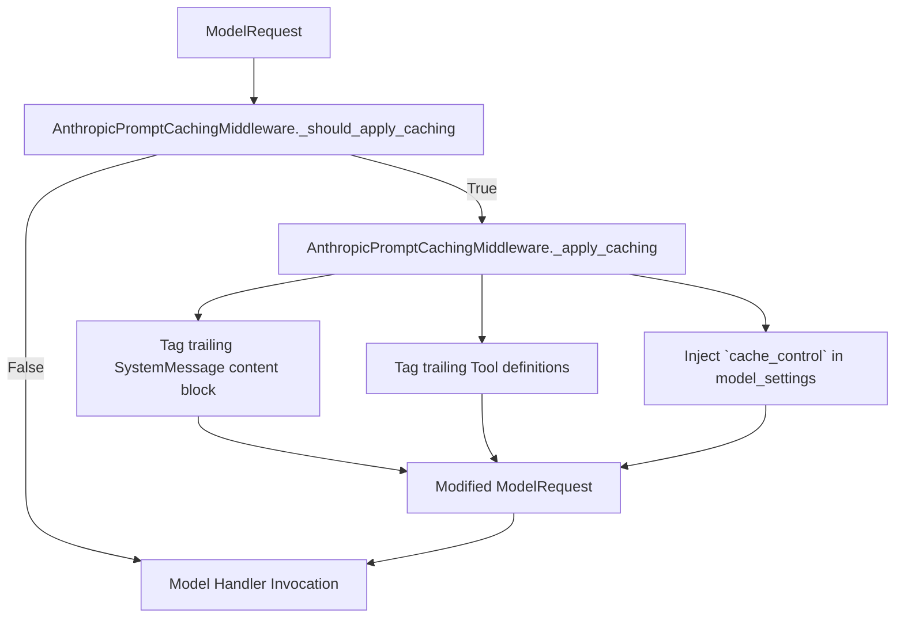
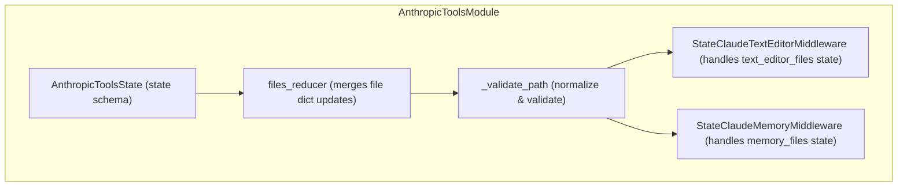
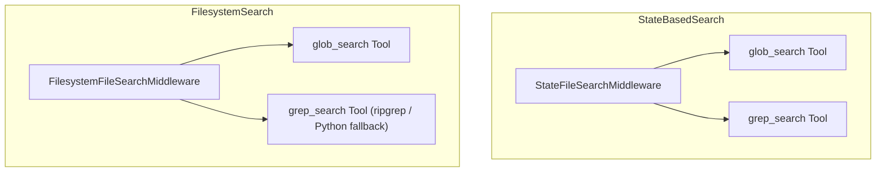

<!-- source: DeepWiki mcp.deepwiki.com · repo langchain-ai/langchain · extra page Anthropic Middleware (Prompt Caching, Tools) · fetched 2026-10-26 -->

# Anthropic Middleware (Prompt Caching, Tools)

Relevant source files

The following files were used as context for generating this wiki page:

- [libs/core/tests/unit_tests/language_models/test_imports.py](libs/core/tests/unit_tests/language_models/test_imports.py)
- [libs/core/tests/unit_tests/prompts/test_few_shot_with_templates.py](libs/core/tests/unit_tests/prompts/test_few_shot_with_templates.py)
- [libs/langchain_v1/langchain/agents/middleware/file_search.py](libs/langchain_v1/langchain/agents/middleware/file_search.py)
- [libs/langchain_v1/langchain/agents/middleware/tool_error.py](libs/langchain_v1/langchain/agents/middleware/tool_error.py)
- [libs/langchain_v1/tests/unit_tests/agents/middleware/implementations/test_file_search.py](libs/langchain_v1/tests/unit_tests/agents/middleware/implementations/test_file_search.py)
- [libs/langchain_v1/tests/unit_tests/agents/middleware/implementations/test_tool_error.py](libs/langchain_v1/tests/unit_tests/agents/middleware/implementations/test_tool_error.py)
- [libs/partners/anthropic/langchain_anthropic/__init__.py](libs/partners/anthropic/langchain_anthropic/__init__.py)
- [libs/partners/anthropic/langchain_anthropic/middleware/__init__.py](libs/partners/anthropic/langchain_anthropic/middleware/__init__.py)
- [libs/partners/anthropic/langchain_anthropic/middleware/anthropic_tools.py](libs/partners/anthropic/langchain_anthropic/middleware/anthropic_tools.py)
- [libs/partners/anthropic/langchain_anthropic/middleware/bash.py](libs/partners/anthropic/langchain_anthropic/middleware/bash.py)
- [libs/partners/anthropic/langchain_anthropic/middleware/file_search.py](libs/partners/anthropic/langchain_anthropic/middleware/file_search.py)
- [libs/partners/anthropic/langchain_anthropic/middleware/prompt_caching.py](libs/partners/anthropic/langchain_anthropic/middleware/prompt_caching.py)
- [libs/partners/anthropic/tests/integration_tests/test_standard.py](libs/partners/anthropic/tests/integration_tests/test_standard.py)
- [libs/partners/anthropic/tests/unit_tests/__snapshots__/test_standard.ambr](libs/partners/anthropic/tests/unit_tests/__snapshots__/test_standard.ambr)
- [libs/partners/anthropic/tests/unit_tests/middleware/test_anthropic_tools.py](libs/partners/anthropic/tests/unit_tests/middleware/test_anthropic_tools.py)
- [libs/partners/anthropic/tests/unit_tests/middleware/test_bash.py](libs/partners/anthropic/tests/unit_tests/middleware/test_bash.py)
- [libs/partners/anthropic/tests/unit_tests/middleware/test_file_search.py](libs/partners/anthropic/tests/unit_tests/middleware/test_file_search.py)
- [libs/partners/anthropic/tests/unit_tests/middleware/test_prompt_caching.py](libs/partners/anthropic/tests/unit_tests/middleware/test_prompt_caching.py)
- [libs/partners/anthropic/tests/unit_tests/test_imports.py](libs/partners/anthropic/tests/unit_tests/test_imports.py)
- [libs/partners/anthropic/tests/unit_tests/test_llms.py](libs/partners/anthropic/tests/unit_tests/test_llms.py)
- [libs/partners/anthropic/tests/unit_tests/test_standard.py](libs/partners/anthropic/tests/unit_tests/test_standard.py)

### Purpose and Scope
This page documents the Anthropic-specific middleware implementations provided in the `langchain-anthropic` partner package (`libs/partners/anthropic/langchain_anthropic/middleware/`) and related agent file search utilities (`libs/langchain_v1/langchain/agents/middleware/file_search.py`). These components extend LangChain v1 agent capabilities with native Anthropic optimizations, including ephemeral prompt caching, virtual file system management (text editor and memory tools), secure file search (glob and grep), and execution sandboxes.

Sources:  
- `libs/partners/anthropic/langchain_anthropic/middleware/prompt_caching.py` [libs/partners/anthropic/langchain_anthropic/middleware/prompt_caching.py:1-189]()  
- `libs/partners/anthropic/langchain_anthropic/middleware/anthropic_tools.py` [libs/partners/anthropic/langchain_anthropic/middleware/anthropic_tools.py:1-204]()  
- `libs/partners/anthropic/langchain_anthropic/middleware/file_search.py` [libs/partners/anthropic/langchain_anthropic/middleware/file_search.py:1-202]()  
- `libs/langchain_v1/langchain/agents/middleware/file_search.py` [libs/langchain_v1/langchain/agents/middleware/file_search.py:1-152]()

---

## 1. Prompt Caching Middleware

The `AnthropicPromptCachingMiddleware` class enables optimization of Anthropic chat model calls by utilizing Anthropic's ephemeral prompt caching. This reduces token usage and latency by caching conversation prefixes, particularly stable system messages and tool definitions, across requests.

### Implementation and Data Flow

- The middleware is an `AgentMiddleware` subclass designed for use with LangChain agents, intercepting model invocation requests through the `wrap_model_call` (sync) and `awrap_model_call` (async) hooks.  
- It verifies that the model is an instance of `ChatAnthropic` and that the conversation length satisfies a configurable minimum (`min_messages_to_cache`) before applying caching optimizations [libs/partners/anthropic/langchain_anthropic/middleware/prompt_caching.py:106-135]().  
- When caching is applicable:  
  - A `cache_control` dictionary (with `type` like `"ephemeral"` and TTL `"5m"` or `"1h"`) is injected into the request's `model_settings`, enabling the underlying Anthropic model to apply prompt caching semantics [libs/partners/anthropic/langchain_anthropic/middleware/prompt_caching.py:102-104,152-155]().  
  - The last content block of the system message and the last tool definition are tagged with the `cache_control` metadata as cacheable content blocks. This tagging guides the Anthropic API in recognizing stable conversation segments to cache [libs/partners/anthropic/langchain_anthropic/middleware/prompt_caching.py:157-163]().  
- If the request model is not supported (not a `ChatAnthropic` instance), the middleware can be configured to ignore, warn, or raise an error on misuse.  

### Key Methods

| Method                  | Description                                         |
|-------------------------|-----------------------------------------------------|
| `_should_apply_caching`  | Checks if caching policies apply based on model type and message count |
| `_apply_caching`         | Produces a modified `ModelRequest` decorated with caching metadata |
| `wrap_model_call`        | Sync handler applying prompt caching to model requests |
| `awrap_model_call`       | Async handler analog applying caching |

### Prompt Caching Data Flow

Sources:  
`libs/partners/anthropic/langchain_anthropic/middleware/prompt_caching.py` [libs/partners/anthropic/langchain_anthropic/middleware/prompt_caching.py:47-189]()  
`libs/partners/anthropic/tests/unit_tests/middleware/test_prompt_caching.py`()

---

## 2. Anthropic Tools & Virtual File System Middleware

Anthropic models support advanced persistent tools to augment conversational context and state. This middleware layer simulates Anthropic's text editor and memory tools on the client side, managing virtual file systems within agent state and mapping tool commands to file operations.

### Key Components

- **`AnthropicToolsState`** extends base agent state with two virtual file store mappings [libs/partners/anthropic/langchain_anthropic/middleware/anthropic_tools.py:86-94]():  
  - `text_editor_files`: Virtual filesystem for the text editor tool.  
  - `memory_files`: Virtual filesystem for the memory tool.  

- **`files_reducer`** is a custom reducer function merging file dictionaries on state updates. It overwrites entries with new data or deletes files when values are `None`, enabling incremental virtual filesystem edits [libs/partners/anthropic/langchain_anthropic/middleware/anthropic_tools.py:60-84]().  

- **Path Validation Helpers**  
  - `_validate_path` normalizes paths, rejects path traversal attempts (like `"../"` or `"~"`), and enforces allowed prefix constraints with exact segment boundary checks to avoid sibling directory escapes [libs/partners/anthropic/langchain_anthropic/middleware/anthropic_tools.py:96-156]().  
  - This security validation is essential to prevent unauthorized state file access or manipulation.  

- **Middleware Classes**  
  - `StateClaudeTextEditorMiddleware` intercepts tool calls for text editing commands (`view`, `create`, `update`, `delete`), and applies operations against `text_editor_files` in state.  
  - `StateClaudeMemoryMiddleware` behaves similarly for `memory_files`, managing memory tool files with a default or customizable system prompt for the memory protocol.  

### Data Flow and Relationships

Sources:  
`libs/partners/anthropic/langchain_anthropic/middleware/anthropic_tools.py` [libs/partners/anthropic/langchain_anthropic/middleware/anthropic_tools.py:60-204]()  
`libs/partners/anthropic/tests/unit_tests/middleware/test_anthropic_tools.py`()

---

## 3. File Search Middleware (State and Filesystem)

File search middleware enables agents to search files either in the virtual file state or on the physical filesystem. Both state-based and filesystem middleware provide glob pattern and regex-based content search (grep) tools.

### State-Based File Search: `StateFileSearchMiddleware`

- Searches virtual files stored in agent state under keys like `"text_editor_files"` or `"memory_files"`, conforming to `AnthropicToolsState` [libs/partners/anthropic/langchain_anthropic/middleware/file_search.py:89-202]().  
- Provides two tools as LangChain `@tool` functions:  
  - `glob_search`: Matches file paths based on glob expressions and returns sorted results by modification time.  
  - `grep_search`: Searches file content using regex patterns with options for file filters (`include`) and output modes (`files_with_matches`, `content`, `count`).  
- Tools are executed within the agent runtime context, accessing current state to obtain file contents.  

### Filesystem-Based File Search: `FilesystemFileSearchMiddleware`

- Performs searches on the local filesystem rooted at a specified directory, strictly enforcing path containment (no symlink or path escaping) [libs/langchain_v1/langchain/agents/middleware/file_search.py:25-96,108-152]().  
- Supports the same two tools:  
  - `glob_search`: Uses `Path.glob` with safety checks to find matching files in the real filesystem.  
  - `grep_search`: Uses external `ripgrep` command if enabled or falls back to a Python regex search of files, respecting file size limits and inclusion patterns.  
- Returns newline-separated lists of file paths or matching content lines formatted as `file:line:content`.

### Middleware Tools and Data Flow

Sources:  
`libs/partners/anthropic/langchain_anthropic/middleware/file_search.py` [libs/partners/anthropic/langchain_anthropic/middleware/file_search.py:89-202]()  
`libs/langchain_v1/langchain/agents/middleware/file_search.py` [libs/langchain_v1/langchain/agents/middleware/file_search.py:25-152]()  

---

## 4. Additional Anthropic Middleware Highlights

The Anthropic partner package also contains middleware to enable shell and bash command execution within agents:

- **Shell Tool Middleware** enables a persistent shell session environment, managing command execution, session lifecycle, output truncation, and redaction in a sandbox context. It supports different sandboxing policies such as Docker and Codex sandboxing [libs/langchain_v1/langchain/agents/middleware/shell_tool.py:1-212]() (not detailed here).  
- **Bash Middleware** exposes bash command execution as tools specific to Anthropic usage, integrating with the broader middleware and tool call system.

These provide advanced capabilities for agents to execute OS-level commands safely and with user-friendly control over environment and errors.

Sources:  
- `libs/langchain_v1/langchain/agents/middleware/shell_tool.py` [libs/langchain_v1/langchain/agents/middleware/shell_tool.py:1-212]()  
- `libs/partners/anthropic/langchain_anthropic/middleware/bash.py` ()

---

# Summary

The Anthropic middleware cluster contributes significant capabilities to LangChain v1 agents configured with Anthropic models (`ChatAnthropic`):

- Ephemeral prompt caching middleware reduces token usage and latency by caching stable parts of conversations including system messages and tool definitions.  
- Virtual file system tools simulate Anthropic's text editor and memory tools, enabling persistent stateful file editing and memory management with strong path validation for security.  
- Comprehensive file search middleware enables powerful glob and grep operations on both agent state and the host filesystem with containment safeguards and regex filtering.  
- Shell and bash middleware layers provide safe command execution environments, allowing agents to incorporate shell tooling as part of their workflows.

Together, these specialized middlewares integrate tightly with Anthropic models and LangChain's agent middleware framework to provide optimized, secure, and feature-rich agent experiences tailored for Anthropic usage.

---

# References

| Module                                           | Description                          | Lines Covered          |
|-------------------------------------------------|----------------------------------|-----------------------|
| `prompt_caching.py`                              | Anthropic ephemeral prompt caching | 1-189                 |
| `anthropic_tools.py`                             | Anthropic virtual file system tools | 1-204                 |
| `file_search.py` (partners/anthropic)           | State-based file search middleware | 1-202                 |
| `file_search.py` (langchain_v1/agents/middleware) | Filesystem file search middleware  | 1-152                 |
| `shell_tool.py`                                  | Persistent shell tool middleware   | 1-212 (partial shown) |

Sources:  
- `libs/partners/anthropic/langchain_anthropic/middleware/prompt_caching.py`  
- `libs/partners/anthropic/langchain_anthropic/middleware/anthropic_tools.py`  
- `libs/partners/anthropic/langchain_anthropic/middleware/file_search.py`  
- `libs/langchain_v1/langchain/agents/middleware/file_search.py`  
- `libs/langchain_v1/langchain/agents/middleware/shell_tool.py`

---

